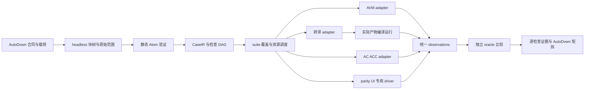

# Design 35：AutoDown 统一文件用例与多后端验证协议

- 状态：设计草案，待审定；本文没有实施 runner 或迁移既有用例。
- 日期：2026-10-12。
- 现状基线：`v0.6-dev @ 897eb34911a4f496a28ba7cdfd8a82815fa043d1`。
- 盘点：[完整清单与统计](../reports/autodown-test-inventory-2026-10-12/README.md)。
- 关联：[现有转译测试约定](../specs/auto-lang/trans/design/test-convention.md)、[AAVM 语料](../specs/aavm/design/corpus.md)、[parity 现状](../specs/parity/project.md)、[AC 子集路线](strategy/auto-ac-subset-and-target.md)、[ACC 自举合同](strategy/auto-acc-bootstrap-contract.md)、[计划 767](../plans/767-ac-scalar-ops-short-circuit.md)。

## 1. 结论与边界

2026-10-16推进要求：773已交付A阶段协议与AVM/a2r-emit只读试点，事实以auto-test-case Spec为准。B阶段AC source/HIR/native与真实编译执行作为紧邻优先计划，不等完整AC/v0.7；syntax/增量观测按adapter支持表显式扩展，不向现行v1偷塞被忽略字段。新增能力从首例用AutoDown声明source/oracle，保留内省Rust测试及原CLI/发布门禁。fresh/缓存比较、产物来源、失效、required检查非零执行须可观测；格式统一不等于native支持。正在执行的787保留合同，跨计划测试接线另定界，不覆盖在途实现。

建议建立 **AutoDown TestCase profile**：一个文件声明一个或多个有稳定身份的用例，每个用例绑定一份输入工程，以及多个独立的后端检查。AVM、a2r、其他转译器、AC/ACC 都消费这个合同，分别报告自己的证据。

统一的核心是 **输入、期望、检查身份、执行条件和报告协议**。同一段源码可以同时具有 AVM 返回值、Rust 生成文本、a2r 编译运行输出、AC 原生退出码等不同期望；不会强行把这些不同观测转换成一个字符串。

这适合把当前散落的语言行为、生成快照、诊断、编译运行语料集中起来。堆引用计数、调度器状态、非法 HIR 图、随机性质检验、进程树回收等需要内部对象或定制操作的 Rust 测试仍然保留，可以在统一报告中引用其证据；不为统一外观损失验证能力。

新协议和本文命令均为**拟议接口**，不是现有 AutoDown 或 `auto test` 已支持的能力。不改变计划 767 的执行合同，不把测试体系重构塞进 AC 标量运算计划。

## 2. 全仓盘点与迁移范围

静态扫描覆盖全部 13,462 个跟踪文件，生成 813 个标记入口、4,489 个测试路径资产的逐文件清单。Rust 有 703 个带测试标记的文件、9,562 个词法标记；这些不是运行时测试数量，包含条件编译、ignore、注释或未挂接代码的可能性。主要发现器、执行器、比较器和门禁另作人工核查；没有宣称已运行或逐条语义审查全部测试。

| 家族 | 当前输入与预期 | 统一方式与保留边界 |
|---|---|---|
| AVM 内联测试 | `src/tests/vm_tests.rs` 等，Rust 字符串、结果、错误、内部状态断言 | 纯源码行为逐步迁移；内部 VM/内存/调度状态保留 Rust |
| VM 文件语料 | `test/vm`，`.at/.as` + `.expected.out/.result/.error` | 导入 source、stdout、legacy result、diagnostics；bootstrap 单独标记 |
| a2r | `test/a2r`，源码、`.expected.rs`、定向 Rust 断言、编译闸门 | 分开 emit / typecheck / build-run；多模块工程完整导入 |
| a2c / a2ts | `.expected.c/.h` 与 `.expected.ts` | 多产物 manifest 和逐字节 snapshot；诊断单列 |
| a2p / a2j / a2gd | Python/JS/GDScript 文件语料 + 转译器模块中的测试 helper | 同一 emit adapter 协议；运行需要明确工具链，不假定已有统一入口 |
| a2ark / a2vue / ui_gen | 文件金样、内联文本/结构断言；Vue/Jet/Ark/Rust 四生成器 | 文本/工程产物可接入；真设备/UI 交互由专用驱动提供 evidence |
| r2a | Rust 源码 → `.expected.at` | input syntax 可为 Rust，不假定所有输入都是 Auto |
| AST Markdown | `test/ast/*.test.md`，`##` + `---`；AST Atom 展示 | 导入 parser/AST 检查；不要把 AST dump 当 VM result |
| Atom Markdown | `test/atom/atom_basics.md`；AtomReader 展示 | 导入 Atom 输入/展示；旧 whitespace comparator 仅迁移兼容 |
| AutoDown | 本仓 Adoc lexer/parser/HTML/Typst 测试与 `.ad` snapshot | 同一输入模型支持 `.ad`；两套 AutoDown parser 不能按名字混用 |
| cookbook / book | `.at` + Rust 金样 + stdout；相对依赖、脚本、教学项目 | project files、entry、dependency recipe；没有 oracle 的 smoke 显式标记 |
| conformance | `input.at` + `expected_output.txt`，当前主要测 VM | 作为共享行为语料起点，增加 a2r-run 后才能宣称双后端对拍 |
| parity | 独立 workspace，Auto/原生 Rust/Python、TAP、真三方库 | 保留多输入 oracle 和 TAP 比较器，绑定 case/check 身份 |
| AAVM / AA2R | token/AST/type/bytecode/emit/runtime 与五路自举语料 | 按阶段选观测，标记编译器代际与 bootstrap；保留独立重型档 |
| AC prototype | `experimental/ac-core` source/HIR fixtures + Rust 集成测试 | Source→HIR、诊断、verify、native build-run；事务/非法图/回收测试保留 |
| 标准库 / FFI / actor | a2r-std、actor 编译运行、ffi_dual、真实依赖、TCP | 显式 fixtures、依赖锁、协议驱动、进程隔离；保留内部测试 |
| 其他 workspace crates | auto-val/atom/cache/man/gen/lsp/macros/xml/playground 等 | 源码/协议可观察用例按需接入；Rust 单测与宏编译测试继续使用本工具 |
| UI/资源/端到端/脚本 | integration snapshots、MCP/Playwright、媒体、HTTP、Python 工具测试、CI | 在报告中关联外部 evidence；不靠文本断言代替视觉/交互验收 |
| 性能/压力/里程碑 | benches、churn、内存权重、塔测试 | 可共享标签与执行报告；保留测量方法、重型隔离与专用门禁 |

文件统计举例（是资产数，不是可执行 case 数）：VM 有 684 份 `.at/.as/.ad/.atom` 类 source、592 个 expected 文件；a2r 286/286；a2c 126/230（含头文件）；a2ts 85/85；a2p 99/99；a2gd 69/73；cookbook 163/202。AC fixtures 共 184 个文件，不能按文件数推断原生用例数量。

对文件型 `.at/.as` 计算 SHA-256，发现 72 组完全相同字节的源码、84 个额外副本，例如异构 enum、spec、union、for-range 在多个后端目录重复。另有大量仅排版、入口或环境不同的相似用例；首轮不做语义自动去重。

## 3. 现状缺口：格式统一同时要修正的语义

以下是基线中的实现观察，均不是本次已修复项：

1. `test_runner.rs` 按固定两层目录与 stem 找源码；缺 source/expected 会 `continue`。按跟踪路径模拟其发现条件，VM 504 份匹配源码中 494 份具备 required expected，a2r 244/241，a2c 125/118，a2ts 85/85。这是发现规则的静态预测，不是运行结果；深层、辅助源文件另算。
2. VM 的 `vm_file_tests.rs` 和生产 `run_vm_file_test` 看到 expected.error 就只检查 `Err`，不核对该文件内容。a2c Rust helper 读取错误文本却用硬编码 `type mismatch` 判断，生产文件 runner 又只判断失败。
3. AST Markdown 用分隔行解析并 trim；Atom Markdown 用 whitespace normalization；conformance trim stdout。不同入口把“相等”解释成不同规则。
4. `conformance_bootstrap` 是普通 `#[test]`，会从被测 VM 输出重写 expected 文件；cookbook 也存在 `GENERATE_EXPECTED` 路径。验证与更新基准必须拆开，否则被测实现可能替换裁判。
5. 一些 a2r smoke/foreign-shape 探针编译的是 **expected.rs**；另一些真实 compile gate 编译本轮生成产物。前者证明 reference 有效，不等于证明当前 emitter 产物可编译。
6. cookbook 以首个 `.at` 为源，并切换全局 cwd；`.wrong.*` 常写回 fixture。统一运行应消除未排序发现、全局 cwd 和修改源码目录的副作用。
7. 旧 per-case Rust wrapper 不少被 ignore；feature/nextest 又分档过滤。不能把文件存在、发现成功、被调度、验收通过混成一个覆盖数字。

对应的新合同：**显式入口、显式比较器、精确失败阶段、oracle 只读、完整发现清单、逐 check 状态、隔离执行目录**。

## 4. AutoDown 的落点：两层格式，而不是第三个 Markdown 分隔器

### 4.1 已存在的能力与当前限制

本仓 `src/autodown` 是 Adoc lexer/parser/文档转译实现，支持 `$` 代码域；外仓 `auto-down/autodown/packages/engine` 是块编辑引擎，并有 Auto 写的 parser、a2r 生成的 headless `autodown-core`。后者已有 heading/fence、`^anchor`、wikilink、`$details/$callout/$query/$embed` 等块能力。本仓 UI 的 `autodown` feature 依赖它，但同时拉入 ui-iced。

参考实际文件：

- 本仓 `crates/auto-lang/src/autodown/{mod,parser,cell}.rs`。
- 外仓 `D:/autostack/auto-down/autodown/packages/engine/auto/parser/{markdown_parser,block_model,ial,serializer}.at` 与 `engine/rust/Cargo.toml`。
- `markdown_parser.at` 的 fence 保存 info 字符串；heading anchor 可作为稳定引用；IAL 目前主要是表格尺寸属性，**不能视为任意 TestCase Schema**。
- 现有 parser 规范化 CRLF/CR，BlockNode 转换使用 `rng(0, 0)`，未提供可靠原始载荷位置。
- 未知 `$name` 会降级为普通文本；**现有 core 不认识 `$case/$expect/$source`**。不能把未知组件默默当有效测试。

### 4.2 v1 文本 profile

扩展名建议 `*.case.ad`；suite 使用 `*.suite.ad`。使用真实 AutoDown 块树定位 heading/fence，并在 `test-case` / `test-suite` fence 内解析**静态 Atom 数据**。采用已有 `auto-atom::AtomParser` 的 object/array/node 子集，不执行 Auto 代码，不依赖尚未冻结的 Atom v2。

普通标题和说明不参与用例身份；`test-case` 中的 `id` 为权威。载荷引用通过显式 `^anchor` 找到一个标题小节，该小节在下一同级或上级标题前必须恰好有一个直接代码块。语言标签与 source syntax 互相校验。无稳定 anchor 的运行时 block id 不可持久引用。

一个文件可以有多个 case fence，其 ID 在整个选择集合唯一；anchor 在文件内唯一。共享载荷通过相同 block ref 表达，不复制源码。大 snapshot、二进制、无末尾换行或精确 CRLF 文件使用 sidecar。教学 `.ad` 也可含测试合同；runner 只执行登记的合同，不扫描所有 Auto 代码块。

### 4.3 编辑层增益

AutoDown 可把 case/check/expected 投影为可编辑的块、折叠大型金样、按稳定 ID 链接规格与失败位置、展示后端矩阵、嵌入运行证据。静态合同是唯一真源，矩阵和运行结果是派生视图，不能反向成为 oracle。

后续可注册 `$case(...)` / `$expect(...)` 组件，映射到同一个 CaseIR；组件与静态 profile 必须双向等价、未知字段硬错。`$query`/`$embed` 的展示不得让用例集合随用户工作区、远程内容或运行结果变化；可执行输入的跨文件引用须显式解析、锁定与追踪 hash。

这使 AutoDown 的块身份、结构编辑、引用与运行证据成为测试工具的一部分，而不是仅给 Markdown 换后缀。

### 4.4 日常编写应短，展开合同必须完整

第 5 节故意展示完整合同，日常不用逐条重复平台、超时、编译模板。suite 可以提供**显式、版本化 defaults**，以及按 adapter/action 匹配的 defaults；case/check 本地值覆盖它们。只有 object 字段递归覆盖，array 整体替换，不做隐藏 append。缺少最终必需字段仍为 ERROR，`inspect` 展示每个字段来自哪里。

例如在已经声明 entry、tier 和 adapter 选项的 suite 中，一条用例可以简写为：

````ad
```test-case
case {
  schema: "autolang.case/1"
  id: "lang.scalar.precedence"
  source: { block: "auto-source", syntax: "auto", path: "main.at" }
  checks: [
    { id: "vm", adapter: "avm", action: "run",
      expect: { completion: "success", result: { format: "legacy-display", text: "14" } } },
    { id: "rust", adapter: "a2r", action: "emit",
      expect: { completion: "success", artifacts: [
        { path: "main.rs", file: "expected/precedence.rs", compare: "bytes" }
      ] } },
    { id: "native", adapter: "ac", action: "build-run",
      expect: { completion: "success", exit: { kind: "code", code: 14 } } }
  ]
}
```
````

这份简写在脱离 suite 时可能缺字段，不能作为自足用例执行。suite 只能补执行上下文与确定的公共约束（例如要求空 stderr），不能默认从 VM 复制语义期望，也不能凭源码特征补一个未声明的 backend check。每个结果都报告 suite 内容 hash，避免默认值变动无法追踪。

## 5. 声明示例

下面是**目标协议示例**，用于评审格式；尚未由新 runner 执行或证明各后端输出。Rust snapshot 使用 sidecar，实施时需独立审查真实产物建立该基准。默认编译入口和调用包装都须适配器验收，不能假定跨后端已经一致。

````ad
# 标量运算：优先级

同一份 Auto 输入，同时检查解释执行、Rust 发射和 AC 原生运行。

```test-case
case {
  schema: "autolang.case/1"
  id: "lang.scalar.precedence"
  tags: ["scalar", "precedence"]
  source: { block: "auto-source", syntax: "auto", path: "main.at" }
  entry: { mode: "program", symbol: "main" }
  checks: [
    {
      id: "vm"
      adapter: "avm"
      action: "run"
      tier: "vm-corpus"
      expect: {
        completion: "success"
        result: { format: "legacy-display", text: "14" }
        stdout: { text: "", compare: "bytes" }
      }
    },
    {
      id: "rust-emit"
      adapter: "a2r"
      action: "emit"
      tier: "trans-snapshot"
      options: { module_name: "precedence" }
      expect: {
        completion: "success"
        artifacts: [
          { path: "main.rs", file: "expected/precedence.rs", compare: "bytes" }
        ]
      }
    },
    {
      id: "rust-typecheck"
      adapter: "a2r"
      action: "typecheck"
      tier: "trans-compile"
      product_from: "rust-emit"
      recipe: "rust-lib-metadata-v1"
      expect: { completion: "success" }
    },
    {
      id: "ac-native"
      adapter: "ac"
      action: "build-run"
      tier: "native"
      profile: "auto.source.core-i32.draft"
      platform: { os: "windows", arch: "x86_64" }
      expect: {
        completion: "success"
        exit: { kind: "code", code: 14 }
        stdout: { text: "", compare: "bytes" }
        stderr: { text: "", compare: "bytes" }
      }
    }
  ]
}
```

## Auto 输入 ^auto-source

```auto
fn main() int { return 2 + 3 * 4 }
```
````

同一合同可以增加 a2c 的 `main.c` / `main.h`、a2ts 的 `main.ts`、a2p 的 `main.py` 等 artifact；也可以增加 a2r build-run 的 stdout oracle。不是每个 case 都必须登记所有后端，后端覆盖由 suite 明确规定。

`result:"14"` 是旧 VM 展示格式，AC `exit:14` 是原生进程状态。不能从前者隐式推出后者；a2r 生成的程序也不自动把 main 的 Auto 返回值编码为 OS 退出码。跨后端语义比较需要声明观测映射或显式测试 harness。

循环的新示例使用 Auto 的 `for y != 0 { ... }`。AC core-i32 仍按 745 的旧 profile 验证历史 while；计划 767 的 scalar-i32 才加入 condition-for。这两个 profile 的支持矩阵分开登记，不能用“AC 支持循环”概括后静默跳过。

## 6. CaseIR：可验证的最小合同

| 字段 | 语义与约束 |
|---|---|
| schema / id | 独立测试协议版本、稳定全局 case ID；移动文件或改标题不改 ID |
| source | `{block}` / `{file}` / `{text}` 三者恰好一个；syntax 与虚拟相对 path 必填 |
| files | 多文件项目，每个文件声明虚拟 path、载荷 ref；不通过扫描“第一个 .at”选择输入 |
| entry | script / expression / program / module / parse；可指定 symbol；不跨模式自动改写源码 |
| tags / links | 功能、Spec/Plan/bug 链接；纯组织元数据 |
| checks | 非空，check ID 在 case 内唯一；全局检查键 `case-id/check-id` |
| adapter / action | avm/a2r/a2c/a2ts/a2p/a2j/a2gd/r2a/ast/atom/autodown/ac/acc…与阶段；非法组合报错 |
| profile / target | 语言子集、HIR schema、ABI、原生目标分别记录；不把这些版本域混成测试 schema |
| options / recipe | 适配器严格 schema 的选项；构建模板注册名及版本，不接受任意 shell 命令 |
| product_from | 引用同 case 上游实际产物；有向无环图，产物未成功产生时记 BLOCKED，不判 PASS |
| expect | 非空观测；成功、诊断、结果、流、产物、进程状态等，按 action 验证组合 |
| tier / budget | 语义档位、compile/run/overall 截止、输出上限、内存/资源组；suite 有最大限额 |
| platform / requires | 明确平台、工具链、能力、第三方依赖；缺失的处理由 gate policy 规定 |
| status | 正常、explicit skip、xfail；skip/xfail 需原因、issue、owner、复核条件 |
| variants | 显式标量参数表及展开 ID；禁止任意 Auto 执行生成隐藏用例 |
| input / fixtures | stdin、argv、env allowlist、预置文件、注册 fixture 驱动；记录工作目录 |
| relations | 对本轮多个 check 观测做等价关系断言；不把某后端自动当 oracle |
| provenance | 导入路径、旧入口/门禁、原始字节 hash、比较规则、债务身份 |

suite schema 独立为 `autolang.suite/1`，声明稳定 ID、相对根的 include/exclude、defaults、adapter/action defaults、required checks、平台 gate policy 与 budgets；加载顺序不影响展开结果。一个 case 在一次执行中绑定一个 suite 上下文，多 suite 消费时生成不同 execution key 并分别报告，不能因同 case ID 抵消上下文差异。

通用部分与 adapter options 都拒绝未知字段，避免拼错 `stdout` 后变成 smoke。工具缺失、源文件读失败、无法绑定 oracle、空发现、重复身份、未闭合 fence、输出缺失均为 ERROR，不是预期的编译失败。

### 6.1 输入工程与上下文

- source 字节、相对路径、module_name、entry、script lowering、依赖锁、fixture 都属于输入身份。源码 hash 相同只能提示复用，不能直接合并执行环境。
- Auto `.as` 与 `.at` 是不同 syntax；是否经过 `auto_s2s` lowering 是显式 pipeline。HIR/Atom/Rust/AutoDown 也可作为输入，不伪装成 Auto。
- 对有 `use` 的项目，保留目录树、pac/manifest、标准库与依赖解析。虚拟 path 由 adapter/materializer 使用；文件名依赖的 codegen 必须保持旧值。
- VM 是否调用 main、表达式结果如何展示、a2r 是否发射二进制 main，以及 AC entry 选择，都用生产 API/真实 CLI 显式对齐。需要包装的检查登记 harness recipe 与 hash；报告原始源和实际提交源，不能隐式补调用或移除不支持语法。
- 新的语义值编码建议 `{type, value}`，但 first migration 保留 `legacy-display`；VM string/int/none 与 native exit 各自编码，不做无声明的类型转换。
- case 内 sidecar 路径相对 `.case.ad`，suite include 相对 suite 根；materialized project path 与 oracle 文件路径是不同域。引用经过 canonical path 校验，禁止虚拟项目路径逃出 scratch，禁止通过 junction/symlink 接入工程。共享外部 fixtures 用显式登记的 root/依赖，记录所有输入 hash，不猜 cwd。

### 6.2 多阶段与多产物

`parse → type → emit → typecheck/build → run` 各阶段分别保存完成状态、diagnostics、产物。`build-run` 是组合动作，但 build 失败只能是 build 失败，不能满足 expected runtime trap。

执行完成状态与 oracle 判定分离：emit 成功但 snapshot 不符时，实际产物仍可交给 typecheck/build-run，各自判定；只有产物未产生或无效依赖才 BLOCKED。`completion:"success"` 表示动作正常完成所需阶段，不隐含程序 exit=0；原生 return 14 必须由显式 `exit.code:14` 验收。

产物比较使用逻辑路径集合：Rust 项目多文件、C 头/源、UI 工程 manifest/资源可逐项验收。emit 不少于 expected 清单；默认也拒绝多出的逻辑产物。临时文件和工具链文件列在 adapter 的非产品清单，不能混入生成工程快照。

native EXE 默认比较运行观测与可审查的 HIR/manifest，不用 EXE 字节作为跨编译器版本的常规金样。PE/ABI/符号等需要时用专门结构检查；二进制字节 snapshot 只用于明确要求可复现构建的用例。

## 7. Oracle 与比较器

默认生成代码和 stdout/stderr 都是 **bytes**；原样输入，失败位置显示字节/行差异。未声明 stdout 表示未检查 stdout，`text:""` 表示检查空输出；二者不得等价。严格运行套件默认要求 stdout/stderr/termination 都登记，迁移遗留缺项列为覆盖缺口。

| 观测 | 允许规则 |
|---|---|
| source / artifact / streams | bytes；显式 lf（只转换 CRLF→LF，其他保持）、可审计文本 pattern |
| VM 返回值 | typed-value 或 legacy-display；不 trim，不以 stdout 替代 |
| token / AST / HIR | exact dump，或版本化 structural comparator；只移除合同列出的非语义字段 |
| diagnostics | stage、code、severity、source span；需要时附 message 精确/有限 pattern |
| termination | success / declared failure；原生 exit code、signal、trap marker 区分 |
| TAP / 多轨 parity | parsed named assertions；只有声明无序的集合可排序，不排序程序输出 |
| UI evidence | driver/schema/version、截图/交互产物引用；视觉阈值属该驱动合同 |

禁止全局 trim、空白折叠、自动 rustfmt 后比较、任意 regex 替换或把失败文本 `contains("error")` 当足够诊断。迁移旧规则时可以保留命名 `legacy-trim` / `legacy-whitespace`，必须记录原语义与债务，不静默提高或降低强度。

错误用例至少要指定失败阶段和一个稳定辨识条件（code，或暂时的有限 message pattern）。缺工具链、panic、timeout、链接器基础设施故障不能满足 parse/type 错误预期。旧 `.expected.error` 仅“文件存在”的用例先保留 `legacy-any-error` 并显式标为弱 oracle，不能凭文件内容假称已验证错误码。

返回码 70 也不足以单独证明 AC overflow trap：检查 build 成功、程序进入 run、规定 trap stderr/marker，并排除 timeout/infrastructure。现有无 stderr 的陷阱 fixture 保留它的现有精度，另列强化任务，不制造未实现的 trap marker。

### 7.1 原始字节与文档树

测试载荷不取渲染 HTML，不经过 serializer，不执行插值；AutoDown 展示树与执行 bytes 分离。

v1 上线前必须提供 fence-aware raw range 通道：可选择在 headless core 补真实原始 byte range/闭合状态，或提供独立的严格 raw-fence locator，再与块树一一对应。后者只负责载荷范围，不自己重新发明 heading/case 语义；无法一一对应就报错。两种方案以协议测试证明 CRLF、Unicode、尾空格、空 fence、嵌套 backtick、四反引号均不损失。

围栏内联载荷按原文件 byte range 读取，含 closing fence 前实际存在的末尾换行；不默默删除它。精确的无末尾换行可用 `text:"abc"` 或 sidecar；非 UTF-8 用 sidecar bytes。源级错误 span 相对虚拟源，同时通过 range map 链接 `.ad` 中位置。编辑器更新载荷按 raw range patch，只改选中块，保留原换行与 fence 规则。

## 8. Runner 架构与工具入口



建议模块边界：dependency-light `auto-test-case`（profile/CaseIR/selection/comparison/report）、`auto-test-runner`（执行与资源管理）、各产品 adapter。具体是否独立 crate 由首个实施计划结合循环依赖裁定；核心协议不得依赖 ui-iced、VM 全部 features 或图形环境。

headless `autodown-core` 应有稳定来源与版本/hash，按 env → 组内兄弟 → 主检出的跨仓路径纪律解析，CI 显式取对应版本；不得创建链接。编译器测试不能在每次运行时用被测 a2r 再生它的解析器，避免自举环与“裁判随被测物改变”。需要验证 AutoDown 自举时另设专门检查，用 pinned host parser 读取测试，再验证被测 parser 输出。

拟议用户入口（实施后才可用）：

```text
auto test cases list --suite language --format json
auto test cases run --case lang.scalar.precedence --check vm
auto test cases run --suite language --adapter avm --tier vm-corpus
auto test cases run --suite ac-scalar --adapter ac --tier native
auto test cases inspect lang.scalar.precedence
auto test cases bless lang.scalar.precedence --check rust-emit --proposal
```

`auto test` 既有 `.at` 中 `#[test]` 的行为保持。新增子命令与 `Test.run_cases` 可逐步使用同一核心，旧 `run_vm_dir/run_a2r_dir/...` 最初保留兼容并转调 legacy importer，不立刻移除 ABI/native catalog 条目。

## 9. suite 与覆盖矩阵

suite 声明 include/exclude、必需 adapter/check、profile、platform、tier 和工具要求。文档中未写某后端不代表它“通过”或“被跳过”；矩阵显示 UNDECLARED。如果 suite 要求该能力，则缺 check 是合同 ERROR。

新 native 子集不能被要求运行全语言语料。按能力维护 `ac-core-i32`、`ac-scalar-i32` 等 suite，新增能力时增加明确必需的 case/check。capability 清单是版本化合同，不能靠“编译失败 → 不支持 → skip”推断。

各 suite 的解析/contract lint 可以全平台跑；Windows 原生 run 在 Windows gate 中 required，在 Linux matrix 中明确 NOT_APPLICABLE。目标平台 gate 缺 linker/工具必须失败；个人按需试跑可以报告 SKIP，但该次报告不能当门禁通过。

报告至少有 DECLARED、SELECTED、PASS、FAIL、ERROR、BLOCKED、SKIP、XFAIL、XPASS、NOT_APPLICABLE、UNDECLARED 数量和逐项身份。PASS 只代表声明并执行的 assertions；smoke 不冒充行为正确。XPASS 必须促使移除失效 xfail，required gate 的 SKIP/ERROR/BLOCKED 不能使总体成功。

机器报告独立版本域建议 `autolang.test-report/1`，每项携带 source/suite/profile/compiler/oracle 的身份与 hash、stage observations、assertion diff、状态与 artifact refs；控制台、JSON、TAP/JUnit 与 AutoDown 矩阵均从同一报告投影。source/compiler 变化使旧报告显示 stale，不能显示当前绿色。runner 建议退出码 0=所选 gate 合同满足、1=断言或 required coverage 未满足、2=合同/基础设施错误；这是 runner 退出码，绝不覆盖被测程序的退出码。

xfail 只接受所列阶段/诊断/断言失败，基础设施错误不算 XFAIL；required suite 若允许某项债务豁免须显式登记，否则 XFAIL 也不能充当完整功能验收。默认全量失败收集，fail-fast 必须报告其余 NOT_RUN，不能算 BLOCKED 或 PASS。

语言行为 golden 与跨后端 relation 并存：AVM/a2r/AC 三条路径可能同时犯同一个错误，关系相等不能替代独立预期。native Rust/Python oracle 是不同 source 的显式 check，不能宣称也是同一 Auto source；它验证的是声明关系。

## 10. 资源、执行隔离与现有门禁

2026-10-16全阶段周转要求：每阶段case/check从首例描述负载/变更、cache冷热、正确性oracle和预期重算/复用；runner输出关联请求/阶段span、真实调用与命中计数、wall/等待/I/O/峰值内存及状态。代表性能场景独立聚合P50/P95/P99，对应Design39§5.6端到端P95<1s目标，不能以阶段各自<1s或缓存查找耗时代替总周转。持续编辑/GC并发/CT失效要入场景；缺例、超时、取消、未测都不能消失。阈值与参考机/样本/预热/回退策略先由Plan冻结，不给所有功能单测强加竞争机器毫秒断言。

上述是B阶段及syntax/语义adapter的协议需求，尚非已实现字段；扩展report/profile须显式版本/支持表，现行v1遇未知字段继续拒绝，不能偷加性能字段后静默忽略。原始观测、语义pass与性能pass分别报告，功能绿不自动授予亚秒达标；测试工具准备另列，用户路径实际排队/验证/发布时间不能扣掉。

统一声明不等于所有后端都进日常 `cargo t`，也不等于每个 snapshot 启动一个重型进程。

| 新合同 tier | 现有执行档与迁移约束 |
|---|---|
| unit / protocol | 快速 Rust 单测；不扩大 native/网络负载 |
| vm-corpus | `cargo tv` 对应 VM/cookbook/conformance；保留日常档排除语义 |
| trans-snapshot | `cargo tt` 语料发射；generated compile 另明确选档 |
| book | `cargo tb`；保留教学模式入口 |
| ui-gen | `cargo tu` 单进程共享 registry setup；不退回每 case nextest 重初始化 |
| bootstrap | `cargo taa` 独立 feature/资源组；不混入普通 VM 回归 |
| native / trans-compile / parity-net | 独立 workspace/工具链档；现有 gate 保持，后续计划再调整 aliases/CI |
| batch / milestone | `tf` 主检出单实例、`ta/taa/t3` 重型纪律；塔测试保留显式环境守门 |

同一 in-process worker 可批量做纯 parse/emit 比较，VM 每个 case 需新隔离状态；环境敏感路径在独立子进程中执行。进程 cwd 是局部 Command 属性，不改 runner 全局 cwd/env。fixture 驱动的临时端口、随机种子、时间输入要可追踪；真实网络/时间不能随意 canonicalize 成固定输出。

native/compile 有 build/run/total 硬截止、并发排空 stdout/stderr、输出限额，Windows Job/进程组 containment；到期杀全树并 reap。沿用 AC 现有 executor 证据，不能在统一 runner 中降级为 `Command.output()` 无限等。超输出/超时/未回收均为基础设施失败，与预期退出码区分。

每次执行使用唯一 run/case/check scratch；实际产物、diff、diagnostics、命令参数、工具版本、二进制 hash/来源版本、依赖锁、profile、source/oracle hash、duration 和资源记录写入专用 artifact 目录，不写 `.wrong.*` 到用例源目录。

缓存键包含完整工程 bytes、entry、options、依赖锁、adapter/编译器 hash、target/ABI/profile、工具链与 recipe 版本。产物可缓存，断言每次重新比较；复审 release/native/ACC 必须能强制 fresh。expected 变化不能复用旧 PASS；并发写 cache 原子化，禁止 basename 冲突。

### 10.1 与 nextest 的接线

不直接用动态文件数替代 Rust harness 可发现数。轻量协议检查可用小范围 wrapper；语料 worker 接受固定 shard/check ID，独立报告每个动态 check。初期沿用既有 wrapper/suite 入口接新核心，确保原 filter 和 gate 工作。

若未来生成 per-case wrapper，只生成派生注册清单而非复制 source/expected；新增 `.case.ad` 必须触发 rebuild/discovery，删除或重复 case 要报错。UI 生成保持一个 libtest 进程批处理，native/bootstrap 重型 worker 受统一资源队列约束。报告中注明聚合 harness ID 与动态 case/check 的对应，不让一个“suite pass”掩盖零检查。

## 11. 期望更新与审查

普通 run 从不生成或改写 expected。`bless --proposal` 只把候选基准、旧/新 diff、来源编译器和受影响检查写到提议目录；接受基准是单独显式动作，须经过代码评审。不能把当前被测 VM 的结果自动覆盖独立 oracle。

字节 snapshot 改动与语义期望改动分开展示；共享 oracle 变化列出全部消费者。compile/run 始终消费本轮或有效缓存的**实际** emitter 产物，禁止从 expected 读取待编译代码；确需检验 reference 时 action 明确为 `reference-validate`，不计 generated compile 覆盖。

## 12. AC / ACC 与自举路线的对接

一个 source case 可追加 source→HIR snapshot、HIR verify、AC Gen0 native、ACC Gen1/2/3 source→HIR、实际 native run。每个 check 明确 producer/compiler generation、HIR schema/profile、ABI/target、runtime/support-lib 与 hash。adapter 名称 `acc` 不是已完成自举的证明。

plan 745 的 core-i32 输入、诊断、eval order、trace、overflow、CLI/artifact 事务用例可以先作为 import 试点。计划 767 的 condition-for、短路未求值、division/remainder trap 与非法语法，在该计划完成后登记 scalar profile；不能预先把计划能力标记 implemented。

共享的语言预期用于观察等价，但 verifier 的负例需要保留 HIR 原始载荷，不能由正常 source 生成后指望覆盖非法图。深度/资源边界与 source span 回归保留 bytes 和专门程序化测试。bootstrap 的代际等价、独立 rebuild 与固定点证据继续遵循 ACC 合同，统一文件格式只承载声明与 evidence。

## 13. 渐进实施建议

建议拆成三个独立计划，编号由创建时的 `.next-id` 原子领取，不预占 768，也不修改 767：

**A：合同与只读试点。** 冻结 v1 profile/CaseIR；补 raw range 通道；headless parser 来源固定；实现 lint/list + AVM/a2r-emit adapters、只读报告。选 20–30 个现有用例，包含正/负、CRLF、空输出、代码 fence、相对 use、多产物及旧 weak oracle。先 external refs，不大搬文件。验证旧、新 runner 对同一输入与 oracle 的比较语义一致，且坏合同不会消失。

**B：真实编译运行与 AC。** 接 generated Rust typecheck/build-run、AC source/HIR/native、阶段诊断、deadline/containment、artifact/cache，绑定 profiles/targets。为 AC 已交付子集形成 required suite；增加独立 golden 与跨后端 relations，兼容真实 CLI 验收，不削弱 CLI gate。接 `auto test cases` 与 CI/资源档。

**C：语料迁移与 AutoDown 编辑视图。** 迁移 VM/cookbook/conformance、其余转译器/AST/Atom，再接 parity/AAVM/教学；逐批作 reachability/coverage 对账，最后考虑 `$case` 组件、矩阵与点击运行。保留需要内省的 Rust 单测；不要一次删除大量 wrappers 或重写所有 snapshot。

每批导入生成 `legacy path + test entry + selector → case/check + comparator + gate` 映射。重复源码先 hash 分组，再人工确认 entry/module/deps 相同；不同环境仍可复用 source ref，但 checks 单独保留。无法发现的旧资产必须解释为 helper、未挂接、smoke、legacy debt 或待迁移，禁止无声丢弃。

迁移账本必须覆盖所有旧入口、old ignored/xfail、expected 与原 gate。新格式先兼容旧 oracle 的强弱，再单独批准强化；不得为了漂亮的统一格式重新生成全部期望。达到同等或更强覆盖并通过独立复审后才退役旧 helper；保留无新 schema 功能依赖的回退方法。

## 14. 首个实施计划的验收底线

1. 同一 case、同一 source bytes，AVM 与 a2r emit 独立判定；一次改动只应使相关 check 失败，报告指向准确 source/oracle。
2. duplicate ID/anchor、未知字段、missing source/expected、empty suite、unclosed fence、循环 product dependency、无效平台/adapter 均产生可定位 ERROR。
3. UTF-8/CRLF/CR、尾空格、空流、无末尾换行、嵌套 fence、标题/分隔符在源码内部均不改变载荷；sidecar 与 inline 的 bytes 行为一致。
4. 负例只在约定阶段与诊断匹配时通过；工具不存在、panic、超时不得通过 expected error。
5. 普通 run 前后源码/expected 工作树 hash 不变；失败产物位于隔离目录；bless 只能生成候选。
6. importer 对真实发现清单与遗漏清单对账；检查数与旧语料断言数可解释，不能按 fixture 文件数宣称覆盖率。
7. compile/run 消费实际产物，有产品 hash 链；坏 actual + 好 expected 必须失败。
8. selected/required 的 SKIP/ERROR/BLOCKED 使 gate 不成功；不支持的 AC profile 能力显示缺口，不伪装已通过。
9. 多文件 source_dir/module_name/entry/legacy 比较器与旧行为一致；相对依赖隔离运行，不改全局 cwd。
10. 不引入图形依赖、自举解析器环或逐 case 重编；沿用门禁分档，并提供成本数据和独立复审。

实施 A 应先解决格式可信、裁判只读和发现完整；B 才扩大编译执行范围；C 才把 AutoDown 的编辑/展示体验普及到全库。这三个步骤各自可验收，也不会阻塞 AC 本体能力推进。
