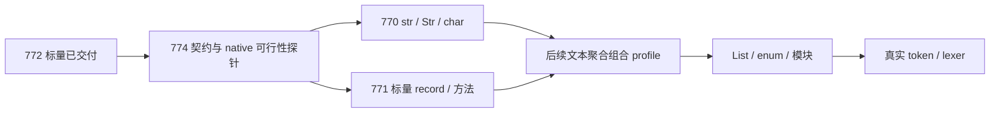

# Design 36：AC 数据能力扩面、资源契约与并行边界

> 更新：2026-10-13，Draft。对应 PLAN-774 revision 3、PLAN-770/771 revision 2；原共同契约769已改号774，770/771未改号。标量前置现为772（开发线原767），AutoDown试点现为773（原768）。
> 授权：用户要求按前述分析规划新计划；本轮只有设计/计划书写授权，实施另走 work。

## 1. 当前起点与本批终点

741 建立独立 HIR→原生闭环，743 明确 ACC 主体/阶段/代际合同，745 建立有限源码入口。
772 已修复、独立复审通过、合入并archived（9/9）；共同契约774与文本770/record771仍为drafting（0/8、0/9、0/9）。本批实施从启动时最新主检出创建各自唯一工作树，不从旧标量实施树复制代码。
scalar profile已沉淀至canonical Specs；data-resource-contract尚未产出。本稿描述后续目标，现状以各计划与Spec为准。

本批终点：确定数据/资源共同边界；独立实现文本 profile 与标量 record profile，各有源码/HIR→真实 PE 和拒绝矩阵。
完整 Token/lexer、List、enum、use、生产 I/O、ACC 主体/桥/自举由后续计划认领。
旧 compiler/parser/VM/A2X/Value 只作语义与用例参照，不要求先重构整个旧编译器。

## 2. 分解与依赖

774 先通过独立复审并沉淀合同，770/771 才开展依赖实现；三份草案已创建；执行顺序是774先完成，再并行770/771。
770/771 没有互相依赖：771 字段仅 i32/bool 与非递归嵌套 record，不包含文本或堆对象。
文本字段、List<Token> 等组合需后续 profile、重新 verify 与联合语料，两个分支单独通过不构成组合能力。
生产 ABI、DLL/热重载、ACC 工具后端桥是不同版本域，不因内部传参与资源探针完成而宣称完成。

## 3. 已知语义冲突与决策责任

| 议题 | 当前事实/要求 | 本批责任与禁止项 |
|---|---|---|
| int | scalar 子集是精确 i32；旧 AST/VM/A2R 宽度不同 | 774 确认新 profile 沿用 i32，内部长度/地址独立；不裁定全语言 int |
| 字符索引 | lexer 游标要求码点；旧 builtin char_at 返回单字符 str，auto-lib 表面为 int | 774 裁定 text profile 的 Unicode 标量/索引及显式转换；770 实现，不照抄任一宿主猜语义 |
| str / Str | types Spec 与 Design 02 区分借用 slice、拥有型 Str、字面量；a2r 存储位置又有拥有型映射 | 774 形成逐语境表（局部/参数/返回/字段/容器），770 执行；不把所有 str 偷换为同一拥有型句柄 |
| view / mut / move | Design 04 有目标规则，旧 ownership checker 未接主链 | 774 规定受限支持与拒绝，770/771 独立验证；旧模块存在不能当安全凭证 |
| 方法 | Design 10 有 static/实例/self/.field，mut 方法与旧 lib 写法需区分 | 771 首批只读实例方法、static new；字段修改经显式 mut 自由函数；可变实例方法另行扩面 |
| 资源 | HeapAlloc/HeapFree 或受限句柄可作实现候选，不允许 Rust Vec/String 布局跨界 | 774 全路径探针选择并冻结；770 引入真实资源、清理与故障注入 |

774 是有界决策计划，输出带支持/拒绝/观察 oracle 的完整决策包；不得以“未来研究”关闭其 AC。
候选 text 规则：UTF-8 存储、Unicode 标量索引（不是字节/字素），char 为独立名义类型，可显式转码点 int；无隐式 char/int 混用。
这些是新 profile 提案，须在 774 核对现行要求和代表性源码；若事实使本方案不可行，先修订受影响下游合同，不边实施边改变验收。

## 4. 类型、HIR 与运行时边界

- 每个 profile 都有精确 source 与 HIR schema/revision/profile 身份，Unknown/Error 不能进入 Checked。
- 签名、字段、place、表达式与所有 TypeUse 都要验证类别、作用域、界限；程序化 Bundle 与文本输入同门。
- HIR 保留名义类型、求值序、访问模式、来源与资源义务；目标大小/offset/物理签名留 native adapter。
- 所有 runtime 调用按明确宽度的值、borrowed pointer/length 或句柄/out-buffer；panic 不穿 ABI。
- 受控拒绝不等于运行期 trap；畸形输入在 bind/verify 前门拒绝，资源申请失败在运行期资源路径拒绝，真实超时由既有执行器分类。
- 正常 return、分支、break/continue 的清理需要有序且唯一；进程级 fatal trap 采用 OS 进程资源回收，不能声称执行了析构或生产 unwind。
- 不偷偷增加固定语法深度上限；宽度/长度转换、分配预算与环境耗尽要有明确单位、失败阶段和边界正反例。

## 5. 并行开发规则

两个工作树可以独立开发，但 source AST/typecheck、hir、descriptor、verify、native、main 是共同热点。
执行前在两份 Plan 的 T-01 建立符号/枚举/API 清单与具体 merge 顺序；共同字段语义只能有一个定义，不能各自造通用类型系统。
774 只沉淀契约/探针，不提前塞入未验证的通用生产框架。770/771 各自最小实现；第二个合入者在新整合基线重放自身全门禁与首个 profile 的回归；如果受审代码/基线发生变化，回同一树 work 更新证据并重新独立 review，再交 merge。联合正确性不是 merge-owned 延后项。
若出现非文本合并冲突（身份、签名、Drop 或能力门不兼容），暂停依赖实现并 revision，不用宽松 verifier 或跨域 fallback 绕开。
所有实现/构建/测试在各自唯一 worktree；主检出只写设计/计划簿记。重型全仓批回归按仓规单实例执行，不在两个 worktree 同跑。

## 6. 验收与语料组织

每项 feature 都分别证明：源码解析/名字类型→Atom bind→verify→Checked→COFF/PE→真实执行；一条路径通过不代替另一条。
常规正例、错误类型、未知身份、同名遮蔽、字段/签名引用变异、命名求值顺序、资源寿命及故障路径有稳定 Case ID。
使用既有 contained executor、真实 artifact hash 和诊断码；控制输入中的 panic、失配与非零不能用统一 ALL-PASS 或 skip 隐藏。
773 AutoDown 试点不作为本批前置；先用 ac-core 文件语料/manifest 验收，之后可以接统一 runner，预期不被 rewrite/update 模式偷偷更新。

## 7. 后续候选（未编号）

| 候选 | 解锁条件 | 可审阅成果 |
|---|---|---|
| enum / is | 聚合身份与布局合同 | TokenKind / payload 正反语料及 native 分派 |
| List | 文本资源与元素类型 | push/get/索引写/遍历/释放；内建实例化不冒称用户泛型 |
| text-record 组合 | 770/771 各自通过并统一 profile | 含 Str/借用视图的 record 清理与调用语义 |
| use / 多模块 | 全局名义身份、签名与静态装配合同 | 跨模块 DefRef、诊断、重名与依赖拒绝 |
| 编译器 I/O / 后端桥 | 文本和资源稳定 | 文件/参数/诊断、受限 Cranelift 客户端接口 |
| 首个真实 ACC lexer | 文本、record、enum、List、模块能力 | token/lexer 适配源码 native + corpus_m1 对拍 |

没有预分配后续编号，不把前三计划计作完整 lexer、生产 ABI 或任何自举代际完成。
