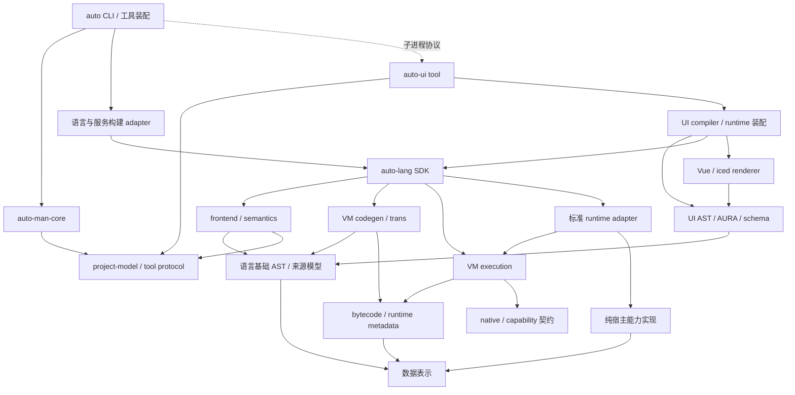

# Design 37：v0.6 模块边界、独立仓与减法路线

> 状态：Draft，2026-10-13；用户已授权本轮调研/规划，实施待各 Plan 确认。
> 背景证据：[调研报告](../plans/reports/v06-modularization-research.md)与[静态基线](../plans/reports/v06-modularization-baseline.jsonl)。代码快照 `5e21561d2c30`。
> 继承：[Design 32](32-autoui-repo-extraction.md) 的双缝方向；本提案补充真实反向类型依赖、auto-man 独立交付、语言内部拆分与实际删减。历史裁定不在原文中抹除。
> 当前行为以 [Specs overview](../specs/overview.md)、各模块 Specs 与代码为准；下文都是目标态，未沉淀为现行 Spec。
> 2026-10-13 补充：已核查既有 `../auto-ui` 与 `../auto-man`。推荐复用原仓身份与 URL，保留 legacy 引用，在迁移分支准备新代码后以新提交推进默认分支；下文“独立仓”不再意味着重新创建这两个仓。

## 1. 目标与边界

目标是几个职责完整、依赖清楚、可以各自构建、测试、发行的大模块；以独立 crate 契约建立仓界，而不是先搬目录制造新的路径问题。

不在本轮重写语言语义、改全语言 IR、替换 VM、砍 renderer 或全部转 IPC。AC/HIR 是已登记的实验能力，不是可以无成本替换当前 AST 的成熟公共中间表示。退役 AAVM/后端必须另行确认用途与兼容影响。

分离标准分两层：

- **实现可独立交付**：UI 实现与工具都可外置；暂有 UI 兼容 AST 的语言包仍属于过渡态。
- **领域完全解耦**：语言基础模型/前端不再拥有 UI 专属声明，UI driver 将领域语法 lowering 到公共语言程序；上层注入宿主能力。

二者都属于本路线，不能完成第一层后宣布第二层已经达成。

## 2. 五个模块域，前三个先独立交付

| 域 | 首期承载 | 终态仓候选 | 只负责 | 禁止反向依赖 |
|---|---|---|---|---|
| 语言 | auto-lang 仓，多个 crate | auto-lang | Core frontend、语义、codegen、VM、trans、SDK、LSP | auto-ui / auto-man / 桌面应用 |
| UI | 先仓内多个 crate | auto-ui | UiAst/AURA/schema、UI 分析、生成、VM bridge、renderer、tool plugin | auto-man 大库；语言内部私有实现 |
| 工程工具 | auto-man core + adapters + auto CLI | auto-man | 包/锁/工程/构建调度、provider 发现、安装与升级 | renderer；包管理核心不得依赖完整 VM |
| 数据 | auto-atom/auto-val，先保持实现 | 数据模块独立仓（名称待定） | Atom/Value/Schema/codec 等基础表示 | parser/VM/工具/UI；新 Atom-v2 按既有 RFC 分期 |
| 标准运行时/宿主能力 | a2r-std + 分离出的 capability 实现 | runtime 模块独立仓（名称待定） | 通用数据/文件/网络/任务等运行能力、最小生成 runtime | 编译器、UI renderer、包管理 |

仓不是层：一个仓可以有多个上下分层 crate。公共项目/工具协议初期由 auto-man 仓中的独立小包维护；各消费者可以只依赖该包。字节码模型由语言仓维护。不要新建一个装着所有跨界类型的 common crate。

### 2.1 允许的目标依赖（A → B 表示 A 使用 B）

上述 frontend→project-model 是工程模块加载需要的数据边；纯 syntax 不需要 pac。引用 VM 栈类型的 `std` 是 SDK 装配侧 adapter，**VM core 不依赖该 adapter**，只依赖 native/capability 契约；图中各边按实际 crate 使用方向落实。

### 2.2 仓内语言拆分顺序

1. `lib.rs` 缩为语言 SDK 门面；UI 门面移到上层 UI facade，不向 core 重新 re-export UI crate。
2. 共有来源/诊断/AST 数据建立模型包；parser 所需 inference/type store 不假装不存在，第一轮 frontend 可以包含这些，之后再收敛。
3. `ObjectType`、opcode/程序元数据、FFI 描述从 codegen 归共享 bytecode/runtime model。执行引擎不查 codegen 的 CFFI_GLOBAL。
4. VM/codegen/trans 按明确模型分 crate；AIE/CompileSession 成为 orchestration，外部 cargo/dep 编译由 build driver 提供 artifact。
5. LSP、Playground、CLI 依赖 SDK 或 frontend，而不是给它们一个默认带 renderer 的巨包。

命名需处理现有 `crates/auto-vm` 辅助 CLI；第一轮用明确的 execution/model 名，不能直接占用它而不迁入口。

## 3. 语法扩展：兼容路线与干净终态

### 3.1 兼容期

- core 保留现有 Stmt/Expr，包括被多后端消费的兼容 UI 数据。
- 先定义 ParserBridge 的最小接口：看/吃 token、mark/restore、解析 core expr/type/body、上下文只读/作用域 guard、诊断来源与恢复。
- 外部 Dialect 注册到实例/session；with_session、导入模块与递归/恢复路径保持注册，冲突有确定规则。
- 不把 in_on_body、符号表、Lexer 内部和整个 Parser 字段集合公开给插件。由 pilot 决定哪些能力实际必要。
- 宿主装配提供 UI 注册；迁移期默认 UI 行为由显式兼容 facade 承担，最终 core 不按 Scenario::UI 硬编码 crate 类型。

第一个 pilot 只外置 model 文法及一个真实外部消费面，验证缝；其余 widget/view/store/inline handler 铸造按族迁移。Core `view` 参数模式、task `on`、变量 `Store`、AutoData Node/Grid 和 Godot 控制样例必须保留。

### 3.2 完全解耦

候选结构：模块保留 source/item 顺序，基础节点之外用受 session/module 管理的扩展 item 身份；UI driver 拥有 typed UiAst，里面可引用 core Expr/Fn，语言基础 AST 不反依赖 UI 类型。UI lowering 输出合法 core 声明/函数与 UI IR。unlowered extension 在 core 编译门明确拒绝。

具体选项（sidecar arena、模块 driver 的外层 item、受约束扩展节点）先做 parse→import→typecheck→lower→VM/生成器→诊断的完整原型。要求 Clone/格式化/序列化、错误恢复、生命周期、跨模块 ID 与源位置语义明确。禁止以全局 side table 或任意 Any payload 规避 ownership 问题。

此阶段不依赖 AC/HIR 必须先支持全语言；若采用 HIR，则验收仍包括完整 UI/Core 支持面，不能拿 core-i32 原型通过替代。

## 4. Native/宿主解耦

沿用 NativeInterface 的现有 ID/name/contract/proof 机制，拆分：

1. **定义**：canonical name、稳定 ID 或确定映射、参数/返回/所有权、错误与能力要求。
2. **适配**：VM 栈/NanoValue 编解码；生成 Rust runtime 适配；不同 backend 实现事实。
3. **实现**：剪贴板、scroll、终端、媒体、frame 等具体能力。
4. **装配**：Core/UI/server host 选择 provider，与编译时 capability 一致。

首个 pilot 为 `auto.frame.begin_ms/present_ms`（9918/9919），保留 i32 clamp 与未捕获 0，以确定值 fake provider 证明外部注入被真正使用，再接现有 frame_bench。不能由“两函数返回默认 0”伪证解耦。该 pilot 不证明 heap handle、媒体或异步能力已解决。

后续逐族搬 clipboard/scroll/editor/media/term，验证 ID 冲突、contract 失效、未装载能力、Rc/!Send 线程亲和、retain-release 与 shutdown。UI adapter 可以依赖 VM SDK，反向引用不可留在 core。外部注册优先通过显式 factory/provider，不依赖 linker 自动把 inventory 拉进程序的偶然性。

纯 diff/文件/媒体能力可归 runtime domain，但含 iced 或 UI 回调的部分归 UI。HTTP/service 通用路径与 776 的资源终值契约保留，不机械搬进 UI。

## 5. 工程模型与工具协议

### 5.1 模型与效果分离

新增小型 project-model 包：声明值、依赖/member、路径来源、render/scene 描述、版本和诊断。不得包含 Builder、IndexStore、renderer 或 AutoVM。使用当前 AtomParser 的静态子集需要跟当前执行型配置做行为对拍。

未知字段与兼容 render/backend 字段按当前约定保留；包名/展示名/locale 与 opens/back.project 规则由明确所有者维护，语言 loader 不再各自文本扫描完整 pac 语义。语言 ModuleResolver trait 可以留 SDK；管理实现通过 adapter 实现，模型无须依赖 core AST 的 ModulePath。

### 5.2 插件

AutoMan core 管包、依赖、工具执行；UI 插件接管 UI 工程分析/代码生成/宿主。语言/service build adapter 用 SDK。auto-gen 拆为纯模板核心与 Auto 可执行模板 adapter；不因为一个模板 engine 又让 package core 编进完整 compiler。

保留现有用户命令，路由覆盖有 pac、无 pac、直接 `.at`、scene override、render override、front/back split、serve/watch、生成但不启动等形态。

协议规定请求版本、toolchain/provider 身份、能力集、资源根和输出根、参数/stdio/exit/cancel。版本不兼容在执行前失败；子进程找不到、崩溃、watch 子树/daemon 清理有明确结果。能力路由不能只扫描 PATH 名字推断匹配。

## 6. 路径、发行和构建身份

- 开发：组内 sibling worktree，显式 path/顶层 patch；runtime 资源按 env→组内兄弟→主检出解析。Cargo manifest path 本身不做 env 展开。
- 发行：包版本或 git revision 锁定，完整依赖来源 identity；每仓独立 manifest/lock。当前根 Cargo.lock 被忽略，需明确应用/工具仓锁文件入库与库消费者锁定责任；同 Rust 类型只来自同一个 source identity，避免 path+git 的重复实例。
- 生成 Rust 工程依赖最小 std/runtime + UI runtime（仅 UI 工程），不绑生成时的临时 worktree 路径；真正的外部 consumer 在无源 checkout 场景编译。
- 每个生成器/provider 输出有 producer fingerprint；cache 必含源/配置/producer/真实依赖身份。不得把 build.rs 扫全 crates 的可信校验简单删除。
- iced patch 的所有权转 UI，发行/消费者的顶层 patch 接线必须测试；依赖包内的 patch 不被消费方采用，须由消费 workspace 根设置。[Cargo patch 规约](https://doc.rust-lang.org/cargo/reference/overriding-dependencies.html)
- schema/模板/标准库采用显式 resource bundle 或可安装包；资源版本影响 cache 与兼容性。
- 复用既有 auto-ui/auto-man 仓，原默认分支基线用 legacy 分支/标签保留；从该基线建迁移分支，以新提交更新代码树，通过验收后快进或合并到默认分支，不重写原仓历史/tag。auto-lang 迁出路径历史如需提取，只在 disposable clone 中过滤，并单独保存来源历史引用与迁移映射；不能直接 force-push 覆盖目标仓旧历史。
- 一律遵守无 junction/symlink 与 wt-guard 红线；不建新的多级路径“捷径”。

## 7. 结构拆分、去重、退役纪律

结构搬运与语义改造分 Plan。每个大文件切成责任清楚的子模块；共享可验证的规则（角色目录、主属性、解析模型、ID/签名），backend 差异以显式 adapter 表达。生成代码不参与人工 clone 删减指标。

退役以消费方/支持合同为依据。历史孤儿、不可启用代码、重复 lock、旧 evaluator/Scope 桩有独立清单与验证；数据/配置格式、ffi ID 或用户命令变化须在 Plan 中明示。测试不得用新实现生成的新 expected 来自证等价，金样更新与 oracle 变更单独复审。

指标：normal dependency DAG、各层 forbidden edge、普通消费闭包、crate/文件最大实现规模、同口径源码与测试/生成量、搬迁量、净删除量、clone 候选处理、相同环境的 cold/warm/增量构建变化。不给没有测过的速度/内存收益数字。

## 8. 分期与验收

首批探针（2026-10-15 已交付归档；各项完成范围以对应 Spec 为准）：

| Plan | 独立产出 | 前提 |
|---|---|---|
| [777](../plans/archive/777-v06-modular-boundary-baseline.md) | 可复现基线、所有者表、增量边界门；观察模式与失败反控 | 已交付；不改 Rust |
| [778](../plans/archive/778-ui-dialect-externalization-pilot.md) | ParserBridge/注册保持/错误恢复 + 外部 model 方言探针 | 已交付；不迁全部 AST |
| [779](../plans/archive/779-ui-native-provider-pilot.md) | frame native 两函数外部 provider + 生产装配 | 已交付；不外推字符串/媒体寿命 |
| [780](../plans/archive/780-project-model-decoupling-pilot.md) | 轻项目模型 + pac 静态/执行对拍探针 | 已交付；不改全量 pac 默认读取 |

后续 R4–R8 见调研报告，按探针结果分别立 grammar 迁移、native family 迁移、UI crate 化、tool plugin/CLI、runtime/服务生成、UI 搬仓、man 搬仓、UiAst 终态/legacy 退役 Plan。首次三件套独立交付与最终 compatibility 退出分别验收。

执行编排见[正式拆分与搬迁顺序](../plans/reports/v06-extraction-execution-roadmap.md)。2026-10-15 首批合同现已交付：[784旧仓保全](../plans/archive/784-repo-extraction-legacy-preservation.md)、[785文本剪贴板能力](../plans/archive/785-clipboard-text-host-provider.md)、[786展示读取收口](../plans/archive/786-project-display-reader-consolidation.md)；781亦已合并归档。2026-10-16 第二批合同见§8.3；783/787/788隔离实验与集成线不是全局前置，按真实热点协调。规划不等于授权立即切旧仓主分支或实施源码。

### 8.0 既有仓复用与默认分支切换

本地核查：auto-ui 默认检出 `master@f7d92eef273c`（2026-02-28），有 v0.1/v0.2 标签和 gpui2/gpui3/iced 远端跟踪分支，Cargo.lock 有未提交改动；auto-man 为 `master@51fafe82e8e0`（2026-01-21），有 v0.0.* 标签与 v0.0.x 远端跟踪分支，工作区干净。两仓 origin 为既有 gitee.com/auto-stack 同名仓。这里只读本地 refs，未 fetch，不能据此保证远端此刻无新增提交。

推荐流程：冻结旧提交与未提交状态收据 → 留 `legacy/pre-v06` 分支及不可挪动的归档标签（拟名）→ 从旧默认分支建立 migration 分支/专用 worktree → 导入已在 auto-lang 解耦并验收的当前实现，替换旧代码树、整理 manifest/资产/CI → 独立复审及消费方验证 → 默认分支以新提交承接新实现。

旧实现保留在 legacy 引用与历史中，不在新默认代码树同时保留另一套生产源码。若希望默认分支叫 main，可在交付时单独变更默认分支名称；当前两仓都叫 master，名称切换不是解耦前提。不要先清空默认分支或建立 orphan main；默认分支在交付前继续维持旧版本。auto-ui 的脏 Cargo.lock 需先保存到迁移收据/恢复位置，不能直接 checkout/reset 覆盖。

原仓沿革与 auto-lang 中这半年的演进分别保留：目标默认分支承接旧仓历史，迁出路径的过滤历史可保存在明确来源分支（拟 `import/auto-lang-v06`），并记录原 commit/path→目标 commit/path 映射。是否将来源历史合入默认分支由后续迁移 Plan 决定，不能把无关历史强行普通 merge 当成代码集成；最低验收是两段历史都可追溯、新代码树与已验收迁出实现一致、来源贡献与许可证信息保留。

### 8.1 必要验收矩阵

| 不变量 | 区分错误实现的 oracle | 边界 |
|---|---|---|
| Core 不需 UI | 外部 consumer 只依赖语言包，metadata/tree 及 parse/run 成功；无 UI checkout/iced | 独立包构建与集成 workspace 分开 |
| 方言外部注入真实生效 | 外部 model 文法工作；未注入回退；嵌套/失败后继续解析；UI/Core 同名变量与 view 参数模式 | pilot 之后还需全部 grammar |
| native 实现由 host 选择 | 可区分的 fake 值到达 VM 实际输出；无 provider 当前降级；两实例不串线；重注册/冲突正确 | frame pilot 不涵盖媒体 ownership |
| 项目模型兼容 | 同 fixture 两 parser/adapter 的规范化结果与错误阶段；动态输入明确分类，无 silent fallback | static 子集和可执行配置分开 |
| UI 行为不漂移 | Vue/VM 真实交互/视觉、代表 desktop/store/handler/media 样例 | 使用 autoui-verifier，声明 fixture 与资源 |
| CLI 委派兼容 | 原始命令 flags/stdio/exit/cancel/missing/incompatible 的正反控 | watch/daemon 必须观测子树清理 |
| 发布独立 | 干净临时目录使用版本锁构建生成工程、无本机绝对 path | 包/模板/patch/cache 身份明确 |

Category A 不跑 cargo t/docs_gen；Rust 按现行 t+触面 tv/tu/tt 等；UI codegen 的 tu 保单进程；tf 按到期的 batch gate，不放每个 worktree 反复跑。pre-existing reds 有基线归因，不能以排除新红或更新金样掩盖。

### 8.2 与在途功能工作的并行策略

推荐**按模块和阶段受控并行**，不暂停全生态，也不等所有 active Plan 归档后才启动。拆分线自身按当前首批 Plan 顺序推进；其他线路是否并行取决于源码写面、共享接口和消费协议，而不是是否用了不同 worktree。此节是调度建议，不改变其他 Plan 状态/授权，也不自动修订其验收或执行合同。

2026-10-13 核查快照：主检出 `f799be601`；在途树为 lang-774（`f1a26e1be`，clean）和 lang-776（`89560b46b`，api/contract.rs 有 WIP）。774 已 execution_done 6/8，776 executing 5/8；只读检查了真实 diff 与当前 Plan。742 的 executing、744/773 的 execution_done、775 的 executing 等是文档状态，不能由代码已汇入 master 推断必需验收已完成。

| 工作 | 并行建议 | 需要协调的关口 |
|---|---|---|
| 777 基线/ownership/边界脚本 | 可与当前其他线路并行 | 绑定采样 commit；后续收口再刷新，不把活跃变化当漂移错误 |
| 774 的复审/收口 | 继续，不为 UI/Man 拆分暂停 | 保持当前接口合同；仅改实验探针/报告，按其独立复审门 |
| 770/771 的 AC 扩面 | 774 复审合入且已有实施前提满足后，可与 UI/Man 拆分并行 | 两者自己的 experimental/ac-core 共享热点仍按既定顺序；语言主路径大改若影响取材，需要重核对应输入 |
| 776 的 HTTP 返回资源/API 生成工作 | 优先完成当前 scope 的验收、独立复审与合入 | 在此之前不迁它正在改的 FFI/API/生成器，也不并行重构其 native contract 装配 |
| 742/744/773 的遗留 work/review | 先核实际剩余项，推进可完成的验收/收据 | API/body、sqlite natives、test adapters 的迁移前确认 owner；744 的 VM 冲突/MCP 采证不能虚假销账 |
| 778/779/780 的调查与独立 fixture | 可同步做设计、静态盘点和隔离探针 | 同一生产源码接线一次一项；778 的 parser/import 和 779 的 native/production 与 776 实际最终 diff 再比对；780 当前不切换默认 pac |
| 应用业务、文档/资产工作 | 公共语法/命令兼容期间继续 | 新 UI 语法、新 native、修改 pac 协议需要先与边界 owner 协调；迁移窗口复跑真实 consumer |
| 大批路径搬运、crate/manifest/CLI 接线、仓交付 | 相关模块短窗口独占 | 涉及范围先合流或停在可恢复提交，迁移与验收完成后恢复；不要求无关 AC/应用 Plan 全部完成 |

执行节奏：

1. **准备期**：开始777；774继续收口，776继续当前scope；778–780可准备接口/fixture。暂缓在UI、natives、man orchestration上新开大feature，避免迁移清单持续扩张。
2. **接口期**：公共合同先稳定；一个热点族只有一个写入方。后合入者基于最新master重新核查/验证，复审证据绑定实际revision与commit，不能靠“文本冲突已解决”代替语义验证。
3. **迁移期**：先一个有界UI切换，再一个有界Man切换；源码/manifest/API路径调整与验收在专用树完成。每次只冻结实际受影响模块，独立实验、应用业务和文档仍可继续。
4. **恢复期**：新边界合入后，受影响在途树重同步、修订实际路径/依赖并复跑触面验证；后续feature按新接口进入，旧兼容入口有明确退出阶段。

冻结以迁移范围和验收结束为界，不定无依据的停工天数。没有“等全生态WIP清零”的要求；确实与迁移重叠的未提交代码必须先形成保全/交接收据，不靠stash/reset丢掉它。资源上各树只跑允许的scoped门禁；tf及其他规定重档保持主检出单实例串行，不能把功能并行扩大为机器重测并发。

### 8.3 第二批实际解耦合同（2026-10-16；789–791已交付，792前置已满足）

781/784/785/786已合并归档，下一批按“先仓内独立crate/能力，再固定发行闭包”推进：

| Plan | 责任切口 | 拟定依赖方向与退出条件 |
|---|---|---|
| [789](../plans/archive/789-lexical-foundation-extraction.md) | Token/Pos/Lexer单一来源 | auto-lang → auto-lex；词法层不依赖AST/Parser/VM/UI，原诊断与桥面恢复保持。AST/type-store/inference剩余环单独列清，完整文法外置仍未完成 |
| [790](../plans/archive/790-clipboard-files-images-provider.md) | 文件/图像剪贴板四native | VM编解码 → owned provider合同 ← UI/OS adapter；不传UI或VM句柄；真实VM、OS与ownership/临时路径寿命可验 |
| [791](../plans/archive/791-generation-core-extraction.md) | 通用生成编排与可执行Auto模板 | auto-gen(Auto adapter) → auto-gen-core；核心无语言引擎依赖，默认生产调用迁移，保留原模板/legacy行为 |
| [792](../plans/archive/792-generated-ui-independent-build.md) | 选定Iced生成工程的发行地基 | 已交付；选定consumer fresh-lock/locked与重定位合同见对应Spec，仍包含auto-lang全库，不代表UI独立仓 |

789/790/791按实际文件热点并行，workspace/规则共用写面短窗口串行合流；792先准备后在合流闭包上实施。这里登记目标合同，不提前发布为Spec现状。旧仓仍遵守§8.0增量承接历史的流程；完成本批不自动授权G/H主分支切换。后续A/B/D/E剩余切口、其他宿主族与I/J终态退出继续列入路线，不能因首个生成工程可建而删除。

### 8.4 可与发行验证并行的边界工作（2026-10-16，拟实施）

789/790/791已归档，792进入独立UI构建发行线；同时建立三条生产解耦合同：

- [793](../plans/archive/793-diagnostics-foundation-extraction.md)：已交付，error.rs通用诊断迁为auto-diagnostics，利用现有Name=AutoStr切断error→AST边，旧类型/诊断出口兼容；完整AST/parser外置仍另验。
- [794](../plans/archive/794-scroll-host-provider.md)：已交付，scroll controller六函数与781子锚点二函数统一owned provider；registry/测量/renderer状态机留UI，不复制为第二份core实现。
- [795](../plans/archive/795-package-lock-core-extraction.md)：已交付，pac.lock模型/codec/校验迁为auto-package-lock，Target/Git观测留Man adapter；保留旧公开API，不混同Cargo发行锁。

这些目标包不依赖792的生成工程接口，主要实现文件互不重叠；manifest/统一出口/边界基线存在小共享面，按路线图写入窗口串行合流。四线后合入者须重核当前闭包及792交付清单，不用独立worktree作为语义无冲突的证明。没有创建agent或授权远端/旧仓切换；本节是规划目标，不写为已实现Spec。

### 8.5 模型独立与适配层归位（2026-10-16，拟实施）

793诊断/795包锁已交付，在其基础上新增两份合同，与792发行验证、794 scroll实现并行：

- [799 前端模型](../plans/799-frontend-ast-model-extraction.md)：auto-lang → auto-ast → 轻值/词法；AST数据/类型表达/序列化单一来源，ParserExt实现和解析耦合测试留上层。保留旧AST类型身份和UI兼容节点，不把Parser/推断倒灌底层，不提前宣称UiAst终态完成。
- [800 Man依赖模型](../plans/archive/800-man-dependency-model-extraction.md)：auto-man语言adapter → auto-package-resolver；轻名称/路径规则与ModulePath/ExecutionMode/pac legacy读取分开，生产旧resolver真实委托。源配置继续归project-model、锁格式归package-lock，不重复发明模型或改变pac协议。

源码主写面不同，manifest/导出/Spec与边界基线按小共享窗口串行。若同时ready推荐792→794→799→800；没有新交付硬依赖，允许就绪先合，后合入者承担闭包/兼容与受影响复审重验。完整责任矩阵见[并行与合流合同](../plans/reports/model-decoupling-parallel-order-20261016.md)。这两份仍为目标计划，本轮不发布为现行Spec、不启动agent或实施源码。

### 8.6 后续迁移合同（2026-10-17）

核实792/794已合入归档；规划期间800也已归档8/8（交付02b11c4b4、清理回填2d246b4e8），799从尚未实施转为executing，主检出仍无auto-ast。新增：

| Plan | 实际切口 | 入场条件 |
|---|---|---|
| [801 方言接口](../plans/801-dialect-api-dependency-inversion.md) | auto-parser-api轻合同、生产Parser端口与旧API适配，外部model实现不拉语言实现包 | 硬等799审查合入；完整UI文法与入口传播另验 |
| [802 CodeEditor宿主](../plans/802-code-editor-host-provider.md) | 22 native全族owned provider、单一UI adapter及实际装配 | 785/790/794已满足，可与799/803并行 |
| [803 Man模板资源](../plans/803-man-template-assets-extraction.md) | 三组资源/纯路径计划独立auto-man-assets，旧copy/GHS/IAR真委托，语言/IO留上层 | 786/791/792已满足，可与799/802并行，无800 API硬依赖 |

当前可并行799、802、803；799交付后801不必等待其他线。800已交付，本批同步其实际源码/Spec，不重开合同。共享manifest/导出/装配/777基线小窗口串行，后合入者承担792实际交付闭包及受影响验证；完整规则见[本批编排](../plans/reports/extraction-next-parallel-order-20261017.md)。§8.3–8.5的早期状态和推荐顺序为历史规划，今日放行以本节及实际代码/合同为准。

之后继续完整UI文法、剩余宿主族、UI SDK分层、Man管理/命令与语言adapter切口；满足真实D/E/F退出门才另立G/H旧仓承接。803不借结构迁移修复模板变量注入或先写后render的遗留行为，后续行为修复单列。新合同不是现行Spec，不授权旧仓默认分支/远端切换。

### 8.7 声明文法、OS宿主与构建规则继续迁移（2026-10-17）

在801–803合同基础上继续建立三项：

| Plan | 迁移切口 | 对799/801及当前复审线的依赖 |
|---|---|---|
| [804](../plans/804-dialog-dnd-host-provider.md) | dialog两项+dnd_start共三native owned provider，合并VM/a2r重复对话框构建逻辑，保旧parent策略/输入线程/完成语义 | 无799/801硬依赖；与802共享装配短窗口串行，不消费其未交付API |
| [805](../plans/805-toolchain-rules-core-extraction.md) | auto-toolchain-core单份八类配置/flags/命令模板，生产Ninja真实委托，加载/定位/执行留adapter | 无799/801/803接口依赖；内联命令模板不是803资产资源 |
| [806](../plans/806-ui-declarations-dialect-extraction.md) | auto-ui-dialect完整msg/model与注解算法外置，顶层和widget/component/store内部统一委托 | 硬等799→801审查合入，不把778裸字段pilot扩为默认文法 |

本轮观察802 latest readiness为needs_fix（V06实机证据待补），799/803也仍在复审/修复收口，均未合入；801仍drafting。804/805可在合同确认后独立推进，不把前端前置放大全局停工；806先规划、后等待真实API。§8.6状态为上一轮快照，本轮调度以[804–806编排](../plans/reports/extraction-followup-parallel-order-20261017.md)及实际合同/代码为准。

804后仍有diff四项、term/media等宿主或算法边；805后仍有Target/构建DAG/管理编排/薄CLI；806后仍有完整结构/事件UI文法。UI/Man真正G/H搬仓需相应D/E/F退出门，不因三项合同创建即放行；去重/退役与UiAst终态继续保留。此次不写canonical Spec，不修复或合并其他计划。

## 9. 决策状态

| 决策 | 状态 |
|---|---|
| 三主要仓 + 两个底层可交付模块；先 crate 后 repo | 本轮推荐，待确认实施 |
| UI DSL 与工具双缝、VM 可进程内托管 | 继承 Design 32 方向 |
| auto-man 也具备独立仓目标 | 对 Design 32 D4 的新提案；最新用户目标要求可独立，不假定已批准搬仓 |
| 复用已有 auto-ui/auto-man 仓；legacy 保旧实现，默认分支增量接新实现 | 本轮补充推荐，已核查本地仓；尚未创建分支/切换默认分支或操作远端 |
| 兼容 AST 暂留，终态退出 | 分期提案，退出门不得取消 |
| ParserBridge 和 frame provider 首批小型探针 | 778/779及784–786、800均已交付；799执行中，801–803为后续合同 |
| 静态 pac 优先，但执行型配置不静默破坏 | 780对拍pilot及786有限展示读取已交付，全面默认切换仍须另立Plan |
| 具体 UiAst 承载、完整 native 生命周期接口 | 待完整链路原型，先形成有界决策工件 |
| 数据/runtime 独立仓名称、版本发布渠道、切换窗口 | 拆仓前决定；不阻止首批仓内边界工作 |

本设计只登记目标态。merge 各已验收 Plan 时再逐条沉淀到 Specs，不能一次把全部目标写成现状。

## 10. 与其他v0.6路线的边界（2026-10-16）

各路线的独立核心、条件集成与验收见[总体矩阵](../roadmap-v0.6.md#7-v06路线阶段与拆分边界矩阵2026-10-16)。独立AC/AV/ABI、图形/知识/排版/输入引擎原型不以整场拆分结束为前置，但接旧AST/Value/VM、UI renderer/native/VTree、Man resolver/build/发行时仍需核对真实共享写面与公开合同。
不为原型增加反向依赖或复制基础模型；接口未稳定时先完成无关部分，再按具名adapter协调，不能提前宣称真实应用贯通。机器人算法暂不纳入，本轮只整理文档，未改变792/794/799/800等在途Plan的范围与合入责任。
