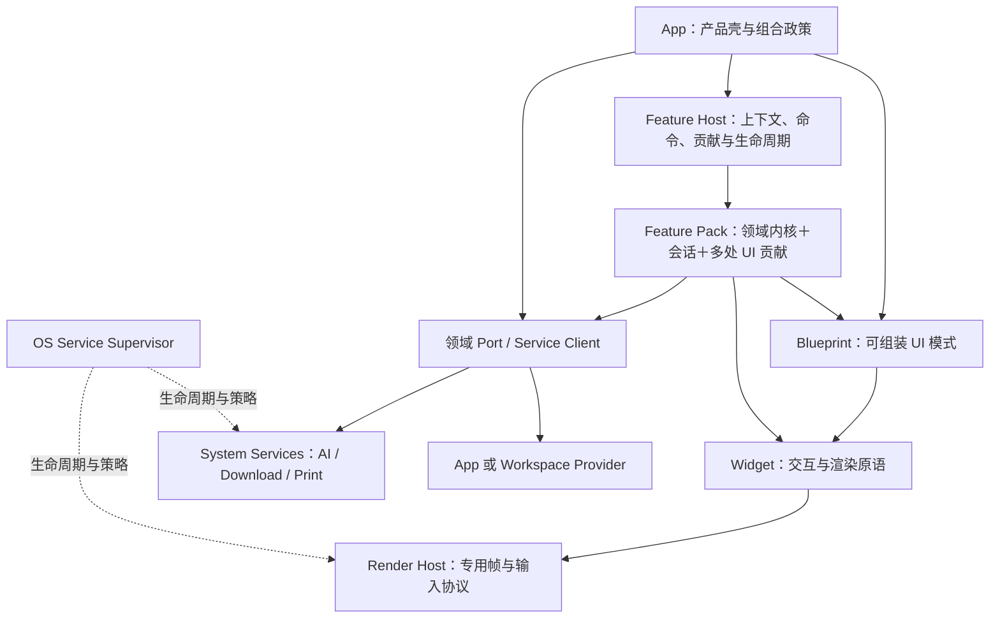

# 38 — AutoUI 应用功能复用与 OS 服务架构

> 状态：研究与架构草案（Draft RFC），2026-10-14。未冻结接口，未实施。
> 输入：用户提出的 OS 通用 Service 与接近 App 的 UI＋后端＋配置复用需求。
> 范围：AutoUI 复用概念、宿主契约、服务接入、编辑/知识能力抽取和验收路线。
> 归属：本文作为框架域设计输入；OS supervisor、具体系统服务和桌面产品的详细设计应落 auto-os 或对应服务仓，应用迁移 Plan 落各消费仓。
> 相关：[Blueprint 契约](../specs/blueprint/contract.md)、[Design 15](15-ai-daemon-infrastructure.md)、[Design 20](20-autoui-separation-architecture.md)、[Design 29](29-autoui-style-theme-system.md)、[Design 31](31-autoscape-autoweb.md)、[Design 32](32-autoui-repo-extraction.md)、[Design 37](37-v06-modularization-and-repo-boundaries.md)、[统一安装战略](strategy/unified-package-install-strategy.md)。

## 1. 建议与问题定性

建议采用 **Widget / Blueprint / Feature / App 四种应用构造单元，加上横向 System Service 服务面**。

- **Feature（功能单元）**：拥有独立领域行为、状态和生命周期，输出若干可分散装配的 UI、命令、配置及后端接口。
- **Feature Pack（功能包）**：发布、依赖与选择安装这些 Feature 的包；简称“功能包”。
- **Extension（扩展）**：功能包被某个宿主安装并启用的形态。它不是另一个业务粒度。
- **Capability（能力契约）**：一个消费者所需的接口/权限/后端能力标识，不用作大组件的名称。
- **System Service（系统服务）**：由 OS/平台统一管理生命周期、资源和访问边界的服务；可以由普通用户态进程提供。

Feature 解决“同一套成熟功能如何融入不同应用”；System Service 解决“多应用如何共享资源与政策”。两者正交：下载功能包可以提供下载列表、进度和菜单，下载服务负责持续任务、网络预算及落盘。一个 app backend 仅因常驻进程存在，不能自动归为 System Service。

这里的“层”是复用职责，不是严格按体积排队：Widget 也可很大（例如文本编辑引擎），Blueprint 也可提供复杂 UI。Feature 的新增价值是**领域会话＋宿主接线＋分散贡献＋生命周期**成为统一维护和测试的边界。

本轮只提出架构与有验收目标的实施分期，不创建正式编号 Plan，不执行产品改造。后续按仓库 L2 流程，确认设计后中央取号生成独立 Plan，逐项 work/review/merge；不得把本草案写成 current-state Spec。

## 2. 本地事实与缺口

### 2.1 采样范围

本节来自 2026-10-14 的只读源码与文档检查，非运行验收；工作区可能含在途修改，以下 HEAD 用于记录采样背景，并不声称工作区等于该提交。

| 仓库 | 采样 HEAD（短） | 检查范围 |
|---|---|---|
| auto-lang | `799eac6fb` | Blueprint specs、action_config、rqhost、编辑器内核设计、Design 31/32/37 |
| auto-edit | `acf71a054` | `specs/auto-edit/src/front/{app,editor_store}.at`、架构与 EditorStore spec |
| auto-musk | `cb4cb9570` | `src/front/{specs_editors,files_view,files_store}.at`、`pac.at` |
| jade-edit（产品名 auto-jade） | `5fb1e9e28` | `src/front/{app,editor_store}.at`、`pac.at` |
| auto-ai | `2a4d606f3` | README、`crates/auto-ai-daemon/src/services.rs` |

### 2.2 事实到设计约束

| 事实与证据入口 | 说明 | 推导出的要求 |
|---|---|---|
| [Blueprint project](../specs/blueprint/project.md) | 已有 import/bind、copy reference、agent generation 三通道；L1 倡导零副本 | 不能再把 Blueprint 描述成只有拷贝模板；Feature 主通道也应零副本 |
| 同上，Q5 版本约定 | 当前官方 bp 单版本滚动，Git 层对齐，禁止自造 bp pin/lock | 新功能包不得借此偷偷改写 Blueprint 现行版本政策 |
| auto-edit `app.at` 的 `actions {}` | 保存/查找/diff 等命令绑根 handler；`enabled_if` 依赖 `.store.*` | 跨宿主复用需要上下文适配和实例目标，不能把 actions 块直接拼接 |
| auto-edit 架构 spec 与当前 App 代码 | store/root 耦合，有为 VM 组件限制保留根视图的历史形态 | 先做跨包、多实例、回调、状态作用域探针，再抽完整功能；旧注释不能充当当前能力判定 |
| [action_config.rs](../../crates/auto-lang/src/ui/action_config.rs) | `ACTION_CONFIG`、`DSL_ACTION_CONFIG` 等进程级静态状态；重复 shortcut 目前 first wins | 同进程多 app/session 时存在作用域风险；新增宿主契约需实例注入、确定性冲突诊断 |
| auto-edit EditorStore spec | 大文件正文不常驻 VM 全文镜像；已有分块装载、BOM/EOL、dirty、关闭确认、保存策略 | “编辑能力”不能退化成 `content/on_change` 包装；要保留成熟会话行为和性能不变量 |
| Musk `specs_editors.at` | AutoDownEditor 包装使用固定 `key: "specs-editor"`、Init 草稿、Input 更新 | 不能推断一定已串线，但固定键不满足“同页多个嵌入实例”新合同，需要反证测试 |
| Musk `files_view.at`、`files_store.at` | 自有文件状态、预览分派和只读 code_editor 接线 | 已复用原语；文档打开、语言选择、错误处理、动作等仍在应用侧接线 |
| jade-edit `app.at`、`editor_store.at` | 有根 actions、tabs/active/dirty，反链、快开、知识功能与产品壳共存 | 需要区分知识领域能力、编辑器会话和产品壳；不能把整个 App 导入 Musk |
| auto-ai README | 共享 client＋aaid daemon，强调并发池、密钥、路由和用量 | 已具服务类别的事实基础，不必再造一个通用服务来重复 AI 领域逻辑 |
| auto-ai `services.rs` | AI daemon 中已有服务发现/启动 registry，硬编码 os-config、musk-web | 有可迁移的启动入口，但 OS 通用服务治理长期不应依赖 AI 进程 |
| [rqhost.rs](../../crates/auto-lang/src/ui/desktop_protocol/rqhost.rs) | 共享合成进程、well-known rendezvous、每 app 管道、原子单实例仲裁、末窗退出 | 它是服务的成熟先例；实时帧/输入应保留专用协议，不能统一塞进普通任务 RPC |

**诊断**：缺口主要位于“领域功能与应用壳之间”，以及“领域 daemon 与 OS 生命周期治理之间”。单加一个 package 名称，或给 widget 再加若干 props，不会解决这些缺口。

## 3. 外部调研：哪些机制值得借鉴

所有下述事实使用官方文档或项目维护者源码；查阅日期 2026-10-14。表中的 AutoUI 取舍是本 RFC 的分析，不是外部项目的承诺。

| 体系 | 官方机制与证据 | AutoUI 可以吸收的部分 | 边界与代价 |
|---|---|---|---|
| VS Code | manifest contribution points 包含 commands、menus、keybindings、configuration、views/customEditors；命令 enablement 与菜单 when 分开。[官方贡献点](https://code.visualstudio.com/api/references/contribution-points)、[上下文条件](https://code.visualstudio.com/api/references/when-clause-contexts) | 命令是语义入口，菜单/快捷键是投影；声明式上下文可统一求值和诊断 | API 围绕 VS Code 工作台；无法仅装一个编辑 widget 就得到扩展能力 |
| VS Code Extension Host | 有 local/web/remote 的执行位置与不同运行时；支持按激活事件懒加载。[官方文档](https://code.visualstudio.com/api/advanced-topics/extension-host) | 领域执行位置与 UI 位置分开；不相关能力不启动 | 扩展 host 不是自动的每扩展安全沙箱；不为首期照搬完整运行体系 |
| Eclipse Theia | 官方区分编译期 Theia extension 与通过约束 API 在运行期安装的 VS Code extension；前者能深度改变应用，后者适配稳定扩展面。[官方扩展机制](https://theia-ide.org/docs/extensions/) | “可组装应用框架”与“用户安装扩展”分阶段；首期深度集成可用构建期组合 | 完整内部 API 的任意访问会扩大升级成本；AutoUI 要把公共 host 接口收窄 |
| JupyterLab | 包含多个 plugin，以 token 声明 requires/optional/provides；缺少必要 provider 不激活。[官方开发文档](https://jupyterlab.readthedocs.io/en/stable/extension/extension_dev.html) | 包与内部功能单元分开，显式依赖图和可替换 provider | 它的 JS 对象/Token 不是 Auto 多后端线协议，需按语义重建契约 |
| JupyterLab / Notebook 7 | 官方专门讨论一个扩展面向多个应用；共享能力直接复用，app 特有能力可选并检查。[多应用指南](https://jupyterlab.readthedocs.io/en/stable/extension/extension_multiple_ui.html) | 这最接近“每个 App 都能安装”：依赖宿主能力，不判断产品名 | 没有状态栏的宿主不能被迫实现完整工作台；降级行为要显式 |
| Monaco | 官方说明它是从 VS Code 源码生成的编辑库，VS Code 扩展不能直接在 Monaco 中运行。[项目 FAQ](https://github.com/microsoft/monaco-editor#faq) | 编辑内核复用与应用功能复用必须分辨 | 继续复用编辑器原语不会自动消除保存/菜单/知识功能重复 |
| OpenHarmony | Samgr 管理 System Ability（system service）的启动、注册、查询，支持按需装载。[官方 Samgr README](https://github.com/openharmony/systemabilitymgr_samgr/blob/master/README.md) | 服务发现、按需启动、生命周期治理 | 不照搬具体 ID、Binder 或系统权限实现；AutoOS 当前还运行于宿主 OS |
| HarmonyOS Atomic Service | 华为该支持页描述元服务/原子化服务为有独立入口、免安装的轻量服务呈现；该页适用范围标注 HarmonyOS 5.0 以下。[官方说明](https://consumer.huawei.com/cn/support/content/zh-cn15954316/) | 可作为轻量产品/独立入口的参考 | **不是 OS 资源仲裁服务的同义词**；此文不对各代 HarmonyOS 开发模型做泛化 |
| XDG Print portal | PreparePrint 获取配置，应用据此格式化，再 Print 交付可读文档句柄；服务侧可统一打印对话框。[官方协议](https://flatpak.github.io/xdg-desktop-portal/docs/doc-org.freedesktop.portal.Print.html) | 统一资源服务也可以提供受控 UI；内容格式化与设备提交分工 | 文档格式导出和打印设备服务不能混成一个无边界万能接口 |

综合建议：**Theia 的构建期应用组合＋JupyterLab 的跨宿主能力依赖＋VS Code 的贡献点/上下文，作为 Feature 架构参考；System Ability/portal 作为 OS Service 的参考。** 不承诺兼容这些项目的实际插件包。

## 4. 分层与命名

| 单元 | 首要职责 | 典型产物 | 不应承担的职责 |
|---|---|---|---|
| Widget | 一个 UI/交互原语或专用引擎 | code_editor、autodown_editor、button | App 的全局文件策略、顶级导航、退出动作 |
| Blueprint | 可组合 UI 模式、布局与接线契约 | 文件树、侧栏壳、编辑区布局、空态 | OS 资源仲裁；强制消费者继承产品身份 |
| Feature | 完整领域行为及宿主集成 | 文本编辑、diff、知识导航、反链、搜索 | 拥有宿主顶层窗口、全局路由和所有快捷键 |
| App | 产品流程和组合政策 | auto-edit、auto-jade、auto-musk | 复制成熟 Feature 实现来适配自身布局 |
| System Service | 跨 app 的资源与平台政策 | AI、render host、download、print | 绑定某个 App 的信息架构与私有业务模型 |



并非每个 Feature 都需要 Blueprint，也不是每个领域 backend 都要升级为 OS Service。抽取边界按生命周期和状态所有权判断。

命名候选比较：

| 名称 | 优点 | 问题 | 建议 |
|---|---|---|---|
| Extension / Plugin | 用户熟悉安装与启用语义 | 描述装配机制，既可极小也可极大；当前框架另有方言/工具插件 | 保留为安装形态 |
| Module | 一般性强 | 已被语言模块、Rust crate、Specs module 使用 | 不作为此层正式名字 |
| Mini App / Applet | 接近独立 app | 容易暗示完整小窗与自己的壳，弱化“打散融入” | 可用于产品呈现，不作架构名 |
| Capability | 强调接口和可用性 | 与权限、native provider、服务协议能力标识冲突 | 保留为接口概念 |
| Feature / Feature Pack | 强调完整用户能力，容纳 UI/后端/配置 | 需要明确 Feature 与包的关系 | **推荐：功能单元 / 功能包** |

## 5. System Service 设计

### 5.1 准入和所有权

服务化的强信号是：跨 app 统一政策；有限资源需共同仲裁；任务需在 app 关闭后继续；凭据/设备应由受控 owner 持有。满足真实需求即可，不要求每个服务都必须是机器级单实例。

| 例子 | 服务 owner 与作用域 | 稀缺资源/政策 | 应用或功能包保留的部分 |
|---|---|---|---|
| AI | 用户/登录会话级 aaid；可细分账户/provider | 并发、预算、密钥、模型路由 | agent 流程、上下文组织、聊天 UI、编辑动作 |
| rqhost | 图形登录会话级共享 host | 显示/GPU/帧预算、窗口/输入路由 | 应用语义状态、命中/渲染生产侧协议规定的职责 |
| download | 通常用户级，具体后端/任务分区可多个 | 网络、连接、磁盘、断点/重试、后台寿命 | URL 提取、章节发现、浏览器/读书业务、任务列表 UI |
| print | 用户请求入口＋宿主 spooler/device adapter | 设备队列、作业、打印配置 | 文档语义、分页/格式化；可复用导出 provider |
| knowledge index（候选） | workspace＋用户/权限域级，默认可为 app provider | 跨 app 访问同知识库时的写入/索引一致性 | editor view、知识面板、产品工作流 |

auto-ai 的 client、daemon、agent/harness 需要分别分类：共享 AI 通道是服务，业务 agent 编排不是因此全变成 OS Service。rqhost 的 singleton 也不能泛化为“所有用户共用同一个渲染实例”。

### 5.2 管理面与数据面

管理面可逐步统一为 **Service Supervisor / Registry**：注册 provider、发现、能力与版本协商、ensure、健康、重启策略、权限授予和诊断。首期不必建立新的大型通用进程；先定义 owner 与 adapter，复用现有启动入口。

数据面按领域保留：AI 用流式调用；下载/打印用 job；rqhost 用 RenderQueue、输入、共享内存/pipe。统一发现不要求统一传输，更不能逐帧通过 JSON task queue。

未来 OS 通用 registry 从 aaid 迁出：先让 aaid 旧入口委托新 OS owner，校验 desktop/app ensure 路径再退役硬编码；不能保留两套 launch truth。安装器记录软件与 provider 声明，Supervisor 管活跃实例与任务，Shell 负责入口与管理 UI。

### 5.3 最小服务合同（语义，非已存在 API）

| 面 | 必须明确的语义 |
|---|---|
| Identity | service_id、provider_id、接口版本、owner scope；机器/用户/登录会话/workspace 不混用 |
| Discovery | `resolve(contract, caller_context)` 得到已验证 provider；多个 provider 时有显式选择政策 |
| Startup | `ensure` 合并并发启动、按作用域单实例仲裁、有界就绪等待；不可在 UI handler 忙等 |
| Authorization | 可信 caller/app/用户身份与授权；本地 TCP URL、请求自报 app_id 不等于身份认证 |
| Execution | deadline、cancel、request_id、资源预算、进度、结果/错误；高成本新请求需准入 |
| Isolation | 每 app/workspace 的资源与数据可见性；不能因共享进程就共享聊天、cookies 或下载凭据 |
| Recovery | health、有限重启/backoff、状态持久化范围、服务 epoch；重连识别陈旧句柄 |
| Diagnostics | owner、队列等待、失败原因、版本/能力不匹配；可解释且不输出密钥 |

租户身份至少带 user、app、workspace 可选、会话/请求关联；feature_instance_id 用于 UI/请求归属，不得当认证凭证。

### 5.4 仲裁不是一个统一 FIFO

- AI：provider/model 级并发与额度，加 app 公平性、交互/后台优先级和饥饿防护。收费额度重试要独立处理，不假设请求重放免费或 exactly-once。
- download：用户总预算＋app 子预算＋host/domain 连接约束；续传需验证资源版本（ETag/Last-Modified 等支持情况），服务不拥有 app 浏览器 cookies，使用受限 credential handle。
- print：设备队列与持久 spool job；提交后不盲目重试物理打印，避免重复纸张/收费。
- rqhost：实时帧/输入路径，按 surface 预算和背压处理；允许丢弃过时帧但不能丢失关键输入。复用现行协议已接受语义，新增策略另验收。

没有平台服务时可由独立 App 启动开发/便携 provider。但它必须显式标为 app-local scope，不能假称全局下载公平性/全局 AI 预算已经成立；凭据或权限拒绝不能通过静默降级绕过。

### 5.5 持续任务与服务 UI

下载等 job 需要 owner、durable job_id、状态水位、结果资源句柄、保留期限和可恢复订阅。App 退出后继续、暂停或取消由 job policy 决定；UI mount/unmount 只影响订阅。孤儿任务如何展示和回收必须有政策。

job 可以按 queued/running/paused/succeeded/failed/cancelled 建模，但“可暂停/可恢复/可取消完成前哪一步”是领域能力，不要求 AI/打印照搬下载状态机。结果不确定的外部副作用须有 unknown/reconciliation 语义。

服务可以提供系统 UI（权限/设备选择对话框、任务中心）。业务内嵌 UI 经 Feature 复用；系统 dialog 以 portal 类契约向宿主请求，其 modal/focus/window owner 明确。

### 5.6 打印、PDF、Word 的边界

建议公开两类相关契约：

1. **Document Export**：领域文档/快照 → PDF、DOCX 等格式；保留元数据与语义结构的能力由 exporter 声明。
2. **Print**：可打印文档＋配置 → 宿主 spooler/device 作业。

PDF 虚拟打印可作为 Print adapter，也可直接 Export；Word 更适合语义导出。仅有分页后的绘制原语无法承诺恢复可编辑 Word 的标题、表格、链接与文档结构。两类 provider 可以同仓交付，但必须分接口、能力和验收。

## 6. Feature Pack 的组成与宿主契约

> **2026-10-14 用户进一步明确的方向**：先重新设计 App 级呈现宿主。App 声明灵活 Region（用户称 viewport），Feature Pack 选择多个 UI 出口绑定；支持面板、顶中悬浮、通知以及占据整个内容区的栏目，避免把所有 App 固定成 editor/workspace。详细合同与首批验收见 [App Presentation Host](autoui/app-presentation-host.md)。这是本节 Host API 和阶段 A 的前置设计输入，尚未实现。

### 6.1 六件组成

```text
Feature Pack
  ├─ Domain Core       编辑、diff、链接解析等可独立测试的规则
  ├─ Sessions          文档/工作区会话、dirty、history、异步任务
  ├─ Views             editor、diff、outline、backlinks、search 等视图工厂
  ├─ Contributions     commands、menus、keybindings、settings、status 等
  ├─ Ports / Providers 文件读写、工作区、索引、AI 等接口及实现适配
  └─ Contract / Tests  profiles、依赖、双端支持、宿主兼容与验收样板
```

包内部按有意义的用户能力拆 Feature，不把每一个按钮当 plugin。建议 text editing、diff、knowledge navigation 各成可组合的功能单元；复杂内部 helper 继续普通模块。

**App = 产品壳＋选择/绑定 Feature＋产品流程。** 独立 auto-edit 自身也应消费 editing pack，auto-jade 自身消费知识/AutoDown pack；这样独立 App 与嵌入宿主维护的是同一条实现。不能维持“旗舰完整实现＋低配嵌入副本”。

### 6.2 多出口，让能力融入宿主

同一个 editing instance 可同时提供中央 EditorView、右栏 OutlineView、底部 StatusItems、Edit 菜单组和快捷键。知识 instance 可把 editor 放详情面板、backlinks 放右栏、search 放宿主全局搜索入口。

包导出语义 surface/view ID，宿主映射位置；包不写死 main/right/bottom 的像素或路线名。布局 slot 可复用 Blueprint，但**布局 slot 本身不能代替命令、状态、后端和生命周期合同**。

最小 Host API 建议分为必要 core 和可选 ports：

| 接口（建议名） | 职责 | 必要性 |
|---|---|---|
| FeatureScope | app/window/feature instance 身份、生命周期、受控配置和 disposable owner | 核心 |
| CommandRegistry / Router | 注册命令、指定目标、上下文校验和执行结果 | 核心 |
| ContextProvider | 当前焦点、文档、selection、readonly、dirty 等受控投影 | 核心 |
| ViewFactory / Mount | 建/挂/卸载多个视图；宿主提供布局容器 | 有 UI 的 Feature 必要 |
| ResourcePort | open/read/write/watch 与资源身份、revision；文件/内存/API provider 可替换 | 按 Feature 依赖 |
| WorkspacePort | 根、项目信息、导航和受限工作区操作 | 工作区 Feature 依赖 |
| Dialog / Notification | 请求确认、保存选择、错误展示；也可有功能包局部 fallback | 按 Feature 声明 |
| Menu / Palette / Status | 承载贡献；缺失时按声明选择局部 UI 或禁用贡献 | 通常可选 |
| ServiceResolver | 发现并接入被授权的 OS/workspace service | 按 Feature 依赖 |

简单 App 只需承载 editor、commands、scope 与文件/内存 provider；不必先造 VS Code 工作台。业务逻辑不可调用 `Musk.*` / `Jade.*`；产品适配器可以认识产品，公共 Feature 只认识 ports。

### 6.3 后端复用的三种形态

- **in-process provider**：宿主链接领域实现，本地调用；适合小型独立 App、低延迟编辑会话。
- **app/workspace provider**：Musk 把自己的认证、工作区和文件 API 接到 ResourcePort；通用保存/search 逻辑继续在 Feature 内维护。
- **System Service provider**：通过 client 连接受治理的外部服务；用于需要全局仲裁或跨 app 共享权威状态的能力。

这三种形态共享语义接口，不保证传输/延迟/故障完全相同。取消、权限失败、失效句柄、最大块尺寸需要一致的错误模型；接口不能把“本地闭包指针”放进 wire contract。首期以已支持的 merged/split 和 API 装配机制实现 adapter，异步资源句柄与 native 注入要衔接 Design 33/37 及在途返回资源合同，不能假称已有统一动态对象 ABI。

## 7. 状态所有权、实例隔离与跨 App 打通

### 7.1 五种作用域

| 作用域 | 典型状态 | owner |
|---|---|---|
| 平台/用户服务 | AI 预算、下载 jobs、provider 配置 | System Service |
| Workspace | 知识索引、资源身份、项目搜索 | workspace provider / 显式共享服务 |
| Feature Instance | 该安装/嵌入实例的会话集合、功能选择 | Feature runtime |
| Document Session | buffer、revision、dirty、undo、encoding、save transaction | 文档模型/领域会话 |
| View | 光标、选区、折叠、滚动、布局/焦点 | view instance；按需求共享 selection |

推荐身份为 `app_session / feature_instance / document_session / view_instance`。文档标识不是文件 basename；应由 provider 的稳定资源 identity＋workspace/权限域决定。widget storage key 从实例身份派生，避免 `"specs-editor"` 等固定键串线。命令采用包/Feature namespace；runtime instance target 与逻辑 command ID 分开。

同资源多个 view 是否共用 buffer/undo 要明示：editing profile 可共享一个 document session；diff 的左右输入是显式 snapshots，可各自独立。不得通过相同 widget key 偷偷共享。

### 7.2 编辑器当前限制不能被设计图掩盖

`editor-kernel` 中已有破坏性 delta drain、视口局部历史等阶段合同。Feature 需要单一会话 owner 消费内核 delta，再向 status/search/diff/agent 分发结构化事件；不能四个消费者各自 drain 同一队列。第一阶段若跨视图统一历史尚不可用，必须在 profile 与验收中明确，并用前置 Plan 补齐目标所需能力。

模型/rope 应长期由 document session 持有；view 的卸载不能导致未保存文本丢失或整个历史重建。大文本通过分块/快照/句柄处理，实例化 Feature 不得重新引入每击键全文复制或 VM 正文常驻镜像。

### 7.3 代码复用与数据共享分别定义

同一 pack 在 auto-edit、auto-jade、Musk 中运行，首先打通实现成熟度、命令语义与配置；**不意味着自动共享正在编辑的 buffer、undo 或所有知识库**。

跨 app 打开/定位可衔接 Design 31 的 URI/Intent/AppResolver。访问同一个知识库，需要同 workspace identity、明确授予、索引版本/写入 owner。默认各 app 文档会话隔离；并发保存通过 revision/hash 校验冲突。需要“两个 app 实时看到同一未保存 buffer”时，单独引入共享 document service 的单写者/同步合同；不在首期暗中引入 CRDT。

### 7.4 Agent 编辑与 diff 应用

Musk 的 agent edit 也必须进入同文档 mutation contract：`resource_id + expected_revision + changes`，不是直接改磁盘后期待编辑器自动同步。

以 immutable base/target snapshot 计算 diff；用户点“应用”时再校验当前 resource/session revision，变更后冲突返回，不静默覆写。对多文件变更只能承诺已实现的事务/回滚边界，不能假设操作系统文件写入天然跨文件原子。人和 agent 的操作来源可附在事件/undo group 中；是否允许写入由宿主策略裁定，复用架构不替 Musk 定业务授权政策。

## 8. Commands、菜单、快捷键与配置

### 8.1 Command 是唯一语义入口

建议每个 command 包含稳定 ID、参数/结果 schema、目标类型、执行 handler、上下文 enablement、权限需求、可取消性；本地/UI/API/自动化入口复用同一校验链。

```text
command: auto.editing.document.save
target:  document_session
enabled: resource.writable && document.dirty && !document.saving
menu:    host.edit-menu / group document
key:     Primary+S / when editing scope is active
```

上例是语义说明，不是当前 Auto DSL。快捷键显示、菜单、工具栏、palette、MCP 若接入，都指向 command；condition 与业务权限需在执行端再检查，禁用菜单不等于权限拦截。

“退出 App、打开全局设置、选择产品工作区、关闭窗口”由 App/Shell 拥有。editing pack 可以请求 close document，但不注册通用 `file.quit` 或劫持 Alt+F4。系统管理 UI 与产品流程分别拥有动作。

### 8.2 路由与冲突

快捷键路由优先考虑 IME composition / widget 保留输入，再 modal、focused view、所属 Feature、App fallback。输入框内 Ctrl+Z 不应被编辑器外层抢走；有目标的 menu command 应固定目标而不是重新猜焦点。菜单打开前捕获上下文，避免焦点转到 menu 后保存错文档。

同一作用域/同等优先级的快捷键冲突不能按安装顺序 first wins；构建期报冲突，运行期新安装失败并给可重映射诊断。用户显式 remap 可覆盖默认绑定，但不能扩大 command 权限。对 handler 的 rejected/error 不向另一对象 fallback；只有明确定义的 not_applicable 才继续路由，避免只读编辑器 Ctrl+S 跑去保存别的文档。

安装后的实例路由示例：Musk 左侧编辑文件 A，右侧编辑笔记 B；焦点在 B 时 Primary+S 保存 B；点击 A 的显式保存按钮则目标是 A。只读 diff 焦点不会触发其他编辑器写入。

现有 `action_config` 要演进为 scoped registry/context 的实例注入。可以先在单 app 内合成有效 actions，验证 command/shortcut/menu 的同源性；同进程多 app/session 验收之前，不能以进程全局静态 registry 作为终态。

### 8.3 配置作为共享语义，而非复制菜单文件

每条 setting 声明 ID、类型、默认、合法 scope、可热更新性、迁移与兼容。配置值建议按 schema 允许的层级解析：包默认 → App/profile 默认 → 用户公共偏好 → workspace → instance/document 显式覆盖。企业/平台 policy 是约束层，可钉值或收窄，不作为最后随意覆盖的普通字典；合并结果能解释来源。

公共偏好如字号/wrap/keymap 可以跨 app 复用；Musk 的 review-only、auto-jade 的笔记目录、凭据等有不同作用域。按 setting scope 决定同步范围，不把所有 app setting 互相覆盖。状态（当前焦点/dirty）不是 configuration。

View 层以现行 ThemeRegistry/token 为主题值来源。Feature 可导出局部 recipe 和少量 token，不硬绑 auto-edit stylekit 或覆盖宿主全局 CSS；Vue 样式有命名空间，VM 对应相同 token/几何语义。

## 9. 裁剪：选择能力、贡献和权限

裁剪须分三件事：

1. **功能选择**：不实例化、不启动未选领域功能；静态构建可排除其实现。
2. **UI 选择**：保留能力，但只挂载需要的视图/菜单；不等同功能禁用。
3. **权限/策略**：即使 command 可以被调用，写入、网络、外部服务等操作仍受 provider/host 检查。

隐藏“保存”按钮不能算只读，也不能算已裁掉保存模块。动态包即使 UI 被隐藏仍可能包含其代码；若宣称瘦身，必须测量构建依赖/产物和运行服务，而不是看截图。

### 9.1 Feature graph 与 profile

为每个 Feature 声明 required/optional 依赖、提供的 interfaces、目标后端、配置和 contributions。profile 是具名、可验收的选集，不另维护一份源码。

| profile（建议） | 选择 | 不包含 |
|---|---|---|
| text-preview | 文档读取、文本 view、selection、查找 | 持久写入、产品退出/顶层文件树 |
| text-edit | 文档模型、编辑、undo/redo、保存、查找 | 文件管理器、目录 diff、独立产品壳 |
| diff-review | snapshots、diff 导航、比较 views | 默认写入；apply 需显式 mutation port |
| note-field | AutoDown 文档/编辑、局部格式动作、宿主提交事件 | notebook 浏览、图谱、全局自动落盘 |
| knowledge-pane | 知识导航、search、backlinks、可选编辑 | 独立 app Shell、产品退出命令 |
| standalone-edit / standalone-jade | 上述功能＋产品选择的树/多 tab/菜单 | 不复制任何嵌入版业务实现 |

依赖解算：选择 profile/features → 计算 required closure → 校验显式 exclude、provider、目标与权限 → 绑定 optional contributions → 输出解释清单。exclude 与 required closure 相撞必须失败，说明依赖链；不擅自加回，也不静默删掉上层能力。缺 optional service 仅关闭声明依赖它的 Feature/贡献，其余功能保持可用。

首期只支持有限、命名清晰的 profiles，避免上百 Boolean 参数；真实第三方需求出现后再增加独立 Feature 或 port，而不是不断添加 `is_musk` 一类产品开关。

### 9.2 装配示例（JSON 概念模型，非 pac.at 新语法）

```json
{
  "package": "auto.editing",
  "instance": "musk.files",
  "profile": "text-edit",
  "providers": {"resources": "musk.workspace-resources"},
  "mounts": {
    "editor": "files.detail",
    "outline": "files.right",
    "status": "window.status"
  },
  "contributions": {"menus": "window.edit", "keymap": "focused-instance"}
}
```

第二个 `musk.spec-note` instance 可选择 `auto.knowledge` 的 note-field profile，绑定 specs record provider，让 Ctrl+S 提交草稿到记录 API。宿主只实现“怎么读写此记录”，不重写 AutoDown 编辑/history/格式命令。

若宿主没有 window.status，status 应是 optional；上述配置可不挂它。若 text-edit 缺 writable ResourcePort，则装配失败或显式改选 text-preview，不能假装保存成功。

## 10. Lifecycle、安装和兼容

### 10.1 三阶段装配

- **第一阶段：依赖包＋构建期贡献合成＋运行期实例挂载。** 可在启动配置选择已有功能；新下载包需要 rebuild/restart。最快证明去重、裁剪与双端一致性。
- **第二阶段：应用选配与重启生效。** 平台只存一份包，App 安装记录选择启用的 profile/providers；复用现有 auto-man 安装网络、实体身份和 provenance，增加 Feature 语义 adapter。
- **第三阶段：真正运行期动态安装/卸载。** 待 scoped state、释放/恢复、包兼容与隔离实证后实现；VM/JS/原生后端分别声明支持，不能承诺所有后端同等热插拔。

“每个 app 可安装”首先指每个 App 有自己的选择/授权/实例记录，包的物理存储可共享。协议不强求所有 App 同一套 Shell，也不强求初版就有商店。Rust native 插件不能假设任意 DLL 卸载安全；可先重启生效，未来进程隔离另议。

### 10.2 Feature 生命周期

建议 state 为 resolved → registered → activated → mounted（可多 view）→ suspended/unmounted → deactivated/disposed。声明注册不启动重型后端；首次 open/command/provider 请求可激活。每份注册、watch、timer、RPC 订阅有 disposable owner，deactivate 成功后归零。

unmount view 与 close document 分开；关闭脏文档可以 veto/返回需处理的结果，App 协调确认和整体退出。保存中切 workspace/卸载时要取消或 drain，晚到结果通过 instance generation/session revision 拒绝；不能凭旧路径写入新工作区。

动态更新采取 prepare/validate → quiesce → migrate/restore → commit，失败保留原有效版本；数据迁移回滚能力单独声明。没有可验证迁移时保持旧实例到关闭或要求重启。服务 provider restart 用 epoch/重新握手使旧句柄失效。

### 10.3 版本与目标能力

区分四个版本域：package artifact、Feature Host contract、领域 provider/Service protocol、持久数据 schema。依赖锁/内容身份复用统一安装战略，避免 Feature 自造第二套 resolver。当前 Blueprint 按 Q5 保持滚动/Git 对齐；未来多版本发布如需改变，单独设计与批准。

每个 Feature 声明 backend capabilities（Vue/VM，未来其他臂）；服务同时协商 provider capabilities。跨语言/进程边界定义数据模型和版本，不拿 Rust trait ABI 或 JS object shape 当统一线协议。构建时缺支持的组合明确拒绝；不能发射未实现占位方法，直到运行才发现保存不可用。

注册逻辑统一生成 Effective Contribution Model，输出有来源的 commands/settings/views/menu/keymap 和依赖清单。Vue 与 VM 消费同一模型，渲染 adapter 各自实现；禁止两臂手工各维护一份公共快捷键/菜单。

### 10.4 信任边界

自有包的首期构建期组合可在 app 内执行；接口约束有助于测试和升级，但不是安全隔离。第三方不可信代码要有进程/VM/worker 等实际隔离方案与受控 capability，不能仅靠 manifest 声明就宣传安全沙箱。共享 app_id、配置 namespace、接口 token 都不能替代权限验证。

## 11. 组织与现有路线的衔接

建议逻辑 ownership 如下，目录/新 crate 名称待 prototype 后冻结：

| owner | 维护资产 |
|---|---|
| auto-ui（按 Design 32/37 的拆分路线） | Feature Host 合同、贡献模型、scoped context/router、Vue/VM adapters、宿主验收工具 |
| auto-edit | editing/diff 公共功能包＋独立 auto-edit 产品壳；先同仓 packages 子目录抽取 |
| auto-down 生态 | AutoDown 文档/编辑内核、知识接口和候选功能包；jade-edit 保留产品壳与 app 特有流程；抽取前确定唯一 canonical owner |
| auto-ai / 服务仓 | 领域 provider/client/protocol 及领域资源调度 |
| auto-os | OS registry/supervisor、service adapter、系统 UI、桌面安装/权限/入口政策 |
| auto-man | 通用包安装、解析/锁、内容身份、来源/升级/卸载；Feature/Service 类型 adapter |
| auto-musk | 产品组合、workspace/record provider、agent 授权与 workflow；消费公共 packs |

初版可在 auto-lang 现有 UI 落 framework pilot，再随既有外部化计划迁至 auto-ui；包不得依赖语言 core 的产品逻辑。Feature Host 的“应用扩展”与 Dialect/native provider/build-tool 插件缝分别建 contract，不共用含混 plugin 全局注册。

Blueprint 可帮助 agent 生成不同宿主的薄 assembly/binding，Feature 实现和命令合同持续由包维护。L1 零副本是成熟功能复用主通道；copy/eject 仍可作为明确分叉，但从此消费者承担同步，不计入“同一实现成熟度”验收。

结构示意：

```text
auto-edit/
  packages/editing/     # domain / sessions / views / contributes / adapters / tests
  packages/diff/        # snapshots / compare / navigation / apply contract
  specs/auto-edit/      # 独立产品，薄 assembly；现有目录逐步迁移

知识能力 owner 仓/
  packages/knowledge/   # document / navigation / links / search / views / contracts

auto-musk/
  integrations/         # host ports、装配声明、产品少量 contributions
```

上例目录均是目标示意，当前未创建。shared service 与 feature package 可以同仓，但不能同一个隐式 singleton 掌管所有文档与 UI。

## 12. 分期建议与验收

采用 **先纵向证明完整能力跨两个真实产品复用，再扩大横向框架** 的顺序。服务线可独立设计，接口交汇通过 ServiceResolver/ports；不把“整个 OS 服务框架完成”作为编辑能力抽取前置。

| 阶段（后续分别立 Plan） | 交付边界 | 必须证明 |
|---|---|---|
| A：App Presentation Host 与合同探针 | 先立 Region/Section/Surface 合同，验证布局/栏目/overlay 与 typed contributions；再验证多实例 store/key、跨包类型/回调、scoped commands、生命周期和资源身份 | 简单 App 与不同产品布局成立；同 Surface 可在合法区域迁移，整页栏目保持会话；Vue/VM 目标和事件一致；不把新合同伪装成已支持 |
| B：editing/diff 包与 auto-edit 自消费 | 抽 Domain/Session/Views/actions，保留独立产品壳；先有 text-preview/text-edit/diff-review | 独立 app 使用抽取后的实现，保存/dirty/关闭/大文件行为不回退 |
| C：Musk 文本/diff 接入 | file/record provider＋分散装配；先重点替换一个文件编辑和一个 diff 入口 | 两产品共同消费同 revision 的包；宿主只有业务 port 与 assembly；Ctrl+S/undo 目标正确 |
| D：知识包＋auto-jade 自消费＋Musk 第二消费 | note-field、knowledge-pane；links/search provider；不夹带完整产品壳 | 同源编辑/反链/导航；记录字段提交与文件保存两 provider 都成立 |
| E：现有服务 adapter 与 OS ownership | aaid、rqhost 接入发现/ensure/health，保持数据面；过渡入口委托 | 并发启动不重复、identity/作用域不串、服务不可用错误可解释，旧入口可退役 |
| F：Download 首个新持续服务 | job/权限/公平性/恢复＋可内嵌 task Feature | 浏览器型和 reader 型两个消费者，App 关闭后政策成立、重启恢复和租户隔离 |
| G：安装生效与动态化 | 先重启生效，后动态装卸；Print/Export 各自另计划 | 依赖与权限失败原子回退、释放资源、按后端声明热插拔；格式与物理打印分别验收 |

每阶段独立可交付，不集中成一个超大 Plan。正式计划的 ID 从主检出脚本取得；各仓代码实现进入 dedicated worktree，跨仓依赖按 sibling-group 解析，不建 junction/symlink。

### 12.1 公共验收矩阵

| 场景 | 能区分错误实现的验收证据 |
|---|---|
| 同一页面两实例 | A/B 同时 dirty；menu/shortcut/programmatic commands 各命中指定文档；key/context/state 互不污染 |
| 两 app/session 同进程 | 同名命令和配置相互隔离；reload 一个不改变另一个；排除进程 global 伪隔离 |
| 裁剪 | text-preview 经菜单/快捷键/直接调用/API 都不能写；依赖图/启动记录证明未选功能未启动 |
| 分散布局 | 不挂中央完整工作台，只挂 editor＋宿主菜单/右栏/状态项；行为和同源 command 保持 |
| 无高级宿主 UI | 缺 status/palette 的小 app 正常工作；缺 required provider 明确失败 |
| 人/agent 并发 | stale revision/apply 拒绝，不覆写用户新修改；同 session 的有效 mutation 产生正确 dirty/event |
| 持久化 | 文件 EOL/BOM 等原合同不回退；record provider 以记录 revision 提交；保存失败不清 dirty |
| 大文本 | 不每击键全文读取，不让正文常驻 VM 镜像；声明文件规模与当前基线，比较 peak/latency |
| 生命周期 | unmount 保留模型；关闭按 dirty 协议；卸载后 subscription/timer/watch 归零、晚到结果无效 |
| 知识共享 | 同库 revision/索引更新可解释，不越权限域；同代码不同库默认隔离 |
| 服务启动/恢复 | 并发 ensure 一个 scoped 实例，启动/权限拒绝有界；provider epoch 更新旧句柄失败 |
| 服务公平性 | 有持续提交的 A/B app，观察预算和饥饿上限；app 自报高优先级不能绕过 policy |
| 持续 job | App 退出/服务重启按 policy 继续或暂停；进度断线重连有水位，打印未知结果不盲重试 |
| 版本/目标 | 不兼容 Host/Service/backend 组合在装配时失败；现有版本仍有效，无 silent fallback |
| 成熟度同步 | 修改公共包的一个缺陷，两真实 app 通过同一回归；消费者无同逻辑私有副本 |

Vue 与 VM 用相同场景、语义 ID、资源与预期状态验收；不仅比较首帧截图，必须有输入、focus、save、close、卸载等行为证据。复用 `autoui-verifier` 的标准脚本。首期若某 profile 尚单端支持则明确标注，不能报告双端完成。

本次仅文档研究，按 Category A 不运行 cargo t/docs_gen。后续 Rust/framework 修改执行 cargo check、裸 cargo t 与按触面 tv/tu/tt 等；tf 按批量回归制度在主检出单实例运行。

## 13. 风险、非目标与待裁定项

### 13.1 主要风险和减缓

- **只是把 App 移进包**：以无壳、多出口、两实例和第二产品为验收，不以目录重排完成。
- **抽取时降低成熟度**：独立 App 首先自消费；带原保存、编码、大文件和关闭矩阵，不只迁 editor view。
- **框架过重**：首期限定三四个 profiles 与最小 ports；不为潜在未来扩展实现全能工作台。
- **UI 双端能力不足**：A 阶段先证明状态/回调/跨包/生命周期；阻塞面按真实缺口立前置计划，不长期把逻辑搬回根来绕过。
- **服务变巨大中心**：统一治理、领域数据面独立；避免一个 Supervisor 承担所有调度算法和业务状态。
- **同源变双真相**：canonical 包一份，产品只接 ports；旧目录、副本与 vendor 迁移有来源和退役清单。
- **配置/焦点劫持**：scoped registry、来源可追溯、冲突失败、execute 端再检查；App/Shell 保有产品全局动作。
- **热卸载丢数据**：先重启生效，文档/session 清退与迁移独立协议；不先实现 native DLL 任意卸载。

这些是设计风险与前置条件，尚未产生实现债务；正式 Plan review 时如采用 workaround/延期，按实际记录进入 KNOWN-DEBT，不把假设风险登记成已确认缺陷。

### 13.2 本轮非目标

不实现扩展商店；不直接兼容 VS Code/Theia/Jupyter 包；不引入通用跨所有后端的动态 ABI；不默认共享未保存文档；不引入多人协作 CRDT；不把全部 backend 都改为 OS daemon；不改当前 Blueprint Q5；不承诺任意用户态程序受全局网络配额控制（政策仅覆盖接入该服务的参与者，系统级强制需额外 OS 能力）。

### 13.3 下一轮需冻结的少数决策

1. 是否接受 Feature / Feature Pack 为正式名称，Extension 专指宿主安装形态。
2. 首个纵向切片：建议 editing＋diff → auto-edit 自消费 → Musk 文件/比较入口；并行服务输入可先做 existing-service adapters。
3. 知识功能包的 canonical owner：auto-down 生态哪个仓负责领域包，jade-edit 哪些保留为产品逻辑；原有代码实际盘点后决定。
4. 第一阶段支持的 Host/Resource 接口子集、异步返回合同和跨包多实例前置验收；不要先冻结新语言语法。
5. 安装生效承诺：建议先 rebuild/restart，再根据后端与生命周期实证提供动态装卸。

这些是设计讨论点，未构成当前阻塞；本 RFC 已给出可评估的默认选择。实施前另形成 Plan 合同，不以讨论稿代替授权与验收。
