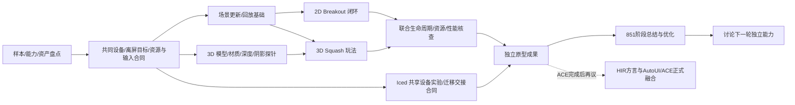

# Design 45：AutoGraphics 的 wgpu 引擎、游戏原型与 AutoUI 集成边界

> **作者模型回归（2026-10-30，用户确认）**：AG 的总体目标是用 **AutoUI 式的声明、组件、绑定和事件模型表达图形应用**，扩展到2D/3D节点；普通Auto模块与use承担复用，model/view/on可内聚也可拆分导入。JSON场景、单活动脚本、数字句柄及逐调用credits只描述已交付实验profile，不是长期作者要求。“可审计agent代码运行时”不作为产品定位；逻辑事务、故障隔离、渲染同步及诊断分别设计。一个最终呈现目标不要求单文件、单模块、单VM或单场景，双缓冲不推出游戏事务。作者树与运行存储分离，ECS是未来可选优化而非当前必做。目标要求与六项讨论建议集中在auto-ui的[声明与组件模型](../../../auto-ui/docs/design/autographics/declarative-authoring-model.md)；本文原型阶段记录与旧验收保留，不据此自动扩大在途合同或启动融合。

> **计划管理归属更正（2026-10-29）**：AG引擎计划在auto-ui/docs/plans，Gallery独立内容计划在ag-examples/docs/plans；跨仓计划由主责任仓持一份合同。882/883已迁至auto-ui（drafting r2），880最新收据已交付归档并迁至ag-examples。auto-lang原位置只留定位指引，历史Specs/设计本次未批量迁移；下文早期“中央Plan仍在语言仓”表述已由本条取代。

> 状态：目标态设计草案，2026-10-21；用户已授权调研/原型计划制定，尚未授权本轮启动实现。
> 首个执行合同：[PLAN-829](../plans/archive/829-autographics-independent-research-and-game-prototypes.md)。版本范围见 [v0.6](../roadmap-v0.6.md)，长期能力入口见[图形战略](strategy/autographics-forge-v06.md)。
> 本稿不改现行 Spec、AutoUI/RQHost 行为或迁移合同，不宣称任何游戏已经复刻完成。
> 2026-10-26 排期更新：当前以独立开发分支的851阶段里程碑为收口，之后先总结/优化，再讨论下一轮独立能力；AutoUI融合与ACE集成等ACE开发完成后再议。当前排期以[§12](#autographics-stage-851)为准，早期“迁移完成即可接线”的安排由此更新。

## 1. 已确定方向

首版渲染底层采用 **wgpu**，与 AutoUI/Iced 的 wgpu 路径共享设备、资源和合成基础；AutoGraphics 拥有场景、组合、2D/3D 与游戏公共语义。未来替换底层时共同适配 UI/图形渲染路径，公共资源身份和玩法不直接暴露 wgpu/Iced 对象。
Godot/Bevy 是功能、结构与游戏样本参照，不把整个引擎作为首版隐藏运行时。物理、模型、文本、音频等可复用库；不用全面重写所有基础设施。

2026-10-28补充[桌面/WebGPU/移动端边界](autographics/platform-architecture-and-research.md)：上述共享设备是原生GPU合成域的实现策略，不要求Vue/DOM控件持有GPU纹理/device。共同场景/运行语义通过renderer/平台服务适配各端，浏览器优先调研WASM/wgpu＋Vue/DOM宿主；DOM承载Canvas、DOM overlay与可采样UI进入3D分层协商，不能把任意DOM当纹理或把overlay认作深度正确合成。移动原生/移动Web分别验证输入/资源/生命周期。XP候选研究可与桌面线独立并行，874/875不变，本轮不实施适配，M2桌面验收不增跨端前置。

## 2. 首批样本与交付分层

| ID | 确定样本 | 能力用途 | 独立原型与正式复刻的区别 |
|---|---|---|---|
| AG-2D-01 | Bevy **Breakout** | 2D 几何/图元、输入、碰撞、计分文字、音效、生成销毁 | 先用 Rust driver 验证自有 core；真实 Auto 源码入口另验，不运行 Bevy 冒充 AutoGraphics |
| AG-3D-01 | Godot **Squash the Creeps** | 模型/场景、相机/材质/光照与阴影、角色移动/跳跃、敌人、碰撞/动画、计分/失败重开 | 同一自有 core 的 3D 原型；不以立方体、截图或 GDScript→Godot 路径替代玩法 |
| AG-MIX-01 | 真实 Iced 控件＋2D/3D 离屏视图的最小共享设备实验 | 同 Device/Queue、绘制顺序、alpha/裁剪、输入与退出 | 可用公开 Iced 构造独立宿主探针；不冒称生产 AutoUI 嵌套或 RQHost 已接通 |

源样本冻结到 PLAN-829 §4 的不可变提交。Breakout 源示例是封闭场地反弹/消砖计分，没有常见打砖块的掉球失败/生命系统；reset 属原型宿主附加能力，不伪称原规则。Bevy 专用 stepping 调试插件不是玩法兼容目标。Squash 的完整样本库存和资产清单由首个 work 任务盘点，不默默省略声音、动画、天空/阴影或输入形式；确需缩范围时显式回到 Plan 修订。

独立原型阶段交付研究决策、游戏/交互示例与复跑证据；真实Auto游戏已交付范围查current-state Specs和归档收据，不按本稿早期Rust driver描述推断现状。2026-10-26用户确定当前AutoGraphics按独立调研原型推进；完整生产UI嵌套、RQHost/Forge融合与ACE接线等ACE开发完成后再讨论，不再作为当前研究里程碑的生产集成承诺。原型交付不标记这些未来目标完成。

## 3. 开发顺序：共同基础先行，2D 先闭环，3D 提早并行



不等 2D 全部完成才碰 3D，也不各造一套设备/资源/场景/输入系统。先让 2D 提供较短的端到端反馈，3D 的高风险图形链同时验证；共同合同稳定后，维度专属模块和样例可以独立推进。
这描述工作依赖，不自动授权创建 agent/chat。PLAN-829 一树单写；将来需要多人实际并发写实现时，先按稳定交付边界分解后继 Plan，各自 worktree，公共核心一个 owner。

## 4. 最小分层

```text
当前：Rust 游戏 driver / 固定输入回放       后续：Auto SDK adapter / Forge
                         ↓                     ↓
        场景/对象身份、输入动作、时间/更新、资源与事件
                  ↓                       ↓
              2D 绘制/碰撞            3D 绘制/角色/碰撞
                  └──────────┬────────────┘
             wgpu renderer / 离屏目标 / 合成 / 生命周期
                             ↓
              独立 winit 宿主；公开 Iced 集成探针
后续：迁移后的 AutoUI 宿主/renderer adapter 与 RQHost
```

scene/model/API 不依赖语言 AST/VM Value、Man、Iced 控件类型；wgpu 对象留在 renderer/host 内。2D/3D 共用对象与资源身份、事件和时间合同，但可保留维度专属碰撞/渲染实现，不强行统一所有算法。
是否采用轻组件存储或局部 ECS、物理/音频/模型库、模型烘焙边界由有限 whole-path 实验决定，记录依赖/能力/成本后再接玩法，不预建“大而全框架”。

## 5. 与迁移及 AutoUI/Iced 的边界

独立实现放在 auto-lang 的新 `experimental/autographics-prototype/` 独立 workspace，独立锁与 target；不入根 workspace，不改根 Cargo/lock、现有 compiler/UI/runtime/provider。沿用仓库实验目录先例；最终生产归属为 auto-ui 图形域，实际迁入由后继 Plan 执行。

| 接缝 | 当前可交成果 | 未来集成需核的接口/责任（另须§12再议门） |
|---|---|---|
| GPU 与 UI 合成 | 公开 Iced+wgpu 的同设备最小探针 | auto-ui renderer owner 提供真实设备/队列与目标借用，统一颜色/alpha、帧序、resize/退出；不能仅对齐依赖版本 |
| Auto 源码/更新/事件 | 稳定命令/资源/输入与错误合同、消费方用例；Rust driver 为研究工具 | 语言 SDK owner 提供实际支持入口，adapter 位于 UI/图形侧；真实 Auto 源码控制游戏并接收事件，不以外部预编译玩法替代 |
| RQHost | 场景更新/资源身份/帧与输入的候选协议及进程所有权决策 | 迁移后的 host/protocol owner 接线；现有 CPU 记录/重放和轻应用目标单列兼容；跨进程不传 Rust/GPU 引用 |
| 嵌套与 Forge | 视图/对象身份、坐标映射与修改/回退需求 | 在真实 AutoUI 上验 UI→3D→UI、3D→UI→2D，补文本/焦点/IME与基础创作闭环 |
| 发行与旧资产 | 实验 manifest/锁/资产来源与独立复跑 | 管理工具消费公开协议/资源闭包；既有 examples/godot 与历史资产不删、不改默认入口 |

正式生产接线继续要求迁移负责人提供迁移路线完成与接口交付的冻结收据；2026-10-26新增排期门：等ACE自身开发完成后，再讨论AutoUI融合、图形归仓/主分支合入与ACE接线。当前保留autographics-dev独立研究分支；UI迁仓或旧AutoVM可运行均不单独放行集成。
ACE完成后的讨论再决定集成Plan、目标仓/写面与owner，不自动启动。既有原型Plan仍在各自worktree审查并落autographics-dev；SDK子集、独立Iced探针或原型验收不能代替ACE及生产迁移交接。详§12。

## 6. 完成证据与后续扩面

样本玩法、画面/声音、输入与状态、资源释放分别取证；固定输入与物理步长用于可重复回放，真实窗口用于交互与绘制，不能仅靠 headless 状态或截图证明全部通过。原实现与工程版本/资产及测量设备锁定，差异逐项说明。
优先补齐选中样本需要的能力。Tilemap、骨骼/蒙皮、复杂刚体/关节、完整动画编辑器、HDR/复杂后处理、联网/XR 等由后续样本驱动，首批不要求具备全部 Godot/Bevy 功能。
所有性能数字先实测；支持规模与资源策略通过早期实验写成有界 profile，不把无限资源视为架构承诺，也不随手加限制来掩盖未实现功能。

## 7. 829 后继：组合与嵌套输入实验

2026-10-22观察：829为reviewed r1（R18 PASS，10/11），合入/迁移交接等仍pending；不能把reviewed直接写成current Spec或D829。[PLAN-830](../plans/archive/830-autographics-surface-portal-composition-and-input.md)（drafting）承接其明确缺项：独立实验的 Surface/View/Portal、真实 Iced 离屏内容、GPU 多层合成与输入/焦点/IME。

下一步复用 Breakout/Squash，验证 UI→3D→UI、3D→UI→2D，以及独立内容实例/共享内容多挂载。Surface 内容状态、Portal 呈现/输入路径和渲染依赖分别建模；循环在提交前拒绝，多视图不重复推进模拟，GPU 纹理采样不经逐帧 CPU 图片往返。

830 不代修829验收、不修改生产UI/RQHost或语言核心；其代码消费前必须取得830 §2的G829交接。原型生产合入仍沿用迁移交接门；没有D829时，不得擅自把候选分支改称已发布依赖。830可完成独立复审，不因实验通过把I1–I3标记完成。

真正 Auto 源码接入、迁移后生产 AutoUI/RQHost、Forge与发行继续按§5实际owner/公开版本规划。此后续选择不新建第二渲染后端，也不要求先全面扩展游戏/物理/动画功能。

## 8. Draft 0.2 补编：AutoShader 与跨生态 CAP（2026-10-22）

此前独立的 AutoGraphics Draft 0.2 未在本次检索的项目镜像、auto-lang/auto-os 设计目录中找到；按《3D引擎方案比较》讨论重建的技术补编见[Design46：CAP System](46-context-profile-capability-cross-ecosystem.md)，战略补编见[跨生态编程战略](strategy/cross-ecosystem-programming-strategy.md)。这是讨论重建，不是原文恢复；本章已有游戏/组合、迁移与验收合同保持。

AutoShader 定位为 Auto 在 GPU graphics stage 下的场景接口，AutoGPU 为 shader/compute 等 GPU profile 族；不独立发明另一门语言。首个语言纵向切片建议 Auto→受检 device 表示→WGSL→wgpu，后续其他 backend 按实际支持另验。AutoRender/AutoGraphics 负责 host 侧绘制组织、资源和组合；host/device 之间用明确的参数布局、资源绑定、dispatch 与同步连接，不把 host 函数调用直接映射为跨设备栈调用。

可组合 Shader Components 是基础 shader 能力后的首个主打候选；CPU 共享数学函数、stage/地址空间/同步检查、宿主参数更新和设备资源生命周期构成首轮验证。Web/桌面/移动的产品目标按实施 Plan 分平台冻结，不由 wgpu 路线推导所有平台已经支持。

**新版 ACE 架构完成、基础 AutoGraphics 建立后，再启动完整 CAP 实现。** 图形独立原型可与 ACE 并行；A/B 两项进入门与实际交接证据见 Design46 §10。基础 AutoGraphics 需约定的真实 Auto 入口和宿主/图形链，829 Rust driver 或独立 Iced 探针不能单独认领。CAP 不扩张829/830或当前v0.6门槛，也不使原型成果自动变成 current Spec。

## 9. 近期路线细化：设计先行，830范围保持（2026-10-22）

[830 r2](../plans/archive/830-autographics-surface-portal-composition-and-input.md)仍以组合/嵌套输入为核心；T-02/04/08只补当前Shader资源布局、renderer边界及交接事实。新[AutoShader最小设计](strategy/autoshader-minimal-language-and-renderer-interface.md)描述ACE受检语义、有限CAP与WGSL/现有renderer接口；本轮不启动实现。

后续顺序：829有效交接→830组合/输入→真实Auto与基础图形接线；AutoShader设计现在进行，最小实现待实际ACE与图形接口具备后逐步接CAP首版，再做Shader Components。基础图形可继续手写WGSL，不以AutoShader完成为前置；不等完整游戏引擎或完整CAP全部扩面才验证最小Shader链。原生产迁移/发布门与v0.6核心承诺保持。

## 10. 后续规划：完整 AutoUI 与默认设计体系（2026-10-24）

用户确认在后续规划中加入完整公共组件接入和默认设计体系研究；统一范围与拟议验证见 [Design47 §16](47-autoui-state-design-and-feature-architecture.md#16-autographics-后续完整组件接入与默认设计体系2026-10-24)，排期候选见[远期 TODO](../roadmap-future.md)。**PLAN-840 的最小公共行为 API/用户脚本保持原范围，本次不实施。**

生产组件、布局、状态/事件与设计语义继续归 AutoUI，AutoGraphics 承担共享渲染、组合及输入映射。迁移完整交付后盘点全部公共组件、别名、组合组件及原后端差异，建立逐组件/后端/窗口与嵌套场景的兼容清单；复杂组件、overlay、IME/剪贴板、可访问性及平台服务不得用 button/input 探针替代验收。RQHost 跨进程路径保留独立证据。

默认设计研究沿 Design47 §7，复用主题/token/recipe，明确旧应用兼容与新设计包选择；主题沿逻辑 owner 继承，共享 Surface 多挂载的主题、弹层来源及缓存/失效先作决策。Vue/VM 的共同设计语义、真实交互与视觉容差分别验证，适用 Rust 与其他平台逐项列支持，不承诺自动全平台或任意组件像素等同。后续按实际基面分期立 Plan，不预排多个编号，不改变现行 I2/I3 与 master 图形合入前置。

## 11. 目标态：Schema 统一 UI、2D 与 3D 声明语义（2026-10-24）

### 11.1 已确认目标与本轮边界

用户确认：基于 Schema 统一传统 UI、2D 场景、3D 场景及其混合工程的声明方式，形成新版 AutoUI 的完整领域语义，并衔接 ACE 增量编译与热重载。本轮只补设计和[后续候选规划](../roadmap-future.md)，**840/845 目标、任务、验收和写面保持原样，暂不实施**；不新分配 Plan、改 canonical Spec、开启生产迁移或对在途841追加功能。

现状与目标分开：已观察的图形实验节点仍由 Rust Kind/Object/Group 与校验代码定义；scene/3 和845拟议scene/4是持久化格式。现有 [aura.at](../schema/aura.at)描述组件元数据，AutoUI文法仍有领域解析实现。上述事实不等于已有通用Schema驱动的UI/2D/3D语言。后续以迁移后的冻结来源重核，不把历史文件路径当最终实现归属。

统一的是作者声明、组合/绑定/事件的公共合同与可检查的领域模型；UI布局、2D坐标、3D空间仍各有规则。AutoUI拥有组件/领域语义，AutoGraphics负责图形资源、Surface/View/Portal、合成和输入映射。共同数据表示不要求把所有节点塞进一个无类型结构、共享同一状态实例或强行使用同一父子树；逻辑owner、场景层级、呈现挂载和渲染依赖图保持区别。暂不裁定产品改名或新的文件后缀。

### 11.2 Schema 的职责与分层

承接[Atom Schema设计](strategy/atom-schema-dsl-design.md)与[Design37领域解耦](37-v06-modularization-and-repo-boundaries.md#32-完全解耦)。Schema描述版本化领域数据及受限语法映射，表达式、函数、类型与控制流复用Auto核心语言；复杂领域扩展文法由具名owner提供并校验，不能宣称任意文法都可由字段表自动生成。

| 层 | 后续研究/冻结的合同 | 边界 |
|---|---|---|
| 节点/组件 Schema | namespace/type/field稳定身份、属性类型/单位/默认值、slots/children基数、引用、事件与payload、约束、版本演进、backend/capability要求 | 区分定义ID、持久对象ID、运行实例与修订；同名不代表同一类型或对象 |
| 作者语法与工具 | Schema到声明头部/属性/内容规则的映射、解析与诊断来源、补全/文档/属性面板、schema-first或code-first生成方向 | 每项契约一份权威源；生成的Rust/Auto类型、codec和编辑视图不再各自手改。默认值表达式若可执行，走受检语言机制而非Schema loader任意求值 |
| 领域语义 | typed UI/2D/3D模型、跨域引用/绑定、事件求值序、owner/状态寿命、坐标/布局边界、资源/能力与图结构检查 | Schema形状通过不等于名字/类型/所有权或运行约束通过，未准入模型不能进入执行器 |
| lowering/执行 | 受检领域操作与Core函数/表达式、所需HIR/MIR/ABC或其他适用目标、宿主资源与渲染adapter | 不把UI/图形专属字段重新焊回Core AST；渲染、物理、布局算法仍有实际实现，不由Schema自动产生 |
| 项目与分发 | 作者源码/Schema bundle、规范化领域数据、项目入口/资源闭包与版本映射 | 语法/Schema版本、IR版本、scene文件版本分别管理；不能把scene/4直接当新的语法或复用runtime指针持久化 |

拟议公共管线：**Auto声明＋固定Schema bundle → 领域解析/形状与语义检查 → UI/2D/3D受检模型 → lowering → ACE适用编译/执行服务＋AutoUI/AutoGraphics运行时**。Schema加载由显式版本与依赖闭包驱动，不隐式联网/执行插件。Schema演进须有兼容/迁移或受控拒绝，旧AutoUI源码、组件别名/样式及旧scene项目都有明确差异表。

Surface/Portal表达跨域组合，类型专属父子规则不因此放宽。例如2D/3D跨域呈现经明确挂载和坐标/输入变换，不能把2D位置直接当3D坐标。能力声明指向真实adapter/renderer支持；统一语言不自动承诺所有平台或任意引擎节点可用。完整CAP、AutoShader及物理/材质扩面仍按原进入门单独规划。

### 11.3 与841及现有图形计划的关系

| 工作线 | 已有职责／后续消费关系 | 本次不追加的范围 |
|---|---|---|
| [841](../plans/archive/841-ui-domain-ast-token-lowering-finalization.md) | 原831/832完整交付门保持；UI owned AST/Token/解析产物与中立Core准入/lowering、实际消费者和发行迁移。后继Schema声明消费其正式模型/来源/codec/扩展端口 | 841完成不等于统一UI/2D/3D语法、ACE产品接线或保状态热重载已完成；不修改其任务/验收、突破启动锁或为新目标预建通用框架 |
| 840 | 当前单文件Auto行为API/真实VM执行是未来编译服务消费者之一；正式API/签名/预算/源位置可作为适配输入 | 不加入领域声明语言、ACE增量或HMR |
| 845 | 单场景绑定、原始源码身份、角色与项目闭包可供未来声明/构建产物映射 | 不把持久化schema升级当语法编译器，也不加入HMR；内容寻址源码blob保持不可变 |
| 完整组件/设计体系 | [Design47 §16](47-autoui-state-design-and-feature-architecture.md#16-autographics-后续完整组件接入与默认设计体系2026-10-24)的组件分母、ThemeScope、recipe和跨端支持表进入统一领域模型的兼容合同 | 新Schema不能删旧组件分母、静默改变默认样式，或把设计包切换误作全部业务代码重编 |

后继生产AutoUI模型/语法接线须取得841正式交付以及届时真实owner/SDK/renderer接口。2026-10-26排期按§12等待ACE开发完成后再讨论图形行为适配与生产融合，取代此前按局部profile提前接线的候选安排；841现行解耦合同不扩张。需要改变其既定支持面/模型合同，先在后继设计明确兼容差额。

### 11.4 ACE 增量：从第一条接入用例建立依赖与复用证据

遵循[Design39](39-ac-incremental-syntax-and-language-platform.md)与[Design40](40-compiler-artifacts-and-cache-lifecycle.md)。首个ACE接入可以先保留显式Stop/Run，但其正式编译链从第一例就消费统一版本/产物/依赖/cache合同；不能把“先能运行”当作允许长期整模块热重编、以后再补增量的默认方案。语言/宿主支持必须覆盖所选真实脚本，scalar内核绿不抵扣数组/全局状态/回调/资源桥等实际需求。

Schema descriptor、语法映射、语义规则、lowerer、设计规则与宿主API都是具名版本化输入。按真实依赖记录所用组件/字段/规则指纹及源码、导入、target/profile/backend/ABI/runtime等身份，分别决定解析、语义、IR、代码及呈现失效；不以一个全域Schema hash无条件让所有未受影响函数重编，也不能漏记Schema变更而错误命中。字段/类型/事件或能力要求改变、默认值/样式改变、仅函数body改变应有可解释的不同失效路径。

验收同时观察正确性和粒度：fresh与增量结果/诊断等价；合法局部修改中未改函数的真实producer调用、产物IO与重装载为零（按所选已交付profile冻结）；Schema/依赖/ABI变更正确失效；跨进程恢复、旧版本拒绝与资源回收有效。耗时、hash命中或“复用了GPU模型”不能替代这些证据。编译产物可回收，845等用户源码/项目文件及仍被运行帧引用的代码不可当普通cache删除。

### 11.5 热重载：领域状态和代码发布共同验收

增量解析、增量编译、运行时热重载分别验收。消费ACE的代码代际/安装/快照机制时，以[当前常驻函数合同](../specs/auto-av/resident-function-install.md)的实际支持为基面，不能把有限函数替换自动推成任意UI/场景/原生资源迁移。状态与重载继承[Design47 §5–6](47-autoui-state-design-and-feature-architecture.md#6-热重载应用实例继续活着定义可以变化)。

拟议流程为：构建并校验候选Schema/领域模型/代码与设计 → 比较签名/状态schema/宿主资源兼容性 → 在所需安全点准备保留/迁移与资源重绑 → 发布一致版本 → 释放无owner旧代。处理在途callback/tick/异步任务：旧帧钉住旧代码，或按已支持的取消/drain规则退出；迟到旧generation结果拒收。候选失败保留旧代码和画面，不能混用新代码、旧布局与错误资源。

分别冻结样式/recipe更新、view/节点结构更新、兼容函数body更新、状态字段增删改型、原生ABI/不可迁移资源变化的策略。应保留的UI输入/selection、文档/undo、场景编辑内容、允许保留的运行变量/物体状态均有身份和owner；状态迁移使用受检schema/codec，不直接复制旧VM heap ID/裸句柄。无法兼容时明确拒绝或要求restart/rebuild，不无提示重置未保存内容。

开发期热重载不自动修改已保存项目或845 immutable源码blob。工作源码的新版本、开发预览overlay、显式项目更新/Save的关系须另作版本化设计；发布新预览与确认磁盘已保存是两件事。重复重载后VM/旧代码/订阅/GPU owner和cache有界，外部合法pin按最后owner释放。

### 11.6 后续研究与分期成果

Schema/领域模型/语法映射、兼容清单和身份/版本仍是长期设计输入。当前执行顺序见§12及[M2战略](strategy/autographics-m2-v06.md)：M1交付→M2/S0优化→网格视口/公共游戏能力；AutoUI混合工程、统一HIR方言及ACE/HMR接线等ACE开发完成后再讨论范围和实施计划。届时仍消费841等正式端口，首例包含真实增量/依赖/资源证据，热重载按状态兼容矩阵另验；当前M2不提前启动集成。

研究交付必须包含可区分的后续用例：同源混合工程在支持后端正确运行；合法嵌套与非法引用/跨域坐标/循环拒绝；Schema改版和旧项目迁移；局部修改未改函数不重算、强制整模块退化反控；同body不同Schema/ABI不错误复用；样式更新正确paint/layout失效；在途旧tick/回调与新版本切换；迁移失败保旧、保未保存状态；多轮更新最后owner释放。用例当前均未实施，不因本章存在宣称语法、增量接线或HMR已交付。

<a id="autographics-stage-851"></a>

## 12. 851 阶段收口与 ACE 完成后的再议门（2026-10-26）

2026-10-28交接更新：长期决策/当前入口集中于[路线跟踪快照](autographics/tracking-handoff-2026-10-28.md)与[M2战略](strategy/autographics-m2-v06.md)。观察874树已有实现WIP、877 executing/仓树已建，875/878未交付；不能用本章早期“未实施”措辞覆盖其他会话最新授权/记录。M1历史源11911a4a与当前tag peel679681b3有未核映射差异，快照保留两种身份；本次不移动标签或改历史证据。

用户确定：AutoGraphics暂留`autographics-dev`独立开发分支，继续独立图形/游戏能力研究。既有旧AutoVM/SDK adapter用于当前实验与对照，不新增旧A2X生产集成路线。旧AutoVM/A2X尚未迁入新版HIR，AutoUI拆分/迁移完成不等于具备统一声明和执行基础；图形归入AutoUI或生产主分支、与ACE集成均等ACE自身开发完成后再讨论。

2026-10-28时机讨论补充：auto-ui独立交付已落定，技术上应区分“实验源码归仓”与“声明/宿主/ACE生产融合”。现提出[纯归仓候选](autographics/repository-move-and-integration-gates.md)：874/875实际交付冻结后，先以auto-ui下独立experimental workspace/锁/旧SDK承接；它可早于ACE，但需另立跨仓切源/验证/恢复Plan。本轮只是排期调整建议，未启动迁仓或自动撤销既定进入门，当前权威仍留auto-lang/autographics-dev。正式新增仅[877 GY-A](../plans/archive/877-autographics-gallery-catalog-and-basic-six.md)与[878 XP-0](../plans/archive/878-autographics-platform-boundary-and-dependency-audit.md)，二者独立写内容/报告，均暂不实施；878只读评估归仓触面，不执行搬仓。

当前以[851](../plans/archive/851-autographics-bounded-move-and-slide.md)作为独立交互原型的阶段功能终点。其实际完成须包括独立最终复审、冻结merge-owned门、落autographics-dev及知识/归档收尾；work完成或代码提交不冒认里程碑交付。本决定不改849/851、841或ACE在途Plan的任务、支持面、预算、验收与进度。

2026-10-26阶段核查：851 r4已归档交付10/10，源码`11911a4a6d809bfd515f745b77d00bc8f04f6ba9`保留于autographics-dev；本阶段进入总结与优化。原始目标/当前能力/长期差距和有证据的优化候选见[阶段总结](../reports/autographics-milestone-851-2026-10-26.md)。该核查复用冻结review/merge运行证据，并独立校验源码/SDK/日志/产物身份，没有重新执行原生/GPU或性能测试，也不代表生产融合完成。

同日后续用户决定：该提交已建立本地附注标签`ag-v0.6-m1`；优化作为M2起始阶段，随后以网格编辑视口、公共接口驱动的2D平台与3D平台探索游戏形成M2。正式样本各自仓外管理，小资源随项目、大资源固定版本按需下载并提供完整离线包。当前合同见[M2专题设计](autographics/m2-editor-and-public-game-prototypes.md)与[M2战略步骤](strategy/autographics-m2-v06.md)；后续状态按M2战略及实际Plan收据更新。M1终点不是后续研究终点，M2未交付。

851实际交付后，下一步先做**阶段性总结和优化**，再讨论继续深挖的能力。总结以冻结提交/原始证据建立能力与限制清单，覆盖UI合成实验、2D/3D、资源/场景编辑、真实Auto行为、查询/运动；区分已交付、实验支持、已知限制和未实现，不把有限profile推成完整引擎。记录真实用户流程、复跑/项目搬迁、错误恢复与资源退出。

优化按证据选择CPU/编译/回调/帧时、内存/最后owner、扫描/上传、重复实现和验证可靠性；保持旧语义/预算/样例/counter AND内容。S0/S1、858 Phase1与860/861已交付；近期[874公共3D角色](../plans/archive/874-autographics-public-character3d.md)→[875运行相机](../plans/archive/875-autographics-runtime-cameras.md)保持原范围/验收，详[运行设计](autographics/m2-runtime-and-character-control.md)。2026-10-28追加[Gallery/three.js能力矩阵](autographics/m2-gallery-and-capability-matrix.md)：首12项分四波，独立ag-examples小内容/资源可与引擎线并行，实际支持随能力Plan交付；两游戏仍各自独立仓。原路线9–12份＋Gallery净增2–3份，暂估11–15份含874/875，不预取号。本轮仅规划，未实施Gallery/建仓/发布，不提前集成ACE/AutoUI。

总结/优化形成阶段报告、已清偿与剩余债务和性能资源前后对照后，按M2战略细化下一份独立能力Plan。此前估算的额外3～5份计划不是执行承诺；M2功能目标已讨论，但不自动给全部物理/重力/动态对象取号或开工。

长期共同基础明确为**Atom＋Schema定义的新版HIR**：普通Auto、AutoUI（含UI/2D/3D）和AutoShell是不同方言，拥有各自语法映射、领域语义及校验/lowering，消费统一ACE。Schema形状、来源/版本和语义准入保持分层；逻辑owner、布局/场景层级、挂载及渲染依赖仍各司其职。未来同仓分模块的auto-ui归属方向保留，实际迁入与统一体系融合不在当前阶段启动。

“ACE完成”依其[现行成熟度与旧路径替代合同](../plans/reports/ace-milestones-version-boundary-2026-10-24.md)的实际交付收据判断，不能用有限scalar/HIR/AV原型或SDK子集替代。ACE完成后重新讨论AutoUI/AutoGraphics共同声明、真实宿主/资源/执行接口、集成范围与兼容/增量/HMR验收，再制定计划；不因满足依赖自动开工，不要求在当前AutoGraphics研究中实现ACE或AACE。


## 13. M2运行对象、触发与新局事务（2026-10-29，拟议合同）

879已交付，AG唯一开发权威为auto-ui/experimental两独立workspace（源4adf2d03）；语言仓保留中央Plan、canonical Specs及历史。880在ag-examples独立树固定消费旧875；下述新能力不写该树或追改其输入。纯归仓不等于生产UI/HIR/ACE融合。

下一阶段按仓拆分为[auto-ui/001有限运行对象](../../../auto-ui/docs/plans/001-autographics-runtime-object-lifecycle.md)→[auto-ui/002触发与新局引擎](../../../auto-ui/docs/plans/002-autographics-trigger-events-and-round-restart.md)→[ag-examples/001 G11](../../../ag-examples/docs/plans/001-autographics-gallery-runtime-objects.md)。001已有实施树，本轮不接管；002与G11均未实施，前者等001实际交付，后者等002实际交付。引擎只写auto-ui，Gallery只写内容仓，各自独立review/merge，无循环依赖。

### 13.1 三种身份与有界对象

编辑Document的持久u64 ID、旧Run内节点ordinal、运行实例(run,slot,generation)三域分离。第一版只从当前已接受资源的叶模板实例化根级平移对象，最多8个预留运行槽；base groups+leaves+预留槽容量合计≤128，3D最坏潜在mesh实例仍≤512。槽是存储策略，不是可复活的对象ID：spawn产生新代次/正式注册，despawn撤销身份/渲染/查询资格；隐藏活对象保持身份。旧handle不得操作同槽新实例或新Run，代次耗尽受控拒绝、不回绕。Run/generation/模板/槽位在传输与消费处保持整数类型，不经float截断。

父子/模板递归生成、动态资源导入、动态solid/移动平台/自由刚体、动态角色/相机目标不在初版。静态角色和静态solid维持原冻结/碰撞语义；运行对象用于物品/非solid敌人/触发标记及表现占位。实例数据单独为Run拥有，不写scene4/编辑dirty/历史；Stop恢复编辑Prepared。

受信Auto提供对象表/代次/写入与几何计算，用户Auto决定生成/销毁/巡逻/收集/胜负；Rust提供实际资源描述与完整来源/状态转移准入、系统输入、GPU准备和发布。新显式profile/装配隔离旧版本。不可将显隐开关包装为销毁，或由Rust识别场景名执行金币业务。

### 13.2 事务和失败

对象集合/角色/相机/有限事件结果共用一个Run/tick候选，经完整准入、prepare、accept、publish一次提交；新对象或事件不得先于失败候选泄漏。旧代码固定`4+22*N+camera`的数据帧和静态Descriptor不能直接接受任意拓扑；新profile必须有受检对象扩展、模板/槽/代次/预算/操作转移证明，不能只改count检查。上限、源空间、VM步数与时间不加预算；先用真实Auto整路径证明角色+相机+对象/后继触发组合，不足回new。

882先支持精确对象注册/平移/显隐/撤销，883再消费其几何及代次建立最多8对显式触发。触发在本tick移动完成后评估一次，结果按配置顺序且身份带Run/tick/pair/phase；连续重绘或重复读取不再发业务事件。AABB采用旧闭区间语义；冻结G2/G3半径0.5的区域必须支持真实2D圆/3D球与角色AABB相交，不能静默用包围盒替代。销毁后的既有结果只保留本tick有界只读快照，不授权旧handle操作新实例；后续无旧事件、无自动绑定同槽新代。

### 13.3 新局与分期

用户Auto决定Playing/Won/Failed及Enter请求；Host不拥有胜负。接受的restart请求触发同一调度栈的新Run/新VM，源码使用原已接受字节与配置；不重新读外部可变文件。新初始帧准备期间保留旧last-good；新初始化失败保旧呈现并具名Fault，旧Run输入/对象/事件/迟到结果均不能进入新Run。中立Step不能合成Enter，暂停时不执行新局，Stop仍恢复原编辑内容。

auto-ui/001提供生命周期夹具，auto-ui/002提供触发/一次收集/重开引擎夹具与可验证消费交付；独立ag-examples/001在002实际合入后制作G11两维项目/目录/锁/离线包，不改引擎，旧880已交付。它们不是两款完整游戏：动画/视觉朝向、纹理/精灵、声音/HUD和完整游戏/发行仍需后继。实施前须冻结资源价格和整路径可行性；本节不声称已实现接口签名/内部profile编号。
