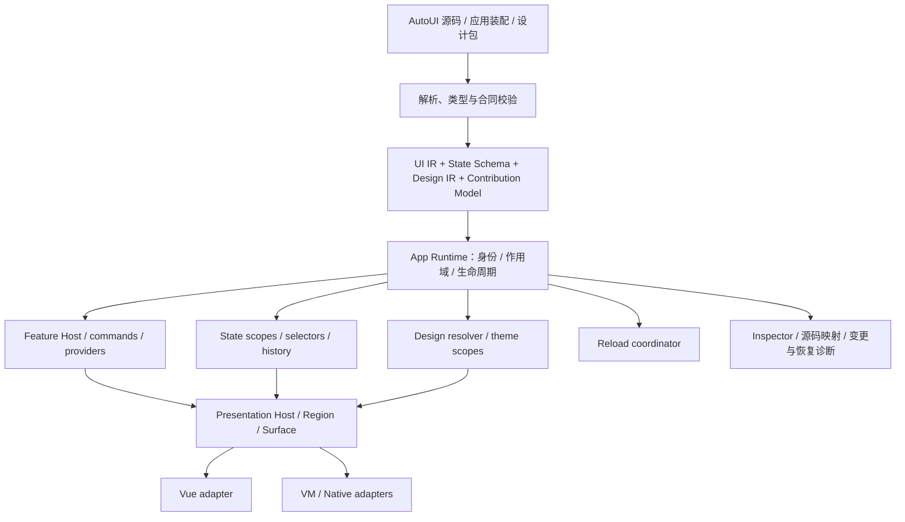

# 47 — AutoUI 应用架构：状态、热重载、设计体系与功能复用

> 状态：Draft RFC，研究与讨论稿，2026-10-22；未冻结语法、接口或实施范围。
> 代码基线：`v0.5.0`，解引用提交 `e05e2d3d7832c7f1d7e29a09a371648b5a53f692`（2026-10-12）。
> 标签对象：`73a24f29160631deb7c3b754826bfd371af5301f`，与上述 commit 区分。
> 本轮工作：只读源码调研、官方资料调研、架构提案；不实现、不创建执行 Plan、不运行构建或测试。
> 2026-10-29 后续规划及范围补充：用户同意先约定并做小样，进一步明确从 examples/ui 逐 app 改新主题、提供未来供 AutoOS 默认使用的官方系列。当前[主题设计](../../../auto-ui/docs/design/autoui/theme-conventions-and-pilot.md)、[逐目录清单](../../../auto-ui/docs/design/autoui/theme-migration-inventory.md)与唯一 [auto-ui/PLAN-007 r3](../../../auto-ui/docs/plans/007-autoui-tree-theme-and-examples.md)已归UI仓；同计划纳入全部示例源码归位auto-ui/examples/ui、实际路径回接和002/005首批主题接入，不新建ui-examples。其余应用主题分批交付。v0.6目标见roadmap§2.3，实际实施仍按既定结构收口门；本轮只迁设计/计划、语言源号已释放，未改应用。上行“本轮”保留原研究阶段边界。
> 排程更新（2026-10-28 用户决定）：先完成近期拆分治理与语言/UI/Man 结构收口里程碑，再恢复本架构的深化设计和实施规划；独立仓迁移完成或 U867 单项成立均不足以提前启动。完整有限范围见[当前战略](strategy/modularization-and-refactoring-strategy.md#autoui-架构重设计的切换点2026-10-28-用户决定)及[总路线§2](../plans/reports/v06-extraction-execution-roadmap.md#2-交付里程碑与有限出口)。本文及相关语法草案保留为候选输入，届时按独立仓冻结版本重核，不向近期结构包追加新语义。
> 关联：[Design 29](29-autoui-style-theme-system.md)、[Design 32](32-autoui-repo-extraction.md)、[Design 34](34-vm-store-ownership-and-handler-discipline.md)、[Design 38](38-autoui-features-and-system-services.md)、[App Presentation Host](autoui/app-presentation-host.md)、[Blueprint 契约](../specs/blueprint/contract.md)。
> 使用方式细化：[Editing Feature 嵌入语法草案](autoui/editing-feature-syntax.md)（Draft v0.2，2026-10-28）：open/bind/split 默认组合、两个实例与 bound UI/action、菜单及快捷键；显式层仍保留，未实施。
> 2026-10-24 后续规划补充：用户确认将 AutoUI 完整组件接入 AutoGraphics、默认设计体系纳入后续研究，范围见 §16；PLAN-840 保持原范围，本轮不实施、不冻结新的组件或样式合同。

## 1. 核心判断

AutoUI 已经具备组件、模型、事件、共享 store、主题和 recipe 的基础；问题是这些机制尚未构成统一的**应用语义层**。组件声明与代码生成比“实例如何存活、状态属于谁、设计如何组合、功能如何装配”更成熟。

建议围绕四组互相衔接的合同演进：

1. **Scoped State：有身份、有归属、有生命周期的状态。** 支持显式共享、细粒度订阅、受控变更、可选择的事务/历史/持久化。
2. **Reload Contract：代码替换与状态存续分离。** 基于稳定实例身份、状态 schema 和 effect owner 做保留、迁移、局部重建或明确拒绝。
3. **Design System：设计也具有类型、接口、组合和发布单元。** token → 语义角色 → 多部件 recipe → 设计包，而不止颜色主题或 class 别名。
4. **Feature Composition：领域功能可以有多个 UI 出口。** 复用领域会话、命令、配置和视图，由 App 决定装配位置。

四者的公共基础是**身份、作用域、生命周期和依赖关系**。它们共享底座，但不应被合并成一个万能 store：主题解析、文档历史、异步查询、布局和插件装配各有自己的合同。

这也不是对 Vue 或 Iced 的否定。Vue 有 props/events、provide/inject、共享状态等机制；Iced 的 state/update/view 允许自行组织领域模型。AutoUI 需要在两条执行路径之上定义自己的应用合同，使应用作者不再为每个后端补接线。

## 2. 调研方法与事实边界

### 2.1 代码证据

以下路径和行号均属于 **v0.5.0**，通过 `git show` / `git grep` 读取；迁移中的当前磁盘路径可能已变化。行号只定位冻结基线，不应当作当前 HEAD 的链接。这里是静态检查，未用运行结果证明所有路径的实际表现。

| 编号 | 基线证据 | 已观察事实 | 对设计的约束 |
|---|---|---|---|
| E01 | `crates/auto-lang/src/aura/types.rs:402`，`AuraStore` | 已有 state、messages、handlers、computed、watchers、timer、stream 等 store IR | 不是从零引入 store；应为现有声明补实例/作用域合同 |
| E02 | `crates/auto-lang/src/ui_gen/vue.rs:18818` 起，`generate_store_composable`；`:19164` 起 | 共享 store 生成模块级 ref 的 singleton composable；SSE/timer 有模块级 guard | “模块”与“运行实例”需分离，同一包两次嵌入不能自动共用模块单例 |
| E03 | `crates/auto-lang/src/ui/vm_bridge.rs:819` 起，`new_from_decls` | 根合成路径把 child/store 的部分 model 字段按名字去重合入根状态 | 字段同名不是共享依据；同一组件类型应允许多个独立实例 |
| E04 | 同文件 `:1655`，`ensure_child_state` | 该 props 路径写 ROOT state 并返回 root ID；参数含 widget name，但此处不据此分配实例对象 | props 的 owner 和 target 必须成为真实语义，不能继续靠写入时序模拟 |
| E05 | 同文件 `:392` 起，`InitDemand` | 已用 identity/generation 调度 Init；注释明确说明统一根 props 被后渲染者覆盖，因此保存快照再播种 | 已有代际/调度资产可用；仍需从 widget 名/临时快照升级为实例作用域 |
| E06 | `crates/auto-lang/src/ui/handler_codegen.rs:855`、`:873`、`:2439` | 相关 store 访问改写和根状态字段合成具有展平逻辑 | 不能只新增 parser 语法；handler receiver、view evaluator、写屏障也要改变 |
| E07 | `crates/auto-lang/src/ui/dynamic.rs:2131`，`reload` | 读旧状态、新建 VmBridge、写迁移结果、换模板；传给迁移器的旧字段定义为空；写结果被忽略 | 简单保值机制已有，但不足以承诺类型安全的应用级恢复 |
| E08 | 同文件 `:2190`，`check_file_changed` | 存在 imports 或非空 widget registry 时返回无变化；源码说明是避免多文件/store/handler 丢失 | 主要多文件路径的整源热重载有明确保护性跳过；不是只差监听文件 |
| E09 | `crates/auto-lang/src/ui/state_migration.rs:57`、`:126`、`:159` | 按字段名保留；缺旧类型时乐观保留；复杂类型用 unique name 近似比较；默认值只覆盖部分 AST 形态 | 类型名不等于布局/schema 兼容；默认值不能靠第二套不完整解释器求值 |
| E10 | `crates/auto-lang/src/design_tokens/registry.rs:1`、`:26`、`:278` | 已有 CSS/RGB 同源 ThemeSpec，31 个封闭 color token，多个内置主题 | “没有语义 token/单一值源”已不准确；缺口是类型范围、扩展和设计包 |
| E11 | `crates/auto-lang/src/design_tokens/decl.rs:53`、`:158`；`recipe.rs:20`、`:540`、`:601` | 已有主题声明/组合，以及参数化、导入、校验、编译期展开的 style recipe | recipe 不只是变量；需要从单串展开继续发展多部件、变体和契约 |
| E12 | `crates/auto-lang/src/ui/style/theme/mod.rs` 的 thread-local 状态 | dark/accent/active theme/epoch 存在线程局部环境 | 应显式传递 ThemeScope；不能把 thread-local 等同于 app、window、subtree 的所有权 |
| E13 | `crates/auto-lang/src/ui/action_config.rs:256`、`:360`、`:366` | shortcut 冲突 first wins 并告警；ACTION_CONFIG / DSL_ACTION_CONFIG 是进程静态表 | 多 App/多 Feature 的命令、目标和冲突需实例化治理 |

E03/E04 描述特定合成与 props 路径，**不表示 VM 中所有对象都被展平、完全没有独立 store 对象**。已有 own-module 绑定、可寻址实例对象和子状态诊断；新设计要统一这些分叉，而不是用“全局一个对象”概括全部实现。

`ui/hot_reload.rs` 另有 Node 文件监听/替换机制，`ui/interpreter/bridge.rs` 也有 reload/migrate 入口。它们的存在不证明主 DynamicComponent 多文件执行路径具有完整热重载合同；不能按文件名或旧注释拼成能力结论。

### 2.2 现有文档与本提案的关系

| 文档 | 关系与本轮处理 |
|---|---|
| [Shared Store](autoui/shared-store.md) | 历史模块级 singleton 设计解释了现状；其中“无共享状态”的早期背景不能作为 v0.5.0 事实 |
| [Design 29](29-autoui-style-theme-system.md) | theme/recipe 主线已有实现，但文首仍写 Draft；本轮以 E10/E11 校正认识，不重写历史文件 |
| [Design 34](34-vm-store-ownership-and-handler-discipline.md) | 保留单写者与异步段纪律；本提案补受控写入/事务，不要求全面 actor 化；历史 CPU 调度判断需按迁移后基线复核 |
| [Design 38](38-autoui-features-and-system-services.md) | 2026-10-14 草案，晚于标签；已有 Feature/Feature Pack 命名与多出口方向，作为提案输入，**不当成标签已有能力** |
| [App Presentation Host](autoui/app-presentation-host.md) | 同属标签之后草案；沿用 Region / Section / Surface / Contribution，不另造竞争性宿主 |
| [Blueprint 契约](../specs/blueprint/contract.md) | 当前文档已规定 L1 import/bind 零副本、L2 copy、L3 agent generation；不能仅用早期“Blueprint=模板”解释现状 |
| [Design 32](32-autoui-repo-extraction.md) / [Design 37](37-v06-modularization-and-repo-boundaries.md) | 本轮不向正在迁移的链路追加改造；新的实现归独立 auto-ui；语言 ABI/包工具调整分别归原 owner |

## 3. 外部调研：借鉴机制，而非绑定某个库

查阅日期：2026-10-22。下表“借鉴/不采用”是本提案判断。外部框架的 JS/CSS 实现不会自动给 VM、Iced 或生成式 Rust 带来同等语义。

### 3.1 状态与热重载

| 体系 | 官方依据与机制 | AutoUI 的取舍 |
|---|---|---|
| Vue / Pinia | Vue 区分组件与共享状态；Pinia 支持 store HMR，保留既有 state 并更新 actions/getters。[Vue](https://vuejs.org/guide/scaling-up/state-management.html)、[Pinia HMR](https://pinia.vuejs.org/cookbook/hot-module-replacement.html) | 使用“数据实例与行为版本分开”的思路；不把模块单例当成全部实例模型，也不要求 VM 实现 Pinia |
| React | key、类型与渲染位置参与状态保留/重置。[官方状态身份说明](https://react.dev/learn/preserving-and-resetting-state) | 组件实例需稳定 key；长期文档不能依附渲染位置，否则搬面板就丢会话 |
| MobX-State-Tree | typed tree、snapshot、patch、action、identifier/reference 可结合，快照可恢复树状态。[Snapshots](https://mobx-state-tree.js.org/concepts/snapshots)、[Listeners](https://mobx-state-tree.js.org/concepts/listeners) | 借鉴所有权树＋引用关系、局部快照/补丁；不复制原生大资源或把所有 UI 字段都纳入历史 |
| Solid | signals/observer/memo 支持细粒度依赖更新。[官方说明](https://docs.solidjs.com/advanced-concepts/fine-grained-reactivity) | 细粒度订阅是性能轴，与状态 scope/undo 是不同轴；可先在字段/selector 层提供 |
| Redux | 对选定 state subtree 组织 undo history。[官方历史设计](https://redux.js.org/usage/implementing-undo-history) | 用于小型表单/配置等通用状态；文本编辑继续使用领域增量历史，避免全文历史复制 |
| XState | actor 有封装状态、消息与受控生命周期。[Actors](https://stately.ai/docs/actors) | 复杂保存/连接/任务流程可用显式状态机；不强迫每个计数器或组件成为 actor |
| TanStack Query | 将远端数据的获取、缓存、同步作为 server-state 问题。[Overview](https://tanstack.com/query/latest/docs/framework/react/overview) | 区分远端缓存与用户草稿；回滚本地状态不能伪装为回滚远端事实 |
| Vite | HMR 提供 accept/dispose/data 等底层生命周期机制。[官方 API](https://vite.dev/guide/api-hmr) | 只作 Web transport/adapter；AutoUI 自己决定状态迁移、资源清理、失败边界 |
| Flutter | hot reload 保留状态并重建 UI，不重跑 main/initState；某些变更需要 restart。[官方说明](https://docs.flutter.dev/tools/hot-reload) | 明确 reload/restart 两种能力；不承诺所有代码、ABI、schema 都无损更新 |

旧 Vue Loader 文档的 template/script/style 分级也有参考价值，但它针对自身工具链；本提案不拿它作为当前 Vue/Vite 的完整实现保证。

### 3.2 样式与设计系统

| 体系 | 官方依据与机制 | 可吸收的设计 | 不直接照搬的部分 |
|---|---|---|---|
| Tailwind | theme variables 关联 token 与 utility 生成。[Theme variables](https://tailwindcss.com/docs/theme) | utility 是设计系统的低层消费 API；保留现有简洁写法 | 当前官网语法不等于 AutoUI v0.5.0 的 v3.4 兼容合同；不随调研自动升级语法 |
| Panda CSS | token、recipe、slot recipe 组织多部件与变体。[Tokens](https://panda-css.com/docs/theming/tokens)、[Slot Recipe](https://panda-css.com/docs/recipes/slot-recipes) | root/icon/label 等 parts 共用 variant；生成类型和样式产物 | CSS extraction 的技术实现并不适用于 VM，需语义 IR |
| vanilla-extract | theme contract 先声明键形状，再分别实现主题。[createThemeContract](https://vanilla-extract.style/documentation/api/create-theme-contract/) | 把“角色接口”和“主题赋值”分开；缺键和类型不符可检查 | 不把 JS 对象或 CSS var 本身当跨后端合同 |
| Material UI | theme 可设置组件默认属性、slot styles、variants。[Themed components](https://mui.com/material-ui/customization/theme-components/) | 主题不只换色，还包含组件默认密度、形状和变体组织 | 不采用任意 DOM selector 深改内部结构，也避免整个主题表强制打包所有组件 |
| Qt Quick Controls | background、contentItem 等控制部件可定制；样式部件需要协同。[Customization](https://doc.qt.io/qt-6/qtquickcontrols-customize.html) | 原生组件也需要可公开定制的部件合同 | 不把任意 QML 可替换性直接承诺给 Iced 每个现有控件 |
| DTCG | Format 定义类型化交换数据；Resolver 定义多 context 下的组合解析。[Format 2025.10](https://www.designtokens.org/tr/2025.10/format/)、[Resolver 2025.10](https://www.designtokens.org/tr/2025.10/resolver/) | 作为 token 交换边界，显式版本、类型、alias、模式解析 | DTCG 是 Community Group 规范，不宣称为 W3C 标准；它不定义整套组件皮肤与交互 |
| Style Dictionary | token 可以经过平台变换形成多种消费产物。[Design Tokens](https://styledictionary.com/info/tokens/) | 构建期多目标生成；保留来源信息 | 工具可替换，不把 Node 依赖强加给所有 AutoUI 运行时 |
| Figma | collections/modes/aliases 可经 Variables API 读取/维护。[Variables](https://developers.figma.com/docs/rest-api/variables/)、[Endpoints](https://developers.figma.com/docs/rest-api/variables-endpoints/) | 通过 adapter 导入规范化 token，并保存稳定设计 ID 与映射 | API 有账号/计划限制；不能假设所有用户都可自动同步，也不能从变量自动推导全部组件行为 |

结论：**设计系统需要一门有类型和组合规则的设计表达体系，但不必再发明一门完整编程语言。** 优先复用 Auto 的模块、类型、函数式组合与编译期能力，只新增无法由这些能力清楚表达的 UI 合同。

### 3.3 功能复用

VS Code 的贡献点涵盖 commands、menus、keybindings、configuration、views 等；JupyterLab 的 requires/optional/provides 把包、功能和 provider 解耦，并专门讨论跨多个 App 的扩展兼容；Theia 区分构建期深度组合与运行期扩展。[VS Code 贡献点](https://code.visualstudio.com/api/references/contribution-points)、[JupyterLab 插件](https://jupyterlab.readthedocs.io/en/stable/extension/extension_dev.html)、[多 App](https://jupyterlab.readthedocs.io/en/stable/extension/extension_multiple_ui.html)、[Theia](https://theia-ide.org/docs/extensions/)

AutoUI 适合组合三者的机制：**声明式贡献＋能力依赖＋构建期先行**。不承诺运行现成 VS Code 插件，也不把所有 App 固定为编辑器工作台。

## 4. 总体架构：树管理归属，图管理依赖

建议把过去隐含在根 widget、模块和 renderer 中的职责提升为显式 App Runtime 合同。这里是逻辑职责，不预先决定 crate 数量。



必须区分四种结构：

| 结构 | 回答的问题 | 示例 |
|---|---|---|
| Ownership tree | 谁创建、保留、释放这份状态/资源？ | App → Workspace → editing instance → document session |
| Presentation tree | 现在把哪些 UI 放在哪里？ | Window → split → sidebar / editor / inspector |
| Dependency graph | 谁读谁、引用谁、需要什么 provider？ | sidebar 与 editor 同读 document selection |
| History streams | 哪些用户操作可作为一组撤销？ | 文档编辑历史、独立的主题草稿历史 |

它们可以关联，但不能强制同构。编辑区从中间移动到底部，只改变 Presentation tree；文档 owner、buffer 和 undo 不变。跨窗口共享的 workspace 状态归共同 owner，不能同时挂成两个窗口的 owned child；两个窗口持受控引用。

## 5. 状态系统

### 5.1 区分状态种类和保存策略

`model` 继续表示组件自己的模型，`store` 继续表达可独立消费的状态/行为模块。两者底层统一使用状态实例机制；不再额外引入一个意义模糊的 `state` 存储世界。

| 状态 | 默认 owner/寿命 | 处理建议 |
|---|---|---|
| hover、pressed、IME composition、临时拖拽 | renderer/view | 瞬时，不持久化，不进入通用 undo；HMR 不强求保留全部平台瞬时态 |
| 光标、滚动、折叠、面板布局 | view/window | 可选恢复，按 view identity 隔离 |
| 表单草稿、筛选条件 | 明确的表单/Feature scope | 可选事务、reset、局部 history、持久化 |
| 文档 buffer、dirty、encoding、undo | document session | 由领域内核持有；view 卸载不销毁文档 |
| workspace、选中资源、领域会话集合 | workspace/Feature | 显式共享给多个 presenter |
| 远端资源 cache、loading、error | query/resource scope | invalidation、过期和取消；不复制成多个私有“权威数据” |
| 用户偏好、主题选择 | app/profile/config provider | 有 schema 的持久化，范围与覆盖规则清楚 |
| socket、文件句柄、rope、GPU 资源 | resource owner/provider | 受控 handle；不当成可随意 JSON 化的 model 值 |

**可热保留、可持久化、可撤销是三个独立属性。** 一个文档句柄可在同进程 HMR 中存活，但不能直接序列化；hover 不需进历史；可序列化的服务端 cache 也不等于能撤销服务端写入。

### 5.2 实例身份

至少区分以下概念：

- 定义身份：包/模块/声明 symbol，表示“什么类型的组件或 store”。
- 运行身份：app session、owner scope、实例 key，表示“哪一份实例”。
- 状态槽身份：实例＋字段的稳定声明 ID，表示“哪一份数据”。
- 资源身份：provider/workspace/URI 或领域资源 ID，表示“哪个文档”，不等于 view key。
- generation/revision：防止已释放实例、旧代码或旧资源请求继续写入。

普通组件可由稳定调用位与显式 key 形成实例身份；循环内有状态组件必须检查重复 key。源文件行号、数组 index、widget 类型名、文件 basename 都不能单独作为长期身份。

跨布局移动的 Feature/document session 必须有显式长期 ID，不依赖调用位。rename/move 不能靠字符串碰巧相同来猜测迁移，需声明映射或明确视为新实例。状态槽的自动 ID 稳定性与显式 ID 逃生口需在后续 parser/IR 设计中验证，不承诺任意重构都自动无损。

### 5.3 通信机制按关系选择

| 关系 | 推荐合同 | 例子 |
|---|---|---|
| 父 → 子 | typed、默认只读 props | 文件列表接收 items/selection |
| 子 → 父 | typed event / callback | 列表发出 Select(resource_id) |
| 受控双向值 | 显式 binding，展开为读值＋update action | 表单输入修改父草稿；不是取得父任意字段写权限 |
| 子树共享 | typed context/provider，scope 内解析 | 页面注入当前 document session |
| 远距离 UI 节点 | 同一领域 store handle + selector/action | sidebar.SelectDocument → Workspace.selection → editor/outline 同步 |
| 命令跨 Feature | scoped command + typed payload + instance target | editor.save，指定当前 document/view |
| 瞬时通知 | scoped typed event，明确订阅寿命 | documentSaved、连接断开；不作为持久状态真相 |
| 跨 App/进程 | service/intent/provider protocol | 打开文档、外部索引服务；不是任意访问另一个 App 的状态树 |

建议 provider key 带类型和命名空间；默认就近查找，必要依赖缺失报错，optional 依赖返回显式缺席。多个候选 provider 的选择要由绑定决定，不能受 import/安装顺序影响。开发工具显示解析来源，防止“最近 provider 意外遮蔽”成为难查隐式依赖。

用户提出“系统地访问某节点状态”，应提供两层能力：

1. 业务代码通过公开 store/session/context interface 获取 typed handle、selector 和 action。
2. Inspector 可以按 scope/instance/field 路径定位并观察；受控调试 mutation 进入同一写入协议。

不把 `app.sidebar.children[3].state.x` 作为产品业务 API。这样的路径会让换布局破坏功能，也会绕过私有状态边界。确需命令式 focus/scroll 等操作时，组件显式 expose 一个窄接口。

### 5.4 原子化的三个含义

需要分别提供：**原子状态粒度、原子提交、用户撤销组**，它们并非同一个机制。

- **粒度**：字段/selector 记录依赖，更新只使相关 computed/view 失效；动态条件读取需替换依赖集，移除不再读的边。先保证正确性，再优化，不要求每个字段作者手写 signal。
- **提交**：普通同步 action 的通知可批处理；若要求失败回滚，使用显式事务。仅“推迟渲染”并不等于数据回滚事务。
- **撤销组**：一次拖动、格式化或多字段编辑可合成一个用户操作；分组可以横跨多次提交，但不因此锁住运行时。

建议事务语义：在同一 owner executor / 内存事务域内收集受控写入，校验类型与不变量后提交，失败撤回该事务内数据写入。嵌套事务默认加入外层，任一失败使外层失败；savepoint 后续另议。事务只保证公开观察者看到完整提交，不承诺事务内部不读到自己的 staged 值。

首期不做跨 App、跨 VM 或文件系统的分布式原子事务。任意外部 I/O 不可塞进“可回滚”承诺；需要提交后 effect/outbox、领域补偿或显式保存协议。

**`await` 不是隐形长事务。** 典型操作分成：提交 loading/请求编号 → 发起 I/O → 结果回来后校验 owner generation、resource identity、expected revision → 新事务提交结果。用户已换文档或手工修改时，旧结果拒绝/合并/提示，不能覆盖新状态。CPU 段让出也不能发布半个显式事务；持有 staged 数据需有时间/内存上限，超限失败退出。

写入协议必须覆盖嵌套对象、列表原地变更、props 更新、native editor delta 和 Inspector 写入。只拦 `SET_FIELD` 而让 `.list.push()` 或 native 写旁路，将无法成立事务、history 或细粒度失效合同。迁移期优先支持已完成追踪的类型/动作，并对不支持组合明确拒绝。

### 5.5 回退、历史与持久化

| 行为 | 意义 | 范围 |
|---|---|---|
| reset | 恢复定义的初始/显式基准值 | 选定 store/scope；初始化函数是否重跑需声明 |
| transaction rollback | 某次提交失败，丢弃尚未发布的内存变更 | 当前事务，不回滚外部系统 |
| undo/redo | 撤销用户认可的领域操作 | 每个 history domain；默认不含 hover/loading/cache |
| checkpoint restore | 恢复一个已记录状态截面 | 兼容 schema 的指定 scope，重新建立派生值和订阅 |
| persistence restore | 新进程恢复持久数据 | codec、schema migration、资源重连，独立于 HMR |

小状态可用 forward/inverse patch；大文档使用现有 rope/editor 内核的增量历史或共享快照，不复制每击键全文。历史记录需要容量上限、合并策略、清空/冲突规则。历史恢复产生新的单调 revision，不能把 revision 数字倒退，以免旧异步回填再次成为“合法”。

跨字段/跨 store 的撤销只有在同一可协调 history domain 内才可成组；跨 provider 保存和多文件修改另立领域合同。schema 迁移后，旧 history 需要兼容转换，否则保留旧实例或显式告知历史边界，不能声称“状态都保留”却悄悄清空 undo。

持久化保存业务 ID/值，不保存 VM heap ID、JS closure、native pointer。保留/迁移策略须带 schema 版本、可观测错误和损坏数据处理；敏感值按 config/provider 政策处理。

### 5.6 执行模型与现有语法

保留单 owner 写入执行器；worker 只交付值/结果，不直接修改 UI 堆。不为实现 scope 就把整个应用改成 actor，也不强制所有业务改写成 reducer。

`on` 仍可用自然的命令式代码修改自己拥有的 model/store；编译器或运行时负责受控 mutation。跨 owner 默认通过 action/interface。`computed` 保持纯派生，effect/watch 在提交后调度，订阅必须有 owner；循环依赖与递归更新需要诊断和预算。

App-global 是一个可明确选择的 scope，而非所有 store 的默认宇宙。现有 module singleton 的兼容映射需记录“按 app session 一份”的目标与旧行为差异；不能悄然改变当前同 realm/多根 App 的共享关系。新 profile 先启用，迁移警告和适配阶段另定。

## 6. 热重载：应用实例继续活着，定义可以变化

### 6.1 先定义承诺矩阵

| 变更 | 建议行为 | 数据与资源策略 |
|---|---|---|
| token、recipe、纯样式 | 重解析 design / 更新受影响样式 | 保留业务状态，按影响做 paint/layout 失效 |
| view 结构 | 重建受影响 presenter | 同身份 state/session 保留；消失的 view 按 owner 政策释放 |
| handler/computed 的兼容变更 | 替换行为版本、重算派生值 | state 不重置；旧 callback/订阅重新绑定 |
| 添加有合法默认值的字段 | schema 扩展 | 仅初始化新槽；修改已有初值不覆盖当前用户值 |
| rename/改型/删除字段 | 显式 migration 或受控局部 reset | dirty 文档/不可丢草稿不允许自动清空；被引用槽需校验 |
| Feature 贡献变化 | validate 新贡献集后整体发布 | 不制造重复命令/快捷键/菜单/订阅 |
| native ABI、运行时布局、不可迁移资源变化 | adapter 拒绝局部 reload，要求 restart/rebuild | 提供原因与可恢复状态；不假装所有后端都能热换 |

HMR 首要是开发期能力，不自动成为生产升级/不可信插件热安装机制。

### 6.2 统一更新流程

建议流程：

```text
发现输入变化与依赖闭包
  → 编译候选定义/设计/贡献（不执行任意初始化副作用）
  → 比较 schema、接口与后端能力
  → 到安全点，冻结受影响 owner 写入，记录 revision
  → 准备迁移状态、资源绑定和订阅计划
  → 校验候选状态与布局/贡献
  → 发布新的 definition epoch / state / contribution 集
  → 切换 effect，释放旧版本并恢复调度
```

只读编译/校验失败时，旧版本应继续可用；候选迁移在隔离数据上进行，不原地破坏旧状态。新 effect 的启动若可能产生不可回滚外部行为，需要明确提交后的失败恢复策略；不能仅画一个“两阶段”流程就承诺任何 activation failure 都能无痕回滚。

需要 EffectScope：timer、watch、SSE、event listener、worker request、command registration 都返回 owner 管理的释放句柄。迁移保留数据不意味着再次执行一次 Init；新增资源按新 effect 计划注册，旧资源在切换时释放。

### 6.3 三个不可省略的问题

**原生与堆资源。** 当前 `read_all_state` 可包含堆引用，不能把旧 VM 的 Value/heap ID 原样写到新 VM 当作恢复。建议长期由 session/resource registry 持有可迁移句柄；普通状态经有类型 codec/对象图迁移恢复，保持引用关系。不能为了 HMR 把大型 rope 全量序列化到 UI model。

**在途执行。** 旧 parked task 的指令地址、栈与 closure 属于旧代码版本。只能在已定义安全点完成/取消，或由明确的多版本引擎钉住旧代码执行；不能换了函数表就让旧栈继续跑新代码。第一阶段宜取消可取消任务并拒收旧 generation 回填；不可取消保存需 drain 或拒绝该次 reload。

**恢复失败。** migration 失败应说明受影响 scope、字段与原因。局部 reset 只适用于声明可丢弃的瞬时状态；未保存文档和历史不应默认重置。无法安全保留时，保持旧版本或要求用户处理/restart，是合同的一部分。

### 6.4 两端关系

Vue 由 Vite transport 接候选更新，但 scoped state registry 不随组件模块重新执行而销毁；VM adapter 消费同一 schema/migration decision。生成式 Rust 的 native code 变化初版可能仍需 rebuild/restart，样式/声明是否可热更新取决于交付形态。统一的是“保留/迁移/拒绝的语义与诊断”，不是假设所有后端具备同一动态链接技术。

这些是目标合同，当前 E07–E09 不满足其全部条件。

## 7. 设计体系：从样式复用到设计编程

> 2026-10-29 深入讨论：[样式高阶抽象与组织](../../../auto-ui/docs/design/autoui/design-system-abstractions.md)。本节保留总方向；专题进一步讨论 typed 样式组合、组件设计合同/配方实现、默认消费与 Figma 两条映射链，未冻结或实施。

### 7.1 五层结构

```text
Foundation tokens   色阶、尺寸、字体、圆角、时长等有类型的基础值
        ↓
Semantic roles      surface.canvas / content.muted / action.danger / focus.ring
        ↓
Component recipes   Button、Tabs、TreeRow、Editor 等 parts × variants × states
        ↓
Design Pack         一致的角色实现、配方、资产、模式、规范和兼容清单
        ↓
App / Feature       选择设计包；消费角色与配方；有限且可追踪的覆盖
```

这里的“语义型原语”至少有两类：**值角色**（危险操作背景、正文间距）和**组件配方**（危险按钮、导航行）。只给颜色改名不能完整表达后者。

### 7.2 Token Schema 与 Theme Value 分离

建议 TokenSchema 定义名字、类型、约束、可覆盖性和说明；Theme 实现该 schema 的值及模式映射。保留现有 31 键作为标准兼容角色，新增 schema 经模块命名空间注册，类型检查未知名/错型/循环引用/缺失必需值。

这会调整 Design 29 的“全框架固定封闭 token 枚举”边界：**每份已解析 schema 是封闭可检查的，整个生态允许显式扩展**。它不是允许随意字符串键；编辑、图表和 Feature 包可以声明自己的公开设计角色，宿主决定其默认值和覆盖。

按需求逐步覆盖 color、dimension、font/typography、radius、border、shadow/elevation、duration/easing 等。某种交换类型可以被导入器识别，并不代表所有 renderer 都支持；支持矩阵必须逐型列出。字号缩放、density、motion、contrast、brand、light/dark 是独立维度，不应编码成几十个拼接主题名。

模式组合必须有明确顺序、默认值、非法组合检查和来源追踪，不预生成所有维度的笛卡尔积。高对比度/reduced motion 等用户约束应有不可被普通 Feature 覆盖的政策。Recipe 引用语义角色，避免把包的私有色阶直接泄漏为公共 API。

### 7.3 多部件 Recipe 与设计契约

例如一个 Button 的样式合同包含：

| 维度 | 内容 |
|---|---|
| parts | root、icon、label、spinner |
| variants | intent=normal/primary/danger；size=small/medium/large；emphasis=solid/soft/outline |
| states | hovered、pressed、focus-visible、disabled、loading |
| semantic inputs | action surface/foreground、control height、focus ring、motion duration |
| rules | 部件样式、变体组合、默认值、合法组合、覆盖政策 |

App 作者选择意图和尺寸；包维护者统一实现所有部件的视觉关系。未知 part/variant 应定位到调用处报错，而非静默追加一个无效 class。

同样的机制适用于复杂 Tabs/Tree/Editor chrome。状态由真实 widget 交互合同提供；不能让 recipe 自行假造一套与 disabled/selection 不一致的状态机。CSS 的 `:hover` 与 VM 的 hovered 输入必须映射到同一语义条件。recipe part 与内容投影 slot 使用不同术语，避免混淆。

组件公开可定制 parts 是稳定的设计 API；内部 DOM/iced 子节点可以演变。要替换结构或行为时仍用 Widget/Blueprint，不把任意内部 selector 覆盖当成可维护皮肤机制。

### 7.4 样式优先级与跨端语义

建议有效样式按显式层合成：

```text
框架基础 → 选定 Design Pack 的组件配方 → App 的角色/配方覆盖
→ 当前 ThemeScope 的允许覆盖 → 明确的实例覆盖
```

每层内部再定义 base/variant/交互条件和断点规则；层优先级不能只靠 class 串顺序、CSS 注入顺序或 import 顺序决定。相同属性冲突要按属性族统一规则规范化；spacing shorthand、logical direction、state 条件重叠等必须有跨端 oracle。可访问性硬约束独立于上述普通覆盖链。

Design 29 的“class 字符串是唯一表示”在初期有价值；如果要支持类型化 dimension、复杂部件、模式和非 CSS 后端，建议把它调整为：**class 继续是兼容输入和 Web 输出之一，规范化 Design/Style IR 承载跨端语义。** 这属于待讨论的架构变化，不能在未确认前静默替换旧合同。

流程建议为 `utility / legacy recipe / typed recipe → normalized style IR → CSS 或 native style`。不是再维护一份互不兼容的样式对象世界；两类输入必须经过同一校验、条件与优先级规则。不支持的属性报明确错误/显式降级，不能 Web 成功而 VM 默默忽略。

ThemeScope 应可按 app/window/subtree 创建，渲染时显式传入。token 改动区分 paint-only 与影响 measure/layout 的变化；cache key 包含有效 scope/design revision、必要状态与尺寸，不以一个无归属的全局 epoch 代表所有 App。

### 7.5 Design Pack 与 Figma 接入

Design Pack（设计包）建议包含：token schemas/values、mode resolver、组件 recipes、font/icon 等资产清单、组件 parts 合同版本、可访问性要求、后端支持表、来源与验证样本。Theme 是设计包中的值选择，不是整个设计包的同义词；主题配置 UI 则属于一个 Feature。

建议交换链：

```text
Figma / 其他设计工具 / 手写 token
  → adapter + 稳定 ID 映射
  → 版本化 DTCG 交换文件 + AutoUI 补充合同
  → schema/type/alias/mode 校验
  → Design IR 与 Vue/VM 消费产物
```

DTCG 文件只表达它覆盖的 token 语义，recipe、组件 part、资产与行为映射放在独立且有版本的 AutoUI 合同中，不能声称 DTCG 已定义完整设计系统。

第一阶段推荐**单向导入并生成可审查变更**，而不是静默双向同步。每个 token 集指定唯一权威源；Figma ID、collection/mode、代码角色 ID、来源 revision 和覆盖关系留在 manifest。设计名修改不应导致代码引用大面积断裂。冲突不采取 last-writer-wins，先显示差异。

Figma 的 Variable 类型/模式与 typography/shadow 等组合设计值未必一一对应；需要 style/asset 或显式组合映射，不能以一次“导入变量”宣传整个设计包完成。REST API 权限不足时，导入离线导出文件/Plugin 导出也是合法入口。具体 API 可用性按实际账号验证，不要求所有用户购买同一计划。

### 7.6 面向开发者的体验

目标不是让每个应用写更多配置，而是减少重复的视觉决策：

- 应用层主要选择 design pack、brand/mode/density，以及组件 intent/variant。
- Feature 声明“需要 editor.line-number、diff.added 等角色”，提供可用默认映射；宿主统一换肤。
- 库作者通过 typed tokens/recipes 编写设计，IDE 提供角色、part、variant 补全和引用跳转。
- Inspector 对一个最终颜色/尺寸能回答“来自哪个包、哪个模式、哪层覆盖，为什么生效”。

保留自由 utility 作为布局、小范围定制和迁移逃生口；对宣称完整主题支持的公共组件，可以 lint 硬编码品牌值。布局并不全部适合主题化：一个页面的三栏结构仍由 App/Blueprint 决定。

## 8. 复用系统：Widget / Blueprint / Feature / App

### 8.1 命名与边界

建议沿用 Design 38 的 **Feature（功能单元）/ Feature Pack（功能包）**：Feature 是逻辑与运行单元，Pack 是发布单元。中文可简称“功能包”，首次出现时区分二者。

| 名称候选 | 判断 |
|---|---|
| Plugin / Extension | 保留给“安装并扩展某宿主”的形态，不能单独表达领域会话和复用粒度 |
| Module | 已广泛用于语言模块/crate，过于宽泛 |
| Mini App / Applet | 容易暗示自己的完整窗口和导航，不利于拆散融入 |
| Capability | 适合命名宿主所需接口/权限，不适合同时命名功能实现 |
| Feature / Feature Pack | 与现有草案衔接，能同时表达领域功能与发布包，建议使用 |

四种单元不是严格按代码量排序。code_editor widget 本身可以很大；Feature 新增的是**领域行为＋会话＋分散贡献＋宿主合同**，不是“更大的组件”。

| 单元 | 复用什么 | 例子 |
|---|---|---|
| Widget | 交互/渲染单元、窄 props/events/parts | button、code_editor |
| Blueprint | 可识别 UI 模式与有界接线方式 | 文件树布局、登录表单、split-detail 壳 |
| Feature | 有状态和生命周期的领域能力，多个 UI 出口 | editing、diff、主题配置、DevTools |
| App | 产品流程、装配政策、身份与最终体验 | auto-edit、Musk、Jade |

System Service 是横向的资源/平台治理单元，沿用 Design 38；与 Feature 不按体积分层。

### 8.2 Blueprint 应如何变清晰

Blueprint 应回答：“这个可辨识 UI 模式接什么数据、发什么事件、需要哪些 action、哪些 slot/recipe 可以变化？”它不应拥有整个产品的文件政策、所有 document session 或全局快捷键表。

保留既有三通道：L1 import/bind 为零副本主路径；L2 copy/eject 是消费者自维护的分叉；L3 agent generation 由契约验收。不要把所有 Blueprint 降回模板，也不要通过增加几十个配置项把它升级成整个功能平台。

示例：EditorLayout Blueprint 负责编辑器/大纲/状态区的结构，Editing Feature 负责打开、编辑、dirty、保存、undo、命令及会话；App 决定是否采用这个布局，或把三个出口分别装到别处。Feature 可以使用 Blueprint，也可以直接输出 Widgets，不强制每层都经过上一层。

### 8.3 Feature 的最小公共合同

| 合同 | 必需内容 |
|---|---|
| identity / profiles | 包/功能 ID；必要/可选子能力；目标后端；兼容版本 |
| requires / provides | 类型化 provider、必需与可选依赖；缺失与冲突处理 |
| state / sessions | owner、实例化策略、会话/视图关系、history/persistence/reload 政策 |
| surfaces | 出口 ID、角色、合法呈现形态、是否多 view、需要的 session |
| contributions | commands、menus、keybindings、settings、status、可选导航/通知贡献 |
| design contract | 消费/扩展的语义角色、部件与变体要求；默认映射 |
| lifecycle | activate/mount/suspend/unmount/dispose、关闭 veto、资源清理与取消 |
| tests / compatibility | 同一实现的独立产品自消费、至少两个宿主、双端语义与限制 |

公开合同以语义为中心，既不是任意 JS object shape，也不是跨 DLL 直接传 Rust trait 对象。实现可以分前端、领域内核和 provider；不要求每个 Feature 新启一个后端进程。

### 8.4 auto-edit 如何拆开融入其他 App

```text
Editing Feature Instance
  ├─ DocumentSession A：buffer / dirty / encoding / undo / save
  ├─ DocumentSession B：...
  ├─ EditorSurface：绑定一个 session + 独立 view state
  ├─ OutlineSurface：同 session 的派生投影
  ├─ StatusContribution：revision / selection / encoding 的只读投影
  ├─ Commands：open / save / find / undo / format / ...
  └─ ResourcePort / LanguagePort / SettingsPort
```

auto-edit 自身成为这一包的一个 App consumer；Musk 等宿主消费同一实现，替换文件/workspace provider 并选择出口。正文继续由成熟编辑内核持有，不以 `content: str + on_change` 包装将大文件性能和历史功能丢掉。

装配示意，**下列 JSON 仅表达目标合同，不是当前 pac.at/AutoUI 已支持语法**：

```json
{
  "instances": {
    "draftEditor": {
      "feature": "editing",
      "profile": "text-edit",
      "providers": { "resource": "host.workspaceFiles" },
      "design": "host.design"
    }
  },
  "bindings": [
    { "instance": "draftEditor", "surface": "editor", "region": "record.body" },
    { "instance": "draftEditor", "surface": "outline", "region": "tools.detail" },
    { "instance": "draftEditor", "contribution": "editMenu", "target": "app.editMenu" },
    { "instance": "draftEditor", "contribution": "status", "target": "app.status" }
  ]
}
```

另建第二个 editing instance 应默认隔离；只有显式绑定同一 document session 才共享 buffer/history。多个 view 可共享文档，但分别拥有光标/滚动等 view state。相同包、相同 basename 或相同 widget key 都不是共享授权。

### 8.5 宿主如何接收贡献

沿用 App Presentation Host：**Region 是目标，Surface 是可挂载内容，Section 是产品活动/导航，Contribution 是结构化贡献**。App 可定义自己的 Region，读书/聊天/下载 App 不需要先模拟 VS Code 的全部固定区域。

菜单/快捷键/命令面板投影到同一命令注册与路由体系；保持现有“Action 为绑定声明、Event 为执行”的分工。新增 Command 指稳定的语义入口，由 actions 声明绑定到具体 handler，不再加一套互不相通执行器。

命令至少包含 namespace、payload/result、目标 instance/context、enabled 条件和来源。用户快捷键、App 政策、Feature 默认值有明确优先级；同级歧义报告冲突，不靠 first wins。全局保存键默认路由给焦点上下文中的 editor，找不到目标时明确不可执行，不广播给所有实例。

### 8.6 版本、安装与治理

首阶段采用“依赖包＋构建期贡献合成＋运行期实例挂载”，新代码包变更可 rebuild/restart。待状态、释放、兼容和 reload 合同成立后，再讨论动态安装/卸载。原生后端不默认承诺任意 DLL 安全卸载。

Package artifact、Host contract、provider protocol、state schema、Design/parts contract 是不同版本域；依赖解析/内容身份复用 auto-man 的统一包机制，不自造 Feature 包管理器。Blueprint 当前滚动/Git 对齐政策不因本提案自动变化，独立发版/锁定触发条件仍按现行契约另立设计。

自有包在 App 内运行的接口隔离不等于安全沙箱。若未来开放不可信第三方扩展，需真实执行隔离和 capability 校验，另立威胁与性能合同；不让这件事阻塞首轮自有包跨 App 复用。

## 9. 语法应该怎么变

先冻结语义合同，再决定表面写法。此轮不建议同时新增 store/context/transaction/feature/design/app 等一长串关键字。

| 现有写法/机制 | 建议演进 |
|---|---|
| widget / model / msg / on | 保留；补真实实例 receiver、状态槽与 effect owner |
| store / use store | 从固定模块单例增加显式 scope/instance/provider 绑定；旧行为有兼容 profile |
| props / events / 受控值 | 形成清楚且两端一致的父子通信面；不靠根字段展平 |
| computed / watch / setup / Init | 派生值纯度、effect 生命周期与一次性初始化分开；reload 不粗暴重跑全部 |
| style 常量/参数化 recipe | 保留，进入同一规范化路径；新增多部件与合法变体的声明能力 |
| theme | 保留当前颜色主题，逐步消费 schema/mode/design pack；不把布局和业务塞进主题 |
| actions / menubar / toolbar | 升级到 scoped contribution model 与 instance target |
| use / pac.at dep / blueprint bind | 继续承担模块与包依赖；宿主装配合同确定后再判断哪些信息需要专用语法 |

公共库声明可能需要类型化 context keys、store factory/instance、recipe parts 等少量新表达；具体用现有注解、声明块还是新语法，需要以真实例子比较简洁性、诊断和双端生成。概念模型不是已决定的 parser 变更单。

## 10. 对编译器、运行时与仓边界的影响

| 层 | 需要新增/调整的职责 | 不应继续采用的捷径 |
|---|---|---|
| UI 方言/AST | 声明身份、scope/binding、设计/贡献合同；精确源码映射 | 把全部 App policy 硬编码进语言核心 parser |
| AURA/UI IR | 实例 receiver、typed state slots、显式 props/events/context；关联 schema/design/contributions | 只有视图树和字段名，靠 backend 猜状态归属 |
| UI 语义分析 | 依赖/provider/目标/part/variant/模式校验，后端 capability 检查 | 先生成占位方法，运行才发现不支持 |
| state runtime | owner registry、写入协议、订阅、事务、history adapter、codec | 各 backend 维护各自“差不多”的状态规则 |
| handler/view lowering | 针对实例取 state；跨 store 用 typed handle；追踪真实 mutation | 把多个组件字段并到根命名空间来模拟共享 |
| Vue generator | 按 scope 创建 registry/factory；组件 remount 与长期 state 分离；HMR/effects adapter | module ref singleton 自然等于每个 App/Feature 实例 |
| VM/native adapter | session/instance handles、旧任务 epoch、native resource 管理、精确失效 | 复制旧 heap ID 作为新 VM 状态 |
| style pipeline | schema/alias/mode/recipe → normalized IR → CSS/native | 追加一套 Web-only 主题后再手抄到 VM |
| App Host | 有类型的 Region/Surface/Contribution、焦点命令和布局恢复 | 根 actions 全局表与安装顺序决定行为 |
| 工具链 | inspector、来源追踪、合同生成、静态兼容诊断 | 用截图相似证明状态/生命周期语义相同 |

“统一运行时”指统一规范和等价语义，不要求 Vue 与 native 物理运行同一个二进制。新增 schema 和语义 IR 应明确版本与 adapter 边界，不重做已经约定的所有后端/渲染协议。

逻辑 ownership 建议：独立 **auto-ui** 负责 UI 合同、state/feature/design/presentation 底座及 adapters；**auto-lang** 提供通用语义/类型/执行接口，不依赖产品 UI；**auto-man** 管通用包/锁/构建插件；**auto-edit** 等领域仓持有功能实现并自消费；**auto-os** 管系统服务、顶级窗口/安装政策。首期不预定这些职责必须拆成多少新 crate。

## 11. 还应一起考虑的优化

这些是由上述需求推导出的邻接问题，重要但不应全部塞进首个实施批次。

| 方向 | 为什么现在相关 | 建议边界 |
|---|---|---|
| 统一 async resource 模型 | 多 presenter 不能各拉一份数据；reload/卸载需取消；旧结果不能覆盖新状态 | loading/error/stale/retry/cache/revision 合同，与用户草稿区分 |
| 命令与焦点路由 | Feature 多出口后，快捷键必须命中正确实例；菜单 disabled 要一致 | 命令上下文、焦点栈、冲突诊断；保留平台输入/IME 合同 |
| 资源/文档会话 | tab、surface、buffer 生命周期不同；大文件不适合通用序列化 | ResourcePort、DocumentSession、ViewInstance；先保留编辑器性能不变量 |
| Accessibility / i18n / RTL | 主题、parts、density、overlay 都会影响语义与键盘路径 | typed roles/labels、focus-visible、字号缩放、logical spacing；非仅颜色对比度 |
| 错误隔离与恢复 | 一个 Feature/view 失败不应摧毁整个 App 和未保存文档 | render/effect/provider 边界、错误 UI、关闭/恢复政策 |
| 性能与调度 | 细粒度状态、虚拟化、hidden surfaces、后台任务争用 | 依赖失效可解释、可见性调度、预算；不让每次更改重建全应用 |
| DevTools / Agent API | 用户要系统地观察状态；生成式开发需稳定可测接口 | 公共语义命令、scope snapshots、trace；不允许绕过所有权随意 patch 私有堆 |
| 测试与确定性 | 两端外观相似不代表 owner、事件和异步语义相同 | 同输入 trace → 同公开状态/命令结果；时钟/IO 可替换；视觉另验 |
| 依赖与能力裁剪 | 大 Feature 不应强制带所有菜单、后端与设计资产 | profile/optional provider、可诊断的 supported combinations |

离线协作/CRDT、跨 App 实时共享 buffer、插件商店与远程 UI 都可能受益于新合同，但缺少明确首期需求，暂列扩展方向；不以“为了未来”把这些复杂性引入状态底座。

## 12. 迁移之后的建议顺序

本节是设计路线，不是已批准的实施 Plan，也不代表各阶段工期承诺。

| 阶段 | 目标 | 进入下一阶段前必须知道什么 |
|---|---|---|
| D0：当前分析阶段 | 讨论本 RFC，收敛身份/所有权、设计表达、功能包合同 | 选定核心语义与明确非目标；不动迁移中的实现 |
| M0：独立仓迁移后复核 | 将 E01–E13 映射到新仓及准确提交；建立行为/兼容基线 | 新仓 provider/AST/IR/运行时边界是否保留；旧债哪些已解决 |
| M1：纵向合同探针 | 一个小型 Feature 两实例、两布局、父子/远距通信、两端 trace | 状态不串线、会话不依赖视图位置；先证明 scope/receiver/cleanup |
| M2：状态与恢复底座 | mutation tracking、基本事务、history adapters、schema、HMR 安全点 | 嵌套/原生写入无旁路；失败/旧异步结果行为可验证 |
| M3：设计体系纵向样本 | Button/Tabs/TreeRow/Editor chrome 的 parts/variants/modes；离线 DTCG 导入 | 双端同义、两套设计可整体替换、局部 ThemeScope 不串色 |
| M4：Editing Feature 自消费 | auto-edit 抽共享领域会话/贡献/视图，独立产品壳消费同一包 | 大文档、dirty、undo、保存与关闭行为不降级 |
| M5：第二真实宿主 | Musk 或另一个布局差异明显的 App 接入，验证无副本与 provider 替换 | 不为宿主写回包内产品分支；多个出口/实例可裁剪 |
| M6：推广与生态 | Blueprint 边界梳理、Design Pack 发布、更多功能包 | 兼容/诊断/包政策成熟后，再另议动态扩展 |

设计 IR/token schema 调研可以与状态合同讨论并行；实现依赖仍是先有实例/生命周期，才可可靠集成 HMR 与 Feature。不要先抽取 auto-edit 全量代码，再靠固定 key/根 store 适配绕过底座问题。

## 13. 后续可证伪的验收场景

下面是未来 Plan 的候选验收输入，**本轮未执行**。每条都需在真实主执行路径与必要后端上验证，不能只检查生成字符串。

| ID | 场景 | 目标结果 |
|---|---|---|
| S01 | 同页两个同类型 widget，有相同字段名 | props/model/Init/事件互不串线 |
| S02 | 循环重排、插入、删除，存在稳定 key | 状态跟随实例；重复 key 有可定位诊断 |
| S03 | sidebar 选择文档，远处 editor 与 outline 观察 | 经同 session/store 更新，无节点路径耦合 |
| S04 | 父 controlled binding 与子事件 | 只修改授权字段，父子公开状态一致 |
| S05 | 两个 App root、两个 Feature 实例同 realm/同进程 | 默认隔离，显式共享才共享 |
| S06 | 多字段事务在校验/执行中失败 | 外部观察无半提交，受控内存变更撤回，副作用边界明确 |
| S07 | 嵌套对象/列表/native editor delta 改动 | revision、订阅、history 按合同更新，无旁路 |
| S08 | await 前切换文档/关闭实例，结果晚到 | 不写新文档；取消/拒收可观察 |
| S09 | undo 后又收到旧 revision 结果 | revision 单调，陈旧结果不能复活 |
| S10 | 编辑器 surface 从 main 搬到 tools，再切栏目 | buffer、dirty、undo 不丢；view state 按政策恢复 |
| S11 | 只改 token/recipe/view 后 reload | 文档内容/会话保留；布局与绘制正确失效 |
| S12 | 多文件 store/handler 更新，含在途任务 | 不跳过整个工程；按安全点保留/迁移或明确拒绝 |
| S13 | 字段改型/rename，migration 失败 | 不污染旧状态，不默认清空未保存草稿 |
| S14 | 连续 reload/activate/dispose 多轮 | timer/SSE/watch/command 数量有界，无重复 effect |
| S15 | 应用两个窗口分别采用不同主题 | 不串色；portal/overlay 消费指定 scope |
| S16 | 更换 Design Pack 的颜色、字号、圆角、density | 不改 Feature 业务代码；必要 layout 重新测量 |
| S17 | 多部件 recipe typo、非法 variant、循环 alias、unsupported 类型 | 构建/装配阶段报告来源与原因，不静默降级 |
| S18 | Figma 导出映射 rename、mode/alias、离线导入 | 设计 ID/代码角色稳定；差异可审查，无法映射项明确报告 |
| S19 | auto-edit 与第二宿主消费同一个 editing 包 | 无功能代码副本；主要成熟能力可用，性能不变量保持 |
| S20 | 两 editor view 同文档与两独立 document session | 显式共享时 buffer/history 一致，view state 隔离；独立实例互不影响 |
| S21 | 两 Feature 贡献相同快捷键、切换焦点执行 Save | 合成规则确定且可解释，只命中正确目标 |
| S22 | Vue/VM 相同公开操作 trace | 状态结果、事件、可执行性、生命周期等价；截图/parity 另外核查 |
| S23 | 恢复旧持久数据且 codec/schema 不兼容 | 明确迁移/拒绝/恢复流程；不把 runtime handle 当持久值 |
| S24 | 大文件打开后修改样式/重挂 presenter | 不全文复制进 VM，不重置领域历史；测量 latency/内存，不仅验证“能显示” |

测试时序遵循届时仓库规约：开发/修复用定向检查；最终审查与 merge-owned 门禁分开。当前文档调研没有 Rust 改动，不触发 cargo 测试或 docs_gen。

## 14. 主要风险与需要讨论的裁定

### 14.1 先讨论这些架构选择

| 决策 | 建议 | 主要替代与取舍 |
|---|---|---|
| 状态是否严格镜像 UI 树？ | 否；owner tree＋引用/依赖图，呈现树独立 | 严格镜像直观，但布局/栏目切换破坏长期会话 |
| 是否全面 actor 化/Redux 化？ | 否；单 owner 写入、命令式 action、可选状态机/事务 | 强制统一范式便于推理，但迁移代价与作者负担高 |
| token 词表是否永久全局闭集？ | 标准角色保持；显式 schema 扩展，解析后闭集校验 | 永久枚举简单，但编辑/图表/领域包无法自然扩展 |
| class 是否继续是唯一语义表示？ | 保留输入，逐步以 normalized IR 作跨端合同 | 全靠 class 兼容成本低，但复杂设计/类型/来源追踪能力受限 |
| 高层复用叫什么？ | Feature / Feature Pack，沿用 Design 38 | Plugin 作为装配形态；不另造多个重叠业务层 |
| 首期是否动态插件热安装？ | 否；构建期组合，运行期实例化 | 动态分发便利，但 ABI/安全/恢复范围显著扩大 |
| Figma 同步权威在哪里？ | 每个 token 集明确一个源，先单向可审查导入 | 无约束双向同步容易覆盖本地覆盖与语义映射 |

这些是 RFC 建议，尚未转换为 canonical Spec 或兼容承诺。更改 Design 29 的闭集与表示层原则时，需要在后续确认和 Spec delta 中显式记录。

### 14.2 技术风险与后续调查边界

- **mutation tracking 成本**：需量化字段/列表/编辑器 delta 的追踪开销；大资源必须保持增量路径。先用真实编辑器/表单样本，避免只在 counter 演示成功。
- **稳定 ID 的误承诺**：结构编辑/声明迁移可能无法自动匹配；明确自动保留范围，提供显式映射和诊断。
- **scope 和 Feature 框架膨胀**：先完成两个真实宿主纵向样本；拒绝为了所有未来 App 实现通用工作台、分布式事务或插件商店。
- **旧状态兼容**：新实例语义会改变根展平/模块单例假设；需要 profile、旧写法诊断和逐应用迁移，不能一次性静默改。
- **样式双轨漂移**：legacy utility 与 typed recipe 必须归一处理，不容许新 Web-only 设计包绕开 native adapter。
- **历史文档与现状不同步**：本轮 E 表保留冻结证据；迁移后先重做映射再立计划，避免按旧行号实施。

上述是设计风险和调查项，不冒充本轮已经完成的独立代码复审 finding，也不修改正在进行中的计划/债账。

## 15. 本轮产物与下一步

本稿将用户提出的四类问题统一到应用级合同，但保留各子系统边界；给出 v0.5.0 事实、外部依据、目标语义、兼容影响和未来可证伪场景。未修改 Rust/DSL/应用代码，未冻结当前 Spec，也没有把 Design 38 等标签之后草案认作已实现能力。

接下来的设计讨论可优先用三个例子检验合同：**两个 editor 实例＋跨区域 outline/status、主题设计包完整切换、含未保存文档和异步请求的多文件 reload**。这三个例子能共同暴露实例、原子性、设计来源、资源生命周期与宿主边界问题。待方向达成一致且独立仓迁移完成，再在新仓分别编写状态/恢复、设计编译、Feature 装配的详细 RFC 和执行 Plan。

## 16. AutoGraphics 后续：完整组件接入与默认设计体系（2026-10-24）

### 16.1 目标、依赖与本轮边界

用户本次授权是补充后续规划，**PLAN-840 的单文件 Auto 行为 API/用户脚本范围保持原样**，不在该 Plan 加入组件迁移、主题或样式改造。此节为研究范围与拟议验收要求，未分配新 Plan ID、未承诺交付月份、未修改 canonical Spec，也不启动生产迁移、源码实现或原生验证。后续候选入口见[远期 TODO](../roadmap-future.md)，图形侧边界见[Design45](45-autographics-wgpu-engine-and-game-prototypes.md)与[集成合同](../specs/auto-graphics/integration-contract.md)。

目标是让现有 AutoUI 的完整公共组件体系接入 AutoGraphics 组合架构。AutoUI 保留组件、布局、状态/事件和设计语义；AutoGraphics 提供共享渲染基础、Surface/Portal、图形组合与输入映射。优先复用迁移后的 AutoUI 实现；Iced 可接收组件树只是基础，不作为全部组件已兼容的证据。

详细源码调查与实施 Plan 以 AutoUI 独立仓迁移完整交付、可消费 SDK/renderer/宿主接口及正式版本收据为前置；生产 RQHost 另核跨进程协议与资源归属，独立 Iced 探针不抵扣 I2/I3。未来按实际写面分别立适度 Plan，不预设为 841，也不要求整个 Design47 的状态/热重载/Feature 框架先一次实现。

### 16.2 完整组件兼容清单的研究范围

先建立**逐组件、逐后端、逐场景**的完整分母，再挑选首个接入切片。盘点迁移后冻结版本的 schema、WidgetRegistry/运行时构建器、公共组合组件/Blueprint、文档及 gallery；别名折叠并保留映射，不能只取 auto-import 清单或按钮/input 示例。登记已有支持、已有局限和接入新增回退，旧 Web-only 能力也须入表说明。

| 盘点组 | 代表对象／必须核查的合同 |
|---|---|
| 基础布局与展示 | row/col/stack、scroll、文本/图片、容器与裁剪；布局约束、字体/资源、滚动与 DPI |
| 表单与选择 | button/input/textarea、checkbox/radio/switch/select/slider 等实际公开项；受控值、校验、disabled、选择/光标、复制粘贴与 IME |
| 导航与反馈 | tabs、菜单、导航、progress/alert 等实际公开项；键盘操作、事件次数、选中状态和焦点恢复 |
| 弹层 | dialog/popover/tooltip/context menu/toast 等实际公开项；定位、裁剪逃逸、遮挡、捕获、模态焦点及取消/关闭 |
| 复杂与组合组件 | table/tree、富文本、代码编辑、图表/diagram、聊天/文档组件及公共 Blueprint；真实状态、虚拟化/大数据、资源和宿主服务依赖 |
| 图形与平台接缝 | canvas、自定义 widget、UI/2D/3D 嵌套与共享多挂载；DOM/JS 或系统服务依赖、可访问性信息、拖放、光标与输入路由 |

表中名称用于指导盘点，不声称所有名称当前均已实现。兼容清单每行至少记录：稳定组件 ID/别名、来源 commit/实现与样例、props/slots/事件/状态、parts/variant/style 支持、宿主/资源依赖；以及 Vue、VM/Iced、适用的 Rust 生成路径各自的旧行为、新路径状态和证据。RQHost 作为独立宿主路径记录，不能用同进程成功填绿。

状态区分“待调查、兼容通过、存在差异、待适配、该后端原本不支持”，未验证不能填写通过。对旧可用路径，保留原行为或提出可审查迁移方案；对原有 DOM/JS/平台专属项，明确 adapter/替代设计、限制及后续 owner，不能从分母删除以宣布全量完成。所有行均有结论及证据、差异关闭或经明确范围决定处理后，才评价相应范围的完整接入；未适配项继续显式列出。

研究样本须由真实 AutoUI 源码经原生产构建链生成，覆盖普通窗口、UI→3D→UI、3D→UI→2D、多挂载、卸载/重挂与错误恢复。核查 props/事件/状态及 owner 生命周期、命中/滚动/捕获、文本焦点/IME/剪贴板、弹层和可访问性，不能用手写 stock Iced 仿制控件替代生产组件。组件自己的渲染内容进入 Surface；弹层是否跨 Surface 呈现及模态边界单独作决策。

### 16.3 默认设计体系的研究范围

承接 §7 的 token → semantic roles → parts/recipe → Design Pack，复核 [Design29](29-autoui-style-theme-system.md)和[基础样式/跨端规范](autoui/base-styles-and-visual-parity.md)。现有主题、31 色角色、utility 和参数化 recipe 是兼容输入；新设计包的名称、数值、语法及是否作为新项目默认值须有比较与裁定，不从实验 Iced 的 Theme::Light 推断最终外观。

研究颜色、字体/图标资产与回退、排版、间距、尺寸/density、圆角、边框、阴影、motion，以及 light/dark、contrast、字号缩放等正交模式。为兼容清单内组件定义公开 parts、variants 和 normal/hover/pressed/focus-visible/disabled/selected/error/loading 等适用状态；组件行为仍提供真实状态，样式不得另造状态机。优先覆盖表单、导航、弹层和复杂组件 chrome，不能只研究按钮主色。

旧应用兼容基线与新默认设计包分别记录。特别复核裸 button 的 chromeless 规则、显式 default/primary/size 的差异：当前 `crates/auto-ui-compiler/src/style/variants.rs` 注明 PLAN-080 后裸 button 无预设，历史基础样式文档仍保留更早的 unspecified=default 表述；后续须以迁移后的实际代码、当前 Spec 和原有裁定核实冲突，不能按旧表静默改变默认行为。保留 legacy theme/recipe 的映射与差异清单，新包通过显式版本/选择策略引入，旧应用不能无提示换肤。

拟产出有类型的设计值/模式/配方合同、优先级及来源追踪方案、一个完整默认设计包候选和兼容映射。DTCG/Figma 沿 §7.5 作为版本化交换与可选导入边界，不将双向同步、设计工具账号或完整 Feature/热重载改造列为此次组件接入的隐含前置。

### 16.4 主题继承与 Surface/Portal 边界

| 研究问题 | 拟议规则与必须区分的验证情形 |
|---|---|
| ThemeScope 的 owner | 研究 app/window/subtree 的显式 scope 与继承链，默认沿 UI 逻辑归属解析；图形渲染 DAG、GPU device、线程局部变量或当前焦点都不能单独决定主题 |
| 跨 Portal 与共享挂载 | 子 UI 可显式绑定继承来源或自有 scope；同一个有状态 Surface 多挂载时主题解析必须确定，不采用“最后挂载者覆盖”。如需两个外观，明确是否分离呈现实例/缓存、如何共享业务状态及计量成本，不能悄然复制 VM/订阅 |
| 弹层与跨窗口 | overlay/menu/dialog 保留发起组件的逻辑主题来源；搬到宿主 overlay 层不应误用宿主默认色。两个不同主题窗口、跨域请求及 scope 销毁后的处理必须有显式合同 |
| 优先级与用户约束 | 沿 §7.4 比较框架基础、设计包、App、scope、实例覆盖；冻结冲突与合法组合规则，保留来源追踪，并研究高对比度/reduced motion 的约束优先级 |
| 更新、缓存与释放 | theme/design revision、widget 状态、布局约束进入适用 cache key；颜色更新与字号/density 更新分别触发绘制或重新测量，再传播 Surface 脏状态。切换后不丢输入值/光标/文档/undo，不跨实例串色，释放后无订阅残留 |

这些是待验证的设计要求，特别是跨挂载的继承机制尚未冻结实现。Portal 缩放/DPI 与主题 density 是不同维度；纹理采样/alpha/sRGB 处理不得再次改变语义颜色。主题范围只能覆盖相应 UI/声明消费角色的图形内容，不默认改变全部 3D 材质、场景光照或游戏业务状态。

### 16.5 跨端一致性与未来可证伪验收

共同目标是 Vue 与 VM/Iced 消费同一规范化设计语义；utility/legacy recipe/未来 typed recipe 经统一的校验、优先级和支持表，再投影到 CSS/native。适用 Rust 生成路径另列证据，RQHost 另验协议到最终画面；Jet/Ark 等其他平台按实际支持单列，不能随本节自动承诺全平台同船。

| 后续案例 | 需要区分的结果与证据 |
|---|---|
| 同一源组件、同一操作 trace | props/事件次数、值/selection、disabled/焦点/生命周期等价；分别核窗口与嵌套后的结果，避免状态 hash 自洽替代真实交互 |
| 同一设计包各状态 | 单源 token/recipe 到实际属性、几何、文本与像素；覆盖间距/尺寸/圆角/边框、状态优先级、字体与缩放。固定资产/平台/DPI并明确文本抗锯齿等容差，不笼统承诺逐像素相同 |
| 双主题窗口与共享 Portal | 各自 scope 不串色；共享挂载结果符合明确选择，弹层沿来源，切换颜色/字号后实际合成内容更新且布局正确 |
| 错误与兼容反例 | 未知 token/part/variant、alias 环、缺角色、unsupported 属性/类型有来源诊断或显式降级；旧应用外观/事件保持，不能静默退回 Iced 默认主题 |
| 更新与资源 | 多轮主题切换/挂载卸载，缓存/纹理/订阅有界；恢复输入/文档状态，保留旧组合 counter 与内容两道门，实际颜色/裁剪/输入错误须被对应反控检出 |

后续研究交付物为：冻结版本与完整组件兼容清单、差异/owner/迁移路径；默认设计包及legacy映射；ThemeScope/Portal/overlay决策；跨端样例与容差/反控；实施Plan及拟议Spec delta。**本轮只登记未来要求，没有执行案例。** 组件分母与设计目标保留；2026-10-26当前阶段改按独立图形研究收口，生产融合等ACE完成后再讨论，不再把此前v0.6最低生产集成排期作为851验收。详[Design45 §12](45-autographics-wgpu-engine-and-game-prototypes.md#autographics-stage-851)。

## 17. Schema 统一声明、841与ACE/热重载的衔接（2026-10-24）

用户确认把传统UI、2D、3D的Schema驱动统一声明语义加入设计与后续规划；详细分层/依赖/验收统一见 [Design45 §11](45-autographics-wgpu-engine-and-game-prototypes.md#11-目标态schema-统一-ui2d-与-3d-声明语义2026-10-24)。本节只补目标态，840/845与841合同均不改，暂不实施、不新取号或改变产品默认入口。

统一声明消费本章的Scoped State、事件/绑定、Design Pack及Feature合同；Schema定义节点/字段/事件/内容约束和受限语法映射，领域分析/lowering校验含Core表达式的完整语义，运行时执行布局/变换/输入/渲染。不得从共用Schema推断状态跟随呈现树、Portal挂载拥有业务状态或2D/3D坐标规则可以混用；§16的组件分母与跨端样式约束保持。

841负责既定UI owned模型/词法/准入/lowering解耦与原消费者迁移，后继消费其正式端口；不把841当完整新语言或ACE/HMR交付。2026-10-26排期更新为：AutoGraphics独立分支完成851后先总结/优化，再讨论下一轮能力；AutoUI融合与ACE接线等ACE开发完成后再讨论。未来统一基础为Atom＋Schema定义的新版HIR及各方言，首例仍带函数级增量/依赖/cache验收，Stop/Run与保状态HMR分开；不启动旧VM上的另一套统一声明体系。

热重载继续由§6承担状态/资源/安全点合同，代码快照切换与领域发布需一致：样式变化不丢业务状态，结构变化按身份保留/释放，兼容函数修改不重置用户变量；状态类型或native布局不兼容时显式迁移/拒绝/重启。在途旧代与晚到回填、失败保旧、未保存文档/undo、scope和GPU owner、多轮释放分别验收。845项目更新/Save与开发期热更新分开设计，不能修改immutable源码blob或自动把预览算作已保存。
