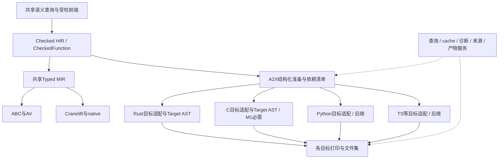

# 51 — 共享A2X架构与Checked HIR→Rust/C路线

> **2026-11-03 CA-C正式立项与顺序更新**：[926 CA-C](../plans/926-a2c-collections-variants-resource-closure.md)合包List/Variant/owned view/is/for-in/资源与独立C认证，drafting r1、0/14，见§15；20原源/完整helper补例/函数P0/恢复后下一编辑和原预算时间门不缩。当前921 execution_done11/14待review，native923实施（收口读头2/12）；主序为921正式合入→925→926，与923→924主体并行。CA-D有限ABI桥取得A/B稳定接口后可与926分窗，CA-E最终待全部必需门；D/E未取号。922已交付盘点，M2执行/宿主/TS/产品迁移仍另行规划；本轮只文档/取号不施工，不改在途进度。

> **2026-11-03最新规划**：921 CA-A实际在途、分支已有C scalar/provider/来源恢复而未交付；CA-B正式为[PLAN-925](../plans/925-a2c-record-text-resource-closure.md)，drafting r1、0/14，见§14。C资源/static-view方法、参数模式、真方法暖编辑/恢复后下一编辑/独立认证均同包；CA-C/D/E仍未取号。统一ABI/FFI结构补于[Design41 §11](41-interface-metadata-and-foreign-abi.md#11-a2c统一abi与ffi的近期结构2026-11-03target-state)，内部C表示不等于公开AutoABI，797候选不擅升版。922盘点已交付，923实施/924等待按用户状态，所有公共S/H逐符号/全文件单写，本轮只规划不改在途合同或源。

> **2026-11-02实施合同映射更新**：CA-A已正式立[PLAN-921](../plans/921-shared-a2x-c-scalar-target.md)，drafting r1、0/14，只规划。共享目标/session去Rust耦合、真实C标量及首例/独立认证/函数P0/来源恢复同包；当前restart仍cold的差额必须实修，不冒已交付。CA-B/C/D/E仍未取号，921不签扩大后M1。915/917实际实施中；A2X主体可并行，公共前端/worker/SDK/注册与919/920逐文件短窗，正式采样错峰。[Design43 §20](43-ac-av-typed-mir-and-abc.md#20-915917在途时的下一波2026-11-02target-state)为下一波边界；下文早期“CA-A未立项”保历史。

> **2026-11-02 M2全替换目标**：[M2合同r2](../plans/reports/ace-replacement-first-m2-contract-2026-11-02.md)要求补全ACE并接管旧AutoVM/A2X全部现有应用/目标/入口，M2结束时旧实现disable；M3/M4未来新增扩展暂不规划，旧M4退役义务已并入M2。C是M1第二验证目标，但Python/JS/TS/Godot等现有目标的接管仍属M2，不能借“后继目标”延到M2之后；新provider消费受检HIR/共享事实，可复用中立打印工具，不能继续委托旧AST emitter。默认Auto开发不经每次生成Rust/C再编译宿主，各目标发布/独立认证保留，M1批准不变。

> 状态：target-state设计r5，2026-11-02。用户已批准A2C作为第二目标加入M1，见[范围增补](../plans/reports/ace-m1-a2c-scope-addendum-2026-11-02.md)与§13；首期C路线预计CA-A..E五包，仅工作标签、不取Plan号。Rust AX-A892/AX-B902/AX-C904均已归档，旧r4/§5.4的仅规划状态按历史读取；current能力以Spec/实际交付收据为准。统一入口：[ACE战略](strategy/auto-native-backend-evolution.md)，实施路线：[Rust/A2X路线](strategy/shared-a2x-and-hir-to-rust-roadmap.md)、[C目标路线](strategy/shared-a2x-and-hir-to-c-roadmap.md)。本轮只设计/规划，无代码、current Spec或913–917合同变更。

## 0. 决策与事实基线

A2X以结构化Checked/Typed HIR为主要输入，复用ACE语义事实、依赖和产物服务；MIR继续负责ABC→AV与Cranelift→native的共享执行lowering。源码转译可复用必要语义分析/变换，不强制从CFG恢复循环，也不建立与HIR/MIR平行的全语言类型系统。依据[Design43](43-ac-av-typed-mir-and-abc.md)、[Design40](40-compiler-artifacts-and-cache-lifecycle.md)、[版本合同](../plans/reports/ace-milestones-version-boundary-2026-10-24.md)。

本轮master读取4ea7780aa；889 executing r2/5-of-10，正在T-06性能/正式验收修复；888 executing r2/5-of-10，模块/批量工具与正式成本收口中；891 drafting r2/0-of-10。代码已提交到实施分支不等于已交付主线，不消费这些WIP，不修改其合同。本文不冻结实施树最新状态，开工须重核。

| 已观察现状 | 对设计的约束 |
|---|---|
| 旧crates/auto-lang-core/src/trans.rs的Trans只有trans(ast: Code, sink: &mut Sink)；Sink/MultiSink和来源映射已有共享 | 旧后端并非零共享；新共享层应增加语义/转换/服务复用，不以trait方法数量衡量复用 |
| 旧RustTrans依赖旧AST/Database/自有推断与后处理；字符串存储/参数/返回有启发式转换 | 可审计提取纯输出工具及合适helper，不把旧AST/Database适配器作为新HIR权威语义，不携入整套正则修语义流程 |
| ac-core::verify已有CheckedModule::bundle/domain/text_resources、CheckedFunction及context_revision；hir有CallBinding/ParamMode/CtorBinding/显式类型和结构化块 | 是当前可信入口；完整meta/实例/依赖query接口仍需按实际producer扩展，不将全部目标能力视为已可查询 |
| source::resolve::CheckedEnv、adapter::prepare_candidate_document/FnCandidate及lib.rs内联body_work已有单体生产接缝 | 复用受检前端；现行probe/session还捆绑MIR/AV消费，新A2X须做轻量消费者适配，不依赖AV执行来取得Rust代码 |
| HIR并不总保留原源语法：864的is/for-in已结构化为guard/branch/loop等 | 可消费这些受检结构；不得假定已有完整Match/ForIn源AST，也不以反读源码/猜模式“恢复”缺失语义 |
| M1原T03仍记录source verify.resource-assign，T05记录shared text eq/lowering缺口；不等所有text原源已过共享前端 | AX-B必须分清source前置、HIR已合法而MIR消费者缺口、新Rust目标映射三个层次；既有合法语义的source误拒须取S窗有界修复，不能以typed绿冒领原源 |
| 旧a2r金样与独立认证、受控rustc进程设施已交付 | 日常emit/金样与显式compile/run分轴；新ACE-A2R拥有明确新身份/金样，不覆盖旧expected来迁移 |

读取hash：hir.rs=A2A7606DC8E4B1E0F0B5BF7F25CE3A4C314EABF2D0B4E1D50B5D368D3DA70C5E；verify.rs=8A7768D1AB37C085A831AAC02812703758788F9B83C4CF4C6675371D603CD84F；旧trans.rs=618A7E73B3F74110A96AD7D7C696CF12190C5AF0D8DB53C8D68D31A9E0C0EB10。来源均为主检出，非889/888分支候选。

## 1. 共享的是哪些层

层次是职责边界，不要求马上新增同等数量的crate或序列化IR。结构化准备可以是共享HIR的只读view、每函数派生计划与稀疏目标改写；保留原控制流结构和源位置，不复制整个世界，不把每个后端都变成新编译器前端。

## 2. 权威语义、共享实现与目标所有权

| 事项 | 共享层职责 | 各目标后端职责 |
|---|---|---|
| 符号/类型/调用 | 消费已绑定声明、真实类型/参数模式、按源码序的实参及构造绑定；CTE/实例结果只从现有语义查询取 | 将受检值与签名映射到目标类型/调用形式，不重新猜接收者或重做语言推导 |
| 控制流/顺序 | 共同遍历/改写工具、短路/求值顺序/临时值计划、必要脱糖；effect事实缺失保守处理 | Rust借用作用域、C显式跳转/清理、Python语句展开等目标合法化；选择保持match或展开分支 |
| 资源 | 对接权威move/view/mut/clone/drop、失败原子性与清理责任，引用TextResourcePlan等已验证分析 | 选择原生值/引用/容器或小型typed helper实现；证明Rust borrow/drop、Python GC、C free符合承诺 |
| 数值/文本/容器 | 操作的语义ID、位宽、溢出/除零/索引/编码/失败合同；共用操作需求和测试oracle | checked_i32_add等映射到目标原语或版本化helper；不把Python大整数、JS number或Rust构建模式默认行为当Auto语义 |
| 库/host引用 | 稳定逻辑API及签名、effect/授权/实际依赖需求 | 每目标runtime/API映射、import拼写与打包；只带实际所需helper及传递闭包 |
| 命名/来源/输出 | 稳定声明ID、局部临时ID、冲突分配工具、源span沿变换传播、Doc输出工具与诊断收集 | 关键字/名称编码、括号/缩进/字符串字面量规则、目标AST和文件组织 |
| cache/生命周期 | 实际依赖记录、分层key、单体事务、quota/lease/GC、原子文件集发布 | 提供target/edition/flags/backend/helper等身份；目标编译器的cache/构建是独立消费阶段 |

语义权威属于ACE，A2X的SemanticsView只是查询门面，不成为第二个type/effect/ownership数据库。共享规则也供MIR路线复用时，在适当中立层定义；不为了共享而把A2X放进auto-mir-lower或让其消费CLIF/ABC。

多目标并行时共享HIR/事实为不可变快照；每目标单独持有局部改写、名称空间及产物。目标优化不得就地改写其他后端正在读取的HIR。未知能力是具名拒绝，不自动降到旧AST转译器。

## 3. 最小公共合同

下列为拟议角色名，不是已存在的API或必须一次全部实现的trait。

| 角色 | 输入/输出及限制 |
|---|---|
| A2xSemanticView | 绑定owner/profile/schema/snapshot的CheckedModule或CheckedFunction及受检环境；只读查询类型、调用、模式、资源与来源，并记录实际事实依赖；missing事实显式返回缺口 |
| TargetProfile | 目标语言/edition、支持矩阵、runtime/helper合同、配置与平台；按需求执行准入，不用进程全局目标开关控制并行请求；未来可消费CAP，不把完整Design46求解器作首包前置 |
| Shared preparation | 每函数或声明的语义摘要、临时求值计划、helper需求及依赖清单；转换pass声明前提/保证/顺序和版本，按目标能力选择，结果仍结构化 |
| TargetBackend | 依据已准入事实与准备结果，生成本目标函数/声明片段或Target AST；可保持小顶层接口；目标节点操作不强迫所有语言实现同一巨型emit_*接口 |
| Artifact service | 稳定装配函数片段、imports/helpers和相对source map；确定性路径/排序，受限sink、manifest、恢复再验及原子发布；底层沿已有store/受控进程设施 |

公共walker、rewriter、source-origin工具与通用名称分配器采用组合方式。目标树不必统一为“万能语言AST”；小型Rust目标树或有结构的Doc均可，Python/C按其语法独立。缩进/布局工具可共享，字符串转义和运算符优先级必须以目标规则实现/验证。

共享实现以真实消费者证明：Rust已有有限闭环；2026-11-02用户批准C为第二目标并加入M1，先标量、再资源/集合及有限ABI桥，见§13。Python改后继而非本次M1前置。C交付前仍只称“为多目标设计、已验证Rust”，不能以接口已中立推定跨目标复用已实证。

## 4. 转换pass的分工与合法性

1. 前端已完成的绑定、类型与模式不再重算；必要函数/方法普通化从已解析DefKind/ReceiverKind和调用绑定出发，不再次扫描文本猜方法。
2. 无目标差异的规范化可共用；需要目标能力参与的转换在请求局部运行，key含相关TargetProfile轴。不能把Rust不支持某形态视为语言本身非法。
3. 保留短路与副作用顺序；参数列表和CtorBinding的“求值顺序/字段存储顺序”分开。公共层提供临时值/读写顺序计划，Rust再安排合法借用生命周期，不能为了避borrow error复制表达式或暗加clone。
4. shared preparation生成新引用/节点后检查类型、def-use、分支/loop目标、来源和单求值保证；目标合法化后检查没有残留未支持操作、import/helper齐全与声明一致。检查不重新解释源语言。
5. 深结构/共享类型DAG遍历有预算且避免宿主递归溢出/指数展开；有限资源拒绝与语言类型错误分列，不擅加语法深度排除。unsupported/资源失败发生在发布前，旧交付物可用。

代表性顺序用例：构造参数按右字段→左字段给出，字段最终仍按声明存储；实参带可观测调用只能求值一次；false && trap() / true || trap()不能先求RHS；循环continue跳转不得绕过约定更新/清理。具体源必须选已合法的profile；缺effect观测缝时以独立手工HIR合法控制辅助，不能冒称源码已支持新builtin。

## 5. Rust后端与runtime边界

### 5.1 初期可执行选择

首期宿主冻结为当前已验证开发平台Windows x64，生成Rust edition 2021、纯std或最小显式helper；其他目标平台逐项认证，不从Rust跨平台能力推导成ACE已交付。函数/类型是普通生成Rust的内部接口，不走mn私有ABI或自动成为public AutoABI/FFI。

标量映射必须精确i32/bool，i32 add/sub/mul/neg/div/rem以显式checked语义落实，MIN/-1及MIN%-1保持Auto合同；release/debug都不依赖Rust默认溢出策略。语言trap用具名结果/受控runtime路径表达，Rust编译错误、panic/异常退出、工具缺失均不满足Auto负例。首包明确i32结果、trap、前端诊断三个观测轴；结果wrapper按实际生成签名编码，不沿旧a2r默认i64推断。

text/record阶段可用String、&str、struct等自然表示，但view/mut/move/显式clone、Unicode标量索引、NUL比较及释放时点以Auto合同为准。Rust默认drop顺序、可能的隐式allocation、借用生命周期不自动满足要求。先用跨函数owned返回、多move、重赋、borrow和失败清理的真生成/编译/运行probe决定直接映射还是typed helper；helper不接受MIR/ABC/AST指令，不复制AV解释器。

集合/变体阶段沿864合法源码/已正式修复域：List<Str>/拥有record/Variant、活动臂、只读投影与有限for-in；List参数/返回/嵌List和源码容器.clone等原拒绝集保持。Rust Vec/enum只是表示候选，容量预算、下标trap、失败precheck→commit、旧臂释放/回收等义务仍逐项验证。源码与typed辅助资源probe分账，不靠手写typed成功覆盖源码gap。

### 5.2 与已有runtime的关系

旧a2r-std可作为经核验的provider，不是自动兼容库。其int=i64、部分字符串find/slice约定、宿主服务和内嵌facade与ACE profile须逐项核签名/语义。可复用中立纯helper或加明确adapter；不能把整个旧库带入只用一次checked_add的程序，也不全量重写stdlib。

能力合同/操作语义ID可共享，实现按目标分开；helper内容及ABI、依赖版本计入产物身份。异常、GC语言的最终回收与Auto可观察资源清理区分；未来Python/C后端对外资源也须显式清理，不因目标有GC省略。

### 5.3 AX-B正式合同（2026-10-31，PLAN-902）

[PLAN-902](../plans/archive/902-hir-to-rust-record-text-resources.md)承接892/881/894正式交付，扩展当前`experimental/ace/crates/a2x-{core,rust,store,worker}`，不新增独立workspace或第二前端。AX-A core/scalar身份与拒绝面保持；AX-B以显式新目标profile/recipe准入source record/text/text-record，main仍零参i32结果。内部支持i32/bool/char、Str/str、非递归具名record、static/view方法及已合法的view/mut/move/clone/拥有返回；List/Variant、闭包、mut实例方法、宽源码、Unit入口、泛型/模块/FFI/console及旧A2X默认切换不在本包。

共享view/prepare补稳定owner/type/field/method身份、receiver/参数模式、源码序求值/落位、借用来源及验证器产生的资源计划；Rust表示、生命周期合法化、typed helper与printer仍属Rust provider。`CheckedModule::text_resources()`现有，但当前`CheckedFunction`没有资源计划出口，且AX-A的Ty只含i32/bool、ParamFacts不含mode；902须先核并补最小S受检事实出口，绑定同一body/owner/context，不能由A2X重新推导所有权或相信任意序列化facts。单体方法身份按owner/name/签名，不能用漂移的def/body索引当持久键。

Rust实现必须保名义record、Copy值捕获、receiver先求值一次、实参按源码序各一次再落位，以及显式clone/move、局部Str重赋与field替换。借用可用Rust引用/生命周期或等价typed表示，但不得放宽源前门拒绝，不能用rustc报错代替Auto诊断。mut使用直接引用或显式回写临时须在最小真链按现行source合同验证；不机械复制MIR的私有MutRet ABI。

文本len/char_at/slice按Unicode标量，len_bytes显式字节，eq/ne含NUL且不归一化；不能把Rust String.len/字节切片直接当Auto操作。资源清理消费验证器事实：RHS准备成功后替换、旧/新恰一次释放、创建序/出口/分支/循环/短路临时和失败部分输出均有真实事件oracle。Rust词法Drop顺序不等于Auto动态创建/重赋后的LIFO，RAII本身不是保持性证明；目标typed runtime/生成cleanup须闭合该差异，不能引入GC/第二VM。未知资源表示由T-02最小真链先冻结。

原R07/R08=42、T03=23/T05=42是required源码，另补具名同布局异类型、各参数模式、Unicode、资源/故障及函数级增量反例。新emit/金样腿不启动rustc或生成程序；显式认证对现场完整actual和手写独立reference分别编译运行对oracle，资源事件/陷阱分态，旧892与旧a2r证书互不冒认。共享声明产物/资源facts须入依赖键与required闭包；body编辑未改函数真实parse/check/prepare/lower/print/persist为0，声明装配/坐标重基另计。

899的工具改名/profile影响来源和性能，901改语言测试features/工具/SDK，902分别按具体文件/源锁交接。P-Rust及只读S准备可以并行，不因append-only注册声称零H交集；正式采样需稳定配置窗口。计划材料只在plan-artifacts，摘要回计划、merge清理；不恢复tm/叶目录或写legacy specs.json。本节与902均为规划，current Spec不据此冒称record/text Rust后端已实现。

### 5.4 AX-C正式合同与type片段拆分决定（2026-11-01，PLAN-904 r2）

[904](../plans/904-hir-to-rust-collections-variants.md)承902正式delivery4303c4457050（archived14/14）、864/889合法source Collections和名义图。20个required源=原L/V14+List<Str>/两种for-in3+拥有List<Variant>/嵌套Variant/Option补源3；原L04/L05=42、V03=3、L06具名ListIndex、补源51/42/53与三个42按实际源/hash，手写独立reference，不以AV/native输出生成oracle。首期入口仍零参i32，拒绝集沿原Collections，不顺带打开List/Variant源码clone、参数/字段/嵌List、str/char、宽源码、闭包/HOF/host或用户泛型。

**type声明片段修复纳同包，不另拆小包。** core source保留声明与候选fragment存在同一单模块坐标/来源缝；目前scoped Collections已将声明作inert元数据，Record/TextRecord尚有原声明span对短fragment越界风险。S修复须保留声明来源和候选body来源各自的权威快照/投影，内部inert span不能冒对外当前位置；不删除UTF8/越界检查、不把全span清零、不改走whole后宣称前端0。T-02最小含type/enum真链先验证，T-03关闭有界共享修复，再扩P主体；需通用多文件坐标/平台重写则needs_replan，不削增量门。

共享修复为902含type的自由函数编辑提供warm片段见证，原902方法声明上下文冷路径不暗扩；Collections函数body编辑需目标生产一次、未改AST/HIR/片段身份保持且实际parse/check/prepare/lower/print/persist为0。类型/臂/字段/签名/权限/runtime改变依实际依赖失效，冷路径具名计账；外部source map定位当前源，声明/目录装配单列，不拿后端片段命中冒完整源增量。

Collections凭证无TextResourcePlan是帧拥有LIFO合同，不能理解成无清理。904须消费core权威受检的类型/guard/消费/拥有/帧出口事实，若缺出口就在S补，不让A2X重做ownership或从MIR/AV取语义。Rust只实现typed容器/变体/helper及显式清理：new逻辑cap4、view零隐藏clone、remove/move责任转移、活动臂一次投影/switch、precheck→commit失败保旧和部分输出回收，List逆序元素/buffer最后。无环深链用显式有界遍历，不以宿主栈或新语法深度上限兜底；typed资源探针不扩源码方法。

新recipe拟ac-a2r/hir-collections-emit-v1，fileset/cert独立Collections身份，与892/902/旧a2r互拒；日常真实目标工具spawn0，显式现场actual与独立reference两腿认证。含声明代表资源负载四状态各30有效样本P90≤2000ms及compiler48MiB/guest8MiB值数据等原预算/实际backing峰同过；源/IPC、文件集、store/scratch和认证deadline沿904冻结，不能套902 type-free或历史cold豁免。候选source/env/坐标/resident/fileset/receipt同代发布，失败保旧，修复后再restart真hit，close/pin最后owner分别验证。

893负责13慢测/未来接入，903负责M1逐格适用/净缺口；904新增producer不改其合同、binding/expected/NA或M1分母。私有P可并行，source/verify/测试观测和H注册/current身份按具体符号接受正式版本，903只读审计不挡S写；正式慢采样/认证/窄重验错峰，不设D893/D903整包依赖。后继第二目标、闭包/host、数值/多模块和产品迁移仍独立规划，不预占号。

r2复核补充（只规划）：source候选须绑定完整SourceSnapshot/hash、授予UTF8替换range与稳定函数身份；fragment只作解析工作单元，manifest/cert必须指替换后的完整源。保留声明mint来源与当前投影分列，连续两个不同函数变长编辑A→B→C、restart后继续编辑及错误base/range控制，证明env generation/source/map/resident/fileset同代发布，不只用单函数A→B→A值证明。

CheckedFunction准入不能只核context/def_id：同owner同声明上下文、A凭证+B body/资源事实必须拒，B自身合法凭证及等价坐标重基必须过。Collections全部名义图/未使用类型项仍按权威门受检；共享修复不把type语义猜测移到Rust provider。

资源补充操作计费/取消轮询表和无余量清理保证：真实循环/递归/clone/构造工作点耗尽或取消后，必要清理不依赖再次分配/剩余fuel，也不因取消再次中断；precheck失败前后原内容/责任及实际live/backing可核。3072小栈见证含构造/失败回滚/末主释放，typed helper资源探针与源码支持分账。

新证书绑定execution_config/mode（debug/release、预算/故障/观察配置），不能互用或覆盖必需认证腿；原14双mode、补6真实认证及各正式采样修订都按完整源/文件集预认证。父侧核实际磁盘required集合和路径域、独立reference不链接生成helper，错配置/旧凭证拒或STALE。真实producer/payload而非wrapper身份和会话自增计数支撑零生产，工具/配置变化按语义/目标/认证层分别失效。

893/903交接按904 §5.8的source/verify、contract/adapter、tools/固定组及903审计Spec候选精确路径取窗；903当前WIP不作为本包已发布规则。新正式来源只令受影响的893成本或903审计项待重核，不擅自扩大其门或修改分母。上述V-13..17/原V映射/14任务都由后续work关闭，不构成本轮实现、认证或性能PASS。

## 6. 函数级增量、分层cache和事务

| 层 | 最小身份/依赖 | 复用与准入 |
|---|---|---|
| 已验证HIR/事实 | producer/schema/profile/owner、真实类型/签名/模式、实例/meta/CTE及其传递依赖、配置/授权 | 活快照内只读共享；持久恢复由producer重验，不序列化Rust指针/Checked标志当信任 |
| 目标无关准备 | 每函数语义内容、实际读取事实、共享pass及语义版本；表索引/绝对span不作语义 | 可多目标共享；若pass实际读取目标能力，该结果立即归目标相关层，不能放入全局无目标key |
| 目标适配/片段 | 上层依赖+target/edition或C标准/能力配置/类型表示/后端版本/runtime helper闭包 | Rust/C及后继Python等互不误命中；完整位型、名义类型与参数模式在规范内容中区分，不能只hash调用点源码 |
| 文件集装配 | 片段ID/hash、导入/helper并集、模块布局与相对来源映射、格式器版本/开关 | 片段复用、装配可以更新；不为一次导入变化重产每函数；format不得事后改语义 |
| 目标编译与认证 | 真实生成全文件集hash、wrapper、实际Rust/C编译器/链接器/target/flags/SDK、完整头库依赖与oracle/reference | 独立工具链阶段，目标工具可能重编更大单元，不冒称A2X函数复用=编译器只编一个函数；允许身份未变的认证收据严格复用，不缓存TestCase PASS替当前emit/父判 |

暖单body编辑必须经现有CheckedEnv/候选单体接口，仅改变函数真实parse/resolve/typecheck/HIR生产、共同prepare、target-lower、print和工件写入推进；未改函数上述生产=0，resident token/Arc及mint代际、片段payload身份保持。源hash/时间更快或末端片段同字节不证明结构增量；强制whole前端/prepare、重造resident伪保代际的反控必须红。为装配/输出做的必要有界暂存不等resident替换，单列计量。

现行CheckedFunction context_revision较粗，body-only可精确；签名/type/模式等context编辑必须正确失效，可明确走保守整上下文复核或具名拒绝，记录真实work与限制，不称最小依赖重验。实际不依赖的目标片段不得仅因表编号/span变更换身份。后续细粒度语义query成熟再收窄；helper body变化对普通非内联caller只重装配/编译依赖，对CTE/内联使用者须失效事实/产物。

准备→验证→生成→完整文件集/manifest核验→原子发布；失败/取消/迟到候选保旧source revision、声明坐标、resident、文件集与可用性。多次变长编辑更新span，避免用旧坐标错路由；GC/close与最后lease释放覆盖旧片段/索引/WAL/staging，不删除用户交付目录或他方cache。reuse/fresh/read-only与冷恢复重验分列，缺依赖/坏片段/错误target在消费前拒绝，修复后下一次restart真hit。

## 7. 测试、认证与计量

保留[现有a2r双轴裁定](../specs/auto-test-case/a2r-golden-certification.md)：日常是新producer真实emit→与已审阅金样逐字节比较→严格证书/身份核查，rustc/cargo/目标程序spawn=0；真实compile/run是显式独立认证。新ACE-A2R与旧a2r的recipe/profile/金样及wrapper分开标识，schema/adapter扩展必须经H窗口，不让旧证书错误授信新入口。

认证消费现场actual且绑定全文件集、source/target profile、shared/backend/runtime版本与内容、wrapper/oracle/reference、实际启动rustc -vV和flags/deps。生成程序与独立手写reference分别等于父侧oracle；不只互相比等、不让worker拿expected。rustc编译失败不算语言诊断，panic不算预期trap。新语义可能合法产生不同Rust文本，新金样先独立审阅，不覆盖旧金样掩差异；原M1 a2r列/NA/accepted-diff不随新producer自动改绿。

首包第一例即文件化AutoDown/TestCase、独立oracle、fresh/hit/restart/body-edit、恢复再验、结构反控和预算观测；不能等第三包或总审计补基础。代表规模沿已交付scalar源码基线核真实115函数/273575B及至少30不同修订，不把单行toy时间当开发工作负载。正式Plan冻结每状态样本、入口→emit/装配/父判/清理口径与P50/P90/P95/P99；日常正式门P90≤2000ms、长期亚秒目标保留。compile/run认证单列原120s编译/30s运行等工具预算；不拿2s emission宣布完整rustc编译运行达标，也不以此擅自放宽native/AV原门。

新A2X管理工作集首期策略上限拟取48MiB，输入≤4MiB、IPC≤4MiB、单目标产物≤64MiB/单check≤128MiB，stdout/stderr各≤1MiB；帧/表达式/类型图/暂存按真实大小分配前受限。正式立项先用最小链核共享上游与caller更严限制，并冻结分区/生命周期、项目store配额/冷热片段/GC与磁盘上限；缺配额不得广铺持久缓存，不自动调大。Rust工具链进程峰值/磁盘scratch单列并受其约定预算，不能藏进“48MiB转译器”口径；没有物理硬门出处的只报真实peak与局限。工具维护构建与warmup单列、不得与888/889正式采样抢资源。

## 8. 迁移、包边界和并行

拟新增独立实验workspace `experimental/auto-a2x/`，内部先以core(shared)/rust(provider)/probe(driver)角色分开，精确crate名与目录在首包feasibility冻结。共享core仅依赖已交付HIR/语义合同与中立artifact/diagnostic设施，不依赖旧auto-lang AST/Database、Cranelift、AV executor或产品UI/Man；Rust provider依赖core，probe可复用既有受控工具/test设施，方向不可反转。旧Sink若抽出会触公共SDK，须窗口；没有独立中立出口时先做最小新输出层，不为复用数十行引入整个旧引擎。

只读消费S/N正式合同的私有A2X工作可与native线并行；无需D889/D891作为Rust代码生成的语义前置。共享HIR/schema/source候选/资源事实或helper执行器变更拿S/H子窗；公共SDK、TestCase、certify/报告、模块发现源锁拿H窗；不改N emit/layout/私有ABI。需要889尚未交付的命名enum/单体source修复时，只等具体正式S修复，不偷取分支WIP或复制前端，不强加整项D889。

旧AST A2X继续承担既有产品，新增入口显式选择ACE-A2R；不自动fallback或切默认。逐源覆盖/行为/项目/host/provider成熟后另立消费者迁移与退役合同，不把纯重构的884/885历史或新A2R首例当全旧转译器替换证明。

## 9. 首期拆分决定

**Rust首期三个有界切片AX-A892/AX-B902/AX-C904均已交付；下表保留其拆分理由。C第二目标的M1首期另拆CA-A..E五包，见§13，不把AX-C误读为C目标包。** 当前执行合同以各Plan/Spec为准，不用旧在途快照覆盖新交付。

| 切片标签（不是Plan ID） | 必须交付的真实闭环 | 可先并行的准备 | 硬关闭边界 |
|---|---|---|---|
| AX-A 共享骨架＋Rust标量 | 共享checked输入/准备/目标能力/产物身份最小接口，core/scalar HIR→真实Rust→独立认证；文件化/金样/增量与预算首例齐全 | 新A2X/Rust私有设计/工具材料；实际写入仍需授权/路径接受 | 标量正例、短路/顺序/溢出trap/静态拒绝及四状态/结构反控；Rust之外暂不宣称多目标实证 |
| AX-B Rust record/text与资源 | 经同一骨架扩record/text/text-record、static/view方法及现有view/mut/move/clone；跨函数返回、Unicode/NUL、资源/失败清理，函数增量 | 在AX-A接口正式交付前可做只读语义矩阵/独立参考，不能复制临时core | 资源表示先真链probe；必需方法/模式/资源矩阵通过，旧scalar与身份兼容，合法源码gap逐条有owner |
| AX-C Rust集合/变体 | 原L01–07/V01–07、List<Str>/拥有record/Variant、for-in/is受检结构、活动臂与失败原子性/清理；source/typed辅助分账 | 只读消费864/889具体S修复，准备独立oracle与表示候选；不等N typed entry | 原源与补例真实Rust认证、复合增量/恢复/资源/预算；不顺带加入闭包/console/全库 |

不单独立一个“共享大平台、无真实Rust消费者”的基础包，也不把增量/cache/AutoDown延后成第四个收口包。AX-B与AX-C有明确资源基础依赖，整包默认AX-A→AX-B→AX-C；无同文件/合同写入的私有参考准备可并行，真正共享core扩展顺序交接。

C第二目标现为M1必需，按§13及新路线实施。其他后继仍为Python验证动态表示/GC差异、闭包/HOF与host-console、多模块/stdlib/泛型-meta/CTE、wide源码与多平台、旧产品迁移。891的typed MIR wide不等A2X有宽源码HIR；新typed起点如需要另定义，不把W fixture强行塞入首期源码包。每目标依原有对应示例矩阵认证，不要求所有源×所有目标的虚假全交叉积。

## 10. 必需验收矩阵（正式Plan展开为AC/V/T）

| 设计case | 所属切片/义务 | 可区分的oracle与反控 |
|---|---|---|
| AXV-01 | AX-A 标量正例/失败 | 原B01=14、B04=42、B09=120等源到真实Rust；B13 overflow与B14 div-by-zero具名trap，未执行分支非法引用也查名；release/debug关键算术一致；rustc error/panic不满足语言负例 |
| AXV-02 | AX-A/B 求值/模式/来源 | 短路RHS trap不触发，构造/实参副作用各一次且源码序；方法/普通调用相同已绑定事实；目标诊断回原span，不以目标编译器猜Auto语义 |
| AXV-03 | AX-A 首例生命周期 | cold/fresh/hit/restart/read-only/body-edit/变长/候选失败、A→B→A；未改函数真实生产0与payload/generation保留，forced whole/伪resident反控红 |
| AXV-04 | AX-A/B/C cache与依赖 | profile/target/edition/类型/参数模式/helper body/meta/实例/CTE依赖变化正确失效；未触达表重排/span不误重产；坏片段/缺required-data先拒，修复后再次restart真hit |
| AXV-05 | AX-A 证书/输出/失败 | 现场actual全文件集与金样/证书核，改expected只红对应格，missing/SKIP/零选择非PASS；日常目标工具spawn0；认证错wrapper/actual/helper/rustc身份拒；多文件发布失败保旧 |
| AXV-06 | AX-B text/record | R07/R08=42、T03=23/T05=42为原源required关闭目标（不是已通过基线）；mut写回、多move、clone后独立变化、owned返回、NUL与A中😀标量/字节轴；一次释放/失败清理与借用活性，合法语言因Rust借用出错仍是未完成支持 |
| AXV-07 | AX-C collections/variant | 原L04/L05=42、V03=3、L06 list-index trap；List<Str>=51、copy/owned for-in=42/53、拥有List<Variant>独立42；活动臂/clone资源probe与源码拒绝分列 |
| AXV-08 | 每包资源/周转 | bounded prepare/print/IPC、分配/取消/超限/写盘失败、进程树和reader收尾、close/GC；真实内存与磁盘配额、正式源规模/样本、P90≤2000ms日常面；编译运行单列预算与结论 |
| AXV-09 | 每包交接/兼容 | S/P/H真实释放接受、SDK/recipe/worker/current身份与stale同步，新case进当时正式治理清单/模块并集；不自动纳888 B/C，不污染旧a2r/native报告/expected |
| AXV-10 | M1第二目标C | 同一checked事实/公共pass由Rust与C实际消费，各自生成/运行对独立oracle，语义复用/目标片段与证书隔离；C未交付前不宣称多目标已实证。Python动态表示/GC验证改后继，不是本次M1门 |

## 11. 尚需在立项/feasibility关闭的机制选择

- AX-A：现有单函数候选/受检环境的最小backend-neutral出口、source span与依赖投影；若S未释放，先只读及私有材料，不依赖AV session取代码。新crate/目标树/Doc形式、真实Rust进程复用与新证书profile、runtime最小内核及store配额必须先真链probe冻结，再扩实现；不新建第二前端或store。
- AX-B：CheckedFunction的text/resource事实若出口不足，producer补受检投影后消费；直接Rust引用/值能否覆盖所有受检合法borrow/资源时点，通过反例选择helper。不能删合法源或暗clone避编译错误。
- AX-B的T03/T05先定位实际拒绝阶段：源门误拒已有合法语义时由本包接受S-text最小范围或等待其正式前置修复；HIR已合法、仅MIR消费者不支持的，不要求A2R等待或重走MIR。正式立项据规模决定前置有界修复是否另拆，所列required原源没有实现不能仅留owner就判AX-B完成；旧AV/native/旧a2r各列仍须各自重验后另回填。
- AX-C：保留现行source域限制，889未交付修复的精确符号/版本是特定S依赖；Rust容器OOM/预算、部分clone/构造失败回滚和深层清理必须先决定，不拿Rust默认panic/OOM退出算资源语义完成。

这些是有owner和关闭门的实施机制，不是本轮已跑过的结论。精确计划任务/SD/依赖/窗口冻结后再依auto-plan流程实施、独立review、合入与Spec沉淀。

## 12. 业界参考与采用限度

Fable展示了共享中间AST/转换工具、分目标AST/打印器及运行库映射的组合；其Compiler上下文还提供声明查询、诊断和依赖记录。参考[项目架构](https://github.com/fable-compiler/Fable/blob/main/AGENTS.md)、[共同转换](https://github.com/fable-compiler/Fable/blob/main/src/Fable.Transforms/FableTransforms.fs)、[Compiler接口](https://github.com/fable-compiler/Fable/blob/main/src/Fable.Transforms/Global/Compiler.fs)。采用层次/复用原则，不复制其项目特有全局配置或全部F#语义。

J2CL在共同AST/pass框架上组织不同目标的desugaring、normalization、restrictions及输出，说明共享pass实现不要求所有目标同一pass序列。参考[Backend实现](https://github.com/google/j2cl/blob/master/transpiler/java/com/google/j2cl/transpiler/backend/Backend.java)。以上是架构参考，不能替代Auto自身副作用/所有权/失败语义的独立验证。

## 13. A2C第二目标与M1范围增补（2026-11-02，target-state）

本轮用户明确“A2C目标也加入M1”，取代先Python/只做可选scalar的建议。正式批准、原范围继承和新签章见[M1增补决策](../plans/reports/ace-m1-a2c-scope-addendum-2026-11-02.md)；输入矩阵、case、预算、拆包及913–917窗见[C目标实施路线](strategy/shared-a2x-and-hir-to-c-roadmap.md)。本节为新设计合同，不声明C实现或认证已通过，不取号/施工。

### 13.1 新增的能力闭环

C以892/902/904已交付的共同源域为基线：core/scalar→record/text/text-record/已有static-view方法与模式资源→有限List/Variant/for-in/is；首平台Windows x64、C11子集。首个C样例必须真实共享SemanticView/prepare/依赖/产物服务，有独立C编译运行和reference。C语言标准、工具、helper与完整依赖进入身份；C私有数据表示不等于公开AutoABI。Unit/console/闭包/Dyn/宽源码运算/泛型模块等未认领域保后继，不能把“C已纳M1”解释为所有旧产品/所有C ABI形态立即承诺。

已有a2x-core是真正的中立视图/计划，但a2x-store当前直接依赖ace-a2x-rust的TargetProfile/lower_functions、目标文件集与worker亦默认Rust。CA-A必须带C消费者做最小去耦，不只改lang字符串、不复制session/store。共同checked事实/资源计划、源码序临时和元数据归共享层；C类型/语法/清理/工具映射归provider，helper实现按目标私有，操作语义共享。读取target能力/layout的派生结果不得进入无target键，未修改Rust输出/命中/证书应保兼容，真实变更显式版本化。

C要显式实现checked i32、Unicode scalar索引、源序/单求值、短路、nominal/mode、clone/move/清理和typed trap；不能继承C未定义行为、浅拷贝/参数求值或locale默认。资源失败先于commit，部分结果恰释放一次，清理显式有界；原深链/小栈/512负载、readonly/lease/close和最后owner不因换语言放宽。

### 13.2 增量、认证与四端一致性

新增Q4目标=AC-native、AV、ACE-A2R-HIR、ACE-A2C-HIR。旧AVM/旧A2R/旧A2C分别保参考或已有义务；不能以其中一个替新producer。先冻结共同源域及扩展行，四端各自对独立oracle，不动态缩交集、不用四端相等互证。语义族诊断保raw事实，资源/trap/infra分态；ABI/缓存/在线能力按执行模型单验，不要求所有目标同样暂停/HMR。

每包含自己的文件化首例/反控/显式双腿认证、fresh/hit/restart/body-edit与失败修复再恢复。受支持暖编辑未改函数在真实前端/prepare/目标lower/print/IO均0，保resident/代际；纯恢复P0但R真实非零，不能先lower求键再报hit。C编译器重编单元与A2X生成粒度分账；原Rust方法冷限制不得被新C暖门继承成PASS，需要有界修复或正式replan。

日常Rust/C是emit+已审golden/严格证书，编译器/链接器/目标程序spawn0；新增C M1基线必须有完整现场actual和独立reference的真实编译运行证据，旧A2R批准的cert-gap不自动免除它。source/target/helper/flags/toolchain/header/SDK/deps/oracle变化按身份STALE，坏证书拒绝，不能自动改golden。沿P90≤2000ms/原样本和资源预算，C生成周转与显式编译认证分别计量；实际源→C→运行总延迟必须展示，不拿emit时间冒运行周转。

### 13.3 五包与ABI/FFI边界

CA-A共享目标接缝+C标量→CA-B record/text资源→CA-C集合变体；CA-D有限C/AutoABI桥消费A/B稳定接口并可分窗并行；CA-E新增target ledger/Q4/总M1签章。CA-E的数据设计随A开始，每包含正式测试，不能把必需验收都押到最后一包。CA-*只是能力标签，未分配正式Plan号；不把CA-C与Rust AX-C混同。

797已交付有限候选，不重做AutoABI规范；C生成函数必须有独立wrapper/header/descriptor/layout/ownership准入才可声称该域兼容。只纳既有Win-x64 profile下真实双向三腿、原方释放、同步per-call callback及context/status/out；typed foreign声明fixture与Auto源码FFI入口分别报告。完整header importer、Rust shim/Python生态、跨线程/持久回调、loader/热卸载仍属通用FFI后继，不随A2C认证自动完成。

### 13.4 M1签章与在途交接

新M1=原M1-base-908全部门 AND C核心/资源 AND C增量/恢复 AND 有限ABI桥 AND Q4独立语义证据 AND 扩展登记有效。旧acceptance/2的can_claim_m1仅证明旧基面；未落地新增总门时新M1保持不可签。CA-E用独立版本target ledger/组合报告，不直接给原12列binding插第五列、不改旧批准件SHA，不令913–917因此失效；原NA/accepted和旧A2R义务保持，新C认证不套旧cert-gap豁免。

913主closures恢复/manifest/root/lease/accepted-context；914主场景/布局观察；915主AV资源；916/917主旧A2R准入/发射。C私有实现/参考可并行，共用core资源事实、ManagedStore、A2X worker/store与public contract/SDK/固定组/M1登记按owner+实际SHA/版本/全consumer收据单写；稳定阶段可交接具体符号，不设D913–917整波前置，正式采样/认证错峰。全部未来实现、Spec delta与运行证据由正式Plan认领，当前只沉淀设计。

## 14. CA-B：C record/text资源与后继ABI接缝（2026-11-03，target-state）

921 CA-A已实际实施；读取分支fff3c124d已有TargetProvider/C标量/AXP1来源恢复代码，尚未主线交付，不能把分支功能或头1/14当完整D921。922盘点已交付d66fdef04；用户确认923在实施、924等待，未因本轮核查代改头/进度。本轮CA-B正式为[PLAN-925](../plans/925-a2c-record-text-resource-closure.md)，drafting r1、0/14，CA-C/D/E仍后继工作标签，不为完整通用FFI预占号。

### 14.1 C资源代码生成的权威输入

源profile沿902/904的record/text/text-record：i32/bool/char、str/Str、非递归名义record/资源字段、static/view方法、view/mut/move参数与已支持返回/控制流。不扩mut实例方法、List/Variant、闭包/泛型/模块、Unit/宽源码或host/FFI。共享SemanticView/ParamFacts/FnKind/ExternalFn modes及验证器BodyResourcePlan/排他fixpoint为权威；C只做表示/控制流/显式清理合法化，不能复制资源/借用分析或用C编译成功补Auto合法性。

C私有Str/view/record不等于AutoABI公开对象。Copy record在求值点快照；命名构造/调用按源序钉临时再bindings落位；view record只读、mut record真实写回，move被调方取得析构责任。mut文本沿现域只有排他读/转发而无新运行时文本变异，不虚构完整可变Str API。receiver=params[0]且只求一次，方法owner限定，borrow/exclusion事实变化进入依赖。借用返回只允许已验view参数/static literal，不从被释放owned局部、mut参数或临时返回悬空ptr；缺可消费事实需从原验证器补有界出口，不在C端重推。

Str显式UTF-8 ptr+byte length，长度/索引另按Unicode scalar；内嵌NUL不可用strlen截断，Auto char不是C char，非法码点/索引在访问前具名trap。move/clone/深record clone/拥有返回按资源计划调度；所有fallible准备成功后才替换目标/释放旧值，失败回收已准备部分、保源/旧值。break/continue/early return/短路/trap/取消各出口恰清理一次，借用不析构backing，拥有返回不在callee末尾提前free。清理不能因预算/取消再次失败中断；观察默认关闭且不持有Value/改语言结果。

### 14.2 方法暖编辑与来源恢复必须真计量

904只解除含type的**自由函数**片段限制；static/view方法body当前仍按冷声明上下文路径。CA-B承诺的支持编辑包括含type源的自由函数与static/view方法，必须有窄方法fragment/单体凭证/owner目录接线，body未改函数真实parse/resolve/typecheck/plan/bind/HIR verify/prepare/C lower/print/每函数工件IO0，resident对象/代际保持；不能把cold whole→字节相同命中当暖增量。声明/layout/mode改动按真实依赖失效，914 D-05的冷声明例外不扩大到body编辑。

921当前分支ensure_env在restore后调用parse_program_with/resolve_env，注释称M-class也不改变实际前端生产性质。CA-B开工以D921最终内容/收据重核；纯恢复P0/R>0与恢复后下一body/method编辑是两道门，整源parse/resolve不能藏入R/M。所需来源/声明/方法/资源事实数据重建必须有界、未授信重验，不反序列化Checked/PASS/活owner；必要有界修复归CA-B，若需新共享前端大平台应修订/拆包，不静默延到CA-E。只读/坏件→修复→下一恢复、失败候选保旧/历史lease/GC均首例进入。

### 14.3 验收、交接和后继顺序

以902四源R07/R08/T03/T05及全部modes/method/资源正反例、881/894实际相关原源为基线；新C reference独立手写，actual/reference各以真实cl编译运行对独立oracle，原源/expected/旧Rust金样不改。所有真实allocation域逐故障点与资源事件，C signed overflow/UTF8边界/别名/对齐均不能依赖UB。C record-text独立recipe/fileset/cert/runtime/片段层与scalar/Rust互拒，语义AXS共享；日常emit+bytes+严格证书身份核查，目标编译/运行spawn0，正式认证另列。

CA-B主体在a2x-c，session/TargetProvider接口由921稳定SHA交接；最终合入含D921，私有runtime/参考/fixture研究可先。共同core资源事实/方法片段出口与923/924取S短窗，A2X主体不占native N。H为worker/父adapter/SDK/auto-test-case/fixed/workspace manifest-lock/新登记与来源清单，全文件单写、全部construct-match/consumer核齐，正式采样错峰。922是已交付盘点，作为M2输入消费，不改其历史验收或现有原source分母。

顺序CA-A→CA-B→CA-C；CA-D沿[Design41 §11](41-interface-metadata-and-foreign-abi.md#11-a2c统一abi与ffi的近期结构2026-11-03target-state)消费A/B稳定接口，可在不依赖集合的有限scalar/record/buffer上与CA-C分窗；CA-E登记规则自首例准备，最终签章须全部C域/有限桥/Q4与旧门AND。M2-EXEC/HOST/TS等922后继仍需另立，不因C路线继续就算产品替换已完成。

## 15. CA-C：C集合/变体与近期实施顺序（2026-11-03，target-state）

用户要求正式规划925后继集合包并明确实施顺序，本轮只设计/立项不施工。main取材8717bd5d3、收口推进003e1babe（921工作记录）；921已execution_done11/14待review、仍无D921；923 executing从1/12推进2/12，924/925 drafting0/14，922已交付。集合与变体合一个[CA-C / PLAN-926](../plans/926-a2c-collections-variants-resource-closure.md)，drafting r1、0/14：List<Variant>、owned view、活动臂/逐出口清理、错误/预算共用同一CollectionsBodyFacts；拆成两个会重复fact/文件集/认证接线。不附带新源码集合语法、公有ABI或闭包。

### 15.1 输入/支持与资源合同

承904的20源：L01..07、V01..07、LSTR864、FIN864A/B、N889-list-variant/nested-variant/optional-variant及原补例/拒绝。必须List<Str>和List<owned record>、List<Variant>，L04/L05原源得42，L06仅具名ListIndex，不能正常返回70/任意crash充陷阱。原集合域只有int/bool/受限Str/非递归record、函数局部List、有限无环enum/Option/Result；List参数/返回/字段/Variant payload/嵌List、str/char/宽源码、Closure/HOF、源码List/Variant.clone等原具名排除保持。

private C List/Variant及helper复用925 Str/record资源边界，普通Auto语义仍由受检HIR/单函数凭证/CollectionsBodyFacts给出；C不能另推ownership或靠cl通过补合法性。列表元素类型/variant owner及有序臂/载荷传递图入canonical identity；C tag+payload只访问活臂，不能无guard读union、memcpy出第二份析构权或靠C布局冒AutoABI。get owned元素为受检只读投影，不能物化/隐式clone；for-in len只读一次，结构变更静态拒绝、set合法，两个不同索引的融合len不能串。

push/insert/set/remove/clear按源码序各求值一次、先界/预算/分配检查再commit；移出责任准确，旧目标失败不变。对齐904：helper收到已求值owned输入后失败时，未提交输入由helper或caller唯一清理；不能两边都free，也不能错误要求已在语言层move的局部继续可读。variant switch旧活臂一次释放、载荷投影move后不再析构；frame exit/pending temp/错误点/loop survivor消费原facts，最后owner清理，借用不freebacking。逆序元素释放、buffer最后，cleanup零分配/零计费/零poll。

源码全链与同一生成runtime的手写helper probe分账：深clone/3072层256KiB小栈、逐allocation fault/中段rollback/同进程retry在实际C helper验证，不据helper开放List.clone源语法，不改HIR→C为MIR→C或运行AV取结果。预算/取消沿904既有2WU/list slot、每8 Str byte1WU、ctor1/call4/loop1，默认2^24；预算/取消/fault/索引/错臂/infra分态，不能拿父kill冒合作式清理。原fault点、合法邻居、失败原子与逐owner事件/真实live计数双证据。

### 15.2 函数增量、来源恢复和认证

源码body编辑沿904 base SHA+UTF8 range授权单声明和next完整source SHA；有type/enum的自由函数只重被改body及真实读依赖者，未改parse/resolve/typecheck/plan/bind/HIR verify/prepare/C lower/print/每函数IO0、payload/代际同对象。元素/臂序/载荷/mode/layout/被读取body变化精确失效；纯表序/span漂移不重产无关单位。声明变更沿914 D-05冷声明前端+精确rebuild，不把cold全源后筛同hash冒暖。恢复caller来源→有界重验P0/R>0，下一body编辑真暖；失败编辑/坏件→修复→下一restore、readonly/foreign/closed/历史lease与最后pin回收均必验，不存Checked/PASS/活指针。

独立C collections recipe/fileset/runtime/fragment/cert及execution_config，与C scalar/record-text和Rust三族互拒；AXS3中立语义可复用。actual完整C与独立手写C reference分别真实cl编译运行对固定oracle，新C不套旧cert-gap豁免。预算/fault/events/cancel/debug-release配置在认证身份内，坏证据非绿；日常现场emit/bytes/strict证书核查，编译器/link/目标程序spawn0，漂移只proposal/STALE。

保904完整formal build_load源码（不能按注释删data helpers；实际至少40函数、32未改caller、非注释≥16KiB/数据≥4KiB）和原四态各30样本，新增512不同修订与原压力；暖P90≤2000ms，cold/认证/prepare分列。A2X48MiB合计/store128MiB/scratch512MiB/guest8MiB/managed32MiB/list65536/父private128MiB/source-metadata4MiB/每流1MiB及原更严门保持，先限额后物化，不给合法小图增永久语法深度限制。C目标编译可大于单函数，不能把生成P0冒cl单函数增量。

### 15.3 两条主线与共同写窗

native：923资源/Place→924有限native闭包及完整R02/R05；A2C：921复审合入→925 record/text→CA-C集合/变体。两条主体N/P可以并行，共用core/受检facts/共享lowering只按真实缺出口取S短窗，worker/父adapter/SDK/auto-test-case/fixed/workspace manifest-lock/登记与source-manifest取H全文件单写，所有construct-match/consumer与SHA/版本/已验/pending/释放齐，漂移STALE影响证据，正式采样错峰。925 A2X私有runtime/provider接缝稳定后可先交具体符号，CA-C最终基面含D925/D921，不能并写它们的store/provider或消费未提交WIP；无D923/D924整包前置。

CA-D有限ABI桥仍未取号：A/B正式target/资源/模式/来源接缝稳定后可立项并与CA-C分窗，不强等集合包；本包内部C List/Variant不冒public ABI。CA-E规则/登记/独立oracle准备随首例，最终签章在native旧三格、C A/B/C/D全部必需门及Q4组合后；各包资源/恢复/认证不延期给总验收。922已有M2盘点，M2-EXEC/HOST/TS及域迁移可另行规划，与A2C并行，不能把M1或C线交付冒v0.6全替换/disable。

## 16. Rust临时消费者生命周期与source-only验收（2026-11-04，target-state）

925/926交付不证明Rust目标所有资源临时已正确。D-925-2已暴露Rust lower_pure/lower_move_value/lower_view_value在新pin前全量drain，可能在多实参真正消费前清理前一view临时；C侧scoped drain是取材，不是唯一oracle。新立[931](../plans/931-a2r-owned-temporary-consumer-lifetime.md)，从受检资源计划保源码序、嵌套消费者责任、move转移/失败/预算与尽早释放，旧错误片段的lowering语义版本必须换键；不引入第二ownership分析，不用拖到函数结束规避。

[933](../plans/933-ace-tracked-oracle-and-fresh-checkout-closure.md)接sema ignored附件/904缺manifest来源，原20源/行为expected/三份golden和四文件bytes断言保持，独立推导补缺而非actual回填。先释放独立材料给代码修复最终consumer验证，931若影响合法版本字段在该基线上自证最小更新，不形成相互等actual的循环。

927合入→928→929继续；931私有Rust lowering与语法规则主体可并行，a2x-store/worker/cache版本与H注册按稳定SHA单写。一般来源恢复后首编辑去整源重建仍归929。CA-D资源前置已具备，待独立typed foreign/ABI原型与资源包设计；本轮不把兄弟ExternalFn或内部C布局冒公开FFI，不自动规划完整生态。详[本波调查](../plans/reports/ace-next-wave-correctness-and-admission-2026-11-04.md)。

931 r2将责任落实到真实RStmt求值/派生view的底层owner、短路右支隔离及cold/片段external原modes（不默认View）；rt目前无累计存活字节配额，早清理以独立event峰值/释放顺序/调用身份反控证明，不虚构runtime预算。933逐字段独立补manifest并先释放稳定材料；无预热恢复首编辑接929稳定接口，尚无则931最终AC pending，私有修复不等整包才可开工。927已交付，928在途，929按用户裁定等D928；最新排期与M1三条未立项机制线见[r2复核](../plans/reports/ace-931-933-plan-review-and-m1-distance-2026-11-04.md)。
