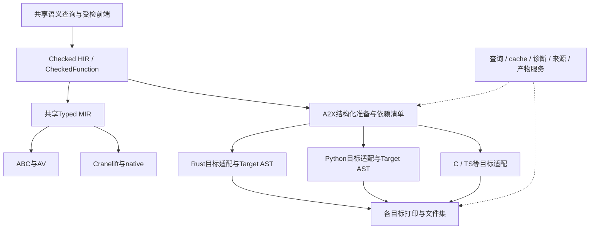

# 51 — 共享A2X架构与Checked HIR→Rust路线

> 状态：target-state设计r1，2026-10-30；本轮用户授权设计/规划，不是实现或Spec交付证明。首期拆三个实施切片；AX-A现已正式立项[PLAN-892](../plans/892-shared-a2x-hir-to-rust-scalar.md)，drafting r1/0-of-11，AX-B/C仍未编号；本轮只规划。统一入口：[ACE战略](strategy/auto-native-backend-evolution.md)；执行路线与写面：[A2X战略](strategy/shared-a2x-and-hir-to-rust-roadmap.md)。

## 0. 决策与事实基线

A2X以结构化Checked/Typed HIR为主要输入，复用ACE语义事实、依赖和产物服务；MIR继续负责ABC→AV与Cranelift→native的共享执行lowering。源码转译可复用必要语义分析/变换，不强制从CFG恢复循环，也不建立与HIR/MIR平行的全语言类型系统。依据[Design43](43-ac-av-typed-mir-and-abc.md)、[Design40](40-compiler-artifacts-and-cache-lifecycle.md)、[版本合同](../plans/reports/ace-milestones-version-boundary-2026-10-24.md)。

本轮master读取4ea7780aa；889 executing r2/5-of-10，正在T-06性能/正式验收修复；888 executing r2/5-of-10，模块/批量工具与正式成本收口中；891 drafting r2/0-of-10。代码已提交到实施分支不等于已交付主线，不消费这些WIP，不修改其合同。本文不冻结实施树最新状态，开工须重核。

| 已观察现状 | 对设计的约束 |
|---|---|
| 旧crates/auto-lang-core/src/trans.rs的Trans只有trans(ast: Code, sink: &mut Sink)；Sink/MultiSink和来源映射已有共享 | 旧后端并非零共享；新共享层应增加语义/转换/服务复用，不以trait方法数量衡量复用 |
| 旧RustTrans依赖旧AST/Database/自有推断与后处理；字符串存储/参数/返回有启发式转换 | 可审计提取纯输出工具及合适helper，不把旧AST/Database适配器作为新HIR权威语义，不携入整套正则修语义流程 |
| ac-core::verify已有CheckedModule::bundle/domain/text_resources、CheckedFunction及context_revision；hir有CallBinding/ParamMode/CtorBinding/显式类型和结构化块 | 是当前可信入口；完整meta/实例/依赖query接口仍需按实际producer扩展，不将全部目标能力视为已可查询 |
| source::resolve::CheckedEnv、adapter::prepare_candidate_document/FnCandidate及lib.rs内联body_work已有单体生产接缝 | 复用受检前端；现行probe/session还捆绑MIR/AV消费，新A2X须做轻量消费者适配，不依赖AV执行来取得Rust代码 |
| HIR并不总保留原源语法：864的is/for-in已结构化为guard/branch/loop等 | 可消费这些受检结构；不得假定已有完整Match/ForIn源AST，也不以反读源码/猜模式“恢复”缺失语义 |
| M1原T03仍记录source verify.resource-assign，T05记录shared text eq/lowering缺口；不等所有text原源已过共享前端 | AX-B必须分清source前置、HIR已合法而MIR消费者缺口、新Rust目标映射三个层次；既有合法语义的source误拒须取S窗有界修复，不能以typed绿冒领原源 |
| 旧a2r金样与独立认证、受控rustc进程设施已交付 | 日常emit/金样与显式compile/run分轴；新ACE-A2R拥有明确新身份/金样，不覆盖旧expected来迁移 |

读取hash：hir.rs=A2A7606DC8E4B1E0F0B5BF7F25CE3A4C314EABF2D0B4E1D50B5D368D3DA70C5E；verify.rs=8A7768D1AB37C085A831AAC02812703758788F9B83C4CF4C6675371D603CD84F；旧trans.rs=618A7E73B3F74110A96AD7D7C696CF12190C5AF0D8DB53C8D68D31A9E0C0EB10。来源均为主检出，非889/888分支候选。

## 1. 共享的是哪些层

层次是职责边界，不要求马上新增同等数量的crate或序列化IR。结构化准备可以是共享HIR的只读view、每函数派生计划与稀疏目标改写；保留原控制流结构和源位置，不复制整个世界，不把每个后端都变成新编译器前端。

## 2. 权威语义、共享实现与目标所有权

| 事项 | 共享层职责 | 各目标后端职责 |
|---|---|---|
| 符号/类型/调用 | 消费已绑定声明、真实类型/参数模式、按源码序的实参及构造绑定；CTE/实例结果只从现有语义查询取 | 将受检值与签名映射到目标类型/调用形式，不重新猜接收者或重做语言推导 |
| 控制流/顺序 | 共同遍历/改写工具、短路/求值顺序/临时值计划、必要脱糖；effect事实缺失保守处理 | Rust借用作用域、C显式跳转/清理、Python语句展开等目标合法化；选择保持match或展开分支 |
| 资源 | 对接权威move/view/mut/clone/drop、失败原子性与清理责任，引用TextResourcePlan等已验证分析 | 选择原生值/引用/容器或小型typed helper实现；证明Rust borrow/drop、Python GC、C free符合承诺 |
| 数值/文本/容器 | 操作的语义ID、位宽、溢出/除零/索引/编码/失败合同；共用操作需求和测试oracle | checked_i32_add等映射到目标原语或版本化helper；不把Python大整数、JS number或Rust构建模式默认行为当Auto语义 |
| 库/host引用 | 稳定逻辑API及签名、effect/授权/实际依赖需求 | 每目标runtime/API映射、import拼写与打包；只带实际所需helper及传递闭包 |
| 命名/来源/输出 | 稳定声明ID、局部临时ID、冲突分配工具、源span沿变换传播、Doc输出工具与诊断收集 | 关键字/名称编码、括号/缩进/字符串字面量规则、目标AST和文件组织 |
| cache/生命周期 | 实际依赖记录、分层key、单体事务、quota/lease/GC、原子文件集发布 | 提供target/edition/flags/backend/helper等身份；目标编译器的cache/构建是独立消费阶段 |

语义权威属于ACE，A2X的SemanticsView只是查询门面，不成为第二个type/effect/ownership数据库。共享规则也供MIR路线复用时，在适当中立层定义；不为了共享而把A2X放进auto-mir-lower或让其消费CLIF/ABC。

多目标并行时共享HIR/事实为不可变快照；每目标单独持有局部改写、名称空间及产物。目标优化不得就地改写其他后端正在读取的HIR。未知能力是具名拒绝，不自动降到旧AST转译器。

## 3. 最小公共合同

下列为拟议角色名，不是已存在的API或必须一次全部实现的trait。

| 角色 | 输入/输出及限制 |
|---|---|
| A2xSemanticView | 绑定owner/profile/schema/snapshot的CheckedModule或CheckedFunction及受检环境；只读查询类型、调用、模式、资源与来源，并记录实际事实依赖；missing事实显式返回缺口 |
| TargetProfile | 目标语言/edition、支持矩阵、runtime/helper合同、配置与平台；按需求执行准入，不用进程全局目标开关控制并行请求；未来可消费CAP，不把完整Design46求解器作首包前置 |
| Shared preparation | 每函数或声明的语义摘要、临时求值计划、helper需求及依赖清单；转换pass声明前提/保证/顺序和版本，按目标能力选择，结果仍结构化 |
| TargetBackend | 依据已准入事实与准备结果，生成本目标函数/声明片段或Target AST；可保持小顶层接口；目标节点操作不强迫所有语言实现同一巨型emit_*接口 |
| Artifact service | 稳定装配函数片段、imports/helpers和相对source map；确定性路径/排序，受限sink、manifest、恢复再验及原子发布；底层沿已有store/受控进程设施 |

公共walker、rewriter、source-origin工具与通用名称分配器采用组合方式。目标树不必统一为“万能语言AST”；小型Rust目标树或有结构的Doc均可，Python/C按其语法独立。缩进/布局工具可共享，字符串转义和运算符优先级必须以目标规则实现/验证。

共享实现以真实消费者证明：首包必须有Rust真实闭环；第二语言（建议Python的scalar实切片）再验证公共接口与pass复用。该后续验证未交付前只称“为多目标设计、已验证Rust”，不能称跨目标复用已实证。

## 4. 转换pass的分工与合法性

1. 前端已完成的绑定、类型与模式不再重算；必要函数/方法普通化从已解析DefKind/ReceiverKind和调用绑定出发，不再次扫描文本猜方法。
2. 无目标差异的规范化可共用；需要目标能力参与的转换在请求局部运行，key含相关TargetProfile轴。不能把Rust不支持某形态视为语言本身非法。
3. 保留短路与副作用顺序；参数列表和CtorBinding的“求值顺序/字段存储顺序”分开。公共层提供临时值/读写顺序计划，Rust再安排合法借用生命周期，不能为了避borrow error复制表达式或暗加clone。
4. shared preparation生成新引用/节点后检查类型、def-use、分支/loop目标、来源和单求值保证；目标合法化后检查没有残留未支持操作、import/helper齐全与声明一致。检查不重新解释源语言。
5. 深结构/共享类型DAG遍历有预算且避免宿主递归溢出/指数展开；有限资源拒绝与语言类型错误分列，不擅加语法深度排除。unsupported/资源失败发生在发布前，旧交付物可用。

代表性顺序用例：构造参数按右字段→左字段给出，字段最终仍按声明存储；实参带可观测调用只能求值一次；false && trap() / true || trap()不能先求RHS；循环continue跳转不得绕过约定更新/清理。具体源必须选已合法的profile；缺effect观测缝时以独立手工HIR合法控制辅助，不能冒称源码已支持新builtin。

## 5. Rust后端与runtime边界

### 5.1 初期可执行选择

首期宿主冻结为当前已验证开发平台Windows x64，生成Rust edition 2021、纯std或最小显式helper；其他目标平台逐项认证，不从Rust跨平台能力推导成ACE已交付。函数/类型是普通生成Rust的内部接口，不走mn私有ABI或自动成为public AutoABI/FFI。

标量映射必须精确i32/bool，i32 add/sub/mul/neg/div/rem以显式checked语义落实，MIN/-1及MIN%-1保持Auto合同；release/debug都不依赖Rust默认溢出策略。语言trap用具名结果/受控runtime路径表达，Rust编译错误、panic/异常退出、工具缺失均不满足Auto负例。首包明确i32结果、trap、前端诊断三个观测轴；结果wrapper按实际生成签名编码，不沿旧a2r默认i64推断。

text/record阶段可用String、&str、struct等自然表示，但view/mut/move/显式clone、Unicode标量索引、NUL比较及释放时点以Auto合同为准。Rust默认drop顺序、可能的隐式allocation、借用生命周期不自动满足要求。先用跨函数owned返回、多move、重赋、borrow和失败清理的真生成/编译/运行probe决定直接映射还是typed helper；helper不接受MIR/ABC/AST指令，不复制AV解释器。

集合/变体阶段沿864合法源码/已正式修复域：List<Str>/拥有record/Variant、活动臂、只读投影与有限for-in；List参数/返回/嵌List和源码容器.clone等原拒绝集保持。Rust Vec/enum只是表示候选，容量预算、下标trap、失败precheck→commit、旧臂释放/回收等义务仍逐项验证。源码与typed辅助资源probe分账，不靠手写typed成功覆盖源码gap。

### 5.2 与已有runtime的关系

旧a2r-std可作为经核验的provider，不是自动兼容库。其int=i64、部分字符串find/slice约定、宿主服务和内嵌facade与ACE profile须逐项核签名/语义。可复用中立纯helper或加明确adapter；不能把整个旧库带入只用一次checked_add的程序，也不全量重写stdlib。

能力合同/操作语义ID可共享，实现按目标分开；helper内容及ABI、依赖版本计入产物身份。异常、GC语言的最终回收与Auto可观察资源清理区分；未来Python/C后端对外资源也须显式清理，不因目标有GC省略。

## 6. 函数级增量、分层cache和事务

| 层 | 最小身份/依赖 | 复用与准入 |
|---|---|---|
| 已验证HIR/事实 | producer/schema/profile/owner、真实类型/签名/模式、实例/meta/CTE及其传递依赖、配置/授权 | 活快照内只读共享；持久恢复由producer重验，不序列化Rust指针/Checked标志当信任 |
| 目标无关准备 | 每函数语义内容、实际读取事实、共享pass及语义版本；表索引/绝对span不作语义 | 可多目标共享；若pass实际读取目标能力，该结果立即归目标相关层，不能放入全局无目标key |
| 目标适配/片段 | 上层依赖+target/edition/能力配置/类型表示/后端版本/runtime helper闭包 | Rust/Python等互不误命中；完整位型、名义类型与参数模式在规范内容中区分，不能只hash调用点源码 |
| 文件集装配 | 片段ID/hash、导入/helper并集、模块布局与相对来源映射、格式器版本/开关 | 片段复用、装配可以更新；不为一次导入变化重产每函数；format不得事后改语义 |
| 目标编译与认证 | 真实生成全文件集hash、wrapper、rustc身份/target/flags、完整依赖锁与oracle/reference | 是独立工具链阶段；Rust可能重编较大crate，不冒称A2X函数复用=rustc只编一个函数；PASS不缓存 |

暖单body编辑必须经现有CheckedEnv/候选单体接口，仅改变函数真实parse/resolve/typecheck/HIR生产、共同prepare、target-lower、print和工件写入推进；未改函数上述生产=0，resident token/Arc及mint代际、片段payload身份保持。源hash/时间更快或末端片段同字节不证明结构增量；强制whole前端/prepare、重造resident伪保代际的反控必须红。为装配/输出做的必要有界暂存不等resident替换，单列计量。

现行CheckedFunction context_revision较粗，body-only可精确；签名/type/模式等context编辑必须正确失效，可明确走保守整上下文复核或具名拒绝，记录真实work与限制，不称最小依赖重验。实际不依赖的目标片段不得仅因表编号/span变更换身份。后续细粒度语义query成熟再收窄；helper body变化对普通非内联caller只重装配/编译依赖，对CTE/内联使用者须失效事实/产物。

准备→验证→生成→完整文件集/manifest核验→原子发布；失败/取消/迟到候选保旧source revision、声明坐标、resident、文件集与可用性。多次变长编辑更新span，避免用旧坐标错路由；GC/close与最后lease释放覆盖旧片段/索引/WAL/staging，不删除用户交付目录或他方cache。reuse/fresh/read-only与冷恢复重验分列，缺依赖/坏片段/错误target在消费前拒绝，修复后下一次restart真hit。

## 7. 测试、认证与计量

保留[现有a2r双轴裁定](../specs/auto-test-case/a2r-golden-certification.md)：日常是新producer真实emit→与已审阅金样逐字节比较→严格证书/身份核查，rustc/cargo/目标程序spawn=0；真实compile/run是显式独立认证。新ACE-A2R与旧a2r的recipe/profile/金样及wrapper分开标识，schema/adapter扩展必须经H窗口，不让旧证书错误授信新入口。

认证消费现场actual且绑定全文件集、source/target profile、shared/backend/runtime版本与内容、wrapper/oracle/reference、实际启动rustc -vV和flags/deps。生成程序与独立手写reference分别等于父侧oracle；不只互相比等、不让worker拿expected。rustc编译失败不算语言诊断，panic不算预期trap。新语义可能合法产生不同Rust文本，新金样先独立审阅，不覆盖旧金样掩差异；原M1 a2r列/NA/accepted-diff不随新producer自动改绿。

首包第一例即文件化AutoDown/TestCase、独立oracle、fresh/hit/restart/body-edit、恢复再验、结构反控和预算观测；不能等第三包或总审计补基础。代表规模沿已交付scalar源码基线核真实115函数/273575B及至少30不同修订，不把单行toy时间当开发工作负载。正式Plan冻结每状态样本、入口→emit/装配/父判/清理口径与P50/P90/P95/P99；日常正式门P90≤2000ms、长期亚秒目标保留。compile/run认证单列原120s编译/30s运行等工具预算；不拿2s emission宣布完整rustc编译运行达标，也不以此擅自放宽native/AV原门。

新A2X管理工作集首期策略上限拟取48MiB，输入≤4MiB、IPC≤4MiB、单目标产物≤64MiB/单check≤128MiB，stdout/stderr各≤1MiB；帧/表达式/类型图/暂存按真实大小分配前受限。正式立项先用最小链核共享上游与caller更严限制，并冻结分区/生命周期、项目store配额/冷热片段/GC与磁盘上限；缺配额不得广铺持久缓存，不自动调大。Rust工具链进程峰值/磁盘scratch单列并受其约定预算，不能藏进“48MiB转译器”口径；没有物理硬门出处的只报真实peak与局限。工具维护构建与warmup单列、不得与888/889正式采样抢资源。

## 8. 迁移、包边界和并行

拟新增独立实验workspace `experimental/auto-a2x/`，内部先以core(shared)/rust(provider)/probe(driver)角色分开，精确crate名与目录在首包feasibility冻结。共享core仅依赖已交付HIR/语义合同与中立artifact/diagnostic设施，不依赖旧auto-lang AST/Database、Cranelift、AV executor或产品UI/Man；Rust provider依赖core，probe可复用既有受控工具/test设施，方向不可反转。旧Sink若抽出会触公共SDK，须窗口；没有独立中立出口时先做最小新输出层，不为复用数十行引入整个旧引擎。

只读消费S/N正式合同的私有A2X工作可与native线并行；无需D889/D891作为Rust代码生成的语义前置。共享HIR/schema/source候选/资源事实或helper执行器变更拿S/H子窗；公共SDK、TestCase、certify/报告、模块发现源锁拿H窗；不改N emit/layout/私有ABI。需要889尚未交付的命名enum/单体source修复时，只等具体正式S修复，不偷取分支WIP或复制前端，不强加整项D889。

旧AST A2X继续承担既有产品，新增入口显式选择ACE-A2R；不自动fallback或切默认。逐源覆盖/行为/项目/host/provider成熟后另立消费者迁移与退役合同，不把纯重构的884/885历史或新A2R首例当全旧转译器替换证明。

## 9. 首期拆分决定

**首期三个有界实施切片，AX-A已立[PLAN-892](../plans/892-shared-a2x-hir-to-rust-scalar.md)，AX-B/C按需逐个立项，不预占号**：

| 切片标签（不是Plan ID） | 必须交付的真实闭环 | 可先并行的准备 | 硬关闭边界 |
|---|---|---|---|
| AX-A 共享骨架＋Rust标量 | 共享checked输入/准备/目标能力/产物身份最小接口，core/scalar HIR→真实Rust→独立认证；文件化/金样/增量与预算首例齐全 | 新A2X/Rust私有设计/工具材料；实际写入仍需授权/路径接受 | 标量正例、短路/顺序/溢出trap/静态拒绝及四状态/结构反控；Rust之外暂不宣称多目标实证 |
| AX-B Rust record/text与资源 | 经同一骨架扩record/text/text-record、static/view方法及现有view/mut/move/clone；跨函数返回、Unicode/NUL、资源/失败清理，函数增量 | 在AX-A接口正式交付前可做只读语义矩阵/独立参考，不能复制临时core | 资源表示先真链probe；必需方法/模式/资源矩阵通过，旧scalar与身份兼容，合法源码gap逐条有owner |
| AX-C Rust集合/变体 | 原L01–07/V01–07、List<Str>/拥有record/Variant、for-in/is受检结构、活动臂与失败原子性/清理；source/typed辅助分账 | 只读消费864/889具体S修复，准备独立oracle与表示候选；不等N typed entry | 原源与补例真实Rust认证、复合增量/恢复/资源/预算；不顺带加入闭包/console/全库 |

不单独立一个“共享大平台、无真实Rust消费者”的基础包，也不把增量/cache/AutoDown延后成第四个收口包。AX-B与AX-C有明确资源基础依赖，整包默认AX-A→AX-B→AX-C；无同文件/合同写入的私有参考准备可并行，真正共享core扩展顺序交接。

后继另择包：第二目标Python scalar验证共享抽象、闭包/HOF与host-console、多模块/stdlib/泛型-meta/CTE、wide源码与多平台、旧产品迁移。891的typed MIR wide不等A2X有宽源码HIR；新typed起点如需要另定义，不把W fixture强行塞入首期源码包。每目标依原有对应示例矩阵认证，不要求所有源×所有目标的虚假全交叉积。

## 10. 必需验收矩阵（正式Plan展开为AC/V/T）

| 设计case | 所属切片/义务 | 可区分的oracle与反控 |
|---|---|---|
| AXV-01 | AX-A 标量正例/失败 | 原B01=14、B04=42、B09=120等源到真实Rust；B13 overflow与B14 div-by-zero具名trap，未执行分支非法引用也查名；release/debug关键算术一致；rustc error/panic不满足语言负例 |
| AXV-02 | AX-A/B 求值/模式/来源 | 短路RHS trap不触发，构造/实参副作用各一次且源码序；方法/普通调用相同已绑定事实；目标诊断回原span，不以目标编译器猜Auto语义 |
| AXV-03 | AX-A 首例生命周期 | cold/fresh/hit/restart/read-only/body-edit/变长/候选失败、A→B→A；未改函数真实生产0与payload/generation保留，forced whole/伪resident反控红 |
| AXV-04 | AX-A/B/C cache与依赖 | profile/target/edition/类型/参数模式/helper body/meta/实例/CTE依赖变化正确失效；未触达表重排/span不误重产；坏片段/缺required-data先拒，修复后再次restart真hit |
| AXV-05 | AX-A 证书/输出/失败 | 现场actual全文件集与金样/证书核，改expected只红对应格，missing/SKIP/零选择非PASS；日常目标工具spawn0；认证错wrapper/actual/helper/rustc身份拒；多文件发布失败保旧 |
| AXV-06 | AX-B text/record | R07/R08=42、T03=23/T05=42为原源required关闭目标（不是已通过基线）；mut写回、多move、clone后独立变化、owned返回、NUL与A中😀标量/字节轴；一次释放/失败清理与借用活性，合法语言因Rust借用出错仍是未完成支持 |
| AXV-07 | AX-C collections/variant | 原L04/L05=42、V03=3、L06 list-index trap；List<Str>=51、copy/owned for-in=42/53、拥有List<Variant>独立42；活动臂/clone资源probe与源码拒绝分列 |
| AXV-08 | 每包资源/周转 | bounded prepare/print/IPC、分配/取消/超限/写盘失败、进程树和reader收尾、close/GC；真实内存与磁盘配额、正式源规模/样本、P90≤2000ms日常面；编译运行单列预算与结论 |
| AXV-09 | 每包交接/兼容 | S/P/H真实释放接受、SDK/recipe/worker/current身份与stale同步，新case进当时正式治理清单/模块并集；不自动纳888 B/C，不污染旧a2r/native报告/expected |
| AXV-10 | 后继第二目标 | 同一checked事实/公共pass由Rust与Python实际消费，各自目标生成/运行对独立oracle，捕获公共pass错误；此未实施前不宣称多目标共享已验证 |

## 11. 尚需在立项/feasibility关闭的机制选择

- AX-A：现有单函数候选/受检环境的最小backend-neutral出口、source span与依赖投影；若S未释放，先只读及私有材料，不依赖AV session取代码。新crate/目标树/Doc形式、真实Rust进程复用与新证书profile、runtime最小内核及store配额必须先真链probe冻结，再扩实现；不新建第二前端或store。
- AX-B：CheckedFunction的text/resource事实若出口不足，producer补受检投影后消费；直接Rust引用/值能否覆盖所有受检合法borrow/资源时点，通过反例选择helper。不能删合法源或暗clone避编译错误。
- AX-B的T03/T05先定位实际拒绝阶段：源门误拒已有合法语义时由本包接受S-text最小范围或等待其正式前置修复；HIR已合法、仅MIR消费者不支持的，不要求A2R等待或重走MIR。正式立项据规模决定前置有界修复是否另拆，所列required原源没有实现不能仅留owner就判AX-B完成；旧AV/native/旧a2r各列仍须各自重验后另回填。
- AX-C：保留现行source域限制，889未交付修复的精确符号/版本是特定S依赖；Rust容器OOM/预算、部分clone/构造失败回滚和深层清理必须先决定，不拿Rust默认panic/OOM退出算资源语义完成。

这些是有owner和关闭门的实施机制，不是本轮已跑过的结论。精确计划任务/SD/依赖/窗口冻结后再依auto-plan流程实施、独立review、合入与Spec沉淀。

## 12. 业界参考与采用限度

Fable展示了共享中间AST/转换工具、分目标AST/打印器及运行库映射的组合；其Compiler上下文还提供声明查询、诊断和依赖记录。参考[项目架构](https://github.com/fable-compiler/Fable/blob/main/AGENTS.md)、[共同转换](https://github.com/fable-compiler/Fable/blob/main/src/Fable.Transforms/FableTransforms.fs)、[Compiler接口](https://github.com/fable-compiler/Fable/blob/main/src/Fable.Transforms/Global/Compiler.fs)。采用层次/复用原则，不复制其项目特有全局配置或全部F#语义。

J2CL在共同AST/pass框架上组织不同目标的desugaring、normalization、restrictions及输出，说明共享pass实现不要求所有目标同一pass序列。参考[Backend实现](https://github.com/google/j2cl/blob/master/transpiler/java/com/google/j2cl/transpiler/backend/Backend.java)。以上是架构参考，不能替代Auto自身副作用/所有权/失败语义的独立验证。
