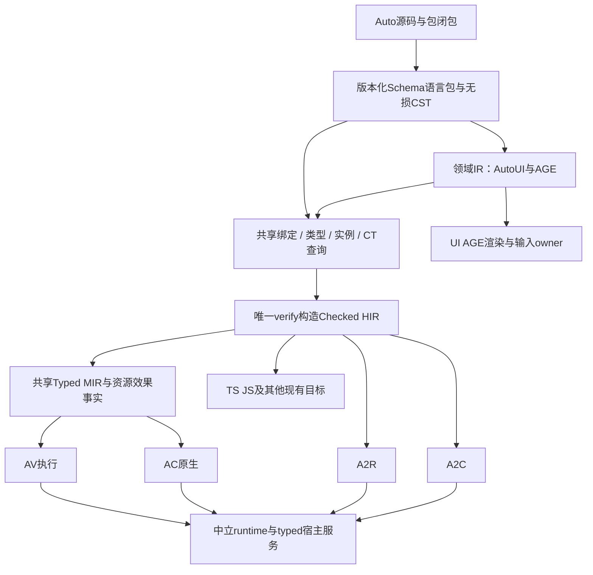

# Design 55：ACE M2 完整语言、标准库与产品替换

2026-11-19，W1 按 1071 原子面和 AutoUI 104–108 剩余 AV 分母验齐，正式 W2 由 [1097](../plans/1097-ace-ac-autoui-w2-and-age-host.md) 交付，1074 消费 W2。AGE 领域来源见[AGE 交付表](strategy/age-m2-three-route-strategy.md#后继交付与消费)。1068 接收正式证据并执行最终三端验收。 普通 AC 修复按 [AAC 与现 AC 实施归属](59-aac-native-bootstrap-and-compiler-subject.md#现有-ac-差额的实施归属) 进入实际任务。

## 2026-11-19 · AV与AutoVM语言齐平专线（仅规划）

2026-11-19 AV阶段补充：1078–1096当前只选AV，共享Case的AC/A2R等检查先以检查级`#ignore`暂缓，后续对应目标开发时逐项打开；非AV失败/未跑/缺工具不阻AV的work/review/merge，不充PASS。取消1078最小AC真执行要求；源码/原预期/迁移义务保留，最终多端门不变，本轮仅规划。

2026-11-19补充：公共语言AutoDown按[共享语料合同](testing/ace-feature-organized-autodown-corpus.md)集中在拟language特性根，同一源码各目标独立检查；1078建作者/选择/迁移机制，1079–1096及AC/A2R/AAC各原owner分批迁例、追加检查、守恒旧义务。suite/固定组为视图，原签章历史与产品原源不重写。本轮未迁用例或施工。

[独立设计与执行顺序](strategy/av-autovm-language-parity.md)将本轮优先推进的AV语言主体拆为PLAN-1078–1096，含72个拟定AutoDown代码case及原旧语料/语言族承接。先交统一普通源码测试接面，再补具体语言差额，最终交`IF-AV-LANGUAGE-PARITY/1`给1068与985/B。完整标准库API、UI/2D/3D全例、AC/A2R/A2PY和产品替换各留原owner；共同前门改动仍做必要下游验证。旧bug/已批准规范差异与真实兼容缺口分账，未跑不计PASS；不重开M2-A已签出口、不把AAC自举设前置，本轮不施工。

> 本轮事件/阶段交接以§16 EVENT-SPLIT及980 r15／981 r17／985 r24为准；旧“等待整个980”或三条件总门不覆盖当前切片合同。

> 2026-11-16 · target-state r12（原调研日期2026-11-06） · 调研与拟议架构，未实施。r11按§5.3/§16调整M2-A基础、B三端最终一致及AAC实证；r10以§5.2补系统库/B1/MODULE/AC的实际后继与无环交接；r9按用户裁定以§5.1调整Godot/TS目标范围；r8补AAC独立路线与A稳定后并行安排，不改M2分母；r4按用户最新指示，把未执行的标准库准备计划945–948统一置于M1正式tag之后，见§1.1。执行索引：[M2路线与全部计划](strategy/ace-m2-delivery-roadmap.md)。本轮不修改canonical Specs、不接管在途实现、不切默认。

当前执行次序由§16正式两阶段合同统领：M2-A语言/新库完善（含具名真实产品验证）→M2-B全产品替换/退役。前文旧轮次的全面交错迁移排程按§16解释；M1-TAG、原全部义务与独立AACE版本边界保留。**2026-11-14 AAC排程增量**：[Design59](59-aac-native-bootstrap-and-compiler-subject.md)和[AAC路线](strategy/aac-delivery-roadmap.md)正式规划Auto版AC主体，1044–1056在M2-A稳定出口后可与M2-B并行，独立验收，不成为M2硬门；本轮仍只规划，不施工。

## 0. A最小真实交付与B三波产品路线（2026-11-16当前）

用户本轮明确：A交稳定真实基础与最小产品贯通；B按完整UI/Widgets的**AV→AC→A2R三波**，再迁AutoOS桌面与全部登记应用，最后候选/安装/退役。不是每个UI批次同时实现三端。原language/stdlib/非图形FFI的基础门和三端最终完整能力不删；既有HELLO/AXR0/SOURCE/库交付复用，不回滚、不重复立项。

A精确范围为[980 §5 MIN-A](../plans/archive/980-ace-m2-autoui.md)：MIN-A-UI（真AV UI-FFI Node Hello/function中文/最小Counter与双实例/关闭恢复）、MIN-A-AGE（正常Node多模块与最小UI-2D-3D真实AV呈现/事件/更新/关闭）、MIN-A-OS（真实OS启动/激活/窗口链承载同源最小见证）。原完整UI/Widgets、完整AGE-L/PROOF/RUST、Notes/Clock全业务与桌面/全部App原oracle按行迁B；A不再等待这些整包结果。旧文完整目标说明均按本节和§16的新表解释，不可作为隐藏A全量门。

正式顺序：MIN-A＋其余原A-required→985/A M2A-08→980/981 UI-W1-AV→1097 UI-W2-AC→1074 UI-W3-A2R→OS064完整桌面/App→984 CLOSURE/985 B候选→986安装默认→987退役重建终验。三波收据独立phase review/fold、绑定正式源/ABI/SDK及各端独立oracle，不是新Plan/状态。W2不等1068三端全包；W3不等OS/985 B；OS不等985 B最终，从而避免循环。完整AAC Gen2/3仍独立，AAC真实模块可驱动AC补齐，不成为UI W2的整包前置。

简单示例可按能力合组，复杂异步/文件/媒体/编辑器边界再拆；Widgets与对应示例同时推进。只当前波新后端日常验证，AV不每批编译A2R图形；预编译Rust宿主/FFI可复用，必要共享变更仍选受影响内部检查。最终第三波/产品汇合才签图形三端。Godot移出M2、JET/ARK归M3、WEB/TAURI现役与Linux延期/性能条件保持。本轮仅规划，不实现/运行或修改canonical Specs。

## 1. 目标、范围与完成定义

M2交付完整Auto语言的ACE实现：AV虚拟机、AC原生编译、A2R三端公共能力一致；A2C完整对齐为增强项、保已有能力与来源；新版标准库、AutoUI及AGE新语法通过统一编译链；AutoOS及所有现有应用真正使用ACE，旧AutoVM和AST A2X实现退出新版。v0.6原M1+M2发布门保持，AACE自举仍另属v0.7。

“完整”不能靠无限扩张或窄化解释：分母取**现行语言规范、已承诺但有缺口的语言义务、真实现用代码与公共入口，以及本次明确纳入的新AGE作者模型**的并集。规范/旧行为不一致列争议，不能把旧bug直接规范化；未来尚未批准的全新语言设想不自动纳入。每行必须有语法、类型、效果、资源、模块/库、平台、入口、consumer与oracle；仅存在AST枚举不证明旧支持，只存在设计也不证明已实现。

四端完整语言支持不等于所有宿主在所有机器可用：语言语义必须一致，OS/GPU/network能力由明确provider/profile提供；已支持的平台/模式格必须保留，新跨积不能随意承诺。合法但缺宿主能力的程序在运行前具名拒绝，而不能降级调用旧引擎。原源兼容优先，必要迁移必须显式工具/说明/独立验收，不能删业务绕过缺口。

M2终点同时满足[REP-01..11](../plans/reports/ace-replacement-first-m2-contract-2026-11-02.md)与[V06-ACE-01..05](../plans/reports/ace-v06-m2-release-gate-2026-11-02.md)：语言、全产品、开发周转、安装默认、旧实现退役都完成。产品只首帧、转译只emit、安装只dev树均不成立。

2026-11-09用户追加范围：[Design56](56-ace-m2-ffi-and-native-stdlib.md)的完整C/Rust自动binding/ABI adapter和新版标准库为M2硬门，不是M1扩容或可选后续；统一公共Auto API、默认Auto实现、`#if`/`#is`目标选择、平台ABI及装配/加载/分发都须实际闭合。下文初轮/第二轮快照按原日期理解，当前增补责任见§15及路线§11。

### 1.1 M1-TAG：标准库准备计划的统一进入门

用户2026-11-09决定：标准库底层的Auto系统接口、C/Rust FFI及新版标准库在M2交付；先前未执行的945–948连同其中的调研、盘点、前探和最小接线，均在**ACE M1完成并打正式tag之后**启动。tag前仅可维护规划文档，不提前执行这些Plan的T-01、生成研究材料、建实施树或运行探针。本轮文档修订不等于实施授权。

`M1-TAG`是Markdown时序门，不是新增Plan状态/后端字段。关闭时须在开工Plan记录以下实际证据：

1. M1最终组合验收与其所需修复（包括941/999）由原owner正式核齐；仅某个任务数满、分支reviewed或报告存在不够。
2. M1最终交付已按实际收口合同合入主线，来源SHA与验收适用身份相符；不能拿尚未合并的WIP作正式基线。
3. 正式M1 tag已经存在，记录完整tag ref、tag object（如适用）、解析出的commit、发布/交付收据及当前工作基面的祖先关系。名称和SHA由实际交付填写，不在规划中猜造tag名，也不强加签名/annotated形式。
4. 后续取得对应M2 Plan的实施授权，再核该包自身依赖与未决设计。tag满足不自动授权施工，也不使所有宿主/库能力变为已支持。

本轮**未核验M1-TAG通过**，不创建/移动tag，不修改941/999或其最终收口合同。这里指ACE M1出口，不借用拆分重构989的同名M1/tag-ready、AGE里程碑或v0.6正式发布作为替代，也不把那些路线整包完成额外加为本门。

适用对象为未执行的标准库准备945–948；其后标准库包沿正式依赖消费交付。已归档943/944及959/960/961等保留历史与原状态，不重开、不重跑为“新调研”。tag后对实际将消费的相关来源/接口重核，受影响证据再按需补验；其他owner的独立在途任务不因本节被接管或改约。

重排后的职责：947先提供公共API/Storage方向/平台条件/装配合同；945/946交有限基础实现；948在tag后可先按943进行调查，最终消费945/946/947形成正式差额交接。972–975、967/968/966及978等继续承担各自完整库、FFI、调度、目标条件与分发责任，不把所有基础算法反向绑定到完整FFI/系统服务交付。

## 2. 本轮调研方法与状态校正

读取Specs overview、ACE HIR/MIR/source/AV/A2X/stdlib规范、Design39/51/54、922盘点与M2原合同、945–950相关计划、引用会话；直接核对旧AST/执行分派/转译栈、新source AST/profile与宿主接口，并只读追踪UI/AGE、Web、Man、OS实际依赖。没有运行产品或性能测试。本轮是架构级抽样与全范围责任分解，**不是已完成每应用逐操作认证或逐符号全量审计**；后者由[PLAN-959](../plans/archive/959-ace-m2-denominator.md)和各产品计划固化、最终认证核齐。无法读取/工具归属漂移保持unknown，不写零差额。

当前较引用会话新增：936已archived；950已archived，交付有限模块；944已archived，r2装配接入。938仍executing，939 drafting，941 executing；945–948 drafting。期间还出现951–957修复，不能拿历史“无模块”快照覆盖950，也不能把950有限标量模块扩大成完整包系统。计划状态是磁盘快照，不替代最终祖先/SHA核验。

| 仓 | 本轮读取HEAD（开工重核） |
|---|---|
| auto-lang | `a63a20b4e69fc39f448b509ec61c046143db0960` |
| auto-ui | `22a925c72d7620b929c947ff2bbddead13fda783` |
| auto-man | `03bb65ef7fb6181caa6a08d9752ac7d57c75516c` |
| auto-web | `bf72baabf28fa865b5a7c680b8a5fa4018a0a63d` |
| auto-os | `5adfe94734fa391116b6b7975723d0348a77501a` |
| auto-down | `58ea33f699efa5cb1194473a2d45dcec51006842` |
| auto-musk | `721ecfa0772713a8bc1bf338fe2205615ac9979b` |

主检出有既存文档WIP与未跟踪草案，本轮保留；外仓未写。动态会话/HEAD不作为永久完成事实。历史922的68行是种子，不是今天的封顶总量。

## 3. 新旧引擎差距：从实际路径出发

| 面 | 直接观察的依据 | M2缺口与责任 |
|---|---|---|
| 旧执行器 | `execution_engine.rs`只有AutoVM变体；core lib的execute_autovm_with_deadline_and_input仍Codegen→Linker→AutoVM::run_task_loop | facade、宿主、调度、会话逐层替换；不是枚举改名 |
| 旧语言 | `auto-ast/src/ast.rs`含宽数字、object、tuple、range、spec/ext、TaskDef、await/go/yield、try、Hash/宏及领域节点 | 新source逐项补语义与资源，不以parser可接收算支持 |
| 新源码 | `core/src/source/mod.rs`九profile；source AST仍有限Stmt/Expr；936 HashExpr是有限CT表达式 | 需要完整组合语言域，保旧profile可重现，不能继续靠互斥窄profile拼“全部支持” |
| 模块 | 950只显式宿主供图、i32/bool自由函数；无公共type、目录发现、重导出/循环/通用泛型；模块+模板组合拒绝 | [PLAN-960](../plans/archive/960-ace-m2-modules.md)与[PLAN-963](../plans/archive/963-ace-m2-generics.md)共享符号/实例图，不能简单拼源码 |
| 标准库装配 | 943操作语义/兼容实册；944有受检proof/manifest、两端有限模块执行与授权/恢复 | 945–948仅基础切片/前探；新版全库另有四包，全部四端证明不能从两端推广 |
| 宿主 | `av-core/host.rs`为console/1闭集，有预算/授权；明确无guest重入 | 939有限同步callback不等通用异步宿主；需资源句柄、运行权、调度、回调与生命周期 |
| 新A2X | workspace有a2x-core/rust/c/store/worker；旧trans.rs仍Python/JS/TS/GDScript/TSCN/r2a等 | Rust/C复用新producer扩面，TS/JS按§5.1交完整生产消费闭包；Python/逆向保原门，Godot目标由用户后置，旧源码/用例保留 |
| UI | dialect WidgetDecl含model/msg/computed/named_views/props/routes/lifecycle/design/style/use/watch/setup/expose/actions/timer；runtime vm_bridge和handler_codegen直连旧VM | UI公共语义到受检领域IR；保各模式真实支持表，不能要求TS专有行为原本已全端等价 |
| AGE | auto-driver lib实际import AutoVM/CpuSliceBudget/ParkedSegment；M4要求Schema语言包成熟、编译器替换已启动 | 新Node/use/model/msg/on与混合视图是本M2明确目标，实验driver必须换ACE；不能仅搬源码/改目录 |
| Web | server_dispatch持Rc<AutoVM>并new_without_host_snapshot；http_transport有owner线程边界 | 换执行服务和任务/资源端口，不能把AutoVM指针换整数穿线程 |
| Man | runtime/automan配置求值、CLI req/run/stdlib与target仍旧接口；package-lock已在Man仓 | config/模板/生成/目标/安装接管；不再按旧overview猜物理归属 |
| OS | host/desktop Cargo仍依赖auto-lang-core与UI；apps含生成后端和固定子模块 | 不是一个引擎开关；需实际应用/安装/后台/窗口/资源全链迁移 |

旧A2R运行时`a2r-std`含fs/task/http/json/sqlite/redis/zip/process/time等可复用基础，但“同名函数”不证明宽度/所有权/错误合同一致；只迁中立实现，不保旧发射/执行循环。旧C的内存/别名假设必须经共享资源事实合法化，禁止直接把Rust默认语义或C UB当Auto语义。

## 4. 目标架构及不可穿透的边界

1. **一套语义权威**：扩现有query/Checked HIR，不新造全语言类型检查器。领域包声明结构与校验，行为表达式进入同一绑定/verify；后端只能合法化表示，不再做名字解析或“补类型”。
2. **组合语言域**：语法可组合能力和版本有明确相容表；M2完整profile覆盖已冻结语言并集。保历史有限profile原身份用于证据追溯，不把互斥profile各自通过相加当完整程序可编译。
3. **HIR与MIR职责**：公共HIR保高级类型、调用、动态/闭包/挂起/资源事实，A2X直接消费；AV/AC经共享MIR降级。存储布局、目标ABI、指针和工具链参数留后端，不能反灌公共语义。
4. **资源统一**：值/borrow/owned/shared/host handle分类；异步挂起帧和闭包环境持真实owner，cancel/close最后pin释放。`Dynamic`是显式值域，类型推导失败仍错误；动态运行时是数据/操作helper，不是把旧VM藏在helper中。
5. **阶段信任**：磁盘内容必须重验身份/结构/语义，Checked不能反序列化取得。编译期授权与每运行授权分开；provider、host ABI、标准库及领域schema变化都参与真实依赖失效。
6. **产品前门**：拟议CompileSession/ExecutionSession/HostServices/ArtifactBundle四职责接口（名称未冻结），分别管受检源、运行/更新、权限资源、发行身份。旧API名可薄转发ACE；新增接口位置由计划前探在现有owner中确定。
7. **开发与发布分离**：日常预编译宿主+AV/可支持AC更新，稳定业务body编辑无cargo/rustc；A2R/A2C显式发布仍调用工具链。引擎/库/ABI改变可以必要重建，不用删真实依赖凑零。

## 5. 完整语言支持矩阵与拆分

| 能力族 | 必需语义和组合 | 实施责任 |
|---|---|---|
| 包/名称 | use/dep、public type/方法、别名/重导出、初始化、跨包同名隔离、源映射 | [PLAN-960](../plans/archive/960-ace-m2-modules.md) |
| 数值 | 宽有符号/无符号、byte/char、浮点、cast/to、位运算、checked边界、trap相位 | [PLAN-961](../plans/archive/961-ace-m2-numbers.md) |
| 组合类型 | tuple/array/list/map/set、嵌套record/enum/Option/Result、索引place、模式/解构/范围 | [PLAN-962](../plans/archive/962-ace-m2-aggregates.md) |
| 抽象 | 通用参数/约束、spec/ext、alias、实例与方法、跨模块泛型/资源 | [PLAN-963](../plans/archive/963-ace-m2-generics.md) |
| 动态与闭包 | object/动态成员/nil/null、反射、真实捕获、共享/递归值、函数值 | [PLAN-964](../plans/archive/964-ace-m2-dynamic.md) |
| 控制与效果 | try/catch/错误传播、循环/跳转/is表达式、yield、析构与挂起责任 | [PLAN-965](../plans/archive/965-ace-m2-control-effects.md) |
| 编译期 | Hash各形态、宏、metadata、生成声明、真实AV CT、hygiene与循环/预算 | [PLAN-966](../plans/archive/966-ace-m2-metaprogramming.md) |
| 并发与宿主 | async/await/go、Task/actor/ask/reply、timer/stream、FFI和权限资源 | [PLAN-967](../plans/archive/967-ace-m2-host.md)、[PLAN-968](../plans/archive/968-ace-m2-scheduler.md) |
| 入口及工具 | 脚本/config/args/capture、持久会话、daemon/MCP、测试/调试/LSP/Playground | [PLAN-969](../plans/archive/969-ace-m2-facade.md)、[PLAN-970](../plans/archive/970-ace-m2-sessions.md)、[PLAN-971](../plans/971-ace-m2-tools.md) |
| 领域 | 旧UI与新Node作者模型；schema/CST→领域IR→普通Auto行为 | [PLAN-979](../plans/archive/979-ace-m2-schema.md)、[PLAN-980](../plans/archive/980-ace-m2-autoui.md)、[PLAN-981](../plans/archive/981-ace-m2-age.md) |

分母计划还须核查FStr、union/tag、grid、存储策略、foreign调用、平台条件等所有旧AST/规范条目，归对应类型/动态/领域owner，不允许因本表没逐token列出就排除。上述表不是固定语料上限。必须验证“模块+泛型+owned集合+闭包+async+UI”这样的真实组合；各单项绿不代表组合绿。

### 5.1 M2目标范围裁定：Godot后置，TS按生产消费闭包（2026-11-16，当前优先）

**2026-11-19 用户裁定**。AutoMan 的 UI 工程验收以真实 `auto gen`、`auto build`、`auto run` 为产品入口，两端分别为 A2Vue（含实际生产 A2TS/JS 闭包）与 A2R＋Iced。A2Ark/A2Jet 现有成果按 Demo 留档，产品支持待 v0.7 或 v0.8 重定。C 导出限新版 A2C 的 CMake 工程与 Ninja 构建产物，IAR/GHS 待实际需求恢复时重评。Tauri 如本版实际产品所需，沿独立产品计划 1073 交付。此裁定适用于 982、候选认证、安装与退役的对应范围。

用户本轮明确：ACE M2不要求Godot转译，TS只在a2vue等实际生产消费需要时保留。本节为 **M2-TARGET-SCOPE-20261116**，覆盖早前“全部在用A2X目标均须迁完”的目标并集；普通Auto语言完善、完整AutoUI/AGE产品语义保持；AV/AC/A2R最终对齐及A2C增强按§5.3最新阶段，A2PY标准库承诺不变。移出Godot不等于移出AGE自有Node场景、2D/3D、光影或图形资源。

| 目标/能力 | 当前M2范围 | 承接与验收 |
|---|---|---|
| 新GDScript provider、Godot/TSCN场景发射、Godot工程/发行/运行验收 | **用户明确后置，不是M2-A/B required**；不再等Godot安装/运行或因其缺证阻塞出口 | 977移出GD/SCENE六个未实施任务，982移出GODOT三个未实施任务；旧任务/AC/V/原源/用例留历史，后续版本再授权规划，本轮不取号 |
| Vue Web 等仍在本版的真实生产消费所需 TS/JS | **M2 required，保留976** | 976交共享受检发射/provider，980/982/983/984按实际消费接线；必须覆盖合法作者表面及传递helper/模块/运行时闭包，不能只挑已有Demo或Hello |
| 独立、无本版生产消费者的通用a2ts/a2js CLI及其额外全语言目标面 | **不自动成为M2 required** | 976/T-01逐项登记消费来源；若实际生产工程依赖此入口或语义，该部分立即进入required闭包，不能以“独立目标”标签豁免生产依赖 |

**已核代码事实。** auto-ui `ui_gen/vue/script.rs`调用`ts_adapter::transpile_handler_body/transpile_body_as_return`；`ts_adapter.rs`在未专门处理的Stmt/Expr上委托旧`TypeScriptTrans`（§4取材锚定）。Ark适配也委托同一旧发射器。因此“Vue只要模板，不需要TS后端”不成立；但代码复用一个全局旧类，不证明独立CLI/所有不相关目标面都成为Vue的必需能力。新链仍经共同前门/Checked HIR和唯一检查，不保留生产路径的旧TypeScriptTrans fallback；Vue响应式/props/store/生命周期映射留UI owner，共享TS/JS发射不嵌Vue业务。

**消费闭包如何冻结。** 976/T-01从现行AutoUI规范、本版全部实际 Vue/Web 工程、handler/computed/watch/setup/store、UI普通函数与传递导入/调用、旧ts_adapter的所有委托分支及目标runtime/API开始，逐构造/符号/目标记录source/hash、旧producer、新producer和真实consumer/oracle。规范允许的合法Auto行为即使没有现成Demo也须补永久case；不能把无法发射的合法输入排除出闭包来过门。相反，旧通用a2ts用例只有在本版消费面/规范可达时才是新M2的必验来源，其余保留原用例与用户范围调整理由。完整Vue支持可能要求很广的表达式/函数能力，但不附带“全部独立a2ts产品功能已验”的宣称。

**验收守恒与发行。** 959归档基线不改写，985在原矩阵/adapter上追加本范围裁定的版本化覆盖：Godot旧义务记“用户后置/非本版required”，不是PASS、未解释NA或因缺工具仍pending-required；历史case/来源/未来去向保留。旧r16矩阵/已过check不能直接证明新范围，985/T-A03须重冻目标分类/消费闭包并重验相关正反控：Godot缺席不阻M2；误将Vue必需TS标后置、丢范围裁定或无证宣称Godot支持均须拒绝；其他required缺口继续阻塞。

986/987须以实际支持目标和生产可达依赖闭包构建、发布与退役，M2的新ACE请求不支持的GD/TSCN目标须具名拒绝，不fallback旧链；旧Godot源码/fixtures可留存，不据其存在判退役失败，也不承诺本版可用。若保留显式legacy工具，必须与M2生产/默认安装闭包隔离并具名登记，不能借此保留旧VM或旧A2R执行后门；旧VM/A2R与Vue生产路径旧TS emitter不可达的门不降低。不能把用户排除Godot解释为允许删除既有代码/用例或取消UI编辑器本身的现用功能。

本轮只改设计/执行合同/导航，不改实现、测试资产、canonical Specs或既有归档历史，不安装工具/运行测试/创建工作树。真实交付时由各原Plan的SD落规范；本节不把拟议新TS后端或目标拒绝行为写成已实现。

### 5.2 系统库后延、B1与共同模块接面（2026-11-16，当前规划）

用户授权细化原973/975/1064/1065/985交接，仅规划，不改变当前已验Spec。973现已归档，其r13已验有限面/终态保持，原D行由1064、AC真身由1065真实后继交付；归档不等于完整M2库已实现。

975的模块拼写/装配差额实际owner固定为**1064/T-MODULE-I/V/R/D**：在已有Schema/CST、PackageModule exports/imports和同一binder/verify上统一合法public/private声明，保原private与std内容/版本/来源身份，冷与恢复同守。不能把源串删pub/全pub化、内联镜面fixture或旧parser当共同模块支持；JSON/DB/结构感知decode[T]/canonical公共API与实际业务仍由975原任务实现。

975已有B1 char.to(Str)/TextFromChar/StrFromChar经新增T-B1-V/R/D先独立验证/复审/正式合入，不等MODULE或975全包；1064复用此原语，Auto算法默认解码字节/owned构造，不新造同义运行时。1064在967现有ABI/binding/resource owner补必要有界可写输出借用（T-FRAME），与原源自动binding/权限/lifetime一致，不另建FFI模型。1065沿原native emitter/ledger给50项符号/签名逐项适用性；Windows36项真实body、14项Linux-bytes专用形在Windows具名不适用，不能拿-10控制代W正例，也不能要求N都Windows成功；Linux原代码/完整用例归1063 NOT_RUN。

任务级顺序：`973已交→1065→1064适用AC终验`；并行`975/B1正式切片→1064 MODULE正式切片→975完整LOAD/业务`，`B1→1064 BSTR/D行`。MODULE I可在已有底座先做，最终真实文本consumer验B1。1064整包不依975整包，1065不依1064；旧D/A义务和新增MODULE/B1接收由985原矩阵/T-A03维护，完整A库/领域/RG齐→独立review→M2A-08，不能因后延删除原库/覆盖门。

1064 r2当前0/13、1065 r2当前0/6、975 r10当前2/11、985 r19当前4/14均为规划计数，未因本轮增加实际完成。973只补归档后前向指针，不重开/回填验收。后继正式source/SHA/grammar/ABI/runtime/原例/独立oracle与未交界面须真实核验，规划图不冒实现。

### 5.3 M2-A基础可用、M2-B三端对齐与AAC实证（2026-11-16当前优先）

用户最新裁定：**M2最终AV/AC/A2R公共能力一致；A2C完整对齐为增强项。** M2-A仍须完整AV/A2R语言/库及原required真实验证，AC至少有能承载AAC启动的真实多模块/类型与owned数据、泛型/Option/Result基本链、所需CTE/FFI、文本/分配/同步文件等基础。AC其余具名差额允许移M2-B：原行ID/输入/oracle/错误及资源义务、实际来源、B-owner/关闭条件必须保留，不能记PASS/NA或从分母删除。仅“原native不支持/旧profile外”不再是M2最终豁免。

[1067](../plans/archive/1067-ace-ac-native-async-and-task-parity.md)补原生异步/Future/Task；[1068](../plans/1068-ace-m2b-three-backend-parity-and-aac-proof.md)收全部三端语言/库/FFI/领域差额，并以AAC实际模块持续实证。985/A不等待两包，985/B及最终986/987必须收三端完整闭合；A2C现有代码/用例/支持记录保留、缺完整对齐不阻M2。A2PY既有标准库义务与AV三provider、Linux1063延期规则不变。

AAC在A出口后、M2-B期间推进，以真实Auto编译器模块检验AC语言/库；某任务所需能力未交只阻该任务/切片，缺口回语言/库真实owner补齐。AAC未使用的语言/领域/异步特性仍补独立三端用例。完整Gen1→Gen2→Gen3自举签章保持独立，不强加为M2通过前置；其所暴露的M2三端能力缺口必须在M2最终前关闭。此规则优先于旧“AC所有义务必须A期全齐”“M2-B与AAC完全无能力交接”“原A2C全量同等硬门”等表述。

本轮只调整本版已确认required的语言/库/领域阶段，不重新加入已后置的Godot、JET/ARK等后续目标；生产TS/JS消费闭包沿当前范围。

### 5.4 CONFIG-ACE-B：配置领域缺口由982端到端承接（2026-11-17，仅规划）

正式target-state见[ACE配置文档求值设计](ace-config-document-evaluation.md)，实施归[982现B-CONFIG-I/V/R](../plans/982-ace-m2-man-gen.md)。扩展其既有auto-lang＋auto-man范围，不新立Plan，不重开969/979；旧归档Spec与A route C只记录当时已交面，不因缺口归B就宣称ACE已有配置求值。

语法沿共同Schema/CST，配置文档投影一个有顺序的Program入口并走唯一verify/现AV；补中立owned Document返回与显式配置上下文/预算/取消/缓存身份，保持变量/if/for/模板、根级注入覆盖与嵌套字段分轴、Node-valued Pair和动态原分母。不得逐字段独立求值、用旧VM或Rust遍历AST代执行。宿主AV配置数据与AC/A2R业务目标分开，1068核边界但不是CONFIG生产前置。

B-CONFIG独立R后原T-06可先phase fold交IF-982-CONFIG-ACE，供983/984/985 B真实消费；完整982各批和final review仍要全部闭合才归档。986核安装/默认，987核生产旧配置链不可达；不形成982↔下游整包环。M2A-08 r29/95c7fbad8与所有A收据保持。首批971/B＋977/B＋1067后，第二批可选982/B＋1066/B＋1030，1038为独立研究非产品实施位。本轮不启动实施。

## 6. 新标准库：语义单源、provider分离、全库闭合

采用Design54已有operation ID/版本、公共签名/mode、单位/错误/权限和proof模型。L0语言内建值/运算；L1纯Auto算法；L2中立原语/runtime；L3宿主服务；L4领域库。L1尽量单源，L2–L4每个provider提供可核签名与实际执行证明。Manifest同时绑定逻辑操作与物理装配；平台不支持明确拒绝，不静默搜另一SDK。

| 包 | 本轮后的职责 | 不能冒领 |
|---|---|---|
| 943/950/944（已交付） | 语义实册、有限模块、装配/恢复底座 | 全库及四端全语言 |
| 945/946 | 当前有限基础数学/文本、集合算法；保既有AC | 宽数值/嵌套泛型全库 |
| 947 | console与File/Task/Stream合同前探 | 已实现所有资源服务 |
| 948 | 全域差额/消费者/发行交接；每个差额映射正式后继 | JSON/async/net已完成 |
| [PLAN-972](../plans/archive/972-ace-m2-stdlib-core.md) | 完整数值/text/bytes/collections/parse/format/hash | 平台宿主 |
| [PLAN-973](../plans/archive/973-ace-m2-stdlib-io.md) | fs/path/env/process/time/rand/zip/console/storage | HTTP transport领域实现 |
| [PLAN-974](../plans/archive/974-ace-m2-stdlib-network.md) | net/HTTP/SSE/stream/上传下载、错误取消 | 靠模拟provider证明Web迁移 |
| [PLAN-975](../plans/archive/975-ace-m2-stdlib-data.md) | JSON/数据库/序列化与其余现用操作闭合 | 漏记无法解析API或未知模块 |

旧int=i64与ACE i32、字符串byte/scalar/grapheme单位、JSON大整数、Result/异常、路径/IO错误均逐操作兼容，不统一强转。未知签名和parse失败API保unknown，阻止宣称全库闭合。UI/media/terminal库仍由领域owner实现，标准库总分母必须追踪其交付。

## 7. AutoUI与AGE：共同语言链，分轴迁移

2026-11-11首Hello执行入口：按[Design56 §0.1](56-ace-m2-ffi-and-native-stdlib.md#01-首个ace-ui-hello最小ffi架构先行2026-11-11当前)，复用967/F0、979/H0、969/E0、978/B0、980/HELLO在原计划内先交最小受检AV/Rust/UI通路。五包新增I/V/R/D共20任务，无新Plan号；AV先有真实单text/函数文本窗口，原967/T-12、978/T-03/09和980/RUST并行交同源A2R。早期前置不机械等待完整泛型/CT/async/标准库/SDK；每包仍按原最终依赖完成完整义务。Hello与完整001、全UI、RG-A03/M2A-08分别计，未执行/缺接口仍pending。

采用AGE原M4融合的Node/use/model/msg/on与view/view-2d/view-3d作者模型；2026-11-09该融合与2D/3D增强合入[AGE两阶段路线的M2](../../../auto-ui/docs/design/autographics/age-three-milestones-and-ace-m2.md)，执行/二维/三维/生产融合分线并行。不强制旧widget源码先重写，先经版本化Schema兼容投影映射，保存原span与语义。规范Node与旧widget兼容别名共用同一AGE Schema/领域语义模型，不先造传统接入线，也不维护两份业务解释器；具体拼写按UI owner正式合同，未批准DSL不视为已支持。

语言方言包至少包含：包身份/依赖、上下文关键词和规则、冲突/优先级、typed字段及引用、CST来源映射、行为投影接口、验证器、增量依赖版本和资源需求。AST codec版本不是文法schema，当前手写UI grammar只能是兼容调查输入，不是最终Schema实现。

状态owner分四层：App/store、组件/Node实例、view挂载、窗口/surface；同实例多view不能重复推进Life.Tick，同名store跨App不能意外共享。事件携带session/instance generation，晚回调/资源完成在应用退出后丢弃且释放。props/emit/computed/watch/setup/actions/routes/theme/timer按现行模式能力保留，不能为四端统一而抹掉模式差异。

渲染保持领域所有权：当前Iced/Vue和AGE renderer不搬进ACE；ACE负责执行和typed事件/数据/资源端口。direct与RQ都必须承接现行能力；RQ控制面使用surface/session/resource/input身份，3D图形包版本化，不能硬降成旧2D DisplayList。需要真实输入、IME、焦点/捕获、媒体与退出证据，截图只是其中一项。

2026-11-09完整性明确：AGE M2必须同时支持传统AutoUI全部既有语法/组件/模式及完整AGE作者语言。979交通用投影/检查能力、最小证明及完整分母接面；980独立验旧widget/store原源的纯UI AV/A2R及各模式，不能强制先改Node；981/LANGUAGE验完整Node普通UI/五view/选择/if/#if/Start-Tick-Frame/实例场景与typed引用，FUSION验其与传统组件、UI/2D/3D/direct/RQ组合。旧pilot未实现项不能永久排除出新M2，策略未决或缺必需证据仍阻完整签章；不是把所有未来DSL/新平台自动算已支持。980不反向等981，981消费980，完整UI不能被两个游戏或最小双方言替代。
同日产品结果确认包括AutoOS桌面本身与原App：OS064 r2在真实桌面`.at`/普通Node根、AV/A2R和各原App/Host模式上验业务/数据/生命周期，984 r4核正式产品来源；这些结果交AGE M2的M2-OS-REAL及ACE原产品闭合门。不能把语言/renderer支持直接称桌面已交；OS单向消费980/981，联合门只汇总，不让能力计划反等整个OS/984或M2标签。OS正文只在OS仓，不新增重复迁移计划。

**消除循环依赖**：Schema平台用最小双方言/双后端证明，不等AGE全部产品化；facade显式ACE替换开始即满足相应事实，不等最终旧引擎删除。981以M1现有图形基础和980/RQ所需实际接口完成执行迁移/生产融合，不反向等待UI058/AG023、新光影或国风首切片终验。新增图形中立服务可并行，最终Node/AV/A2R接线消费981正式交付，由AGE M2联合验收；不能把整个AGE M2新内容置为ACE M2签章前置再让它等待ACE M2标签。ACE既有全消费者/融合/兼容/发行退役目标不减，缺实际接口仍未完成。

### 7.1 AGE Schema、位置敏感NodeName与Node首Hello（2026-11-13，当前）

用户明确首Hello直接用AGE `node`，复用AutoUI声明body/组件和旧用例；不按“完整传统AutoUI→再支持AGE”串行建设。`widget/model/view/on`等只在已显式激活AGE领域包、Schema声明的NodeName槽与允许父规则中取得领域意义；普通变量/形参/函数/字段/字符串及无AGE模块保持普通Auto规则，不进入通用保留字表。Schema是真实parser输入并驱动结构校验，普通行为继续唯一语义/类型/资源verify；规则冲突/上下文恢复/grammar及兼容配置失效有区分性反控。正式拼写来自领域Schema，不依赖源码改写或第二parser。

979/H0交最小`node Hello { view { text "Hello" {} } }`、函数文本、CPU投影及位置反控；980/HELLO消费H0与F0/E0/B0交AV真实窗口，同源A2R沿原RUST并行；981复用接口逐步扩Node/状态/场景/完整语言，不等980整包完成才开始，也不让H0反等完整981。完整传统UI覆盖由980核，完整AGE/混合由981核，公共机制只实现一次。

旧widget的兼容有明确两项：原字节经AGE Schema显式legacy-widget声明头别名直接接受；作者显式只改声明头的Node迁移副本保body/行为。两项不得互冒，别名归一为同一Node候选但CST保原字节/span；不开别名受控拒绝，不fallback旧引擎。旧case/check ID、expected、业务/资源/模式格保留，每义务只计一次，不因映射双输入虚增覆盖；旧引擎退役仍经987，不能自动退役Schema别名或删除原源兼容门。具体类型/模块、AC/任务/反例与963短窗单写合同见979/980/981本轮当前§5–8。未实施、不改canonical Specs，不把目标设计当现状。

### 7.2 模块领域集成与979完整回验的无环交接（2026-11-15，当前）

本轮仅修订规划。960保持已归档，其普通模块基础不等于AGE多模块组合已交；该组合的实际生产owner是**981/SOURCE原B-SOURCE-I/V/R**。依979 r11、980 r10、981 r13，981/SOURCE以979已落主通用包/组件接口为基础，承担逐模块Schema/CST、Node/资源/普通helper的共同绑定、唯一verify、原文件source map和AV/新A2R真运行，并交最小实例引用/可见性、完整AGE构造清单与g01原源CPU证明。980/DIALECT原任务交完整WidgetDecl字段清单和可执行投影/拒绝/覆盖证明。共同Core改面仍由auto-lang维护，无UI crate反向依赖，不另造parser/绑定器/执行器；生产计划拥有集成工作，不将缺口再次空挂960。

生产/消费图按接口而非Plan归档建边：`960已交 + 979已交基础 → 981/SOURCE四个IF`，并行`979已交基础 → 980/DIALECT IF-980-FIELDS`，两线正式复核/落主后 → `979 T-03/T-08/T-04全部原V → T-05/T-06/T-07`。979的V-09④、V-10、V-11、V-DETAIL-01及全部原AC保留，不能以已交A切片归档；980/981输入不以979最终归档为前置，979回验不等其产品整包/985/A/B游戏。完整UI模式、完整AGE与RG-A、两游戏/发行/融合仍归原批次，本交接不缩减它们。

交接必须有正式SHA/revision、源/模块/资源闭包、grammar/domain/compat与source map、真实consumer/后端、永久case与独立oracle；WIP、静态清单或两端相等不足以关闭。最小两文件Counter/helper要在AV与真实rustc后的A2R读到2:1事件和N Tick的独立状态/文本；同型不可见引用拒绝、删必需映射/清单行判红、原g01四图形值/隐藏项可追到原源。详979–981当前§5–8。首Hello仍由980/HELLO消费F0/H0/E0/B0，不新增多模块/实例引用或979整包门；状态只由原Plan记录。本次不改canonical Specs、不启动实施或恢复暂停目标。

## 8. 产品迁移与独立目标

旧Rust/C产品入口必须转新HIR provider；TS为UI表达式生产依赖，先于UI全面切换。Python及r2a/s2s逐一归属，TS/JS按§5.1保生产消费闭包；GD/Godot/TSCN目标由用户后置，不再是M2-A/B必验。逆向转换可保中立实现；生产required路径不夹带旧AST发射器。每个required目标保自己的实际支持平台，缺runtime环境不计成功；后置Godot不记PASS。

AutoMan不仅build，还含配置二阶段求值、包锁、任务、模板和所有CLI；Web不仅HTTP函数，还含handler owner线程、资源返回和真实服务；OS不仅shell，还有应用子模块、生成后端、窗口/终端/系统服务、发行pin与安装物。当前仓列表包括auto-reader/edit/charts/coder/ai/launcher/musk/down等及其他auto-*产品；不是列这几个就认为穷尽。分母由目录/包锁/子模块/代码调用/安装manifest双向核对；每App测试启动、关键交互、持久化重开、更新、退出。

跨仓本轮只读。语言仓Plan承担接口与总体闭合，外仓代码保持领域owner；正式执行先读当地AGENTS并在同组唯一树立约/认领，必要拆当地编号计划，记录依赖和签章。未交外仓收据不能标语言总包完成。

## 9. 正确性、增量、热更新与发布门

- 源码支持、typed fixture、产品入口三账分离。四端各对独立oracle，不能只互相比较；源码、值/诊断、可观察副作用、资源和退出均核验。
- 完整工程按实际依赖失效：语法/签名/body/实例/CT读取/负依赖/stdlib/provider/host权限/ABI/工具链分别入键。未改函数真实生产点和工件IO为0，不能whole compile后过滤计数。
- 同PID兼容更新：新调用用新代，旧在途保旧代；失败、取消、late不能替换CURRENT；最后pin释放后回收。布局不兼容按模式具名拒绝/明确重启，不承诺任意状态迁移。
- 恢复后第一次body编辑、第一次坏件修复及再恢复为必要序列；不能先预热重建再称恢复快路径。权限不随磁盘恢复。
- REP-07原工程P90≤2000ms及既有更严门不变；准备/冷编译/运行/清理/峰值分账。没有数据就不估“晚一周足够”，不添加普遍三warm/P90门给每个小包。
- 测试按固定职责组与必要下游；新provider用例注册完整组。窗口/正式计量错峰，AG只测本包受影响case，全套里程碑另排。每计划不强制全ACE/全仓。
- 迁移期允许显式opt-in并记录新旧选择，最终default/all-features/安装包/日常测试中旧实现全部不可达；回滚用独立旧版本，不能在新版内留hidden legacy。

## 10. 未决事项、决策owner与关闭方式

| 决策 | owner | 实施前关闭条件 |
|---|---|---|
| 完整语言规范与旧行为冲突、全App分母 | [PLAN-959](../plans/archive/959-ace-m2-denominator.md) | 逐行语法/真实例/独立oracle及差异裁定，unknown不消失 |
| 动态共享/循环对象回收与布局 | [PLAN-964](../plans/archive/964-ace-m2-dynamic.md) | 一个真实配置+JSON/闭包跨scope全链先证，两策略比较，明确owner/close/峰值；不可拿无限资源作承诺 |
| 模块循环、泛型实例与CT依赖交互 | [PLAN-960](../plans/archive/960-ace-m2-modules.md)、[PLAN-963](../plans/archive/963-ace-m2-generics.md)、[PLAN-966](../plans/archive/966-ace-m2-metaprogramming.md) | 声明循环/初始化循环、跨包实例、CT读取变更三类闭环；预算与拒绝分类明确 |
| 异步ABI和调度、Python/Rust既有桥支持形状 | [PLAN-967](../plans/archive/967-ace-m2-host.md)、[PLAN-968](../plans/archive/968-ace-m2-scheduler.md) | 真回调/取消/关闭/重入；一对同步和异步真实consumer，不用模型代替 |
| Schema领域投影与AGE实际生产接口 | [PLAN-979](../plans/archive/979-ace-m2-schema.md)、[PLAN-981](../plans/archive/981-ace-m2-age.md) | 双方言→Checked行为→真实host/renderer；满足AGE独立进入门 |
| 跨仓命令、LSP物理owner和安装平台 | [PLAN-971](../plans/971-ace-m2-tools.md)、[PLAN-986](../plans/986-ace-m2-release.md) | 读真实manifest/AGENTS、冻结命令/工具版本；旧overview/固定组名称不能代源码身份 |

这是一组有界技术决策，不是请求用户反复批准普通实现选择。改变语言语义、现有支持承诺或跨仓行动范围才呈现具体变更；当前仅规划授权未覆盖实现。

## 11. 调研来源身份

以下为实际读取文件SHA256；行号不稳定，用路径/符号及内容身份定位。文件未覆盖到的能力保持待核，不从hash推出运行正确。

| 来源 | SHA256 |
|---|---|
| `crates/auto-ast/src/ast.rs` | `e8820f13f329630f9bce98c2b86e506e7ab2b12518d030c615efab612e542719` |
| `crates/auto-lang-core/src/lib.rs` | `2cbf34cdc9e70cd0f9b444443e4dbb2f7200a2d6dbd84d27a55433fbffff0aed` |
| `crates/auto-lang-core/src/execution_engine.rs` | `58b059a91253eeeeaf6bfa9dde30da803812efa913a6cdeca240e9c1a6a28c1e` |
| `crates/auto-lang-core/src/trans.rs` | `618a7e73b3f74110a96ad7d7c696cf12190c5af0d8db53c8d68d31a9e0c0eb10` |
| `experimental/ace/crates/core/src/source/mod.rs` | `50c62f8ecc0fdeb10e7256e49e9334c9bc2f71a8e5dceca0cfe110e52cf0ddbc` |
| `experimental/ace/crates/core/src/source/ast.rs` | `bb200af6e7c42269f9a0e32bc12d0b541f92f5c52908864f86b4a87ebd1c8e63` |
| `experimental/ace/crates/av-core/src/host.rs` | `30d6dcc475850cd007f4032352fda01644e4ff6ccc012b13a34854867c1eb7d4` |
| `docs/specs/auto-syntax/finite-source-modules.md` | `e0870a71b96fb6f375a59bdc986aa097f7b3415e3318cdb531d7b2a1909cd617` |
| `docs/specs/stdlib/design/ace-binding-and-assembly.md` | `6c8c8b068a3c235c23599e319c37d0a76bd7887901826ed8c4ef679218d77c68` |
| `D:/autostack/auto-ui/crates/auto-ui-dialect/src/ast.rs` | `1d10f5ff2566422ecb1cf64b0b76132193570bccd5969a0fd4f8988ecf8c9530` |
| `D:/autostack/auto-ui/experimental/autographics-auto-driver/src/lib.rs` | `7926267bd2ec52e44c73c81da3632b87bb0bcb0d59d34b9ae95b5a4247441375` |
| `D:/autostack/auto-ui/docs/design/autographics/m4-autoui-integration-roadmap.md` | `16e26ffa870b96ec33e78e98b081c655142b959e3b25a332d0ca5eaf2a93721d` |
| `D:/autostack/auto-web/crates/auto-web/src/http_server/server_dispatch.rs` | `44e4eeedac749dc4871a6bd1ddafc7f6061dd17e4ec369956f7bede035216903` |
| `D:/autostack/auto-man/crates/auto-man-runtime/src/automan.rs` | `3699ce78450fd62d4d9b377a4dd934296e85fbdffc3c85efb58eec6103420fe9` |
| `D:/autostack/auto-os/host/desktop/Cargo.toml` | `980824c364c7ad2fd5059ee5d87b1211e0dc1b38c001f68e935324f743037c1b` |

历史与当前互证入口：Design39/41/42/43/49/51/54、Specs ace-migration/auto-syntax/auto-hir/stdlib、922盘点与原REP合同、950/944归档、UI M4路线。未引用外网设计作为本仓实现证据；本轮无需外部产品推荐或版本推测。

## 12. 必须贯穿的组合验收（不能由单族用例替代）

下列为拟议场景；各Plan T-01选取现有原源/明确新增fixture并绑定实际入口，非已执行结果。完整参数由语义合同冻结，严禁以手写HIR代普通源码腿。

| 组合ID | 程序/状态组合 | 独立观察 | owner |
|---|---|---|---|
| MIX-01 | 两包公共泛型函数返回嵌套owned集合，调用方闭包持结果；释放原集合 | 原值不被别名改写，闭包读到确定原字符串；最后owner资源归零；AV/AC/Rust/C各自断言 | 模块/泛型/数据/动态包，联合认证汇总 |
| MIX-02 | CT读取公开类型字段生成函数；更改被读字段，再改无关函数；重启后首编辑 | 前者重算生成行为，后者不重算CT；来源/旧当前根不串，恢复后无整源生产 | CT/构建包 |
| MIX-03 | UI两个实例各自触发async HTTP，关闭其中一个后请求完成 | 存活实例只更新自己；已关实例不被复活；上传/stream/任务资源释放；旧/新更新代隔离 | scheduler/HTTP/UI/Web |
| MIX-04 | i64大整数经JSON、生成TS调用、C/Rust服务往返 | 大于2^53的整数不损失；格式由已冻结兼容政策决定，不能用近似浮点误差“通过” | 数值/JSON/TS/Web |
| MIX-05 | 同一Node挂UI+2D+3D两视图，direct与RQ，各接真实输入 | 一次tick只推进一次状态，焦点/捕获一致，last-owner前资源不释放，截图和事件两轴核 | Schema/UI/AGE/OS |
| MIX-06 | 仓外安装SDK的OS应用使用文件、后台任务、动态配置并热更新 | 源/安装manifest一致；同PID兼容更新，坏更新后继续旧业务，关闭任务/handle归零；legacy dispatch=0 | Man/OS/发行/退役 |
| MIX-07 | 同一公共Auto工程以#if/#is选择平台文件实现，读取配置，经use.rs调用Rust公开API解析，再经use.c写SQLite，返回owned结果并取消一条异步分支 | 四端对独立值/文件/DB oracle；析构一次、取消不晚发布；改相关header/target正确失效、无关Auto body复用；仓外安装及退役后复核 | 966/967/972/973/978；985 T-09/AC-07候选认证，986/987补最终安装 |

联合认证必须逐行绑定输入身份、consumer、原oracle、结果及源码版本；不能仅返回一个aggregate PASS。缺任何适用组合仍是未闭义务。

## 13. 第二轮合同复核修订

第二轮历史复核见[执行路线](strategy/ace-m2-delivery-roadmap.md)§8；当前批次细化见§9。945–948 r3、959–987 r2；33包共263任务。补足全局/模块初始化、完整调用与插值、资源/动态值、真实LSP归属、协议与用户数据兼容、全UI字段/AGE生产门、按目标/应用批次、组合认证和退役后发行重验。

依赖原则：完整模块960交已有文本/聚合的公共签名和四端装配，数据962交具体布局，泛型963/CT966各闭自己的组合；不得让早期模块/数据包反向等待后继全集。基础stdlib945/946/947均先过§1.1 M1-TAG；各自仍需960/962/960，945新增947公共合同前置。967异步完成端口不等968完整调度；974的真实transport证据不等983产品接线。完整CAP仍守Design46独立进入门，M2只补既有产品必需的显式需求/授权/适用性，不借Schema或宿主名义偷做整个求解器。

发行顺序明确为：978候选可重定位SDK→985候选预认证→986隔离安装/升级/默认验证→987旧实现退出后的冻结重建与最终安装/产品再核→全部REP/V06齐才签M2。985/986只交本阶段收据，未完成最终安装/退役的行保持pending；987的实际改动使受影响旧收据失效，不能沿用退役前包hash冒最终发布。

## 14. 大包执行批次与OS领域拆分（2026-11-07）

977、980–984的当前执行合同见[路线§9](strategy/ace-m2-delivery-roadmap.md#9-第三轮批次细化与跨仓合同当前2026-11-07)。六语言Plan40批；新增[auto-os/PLAN-064](../../../auto-os/docs/plans/064-ace-desktop-and-app-migration-batches.md)30批（HOST、28个单App、ASSEMBLY）。保六个语言编号、不重复OS实施正文；整体语言33份359任务，加OS为34份453任务，均未实施。

UI 的实际产品模式通过各自工程验收，AutoMan 的 UI Gen/Build/Run 聚焦 Vue Web 和 A2R/Iced；Man 的 C 导出验 CMake/Ninja，非 UI 的普通工具按原实际义务验收（后置目标按§5.1），不能一条“支持全部目标”结束。OS每App都具有实现/业务验证/独立复核与原数据/失败恢复合同，主题烟测不代业务。984保嵌入与非manifest消费者、959全生态分母及最终正式收据闭合，所有原AC责任保留。

依赖采用“全包正式并集＋批次最小前置”：UI/Web互用各自已稳定接口，不互等整包；OS064直接消费969/970/978/980等，984最后接OS064，OS不反等984或认证发行。AGE采用当前三阶段路线，旧AGE M4现为M3；UI067是研究与先证，不是迁移交付，原AGE执行链替换在ACE M2签章前闭合，无须等整个AGE M3才启动。

独立批次不等单独归档；同Plan唯一worktree保留至全包完成。各领域知识只落owner Specs，语言保通用合同与指针；当前修订不修改canonical现状。所有拟议行为还需后续实施与真实验证。

## 15. 完整FFI与新版标准库的正式M2增补（2026-11-09）

用户明确追加完整FFI基础设施和新版标准库到M2；依据[Design56](56-ace-m2-ffi-and-native-stdlib.md)，FFI-M2-01..08/LIB-M2-01..06与959原分母取并集，948登记具体特征/操作子行，985–987逐行闭合。旧初轮“有限桥/后继另做”措辞不能据以排除本节责任；不重写archived959或改变M1/941/999。

- 947 r4交公共API、core/alloc/host/domain分层及现有装配schema/loader迁移；948 r4交新增分母与正式后继映射，原console/资源前探和早盘点依赖保持。
- 966 r3拥有`#if`/`#is`目标条件、外层模块导入及精确依赖；947只先冻结合同。未选平台不绑定其SDK，目标不是构建宿主，缺平台具名失败，不等待完整CAP。
- 967 r3按公共入口→C真实预处理/ABI→Rust公共元数据/具体实例/shim→四端适配与资源→缓存/真实库五步交付完整FFI；新增963具体泛型依赖，不反向等968调度或安装终验。手写manifest、emit Rust源或旧桥不算自动FFI。
- 972 r3交普通Auto默认算法、四端语义及core/alloc边界；973 r3消费967/968/972/947/966交平台provider和真实系统资源服务。native用AutoABI连接Auto模块、用目标平台ABI调用OS，无业务转C/Rust前置。
- 978 r3交新库/binding/shim/runtime的可分发闭包及精确增量；985/986/987 r3分别做候选认证、干净安装升级回滚、退役后重建终验。原REP/V06/MIX和全部产品义务不变。

十份计划共101任务，全部仍drafting/0；本次新增21个work任务和对应AC/V，原review/merge责任保留。这里只完成正式规划，未编译/运行产品、未创建实施树或新会话、未执行独立实现复审。静态检查收据见[路线§11](strategy/ace-m2-delivery-roadmap.md#11-完整ffi与新版标准库正式增补2026-11-09)。

## 16. M2两阶段正式合同与验证方法（2026-11-09，当前）

用户本轮正式决定：M2分为**M2-A：完整语言与新版标准库完善**、**M2-B：全产品替换与旧实现退役**。A保留本节具名的真实产品验证；B集中迁移全部消费者。两阶段是交付边界，不增加Plan状态，不表示两个独立大版本；v0.6原M1+完整M2/REP/V06硬门仍在B结束后满足。先前“按能力就绪全面交错迁移”排程由本节取代，历史记录与既有验收义务保留。

已归档959/960/961及M1成果不重开。945–948继续严格遵守§1.1 M1-TAG，包括调研/前探；本轮只修订文档，不核tag通过，不创建实施树/fixture、不运行测试或启动产品。

### 16.1 两阶段职责与入口

| 阶段 | 必须交付 | 范围边界 |
|---|---|---|
| M2-A | AV/A2R完整已冻结语言/库及原required验证，AC基础真实可用并交完整B差额账；FFI、host/session/构建SDK及RG-A按当前阶段闭合 | 不以parser、typed HIR、emit或同端自证代普通源码/实际执行；此时不要求全App迁完或全机默认切换 |
| M2-B | 全部旧公开入口/CLI/工具/生成器、现用目标、UI/AGE内容/安装副本、AutoOS桌面及所有App、非manifest消费者迁到ACE；原数据/模式/资源保持，安装升级/默认切换/旧实现彻底退出 | 不借阶段拆分减少任何REP/V06、MIX、FFI/LIB或原产品义务；985–987仍核退役后最终包 |
| 独立后续 | AAC（旧称ACC）的Auto主体迁移、后端桥和Gen1→Gen2→Gen3自编译；AACE更大主体范围另定 | 2026-11-14以Design59为当前合同：保留独立v0.7归属，M2-A稳定后与M2-B并行实施；非M2-A/M2-B/发布硬门，不必等B全闭。本轮只规划，不授权施工，不要求同步重写Cranelift |

A期仅开展能力实现、测试资产/adapter及RG-A受控接线。B期可以先只读核对输入/原oracle/owner，但全面迁移实现须A出口实际通过并有本包实施授权。产品在A暴露的引擎缺口回真实能力owner修复；B发现的缺陷同样回源，已归档Plan不重开，按当地修复流程交付。影响公共语义/ABI/源或SDK身份的变更使相应A证据失效，须定向复验并更新A基线，不能为维持阶段标签改expected。

### 16.2 M2-A出口（由985/A汇总与独立复核）

| 门 | 可观察完成谓词 | producer / 收据 |
|---|---|---|
| M2A-01 分母 | 全部旧语言/库/图形/产品行有source/独立oracle/owner/平台/phase/wave；A-required缺去向/unknown/未执行=0，B行不删且有关闭条件 | 959/原owner＋985 T-A01/A02/A03；完整UI/Widgets/AGE-L/OS原行明确迁B |
| M2A-02 语言与AC基础 | 普通Auto语言的原AV/A2R required与AC真实基础保持；图形只MIN-A AV，完整UI/Widgets/AGE领域语法与图形A2R逐行交B三波；AC剩余差额有owner/oracle | 原语言计划/976/977 A；980/981精确A接口；985核新矩阵，不拿旧完整图形语言门反卡A |
| M2A-03 标准库 | 已批准公共API逐条签名/单位/错误/ownership/权限与来源；A-required真实关闭，AC基础真实可用，其余AC行保B-owner/完整oracle/恢复义务；A2PY及AV三来源原承诺不变，原S域不漏 | 947/948/972–975及领域owner；旧943的17操作不是全库上限 |
| M2A-04 FFI与装配 | Design56 FFI/LIB的A-required及AC基础/候选腿关闭，其余AC差额具名交B；C头/SQLite、Rust serde_json及owned/callback/future真实执行；SDK仓外重定位可用，构建与运行依赖分账 | 966/967/968/973/978、985/T-09及MIX-07；最终升级/退役安装腿明确B，不能用它们阻A |
| M2A-05 真实验证 | RG-A01/02/06原基础真实，RG-A03/04/05按MIN-A精确子面；无旧fallback、独立值/业务/错误/资源oracle；最小本身缺GPU/宿主/接口NOT_RUN不得签 | RG具名原任务正式切片，完整产品格按同ID迁B |
| M2A-06 测试守恒 | 每条旧语言/库验收义务有新去向，新增语义/组合/负控覆盖；少行、错source/工具、worker假PASS、emit冒run、超时冒语言错误等控制实际红且合法近邻绿 | 985/T-A01..A03，见16.5；M1 NA/accepted-diff不自动转M2豁免 |
| M2A-07 增量与资源 | clean/hit/restart/首编辑/坏编辑恢复相同语义、旧当前代隔离；原P/IO、P90及正式样本/压力门在实际适用工程保持 | 966/970/978及能力owner；不增加普遍三warm或每Plan全仓门 |
| M2A-08 正式来源 | 上述A结果通过独立review，并按owner流程落主；985/T-A05记录已合入source/SDK/ABI/stdlib/grammar版本、测试输入/实际命令/结果/适用性及B-pending清单 | `985/A`是阶段收据，不是整个PLAN-985已交付；仅分支reviewed不满足；不得声称整个M2或v0.6发布 |

A出口首先复核§1.1所定义的ACE M1正式验收/合入/tag身份；945–948进入门未闭，不能用其他A能力完成绕过。

A出口中B-required保持具名pending，不能改为NA或删除；A-required任一缺口仍阻A。985/A的拟议收据schema为`ace.m2.stage/1`，由T-A02实现/版本化；本轮不存在该证书或可运行的新验收脚本，不复用M1证书类型冒M2通过。

### 16.3 A期具名真实产品验证（RG-A）

这些是能力验收的真实消费者，不是将全部产品迁移前移。980/HELLO等早期切片属于A的局部真实验证，可先交接口；RG-A03最终仍核完整传统UI/全部原模式及AV/A2R，不以Hello替代或把其开工反绑M2A-08。T-01/各PROOF-I冻结原工程/源hash、工具/平台、可重复业务序列及独立expected；测试数据隔离，保原功能。现有有效证据仅在身份/输入/配置均匹配时复用。

| ID / owner批次 | 原输入与实际路径 | 独立oracle及失败控制 | A/B边界 |
|---|---|---|---|
| RG-A01 / 982/CONFIG+PROOF | Man真实pac/多模块配置/args/env，经新969入口与实际CLI；原runtime/CLI测试fixture | 双配置隔离、值/输出/exit；坏配置不写state/lock，缺ACE不能回退旧VM | A证明配置与最小CLI消费；全部run/req/debug/test/template/各target/watch及安装在B |
| RG-A02 / 983/PORT+PROOF | `auto-web/tests/http_runtime.rs`与`http_generation.rs`原工程，真实本地TCP；AV服务和未手修的新A2R生成服务 | 路由/大整数JSON与隔离DB读写、请求上下文、断连/取消/关端口；坏生成保旧 | A闭新宿主/网络/数据/生成接缝；全Web API及Man/UI/Down生产链在B |
| RG-A03 / 980 NATIVE最小＋DIALECT/STATE基础 | MIN-A-UI普通Node Hello/函数中文/最小Counter与真实AV UI-FFI窗口 | 独立文本、0→1→0→0/两实例2:1、关闭/late/坏更新、错ABI/权限/字节探针旁路负控 | 完整001/002、所有UI/Widgets/主题/模式保原oracle，交1071 AV→1097 AC→1074 A2R，985/B汇总 |
| RG-A04 / 981 SOURCE与SESSION/LANGUAGE/PROOF A部分 | MIN-A-AGE普通多模块、最小真实UI＋2D＋3D AV场景 | 原span/独立CPU值/ROI、事件/更新/失败保旧/关闭资源；只AV | 完整AGE-L/五view/全PROOF/游戏/融合按981 W1/W2/W3原任务验，不等待A2R/PARITY才交A |
| RG-A05 / OS064 HOST/PROOF A部分 | MIN-A-OS真实OS启动/激活/窗口链承载隔离Node Hello/Counter候选 | 真实交互/两实例/关闭/错协议拒，无空host/DryRun/旧VM | Notes/Clock完整原旅程→OS064 A15/A12，完整shell/Node根/登记App/双Host/旧数据→三波后的HOST B/ASSEMBLY |
| RG-A06 / 978+984/EMBED | 仓外候选SDK的独立多模块consumer，真实File/后台任务/动态配置与兼容更新 | 源/安装身份同版，坏更新继续原状态，旧任务代隔离、权限拒绝dispatch=0、关闭资源归零 | A是最小仓外证明；所有安装消费者/旧用户数据、MIX-06真实OS终验在B |

传统UI和AGE都属于完整语言，不能把其实现统统留B。反之，RG-A绿也不能计入某App全部功能或整个AGE/OS里程碑已交。AGE新增图形增强仍沿其独立路线；不把整个AGE M2标签反置为A门。

本轮图形阶段补充：上述RG-A03/04/05已替换为MIN-A，不得沿旧“完整传统UI/完整LANGUAGE/RUST/PARITY/Notes-Clock AV-A2R”反向阻A。完整原行统一在B各波/OS原任务关闭；非图形RG-A02的生成服务等既定A承诺不因UI波次自动延期。

### 16.3a A-FREEZE-20261116-r23审计与测试分母（本轮当前）

A最小图形/OS范围与B三波不变；普通语言/资源/CT/提交/可信恢复和父侧证据不能随UI后移。当前[985 r23](../plans/985-ace-m2-certification.md)将162父行逐原子check/consumer/backend分类，1024 F01..35全部有阶段/任务/关闭条件：1027/28已交复用，1029与1031–1037八个正确性包/20发现A，6个约束/证据行归985核，1030历史外层与1038研究B。A真实修复或充分反证后正式来源齐才可签，不把静态候选当已复现bug或把“没跑”当无问题。

1066两个原result/九空H判决、A实际集合/来源与正常零作者写入是A正确性切片，独立phase交IF-1066-A-CORRECTNESS；完整1050文档唯一路由/S11格式/项目doc/v2/proposal/250编译campaign可B，旧检查/条件/实际语义证据必须守恒。A不等全格式迁移、研究或整包1066，亦不允许缺失判据/假来源签A。原G1002只约束新作者格式接线，核心修复可原入口推进。运行矩阵/adapter更新与负控归985原T-A03，独立A04/正式A05后才M2A-08，本次只规划。

### 16.4 M2-B出口与阶段交接

| 门 | 关闭条件 | owner |
|---|---|---|
| M2B-01 全消费者 | UI/Widgets完整AV→AC→A2R三波后，完整OS/登记App/CLI/工具/产品/SDK副本及全部delta真实业务齐，无漏登/不可读；每端分别对独立oracle | 1071及后继AV/1097/1074分波，1072/1073生产模式、1075/1076/1077 AGE产品、OS064/982–984及原各owner；候选认证不反等安装/退役 |
| M2B-02 兼容与组合 | 原用户数据、权限/资源/async/热更新/失败恢复及MIX-01..07在实际产品成立，A接口变更已补受影响证据 | 各产品owner、984/CLOSURE、985/B |
| M2B-03 安装与默认 | 干净仓外安装、重定位、升级/坏更新回滚、默认入口和全部依赖实际可用 | 986；985仅候选预认证 |
| M2B-04 无legacy | 旧执行循环/AST emitter/feature/fallback/旧二进制在新版构建、发行、默认及日常测试不可达；无旧实现冻结提交重建并复验受影响安装/产品 | 987；旧版本独立历史对照不进入新版执行闭包 |
| M2B-05 最终签章 | 原M1、REP/V06及当前required产品/库/FFI同版闭合，M2B-06三端差额=0，正式review/合入/清理齐；A2C完整对齐非硬门 | 985/B→986→987；M2-A单独不签M2/v0.6 |
| M2B-06 三端能力一致 | AV/AC/A2R语言、标准库、FFI与UI/AGE领域公共能力按同平台完整对齐，A后延AC行全部真实关闭；AAC实际模块实证及未用特性补验齐，不接受native未实现作为适用域豁免 | 1067→1068正式来源，985/B联合复核，986/987核最终产物；完整AAC代际签章独立 |

阶段交接不是把985整个Plan加为产品前置：那会产生985→984→产品→985环。A的具名输入为capability/PROOF批次，985/T-A04独立review、T-A05核真实合入并发布A收据，B任务消费该收据。frontmatter保整Plan最终依赖并集，具体阶段启动以前述任务级前置为准；任何旧“必须所有依赖齐才开始”句子仅指最终全Plan交付。

跨阶段同Plan沿现有“多阶段fold并resync”规约，在同一唯一树完成A切片的独立review与正式合入，保留同树继续B；阶段收据必须绑定已合入SHA，不能拿reviewed/WIP当D。整体归档/删树仍须该Plan全部原义务完成；不新增lifecycle状态。A/B同时触及公共文件须单写；本次只定义未来流程，不触发阶段合入。

### 16.5 语言与标准库如何证明完整

**采用“旧义务守恒迁移＋按规范补充新测试＋真实工程验证”的并集。** 复用现有auto-test-case父侧判定、ACE worker/adapter、Rust原生单测与固定Cargo组；不是恢复已退役tm，也不是为了M2重造一套调度/发现框架。当前Spec overview有旧物理归属/别名，实际入口按`module-selection.md`、当前Cargo与`scripts/test-groups.toml`核定。

| 测试层 | 继承内容 | 必补内容 / 完成判据 |
|---|---|---|
| 旧语言/库回归 | 原`.at`输入、预期值/输出/错误/资源/金样所保护的行为及适用条件；公共兼容格式继续逐字节 | 每条原义务→新source/check/provider/阶段/owner有去向；不能把旧runner通过当ACE通过 |
| 新语义与完整标准库 | 959 L/S、Spec与已追加完整FFI/UI/AGE义务逐项产生required行 | 合法/非法近邻、数值/Unicode/集合/布局/权限/错误与每操作边界；旧测试未覆盖的功能必须新设计 |
| 组合与生命周期 | 原场景、MIX-01..07、原资源/故障/压力预算 | 模块+泛型+owned集合+闭包、CT依赖、async+host+UI、File+Rust解析+C数据库；取消/异常/close/代际及失败恢复 |
| 四端与目标 | 同一普通源经真实AV/AC/A2R/A2C适用管线 | 分别对独立expected；A2R/A2C必须编译运行，emit/golden另列；跨端相等仅补充证据 |
| 工程与真实consumer | RG-A01..06与B全产品矩阵 | A给真实能力证据，B给全生态替换证据；两者分母及完成谓词分列 |
| 验收器负控 | 父侧身份/边界/原check与来源验证 | 缺行/多行/重复、错source/SDK、旧binary、零选择、worker谎报、timeout冒负例、emit冒run、未执行冒NA必须实际拒绝 |

985/T-A01在现有来源上建立**义务映射**，不是按目录盲复制：

1. 旧语言和公共stdlib行为测试保输入与断言强度，经薄adapter移到新ACE路径；原平台/ignore/正式样本保留，条件排除不充PASS。
2. 旧VM指令/旧AST emitter内部测试按它保护的语言/资源不变量映射到新IR/runtime；旧实现专有结构或非公共代码文本金样可以具名替代/退役，须有原义务→新检查和独立review，不能直接删断言凑绿。公共格式/ABI兼容义务仍逐字节保留。
3. 产品专有业务与端到端用例完整留B，A保语言/库义务和RG-A；归B不是NA。自举实验等原非日常条件仍保原手动入口，不自动变M2硬门。
4. 旧引擎结果只作有版本调查对照，规范及独立oracle优先。旧bug、M1 accepted-diff、M1 NA/future分别认领M2后继；不把旧错误输出规范化，也不把有限M1豁免复制成完整M2豁免。争议必须具名裁定，A-required争议未闭不能签A。
5. 新增完整性构造必须增补文件化源/expected/错误/资源case，不能仅把旧“全部”套件纳入后宣称完整；计数分别给出原义务、迁移成功/具名替代、增补、A/B-required、执行/失败/NOT_RUN/有依据NA及来源身份。

T-A02先用一份普通源码与一份含FFI/async资源的真实配方有界核对现父侧协议的观测支持表：已有观测直接复用，缺失的typed观测先版本化扩展现合同/adapter与拒绝负控，不得只加字段、由worker自报PASS或把unsupported改语言负例。缺观测或新配方未被父侧实际核验仍阻相应required。

未来跟踪资产拟放`crates/auto-lang/test/cases/ace-m2/`（拟新增），包括版本化源/operation/适用性/迁移映射和独立expected；真正的私有协议/资源断言留现有Rust owner模块，外仓UI/AGE/Man/Web/OS保真实owner入口。985/T-A02只补现框架缺失的M2描述/薄adapter与守恒/父门控制；各能力Plan负责实际能力case，不能另建一套全仓叶目录、缓存或自动消费者调度系统。本轮不创建这些资产。

执行按受影响完整固定组和必要消费者并集，M2阶段出口在冻结来源核实际覆盖的并集；`cargo t all`不包含ACE与外仓UI/Man，不能独自证明M2。`cargo t ace`是ACE常规入口也不能代全产品和原正式`ace-performance`义务；性能、压力、GPU/窗口继续各自平台/串行/资源/原阈值。门齐且identity未变的证据可复用，不为了每个计划或提交反复跑全仓。

A收据须来自跟踪输入的新鲜检出重放，禁止依赖ignored attachments、旧target/SDK或主检出残留；永久fixture入真实owner树，临时日志/探针/安装副本只在plan-artifacts，merge按仓/Plan折摘要后清理。当前仅文档合同，不存在已通过的新M2测试套件。

2026-11-10执行入口整理：现有各Plan的§8已直接分A/B清单，不再沿用旧混合总顺序。985/§5新增明确任务级链，T-08[A]只依T-A02及能力/RG来源，交T-A03，不反等T-02/03(B)；T-08[B]后接全产品。该记法仅分同一任务的证据，整项与整Plan仍须全部原义务齐才关闭。当前计划索引见[M2路线§14](strategy/ace-m2-delivery-roadmap.md#14-已建立plan的执行清单整理2026-11-10当前)，未施工或签任何阶段。

### EVENT-SPLIT：980/981/985按阶段交接（2026-11-16当前）

本轮合同为980 r15、981 r17、985 r24：980 A正式源/测试oracle已交→981 MIN-A-AGE＋EVENT-A和其他原A必需→985/A M2A-08→981 LANGUAGE/SESSION的typed事件B producer→980完整AV/WEB实际消费；W1正式后W2，W2正式后W3，最终产品/OS/候选依原合同。这里事件B producer可分件先交，不能等待980完整consumer或W1签发；WEB不等W1/W2全波。

#6i已补具名msg/handler参数语法（lang b043117b8/ui876c99a3），只复用实际范围。三个缺口全部有现有owner：981 LANGUAGE负责声明/作用域/类型/ScenarioOp payload/handler绑定，SESSION负责typed队列/世代/资源，980 B-AV/B-WEB负责真实consumer；1068/980-981 RUST按W2/W3接。A关闭unit消息真事件、已有声明/参数保真及不支持形态的具名零效果拒绝；全量带参业务、quoted/multi-payload/inline-lambda来源及WEB完整覆盖留B，普通函数/node/actor/库/非图形FFI的原A义务不后移。A实际源若真用到某带参能力，同任务先补所用最小闭环，不能改业务/expected规避。

#6i的两个AGE profile冻结身份红由981原T-01/LANGUAGE[A]核语义差额后维护期望/SDK/cache并真实回验，属于A必闭，不是等待完整WEB或仅换hash。985保r23冻结分母，只接A真实来源和完整B承接账；不生产语言语义，不为“解锁”提前出M2A-08。完整验收/原oracle/未实现状态全保，三波图形AV→AC→A2R不改变。具体设计/用例/任务见[981](../plans/archive/981-ace-m2-age.md)、[980](../plans/archive/980-ace-m2-autoui.md)、[985](../plans/985-ace-m2-certification.md)，仅规划，未改canonical Specs。

## 17. 默认自有基础库与显式Rust/C FFI（2026-11-12）

用户明确：默认Auto基础标准库承担自身数学/文本/内存/系统基础职责，不依赖libc提供这些语义；经AutoABI连接Auto模块与runtime，再在薄平台边界遵守OS ABI。Auto字符串保显式长度/编码/ownership，不以NUL结尾为默认协议。Rust/C自动导入与能力扩面继续由967负责，外库/可选兼容provider显式选择，不能为缺默认实现而悄悄回落。

正式合同与LIB-M2-07/08见[Design56 §0.2](56-ace-m2-ffi-and-native-stdlib.md#02-默认auto系统库可选ffi与字符串边界2026-11-12当前)：947/948追踪分层/分母，972交自有算法，973交直接OS适配，967交外部字符串/ABI边界，978列真实闭包，985 A验默认与外库双腿，986/987验安装与最终退役后产物。宿主/工具链含C运行支持单独如实列出，不得隐去标准库实际委托链，也不据此声称整个宿主已无libc。A/B阶段、F0首个Hello及M1-TAG保持；本轮只补规划。

2026-11-13 本轮仅规划的静态核验：4份计划原95任务ID/勾选/数量/状态/进度与依赖元数据保持；新增3项AC、7项拟验证及3项拟Spec增量，全部未执行。9份文档本地引用、0–10章节、表格/围栏与新AC/V任务映射核对通过；F0→E0→B0与H0汇合HELLO、随后981按接口扩展的切片顺序不新增反向整包等待。963及其实施树未由本轮修改；未生成fixture/binding/SDK、未运行编译/产品/GPU/性能、未建树/提交/合入/tag。此为规划预检，不是实现独立review PASS。
