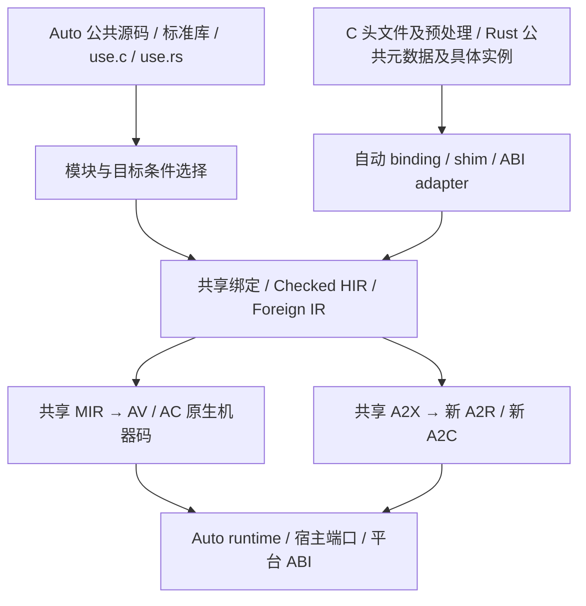

# Design 56：ACE M2 完整 FFI 与新版标准库

> 2026-11-12 · proposed r5。用户正式追加的 M2 范围，尚未实施；补充 [Design55](55-ace-m2-complete-language-and-product-replacement.md)，执行入口为 [M2路线](strategy/ace-m2-delivery-roadmap.md)。r2把945–948的调研/准备/最小接线统一移至M1正式tag之后，门见Design55 §1.1。本轮仅修改设计与 drafting 计划，不改 M1/941/999、canonical Specs 或产品代码。

## 0. 两阶段归属（2026-11-09，当前）

用户正式把ACE M2拆为A语言/新版标准库完善、B产品替换；依据[Design55 §16](55-ace-m2-complete-language-and-product-replacement.md#16-m2两阶段正式合同与验证方法2026-11-09当前)。本设计的完整binding/ABI/stdlib、四端真实调用、平台选择、候选装配与MIX-07能力腿属于A，不能等全App迁移才首次验证。原安装/升级/默认/最终退役后重建腿属于B，保985→986→987职责；B-pending不冒A失败或NA，A-required缺项仍阻A。

A阶段完整性采用旧义务守恒迁移＋按规范补足新case＋真实RG-A验证的并集。每操作/目标provider、数值/文本单位、错误/授权/ownership/close/future取消分别有独立oracle；复用TestCase/ACE worker和固定Cargo组，新增跟踪源与必要adapter由能力owner及985/A负责，不重新造测试框架。旧943的17项、M1 NA及旧bug均不是新版全库的覆盖上限或豁免。

945–948的M1-TAG进入门保持；本轮只修改文档，未执行调研前探或产品验证。A的正式出口由985/T-A01..A05收M2A-01..08及RG-A，B最后消费全产品与最终安装/退役证据；AC自举不在本设计/M2硬门。

## 0.1 首个ACE UI Hello：最小FFI架构先行（2026-11-11，当前）

用户要求按AV/Rust FFI方向规划首个UI Hello，并核对既有ACE M2计划；本轮仍只规划，不构建/运行/生成binding/素材/SDK或建实施树。这里的“架构先行”是先正式交一个可复用、受检的Rust互操作纵向切片，不要求完整Rust/C importer、所有泛型/async/标准库或整个ACE M2先完。

Iced仍是Rust编译的宿主库；Auto代码经共同前门/领域投影与受检foreign事实，由AV stub调用自动生成的C兼容Rust shim。Rust宿主内部正常调用Iced，不能把iced::Element/trait对象/Rust私有布局直接当AV值。UI文本必须在guest借用失效前由session拥有者复制；签名/权限/错误/线程/析构规则明确，不能以UI专用native数字ID或手写manifest绕开通用FFI。

| 原Plan / 早期切片 | 最小交付、前置与边界 |
|---|---|
| [967/F0](../plans/967-ace-m2-host.md) r7，0/19 | 已交938/939与现有text/AV基础→普通use.rs/真实Rust公共元数据→自动binding/shim→共享verify→AV真实非UI Rust函数；首批借用UTF-8/i32-bool/同步同线程/准入资源错误。原完整T-09..15继续扩大C/Rust、资源、四端/真实库，F0不等962/963整包 |
| [979/H0](../plans/979-ace-m2-schema.md) r8，0/12 | 现有grammar/CST/普通函数/text/verify基础→一个widget/view/text与普通函数文本表达式→受检领域描述/CPU消费者；不等完整963/966，保原完整Schema/Node及双后端任务 |
| [969/E0](../plans/969-ace-m2-facade.md) r5，0/12 | F0正式来源→公开显式ACE AV同步执行/授权/结果/关闭接口，非UIconsumer自证；不等Dynamic/async/热更，不让UI另造解释器 |
| [978/B0](../plans/978-ace-m2-build.md) r7，0/14 | 已交942/944/960＋F0/E0正式来源→预编译宿主/FFI闭包、运行构建分账、改Auto不重建不变provider；不等全部新库/CT/完整SDK，非UIconsumer闭合 |
| [980/HELLO](../plans/980-ace-m2-autoui.md) r7，0/35 | F0/H0/E0/B0正式来源→独立最小Hello、单text和函数文本、真实AV→FFI→既有Iced宿主、错误/恢复/退出；不等STATE全部async、File/WEB/PARITY，不精简原001 |

每个早期切片新增I/V/R/D四个明确任务（work实现、work验证、独立review、merge阶段fold正式交接），共20任务；原任务/AC/用例及完整M2分母全保留，旧Plan号复用、没有新取号。只交早期能力不勾整项旧任务/整包完成，不归档/删唯一树；下游只消费已审已落主接口，不把冻结分支tip作交付。

AV首窗与A2R分开推进：967原T-12的AXR0简单签名腿、978原T-03/09构建腿、980原B-RUST的同源Hello腿可并行独立复核/phase fold；AV首窗不等它们，完整980/RG-A03及M2-A仍须真实A2R与原模式全覆盖。相同源和资源、签名/ABI/owner事实共用，A2R禁AV/旧VM解释provider仍运行；直接crate adapter须独立证明与AV shim合同等价。

最小Hello只证声明/呈现，函数文本再证实际AV求值与FFI dispatch。按钮→双实例→原001 themes/model/design/布局/选择复制→其它Demo逐步消费新增能力，Demo未覆盖的语法/资源/错态另补。完整FFI不能由简单借用文本、完整UI不能由Hello替代，945–948 M1-TAG及A/B总出口不变。

## 0.2 默认Auto系统库、可选FFI与字符串边界（2026-11-12，当前）

用户明确默认标准库由Auto承担类似C标准库的基础职责，而不是包一层libc；Rust/C FFI用于显式外部能力与可选实现。这里收紧原§2“libc由provider决定”的默认选择：默认core/alloc/基础系统库不得把libc作为语义/API实现provider，也不得经Rust std或第三方shim间接绕回libc来实现同一基础操作。不是声称当前已实现无libc默认库，更不以旧a2r-std或有限F0支持充整库完成。

| 层 | 规则与owner |
|---|---|
| Auto公共API与算法 | 默认普通Auto源码实现数学/文本/bytes/集合/parse/format及已批准基础职责，沿943/959分母；不是逐函数复刻完整C/POSIX API或继承C字符串/errno模型。947定分层，972实现；Storage/allocator具体API仍按原M2讨论冻结，不借本条预定签名。 |
| Auto内部调用 | 使用版本化AutoABI、Auto值/ownership/错误合同；AV、AC、新A2R/A2C保同一逻辑语义。实现语言或C ABI本身不决定某函数是不是libc。 |
| OS边界 | 973提供薄的目标平台适配，遵守OS实际公开入口/系统调用的调用约定、布局、编码与资源规则；AutoABI不替代内核/OS ABI。不要求所有平台发同一裸syscall指令，也不以通过C调用约定访问系统API为“依赖C标准库”。 |
| 显式Rust/C外部能力 | 967自动import/binding/shim、资源/回调/future/双向调用继续扩面；SQLite、第三方解析/图形等按模块/provider manifest显式声明依赖。也可显式选libc兼容provider，但它不冒默认自有实现，不被缺provider时自动回落选中。 |
| 工具/宿主/产物依赖 | 978分别列出构建工具、AV/UI宿主、标准库provider、目标运行时与第三方库的实际依赖。Rust宿主或工具链含C运行支持，不等于Auto标准库基础操作可委托libc；也不能据此宣称整个宿主/最终二进制完全无libc。默认库调用链与实际目标导入/链接闭包须单独实证。 |

**字符串**：Auto Str/str/bytes保显式长度和相应编码/ownership语义，不采用NUL（`\0`）结尾作为通用长度协议；逻辑表示不冻结某个Rust String布局或未批准的AutoABI字段。空串、中文/多字节、含`ab\0cd`的五字节载荷须完整保真。C ABI并不意味着所有buffer都NUL终止：ptr+len接口按长度传递；只有外部API明确要求CStr时才在边界建立终止符、编码转换与临时owner。内嵌NUL不适用于CStr时明确拒绝或按该API已声明的有损策略处理，不静默截断；C端返回字符串按已证长度/容量或有上界扫描读取，不能无界strlen。Rust字符串经明确shim/handle/借用缓冲适配，不暴露私有布局；所有复制/借用/销毁及allocator跨界责任由967/972/973验。

新义务纳入M2-A能力/候选验收，B继续安装/升级/退役后重建验证。原FFI-M2-01..08不因默认自有库而缩减；F0仍只交借用UTF-8同步早期切片，不能拿F0代完整CStr、owned、泛型或async；相关能力按原完整任务扩面，首个UI Hello不被完整C importer反向阻塞。

| 新义务 | 完成条件 | 原Plan/任务及新增AC |
|---|---|---|
| LIB-M2-07 默认自有实现 | 每个基础操作有自有Auto/原语/OS适配来源与默认选择；无隐式libc或Rust std→libc委托；可选外库显式分账，缺默认provider具名拒绝 | 947 T-09/10、948 T-09、972 T-09/10、973 T-09/10、978 T-09/10、985 A/T-09、986/987 T-09；各AC-NATIVE |
| LIB-M2-08 字符串/ABI边界 | Auto长度/编码/owner语义独立于CStr；C/Rust入出参、内嵌NUL、借用/复制/释放、平台编码与错误有四端独立oracle | 967 T-10..13/15、972 T-09/10、973 T-09/10、985 A/T-09；各AC-NATIVE |

验收分两腿：一腿移除所有可选Rust/C/libc provider，用默认库在真实OS执行文本/格式化/分配/文件等原已批准功能，核源码/符号/链接/运行调用与错误/清理；另一腿显式导入C/Rust测试库，分别验证ptr+len与CStr/Rust适配。默认腿不得偷用外部桥过关，外部腿也不得因“默认不依赖libc”被删。注入错误默认选择/隐式libc委托、错ABI、NUL截断、缺长度/销毁、缺工具/缺provider的控制必须红，合法空串/多字节/含NUL长度载荷及正确原生provider近邻须绿。四端相等只是补充，不替独立expected。

本条只补设计与计划；未新增或生成binding/fixture/runtime/SDK，不运行探针/系统调用/产品，不改canonical Specs、不改M1或M1-TAG，不冻结新的allocator接口。

## 1. 决定与现状

M2必须交付自动生成 binding 与 ABI adapter 的 C/Rust FFI，以及适配 ACE 的新版标准库。用户从 `use.c ...`、`use.rs ...` 公共入口使用库；不能只提供手填 Foreign IR、手工 extern 声明或一组受限演示。新版标准库保持一套公共 Auto API，优先用普通 `.at` 实现可移植算法，再通过平台实现、宿主服务和 FFI 提供外部能力。M2终验增加下文 FFI-M2/LIB-M2 义务，原 REP/V06、语言与产品分母不减少。

M1已交的是 Windows x64 有限 AutoABI/Foreign IR、手写 typed manifest、资源/同步 callback 与部分目标发射，不是完整 importer。旧引擎已有部分 `use.c`/`use.rs` 或 bindgen，并不证明新 ACE 公共入口接通；A2R生成 Rust 源也不证明 Rust库 FFI。M1残余正确性继续原 owner，本设计不把新范围塞进999。

输入依据：当前 Specs 优先；[Design41](41-interface-metadata-and-foreign-abi.md)给出 provider/ABI 分离和 Rust shim 方向；[Design54](54-stdlib-semantics-and-ace-integration.md)给出统一语义/装配合同。本设计扩展其早期有限范围，不把这些 proposed 文档当现有能力证书。保留 Design46 完整 CAP 原进入门，显式平台选择与装配无需等待完整 CAP 求解。

已使用 read_thread 读取用户引用的标准库讨论（local / `01a1abb2-ae3b-7033-894c-11bff0ff948c`），包括 2026-11-09 已完成的 `#if`/`#is` 平台选择答复；该讨论仅为设计输入，原文中的完成/支持主张仍须对当前源码和规范核定。本轮不编辑其 Design41/54，不向该聊天发消息。

## 2. 一条编译链与两类 ABI



Auto模块之间使用受检 AutoABI（内部可内联或优化）；系统接口与 C-compatible shim 使用明确的 C/system/目标平台 ABI。AutoABI 不代替操作系统 ABI，也不承诺直接调用任意 Rust 原生 ABI。AC直接产生机器码调用适用平台 API，无需把业务 Auto 先转译成 C 或 Rust。系统入口遵目标OS ABI；默认基础标准库的自有实现/非libc provider与显式C/Rust外库分账，选择及字符串规则以§0.2为准。不把“原生”解释为所有平台都发裸syscall，也不允许以provider可选为由默认委托libc。

四个独立维度进入装配：执行后端 AV/AC/A2R/A2C、宿主 CLI/browser/UI/service、语言/能力 profile、目标 OS/arch/env/ABI。provider 的实现语言是另一属性；不能从 `.rs.at` 推断“ACE后端”，也不新增 `.ace.at` 或第二套 `ace.std` 公共 API。

## 3. 完整 FFI 合同

| 义务 ID | 必须交付的能力 | 明确边界 | 实施与验收映射 |
|---|---|---|---|
| FFI-M2-01 | 公共 `use.c` / `use.rs` 从工程输入到共享绑定、类型诊断和实际执行；自动产生可追溯 binding | 可显式配置库/工具链和所有权注解，用户不逐函数手抄签名/布局或手写 extern wrapper | 967 T-09 / AC-07 / V-09 |
| FFI-M2-02 | C importer：真实预处理、include/宏/typedef、目标布局、指针/record/enum/callback/opaque handle、常量和 inline 所需 shim | 逐行继承现用 C 义务；varargs/union/bitfield 等具名支持或保留缺口，不能偷偷删分母；不自动扩大为任意 C++ | 967 T-10 / AC-08 / V-10 |
| FFI-M2-03 | Rust 公共 API 元数据、具体泛型实例到自动 C-compatible shim/handle adapter | 不依赖私有 Rust ABI；显式 String/Vec/Result/borrow/析构、panic、Send/Sync与 future 约束；无法证明的接口具名诊断 | 967 T-11 / AC-09 / V-11 |
| FFI-M2-04 | AV、AC、新A2R、新A2C消费同一签名/资源/效果事实并实际调用 | A2R可用经证明等价的直接 crate adapter；不能以生成 Rust 或 emit-only 算通过；不回落旧VM/AST emitter | 967 T-12 / AC-10 / V-12 |
| FFI-M2-05 | 双向 import/export、适用静态/动态链接、allocator 与销毁、callback 重入、版本/签名检查 | generation/lease保活，在途callback/析构/future禁止卸库；跨ABI不放任panic/unwind，错误签名在调用前拒绝 | 967 T-13 / AC-11 / V-13；原T-08/AC-06仍保留 |
| FFI-M2-06 | 异步注册/完成/取消端口可承接Rust future及实际现用桥 | 967只交端口/adapter与受控provider；语言await/调度归968，不能让967反向等待968 | 967 T-13 / AC-11 / V-13；968原T-02..04/AC-02..03消费 |
| FFI-M2-07 | 可分发 binding/shim/provider 闭包、精确缓存与清晰工具依赖 | 缓存无进程地址/授权；导入编译工具与安装后运行依赖分别列出 | 967 T-14 / AC-12 / V-14；978 T-09 / AC-07 / V-09 |
| FFI-M2-08 | 用户级真实库工程与独立ABI oracle，失败/取消/升级均闭合 | 自有fixture不能替代真实库；缺环境仍是缺证，不改PASS/NA | 967 T-15 / AC-13 / V-15；985–987 T-09 / AC-07 / V-09 |

### 3.1 导入输入与安全边界

C导入身份至少包含头文件的实际传递include闭包、预处理选项/宏、include搜索序、target/sysroot、解析器与ABI工具链版本、库链接身份。不得靠字符串正则抽签名、按宿主布局猜目标，或把生成文件存在当binding正确。

Rust导入身份至少包含crate版本/lock、features/cfg、target/toolchain、导出元数据版本、具体类型/泛型实例、shim源码/生成器和链接身份。编译辅助工具缺失应报告构建缺依赖；无元数据不猜公开布局。原生态的宏/trait/泛型等通过真实公共元数据与具体实例承接，不能宣称任意 Rust 源都可直接变为稳定 ABI。

自动binding不等于能自动猜全部所有权。来源注解、API约定与校验必须足够；不确定的raw指针/生命周期保留显式低层边界，不能包装成虚假的安全标准库函数。受检标准库facade必须关闭其所有权、错误、线程、取消义务。

T-09冻结可运行源码、依赖/工具链和required特征表，原有C/Rust/Python消费者保持；本次“完整”是基础设施和已批准支持集完整闭合，不承诺世界上所有第三方API零配置兼容。冻结不能用缩成scalar demo代替完整义务；新增语义争议需正式修订。

### 3.2 独立验证路径

C用独立C编译器构建caller/callee核布局、调用约定、返回值、写回、释放及错误签名；Rust用独立Rust测试核同一公开API，再核自动shim和四端结果。至少覆盖一个标准C头输入、真实SQLite header/library工程和一个使用Rust `serde_json` 公开API的工程，及具有callback/owned/泛型实例/future的专门fixture。具体版本由T-09钉住并记录许可证/分发依赖，sqlite和serde_json是最低真实路径，不作为全旧用法的上限。

分别断言值、效果、资源销毁次数、越权dispatch=0和拒绝阶段；四端彼此相等不作唯一oracle。删除手工manifest、开发树与旧桥后仍能从原工程生成并执行，才算自动体验闭合。

## 4. 新版标准库合同

| 义务 ID | 必须交付的能力 | 实施与验收映射 |
|---|---|---|
| LIB-M2-01 | 一套公共API与稳定操作ID；core/alloc/host/domain分层；默认可移植Auto实现，平台provider可替换 | 947 T-09 / AC-08 / V-09；972 T-09 / AC-07 / V-09 |
| LIB-M2-02 | 组织/装配/加载清楚；公共声明、Auto算法、宿主端口、平台实现、foreign声明、生成产物有明确owner及版本 | 947 T-10 / AC-09 / V-10；978 T-09 / AC-07 / V-09 |
| LIB-M2-03 | `#if`/`#is`选择目标平台代码与导入，统一模块作用域，目标条件进入依赖图 | 947 T-09冻结合同；966 T-09..10 / AC-07..08 / V-09..10；973 T-09 / AC-07 / V-09 |
| LIB-M2-04 | 完整基础/集合/文本等公共算法四端语义一致，core无隐式heap/宿主；可选alloc层单列 | 972 T-09..10 / AC-07..08 / V-09..10；945/946原有限义务保持 |
| LIB-M2-05 | 文件/系统/宿主库用统一语义与平台ABI，真实读写、错误/EOF/close/取消/授权四端闭合 | 973 T-09..10 / AC-07..08 / V-09..10；网络/数据沿974/975既有完整责任 |
| LIB-M2-06 | 兼容分母、安装/增量/恢复/最终退役门均包含新库，旧runtime复用须有合同证明 | 948 T-09 / AC-08 / V-09；978 T-09..10 / AC-07..08 / V-09..10；985–987 T-09 / AC-07 / V-09 |

### 4.1 组织与加载

优先保留公共 `auto.*` 源路径和现有943操作实册/944manifest事实；初始组织如下，物理目录迁移必须有原路径兼容和构建验证，不要求本轮创建目录。

| 层/材料 | 逻辑职责 | 执行owner | 加载与边界 |
|---|---|---|---|
| 公共声明与Auto默认实现 | 稳定操作ID、签名/错误/效果、可移植算法 | 947合同、972基础、973–975各领域 | 普通`.at`参与统一模块绑定；不复制四套算法 |
| core / alloc | core不隐式分配/调用宿主；alloc显式要求allocator | 972 | 单独profile构建/执行；no_std不自动等于无heap |
| host端口 | IO/task/service的逻辑操作和运行期授权 | 967/968、973–975 | 已编译装配不携带旧授权，恢复重新授权 |
| `auto.platform.*` 实现 | target平台API、C/system ABI、必要适配 | 973（领域provider各owner） | `#if`/`#is`选中实现；缺或歧义provider具名失败 |
| foreign声明与生成binding/shim | C/Rust公开输入到可复现适配产物 | 967 | 生成物不是手工公共API第二真相；具名来源和hash |
| 源码/受检IR/ABC/native/A2X片段包 | 开发与发行各需的stdlib/runtime/adapter闭包 | 978、986/987 | 构建加载与运行加载分账；不每次编辑重跑Cargo |

947 T-10把此逻辑分层落到当前 `stdlib/auto`、`stdlib_assembly` 模型/manifest/loader、source-query package store的具体文件/接口，给出版本和迁移规则。禁止另外造一套与944/960/942不相认的loader、provider registry或全局缓存。旧 `.vm.at/.rs.at/.c.at` 按语义/实现兼容映射，不把后缀变成新ACE公共组织原则。

### 4.2 平台条件语义

语法沿现行 [hash-syntax](../specs/auto-lang/comptime/design/hash-syntax.md)，例如（拟议ACE M2用法，非当前可运行声明）：

```auto
#is sys.os {
    OS.Windows => { use auto.platform.windows.file }
    OS.Linux => { use auto.platform.linux.file }
}
```

`#if`同样可用于选择函数、类型、常量与导入。`#`上下文的`sys.os`取**编译目标**，构建宿主信息另命名；OS枚举与精确公共符号在947/966核现行规范后冻结。分支先做必要语法检查，再选择，未选分支不绑定/类型检查/链接平台依赖。选中导入进入所在模块，不困在临时块；有序初始化/冲突/循环按统一模块规则处理。缺平台或多个冲突实现具名拒绝，不把所有非Windows默认为Linux。

947只交合同/装配基础，不等待966完整CTE；966实施target条件最小能力并继续本包完整编译期职责；973消费正式交付。不能让947→966→972→948→947互等。Windows/Linux至少各有条件选择正反例与对应平台provider适用表；真实运行按正式支持矩阵取证。没有平台runner可以先做目标选择/代码检查，但不得声称该平台运行已验证。

### 4.3 ABI、语义与可分发性

字节/Unicode标量长度、parse失败、整数位宽/溢出、EOF/部分读写和资源释放沿943/现行Spec独立冻结；不能以性能或后端库默认行为改公共语义。纯算法默认Auto，intrinsic/外部优化实现须单独行为证明。

AC原生库经AutoABI复用Auto模块、经平台ABI调用OS；不隐式套旧VM或强制先发C/Rust业务源码。标准库runtime可以包含必要的预编译非Auto代码，须明确owner/ABI/allocator；“默认Auto”不等于否认runtime职责。

978缓存键覆盖实际读取的源/传递headers、crate lock/features/cfg、目标、工具链、provider/ABI/runtime/manifest版本、布局/效果与生成器身份。测试必须同时证明相关变化失效、无关变化不重编、失败保旧/恢复修复。编译工具依赖和运行依赖分别给清单：已生成native程序不得隐式依赖开发仓、旧VM、Python、rustc/clang才启动；显式声明的动态库依赖正常保留，首次导入生成所需工具可由SDK分发/声明。

### 4.4 Storage 与分配资源专题（2026-11-09，仅方向记录）

[Storage 与内存分配资源](memory/storage-and-allocation.md)作为Design04的分配专题，记录用户认可的方向：保留Storage用户模型、prelude默认政策与具体资源实例，按需抽取底层分配服务，不预先冻结独立Allocator语言机制或全部API显式allocator参数。本文的core/alloc职责与来源/释放要求保留；具体Storage/allocator接口在M2标准库阶段继续讨论后，由对应owner纳入正式实施合同。本次仅建立设计关联，不新增任务/验收门、不修改972等现有Plan或启动施工。

## 5. 真实源码矩阵与职责

下列为2026-11-09已读取的现存入口；新节点/fixture路径均由各T-01在相同owner下确认后创建，不声称现成支持。

| 输入→producer/事实 | 现存源码锚点 | 后继与拟改面 | 验证入口（固定组；未来按实际改面取并集） |
|---|---|---|---|
| C/Rust导入/提取与manifest | `crates/auto-bindgen/src/extractor.rs`、`type_map.rs`、`manifest.rs`；`docs/specs/auto-bindgen/project.md` | 967 T-09..11；核旧实现可复用层，接新ACE共享绑定 | `cargo t auto-bindgen ace-source ace-foreign-contract` |
| Checked foreign签名/资源/各lane | `experimental/ace/crates/foreign-contract/src/{typed,manual,resource,lane}.rs`；`experimental/ace/crates/abi` | 967 T-12..15；公共IR与四端adapter、ABI oracle | `cargo t ace-foreign-contract ace-abi ace-av ace-native ace-a2x ace-a2c-abi` |
| 模块包/持久store | `experimental/ace/crates/source-query/src/modules/{session,packages,packages_store,persistence}.rs` | 947/966/967合同与接入、978包/依赖/缓存闭包 | `cargo t ace-source ace-semantics ace-artifacts` |
| 公共标准库装配 | `crates/auto-lang-core/src/stdlib_assembly/{model,manifest,contracts,loader}.rs`；`stdlib/auto` | 947组织与装配；972/973消费者；禁止第二loader | `cargo t stdlib ace-stdlib ace-console` |
| `#`源码与目标条件 | `experimental/ace/crates/core/src/source/ast.rs`；`docs/specs/auto-cte/scalar-query-profile.md`；现行hash-syntax | 966 T-09..10，从有限CTE到模块条件导入；不调用旧VM执行# | `cargo t ace-syntax ace-source ace-semantics ace-comptime ace-a2x ace-av ace-native` |
| host/平台IO与旧provider语义调查 | `experimental/ace/crates/av-core/src/host.rs`；`crates/a2r-std/src/{fs,process,time}.rs` | 973平台provider与四端；968仅调度owner | `cargo t ace-host ace-stdlib ace-av ace-native ace-a2x stdlib` |
| 候选包与终验 | `scripts/test-groups.toml`；`crates/auto-test-case`；`docs/specs/language-sdk` | 978→985→986→987，沿真实SDK/产品入口 | 对应计划完整职责组与仓外消费者；不能以仓内fixture代安装 |

测试组从本仓固定表核名，未执行产品测试。外仓改面须读当地AGENTS并由原owner实施；本轮不在外仓写入或创建会话。

## 6. 阶段顺序、交接与M2签章

1. **M1正式tag后，组织/合同与分母**：先核[Design55 §1.1 M1-TAG](55-ace-m2-complete-language-and-product-replacement.md#11-m1-tag标准库准备计划的统一进入门)及对应实施授权；947保原console/资源前探并交分层、装配schema；948只在tag后才能按D943先盘点增补义务，最终仍等945/946/947。945/946在tag后消费947合同进入基础实现。943/944/959/960/961以正式归档身份消费，不重开历史计划。tag前不执行这些包的研究任务、probe或实现。
2. **可并行基础**：967在960/962/963与938/939齐后，按公共导入→C→Rust→四端/资源→缓存/真实库阶段推进；972在其原语言/基础库依赖齐后实现默认Auto核心；966完成目标条件语义。不把972整库或968完整调度反向加为967前置。
3. **系统与构建集成**：973消费967/968/972/947/966，补四端系统服务与平台provider；974/975保完整领域责任；978消费正式接口，完成可分发新库/binding/shim与工程增量。其原依赖不减少。
4. **逐层验收**：985候选预认证收齐FFI/LIB义务及原MIX/REP/V06与新增MIX-07组合（目标选择→File→Rust解析→C数据库）；986隔离安装、升级/失败回滚/默认入口；987退役后重建发行物并重核受影响证据，才签M2。不得新增985↔986循环。

每项交接必须含源/工具链/目标/producer/工件身份、公共调用源码、独立expected/资源trace、真实命令/子终态、环境排除和未闭项。binding签名proof不代行为proof；已编译不代执行；源码开发树不代安装；条件排除不充PASS。

新增义务作为用户2026-11-09批准的**M2分母增补**，948建立逐操作/特征子行，985核与原959分母并集，不修改archived959，不借新ID掩盖旧缺口。任何required子行未闭均阻相应能力包及最终签章；缺环境具名pending，不能以最终“总数相等”代替逐行关闭。

## 7. 本轮变更与验证边界

本轮修订现有 drafting 947/948/966/967/972/973/978/985/986/987及Design55/路线/索引，不分配新Plan编号，不修改941/999或另一讨论拥有的Design41/54；保留全部原任务、验收与历史记录。各新增work任务须先于原最终work验证和独立review，所有计划进度仍为0。

实施时如某批超出可独立评审规模，须先把具体T/AC/V正式迁移到后继Plan并重核DAG，不能只写“未来完善”就通过母包。原计划的一般full-scope责任和本设计显式义务共同生效。

本设计是未来执行合同。本文中的源码锚点、链接、任务/验收映射和依赖图需做静态预检；不以文档预检替代编译、功能、性能、安装或独立实现复审。最终预检收据见M2路线本次修订节。
