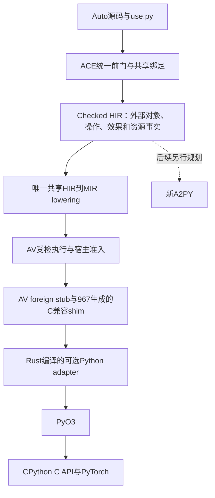

# Design 58：ACE Python 互操作与标准 Auto 语法

> 2026-11-14 · target-state r5 · 仅对齐跨路线状态与导航，原AV互操作范围不变：1042已交ACE A2PY最小端口，977/PY已规划完整目标语言扩面；1026先交AV训练，其互操作能力向A2PY等其他后端扩展仍为后继。参见[统一计划总览](strategy/ace-route-plan-map.md)。r4的数据/Meta/FFI交接与967构建/分发兼容规则保留。执行合同：[PLAN-1026 r3](../plans/1026-python-interop-standard-auto-syntax.md)。r1旧AutoVM/a2py实施方案已被后续方向替代，无实现成果需要迁移。本轮不施工。

## 1. 目标与当前事实

Auto程序应直接写`model(x)`、`optimizer.step()`、`prediction.shape`、`prediction[0]`和`loss.to(float)`，Python互操作由编译器与runtime承担，避免应用作者手写`py_call/py_call0/py_getattr/py_float`。

M2正将语言和产品迁到ACE。新增Python能力进入共享语义/受检执行体系，先交AV→CPython→CPU PyTorch完整训练。旧AutoVM/a2py仅为兼容基线、研究材料及可选对照；不作为实现fallback，不在它们上面补新标准语法再迁一次。

当前不能宣称ACE已支持Python：已有有限Foreign事实、受限console host和typed Dyn；portable Dyn明确不含外部资源。相关当前知识见[AV host](../specs/auto-av/host-import-and-console.md)、[动态冻结边界](../specs/auto-av/dynamic-portable-values.md)、[唯一lowering](../specs/auto-mir/hir-lowering-boundary.md)。这些有限profile不能直接拼成完整训练支持。

## 2. 两种能力分别规划

| 能力 | 作用 | 本次决定 |
|---|---|---|
| ACE运行时调用Python | Auto在AV上执行，调用CPython/PyTorch | PLAN-1026首交付目标 |
| 新ACE A2PY | 从ACE共享受检语义生成Python源码，服务Python包/Notebook/部署 | 1042已交最小端口，977/PY扩完整目标语言；1026互操作生态的专用后继另行规划，不作为AV训练前置 |
| AC/A2R/A2C的Python适配 | 各后端通过同一操作/资源合同接Python runtime | 后续独立交付；本切片不宣称四端可用 |
| 旧AutoVM/a2py | 既有能力、迁移行为对照 | 保原合同，本次不新增功能或删除入口 |

新A2PY已有1042/977的基础与扩面安排；1026的Python互操作向该后端扩展尚无单独交付计划，不影响先用AV训练。M2的Python分母/退役责任仍由现有目标owner处理，不能据1026的AV-only范围删除旧Python/A2X义务或宣称全M2通过。

## 3. 架构与信任边界

### 3.1 共享语义负责什么

沿ACE统一Schema/CST、绑定、类型/效果校验与Checked HIR，不建Python专用parser、第二套类型检查器或旧AST转译前门。保留PLAN-1026中的示例源码和`.as`文件身份，ACE准入来自明确profile/能力，不能凭扩展名把所有变量降成动态值；不依赖旧s2s预处理。

`use.py module: items`建立有来源的导入与外部值类别；可调用对象、方法/属性、整数索引、命名参数、Tensor运算与显式标量转换使用普通Auto操作。共享层知道操作类别、逻辑输入/返回/错误/资源，不需要静态掌握整个PyTorch成员表，也不把所有方法伪装成C函数签名。未知Python成员在运行时按协议查找，类型推导失败仍是编译问题，不自动变成Python/Any。

函数传参返回、别名、分支、循环和混合值分发消费964的通用规则；静态来源只能优化，不可把句柄当数值。receiver与实参按源序各执行一次，绑定方法值可直接调用，Python失败不能fallback到Auto臂。

### 3.2 AV调用的Rust边界与PyO3位置

首期采用PyO3实现CPython adapter，但**AV不直接导入/解释PyO3库**。路径是AV受检foreign stub→967通用自动binding/C兼容shim→具体非泛型Rust adapter入口→adapter内部PyO3→CPython C API。adapter拟独立可选包`experimental/ace/crates/python-runtime/`，准确符号/版本由1026 T-01冻结，当前未实现。

1026定义Python provider业务操作，967拥有同一套Rust元数据/注解、目标ABI与自动shim/AV stub工具。应用写use.py即可，编译器内部绑定到provider操作，不要求应用额外use.rs、手写extern/manifest。不应给PyO3所有泛型和生命周期API逐项生成binding，也不建Python专用Rust importer或privileged数字ID旁路。

跨C边界使用967受检标量/长度文本/带tag参数帧/opaque引用/结构化错误，绝不能暴露Rust String/Vec/Result、trait对象、964私有DynValue布局、Py/Bound/Python token。静态链接也不使任意Rust ABI稳定；Rust/Python异常不能跨C unwind。967/F0的text+i32/bool范围尚不包含训练必需的float/owned引用/帧/返回合同，须等T-09/11/12/13相应最小扩展正式交付，不能拿F0已绿等同Python接口已交。

PyO3及真实Py对象仅在adapter内部；共享HIR/MIR、av-core不依赖它。普通无Python程序在未安装CPython/adapter的配置仍可构建执行，不将旧auto-lang-core/AutoVM隐藏回宿主。PyO3 0.29的[Python调用](https://pyo3.rs/v0.29.0/python-from-rust.html)及[对象指针模型](https://pyo3.rs/v0.29.0/types.html)支持这一分层：适配器持拥有引用，需要访问解释器时绑定到调用期；引用复制不等于对象载荷深拷贝。确切版本/链接/线程配置未来冻结，首期仅普通GIL-enabled CPython。

生产包方向为AV宿主装配层→可选adapter→PyO3/中立foreign契约；adapter不反依赖AV解释器/通用动态执行实现，中立契约也不依赖Python provider。正式实现需核构建图，不能把无环的Plan depends_on当作包依赖无环证明。

#### 3.2.1 Python adapter的构建与分发兼容

消费[Design41 §5.1](41-interface-metadata-and-foreign-abi.md#51-rust-provider的构建与兼容合同2026-11-13目标态)、[Design56 §3.3](56-ace-m2-ffi-and-native-stdlib.md#33-rust-provider的二进制兼容与独立分发)及[967 r10](../plans/967-ace-m2-host.md)，不在1026建立第二套ABI/缓存规则。Rust Python adapter、其生成shim和PyO3 Rust依赖共同构成兼容构建闭包；对外版本化C ABI边界可独立于AV宿主的rustc版本分发。封装后的正常调用不要求开发源码/rustc/Cargo，不意味着不需要所声明的CPython/PyTorch/系统动态库。

BuildIdentity记录编译器/源码/配置/target等精确构建身份；RuntimeCompatibility核目标、导出/布局/ABI域与接口语义、资源及实际解释器/包/runtime约束。外层C ABI稳定不能证明任意CPython ABI、free-threaded配置或torch版本可互换；也不能让新adapter接管旧session的Py对象。源码构建换rustc需重建adapter+shim、更新受影响证据；只升级AV宿主编译器不自动重建未变化的已发布provider，仍按当前接口和运行条件重新准入。包/工件pin、解释器身份及原资源代次检查保持。

二进制provider只提供清单中已有操作，不要求直接导入PyO3泛型API，也不能从任意旧Rust私有库生成稳定接口。其他后端/安装交付仍由原owner/后续规划负责，本次不新增Python发布承诺、测试目标或实施授权。

### 3.3 数据交换、对象身份与Meta分层

每次调用有参数帧检查、标量封送、引用和Python调用开销，不能称零开销；但**传递Python对象不要求把其载荷搬到AV再搬回**。本切片按语义类别选择，不因对象大小改变别名关系。

| 数据 | AV与Python之间的规则 | 复制边界 |
|---|---|---|
| bool/int/float等精确内置小值 | 受检转换/boxing/unboxing，遵Auto目标位宽和舍入 | 有小值转换/分配；Tensor或数值子类不自动展开 |
| str/bytes与参数名 | 长度明确的UTF-8/字节数据、配额与borrow/noescape | 可能编码/复制，保嵌NUL；Python保留时须有自身拥有数据，不能留AV临时指针 |
| 受支持Auto list/map输入 | 有界结构化物化，明确值快照 | 会按内容转换；反复送Auto容器会重复转换，不隐式共享或写回；可先构造Python对象再复用其引用 |
| Tensor/Parameter/model/optimizer/iterator及Python容器/shape对象 | 受管opaque引用；adapter取回原Py对象交CPython | 不自动clone/tolist/numpy/导出Tensor storage；Python运算本身创建结果或复制是另一回事 |
| `.to(float)`、显示/shape读取 | 显式读取小值/文本/元数据 | 仍有提取/复制和预算，不能夸称所有路径零复制 |

例如x在Python侧由arange/reshape/除法产生，AV只持其引用；60轮model(x)复用该Python对象，backward和step仍在PyTorch内部执行，loss.to(float)只取一个标量。若最初输入是Auto数组，首次构造Tensor的复制仍存在。本期不交通用borrowed-buffer/NumPy/DLPack共享内存协议；它们将来还需独立关闭pin、dtype/stride、可变/逃逸/设备合同。

PythonObject是逻辑外部类别，不是新平行Dyn/资源模型。**967统一资源账本是唯一授权和生命周期权威**，记录provider/session/entry代次、kind/alive/owner/pin；adapter私有payload持真实Py对象，不再建立一套Python lease/generation/owner表。token不是裸PyObject地址，多个token可引用同一对象，不能用token相等替代Python对象identity。校验并pin后释放全局账本锁再执行Python/析构，按调用/异常/close释放自有引用。

Tensor/loss保持计算图，显式`.to(float)`调用Python标量协议再按Auto目标浮点转换，不是Tensor dtype变化；多元素失败且原引用仍可用。最后AV owner释放其Python引用，不承诺绕过Python自身仍持有的引用强制回收对象。

| Meta层（职责分类，不是四套新系统） | 权威/实际用途 |
|---|---|
| 静态类型/操作/效果/参数帧/ABI/ownership | 964共享值事实、967 foreign-contract/descriptor、1026的Python操作；不是全PyTorch成员镜像 |
| runtime资源身份/代次/解释器/存活与pin | 967统一账本；实际访问前校验，不能从type_name/shape恢复权限 |
| Python反射：成员、callable、类型显示、错误 | adapter按需走Python协议；不要求inspect.signature或扫描全库，getattr可能有副作用/异常且只执行一次 |
| Tensor shape/dtype/device/stride | 显式观测，可能变化；首期不缓存影响正确性的动态成员，不凭缓存直接解引用Tensor raw内存 |

因此普通opaque调用不需先查询TensorMeta；反射信息帮助观测和动态派发，不能替代句柄身份/资源协议。变更后的shape/属性必须读到新状态，同shape的两个对象也不能混为一体。

代码缓存保存声明与真实依赖身份，不存活Py对象/地址/引用或旧授权；恢复每次重验。活Python对象freeze为Unsupported，本次不引入pickle。异常类型/稳定消息/用户span映射965体系，provider/权限/环境/预算/取消保持各自类别；公共print沿947/972，不造Python打印旁路。

### 3.4 支持与资源边界

首期为受信任进程内普通GIL-enabled CPython、同步AV owner线程、CPU、串行训练会话。解释器是宿主基础设施，不能每个session close都Py_Finalize后再初始化；session只释放自有引用。跨线程/Auto回调、async、模块全局状态多租户隔离、GPU和原生扩展崩溃隔离不在本切片。

AV计量句柄表、跨边界字节、参数/结果暂存和调用预算；Torch内部allocator内存不冒称已被AV精确计量。T-01冻结这些单位/上限/超限分类及独立边界反例，父驱动观测训练进程实际峰值。长Python/native调用不承诺进程内抢占；测试超时按现有受控子进程机制终止/回收，不杀用户宿主，也不承诺回滚Python已发生副作用。

## 4. 与既有计划的职责与依赖

| owner | 对1026的最小正式交付 | 1026自身职责 / 保留边界 |
|---|---|---|
| [964 动态值与闭包](../plans/964-ace-m2-dynamic.md) | 可调用值、通用成员/索引、外部引用在值流中的身份/清理、Dynamic与推导失败区分 | 接Python外部类别/操作；不另建通用Dyn、闭包或共享环GC，不扩portable白名单 |
| [967 宿主与FFI](../plans/967-ace-m2-host.md) | 受检host/foreign操作/错误ABI、AV派发、provider/能力、owner/generation/lease与释放 | 实现CPython adapter；967仍管通用ABI及原C/Rust/Python现用桥/四端/双向/异步义务 |
| [965 控制流与错误](../plans/965-ace-m2-control-effects.md) | while、catch/未捕获、错误/trap/取消分类和清理 | Python异常映射；不复制第二套异常执行器 |
| [947 公共控制台](../plans/947-ace-stdlib-console-and-resource-host-contract.md)、[972 基础库](../plans/972-ace-m2-stdlib-core.md) | 本例所需公共print、浮点/显示格式与授权输出 | 保留示例print，不反向接管完整IO/格式化库 |

**方向为上游正式最小切片→1026→后续Python后端。** 不反向添加964/967依赖1026，不等待新A2PY或全M2退役。1026的depends_on列所需owner并集，实施只消费已正式交付/合入且证据身份匹配的接口，不把“整包archived”设为所有工作的机械前置；WIP/草案接口也不能冒充就绪。

947/972的M1-TAG等既有时序保留，960/961/962必要能力按真实依赖消费。最小切片不足由1026 T-01给出明确差额、交相应owner修订/交付后再依赖，不在1026偷补另一套通用基础设施。本r3在964 r6/967 r9补INT-1026同名交接，细化其既有通用职责；保持原任务数/依赖/状态/进度/F0范围和完整义务。其他Plan不改，不把这些规划条款当已正式交付接口。

接口关闭采用PLAN-1026 §5.6的IF-VAL/IF-CALL/IF-RES/IF-ERR-OUT表：值/外部kind及cleanup、源序带tag调用帧、返回owner/借用寿命、统一资源身份/pin/释放、错误与输出均有owner与独立oracle。964/967用**不含Python的通用Rust资源/可调用provider**可先关闭最小接口；不能新增对1026的前置，也不能在1026里重建通用Meta/资源或Rust FFI工具。

文档依赖图核查涵盖1026所有可达depends_on，元数据无环还不够：1026 T-01先静态核接口缺口，等具体切片正式合入后才探运行链；不以各上游整包完成作为机械门，也不以未交接口开始完整探针。967的最终现用Python迁移行仍逐项核，不能用定义通用协议或AV单例通过来代签。

## 5. 首次交付与验收

PLAN-1026保留60步Linear+MSELoss+SGD训练程序，seed=0，CPU同环境/dtype。顺序为：接口/环境有界决定→共享语义/lowering→adapter/资源→AV公共入口与准入→完整训练和反例→独立review→冻结门与merge。

AV与独立手写Python参考比较loss、梯度、最终参数和预测，容差rtol=1e-5/atol=1e-6并计入Auto目标浮点舍入；最终loss低于首步且<1，shape=[4,1]。补充标量转换/图保持、一次求值、别名/函数/分支/循环、Auto近邻、异常、坏句柄/撤权、缓存恢复、最后owner回收及限额反例。没有旧同形用例的准入/信任规则用独立正反控，不能只看训练收敛。

真实路径必须是普通源码→Checked HIR→共享MIR/ABC→AV→adapter→torch，typed fixture、parse/emit快照、旧VM/a2py相等都不替代这个闭环。旧版本仅有版本身份的辅助对照；无Python程序独立验证无CPython依赖。

补充V-09/10/11：固定普通CPU Tensor多次传递以独立Python `is`/别名修改证明桥不深拷贝（注入数值相同的deep-copy错误控制必须红）；动态property/无静态签名callable/shape变更验证Meta按需且不陈旧；经真实自动shim验证tag/长度/NUL/borrow/返回资源/错误销毁和不跨C unwind。不能仅靠桥自报copy_bytes=0或训练数值相等。它们属于正确性验收，不是延期性能优化。

拟用现有ACE固定职责组与未来显式`ace-python`组，不假装新组/CLI参数已存在。未来T-01落实确切命令，T-05接入永久测试和隔离环境说明；缺环境/未选中不PASS。此次不构建/测试、不运行探针或生成测试资产。

## 6. 新A2PY与M2交接

将来新A2PY应消费本设计的受检调用/访问/转换/错误语义，在Python中直接实现相应操作，不为发布端再引入一套名字猜测。需要另行明确语言覆盖、Python目标版本、运行时依赖、标准库映射、发布工程与独立oracle；此轮仅留扩展边界，不立新Plan或承诺日期。

AV训练闭环可作为967/M2某些Python迁移行的证据，但不能关闭其他现用Python桥、其他后端、全产品替换/安装或新A2PY的缺口。SD-04只在未来实际交付后记录已验/未交状态，当前不改M2总路线和canonical Specs。

## 7. 难度与修订历史

相较补旧链路，ACE首次接入工作量更大：需正式类型/操作/效果、AV资源与provider接线，不是简单语法糖。收益是共享语义和adapter可以供后续后端消费，避免M2退役前重复实现。

r1（2026-11-13）：旧AutoVM/a2py标准语法收口，仅初稿，未实施。r2（同日用户明确修订）：改ACE、先AV训练、明确964/967/965/输出职责，新A2PY另行规划；训练和关键反例保留，AV-only边界公开，实施前技术差额交T-01/上游owner。未来按PLAN-1026 SD-01..05沉淀实际已验证的canonical Specs，不写legacy specs.json/派生索引。

r3（2026-11-13定向文档复查）：补967生成shim→Rust adapter→PyO3的实际边界、逐类封送/opaque共享、单一资源账本及四类Meta职责；同步964/967 INT-1026交接并补V-09..11/AC-09。所有运行证据仍未执行，保持规划态；无新A2PY或通用零复制buffer承诺。

r4（2026-11-13 ABI兼容文档补充）：沿967 r10/Design41 §5.1明确Rust adapter＋shim联合构建、C ABI独立分发及精确构建身份/运行兼容分离；CPython依赖/资源/AV-only边界保持，仍未实施。
