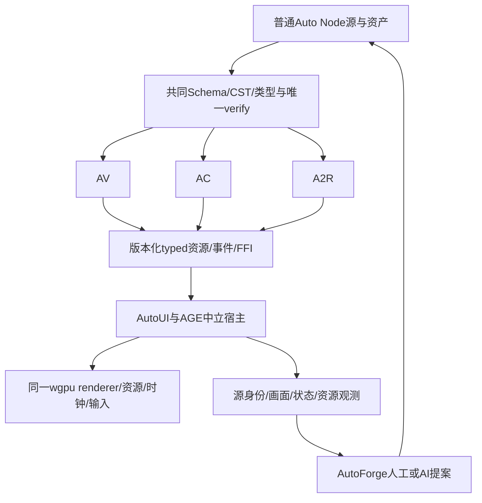

# AGE M2三路线共同架构与交付合同

2026-11-19，W1 按 1071 原子面和 AutoUI 104–108 剩余 AV 分母验齐，正式 W2 由 [1097](../../plans/1097-ace-ac-autoui-w2-and-age-host.md) 交付，1074 消费 W2。AGE 领域来源见[AGE 交付表](../strategy/age-m2-three-route-strategy.md#后继交付与消费)。1068 接收正式证据并执行最终三端验收。

2026-11-17 target-state v1；正式行为以各当前Spec/已交身份为准，以下是拟实施增量。统一策略：[三路线strategy](../strategy/age-m2-three-route-strategy.md)。不实施，不新建第二语言/控件/渲染/Agent基础设施。

## 1. 分层与依赖方向

完整 UI 和 AGE 的实施归属以[阶段交付表](../strategy/age-m2-three-route-strategy.md#后继交付与消费)为准。980/981 给已验基础；1071、1075、1099–1101 给实际 AV，1097 给 W2，1074 给 W3，AGE 后端按[AGE 交付表](../strategy/age-m2-three-route-strategy.md#后继交付与消费)接收。

core不反向依赖UI/Forge。NodeName只在当前AGE Schema上下文生效；旧widget alias通过同一前门兼容，不建旧widget专线。Shader首批用现WGSL/wgpu宿主，AutoShader/CAP完整版不是前置；完整GPU语言研究另线。资料里的M3/M4只是历史文件名，不新增AGE阶段。

## 2. owner与最小公共接面

| 事实/接口 | producer | consumer/关闭证据 |
|---|---|---|
| 源模块图/Schema/原span/ResourceType/字段/Float/tuple语义 | 981 已交 SOURCE；尚未完成的原 LANGUAGE 格归 1071、1075、1099–1105、1076/1077 对应生产方及共享 ACE owner | UI新包/Forge薄adapter；原普通源可变、坏源具名拒，不拷parser |
| 事件payload/具名msg/绑定/授权与队列生命周期 | 981 LANGUAGE/SESSION既有EVENT-B；967通用ABI、968/970调度会话 | Forge编辑输入/运行工具、980组件，非单位事件不能用unit假成功 |
| 中立服务与资源 | UI058/080及099–102新包（实际ID见strategy） | 普通作者AV先交；AC 由 1102、公共 A2R 由 1103 接；typed字段缺失先生产接口，不等产品最终 |
| 场景/视图/时钟/输入与device owner | 既有AGE driver/renderer＋981域端口 | UI/游戏/Forge共用，不能跨进程传Rust/GPU指针 |
| 作者工程/Revision/Changeset/源映射与写入政策 | 新Forge001 | 用户/Agent统一编辑；只写授权工程，编译/预览/发布有恢复边界 |
| 模型transport/任务/提案 | 新Forge002，复用旧provider协议经验 | 不可信proposal经同一Changeset；真实模型/真实产物/错源反控 |
| 构建/候选SDK/输出 | 978/1074/1068、游戏发行1076/1077及原986/987 | Forge004仅consumer，不创建编译/发行第二实现 |

新拟交接`IF-AGE-GFX-AV/<cap>`、`IF-AGE-GFX-AC/<cap>`、`IF-AGE-GFX-A2R/<cap>`，cap为MAP/ASSET/PBR/CLIP及原G2/G3子面。字段为schema/cap version、源/资产closure、符号与原span、accepted type domain、公共host ABI/grants/owner/gen、actual/expected、provider/SHA及未支持项。是owner phase收据，不是新注册系统/runner。producer有实现与独立R/fold，consumer才能签相应格；语言与宿主接口可提前按最小切片生产，禁止双方等整包。

## 3. 一次编辑/运行的状态与错误

源/资源候选仅在共同校验后接受；编译/类型/缺能力、预算/资源、宿主/工具/环境、授权/取消分别报告。状态接受和资源所有权不等于全工程物理事务，候选失败必须保last-good或准确报告残留/可重放恢复。世界Tick与render Frame分离，view倍增不能让业务/Tick重复。

Forge的源为普通.at工程，CST/typed投影是派生视图；SceneDocument/JSON不得变成第二业务真相。`SourceKey`是符号/实例路径而非ordinal，原span是对应revision的定位；人工修改/Agent输出都带base_revision。资源侧`AssetKey=(content_hash,subresource,version)`与runtime handle/epoch分别管理，不能把GPU地址存工程。

## 4. 三端/阶段与验收归属

UI-W1/2/3继续只签原全UI/Widgets分母，不等新增GFX或Forge。四新UI包AV-only完成即可归档；后端差额逐能力交 1102/1103及AG031最终矩阵，不丢失三端义务。原058/AG023/029/030完整任务保留，可先AV独立R/fold、后AC、再A2R，最终才勾全量任务/归档。新AC能力不是UI包完成的借口；实际编译/运行端与host/render必须各可观察。

AG031原E/G2/G3/F/OS/联合门加四扩展三端，签AGE M2-ready；985/A不等上述新扩展，985 B原A/B分母实际需要的consumer仍保；Forge首批单独签AV-CREATOR/1，输出三端齐才FORGE-OUTPUTS-3/1，不成为AGE/ACE前置。源码/hash/资产与业务预期守恒，换backend只换执行/构建provider，不改应用逻辑凑绿。

## 5. 复用/增量/后续候选矩阵

完整计划映射见strategy与各Plan。已有UI055/059/AG022只供研究结论；080正式能力已交不重开；UI040/835/837有限静态/编辑原型不冒有业务/AI/源码往返产品。新功能只补明确增量。骨骼/完整物理/XR/全平台/任意shader/所有three.js条目仍候选，未本轮立约不充M2结果。
