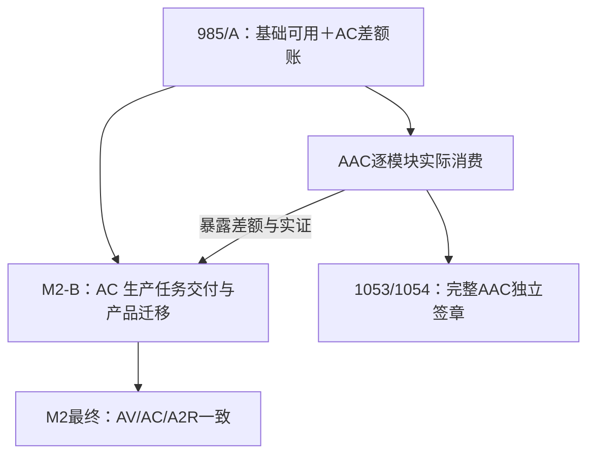

# AAC 设计落地与独立验收路线

G-AAC 已于 2026-11-17 取得 985/T-A05 正式 M2A-08（95c7fbad8），AAC 下一入口为 1044/T-01。

> 与其余ACE子路线的关系见[统一计划总览](ace-route-plan-map.md)。AAC在985/A稳定出口后与M2-B并行，非M2硬门。

> 2026-11-16 · r4 · 仅规划，0项实施完成。依据[Design59](../59-aac-native-bootstrap-and-compiler-subject.md)。AAC=Auto版AC主体，独立后续路线；M2-A稳定后可与M2-B并行，不作为M2硬门，不要求等全部产品替换。当前没有施工授权。

## 0. 当前M2-B实证关系

### M2-A基础可用、M2-B三端对齐与AAC实证（2026-11-16当前优先）

用户最新裁定：**M2最终AV/AC/A2R公共能力一致；A2C完整对齐为增强项。** M2-A仍须完整AV/A2R语言/库及原required真实验证，AC至少有能承载AAC启动的真实多模块/类型与owned数据、泛型/Option/Result基本链、所需CTE/FFI、文本/分配/同步文件等基础。AC其余具名差额允许移M2-B：原行ID/输入/oracle/错误及资源义务、实际来源、B-owner/关闭条件必须保留，不能记PASS/NA或从分母删除。仅“原native不支持/旧profile外”不再是M2最终豁免。

[1067](../../plans/archive/1067-ace-ac-native-async-and-task-parity.md)已交原生异步/Future/Task 基础；[1068](../../plans/1068-ace-m2b-three-backend-parity-and-aac-proof.md)收各实施任务的语言/库/FFI/领域交付证据和 AAC 阶段实证，执行最终三端验收。985/A不等待两包，985/B及最终986/987必须收三端完整闭合；A2C现有代码/用例/支持记录保留、缺完整对齐不阻M2。A2PY既有标准库义务与AV三provider、Linux1063延期规则不变。

AC 共享语义由 1046–1049 对应任务交付，MIR 和机器执行由 1050/1051 交付，启动库及工程分别由 1045/1056 与 1052 交付。修复计划负责重新交付失败项。详见[逐任务归属](../59-aac-native-bootstrap-and-compiler-subject.md#现有-ac-差额的实施归属)。

AAC在A出口后、M2-B期间推进，以真实Auto编译器模块检验AC语言/库；某任务所需能力未交只阻该任务/切片，缺口回语言/库真实owner补齐。AAC未使用的语言/领域/异步特性仍补独立三端用例。完整Gen1→Gen2→Gen3自举签章保持独立，不强加为M2通过前置；其所暴露的M2三端能力缺口必须在M2最终前关闭。此规则优先于旧“AC所有义务必须A期全齐”“M2-B与AAC完全无能力交接”“原A2C全量同等硬门”等表述。

## 1. 公共开工门与依赖解释

**G-AAC** = M2A-01..08及985/T-A04→T-A05正式已落主收据 + 执行时的实施授权；1044开工后绑定CS/CL及接口/预算，1056补精确支撑操作，1055先交基础MIR打通CT。当前945/947/962/963/1042/1043有限交付不能代A出口。当前所有AAC Plan均 `drafting/current_step:0`，并无自举结果或稳定证书。

frontmatter `depends_on` 只列AAC包级交付；外部阶段门在各Plan §4/5明确，**不写整个985为硬前置**，以免把985/B、全App/安装/退役反加为AAC前置。当前方向为“A基础正式出口→AAC及M2-B并行”；AAC需要的共享 AC 缺口由[具名实施任务](../59-aac-native-bootstrap-and-compiler-subject.md#现有-ac-差额的实施归属)或实际库/领域 owner 修复，M2-B最终收1068三端闭合与AAC阶段实证，但不等1054完整代际签章。不能将1068或整个985反加1044/1045开工依赖。各包最终验收需其全部正式输入，私有准备可按下表稳定接口并行，不消费其他树WIP。

## 2. 完整计划和建议执行顺序

| 序 | Plan / 独立交付 | 最小实施前置/可以并行的工作 |
|---|---|---|
| 1 | [1044：基线、需求与阶段契约](../../plans/1044-aac-baseline-and-stage-contracts.md) | G-AAC；首包冻结CS/CL、schema、语法和资源合同；本轮只读审计已在Design59，不冒该包T完成 |
| 2 | [1056：精确摘要与编译器codec](../../plans/1056-aac-exact-digests-and-compiler-codecs.md) | 1044；复用/补统一Auto库及wire协议支撑，不依赖AAC语义/服务，不反加M2-A门 |
| 3 | [1045：hosted标准库与SDK](../../plans/1045-aac-hosted-stdlib-and-sdk.md) | 1044+1056；消费M2-A库/OS/FFI/SDK，不实现第二套标准库 |
| 3A | [1046：Auto语法、源码与模块](../../plans/archive/1046-aac-syntax-source-and-modules.md) | 1044+1045；第一批Auto主体，先独立语法/模块验收 |
| 3B | [1051：native后端与CTE服务桥](../../plans/1051-aac-native-backend-and-cte-bridges.md) | 1044+1045；transport有限试验后冻结，不等完整前端/MIR才做服务边界 |
| 4 | [1047：绑定、类型与受检HIR](../../plans/archive/1047-aac-binding-types-and-checked-hir.md) | 1046；接已冻结HIR/语义接口，不依Rustsolver运行 |
| 4B | [1055：基础MIR与CT启动闭环](../../plans/1055-aac-early-typed-mir-and-ct-bootstrap.md) | 1047+1051；Auto受检基础闭包→Auto MIR/verify→真AV/native；不等1048/1049/1050 |
| 5A | [1048：泛型、meta与CT编排](../../plans/1048-aac-generics-meta-and-cte.md) | 1047+1051+1055；完整算法/基础CT工厂真跑，advanced CT组合具名交1050/T-09和1053，不反import完整1050 |
| 5B | [1049：控制、dynamic与资源语义](../../plans/1049-aac-control-dynamic-and-resource-semantics.md) | 1047+1048；高级语义私有准备可先，最终生成/资源组合取已交1048，不把它移出CL |
| 5C | [1052：增量驱动、缓存与发布](../../plans/1052-aac-incremental-driver-and-artifacts.md) | 通用身份/事务可在1047后准备；最终依1048/1049/1050/1051/1056，必须有完整Auto MIR，不能漏lowering输入 |
| 6 | [1050：共享Typed MIR的Auto lowering](../../plans/1050-aac-shared-typed-mir-lowering.md) | 1047+1048+1049+1051+1055；继承基础MIR扩完整面，并接1048工厂验证高阶CT/资源/领域组合 |
| 7 | [1053：Gen1全语言闭环与主体核验](../../plans/1053-aac-gen1-full-language-parity.md) | 1044–1052与1055/1056全部必要结果；Gen0真编Gen1，完整CL与无Rust语义回落证据 |
| 8 | [1054：Gen2/Gen3及独立认证](../../plans/1054-aac-generations-and-independent-certification.md) | 1053；同源代际、独立oracle、可搬迁包/依赖清单；不切M2产品默认 |

默认单执行者按 `1044→1056→1045→1046→1047→1051→1055→1048→1049→1050→1052→1053→1054` 推进。多人/会话执行才按3A/3B、5A/5B/5C拆写窗；本轮不启动额外agent、会话、worktree或试验。共享 grammar/HIR/IR/固定组/SDK文件由owner串行交接，私有目录才可自由并行。

## 3. 跨仓交接与缺口回流

| 供给 | AAC消费者及明确要求 | 不形成的依赖 |
|---|---|---|
| auto-lang / 985-A | 1044核A收据与已合入source/SDK/stdlib/AutoABI/grammar；1045落实CS逐操作供应 | 不等985最终B/986/987，不要求改M2验收计划来接AAC |
| 946/972/973/975/967/978/1039–1043等对应owner | 1045、1051、1052复用已交接口。缺失能力/兼容问题登记实际producer及后继ID，缺口关闭前不得宣称对应AC通过 | 不重开已归档Plan，不把供应缺口塞进临时Ruststd/隐含libc，AAC不建设第二通用FFI |
| 语言仓TestCase/adapter/worker；auto-down文档格式owner | 1053复用当前协议，新增AAC资产/薄worker由语言仓接；协议真缺能力才分出具名owner后继并收交付证据 | 不盲改外仓/重新建设全仓用例系统，无空泛“等待测试框架重写” |
| auto-man/UI/Web/OS/AGE owner | 使用M2-A已冻结领域接缝/SDK和最小真实产品oracle；涉及外仓输入列路径/commit/命令/负责人 | 不迁各产品到AAC、不接其全套应用迁移，也不令M2-B依AAC |

实施树计划采用 `D:/autostack/.wt/lang-<ID>/auto-lang`，分支 `plan-<ID>-dev`；材料唯一 `D:/autostack/plan-artifacts/plan-<ID>/`。若需要外仓代码修改，先按对应AGENTS规划真实owner计划并加入同组树；当前授权仅规划和需求审计。阶段收据身份变化仅使受影响证据过期，不能整轮无依据扩大或复用旧身份。

## 4. 分母与验收证据

**本轮逐任务检查结论**：AAC原路线已有完整CL目标，但旧任务含“M2-A AC适用子集”收窄措辞、required标注/类型修饰组合不够明确，已在1044–1056当前执行任务/验证中校正。完整语言取最终M2 AV/AC/A2R required矩阵及A后延增量，CS未使用不构成豁免；族级生产/运行owner以[Design59 §3的CL映射](../59-aac-native-bootstrap-and-compiler-subject.md)为单源，不另建registry。

1046/1047负责语法/基础类型，1048负责泛型/CTE/required标注，1049负责~T/?T/!T、动态/闭包/控制与资源组合，1050完整lowering，1051受检机器/AV执行尾；实际机器/runtime 缺口由 1051 对应任务处理，消费 1067 已交基础。1053 Gen1必须编译并运行全部CL对应native程序，1054逐代复验。1055有界基础LowerCt继续先交破依赖环，不能因此要求它提前完成整个语言；1056精确库支撑亦保原边界。AAC优先AC输出，不为语言完整性强迫重写所有A2X emitter。

1044登记独立 `CS-*`、`CL-*`、`SUBJECT-*`、`BRIDGE-*`、`GEN-*` 义务；其格式复用现有能力/测试描述机制，具体schema由该包冻结，不在规划阶段生成registry。每行至少有规范来源、生产者、消费者、阶段、目标适用性、输入、独立expected、执行入口、owner和源码/工具身份。已交 M2 资产按义务映射接入，AAC 专项反例由对应实施计划创建。AC 语法统一复用 AV 的 AutoDown 作者源和独立预期，已有正式用例随包验证，尚缺用例等 1078–1096 交付再对账。详见[同源验收规则](../59-aac-native-bootstrap-and-compiler-subject.md#ac-复用-av-的-autodown-语言语料)。

| 出口 | 必须观察到的结果 | 不能据此声称 |
|---|---|---|
| R0/R1 | CS需求全有owner，需求验证在实际AC/SDK成立，剩余工具依赖明列 | AAC自举完成或M2-A已由AAC证实 |
| R2–R7 | Auto主体阶段独立产物/非法输入/资源/恢复符合合同；共享边界实际可用 | 完整nativeAAC或全代际通过 |
| R8 | Gen1真实native、CL完整实际执行、服务日志无Rust源码语义入口、正反例oracle一致 | Gen2/3通过或全产品已迁 |
| R9 | 同一源码代际链、CL/CS、诊断/失败/资源/缓存/发布和独立验收齐全，包可真实仓外使用 | M2/v0.6已签、自研机器后端完成或AAV/AACE整体完成 |

普通每包使用其实际触面固定完整组/必要消费者，资源和协议以原owner定向反例验证；不每包跑全仓/正式压力。`cargo t ace-perf`为显式专项，普通模块排除`::performance::`。1053新增的AAC固定测试选择和正式自举命令未实现，本轮不报告其可运行；1054必须记录实际各代命令与退出码而非仅计划中的脚本名。

## 5. 初版r1规划核验记录（历史）

2026-11-14：已读取关联Codex会话、模块Specs、当前Rust源码/依赖、M2-A阶段合同及供给Plan状态，编制Design59需求表与11个drafting包。四位ID按当前仓脚本分配；旧skill的三位限制与现实现不符，backend `relay/plan_control.rs` 已匹配 `[0-9]+` 且有PLAN-1001用例，本次未截断编号。分配1047时脚本已建骨架但WSL写`.next-id`返回Invalid argument；核对唯一1047骨架后用原生文件写将计数修复为1048，余项改用Git Bash串行取号，未覆盖其他Plan。

文档静态预检通过：新增2份设计/路线及11个Plan，88项任务全部未勾选；每Plan的0–10节、元数据、owner_stage、AC和规范delta完整，表格列数与代码围栏配对；新文档41个本地链接均存在，29条AAC包级依赖无缺失/环；现有计划没有新增反向依赖AAC，下一计划号1055。`git diff --check`通过。该结果只证明文档结构与依赖一致，不作为任何实施、独立代码review、M2-A或AAC验收结果。本轮没有改源码/测试/当前Spec，没有创建实施树、运行编译/产品/探针，未合并或提交工作区的其他改动。

## 6. r2复核与修订收据（2026-11-14，当前）

本轮逐包复核1044–1054，结论是初版需要补齐真实数据流与验收，不能仅凭编号依赖无环认定可执行。具体F01–F10、代码依据和跨仓已核输入见[Design59 §9](../59-aac-native-bootstrap-and-compiler-subject.md#9-r2再次审计发现补齐与可执行顺序2026-11-14)。

1044–1054均修为r2、原任务ID/验收义务保持，补12项work任务；新增1055基础MIR/CT启动、1056精确摘要/codec两个独立8任务Plan。当前共13个Plan、116项任务，全部drafting/current_step=0；不施工。1048的早期MIR依赖已有独立正式producer，1052补完整1050输入，#in语法/绑定/CT固定点与高级CT整机关闭责任清晰；新支撑Plan不反置M2-A前置。

验收补强包括完整CS依赖闭包/CL逐操作分母、host-target-CT身份、合法模块互递归、UTF-16/CRLF/emoji位置、精确hash/分帧、Auto store策略、foreign binding/shim、执行权限和硬回收、早期Auto阶段driver、Gen0与Gen1观察窗、各代不同exe不能借绿报告、metadata不能屏蔽机器语义差异。1054可在全部义务闭合后签Windows AAC独立完成；不签M2/AAV/AACE全体。

本轮不改M2能力/产品计划进度、不写current Spec、不运行实现测试/编译/产品/压力，不启动额外agent或工作树。正式G-AAC与未来实施授权仍待满足。

静态预检收据：13个Plan、116项未勾选任务、67条拟议V用例；1044–1054原任务/AC/V的ID全部保留，状态仍drafting、进度0。42条AAC直接依赖无缺失/环，建议单执行者顺序逐条满足所有依赖；既有M2及其他Plan未新增反向AAC依赖。15份核心设计/路线/Plan中的48个本地链接存在，0–10节、元数据、owner_stage、任务数量、表格/围栏一致，`git diff --check`通过。新.next-id为1057。该收据仅验证规划结构与关系，不是67条用例已运行或M2-A/AAC已通过。工作区其他会话已有且继续变化的源码WIP保持原样，未纳入本轮修改/验收。

## 本轮语言完整性检查收据（2026-11-16）

逐原任务核对1044–1056、1067/1068后，修正AAC当前任务/测试中的旧A期AC适用上限，明确~T/?T/!T、泛型、CTE、required标注及跨模块/资源组合的真实生产→执行→consumer。AAC自己的源码可用子集实现，编译出的用户语言必须覆盖完整CL；只parse、只生成、只自编译或旧Gen0代Gen1不能过门。1068的早期AAC实证不冒1053/1054完整AAC支持；反之，M2最终三端仍按1068/985原完整门，不新增依赖完整代际签章的循环。

原13个AAC计划116任务保持，全部未实施；本轮不取号、不生成fixture、不构建/运行。静态预检结果另记，不能当独立实现review或完整语言已支持的证据。

2026-11-16 AAC-LANGUAGE-COMPLETENESS 规划静态预检：17份设计/计划239处本地链接有效；14份原Plan共126任务（AAC13包116项＋1068十项）的ID/勾选/阶段/依赖/状态/进度保留，无新Plan/新任务。10份AAC计划补族级SD/V/AC，1068明确语义主体/机器补齐/完整CL分工；当前任务中旧A期AC有限上限已校正。可达166份Plan无缺失/环，章节/表格/围栏和git diff --check通过。仅规划检查，全部新增验证未实施；未改产品代码/已验Spec/归档历史、未生成fixture或运行编译/产品/测试。
