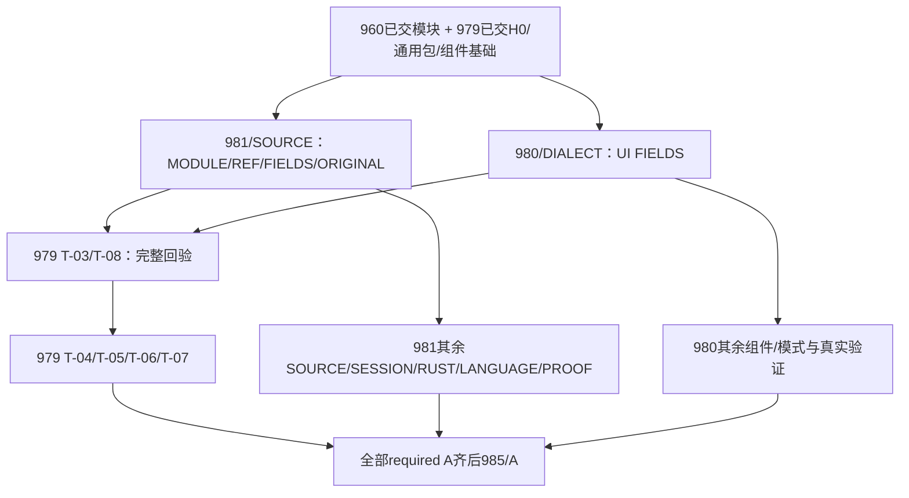

# ACE M2执行路线：完整语言到全部产品替换

> 2026-11-17最新状态与A执行前沿见§40（r38）；事件/阶段合同沿§39与980 r15／981 r17／985 r24，旧日期待办不覆盖新交付。

> 当前阶段等待/事件缺口与状态接续以§39（r37）及980 r15／981 r17／985 r24为准；§38是1032交付前快照，r23验收分母保持。

> 当前A待办/状态与执行顺序以§38（r36）为准；985/A验收合同仍为§37及985 r23，旧状态快照不覆盖最新正式交付。

> 本轮r35：985/A分母、审计A/B与1066正确性切片见§37；UI三波与OS顺序沿§36。

> 本轮r34：A最小真实出口与B三波/OS迁交以§36为准；旧日期快照及§35不覆盖最新Plan合同。

> 2026-11-16 Node桌面最新执行合同见§35（本轮r33）；旧日期快照不能覆盖980/981/1068/985当前合同与正式收据。

2026-11-16最新裁定：**M2最终AV/AC/A2R公共能力一致；A2C完整对齐增强。** 985/A可接真实AC基础＋完整B差额账，非基础AC缺口在B期间由1067/1068结合AAC真实模块逐项补齐。完整AAC代际签章仍独立，相关AC能力闭合为M2最终硬门，不能以原适用profile拒绝豁免。此条取代旧A四端全齐与“AAC同B完全无交接”的排程；原A2PY标准库/AV三provider/Linux1063延期规则保持。

2026-11-16 全计划最新状态/A-B顺序见[统一总览§17](ace-route-plan-map.md#17-2026-11-16-aceage-m2全计划状态与ab顺序本轮当前)，六计划清空视角见§34：Godot脚本/TSCN/工程不再要求M2支持；TS/JS保生产消费闭包。以下日期状态是历史快照，不能覆盖原Plan最新正式来源。

> 2026-11-16早时状态快照见§33；本轮目标范围与排程优先看§34。早时记录：970/978已归档；971/A、977/PY已阶段交付；973/974/981与985/A在途；M2A-08尚未产生。交接合同见§31，状态以各原Plan及正式收据为准；本轮只规划。

> 当前计划分类、状态和跨路线执行顺序先看[统一总览](ace-route-plan-map.md)。本文件保留历次日期快照，旧“未打M1 tag”或旧drafting计数不能覆盖当前Plan/正式收据；各批次合同不因总览改变。

2026-11-16，r32（977归档门/最新状态/当前接续见§34；早时状态/低占用接续见§33；§32为11-15历史快照；Linux延期与普通库自有实现见§30；AAC独立路线与M2-A后并行门见§29；两项全仓旧红后移M2与M1收尾边界见§21；ace-perf成本优化专项见§20；AutoDown 文档式测试试点见§15；默认自有库/非libc选择与字符串边界见§19；标准库准备的M1-TAG进入门见§12；完整FFI/新版标准库增补见§11；AGE两阶段接洽见§10；历史核验记录保留原日期）。设计权威：[Design55](../55-ace-m2-complete-language-and-product-replacement.md)。初轮创建29份草案并重排945–948；r5已修订十份M2草案纳入[Design56](../56-ace-m2-ffi-and-native-stdlib.md)；r6修订945–948的M1 tag后进入安排；r7正式拆M2-A/B并明确阶段出口/跨仓证明与测试守恒；不施工、不修改M1在途合同，不把路线草案当已批准实现。旧REP-01..11/V06门保留。当前路线替代“只有M2标签、尚未立项”的旧排程描述，历史状态不覆盖当前事实。

当前完整AGE上游根与M2隔离集成建议见§18；962/963均已8/8归档，后继按实际Plan推进；本轮Node首Hello与并行合同见§24。967/F0是并行Hello切片，979通用Schema不串行反等完整执行/SDK；其余计划的具体化复查见§23。

ACE/Hello/AGE统一排程见§17：一个依赖总览、两个里程碑视图、三条执行工作线；Hello属于既有ACE接入能力，不单设第三套里程碑。各Plan仍是唯一任务/验收/进度来源。

当前首ACE UI Hello路线见§16：五个原Plan内新增F0/H0/E0/B0/HELLO共20任务，AV首窗先行、A2R同源并行；原完整语言/标准库/全UI及A/B出口保留。

历史AGE接洽快照见§18（2026-11-12；当前Node入口与时序见§24）：AGE M1已签，981仍r10十批34任务；UI080 executing 3/10，作者链待979/981，AG029 executing 2/10且有用户暂停记录；UI058/AG023/AG030/AG031仍按原合同。§10保留11-11规划快照，不把当时全零状态当当前；本轮只规划。语言984 r7交OS相关正式覆盖切片，不要求非桌面全生态先完。

当前排程由§13正式两阶段取代此前全面交错迁移；11-10执行清单整理见§14，M2-A 测试框架试点见§15。阶段次序为：A能力/新库＋RG-A真实验证→985/A出口→B全产品替换＋发行退役。保原M1-TAG/REP/V06与独立自举后续路线；仅规划。

当前标准库Linux延期和普通库归属以§30为准；加载/#in分工设计见§28，后端/provider覆盖见§27，平台方案及强制底座依赖见§26（§25保初稿过程）；见[原生平台I/O设计](../stdlib/native-platform-io.md)。947已归档；新增1039–1041仅规划，完整系统库仍归973；历史零进度快照不覆盖各Plan当前状态。

## 数值与组合类型

| 要查的问题 | 阅读入口 |
|---|---|
| M2 要补哪些语言能力？ | Design 55 将数值和组合类型分成两个交付项，两者都属于 M2-A 语言能力阶段。[语言支持矩阵](../55-ace-m2-complete-language-and-product-replacement.md#5-完整语言支持矩阵与拆分) |
| 今天写数值表达式可以依赖什么？ | Numeric 源码入口支持 `.shl(n)` 和 `.shr(n)`。值与移位量须同型，移位量达到位宽时触发 `ShiftOutOfRange`。支持类型、转换和错误边界见[数值 Spec](../../specs/ace-migration/m2-numbers.md)。实现可从 [`compile_numeric_source`](../../../experimental/ace/crates/core/src/source/adapter.rs) 进入，接受与拒绝样例见[源码测试](../../../experimental/ace/crates/core/tests/cases/numeric_source.rs)。 |
| 谁验证了这些行为？ | [已归档的 961](../../plans/archive/961-ace-m2-numbers.md#9-复审记录) 保存四端验收与交付记录。 |
| 接下来怎样使用这项能力？ | [962 组合数据结构与递归拥有资源](../../plans/archive/962-ace-m2-aggregates.md#8-执行步骤) 承接 960 的模块能力与 961 的数值能力。首项工作 T-01 核对依赖并冻结支持范围，后续覆盖组合类型、索引与所有权。进度以该 Plan 为准。 |

## 1. 当前基础与旧包处理

- 936/943/944/950已archived：CT、语义实册、装配及有限模块是可复用基础，支持边界仍分别受限。
- 2026-11-12状态刷新：938/939/959/960/961均已archived；[1005](../../plans/archive/1005-ace-m1-architecture-evidence-and-independent-audit-admission.md)已11/11归档，其delivery `05b7c9d7e`是当前主线`1169f135940e38e6a567826ce406785134e356e3`祖先，原实施树不再登记。其当时1006P/tag_ready是历史候选结论；签前发现的分域facts来源/虚构提交准入问题由新[1013](../../plans/archive/1013-ace-m1-phased-facts-provenance-and-tag-admission.md)承接，文档drafting r1、0/10，不能据worktree注册推定已交。正式`v0.6-ACE-M1`本地仍未发现；当前不宣称M1正式签章或重新验证全部原始证据，不重开1005。945–948原M1-TAG门仍未闭，见§12。M2最终认证消费正式M1结论，旧A2R 38格继续按原owner证据核。
- 945–948保原ID/既有AC/任务；945/946现r6，947/948现r7新增分层/装配与分母，原r3的T-08继续有效；r2是初轮后继映射：945/946交有限基础，972接完整库；947做console/资源前探，973/968接真正资源/任务；948差额必须映射972–975和领域/产品包，不留“以后立项”无owner口袋。
- 942生成构建治理与949旧VM异步修复保原owner。949结果是迁移oracle输入，不能用ACE将来替换取消在途缺陷；942交付按实际源契约复用，不再重复造构建缓存。
- 本轮取号前.next-id在并行工作中从958推进959，按脚本实际分配 **959–987**，没有覆盖958；最终.next-id=988（此后并行新建可能继续前移）。

## 2. 全部正式草案与依赖

| Plan | 独立交付职责 | 正式依赖（裸编号属语言仓；跨仓显式标仓） | 阶段 | 本轮状态 |
|---|---|---|---|---|
| [945](../../plans/archive/945-ace-stdlib-core-math-and-text.md) | ACE 基础数学与文本标准库最小切片 | 943, 944, 960, 947；M1-TAG | M2-A | drafting r7 / 0 of 8 |
| [946](../../plans/archive/946-ace-stdlib-collections-and-owned-algorithms.md) | ACE 集合与拥有资源公共算法 | 943, 944, 945, 962；M1-TAG | M2-A | drafting r7 / 0 of 8 |
| [947](../../plans/archive/947-ace-stdlib-console-and-resource-host-contract.md) | ACE 控制台接入、标准库分层与装配合同 | 943, 944, 960；M1-TAG | M2-A | drafting r9 / 0 of 10 |
| [948](../../plans/archive/948-stdlib-domain-migration-and-release-readiness.md) | 标准库领域迁移差额与发行接管准备 | 943, 945, 946, 947；M1-TAG | M2-A | drafting r9 / 0 of 9 |
| [959](../../plans/archive/959-ace-m2-denominator.md) | M2 全语言与全产品兼容分母冻结 | 只读冻结分母（已交） | 已交A底座（不重开） | archived r2 / 7 of 7 |
| [960](../../plans/archive/960-ace-m2-modules.md) | 完整模块包与公共类型绑定 | 959, 950 | 已交A底座（不重开） | archived r2 / 8 of 8 |
| [961](../../plans/archive/961-ace-m2-numbers.md) | 完整数值源码与四端一致语义 | 959 | 已交A底座（不重开） | archived r2 / 8 of 8 |
| [962](../../plans/archive/962-ace-m2-aggregates.md) | 组合数据结构与递归拥有资源 | 960, 961 | M2-A | archived r4 / 8 of 8 |
| [963](../../plans/archive/963-ace-m2-generics.md) | 通用泛型spec与方法实例化 | 960, 962, 935 | M2-A | archived r5 / 8 of 8 |
| [964](../../plans/archive/964-ace-m2-dynamic.md) | 动态值对象反射与通用闭包 | 962, 963 | M2-A | drafting r5 / 0 of 8 |
| [965](../../plans/archive/965-ace-m2-control-effects.md) | 完整控制流错误传播与生成器 | 962, 964 | M2-A | drafting r5 / 0 of 8 |
| [966](../../plans/archive/966-ace-m2-metaprogramming.md) | 完整编译期执行宏与领域生成 | 960, 963, 964, 965, 936, 958 | M2-A | drafting r6 / 0 of 10 |
| [967](../../plans/archive/967-ace-m2-host.md) | 完整C/Rust FFI、自动binding与通用宿主资源 | 960, 962, 963, 938, 939 | M2-A | drafting r8 / 0 of 19 |
| [968](../../plans/archive/968-ace-m2-scheduler.md) | 任务async actor与事件调度 | 965, 967 | M2-A | drafting r5 / 0 of 8 |
| [969](../../plans/archive/969-ace-m2-facade.md) | ACE 产品执行配置与嵌入前门 | 960, 964, 967, 968 | M2-A | drafting r6 / 0 of 12 |
| [970](../../plans/archive/970-ace-m2-sessions.md) | REPL持久会话daemon与在线更新 | 969, 968 | M2-A | drafting r5 / 0 of 8 |
| [971](../../plans/971-ace-m2-tools.md) | 调试LSP测试与Playground接管 | 970, 966 | 跨M2-A/B | drafting r5 / 0 of 11 |
| [972](../../plans/archive/972-ace-m2-stdlib-core.md) | 新版标准库完整基础与集合 | 961, 962, 963, 964, 945, 946, 948 | M2-A | drafting r7 / 0 of 10 |
| [973](../../plans/archive/973-ace-m2-stdlib-io.md) | 新版系统文件进程时间与资源库 | 967, 968, 972, 947, 966 | M2-A | drafting r7 / 0 of 10 |
| [974](../../plans/archive/974-ace-m2-stdlib-network.md) | 新版网络HTTP与流式服务库 | 968, 973 | M2-A | drafting r5 / 0 of 8 |
| [975](../../plans/archive/975-ace-m2-stdlib-data.md) | 新版JSON序列化数据库与扩展库 | 972, 973, 948 | M2-A | drafting r5 / 0 of 8 |
| [976](../../plans/archive/976-ace-m2-typescript.md) | 共享HIR到TypeScript和JavaScript | 960, 961, 962, 964, 965, 968 | M2-A | drafting r5 / 0 of 8 |
| [977](../../plans/977-ace-m2-other-targets.md) | 其余A2X目标与独立转换工具接管 | 959, 960, 962, 964, 965, 968 | 跨M2-A/B | drafting r6 / 0 of 16 |
| [978](../../plans/archive/978-ace-m2-build.md) | 工程增量多目标构建与预编译SDK | 960, 966, 972, 967, 942 | M2-A | drafting r8 / 0 of 14 |
| [979](../../plans/archive/979-ace-m2-schema.md) | Schema领域语言包与UI AGE投影接口 | 960, 963, 966 | M2-A | drafting r10 / 0 of 12 |
| [980](../../plans/980-ace-m2-autoui.md) | 现有AutoUI全模式ACE兼容接入 | 960, 963, 967, 968, 969, 972, 973, 976, 978, 979 | M2-A | drafting r9 / 0 of 35 |
| [981](../../plans/981-ace-m2-age.md) | AGE Node直接接入ACE与AV开发及A2R游戏发行 | 960, 961, 962, 966, 967, 968, 969, 970, 972, 978, 979, 980, ag-examples/024, ag-examples/025, ag-examples/028, auto-ui/061, auto-ui/062, auto-ui/063, auto-ui/067, auto-ui/072 | 跨M2-A/B | drafting r12 / 0 of 34 |
| [982](../../plans/982-ace-m2-man-gen.md) | AutoMan配置任务模板与生成器迁移 | 960, 964, 966, 969, 970, 971, 973, 976, 977, 978 | 跨M2-A/B | drafting r6 / 0 of 40 |
| [983](../../plans/983-ace-m2-web.md) | Web服务嵌入与实际后端迁移 | 967, 968, 969, 974, 975, 978, 980, 982 | 跨M2-A/B | drafting r6 / 0 of 19 |
| [984](../../plans/984-ace-m2-os-apps.md) | AutoOS全部应用与系统宿主迁移 | 959, 969, 970, 971, 972, 973, 974, 975, 977, 978, 980, 981, 982, 983, auto-os/064 | 跨M2-A/B | drafting r8 / 0 of 25 |
| [985](../../plans/985-ace-m2-certification.md) | M2两阶段验收与完整义务联合认证 | 971, 972, 973, 974, 975, 976, 977, 978, 984, 941 | 跨M2-A/B | drafting r10 / 0 of 14 |
| [986](../../plans/986-ace-m2-release.md) | 独立发行安装升级与默认切换 | 985, 982 | M2-B | drafting r7 / 0 of 9 |
| [987](../../plans/987-ace-m2-retirement.md) | 旧AutoVM A2X退役及M2终验 | 986, 985 | M2-B | drafting r7 / 0 of 9 |

依赖表是保守正式交付序；945–948的调查/oracle准备/前探也受§12 M1-TAG限制，不允许tag前先跑；其他包的准备按自身已授权合同，不得把准备算完成。跨包新增实际依赖必须修订DAG；禁止绕过依赖的功能使用，也避免把所有前探一律绑最终认证。部分领域包含多目标/多产品，T-01按真实触面细分中等执行批次；无法在一包内独立评审则正式拆后继并逐AC迁移，原总体闭合责任保留。

## 3. 正式两阶段与关键路径（当前）

**M2-A0，复用与范围**：959/960/961及原M1成果保归档；945–948所有准备继续等M1-TAG。按959及FFI/LIB/UI/AGE增补核A/B行集，不重复开已交盘点。

**M2-A1，完整能力**：962–970、972–976、978–980及977/981的A批补完整语言/新库/FFI/构建与UI/AGE。971只交A/PROOF，977逆向工具保B；982/CONFIG+PROOF、983/PORT+PROOF、984/EMBED及OS064/HOST+PROOF是具名真实验证，按最小接口前置推进，不等这些产品整包。

**M2-A2，出口**：985/T-A01..A03建立旧义务→新check映射、按规范补case并汇总四端/新库/RG-A真实结果；T-A04独立review，T-A05核已合入来源与候选SDK，M2A-01..08齐才产生可消费的A收据。完整语言/标准库既不能由旧“全部”绿替代，也不能由少量演示或typed fixture替代。

**M2-B1，全产品替换**：A收据后实施971全工具、977/REVERSE、981内容/两游戏/融合、982全部剩余CLI/模板/target、983全部服务/四仓、984其余消费者及OS064全部App/组合；逐原数据/模式/业务和MIX验收。A只读准备不算B开工或交付。

> **2026-11-16 用户范围裁定（v0.6 面积调整）**：PLAN-980 的 **JET/ARK 两后端归 M3（v0.7），从 v0.6 移除**（B-JET/B-ARK 六任务行撤出、原义务留 980 §9 历史；PARITY 的 v0.6 联合覆盖=现役模式 NATIVE/WEB/RUST/TAURI）；**WEB（Vue+TS）保留 v0.6**（关键路径=PLAN-976 TypeScript provider）。v0.6=完整 M2 的签发口径不变，M2 的传统 UI 门按此缩面后的批次分母执行；JET/ARK 环境事实（无 gradlew/DevEco）随批归 M3。

**M2-B2，发行退役**：984/CLOSURE→985原B全产品联合候选验收→986安装升级/默认→987无legacy冻结重建及最终安装/产品证据→全部REP/V06齐才签完整M2/v0.6。B发现基础缺陷按真实owner修复/定向复核A基线，保原义务。

关键顺序是A底座→完整能力＋RG真实验证→A正式出口→全产品迁移→默认/安装/退役。A自身有并行接口批次，但不再全面交错迁移；不承诺未经测量的日历。AC自举保独立后续，不能成为A、B或发行隐性前置。

## 4. 所有旧工作标签的新owner

| 922标签/义务 | 当前正式责任 |
|---|---|
| M2-DEN / REP-01 | 959 + 每个能力包 |
| M2-EXEC / HOST / SESSION / DEBUG / TEST | 969 / 967 / 970 / 971；调度968 |
| M2-A2X-R / C / T1 / T2 | 语言扩面包每项四端；构建978、TS/JS976、其他977 |
| M2-UI / MAN / WEB / GEN / OS | 980+981 / 982 / 983 / 982 / 984 |
| stdlib未立项余账 | 972–975，领域库由产品owner交付并入全库分母 |
| M2-REL / TEST-MIG / RETIRE | 986 / 985+各consumer / 987 |
| REP-02/03/04/05/07 | 978+970，各实际工程集成时核 |
| REP-06/09 | 967+标准库+全部A2X+领域产品 |
| REP-08/10/11与V06总门 | 985–987；M1正式收据941独立保持 |

## 5. 写面、owner与验证容量

S：grammar/core/source/query/Checked/HIR/MIR/公共资源事实；H：Cargo/固定组/父协议/manifest锁/SDK入口；各公共文件单写稳定SHA交接。AV、native、Rust、C私有代码可按接口准备，但公共类型变化必须四消费者确认。UI、AGE、Man、Web、OS保各自领域owner；本轮不创建/接管聊天，不分派agent。

四端功能门按受影响完整组和实际集成，原性能/压力样本保持。正式采样与窗口交互错峰；AG每包只测受影响case，全量归里程碑。批回归仍由主检出due规则单实例运行，不因本路线创建29包立即跑29轮全仓。

## 6. 执行交接与边界

当前先保留959/960/961等正式归档成果；945–948全部等待M1-TAG及其本包实施授权，tag后947先交合同、945/946依赖推进，948可分阶段调查；其余按当前DAG。967新增963、973新增966；具体次序见§11。此处不触发实施，须后续指令。所有新Plan有T-01真实全链先证/决定门、AC与反例、对应Spec增量、唯一worktree和材料清理合同。新接口/API名字待有界前探冻结，不伪造当前可运行命令或fixture。

历史初轮new交接（被本页§9当前结论取代）：stage=new；959–987 revision=1，945–948 revision=2；outcome=blocked-for-implementation（规划交付不等实现授权；各包另有依赖/决策门）；next=评审本设计后按DAG执行。全为drafting，当前步数0；没有产品测试、独立final review、merge/archive或清树完成声明。

纯文档临时生成材料在系统TEMP；永久交付仅设计/路线/计划文件。未创建实施树/plan-artifacts scope，未写attachments或legacy specs.json。

## 7. 本轮文档预检记录

2026-11-06：29份新Plan的0–10章节、203个未执行任务、AC/V/SD引用、所列源码路径与固定组名、所有新增文档链接、编号唯一性和依赖DAG静态检查通过。945–948 revision=2，原AC/任务保留。跟踪入口diff空白检查通过。补核TS/其他目标对async调度合同的显式依赖后重核无环。

未运行任何编译/产品/性能/窗口测试；未执行实现复审、合并或发布。分配时958已被其他会话使用，本轮959–987之后已有其他会话继续取号，.next-id不得回写成旧值。主检出原有修改保持，未替其他工作提交。

## 8. 第二轮完整计划复核结论（历史，2026-11-06）

范围：945–948、959–987共33份，逐份核§5设计、§6反例、§7验收、§8任务，再对当前Specs/代码入口、原REP门与DAG交叉验证。结论：初轮只有结构预检通过，不能据此称33包均已具备直接施工条件。本轮发现并修订以下合同缺口；不是产品功能缺陷复审或实现PASS。

| Finding | 原问题/依据 | 已落入的修订与关闭条件 |
|---|---|---|
| M2-P01 | 944/950仅scalar模块、AV/Rust装配；945–947要求text/collections/host公共调用，前置不足 | 945→960、946→962、947→960；960 T-08明确四端公共签名/装配，945/946/947各补V-08，不依赖隐式typed替代 |
| M2-P02 | 959盘点合同套用了实现producer/接产品的AC/T，工作边界错误 | 959 r2重写§1/5–8为分母、证据分类、owner/后继和四个审计控制；不要求未来功能先实现 |
| M2-P03 | 一般语言枚举未逐项归属，组合义务只在Design55 | 960–965 T-08分别认领全局初始化、数值边界、union/tag/grid/Hold/Box、调用语义、Arc/动态/FStr、资源跨出口；985绑定MIX-01..06 |
| M2-P04 | 模块→泛型、数据→泛型、host→调度、HTTP→Web、TS→UI存在隐藏的语义反向等待 | 960/962交基础事实和具体布局，963/966闭组合；967交完成端口、968实现await；974独立真实transport、983接产品；976独立表达式consumer、980接UI |
| M2-P05 | 任意前探与通用T-02/T-03过宽，缺按目标/产品可审查批次 | 32包各补唯一T-08/AC/V；977/984必须T-01冻结目标/产品批次，超一包评审容量先正式拆合同，不在执行中隐式吞全仓；无新增空占号计划 |
| M2-P06 | LSP物理owner不明且误列语言仓测试组 | 当前auto-lsp Spec与auto-ui源码核定owner；971改实际路径与外仓验证，保完整现用LSP/测试/调试面 |
| M2-P07 | 工件恢复不等用户数据/协议兼容，回滚可能遗失真实数据 | 970协议/持久会话、975数据格式、984应用数据、986升级失败/旧版恢复各补V-08；不以删状态或重置数据通过 |
| M2-P08 | 982承诺所有目标命令却不依赖新TS/其他provider；969运行前门缺实际async前置 | 982补976/977，969补968；966显式继承958已交worker CT前门；972补948全库分母来源 |
| M2-P09 | 985要求REP-11最终安装，而986依赖985；986“发布”在987退役之前 | 978交候选包；985仅预认证与源码/候选腿，最终安装腿pending；986隔离候选验证；987退役后重建包并补最终收据，全部REP/V06齐才正式M2签章 |
| M2-P10 | 948写T-01可早调查又写必须等945–947，阶段前置相互矛盾 | T-01..03仅D943，T-04/05才等基础三包；frontmatter是完成依赖，不阻早期调查 |
| M2-P11 | catch权限拒绝规则未经语义裁定；分组存在不等命令适用 | 965保编译错误不入catch、授权前dispatch=0，宿主错误可捕获性按既有合同冻结；各仓实际包/命令T-01重核，未执行不计PASS |
| M2-P12 | 新AC未绑定原Spec delta/组合验收闭合 | 各修订将新增AC纳入SD；985 T-08收MIX输入/owner/producer身份；领域语法/ABI/错误/平台矩阵在T-01冻结到实际入口，不以总计数代每项证据 |

该轮版本（已被§9局部修订更新）：945–948 r3；959–987 r2。959保7任务，其余32份各8任务，共263个未执行任务（较前231增加32）。所有新增T-08均为work阶段，先于最终work验证与独立review；原review/merge任务不提前勾选。未改M1在途合同、canonical Specs、任何产品代码或.next-id。

历史r3次序（现由§12覆盖）：959→960→945/947；962齐后946；当时允许948早调查，正式交付需基础三包。其余按本页实际头字段依赖表。完整模块/数据基础不依赖972整库，防标准库与语言基础互等。

第二轮结束时的剩余具名工作：959实际冻结分母；各T-01冻结具体语法/资源/平台/命令；当时977/980–984批次待细化（已由§9完成合同细化）；AGE原进入门核正式收据。这些是已指派任务，不是本次假称已完成的调研/验证。无已识别但未指派的M2范围缺口；不能据此保证后续全量分母调查不会发现新项。

本轮授权为计划验证与补充，仅修改计划/设计。stage=new，文档修订完成；实现readiness按每包前置/决策分别判定，不统一报33包ready。不新增功能范围，不扩大完整CAP/新平台/自举义务。

复核后静态验证：33份计划0–10章节各唯一；任务ID唯一且与total_steps相符，合计263；新增T-08/AC/V与Spec delta映射齐；依赖编号存在、DAG无环、路线依赖表与实际frontmatter一致；计划本地链接和空白检查通过。LSP实际目录已核存在。未跑编译/产品/性能测试，这些文档检查不证明拟议行为正确。

2026-11-07 AGE接缝复核：981 r3与auto-ui/067 r2交接；067仅整链研究，959总分母/979通用投影/981生产迁移/985–987认证发行退役各保原owner，不重复另立B/C/D整包。AGE新版编号见[三阶段路线](../../../../auto-ui/docs/design/autographics/age-three-milestones-and-ace-m2.md)，旧AC义务不变；本次未施工。

## 9. 第三轮批次细化与跨仓合同（历史快照；当前修订/进度见§23）

授权：继续细化977、980–984，必要时拆计划，先不施工。结论：保留六个语言Plan编号，把大段T-02/03/04/08改为具名I实现/V验证/R独立复核；桌面和App实施正文按OS AGENTS拆到[auto-os/PLAN-064](../../../../auto-os/docs/plans/064-ace-desktop-and-app-migration-batches.md)。不写两份OS业务正文，不修改054/063已有进度。

| 主Plan | 当时修订/任务 | 独立批次 | 边界 |
|---|---|---|---|
| [977](../../plans/977-ace-m2-other-targets.md) | r3，0/16 | PY、GD、SCENE、REVERSE | Python、Godot与逆向/独立工具分别运行 |
| [980](../../plans/980-ace-m2-autoui.md) | r9，0/31 | DIALECT、STATE、NATIVE、WEB、RUST、TAURI、JET、ARK、PARITY | 保传统UI公共API及全组件/各模式；完整Node归981 |
| [981](../../plans/981-ace-m2-age.md) | r12，0/31 | SOURCE、SESSION、CONTENT、RUST、RUST2D与981/RUST3D、FUSION、LANGUAGE、AUDIT | Node完整语言/普通UI、双后端、两游戏发行及融合 |
| [982](../../plans/982-ace-m2-man-gen.md) | r3，0/37 | CONFIG、EXEC、TEMPLATE、RUST、C、WEBTARGET、PY、GODOT、REVERSE、EXPORT、DEVSDK | 按真实命令/目标分批，保SDK与模板消费者 |
| [983](../../plans/983-ace-m2-web.md) | r3，0/16 | PORT、AVSERVICE、GENERATED、CONSUMERS | 真实服务/生成工程及消费者，UI接口不反等整包 |
| [984](../../plans/984-ace-m2-os-apps.md) | r4，0/25 | EMBED、SHELL、AI、CODER、CODERS、EDIT、CLOSURE | 通用嵌入/非manifest与OS064收据闭合 |
| [OS064](../../../../auto-os/docs/plans/064-ace-desktop-and-app-migration-batches.md) | r2，0/94 | HOST、A01–A28、ASSEMBLY（30批） | 桌面.at/Node根AV+A2R、28 App原业务/数据/模式及真实组合验收 |

上表保留此前批次细化的修订与范围快照；以下数量/状态也属历史。当前范围/阶段见§2/§12，各Plan当前修订/进度见§23，不用历史计数调度。

六语言Plan共40批、144任务；OS064为30批、94任务。本次细化范围共70批、238任务。M2语言序列仍33份、共359任务；加OS064为34份、453任务（含review/merge/清理，不是453项功能）。其余945–948 r3、959–976/978–979/985–987 r2未被本次改写；981因此前AGE接缝r3，本轮升r4，其余五份r3。全为drafting/current_step=0。

“独立批次”表示前置明确，可独立实施/验证/复核；不是独立Plan状态，不单独归档或提前清树。每Plan只用一个权威worktree直到全包完成。跨批共享文件单写，收据绑定source/revision/SDK/平台/consumer。若执行中确需独立正式归档，先由原Plan逐AC转交正式后继，不另造隐藏状态机。

### 跨仓交付合同与次序

| producer → consumer | 交付与接收条件 | 不得隐含的等待/替代 |
|---|---|---|
| 960/963/979 → 980/DIALECT、981/SOURCE | 普通源、模块绑定、Schema→Checked行为、原span及非法近邻 | 领域IR不能旁路语义；不手写HIR冒原源 |
| 967/968/969/970 → UI STATE、AGE SESSION、Man EXEC、Web PORT、OS HOST | 公开host/session、资源/取消/代际接口；各真实owner逐端消费 | host完成端口不等全部产品；Web端口不等UI整包 |
| 976/978/977 → UI各目标、Man逐目标命令 | 已验证provider/工件/SDK与源hash、工具版本、真实目标执行 | UI Rust/Tauri/Jet/Ark各批独立；Man Rust/C/TSJS/Python/Godot/逆向/export分别收据 |
| UI067、AG024/025 → 981 | 067只交完整清单与先证结论；024/025交原义务/候选正式结果 | 067 no-go须先解决具体阻塞，不冒迁移已可执行；现有AGE执行链迁移不等整个新AGE M3 |
| UI061/062/063 → 981/FUSION、OS063/064 | 精确RQ/输入/资源与双Host原接口、适用平台、同版收据 | 原direct/RQ各格保留；不因ACE计划复制RQ实现 |
| 983/AVSERVICE+GENERATED、982/EXEC、980/WEB → 983/CONSUMERS | 原四仓真实TCP/生成Rust服务/Man/UI/Down闭环 | 980/WEB不反等983整包，切断UI↔Web循环 |
| 各App独立clone → OS064/ASSEMBLY | 逐App业务/旧数据/模式独立review，已交且可获取commit；目标gitlink固定同SHA | 禁止子模块内开发、覆盖WIP或批量升级非目标；外部repo/local也要身份 |
| 969/970/978/980等 → OS064 → 984/CLOSURE → 985 | OS直接接正式上游，984最后收OS完整收据；候选与安装腿分账 | OS064不依赖984整包/985–987，消除互等；MIX-06不以空窗口代实际产品 |

### 全产品分母与遗漏处理

OS064以当前28条manifest逐项编号，包含Reader、三游戏、媒体/编辑/数据/系统、Musk/Jade Garden/Jade Edit等外部消费者；OS054排除Reader仅是原局部范围，不影响ACE M2。984另列AutoShell、AutoAI实际执行桥、Auto Coder、Auto Code Rust和独立Auto Edit，保通用嵌入。纯Rust产品只核实际可达旧依赖，不强迫改写语言；历史snapshot不冒当前入口。

959仍负责全生态最终分母：书稿/插件/后台、SDK副本、未登记产品等新增行必须落具名批次或当地Plan，并带原模式/owner/命令/oracle；未分配或不可读即阻984/985。28和70是本轮已知快照，不是授权缩小“所有现有码”的上限。

### 工作位置与证据

语言977/980–984按每Plan唯一组与真实owner树实施；OS域拟唯一os-064树；App遵OS当地独立clone主分支规约。各仓当前规则在开工重核，不创建链接。纯文档生成材料仅系统TEMP；未来实施材料归plan-artifacts按Plan/仓/批区分，merge折摘要后清理，不回写attachments/派生索引。

本轮只改六份语言Plan、Design55/本路线，以及新OS064与OS.next-id；语言编号未额外占号，其他会话推进的.next-id保持。真实runner参数、工具平台与未决接口由具体批次I在实施前冻结；这不同于推迟拆分，批次owner/改面/AC/原测试入口已列出。没有编译、产品测试、窗口操作、独立实现review、merge或发布。

### 本轮文档核验收据

34份相关Plan的0–10章节、任务唯一性/total_steps、drafting与零进度、批次I/V/R↔AC↔V绑定、实际源路径、固定测试组名、本地链接通过静态检查；共453任务。OS064的28条产品表与当前apps.manifest逐ID一致，每项均有I/V/R。沿跨仓正式依赖解析206个Plan节点，批次展开后246个节点，无环（OS064仍作为正式聚合节点，内部HOST→单App→ASSEMBLY顺序另核）。路线表与当前frontmatter一致。

一项外部来源告警：auto-ui/039活动草案和archived文件并存，状态不同但depends_on相同；图检查按相同依赖去重并读取归档记录，不据此宣称交付身份已核定。已明确指派981/T-01核归档commit/实际接口，未改或删除外仓历史文件。其余本轮合同结构未发现未分配项；959全量分母和各I真实环境/接口仍须未来执行。

本记录是文档核验，不能证明产品功能、性能或跨后端行为已通过；未运行编译/产品/窗口测试。

## 10. AGE两阶段与当前执行合同（2026-11-11，仅规划）

AGE M1已按AG026于11-10独立复审/归档/清理/签章，三仓v0.6-AGE-M1固定原验收版本；不代表ACE M1标签。AGE只有M1/M2，增强与生产融合并行，详[领域当前路线](../../../../auto-ui/docs/design/autographics/age-three-milestones-and-ace-m2.md)。979 r8共12任务、980 r7共35任务、981 r10共34任务/十批、984 r7共25任务，均drafting0完成。981/A为SOURCE/SESSION/RUST/LANGUAGE/PROOF，B为CONTENT/RUST2D/RUST3D/FUSION/AUDIT；AUDIT核其余九批正式收据（含PROOF），十批齐交全包final，旧8/9批数字只保历史。

UI058/AG023 r3各10任务，前者增加可见非阻挡地面并保原五对象/费用，后者保教学小例。最终作者整链消费981/SOURCE/SESSION/RUST及所用LANGUAGE A切片已独立复核/落主的最小接口，不等981整个B归档。新[UI080正式方向光/硬阴影](../../../../auto-ui/docs/plans/080-age-node3d-directional-light-and-shadow.md)、[AG029国风首切片](../../../../age-examples/docs/plans/029-age-farming-first-playable-slice.md)、[AG030独立光影内容](../../../../age-examples/docs/plans/030-age-directional-light-content-and-oracles.md)、[AG031联合验收](../../../../age-examples/docs/plans/031-age-m2-joint-acceptance-and-signoff.md)各r1/0-10，复用UI055/059、AG022研究，未实施/制作素材/运行。

UI080只做公共能力，AG029纯2D两田种植/生长/收获/最小存档和同源AV/A2R包，AG030按G3-C01..06六能力验原创小场景；621完整同语义覆盖0不因部分机制改变。UI058/080中立服务与E并行，正式产品实现按各包M2A-08门；完整传统UI/五view/时钟/实际OS义务不减。984/B-CLOSURE-V独立核OS064相关分母并正式落主交AG031，整项仍等全生态，AGE不反等其它非桌面产品。

979不等980/981终验；980不反等完整Node；981不反等UI058/AG023/UI080/AG029/030/031；OS064不等AG031。985/A不等AGE新增图形和联合签章，B仍消费M2A-08阶段收据，不能把985整Plan写成环。完整AGE M2另须四线/真实OS/增强同源AV+A2R及direct-RQ适用格/资源恢复/独立review/真实落地清理；981完成不自动签AGE M2，ACE整个M2也不因此增加新图形全目录前置。

## 11. 完整FFI与新版标准库正式增补（2026-11-09）

用户已决定把完整FFI基础设施和新版标准库纳入M2；详细合同见[Design56](../56-ace-m2-ffi-and-native-stdlib.md)，总设计见[Design55 §15](../55-ace-m2-complete-language-and-product-replacement.md#15-完整ffi与新版标准库的正式m2增补2026-11-09)。本节为当前增补，前面各轮日期/总数仅作历史，不以历史draft状态覆盖本页§2当前表。

| 顺序/可独立工作面 | 责任与交接 | 明确完成条件 |
|---|---|---|
| M1-TAG后947 r5 / 948 r5分阶段调查 | 单一公共API、默认Auto与core/alloc/host/domain分层；四轴装配schema/loader；新增分母子行/owner/后继AC；保原console与资源前探 | 947 T-09/10、AC-08/09；948 T-09、AC-08。948最终仍等945/946/947，不等967/972实现 |
| 语言底座齐后967 r3 / 966 r3 / 972 r3 | 967需960/962/963/938/939：公共use.c/use.rs→C→Rust→四端/资源→缓存/真实库；966实现#if/#is目标与模块导入；972交完整普通Auto基础算法及core/alloc | 967 T-09..15/AC-07..13；966、972各T-09/10与AC-07/08；所依赖945–948须先通过§12门；其他准备按自身合同，正式消费须相应接口已交 |
| 973 r3系统provider | 消费967/968/972/947/966；平台ABI系统调用、File/进程/时间等四端真实资源，后接974/975完整领域 | T-09/10、AC-07/08；至少Windows/Linux条件与provider适用表，缺真实平台证据保持pending |
| 978 r3构建/分发 | 沿原依赖交可重定位新库/binding/shim/runtime闭包和精确缓存，区分首次生成工具与程序运行依赖 | T-09/10、AC-07/08；相关变化失效、无关Auto body无Cargo/bindgen；保原性能门 |
| 985→986→987 r3 | 候选FFI/新库联合认证→隔离干净安装/升级回滚→无legacy冻结重建/最终安装与签章 | 各T-09/AC-07并收MIX-07；FFI-M2-01..08/LIB-M2-01..06全部子行与原REP/V06/MIX并集，未闭不签M2 |

用户体验验收包含：从公共use自动生成binding/adapter、真实SQLite与Rust serde_json工程、四端独立oracle、callback/owned/future取消、默认Auto算法及真实File读写、目标切换与增量恢复、仓外安装和退役后执行。用户可给依赖配置及必要所有权注解，不要求逐函数手填签名或手写extern；未推断的raw边界不能伪称安全。完整FFI不意味着任意第三方API无条件零配置。

新版标准库保持`auto.*`公共API和普通Auto默认实现，不新建ace.std/.ace.at；AutoABI连接Auto模块，C/system/平台ABI连接系统和外部库。条件选择用Auto的#if/#is，未选分支不绑定平台依赖，编译目标不等于构建宿主。完整CAP进入门保持。

新增14个父义务由948按具体特征/操作展开，与已归档959分母取并集；不改历史959，也不扩大M1或修改941/999。947/948从r3到r4，其余八份从r2到r3，十份共101任务，其中新增21个work任务；全部drafting/0。967阶段较大，若未来超过可独立评审容量，须正式迁移具体T/AC/V到后继并保持终验责任，不能用前探报告交差。

### 本次文档预检收据

2026-11-09静态核验：十份修订Plan共101任务、83个AC、75个V、39条拟议SD；0–10章节、任务唯一性/total_steps、drafting/零进度、T↔AC↔V引用、新增work阶段与最终验证顺序、14个父义务映射、现存源码/Spec路径、固定组名、当前路线表与frontmatter、本地链接及空白检查通过。语言侧可达146个Plan节点（含只读旧archived/930来源）无环、无缺失前置；这是语言侧静态图检查，不冒充已重跑外仓全部批次或产品验收。

写入范围仅Design56、Design55、设计索引、本路线及947/948/966/967/972/973/978/985/986/987。输入快照后999从1/13推进到2/13，979/980/981亦有其他规划更新；这些文件不在本轮写入列表，未回滚其进度，路线保留其最新§10接洽。941与.next-id的输入内容hash保持，Design41/54未写。未修改canonical Specs/产品代码、未占新Plan号、未创建实施树/材料scope、未启动或接管其他会话。

全部命令仅文档生成/静态核验，无编译、功能/性能/安装测试或独立实现review PASS。未来每包仍须在唯一实施树完成其真实验证、独立review与归档；不能将本收据作为产品准入证据。

2026-11-09桌面产品口径补充：用户明确AGE M2须能实际承接AutoOS桌面本身及原App。OS064 r2补桌面.at和普通Node根的真实AV/A2R组合门，94任务保持；984 r4保25任务，只核正式OS/生态收据，不复制桌面实现。结果交AGE M2的M2-OS-REAL，语言/图形支持不能直接充桌面已迁；OS单向消费980/981，联合门不反置为上游开工前置。仍仅规划。

## 12. M1正式tag后再启动标准库准备（2026-11-09，r6当前时序）

用户最新决定覆盖本路线原“可先于941能力建设/948早调查”的945–948安排：全部研究、盘点、前探、最小接线都在**ACE M1正式完成、最终合并并打tag之后**，再按对应M2实施授权进入。唯一判据见[Design55 §1.1 M1-TAG](../55-ace-m2-complete-language-and-product-replacement.md#11-m1-tag标准库准备计划的统一进入门)。本次不核M1通过、不创建tag、不执行任何准备任务。

| 包/阶段 | tag之后的职责 | 局部前置及后继 |
|---|---|---|
| 947合同先行 | 公共API、默认Auto、Storage/资源方向、目标条件与既有装配接入；保原console/资源前探 | D943/D944/D960；不反向等966完整CTE、967完整FFI或972整库 |
| 945基础数学/文本 | 消费947合同完成有限公共算法/文本四端及资源/增量验证 | 新增D947，其余原依赖保持；完整库仍972 |
| 946集合 | 消费945/962与947合同来源，交有限公共集合/拥有资源 | Storage具体接口在M2讨论；不悄悄扩大/缩减已承诺域 |
| 948研究第一阶段 | tag后按D943调查真实consumer、平台/C/Rust/Storage/安装需求与增补分母 | 不等后继完整FFI/全库实现；缺能力保留具名owner，不运行未交producer |
| 948最终交接 | 消费D945/D946/D947，核差额与后继AC/V/owner | 交972–975/966/967/978及领域包；不得948反向等972造成循环 |

943/944和959/960/961等已交付成果不重新设计成待执行研究，不改archived状态。M1-TAG消费的是实际正式tag/ref/commit及验收/合并收据；989的拆分重构M1/tag-ready、AGE里程碑和v0.6发版均不是替代证据，也不被本轮加为额外总等待门。M1在途任务由原owner继续，本轮未接管、改约或联系其他会话。

新增时序AC/V并入各包T-01/T-05和原独立review；保所有原任务，945/946 r4各0/8，947 r5为0/10，948 r5为0/9。没有启动研究worktree/材料scope/产品测试。Storage专题仅记录方向，不能借本次重新排程冻结allocator API；修改接口应在M2具体设计时讨论。

§8等历史复核收据保持原日期，不再授予提前执行许可。当前路线上涉及945–948的进入顺序一律采用本节，原完整M2分母和终验门不减少；其他独立owner不因本次文档维护被自动暂停或接管。

本轮实际静态核验：9份文档本地链接/门锚点、四Plan的0–10章节/任务唯一性与total_steps、AC/V引用、drafting/零进度通过；保35个原任务，新增4条时序AC/V，相关可达97个语言Plan节点无环且无缺失前置；空白检查通过。未运行研究/产品测试，未核M1签章或tag通过。
941/999、943/944归档件、.next-id、stdlib项目Spec与storage.at的输入hash保持；本轮未改这些文件。

## 13. 正式两阶段、任务级交接与测试策略（2026-11-09，r7当前）

本节与Design55 §16为最新授权合同，替代前轮“语言扩面与所有产品交错施工”的排程，原功能/数据/平台/REP/V06/FFI/LIB义务不减。复用原Plan编号，无新增Plan状态，不重开959/960/961等归档，不新增重复OS正文。30份语言draft Plan与OS064已经修订任务阶段/AC/V/Spec-delta；A只开展能力、测试与下列真实验证，B全面迁移在A出口后。

### 原计划是否更改

是：完整能力Plan归A；Hello新增早期切片按§16独立交接，整包原义务保留；混合包按现有任务/批次分A/B并补具名PROOF；985新增A汇总/独立review/真实落主出口，保原B全产品候选职责；986/987仍B。原ID/已归档成果/既有AC和任务均保留。任务具体阶段写在Plan§5/§8，不凭编号或Plan标题猜阶段。

| Plan | A期能力/真实验证 | B期接管 | A最小交接（最终整包依赖仍看frontmatter） |
|---|---|---|---|
| [945](../../plans/archive/945-ace-stdlib-core-math-and-text.md) r7 / 0 of 8 | 原T任务（逐项见Plan） | — | 本包完整能力与其永久测试均在A；原review/merge/清理亦在A，正式交付后由985/A消费。 |
| [946](../../plans/archive/946-ace-stdlib-collections-and-owned-algorithms.md) r7 / 0 of 8 | 原T任务（逐项见Plan） | — | 本包完整能力与其永久测试均在A；原review/merge/清理亦在A，正式交付后由985/A消费。 |
| [947](../../plans/archive/947-ace-stdlib-console-and-resource-host-contract.md) r9 / archived 10 of 10 | 原T任务（逐项见Plan） | — | 本包完整能力与其永久测试均在A；原review/merge/清理亦在A，正式交付后由985/A消费。 |
| [948](../../plans/archive/948-stdlib-domain-migration-and-release-readiness.md) r9 / 0 of 9 | 原T任务（逐项见Plan） | — | 本包完整能力与其永久测试均在A；原review/merge/清理亦在A，正式交付后由985/A消费。 |
| [962](../../plans/archive/962-ace-m2-aggregates.md) r4 / 8 of 8 | 原T任务（逐项见Plan） | — | 本包完整能力与其永久测试均在A；原review/merge/清理亦在A，正式交付后由985/A消费。 |
| [963](../../plans/archive/963-ace-m2-generics.md) r5 / archived 8 of 8 | 原T任务（逐项见Plan） | — | 本包完整能力与其永久测试均在A；原review/merge/清理亦在A，正式交付后由985/A消费。 |
| [964](../../plans/archive/964-ace-m2-dynamic.md) r5 / 0 of 8 | 原T任务（逐项见Plan） | — | 本包完整能力与其永久测试均在A；原review/merge/清理亦在A，正式交付后由985/A消费。 |
| [965](../../plans/archive/965-ace-m2-control-effects.md) r5 / 0 of 8 | 原T任务（逐项见Plan） | — | 本包完整能力与其永久测试均在A；原review/merge/清理亦在A，正式交付后由985/A消费。 |
| [966](../../plans/archive/966-ace-m2-metaprogramming.md) r6 / 0 of 10 | 原T任务（逐项见Plan） | — | 本包完整能力与其永久测试均在A；原review/merge/清理亦在A，正式交付后由985/A消费。 |
| [967](../../plans/archive/967-ace-m2-host.md) r8 / 0 of 19 | 原T任务（逐项见Plan） | — | 本包完整能力与其永久测试均在A；原review/merge/清理亦在A，正式交付后由985/A消费。 |
| [968](../../plans/archive/968-ace-m2-scheduler.md) r5 / 0 of 8 | 原T任务（逐项见Plan） | — | 本包完整能力与其永久测试均在A；原review/merge/清理亦在A，正式交付后由985/A消费。 |
| [969](../../plans/archive/969-ace-m2-facade.md) r6 / 0 of 12 | 原T任务（逐项见Plan） | — | 本包完整能力与其永久测试均在A；原review/merge/清理亦在A，正式交付后由985/A消费。 |
| [970](../../plans/archive/970-ace-m2-sessions.md) r5 / 0 of 8 | 原T任务（逐项见Plan） | — | 本包完整能力与其永久测试均在A；原review/merge/清理亦在A，正式交付后由985/A消费。 |
| [971](../../plans/971-ace-m2-tools.md) r5 / 0 of 11 | 批次 PROOF；T-01 | 原T任务（逐项见Plan） | A/PROOF仅等966/969/970的实际接口；原T-02/03/08的全工具迁移属B并消费M2A-08收据。 |
| [972](../../plans/archive/972-ace-m2-stdlib-core.md) r7 / 0 of 10 | 原T任务（逐项见Plan） | — | 本包完整能力与其永久测试均在A；原review/merge/清理亦在A，正式交付后由985/A消费。 |
| [973](../../plans/archive/973-ace-m2-stdlib-io.md) r7 / 0 of 10 | 原T任务（逐项见Plan） | — | 本包完整能力与其永久测试均在A；原review/merge/清理亦在A，正式交付后由985/A消费。 |
| [974](../../plans/archive/974-ace-m2-stdlib-network.md) r5 / 0 of 8 | 原T任务（逐项见Plan） | — | 本包完整能力与其永久测试均在A；原review/merge/清理亦在A，正式交付后由985/A消费。 |
| [975](../../plans/archive/975-ace-m2-stdlib-data.md) r5 / 0 of 8 | 原T任务（逐项见Plan） | — | 本包完整能力与其永久测试均在A；原review/merge/清理亦在A，正式交付后由985/A消费。 |
| [976](../../plans/archive/976-ace-m2-typescript.md) r5 / 0 of 8 | 原T任务（逐项见Plan） | — | 本包完整能力与其永久测试均在A；原review/merge/清理亦在A，正式交付后由985/A消费。 |
| [977](../../plans/977-ace-m2-other-targets.md) r6 / 0 of 16 | 批次 GD,PY,SCENE；T-01 | 批次 REVERSE；T-05,T-06,T-07 | A的PY/GD/SCENE按原最小语言接口；REVERSE及其全部公开入口接管属B，不能由982/PROOF反等。 |
| [978](../../plans/archive/978-ace-m2-build.md) r8 / 0 of 14 | 原T任务（逐项见Plan） | — | 本包完整能力与其永久测试均在A；原review/merge/清理亦在A，正式交付后由985/A消费。 |
| [979](../../plans/archive/979-ace-m2-schema.md) r10 / 0 of 12 | 原T任务（逐项见Plan） | — | 本包完整能力与其永久测试均在A；原review/merge/清理亦在A，正式交付后由985/A消费。 |
| [980](../../plans/980-ace-m2-autoui.md) r9 / 0 of 35 | 批次 ARK,DIALECT,JET,NATIVE,PARITY,RUST,STATE,TAURI,WEB；T-01,T-05,T-06,T-07 | — | 本包完整能力与其永久测试均在A；原review/merge/清理亦在A，正式交付后由985/A消费。 |
| [981](../../plans/981-ace-m2-age.md) r12 / 0 of 34 | 批次 LANGUAGE,PROOF,RUST,SESSION,SOURCE；T-01 | 批次 AUDIT,CONTENT,FUSION,RUST2D,RUST3D；T-05,T-06,T-07 | A=SOURCE/SESSION/RUST/LANGUAGE/PROOF；LANGUAGE-A验证不等CONTENT/RUST2D/RUST3D/FUSION/AUDIT。LANGUAGE原全产品组合义务由B/FUSION及AUDIT接收；A仍核完整语法/组件互操作，不能用最小例减范围。B=CONTENT/RUST2D/RUST3D/FUSION/AUDIT，消费A正式收据及原AG/UI所需接口。 |
| [982](../../plans/982-ace-m2-man-gen.md) r6 / 0 of 40 | 批次 CONFIG,PROOF；T-01 | 批次 C,DEVSDK,EXEC,EXPORT,GODOT,PY,REVERSE,RUST,TEMPLATE,WEBTARGET；T-05,T-06,T-07 | A=CONFIG/PROOF；CONFIG只等960/964/969/973，PROOF补970/978；不等971整包、977/REVERSE或所有目标CLI。其他原批次全部B，消费M2A-08及原最小前置。 |
| [983](../../plans/983-ace-m2-web.md) r6 / 0 of 19 | 批次 PORT,PROOF；T-01 | 批次 AVSERVICE,CONSUMERS,GENERATED；T-05,T-06,T-07 | A=PORT/PROOF，PORT只等967/968/969/974，PROOF补975/978；不等982/EXEC、980整包或四仓CONSUMERS。B=AVSERVICE/GENERATED/CONSUMERS，保完整原功能及四仓收据。 |
| [984](../../plans/984-ace-m2-os-apps.md) r8 / 0 of 25 | 批次 EMBED；T-01 | 批次 AI,CLOSURE,CODER,CODERS,EDIT,SHELL；T-05,T-06,T-07 | A仅EMBED，按959/969/970/971-A/973/978消费通用接口；不等OS064整包、SHELL/AI/EDIT或产品全验。其余批次全部B，CLOSURE保OS/全生态终验。 |
| [985](../../plans/985-ace-m2-certification.md) r10 / 0 of 14 | 原T任务（逐项见Plan） | 原T任务（逐项见Plan） | A由T-01、T-A01..A05、T-09以及T-08的能力/RG腿组成；A不等待984/CLOSURE、OS064/ASSEMBLY或本包B全产品任务。B原T-02/03/04/05/06/07及T-08全产品并集在M2A-08后完成，仍接986/987原安装退役门。 |
| [986](../../plans/986-ace-m2-release.md) r7 / 0 of 9 | — | 原T任务（逐项见Plan） | 本包全部实现/验证/正式交付均在B，开工先消费M2A-08的已合入收据与原Plan依赖；A只允许只读准备。 |
| [987](../../plans/987-ace-m2-retirement.md) r7 / 0 of 9 | — | 原T任务（逐项见Plan） | 本包全部实现/验证/正式交付均在B，开工先消费M2A-08的已合入收据与原Plan依赖；A只允许只读准备。 |
| [OS064](../../../../auto-os/docs/plans/064-ace-desktop-and-app-migration-batches.md) r5 / 0 of 97 | 批次 HOST,PROOF；T-01 | 批次 A01,A02,A03,A04,A05,A06,A07,A08,A09,A10,A11,A12,A13,A14,A15,A16,A17,A18,A19,A20,A21,A22,A23,A24,A25,A26,A27,A28,ASSEMBLY；T-05,T-06,T-07 | A仅HOST与PROOF；HOST只消费969/970/973/978、980所验模式及适用RQ原接口，不等28App/981全包/982/983全迁。B=A01–A28/ASSEMBLY及原桌面普通Node根/双Host/全业务验收，消费A正式收据和各自原前置。 |

### A门与无环交接

M2A-01分母、02四端、03全库、04FFI/装配、05RG-A、06测试守恒、07增量/资源、08独立review后正式来源，详Design55 §16.2。A通过不是985整包或M2通过；B-required保持pending。跨阶段Plan用原phase fold规约在同一唯一树核A review/落主后交收据，保树继续B，整个Plan只有原终态归档。

| A producer | A consumer | 明确不等待的B整包 |
|---|---|---|
| 962–970/972–980适用能力、977/PY/GD/SCENE | UI980、981/SOURCE/SESSION/RUST/LANGUAGE、各PROOF | 984/CLOSURE、OS064/ASSEMBLY、985整包 |
| 966/969/970 | 971/PROOF | LSP/Playground全入口迁移 |
| 969/970/973/978 | 982/CONFIG+PROOF | 982全CLI/targets、977/REVERSE |
| 967/968/969/974/975/978 | 983/PORT+PROOF | 983/CONSUMERS及Man/UI/Down全生产链 |
| 979/980及981的A语言/AV/A2R接口 | 981/PROOF | 两完整游戏/全Gallery/编辑/包及FUSION/AUDIT |
| 969/970/973/975/978、980所需Host接口 | OS064/HOST+PROOF、984/EMBED | 28App全业务、981/982/983整包 |
| 上述正式A来源＋RG-A01..06 | 985/T-A03→T-A04→T-A05（M2A-08） | 984产品总闭合、986/987最终安装/退役 |
| M2A-08已合入A收据 | 所有B实现任务 | 不把PLAN-985整体写进产品depends_on制造环 |

A期RG六条实际输入/oracle/owner与边界见Design55 §16.3：Man配置/CLI、Web AV+A2R真实TCP、传统UI、AGE混合、OS桌面Notes/Clock、仓外SDK。RGA控制与能力验证不是“全产品已迁”；B保完整桌面Node根、28App及所有非manifest消费者。

### 测试答案与实施任务

不是仅收旧“全部”，也不是弃旧从零重写。985/T-A01守恒映射旧义务，T-A02复用现TestCase/ACE worker/固定组并补版本化M2描述/必要adapter与新case，T-A03核四端/每库操作/组合/负控及RG，T-A04独立review、T-A05核正式来源。各能力Plan在原实现/验证任务补真实源码与独立oracle，产品专有全量旧case归B；缺环境/未知/少行不充绿。

旧公开行为断言保强度；旧内部VM/emitter测试按不变量具名替代/退役，公共ABI/兼容格式保原门；旧bug/M1 NA/accepted-diff不自动变M2成功或豁免。拟新增跟踪ace-m2语料/适用性与父侧stage描述仍待实施，不能宣称新框架已存在。cargo t all不含ACE/外仓，cargo t ace也不代全产品/正式性能门，阶段在冻结SHA核实际覆盖并集且复用有效证据。

AC/AAC自举仍独立后续v0.7，技术上可在稳定基线后另评并行，但本次未授权提前主体迁移，不把Gen1/2/3或自主机器码后端加为M2门。当前全部只是规划，无测试实现/产品运行/阶段签章。

### 本轮文档静态核验收据（两阶段）

实际修订30份语言draft Plan及OS064，共31份；原463个任务ID/原AC与进度状态保留，新增5个A期PROOF批次（各I/V/R，共15任务）与985/A五任务，当前483任务、全部0完成。新增任务是未来执行合同，包含review/阶段落主，不等于20项已实现功能。959/960/961等归档未改，M1-TAG仍未核通过，.next-id未改。

文档预检通过：0–10章节唯一、任务ID/阶段覆盖/total_steps相符、原AC与任务无丢失，新增PROOF与AC/V/Spec-delta齐，本轮全部本地链接可解析、无新增空白错误，所引固定组存在。按当前A/B最小接口构造39个阶段节点，无环且A无反向等待B；整Plan前置未添加985全包环。路径核对额外确认Web原冷生成测试直接调公开generate_api，不依赖Man全部CLI，OS采用显式候选源。

上述仅是规划与静态文档检查，不是独立实现review或产品/性能通过；未建实施树、未写测试源码/fixture/新证书、未构建/运行产品、未做阶段fold/merge/tag/发布。永久M2用例/版本化描述/必要观测扩展与A阶段收据均待相应Plan实施。

## 14. 已建立Plan的执行清单整理（2026-11-10历史快照，后续增补见§10/16）

按用户再次要求，直接整理30份语言草案（945–948、962–987）及OS064的正文。保原编号、全部483个任务ID/原AC和drafting零进度，不重复取号，不重开959–961等归档，不改M1/1000等其他在途合同。没有新增实施任务。

本次将各Plan§8重排为唯一当前A/B清单，保每批I/V/R与原全部验收义务，删除与阶段安排冲突的旧单阶段总顺序/旧批次数量。§2区分整Plan最终依赖与A最小接口，混合包T-01只冻结当前A及B只读输入；B实现仍须M2A-08。旧轮次摘要明确为历史，不再用一句“新安排优先”掩盖可执行顺序冲突。

985尤其明确：T-A01→T-A02→T-09与T-08[A]→T-A03→独立T-A04→已落主T-A05；T-08[A]不再等待B期T-02/03。T-08同一任务的A证据先交A出口、B证据再进T-04，完整勾选仍须A/B全义务完成，不新增任务状态。A通过后，T-02/03与T-08[B]→T-04→原全包review/merge/收尾，随后986/987实际安装与退役。

981已移除旧“9批R齐”的固定数量门，完整B复审核实际全部required及所有批次R，新增PROOF不再遗漏。其他混合包也分别写明A正式来源交接与B最终收口；各Plan内列表顺序不是替代§5实际最小前置的调度器。

测试合同保Design55 §16.5：旧语言/库义务逐条迁移守恒，新增完整语义/标准库/组合/边界/资源case，复用现TestCase/ACE worker与固定Cargo组；产品专有全量旧用例仍在B，AC自举仍独立后续非M2硬门。新测试资产、探针、SDK和阶段证书均尚未实施。

11-10文档预检：31份当前Plan的0–10章节、483任务ID与原AC守恒、任务分阶段清单、frontmatter总数/原状态/原整包依赖、路线版本及本地链接核对通过；985任务级A/B证据图无环。未新增Plan号/任务/测试资产，未修改.next-id、归档、canonical Specs或产品源码；未运行产品/性能测试或执行独立实现复审。此记录只说明计划结构与交接已核对，不代表任何能力或阶段通过。

## 15. M2-A 测试框架试点（2026-11-10）

2026-11-13，ACE M1 已按 [PLAN-1025](../../plans/archive/1025-ace-m1-mainline-identity-and-final-signoff.md) 完成主线收口并打标签 `v0.6-ACE-M1`（`b923362f4`）。在 M2-A，[PLAN-1002](../../plans/archive/1002-autodown-document-cases.md) 用 AutoDown 文档式格式重写 B01、O03、B18、NB18 四个样本，在独立 suite 与原七项检查逐项对跑。1002 负责格式实现和对照，985/T-A02 可复用试点验证过的能力，继续负责 M2 的测试覆盖与执行接线。

2026-11-14，1017 已按 r6 裁定归档，交付提交 `357d68471` 已落主，性能验收采用逐模块分跑干净校正约 3345 秒、上限 3600 秒的现行合同。接续由 1002 在当前主线实施四例七检查的新旧格式对照；通过后按观测类型逐批推广，每批新旧结果对齐后切换正式 suite。1017 后继性能优化按其交付裁定排到 ACE M2 完成后。

2026-11-14 首批推广已交付：[PLAN-1057](../../plans/archive/1057-autodown-document-cases-first-wave.md) 承接已归档1002，把标量/Rust、控制台、赋值诊断三份完整语料（30 例 60 检查）迁入 AutoDown 文档，并接通 script 入口、console channel 与失败 stage/code 双流；新旧逐行对跑与具名负控通过后，三个日常固定组（`case-ace-m1-base`/`-console-863`/`-immutable-avm-920`）已切到 `ace-document-*` suite，旧 suite 保留为冻结历史与 M1 来源。交付提交 `389c80f6a`（ff-only），规范落在 [document-cases](../../specs/auto-test-case/document-cases.md)、[module-selection](../../specs/auto-test-case/module-selection.md)、[ace-m1-conformance](../../specs/auto-test-case/ace-m1-conformance.md)、[legacy-immutable-diagnostic](../../specs/auto-test-case/legacy-immutable-diagnostic.md)。

2026-11-14 第二批推广已规划：[PLAN-1059](../../plans/archive/1059-autodown-composite-cases-migration.md) 将 `legacy-composite.case.ad` 的14例28检查迁入单份文档，沿用旧AutoVM结果与a2r字节快照合同。新旧BASE97项逐行/actual对照及15个具名控制通过后，再替换现行BASE的一个include；迁后BASE为24个文档式case/68检查加12个旧格式case/29检查。计划含逐项映射、真实源/金样摘要、四例完整范例与宿主/治理复制入口验收；当前drafting，0/7任务，只做规划。

2026-11-14 普通测试成本后继：[PLAN-1060](../../plans/archive/1060-ace-regular-test-latency-audit.md) 对当前21个普通职责组、36个workspace成员与71个ACE域case组逐模块实测/扫描：性能漏标迁显式ace-perf，功能慢例保原oracle并优化。完整warm模块调用以60秒为目标、120秒为验收上限，首次冷编译单列、测试体真实冷构建仍计入；聚合入口另报总时长，保原正式规模/阈值与串行纪律。计划含逐模块任务、用途判决、预算负控、覆盖守恒和review/merge证据复用；不重开1017的M2后正式深层优化。r2已只读定位946的8组Group union与source单项235.6秒、967宿主发现202.1秒/执行243.2秒，并补具体组/当前阶段可读性验收；这些共享负载观测不冒1060的干净预算成绩。当前executing，发现/准备进行中，0/29验收完成；建议先于1059实施以减少迁移验收成本。

2026-11-14 Linux测试环境新裁定：[PLAN-1061](../../plans/1061-ace-linux-suite-isolation.md) 隔离1040/1041首批11个真实身份并扫描其余Linux专属义务；新ace-linux只在原生Linux VM显式执行，Windows普通/ace聚合/ace-perf不选择、不准备Linux腿、不启动WSL。需要将WSL路径/执行/定点清理改成本机Linux，前置debug runner构建，保原ELF/AV/双流/信号/资源与跨格式拒绝。当前drafting 0/9；允许Windows隔离切片独立phase review/门禁后先落，VM实际验证仍pending且全包不提前完成。1060已按r3增加native完整组前置（2/29已完成保持），不再将WSL启动/截止当Windows日常预算的一部分。

1061 r2补充确认：Linux用例直接假设当前已在真实Linux，使用本地路径/argv/信号/进程清理；VM创建/连接/工具准备在测试外，不保留WSL发行版、Windows路径转换或远程启动包装。此约束已绑定T-03/T-08及AC-04/08，仍未实施或认证VM运行。

2026-11-15 语料统一收尾已规划：[PLAN-1062](../../plans/archive/1062-remaining-code-cases-to-autodown.md) 在同一计划内分P0～P7执行，20任务均未开始。固定case层冻结75个入口、176份旧文件、756处case声明、1062项去重检查（1079个旧入口位置），逐文件/逐检查对照，并保持已有95个文档式入口位置；传统文件夹层另列1050个发现项、VM实际cache、Python/TypeScript/C及各原生包装和比较器，活跃消费者全部纳入，ignored/未注册/缺失引用单列。先补12类格式能力与无损投影，再分阶段迁移；30个具名负控、真实旧新actual和正常入口验收齐备后切换，最终活跃旧作者格式/文本sidecar回读为零。1060已归档，1061缺Linux环境不阻Windows迁移；Linux不借WSL执行。当前只规划，附录清单与只读发现不代表迁移或产品测试通过。

2026-11-16事后更正：1062已经归档20/20，但“全部入口已切/旧载荷零回读/bootstrap仅proposal”结论不成立。当前76组中75组文档式、968调度器11项仍旧围栏；原生TestRunner五根1050项仍有旧发现/载荷读取，a2r两工程及250子项编译门、conformance普通生成器也有残留。统一补漏[PLAN-1066](../../plans/1066-autodown-migration-gap-closure.md)当前drafting 0/13，列逐项输入/19工程断言/30生成与33验证、20个负控、入口切换和当前全量重发现。1062状态/历史收据保留并已追加更正，当前权威边界见[收口Spec](../../specs/auto-test-case/document-migration-closure.md)；本轮只规划及纠正事实，无修复/运行。

## 16. 首个ACE UI Hello：FFI与最小宿主路线（2026-11-11，当前）

本轮用户要求按AV/Rust FFI方向规划首个Hello并检查旧M2合同，不启动实施。采用原计划局部重排，不新增Plan号或重开归档；详[Design56 §0.1](../56-ace-m2-ffi-and-native-stdlib.md#01-首个ace-ui-hello最小ffi架构先行2026-11-11当前)。当前五包新增I/V/R/D共20任务，全部drafting/0完成。

| 顺序 / 原Plan | 最小前置与真正交付 | 保留的完整义务 |
|---|---|---|
| [967/F0](../../plans/archive/967-ace-m2-host.md) r8，0/19 | 已交938/939与现有text/AV基础→自动Rust binding/shim→共享受检FFI→真实非UI Rust文本函数；I/V/R/D正式交接，不等完整962/963 | 完整C/Rust importer、泛型/owned/async/四端与真实库仍由原任务闭合 |
| [979/H0](../../plans/archive/979-ace-m2-schema.md) r10，0/12；可与F0并行 | grammar/CST/现有普通函数/text/verify→最小AGE node/view/text与函数文本（Schema驱动解析/校验）→CPU受检描述；不等963/966全包 | 完整Schema、UI/Node构造/组合与最小双方言双后端 |
| [969/E0](../../plans/archive/969-ace-m2-facade.md) r6，0/12 | F0正式来源→公开显式ACE AV同步run/provider准入/结果/关闭；不等Dynamic/async | 全入口/配置/stdin/错误通道，970继续持久会话/热更 |
| [978/B0](../../plans/archive/978-ace-m2-build.md) r8，0/14 | 已交942/944/960＋F0/E0→最小预编译宿主/provider闭包与冷消费，改Auto不重建不变Rust | 全新库/foreign/目标SDK、精确缓存/原性能和最终安装退役 |
| [980/HELLO](../../plans/980-ace-m2-autoui.md) r9，0/35 | F0/H0/E0/B0正式接口→单text/函数文本源→真AV FFI→既有Iced窗口/恢复/退出 | 原001全功能、九个完整能力批次/全模式及RG-A03，不用Hello替完整UI |

AV首窗口不反等A2R：967原T-12的AXR0简单签名→978原T-03/09装配→980原RUST同源Hello，在同合同上并行I/V/独立复核/正式phase fold；整项仍保完整范围。Hello源码/值/ABI/owner与资源事实共用，A2R须真实生成/编译/dispatch，禁AV/旧VM解释provider仍运行；peer相等不替独立oracle。

原合同目标没有冲突，需修的是开工粒度：967的完整Rust importer/四端终验不能挡最小AV调用；979的泛型/CT最终依赖不能挡无泛型/CT的最小UI包；980/NATIVE的STATE全async/973/完整SDK前置不能套给静态Hello。已有大包任务原ID不删，新切片代码/证据供原任务扩展复用，不制造第二执行器/前端/FFI或UI renderer。

新切片是M2-A内部能力交接，不是新的里程碑、默认切换、全产品迁移或发布；M2A-08仍核完整语言/新版库/FFI/全UI/真实RG。旧AutoVM/A2X原义务守恒，新标准库以Auto API/ABI为基底并经C/Rust FFI接外部能力，两条路线继续并行；945–948原M1-TAG门保持，Hello不替它。

后续Demo按能力递进：静态text→普通函数/状态文本→单按钮→双实例→原001主题/布局/选择复制全保真→其它Demo→Node/2D/3D；各Demo缺口回真实能力owner，未覆盖语法/错态/资源另补。不能精简原001冒完成、仅手写Rust画Hello、用旧Parser/VM fallback或用Rust私有ABI跨AV。

本轮只修订967/969/978/979/980和985证据接收、Design55/56与路线导航；无新取号、实现/测试资产/SDK/实施树/素材/运行/发布。早期切片各用原唯一树、独立上下文review与正式D交接，保树继续全包；主/依赖源变更按对应证据失效规则重验，不静默抬资源或缩完整分母。

2026-11-11 规划静态核验（非产品/独立实现review）：12份本轮文档、6份Plan共106任务；对照本轮前快照，原86任务ID及原AC/V全部保留，新增20任务、全为未执行，drafting/current_step=0。0–10章节、total_steps、阶段清单与AC任务映射一致；323处本地链接已检查，新增链接/4处新锚点无失效、无新增行尾空白。跨四仓可达207份Plan的显式依赖无缺失/环，8个早期交接节点无环、AV不反等A2R或完整B；12个拟职责组名存在。6个具名源码SHA与本轮读取值相同；语言/UI/内容计数器仍1006/081/032。未新取号、建树、改产品/测试资产或canonical Specs，未构建/运行/签阶段/merge/tag。此检查不证明拟议接口已经实现。

## 17. ACE与AGE统一调度、分里程碑验收（2026-11-11，当前）

用户要求安排既有ACE M2、首个ACE UI Hello和AGE M2的执行与跟踪。采用一个跨仓依赖总览、ACE M2与AGE M2两个里程碑视图、三条执行工作线。本节只整合既有合同与交接次序，不新建总控Plan、不新增任务/验收门/Plan状态或实施授权。Hello是ACE M2-A内部的早期真实消费者，不单设与ACE/AGE同级的第三里程碑。

本页作为跨仓排程入口；[AGE路线](../../../../auto-ui/docs/design/autographics/age-three-milestones-and-ace-m2.md#9-统一跟踪与分线执行2026-11-11)保留产品E/G2/G3/F与最终联合验收视图。每个任务的权威仍为原Plan §5–8，源码/接口知识以各仓Spec及正式来源为准；总览引用原任务和证据，不复制另一套完成勾选/计数。原30份语言草案之外的Man/Web/OS等ACE消费者仍按§13与各Plan处理，三条工作线不是缩减完整ACE范围。

| 执行工作线 | 既有主责与内容 | 对其他线的交接 |
|---|---|---|
| ACE基础能力 | 962–978及适用945–948：语言、Auto标准库、通用FFI、调度/执行/装配；967/F0、969/E0、978/B0在此实施 | 按最小正式接口交UI/AGE及其他消费者；不等AGE新增内容全部完成 |
| ACE接入UI与AGE | 979/H0及后续完整Schema、980/HELLO及完整传统UI、981的A/B原批次；共享F0/E0/B0任务只引用基础线，不重复派工 | 先AV单text/函数文本；再按真实依赖扩Demo、Node与981-A能力/PROOF，B按原门迁移发行与融合 |
| AGE图形与内容 | UI058/AG023、UI080/AG030、AG029；AG031汇合E/G2/G3/F、真实OS与联合证据 | 中立公共服务可先行，作者接线消费979/981所需A正式来源；AG029/030产品实施保M2A-08门，AG031不反置为上游前置 |

### 当前启动优先级（2026-11-12更新）

以§18为当前完整AGE解阻排程：962为现有整包根，967/F0与979/H0可作为早期Hello切片并行。此前“先967”的建议只适用于Hello纵向验证；“先M1收口”是当时排程建议，不把962等全部M2开发静默改成M1 tag前禁止。M1实际签章/正式交付、945–948明确M1-TAG以及各consumer现行正式来源要求仍保留。

用户本轮提出tag前在独立worktree或本地M2集成分支推进的问题；§18只形成可审阅方案，不创建分支/实施树、不改各执行Plan的工作基面或“正式落主”门，不恢复AG029暂停或接管UI080等待。正式采用前须把开发集成来源与最终验收来源的区别写进实际受影响Plan，不能仅凭本路线放行。

下表保留Hello与产品的接口交接关系，完整语言/Schema共同根的先后见§18；不能再据此把967/F0当作所有AGE能力的唯一根。

### 按就绪接口推进的先后安排

下表是依赖顺序和可并行范围，不是必须逐行清空的全仓串行批次。实际开工仍核各Plan最小前置、同一唯一树和授权；不因本表把Plan从drafting改为executing。

| 时机 | 优先交付与可并行工作 | 不能据此宣称完成 |
|---|---|---|
| 取得实施指令及相应基面安排后 | 完整路线先962；967/F0与979/H0可按现有基础并行；UI058/UI080按原T-01/02先做中立有界决定/服务，945–948保M1-TAG进入门 | 不把UI/Rust研究或中立服务当作者链/新库/首窗已通 |
| F0正式交付后 | 969/E0→978/B0；H0可同时继续。F0/H0/E0/B0各正式D齐→980/HELLO AV首窗。967/T-12→978/T-03/09→980/B-RUST的同源A2R腿并行 | AV首窗不等A2R全腿，不以Hello关闭完整传统UI/AGE/RG-A03 |
| 各自接口就绪时（不要求先过Hello） | 980按各Demo实际语法/库/宿主依赖扩展；979完整机制及981/SOURCE/SESSION/RUST/LANGUAGE/PROOF按原最小来源推进，语言/新库继续补完整分母；AGE教学/作者接线按原Plan进入 | Hello是反馈节点，不新增为所有979/981/AGE中立任务的统一开工门；不按Demo编号或Plan编号机械串行 |
| 985/A实际独立review与正式落主，M2A-08通过后 | 原B全消费者迁移/发行/融合按各自前置推进；AG029/030正式产品实现按原合同，981原两游戏新A2R包复用既有壳和资产；OS相关来源按984/OS064交AGE | 不要求ACE完整M2标签或非桌面全生态终验先于AGE所需接口；不提前做默认切换/旧实现退役 |
| 各自required来源/验证齐后 | ACE由985完整联合认证、986发行及987退役收口；AGE由AG031汇合四线与真实OS/增强混合后独立review/签章 | 两个里程碑分别判定；ACE Hello、981归档、ACE M2或AGE M2任一通过均不自动使另一门通过 |

完整M2-A仍须完整语言/新版库、FFI四端、旧义务守恒与全部具名RG-A，不只核Hello/AGE。985/A不反等AG029/030、AG031或AGE M2最终签章；AG031消费所需A/B正式来源，不反置到967/979/980/981或985/A。产品迁移与图形增强相互交接，但不把完整ACE M2标签设为首次接线前置。

### 统一跟踪的最小信息与执行纪律

总览只记录当前交付前沿、受阻接口与下一个已就绪原任务：主责仓/Plan/任务ID、合同revision、所消费正式来源repo/SHA/接口版本、验证范围及剩余必需项、阻塞的具体consumer与下一动作。就绪/等待只作排程说明，不新增Plan状态；任务完成和实施/review/merge收据写回原Plan。共享FFI任务只记一次，UI/AGE视图引用消费关系，避免五包20个Hello任务在三线重复累计。

一个调度上下文负责合并依赖变化与排共享写窗，具体实施可按原Plan在不同执行会话进行；本轮不创建聊天/agent或自动化。grammar/core/ABI/构建公共文件短窗单写，独立模块按就绪接口并行；每Plan每仓仍一棵权威树，独立review使用独立上下文、同一树。GPU/原生输入/焦点/音频按原规则单实例安排；定向验证归各Plan，完整AGE联合并集在AG031里程碑窗口集中，不为每线重复跑全套。

只在正式接口交付、阻塞/范围变化、review结论、阶段或里程碑变化时更新总览；上游来源变化定位受影响consumer并按原证据失效规则处理，复用身份未变的证据。这里没有创建周期巡检/后台监控，后续跟踪仍在当前获授权任务中执行。

本轮仅修订两份路线文档；原Plan编号/revision/任务/AC/进度和计数器不变，不建树、不实施/构建/测试产品/制作素材/合入或发布。

## 18. AGE阻塞的共同上游与M2隔离集成建议（2026-11-12，当前）

本节保留962开工前的根节点核查与集成建议；现962已归档8/8，963直接前置已齐。当前前沿与合同细化状态见§23，不能再把下文早时快照当962尚未实施。

用户要求找到前置已满足的M2共同上游，避免AG029/UI080反复等待未实现能力，并评估M1未签时只在worktree或本地M2开发分支推进。本节仅修正排程和提出开发集成方案；不实施、不建分支/树、不改任何执行Plan任务/AC/状态，也不授权外仓上游链或恢复暂停任务。

### 现场事实与真正根节点

读取主线`1169f135940e38e6a567826ce406785134e356e3`：1005已交付归档，`05b7c9d7e`为主线祖先；旧round15 work等待是历史。此处为此前快照：新1013当时承接签前facts来源准入缺口、正式ACE M1 tag尚缺；当前1025/tag状态见§24，不能从1005历史tag_ready倒推当前可签。

[962](../../plans/archive/962-ace-m2-aggregates.md)只有960/961两项直接前置，两者已归档且对应canonical知识分别于`581a96146`、`50cd541ee`在主线。962没有未完成的其他M2前置，也没有自身明确M1-TAG门；T-01仍须核实际能力/有界先证，前置满足不等于实施已授权。在962–987整包直接前置中，962是本次静态核对唯一所有语言仓前置均已归档的节点。这里要找的是“没有未交付前置”，而非在成熟仓再造完全无依赖的新Plan。

967/F0和979/H0同样有按已有基础先行的任务入口，但各只保证简单Rust文本FFI、widget/text投影。它们适用于早期Hello，不承担完整Node、复杂状态/事件、在线会话、文件库或M2-A出口；不能用它们通过宣称UI080/AG029的真实缺口已关闭。

### 并行分支与汇合顺序

以下箭头只表示所列关系；其他已交底座、标准库与产品前置仍按原Plan并集核，不以此简图删掉它们。

| 工作面 | 依赖次序与可并行范围 | 交付边界 |
|---|---|---|
| 共同语言根 | 960/961已交→962→963；963后964→965→966，且966同时消费963/964/965及已交960/936/958 | 962先具体布局/内建容器，不反等963用户泛型；这是完整Schema/AGE数据与行为的基础 |
| 通用宿主/运行 | 962+963及既有960/938/939→完整967；965+967→968；964+967+968→完整969；969+968→970 | 967/F0→969/E0→978/B0可先交Hello用途；有限E0/B0不冒完整会话/SDK |
| 通用Schema | 960+963+966→979通用版本化包/typed投影；T-02/08准备按已交相应接口推进，T-03再闭实际AV/A2R CPU消费者 | 979通用接口不串行依赖967/F0→969/E0→978/B0，也不等980/981产品终验。实际测试若用host/build则记录所需有限接口，不能扩成全包反等；H0不是Node通用接口的替代品 |
| 新库/装配 | M1-TAG后947及945/946/948按原依赖推进，连同962/963/964→972；967+968+972+947+966→973；960+966+972+967+942→完整978 | 945–948明确tag前禁止准备/实施，集成分支不自动豁免。973承担所需文件权限/写入/替换；978承担构建装配，不能用B0冒完整库/SDK |
| UI/AGE语言接入 | 979及962/967所需接口→981/SOURCE；SOURCE后SESSION消费967/968/969/970，RUST消费967/969/978及所用972，可分别推进；980所需UI接口及966连LANGUAGE，再汇合PROOF | 按981既有最小批次，不等整个981的B；传统UI/叠层归980，文件服务语义不转给980/978重复实现 |
| 正式图形/内容 | 979+981所需A正式来源→UI080作者链；UI058作者链→AG023；AG029还须973/978/980/981相应来源和985/A的M2A-08 | UI080不新增等待整个M2-A出口；AG029现合同属于出口后产品阶段，补几个接口不足以提前关闭其T-03 |

因此单一实施队列先取962；有并行容量时把967/F0、979/H0放旁线。963交后可同时展开完整967和964/965/966；Schema线、运行线、新库线按各自接口汇合，再交981。不能把979/981/973/978这些中游包装成“无前置根”直接开工，也不先实现985/A来发空许可；985/A是完整A能力/真实RG的消费者和出口。

AG029的M2A-08要求会等完整语言、新库、四端、全部RG-A及独立出口，并非只等AGE少数接口；若未来希望在此前交付开发候选或完整游戏，须显式修订其阶段/验收合同，不偷偷取消原门或用旧VM通路替代。当前AG029用户暂停保持。

### 本地M2集成分支：可选方案，尚未采用

“不合master”不等于“不能提交”。可提议建立本地`codex/ace-m2-integration`：记录精确主线基底SHA，962仍在原唯一Plan树实现/提交/独立审计，已审冻结提交汇入集成线；963及后续Plan各自唯一树从满足其前置的已审集成SHA工作。禁止多个Plan在同一大树混写，集成分支只接收有归属的已审提交，不把可移动分支名/WIP当可信接口。

这一方案改变现有默认从master建组、正式落主后才能消费的流程，必须先在实际受影响Plan §5–8明确：允许的开发阶段/基面与依赖SHA、来源/ABI/grammar/provider和测试身份、独立review责任、候选失效/重验规则，以及仍保留的正式M1/主线/发布门。它不是现有合同已允许的捷径。至少962→963的开发接续要写清，后续979/981/UI080/AG029逐项决定，不能一条总路线将全部外仓放行；945–948明确M1-TAG不在此豁免。

开发集成验证可以在获准的固定候选上进行，但不得冒正式主线能力、M2A-08、产品完成或发布。M1修复到来后只将已审M1正式来源同步到M2线，对受影响事实失效/复验；M1 tag固定其自己的正式验收提交，不取含M2扩面的集成tip。M1完成且原合入条件齐后，再按拓扑把已审M2改动合回master，核实际落地/来源漂移与必要受影响并集；保有效证据、不机械重跑全仓。候选证据不是因为合并就当然失效，也不是永远有效。

如果只建普通feature分支而不修订“已审已落主才允许T-04”的合同，UI080/AG029仍会在同一位置停住；Git容器本身不能解除流程依赖。当前本轮未创建集成分支或修改这些合同，也未改变UI080既有等待/后续指令、AG029暂停/不merge决定。

### 本轮核查范围

当前产品快照：UI080 executing r1、3/10，T-01..03已有实施记录，T-05/06有中立部分；本轮没有复跑其GPU或独立审计证据。AG029 executing r1、2/10，T-03后的D-04与用户暂停保持。语言978/980当前分别r6 0/14、r7 0/35，旧阻塞回执里的0/10与0/31是历史数量，不重写原证据。

本轮仅改两份路线；967/962/979等所有执行Plan及1005/1013、UI080、AG029由原owner维护，不勾任务、不自动重启/轮询或发消息，不创建新Plan/分支/树、测试资产/SDK，也不构建/运行/合入/tag或发布。

## 19. 默认自有标准库与Rust/C自动化FFI（2026-11-12当前）

用户再次明确默认基础库不依赖C标准库、Auto字符串按长度保真。Design56 §0.2新增LIB-M2-07/08，并收紧此前“libc可由provider选择”的默认含义；967完整C/Rust导入/绑定/资源/四端扩面不减，F0早期AV借用文本切片不扩大为完整FFI或变相阻塞Hello。

已修订947/948/967/972/973/978/985/986/987九份现有draft Plan，复用原任务新增AC-NATIVE/V-NATIVE/SD-NATIVE。默认Auto算法/原语→AutoABI→薄目标OS适配；显式C/Rust库单独装配。C ABI不等同libc，AutoABI不替OS ABI；CStr仅在需NUL协议的外部边界适配，合法含NUL长度buffer不截断，借用/复制/allocator/销毁及编码明确。

M2-A验默认库与显式外库双腿、四端独立oracle和真实符号/调用/依赖；B保安装升级/退役后冻结重建。宿主和工具依赖分账，不能用Rust std/helper暗调libc冒自有实现，不能把整个宿主含CRT与基础库默认语义混成同一结论。未创建代码/用例/binding/SDK、未运行探针/产品，也未修改M1或解除M1-TAG。

11-12静态文档核验：九份现有draft Plan的原任务ID/总数/AC、原阶段/整包依赖和零进度守恒；新增AC-NATIVE/V-NATIVE/SD-NATIVE映射齐。设计章节唯一、本地链接及当前路线revision/计数一致，默认provider与长度字符串新合同存在，旧无条件libc选择表述已被收紧。仅文档检查，未新增任务号/计划号、未运行编译/测试/产品或声明默认库已实现。

## 20. M2-A工程支撑：ace-perf成本优化专项（2026-11-12，新增）

新建[PLAN-1017：M2 ace-perf串行套件成本与压力负载优化](../../plans/archive/1017-ace-perf-m2-cost-and-workload-optimization.md)，
当前drafting r1、0/9，仅规划；Plan §5–8是执行、目标与验收的唯一合同。本节不复制第二套进度计数。

| 项目 | 当前安排 |
|---|---|
| 阶段/进入 | M2-A工程支撑线；承接1016正式隔离/串行交付后，在M2获得实施授权时进入。可与语言/标准库/Hello能力建设并行安排，正式采样单实例错峰；不要求完整M2-B先完。 |
| 优化目标 | 同一冻结原义务集、原规模/样本/断言下，串行端到端成本降低至少10倍；先建立可比B0，不把1.5–3小时估计或历史失败耗时当基线。新增M2用例另列增量，不能筛快例凑比例。 |
| 工作顺序 | 历史热点与真实发现→60秒内同机制短复现/分阶段归因→一次可信B0→有界优化→一次完整原规模验收→独立review/沉淀。达不到十倍须有证据地修计划，不静默降标。 |
| 保持不变 | 显式cargo t ace-perf、测试间串行、原平台/ignore/预算、原32/64/128MiB和修订/采样义务、独立值及负控。不得隐藏准备/清理或用假页替真实producer义务。 |
| M2交接 | 建议在M2-A正式性能复核前交付，供985与各能力owner的M2A-07增量/资源复核使用；本包不等于产品P90/资源或整个M2已通过，不改变985既有任务/AC/整包depends_on。 |
| M1边界 | 1017不作为1013或M1签前前置；1013收普通正确性与证据可信性。其旧recipe所引正式PERF事实须由1013明确修订归属/报告与签章口径，不能靠调度跳过后沿用旧全PASS结论。 |

1016负责隔离/串行与已做局部修复，1017负责M2的全套成本治理；不将长压力优化继续堆入M1收尾。
本轮未修改1013实现、配方/分母或签章，未改其他能力Plan、canonical Specs或legacy索引，
未建实施树、未运行编译/性能套件。M1既有可信证据与功能准入不因分期而豁免；正式性能/持续压力结论由M2专项承担。

## 21. 两项全仓旧红后移M2与M1收尾边界（2026-11-12，用户裁定）

用户明确“这两个问题放到M2”。本节是当前阶段归属补充，不增加1013施工phase、不新取Plan号、不修改既有能力包或1017的任务/验收；实施时由下列owner形成有界合同。旧全仓红仍如实记录，M1范围判定与全仓回归结果分账。

| M2待办 | owner与安排 | 实际关闭条件 |
|---|---|---|
| D-1014-P707-CANCEL：旧VM HTTP managed job取消断言间歇失败 | 旧VM async_http取消/测试维护者；M2兼容遗留修复线，968/974仅关联迁移语义核验，不以新引擎未来实现冒旧链修复 | 对齐生产取消与测试时序；真实entered/cancel/gate/abort/late-result正反控、取消后不推进/迟到结果丢弃/资源收敛、完整相关组通过 |
| D-1014-P988-BUDGET：旧VM/Rust生成字节消费测试超时 | auto-generation-core/测试预算维护者；M2公共测试成本治理，保持原输入/字节/拒绝后文件保全，不自动塞入ACE ace-perf专项 | 有界减少重复编译/准备，或明确具名预算依据与裁定；原完整样本/语义断言、正式组和全量门有效，不靠ignore/NA消红 |

两项状态均OPEN，M2收口前须实际关闭或另有用户明确裁定；本轮只登记归属，尚无新实施Plan。详见[债务表](../../plans/KNOWN-DEBT-AND-RISKS.md)中同名条目。

**M1非阻断边界**：当前失败producer分别是旧AutoVM HTTP managed job和旧VM/Rust生成消费者整项预算，不是ACE M1原始执行准入或同名ACE取消/P90义务。用户接受后移不改变M1 required/分母、独立expected/审计/来源门；若后续确认共享路径实际影响M1，按证据恢复对应阻断。正式[全仓回归收据](../../plans/.last-batch-regression.json)仍为known-reds-only/exit1，不能据排期改为全绿，也不回写1014原合同差额为已通过。

**M1剩余交付链**：主收口计划仍为[1013](../../plans/archive/1013-ace-m1-phased-facts-provenance-and-tag-admission.md)，当前文档计6/10，T-07全域证据/组合及T-08独立复审、T-09主线签前复核、T-10归档清理未闭。完成应指其全部受审交付和tag_ready，而不是仅实施或分支测试通过；本节不修改其合同/勾选或宣称M1已完成。

**已采用配置的来源交接更新（2026-11-12）**：[1016](../../plans/archive/1016-ace-comptime-short-repro-and-cost-repair.md)已归档r5；其merge收据记载交付`a8fe02aa01ab2810b729d5b147909e16c541e7f8`已落master，独立复审与清理完成，来源交接不再标为pending。1013仍须按实际采用闭包完成最终冻结/签前复核，变化则重采/重审；1016收据另具名移交`profiles_927::profiles_declared_set_is_exact`的962遗留红，不能据配置落主宣称1013/tag已通过。正式PERF全campaign保持显式pending；1017长压力优化或其他未采用性能工作不新增为M1前置。此前HEAD=8a0d2101d/候选edc73bdf7的未落地主张由本次归档事实取代；这里只同步来源，不执行修复或回归。

本轮仅更新债务与路线，保留1005/1014归档历史、1013/1016实施合同、最新真实回归结果和其他会话WIP；未施工、跑测试、创建会话、合入代码或打tag。

## 22. M2-A已实现代码质量与重构审计（2026-11-12）

新增[PLAN-1024](../../plans/1024-ace-m2-code-quality-and-refactoring-audit.md)，归M2-A工程质量支撑。用户明确允许在M1最终测试期间提前只读扫描，审计覆盖现有ACE实现的架构职责、重复逻辑、复用、状态/恢复、资源、诊断与测试接缝，形成有代码依据的有界重构建议。

首轮已做35成员结构清点与热点抽查，记录15项发现/候选；其中UTF-8增量编辑有静态算法反例，实际Rust/PE复现仍待验证。当前主线含961/962的M2增量，后续审计须分别核最终M1来源与M2差额，不能把所有发现归因M1。完整逐层深审及独立复审尚未完成。

1024只读分析不等待1002/985/1017整包完成；1002继续负责文档式测试试点，985负责覆盖认证，1017负责性能成本。代码重构另按有界实施合同安排，本条不改变各计划前置、M1签章、945–948原M1-TAG门或其他会话的在途工作。

## 22. ASE M0早期消费者排程（2026-11-12，新增）

用户确定 **Auto Scape Engine（ASE）** 为前后台整体框架名，AutoScape 为浏览器产品名。新增[ASE M0路线](ase-m0-delivery-roadmap.md)与语言仓1020–1023草案，仅规划，不改原ACE能力Plan的任务/AC/状态或进入门。

| 当前ACE前沿 | ASE消费顺序 | 边界 |
|---|---|---|
| 收尾读回962已归档，完整语言线按正式来源接963；967/F0、979/H0早期旁线 | 1020现有Gallery基线/接口调查→1021消费已交960公开包链做无窗口AV | 不反等UI或完整M2；1021有限低层consumer不冒969正式产品facade |
| F0→969/E0→978/B0，与H0汇合→980/HELLO AV正式交付 | 1022两份独立AutoUI文字源与公共frame切换/关闭先证 | Hello不证明frame已可嵌入；不等981、A2R首窗或AGE联合门 |
| 980所需状态/按钮事件与969/970保留/隔离/关闭、所用968能力正式交付 | 1023双Counter/同app双会话与M0联合验收 | 单text不足以运行Counter，不等970全部daemon或整个M2；具体接口由原owner正式交接 |
| 981/AGE公共组合及服务所需接口就绪 | M0后另立服务/混合图形/Gallery产品扩面 | M0不含全栈/持久化/3D，不改M2A-08、945–948 M1-TAG或任何既有暂停 |

ASE是实际消费者而非ACE/AGE上游整体前置；它不复制FFI、Schema、执行器/调度或图形实现。1020–1023未开工、未建树/运行，正式任务与最小来源门见各Plan和ASE路线；本节不维护第二份完成计数，也不把浏览器M0新增为ACE M2 required/认证门。

## 23. 其余ACE M2计划的具体化复查（2026-11-12，当前）

用户要求按963标准复查其余ACE M2计划，补具体语法/工程输入、类型与代码职责、旧AutoVM/A2R用例到新ACE检查的映射，复用研究/既有计划，只规划不实施。本轮实际更新32份：28份核心能力/产品草案（945–948、964–987）、1002/1017/1024三份支撑合同与独占桌面实施的OS064；959–962归档不重开，963r5保持。

每份原Plan §4–8已补：已核原源节选/独立期望、带字段的拟类型结构与实际owner文件、输入→producer→consumer/状态/错误/资源、旧source/test/check/期望类型→拟ACE检查与原任务映射、具名未决和V-DETAIL-01..04。字段草图不是现存API或实现完成声明；相同已交机制优先复用，不另造求解器/FFI/渲染器/runner。研究/格式/性能/审计/安装没有同形旧运行例的部分明确分类，不为凑表编造旧覆盖。

| 原合同 | 本次revision / 原进度 | 具体化焦点 |
|---|---|---|
| [945](../../plans/archive/945-ace-stdlib-core-math-and-text.md) | r7，drafting 0/8 | 有限基础数学/长度文本公共算法 |
| [946](../../plans/archive/946-ace-stdlib-collections-and-owned-algorithms.md) | r7，drafting 0/8 | 有限集合/拥有元素公共算法 |
| [947](../../plans/archive/947-ace-stdlib-console-and-resource-host-contract.md) | r9，drafting 0/10 | 公共标准库分层/装配与console宿主合同 |
| [948](../../plans/archive/948-stdlib-domain-migration-and-release-readiness.md) | r9，drafting 0/9 | 已有标准库迁移差额与有限consumer研究 |
| [964](../../plans/archive/964-ace-m2-dynamic.md) | r5，drafting 0/8 | 动态对象/反射/可调用值与通用闭包 |
| [965](../../plans/archive/965-ace-m2-control-effects.md) | r5，drafting 0/8 | 控制流/错误传播/生成器清理 |
| [966](../../plans/archive/966-ace-m2-metaprogramming.md) | r6，drafting 0/10 | #编译期求值/条件/展开/元信息 |
| [967](../../plans/archive/967-ace-m2-host.md) | r8，drafting 0/19 | C/Rust自动导入与中立FFI/资源 |
| [968](../../plans/archive/968-ace-m2-scheduler.md) | r5，drafting 0/8 | 任务/await/actor与取消调度 |
| [969](../../plans/archive/969-ace-m2-facade.md) | r6，drafting 0/12 | 公开执行facade/配置与嵌入选择 |
| [970](../../plans/archive/970-ace-m2-sessions.md) | r5，drafting 0/8 | REPL/daemon/同PID编辑与恢复 |
| [971](../../plans/971-ace-m2-tools.md) | r5，drafting 0/11 | LSP/调试/测试/Playground接管 |
| [972](../../plans/archive/972-ace-m2-stdlib-core.md) | r7，drafting 0/10 | 完整默认Auto基础/文本/集合库 |
| [973](../../plans/archive/973-ace-m2-stdlib-io.md) | r7，drafting 0/10 | 文件/进程/时间/环境等系统资源库 |
| [974](../../plans/archive/974-ace-m2-stdlib-network.md) | r5，drafting 0/8 | TCP/HTTP客户端与服务/流生命周期 |
| [975](../../plans/archive/975-ace-m2-stdlib-data.md) | r5，drafting 0/8 | JSON/序列化/SQLite等数据库与扩展库 |
| [976](../../plans/archive/976-ace-m2-typescript.md) | r5，drafting 0/8 | 新TS/JS provider与浏览器运行 |
| [977](../../plans/977-ace-m2-other-targets.md) | r6，drafting 0/16 | Python/GDScript/场景/逆向目标 |
| [978](../../plans/archive/978-ace-m2-build.md) | r8，drafting 0/14 | 工程增量/foreign闭包与候选SDK |
| [979](../../plans/archive/979-ace-m2-schema.md) | r10，drafting 0/12 | 通用Schema领域包/typed投影 |
| [980](../../plans/980-ace-m2-autoui.md) | r9，drafting 0/35 | 完整AutoUI声明/状态/所有运行模式接入 |
| [981](../../plans/981-ace-m2-age.md) | r12，drafting 0/34 | AGE Node直接前门/AV会话/A2R发行与完整语言 |
| [982](../../plans/982-ace-m2-man-gen.md) | r6，drafting 0/40 | AutoMan配置/命令/模板/生成工程迁移 |
| [983](../../plans/983-ace-m2-web.md) | r6，drafting 0/19 | Web宿主端口/动态与生成服务/真实消费者 |
| [984](../../plans/984-ace-m2-os-apps.md) | r8，drafting 0/25 | 桌面与完整应用生态迁移覆盖/收据汇合 |
| [985](../../plans/985-ace-m2-certification.md) | r10，drafting 0/14 | M2-A/B完整覆盖/守恒/联合认证 |
| [986](../../plans/986-ace-m2-release.md) | r7，drafting 0/9 | 安装/升级/重定位/正式发行 |
| [987](../../plans/987-ace-m2-retirement.md) | r7，drafting 0/9 | 默认接管/旧引擎禁用与移除后重建 |
| [1002](../../plans/archive/1002-autodown-document-cases.md) | r6，drafting 0/4 | AutoDown文档式四例七检查试点 |
| [1017](../../plans/archive/1017-ace-perf-m2-cost-and-workload-optimization.md) | r2，drafting 0/9 | ACE正式性能套件十倍成本治理 |
| [1024](../../plans/1024-ace-m2-code-quality-and-refactoring-audit.md) | r2，executing 1/5 | 已实现ACE架构/重复/状态与测试接缝只读审计 |
| [OS064](../../../../auto-os/docs/plans/064-ace-desktop-and-app-migration-batches.md) | r5，drafting 0/97 | 真实桌面/28App与普通Node根迁移 |

1024在本轮期间由他会话推进至executing 1/5，并新增F01–20/MC01–36审计记录；本次重新读取后叠加细化，未恢复drafting、未清勾选或覆盖审计结论。1002也有并行补入完整pilot.case.ad/解析设计的r5更新，本次保留并在其上补订至r6；四例七check不增加、不重号。所有其他原状态/任务数/预算/阶段门保持，945–948 M1-TAG及M2A-08、各consumer正式来源/已有暂停或等待不因文档检查放行。

特别校正：旧VM数值/句柄显示不能作新语言oracle；旧A2R全文金样不等真实编译运行；有限Hello不等完整UI/AGE；空pop/缺字段/重复JSON键/未验证断点依原合同分态，不统一新增异常。默认自有Auto基础库、长度字符串含NUL、显式C/Rust外库两腿沿§19保留。

963现已executing，交付后分叉到964→965→966与完整967；F0/H0可按各自最小正式来源旁线推进。此轮不把M2集成分支提案当已采用，不创建分支/树、不恢复AG029/UI080、不修改其他owner实现，不创建新Plan或新测试资产。

2026-11-12 本轮规划静态核验：32份合同原505任务ID/顺序/进度、全部旧AC/V/Spec-delta及原依赖/阶段/预算保留；新增128条V-DETAIL待实施验证，未生成任何测试源码。505处本地引用/围栏/0–10章节/原任务映射核对通过，跨四仓可达222份Plan的显式依赖无缺失/环。只证明规划结构与取材来源，不是旧VM/新ACE运行或独立产品review PASS；959–962归档和963r5未改。

静态取材覆盖143个代码/旧用例/Spec/研究文件（读取身份与代表映射在各Plan）；不是逐符号穷尽审计或已执行覆盖。真实运行、资源/性能、独立实现review与合入仍由各Plan原任务完成。所有新验证行保持未执行；无cargo/GUI/产品/正式性能运行、canonical Spec写入、提交/推送/tag/发布。

## 24. AGE Node首Hello、Schema名称与963并行顺序（2026-11-13，当前）

本轮用户修订的是既有979/H0、980/HELLO、981的目标前门：首源直接为`node Hello { view { text "Hello" {} } }`，复用AutoUI组件和旧用例，不先做完整传统widget接入线。979的Schema必须驱动解析与结构校验；`widget/model/view/on`等仅在AGE已激活且处于Schema NodeName槽/允许父规则时识别，普通变量/形参/函数/字段/字符串及非AGE模块不受污染。具体规则和反控在979当前§5–8，架构权威见Design55 §7.1；历史§16的widget首源解释由本节取代。

| 队列/可并行项 | 当前允许规划的实施顺序（本轮不启动） | 正式关闭条件/限制 |
|---|---|---|
| 963语言线 | 已executing，按其现有唯一树继续；交付后964→965→966，完整967可在963后分叉 | 本轮不修改963合同、进度、工作树或实例/泛型代码 |
| 979/H0领域线 | 与963并行核已有text/函数、编写AGE规则/组件表与CPU投影；H0-I→V→R→D | 不依963泛型/966完整CT；公共auto-source.at、CST/AST/resolve/query及公共测试注册与963按owner短窗串行，固定SHA交接，不消费未审WIP或私拷parser |
| 967/F0宿主线 | 与963/H0并行，先真实非UI Rust函数→F0-D→969/E0-D→978/B0-D | 按各Plan既有接口/资源/FFI合同，不因Node名字变化新增UI反依赖 |
| 980/HELLO | H0-D与F0/E0/B0-D齐→Node源真实AV/FFI/文字窗口→原R/D | 原源不是widget，不能由Rust硬画或旧Parser改写通过；A2R同源腿沿原任务另验，不阻AV切片交接 |
| 后续980/981 | 已交接口后按能力扩Counter/双实例/输入布局异步及Node/2D/3D；981/SOURCE/SESSION/RUST/LANGUAGE各按原最小前置 | 不等980整包才接AGE，也不让H0反等981；完整Schema/语言所需963/966、全UI模式、M2A-08与B产品门不减 |

兼容口径：新作者用node；旧widget原字节在显式AGE legacy-widget配置下由同一Schema声明头别名归一为Node，保存原span/组件body，不另建旧parser/执行器。仅改widget→node声明头的迁移副本另计兼容种类，不冒原源接受；复用原case/check/expected/全部功能与模式格，每旧义务只计一次，不复制分母或删旧例。980核组件/模式，981核场景/完整语言/组合，985接正式证据；Hello不关闭完整RG-A03/RG-A04。

M1时序刷新：本地正式v0.6-ACE-M1已存在（目标b923362f47bc8861407e9a470d63ddfdb505982b），1025已8/8归档；945–948的M1-TAG仍是须核的实际进入门，不能沿用历史“tag尚缺”作为当前状态，也不因本轮规划自动取得实施授权。963及早期F0/H0无需新增M1等待。1024已有在途审计及其他会话WIP、AG029暂停/UI080等待全部保持；不创建新计划/分支/测试资产或启动实现。

2026-11-13 本轮仅规划的静态核验：4份计划原95任务ID/勾选/数量/状态/进度与依赖元数据保持；新增3项AC、7项拟验证及3项拟Spec增量，全部未执行。9份文档本地引用、0–10章节、表格/围栏与新AC/V任务映射核对通过；F0→E0→B0与H0汇合HELLO、随后981按接口扩展的切片顺序不新增反向整包等待。963及其实施树未由本轮修改；未生成fixture/binding/SDK、未运行编译/产品/GPU/性能、未建树/提交/合入/tag。此为规划预检，不是实现独立review PASS。

## 25. Windows/Linux无libc基础库：Zig/Go调研后的设计与计划（2026-11-13）

用户要求先核Zig/Go通用机制，再形成设计并更新计划，已完成者另开补充实现。本轮实读固定版本源码/blob，详[专题Draft 0.1](../stdlib/native-platform-io.md)：共用Auto算法与平台适配可采纳；Linux直接内核调用，Windows首版公开Win32。Zig的NtCreateFile与Go的CreateFileW/WriteConsoleW差异保留，不推导全标准库或所有配置无libc。

| owner / 状态 | 顺序与交付 | 不变边界 |
|---|---|---|
| 943/944/947已归档 | 正式底座；947已有Windows有限console/四轴选择 | 不重开、不倒填新平台/Unicode实现 |
| [1039](../../plans/archive/1039-ace-platform-io-primitives.md) drafting 0/9 | 受检平台I/O/内存区域、AV缓冲/授权/资源与Windows原语 | 不反等完整FFI/调度/全库；复用共同事实 |
| [1040](../../plans/archive/1040-ace-linux-native-elf-and-syscalls.md) drafting 0/9 | 1039后Linux x64 ELF/自有入口/直接syscall/匿名内存/实际运行 | COFF/PE不是Linux支持；保Windows回归/原缓存发布规则 |
| [1041](../../plans/archive/1041-ace-native-stdio-and-console-unicode.md) drafting 0/8 | 1039+945可先Windows切片，1040后四格收口 | 947bytes/换行/预算保留；真控制台另验；完整A2X/stdin归973 |
| 946 r8 / 948 r10 / 972 r9 / 973 r8 | 948登记分母/owner不等新包；972算法不反等973；973消费三包实现完整File/系统库 | 原任务/进度/四端及process/time/watch/zip等不减 |
| 978 r11 / 985 r12 | 完整SDK核PE/ELF依赖与AV宿主分账；完整M2-A收真实四格/独立oracle | B0/F0/Hello不新增Linux整包前置；原FFI/RG/产品/退役保持 |

本专题新四格为Windows x64与Linux x64的AV/AC；目标选择、交叉编译、mock和emit不能替实际OS运行，缺Linux runner/真实控制台保持pending。原A2R/A2C与LIB/REP/FFI义务不因新格减少。无libc I/O链、独立AC无libc/CRT程序、整个AV/GUI宿主自举三层分开，现Rust宿主不能被写成已无libc。

计划已具体化目标/owner/旧新行为与负控、实际代码锚/Spec delta和同树work→review→merge/清理；T-01先解具名可行性/接口，改公开语义须修约。Storage完整API、调度器和全runtime移植不提前冻结或冒完成。新计划均drafting，原计划状态和其他会话WIP保持；无新实施树/产品/GUI/性能运行、代码/Spec修改或提交/合入/发布。

本轮规划静态预检：12份设计/计划，407处本地链接、Markdown围栏、0–10章节、新增AC/V/任务映射与新ID唯一性通过；原57任务/勾选/状态/进度/旧AC与V保留，新三包24任务全部未执行；可达147个语言计划依赖无缺失/环（旧archived/930仅只读定位）。只证明规划结构，不是产品/独立实现review PASS。无canonical Specs或归档计划修改、无代码/运行/工作树/提交/发布。

## 26. 原生底座是标准库实施/完成的硬前置（2026-11-13纠正）

用户指出平台原语是Auto自有标准库基础。此前把“算法可提前开发”和“自有原生库可完成”混用，现按[Draft 0.2 §10.1](../stdlib/native-platform-io.md#101-依赖的强制含义r02取代此前可并行表述的歧义)纠正；本节取代§25及早前快照中可能把底座当可选旁线的解释。不改已归档计划，不运行产品。

| owner | 强制实施/验收前置 | 允许提前做的工作 |
|---|---|---|
| 1039 r2 / 0 of 9 | 938/939/944/947/960既有正式底座；新增OS内存区域与原I/O共用资源账 | 无需等946/972分配策略或完整967/968 |
| 1040 r2 / 0 of 9 | 1039正式接口；真实Linux ELF/syscall及匿名区域来源 | 目标/工具可行性核实按本包T-01，不冒运行已交 |
| 946 r8 / 0 of 8 | 新增1039/1040整包前置；原生owned集合接线/运行必须等真实区域服务 | 纯算法准备与旧语义对照；不能关闭自有原生子行 |
| 1041 r1 / 0 of 8 | 1039/1040及已交945；不反等972 | Windows切片按原最小正式来源可先推进 |
| 948 r10 / 0 of 9 | 最终交接收946等正式来源及新的原生底座；不反向阻底座 | 前期盘点/分母/owner调查先做 |
| 972 r9 / 0 of 10 | 新增1039/1040/1041整包前置，连原946/948/语言来源 | core数学/编码等无OS算法先写测，原生alloc接线和整包完成须底座 |
| 973、974、975 | 973已有三包+972等，974/975经973传递依赖 | 设计/算法准备不冒系统与默认provider实现 |
| 978 / 985 r12 | 完整SDK/认证通过972/973等传递依赖；985核FOUNDATION来源与AC-MEM | B0/Hello、测试描述准备保原最小门，不冒整库通过 |

主链：1039→1040；其后946与1041可并行。946→948最终交接，二者再与1041及语言前置汇合到972→973→974/975→完整SDK与M2-A认证。946/972不允许通过旧Rust Vec/String/HashMap或malloc默认委托充自有实现；no_std也不自动等于Auto算法。临时必要桥/旧语义对照可如实记账，不关闭相应原生义务。虚拟内存来源由1039/1040做，Auto分配策略由946有限切片/972完整库做，不产生946/972↔底座环。

本次新增2项work（1039/1040各T-09）及其AC-MEM/V-MEM/SD-MEM；946/972/985复用原任务新增FOUNDATION AC/V/SD，旧任务/进度/验收保持。仅文档修订、未建树/运行/实施，计划状态不自动推进。

2026-11-13 原生底座依赖修订预检：9份文档371处本地链接通过；保原48任务ID/阶段及已有AC/V，新添1039/1040各T-09共2项work；可达149个语言计划无缺失/环，946与972新增硬前置无反向分配器依赖。状态/勾选/进度未推进，归档计划与canonical Specs零修改，.next-id仍1042。仅规划静态检查，非产品/独立实现review PASS。

## 27. 新增标准库能力：四方向最低要求与单 AV 多 provider（2026-11-13当前）

用户追加的完整最低覆盖以[覆盖设计](../stdlib/backend-provider-coverage.md)和[Design56 §0.5](../56-ace-m2-ffi-and-native-stdlib.md#05-标准库最低后端与-av-三来源2026-11-13当前)为准。此前“四端”AV/AC/A2R/A2C保留，新增A2PY；所有后续新增公共标准库能力至少六条主路径：AV/native、AV/C、AV/Rust、AC、A2R、A2PY，另保旧A2C。Windows/Linux按原已承诺平台表实跑，缺环境pending。AV是一套执行器，三来源只改必要原语adapter，纯Auto算法、公共API和资源/错误规则共用；不同provider资源不可混用销毁。

| 执行层次 | 当前计划/依赖及责任 |
|---|---|
| 原生底座 | 1039 r3 / 1040 r3，均drafting 0/9；内部OS/内存与Linux目标，不反向等Python/完整FFI，不签公共能力全覆盖 |
| Python最低就绪 | 新1042 r1，drafting 0/8；已交943/944/960/962/963→共享HIR/A2X的Python producer/库端口/真实运行；不是旧AST emitter或Python全语言 |
| AV来源/FFI | 967 r11，drafting 0/19；扩既有装配与受检adapter/原provider销毁，A2PY消费1042；早期F0不增前置 |
| 公共能力 | 946 r9、972 r10、973 r9、974 r6、975 r6、1041 r2；消费适用底座/967/1042，逐操作六路径及旧A2C，独立oracle和真实资源/错误证明 |
| Python全语言 | 977 r7 / PY消费1042继续完整语义/旧语料；标准库只消费所需已交PY切片，不反等GD/SCENE/REVERSE整包 |
| 分母/装配/验收 | 948 r11登记覆盖缺口；978 r12包Python helper与三provider/实际依赖，985 r13核新增A-required完整性；B0/Hello早期范围和B安装/退役不变 |

完整公共能力对所需967和1042为完成依赖；纯算法及native有界切片可按原门先实施/正式fold，缺其余路径仍不能勾整包完成。1042不依977/972/973/985，未制造库与Python整包循环；977/PY扩能力时沿其现语言前置，不回造第二Python前端。新provider类别/descriptor具体字段由对应T-01复用947既有模型冻结，而不是当前实现声明。

本轮仅修设计与计划，无实施树/编译/产品运行/提交。已有归档945/947等不重开；新增能力/旧覆盖差额由新计划及后继关闭。静态核验：19份设计/计划519处本地链接存在；14计划150任务（新1042八项、其余142原任务保持）与0–10节/围栏一致；148个可达计划依赖无缺失/环，原AC/V/状态/完成数保留。历史非UTF8档只读解析frontmatter，未改归档。git diff --check通过；这些检查不代真实六路径验收或独立实现review。

## 28. 新标准库加载机制：1043首交，OS底座并行（2026-11-13当前）

用户确定平铺provider后缀与`#in`编译期namespace；[Design56 §0.6](../56-ace-m2-ffi-and-native-stdlib.md#06-新加载机制in与首个实施包2026-11-13当前)和[加载设计§8–10](../stdlib/backend-provider-coverage.md)为当前合同。§25–27保各轮来源/覆盖快照；本节明确新分工，944/947历史交付不冒新文件选择/#in已交。

| 下一步/工作线 | 当前计划与必要顺序 |
|---|---|
| 新加载机制首包 | 新1043 r1 drafting 0/10。核936/958/944/947/960所需正式来源后，先做来源后缀/逻辑模块/最小#in与既有后端消费；最终A2PY腿消费1042。不是等待完整966之后才建加载器 |
| Python最小目标 | 1042 r2 drafting 0/8，可并行交producer/helper供1043；它不反依1043/966/整库，977/PY后扩全语言 |
| OS I/O与内存底座 | 1039 r4 drafting 0/9，可与1043并行；1040 r4 drafting 0/9在1039后补Linux ELF/syscall。显式target原语不能冒新加载能力，加载器也不能冒OS服务 |
| 完整编译期能力 | 966 r8 drafting 0/10，新增对1043的依赖；保964/965等完整前置，消费最小#in/装配再扩完整CTE/宏/metadata/目标条件，不复制实现 |
| FFI与公共库 | 967 r12、946 r10、1041 r3、972 r11直接增加1043整包前置；973 r10、974 r7、975 r7经966/967/972传递消费，原native底座、六路径/旧A2C不减；F0等早期切片保原最小范围 |
| 调查/装配/验收 | 948 r12登记分母/去向不代产品；978 r13、985 r14最后核1043正式source/context/namespace/ABI身份与真实消费者，B0/Hello及B安装/退役保持原边界 |

执行关系：1043与1039/1042是可推进的独立前置线；1043最终等1042的Python接口，1040等1039。公共输出/集合/核心/系统库在原语言依赖下汇合source加载、OS原语、Python及真实FFI；不把“能够并行准备”写成任一整包已完成，也不要求所有线机械串行。针对这套加载机制，下一计划明确是1043；针对无libc系统底座，下一计划仍是1039。

本轮只更新设计/计划，创建新1043草案并推进中央ID到1044；未开实施树/运行产品/提交或改canonical Specs/归档历史。原在途964及其他会话WIP不改变状态。2026-11-13 stage:new / CONTEXT-LOAD | 规划静态预检通过：20份设计/计划553处本地链接路径、Markdown围栏与Plan 0–10节/任务数一致；原144任务ID/勾选/状态/进度/旧AC/V及原依赖保留，新1043十任务均未完成。可达149个语言计划依赖无缺失/环、ID无冲突，中央.next-id为1044。1043不依完整966/FFI/库，1042不反依1043；966改为消费1043，原F0/B0/Hello与M1门不减。新计划候选固定组名和新增设计锚静态核对，git diff --check通过。未实施/建树/编译/运行产品或测试，不是独立实现review PASS；canonical Specs及归档历史未改。

## 29. AAC独立路线正式规划与M2-A后并行（2026-11-14，当前）

用户授权本轮制定AAC设计/路线和需求审计，**先不施工**。[Design59](../59-aac-native-bootstrap-and-compiler-subject.md)与[AAC路线](aac-delivery-roadmap.md)编订1044–1054并经再次审计增补1055/1056，现共13个drafting包，覆盖基线/语言与库需求、hosted支撑、语法、绑定类型、泛型CT、控制dynamic资源、Typed MIR、native/AV桥、增量驱动、Gen1与Gen2/3独立认证。AAC是Auto版AC主体，不是Auto壳调用Rust编译器；不要求同时重写Cranelift、AV或所有A2X。

当前时序为：M2-A完整语言/新版标准库及原RG-A验证 → 985/T-A04独立复核、T-A05已落主稳定出口 → M2-B产品替换与AAC独立实施两条线可并行。AAC各包仍需未来实施授权；不把当前只读审计或有限已归档能力当A稳定。AAC不等984/985-B/986/987整包，M2-B不反等AAC，自举仍非A/B/v0.6硬门，交付沿独立后续v0.7路线。此条取代§13及旧战略文档中必须整个M2全产品迁完再启动AAC的排期。

M2现有能力/标准库/产品Plan的目标、任务、进度和分母保持；它们向AAC交已冻结API/SDK/ABI/grammar/执行收据，不增加AAC通过前置。需求缺口回真实owner活动计划或另立后继，归档Plan不重开。CS（编译器源码需求）与CL（可编译完整Auto面）分列，Gen1自编译不代完整CL支持、Rust参考对拍不代独立oracle。新增Plan的详细依赖、跨仓交接、普通固定组与代际出口见AAC路线。2026-11-14 r2补基础MIR/CT启动与精确摘要/codec：1044→1056→1045→1046→1047→1051→1055→1048→1049→1050→1052→1053→1054，解除隐式CT/lowering环，不改变本M2的A/B出口。

## 30. 标准库Linux先代码后验证、Windows DLL与自有普通库（2026-11-15当前）

用户最新裁定：整个ACE标准库路线的Linux分支先实现、当前不测试；Windows所需各路径照常验证。新[1063](../../plans/1063-ace-stdlib-linux-deferred-validation.md)承972–975/978等Linux实现和完整原分母/fixture/oracle，环境完善后接1061原生Linux入口实跑。1061管隔离/执行设施，1063管标准库能力认证；不回退WSL，不改已归档1040/1041历史。Linux行deferred-required/NOT_RUN，不冒verified；能力包不反等1063，当前Windows认证/发行须清楚标平台范围。

普通math/io/net/JSON/编码等默认Auto实现算法与协议，底层接Linux syscall / Windows公开系统DLL和受检CPU/OS原语。Windows固定API由PE imports/IAT让loader加载解析，动态/可选API复用受检加载器按需解析；不等于依赖CRT。高级数据库/TLS等引擎暂显式FFI，不能顺带接管默认普通库。AV/C/Rust可选provider及各转译方向义务保持。

最新状态见§33：968/969/970/972/978已归档；973/974在途、975等973，976尚未开工且直接前置齐。1063在相关能力和真实Linux环境就绪后执行，不在当前可无阻完成队列；详[平台设计Draft0.6](../stdlib/native-platform-io.md)、[覆盖设计Draft0.4](../stdlib/backend-provider-coverage.md)、Design56 §0.7。历史快照与旧“必须四格当期跑”排程由本节取代。

## 31. 979完整收口与980/981接口生产的无环顺序（2026-11-15，当前）

> 本节固定交接边界保留；条目中的11-15进度属于历史快照，现时状态/剩余阻塞以2026-11-16的§33为准。

合同权威：[979 r11](../../plans/archive/979-ace-m2-schema.md) §5–8、[980 r10](../../plans/980-ace-m2-autoui.md) §5–8、[981 r13](../../plans/981-ace-m2-age.md) §5–8及[Design55 §7.2](../55-ace-m2-complete-language-and-product-replacement.md#72-模块领域集成与979完整回验的无环交接2026-11-15当前)。只修订现有任务/验收/导航，不取号或施工。

960已归档，原“Wait for 960”不是可执行任务；模块图×AGE领域的组合正式归981/SOURCE原B-SOURCE-I/V/R，含共同grammar/CST、逐模块投影与包绑定/唯一verify、source map及AV/新A2R真实运行。979已交基础作为生产输入；981交IF-981-MODULE/REF/FIELDS/ORIGINAL，980/DIALECT交IF-980-FIELDS。交接必须独立复核并按原phase fold正式落主、绑定API/源闭包/Schema/compat/实际case和独立oracle。各IF不是新任务，不提前勾完整批次；979仍保全部原AC/V和最终review/归档义务。

当前执行顺序按实际依赖选任务：

1. 968/969/972已归档，970原树续行1/8；981执行中0/34（有SOURCE代码进展、整批未勾选），979仍6/12等待正式交接；目标恢复由原会话/用户管理，本次不操作。
2. 980/DIALECT先生产完整WidgetDecl字段/来源/可执行覆盖证明；981/SOURCE先生产上述四个CPU交接。它们消费979已交基础，不等979整包；不把SESSION/RUST整批、978完整SDK或产品B追加为这组CPU输入的新前置。实际缺能力按原I任务记录精确接口及实现owner。
3. 具名输入各自正式交付后，979补齐V-09④、V-10、V-11、V-DETAIL-01的原范围与独立oracle，T-04核全部原V，再T-05独立review→原合入/清理。不能凭D-979登记或A增量pass归档。
4. 970继续；973/976/978均已具备直接计划前置，973之后974/975。首Hello尚需978/B0→980/HELLO，967/F0、979/H0、969/E0已交，不新增多模块、981完整能力或979归档门。
5. 980/981其余A职责及工具/库/目标/OS/真实PROOF汇合985/A；M2A-08后B产品与AGE内容、发行、退役沿原门推进。G2/G3不重复中立研究，AG029用户暂停保持；本修订不新增当下可整包归档的图形内容候选。

该顺序含现有Plan内部必要交接，不等于宣称980/981现在可从开工无阻完成整包；不能为满足“整包执行”偏好强加等待其全包归档的循环。原完整UI、AGE语言、真实GPU/窗口、两个游戏/最终包、各模式/平台义务全部保留。Linux适用/后验证政策沿§30与各原合同，本次不改平台承诺或把缺环境记PASS。

## 32. 最新计划状态与后续执行顺序（2026-11-15，r26）

> 历史快照：当前以2026-11-16的§33为准；下列970/978/let推断等进度不再作为现时等待。

读取主线`3279f2f728f5699250a88eb94d76352ece132cb7`、原Plan/正式收据与worktree登记；只做规划核对，未重新运行产品/测试或创建/恢复实施。总表以[统一总览§11/§14](ace-route-plan-map.md#11-建议的实际排程)为当前入口，各Plan仍为进度/验收权威。

| 最近计划 | 本轮确认状态 | 正式交付/后续 |
|---|---|---|
| 968 / 969 | archived 8/8、12/12 | 2fe30f52f / 6fd48b4f1均在主线，树已不在登记中；969/E0可供B0/Hello消费 |
| 972 / 1062 | archived 10/10、20/20 | aa7b56864 / 42a1b19d1均在主线，树已清；不沿用旧reviewed或执行中快照 |
| 970 | executing 1/8 r6 | T-01前探冻结，原树继续T-02及剩余任务；直接前置已交，可按原合同整包收口 |
| 979 | executing 6/12 r11 | 已交H0/组件基础；待981四IF及980字段IF，按正式输入逐项回验后全包收口 |
| 981 | executing 0/34 r13 | SOURCE在实施树1c2fcdbd5有代码，四IF未完整正式交付；0表示原整批未勾选 |
| 980 | drafting 0/35 r10 | 字段交接可先；完整模式仍需973/976/978、979及适用模块接口 |
| 973 / 976 / 978 | 973 executing 0/10；976/978 drafting 0/8、0/14 | 973在核对期间已开工；976/978为当前新增整包候选，直接计划前置均已归档；各自T-01核实际准入 |
| 974 / 975 | drafting，各0/8 | 等973；其余直接计划前置已交 |
| 971 / 977 / 982–985 | drafting | 各A能力/PROOF按实际接口汇合985/A，B保M2A-08；不要求混合Plan整包先归档 |
| 1061 / 1063 | drafting 0/9、0/8 | 原生Linux环境/正式来源未齐；沿既定延期验证，不反阻Windows能力包 |

**981实际剩余项。** 已选择A路线：在共同Schema/CST接入既有AGE作者表面，复用原语义/源与独立oracle，不让旧AST/旧parser进入新链。1c2fcdbd5已补age-package的g01语法，但对模块级let仍报`source.module-let-inference`；应在原SOURCE任务继续补合法初值推断、资源构造器受检签名/绑定、typed描述与原g01完整CPU证明。不能要求作者改const、不能以解析通过/23例内部绿/45例grammar绿关闭ORIGINAL，也不把尚未正式落主的MODULE/REF/FIELDS当979已收输入。本次不改变981的paused目标状态或宣称新实现已交。

**推荐接续。** 保留现有970、973和981原树续行；980/DIALECT仅先交完整字段事实/可执行反控，981各IF正式交付后979可逐项T-03/T-08回验，再T-04全部原V→T-05→T-06/T-07尽快归档。整包主队列倾向`在途973→新增976→978`逐包完成/清理，避免一次展开所有后继；三者之间是资源优先建议，不是新增硬依赖。若首窗优先，可先做978，再980/HELLO；此首例不等979归档、完整SOURCE、全模式或985/A。

后续973→974/975；970→971/A与981/SESSION；相关接口齐后980全模式/PARITY可完成整包A并归档；981完成其SOURCE/SESSION/RUST/LANGUAGE/PROOF及其他required A证明后汇合985/A，取得M2A-08才做CONTENT/两游戏发行/FUSION/AUDIT。981全包仍跨A/B，不能以SOURCE交接删除其唯一树。最后985/B候选→986→987及各独立里程碑原门保持。

AGE UI058/AG023/AG030/AG031仍各0/10，UI080 3/10，AG029 2/10且用户暂停；G2/G3暂无新增可从开工无阻整包归档的独立候选，不重复已交中立研究。1026语言前置已齐，但Python/PyTorch实际环境与专用接口本轮未实测，作为条件支线，不挤入当前无阻主队列。归档计划的计数滞后、具名债务和平台边界按原收据/owner解释，不为本轮状态核对重开旧计划。

## 33. 早时状态与阶段执行顺序（2026-11-16，r27历史；当前见§34）

读取主线`5360b8833822b66e951c113e1de88d79ffb9afec`、原Plan/§9收据与工作树登记；只读核对、更新路线，无产品测试或实施。详[统一总览§11](ace-route-plan-map.md#11-建议的实际排程)和[最新核对§15](ace-route-plan-map.md#15-2026-11-16最新核对与实施边界)。

| 最近计划 | 当前状态 | 已交范围或剩余边界 |
|---|---|---|
| 970 / 978 | archived 8/8、14/14 | 900ba5ba9 / b8f80afcf均在主线，原树已清；会话与B0已可供下游消费 |
| 971 | executing 4/11 r6 | A/PROOF已在两仓phase fold（lang 2f1eed27f、ui c1561d94）；B仍等M2A-08，不能整包归档 |
| 973 | executing 0/10 r11 | 有系统/平台核心实现e1dc1d389，但完整文本公共API/资源/进程树/压缩与多端等尚未闭；0不代表没代码 |
| 974 | executing 1/8 r9 | T-01已冻结，TCP/HTTP/SSE可推进；File/Stream/upload文件腿与io port依赖973正式输入 |
| 977 | executing 4/16 r9 | PY批已正式交56aadead4；GD/SCENE缺Godot、REVERSE属B；不重做PY或据此宣布全目标齐 |
| 979 / 980 | executing 6/12 / drafting 0/35 | 979待五个具名IF完整回验；980字段交接及HELLO可先行，完整模式仍等剩余库/目标/Schema接口 |
| 981 | executing 0/34 r13 | SOURCE已补资源类型/签名、受支持模块let推断、场景属性与类型检查；原g01当前卡构造调用的record借用/所有权，完整IF-981-ORIGINAL未交 |
| 985 | executing 4/14 r16 | 矩阵/覆盖接面及T-09部分已有来源已推进；T-A03..A05仍等required能力/RG，不能把开工当M2A-08 |
| 976 / 975 | drafting 0/8 / 0/8 | 976直接前置齐，是当前未开工的完整候选；975仍等973，不以半段算法准备充整包 |
| 982 / 983 / 984 | drafting 0/40、0/19、0/25 | 分别依实际A接口交CONFIG/PROOF、Web PROOF、系统EMBED/OS064 HOST+PROOF；B全产品后置 |

981最新已提交`b7f5a913d`不在主线：AGE node按最新用户裁定，普通use导入不再要求pub；AGE前门统一用AgePackage解析/检查/发射，端口类型覆盖注解位，值函数只携其实际引用参数。原源已越过解析/绑定/类型检查，当前未闭是实例/隐藏值调用计划对record实参的借用包装与所有权验证。原树当前另有未提交修改/探针，仅属在途；不能用内部29例/core547例绿替完整g01描述、独立oracle、四IF正式交付或979回验。类型与推断不再列作“完全不存在”的现时阻塞；原源不改写、旧parser不回退、公共Auto规则不擅改。

**推荐顺序**：

1. 973继续完整原API/资源/多端闭合；974按T-01继续核心网络腿，其文件相关腿等973，不用替代API默删义务。981/SOURCE集中完成Node调用/所有权、g01完整原源CPU观察与正反控，再独立复核正式交IF。
2. 980/DIALECT可先交UI字段；979随正式输入到达做T-03/T-08，全部原V齐再T-04/T-05/T-06/T-07，争取优先收掉已有树。两边不互等整包归档。
3. 若只新增一个可整包完成的核心计划，选976；它供980 WEB/ARK等和A目标能力。若当前首窗优先，980/HELLO四项最小正式前置F0/H0/E0/B0现已齐，可直接进入原I/V/R/D，不再安排“先做978”。首窗仍需真实AV/FFI/Iced与资源/错误反控，前置齐不是窗口PASS。
4. 973正式输入齐→975与974文件腿；973/976/979及适用981模块接口齐→980全模式/PARITY与整包A归档。970已交→981/SESSION、971/A可复用其既证来源，971/A本身也已交，不重复开工。
5. 981其余A、977/GD/SCENE（Godot环境齐后）、982 CONFIG/PROOF、983/984与OS064 required A及全部库/组合/RG齐→985 T-A03→A04→A05。只核各required A，不反等这些混合Plan全包B。
6. 取得M2A-08后才971/B、977/REVERSE、981内容/两游戏发行/FUSION/AUDIT及其他产品B；最后985/B候选→986安装默认→987退役后重建/终验。各独立AGE/ROS/AAC门仍保留。

当前G2/G3没有新增可从开工完整归档的独立候选，UI080 3/10和AG029 2/10暂停保持；不重复中立研究。Linux1061/1063与Godot环境条件不冒PASS，1026的PyTorch/专用接口本轮未核，不作为无阻主队列。此状态刷新不修改Plan任务/计数、源文件、canonical Specs，不创建/恢复目标或工作树，不清理任何在途目录。

## 34. 全计划A/B状态与后续顺序（2026-11-16，r32当前）

完整单表见[统一总览§17](ace-route-plan-map.md#17-2026-11-16-aceage-m2全计划状态与ab顺序本轮当前)，清树操作仍按各原Plan/仓规。本轮读40bec290a；979已9/12（T-04汇总完成，待final/收尾）、975为8/11（B1已正式、MODULE/完整业务仍须核）、980 9/35（Hello已批审未正式D）、981 0/34但SOURCE正式已交；1064执行0/13且有MODULE实现，1065用户确认已工作/有树、原metadata仍drafting0/6待owner更新。

A整包队列：979先收→1065独立收→1064完整D/FRAME/ZIP/KV与AC验收收→975实际原义务全齐收；MODULE可先独立交释放975，975可按真齐情况提前。976当前0/8可完整实施，供980 WEB/ARK及TAURI；980全部原模式/组件/PARITY齐后在A整包归档。981 SESSION/RUST/LANGUAGE就绪任务与之并行，不反等整个980，但最终PROOF取其适用正式能力。

跨A/B：971 4/11的A-PROOF已交，977 4/10的PY已交；981 SOURCE/SESSION/RUST/LANGUAGE/PROOF、982 CONFIG/PROOF（0/37）、983 PORT/PROOF（0/19）、984 EMBED（0/25）、OS064 HOST/PROOF（0/97）先正式交A。985当前4/14，各required A库/语言/FFI/RG/组合齐→T-08[A]/T-A03→A04→A05正式交M2A-08；这些混合计划不需要先全包归档，不等待其B来签A。

M2A-08后：971/B、977 REVERSE、981内容/两游戏/FUSION/AUDIT按实际前置可推进；982完整命令/目标工具→983完整消费者，OS064各App/ASSEMBLY及984各产品按真实输入，984/CLOSURE最后汇合所有原生态/OS证据；各包完成原final/合入/归档就核依赖后清树。985/B最后全产品/组合候选齐→986 0/9→987 0/9。等待的是985/A而非985全包；当前仍保A后唯一树到B闭，不因磁盘压力跳阶段。

AGE独立：UI058/AG023各0/10、UI080 3/10按所用981 A正式接口接线；AG029 2/10用户暂停、AG030 0/10正式产品保M2A-08；AG031 0/10最后四线真实OS联合验收。1061/1063为Linux延期原生环境/认证，Windows不跑Linux/WSL，不能充PASS。完整底座归档情况与历史计数滞后解释见总览，复用原收据，不重开已归档计划。

仅文档汇总与静态检查，不实施、产品测试、取号、建树、合入、清理或恢复目标。

## M2最终三端一致、A基础与AAC实证（2026-11-16当前）

阶段为：A完整AV/A2R与原required真实验证＋AC基础可用/具名差额 → 985/A正式出口 → B产品迁移与AC补齐/AAC实证并行 → 985/B核三端完整 → 986/987最终产物。A2C完整对齐增强，旧实现/原例/支持事实保留；A2PY标准库原承诺不变。所有B后延行保原输入/oracle/资源/失败及实际owner，不记PASS/NA。基本AC本身仅stub或差额无owner仍不能签A。

新增[1067：AC Future/异步/Task](../../plans/1067-ace-ac-native-async-and-task-parity.md)和[1068：三端能力与AAC实证](../../plans/1068-ace-m2b-three-backend-parity-and-aac-proof.md)。1067接968的native拒绝缺口；1068与库/FFI/UI/AGE原owner接真实AC调用及组合，消费AAC1044/1045及逐步已交实际模块；AAC没用的特性用原完整语料补验。985/B收1068正式来源，A不反等两包。1044/1045不依整个985或1068，避免“先AC全齐才写AAC、又等AAC补AC”的环。

完整AAC1053/1054的CL/代际/主体签章继续独立；M2最终三端能力不能借独立签章延期。所有改动仅设计/计划，未改产品代码或已验Spec、未运行编译/测试或启动AAC。

## 35. Node桌面：A先AV＋Rust FFI，B补AC原生（2026-11-16，r33）

当前排程见[统一总览§18](ace-route-plan-map.md#18-2026-11-16-node桌面入口当前顺序)。复用980/NATIVE原I/V/R、981 SESSION/LANGUAGE/FUSION/AUDIT、1068/T-04及985现有任务，不新增Plan/任务/终态。已交Hello是真窗有界证据，FFI目前只验byte_len，尚不是通用UI操作/回调入口；AXR0/A2R是另一个后端，不算AC。原历史收据保留；980 NATIVE三项因新UI-FFI范围重开（15/29→12/29），其他原勾选/状态不变，旧PASS不代表新增要求已验。

A：980普通Node项目→Schema/verify→AV→967自动受检Rust FFI实际UI创建/更新/关闭、typed事件回AV→现有Iced；先静态/函数文字→002 Counter→两实例→原001/全NATIVE，交IF-980-NODE-DESKTOP-A。接口使981 SESSION/LANGUAGE可按来源并行，原A2R/RUST与PROOF义务不减；976只约束WEB相关，不能等AC或全981才交AV入口。全部原required A/RG齐→985/A正式M2A-08，AC桌面逐行B-required移交，语言/库AC基础仍真实可用。

B：1068/T-04按已交A ABI/领域接面运行同源AC机器码业务/handler，经同一Rust/Iced宿主交IF-1068-AC-DESKTOP；981/FUSION/AUDIT核真实混合UI/2D/3D、输入/代际/资源/包，双方按正式切片协作不互等整包。宿主可由Rust预编译，guest不能回AV或A2R/rustc代跑；最终三端/全产品结果→985/B→986/987。980原完整A交完可归档，不为B保树，B源码变更归1068/981原owner组。Godot/JET/ARK既定范围、AGE独立G2/G3/AG031、Linux/性能与窗口单实例条件保持。

本轮仅文档规划/静态预检，未实施、建树、测试、运行窗口、合入、归档、取号或恢复任何目标。

## 36. A最小出口、AV→AC→A2R三波与OS产品迁移（2026-11-16，r34）

正式执行表见[统一总览§19](ace-route-plan-map.md#19-2026-11-16-a最小出口与完整ui三波os迁移本轮当前)，阶段权威为Design55 §0/16、980/981/1068/OS064及985–987原任务。A仅MIN-A真实产品贯通＋既定语言/标准库/非图形FFI/SDK基础；完整UI示例/Widgets/AGE语言/复杂场景、图形A2R、全桌面/App原行正式迁B，不能继续作为A门，也不能删旧oracle。985/T-A03重冻全分母/阶段，T-A04独立复核、T-A05正式落主出M2A-08。

B：980新增B-AV-I/V/R与981原域任务完成U01..06全部AV，交UI-W1-AV；1068/T-04及981 AC域在W1后交完整UI-W2-AC，不等整个1068或完整AAC；980/981 RUST等在W2后新增完整图形A2R并交UI-W3-A2R。每波只当前新后端，旧源码/Expected/事件/资源/错误oracle及有效结果复用，简单例可合组。已有Hello/AXR0是历史局部证明，不能冒实际通用UI-FFI或完整某波；Rust宿主可预编译，AV-only不承诺无初次Rust构建。必要共享变更仍做受影响内部回归，不强制每批A2R图形。

三波后OS064 HOST/PROOF剩余完整业务、A01..28及登记增量、ASSEMBLY迁真实桌面/Node根/App与gallery容器；原Notes与Clock完整旅程分别归A15/A12。最小A OS仅真启动/激活/窗口链的隔离Node见证，不要求完整shell/双Host/图形A2R。原公共桌面三端与各App声明模式/数据分开验。OS不等985 B最终；984 CLOSURE收OS后，985 B候选→986安装升级默认→987无旧链重建/重装终验，最终全required齐才签M2。

原Plan/任务复用；仅980增3个完整AV波任务（29→32）并重开3个RUST完整W3任务（12→9完成），旧AXR0成果保留；981仅核正已交SOURCE三项的滞后元数据（0→3/34），其他原勾选/进度保留。跨A/B树按现合同保留，未授权删除/另建。Godot/JET/ARK/WEB-TAURI和独立AGE/G2/G3/AG031、Linux/压力/窗口单实例既定边界保持。本轮只规划与静态预检，没有实施/建树/产品测试/合入/取号或目标恢复。

## 37. 985/A验收分母重冻与审计后继、1066分账（2026-11-16，r35）

以[985 r23](../../plans/985-ace-m2-certification.md)的A-FREEZE-20261116-r23为合同：162父行逐check/backend/consumer分类（原矩阵取材SHA见Plan）、F01..35全覆盖、1066各集合/原oracle/阶段与actual分开。1027/28已交复用；1029/1031–1037八个A正确性包必须真实修复或有充分反证并独立review/正式交；1035的F30聚合真fault、F33 Named投影、F34跨层资源分类全A，不能以证据P2或图形后移名义留B。F03/05/08/12为A约束保留，F14/20为A测试守恒/来源，归985原任务核。

1030只历史864外层、1038复用/拆分研究可B；若864实际进入A消费者须先提升缺口。1066 A只A-DEN/ORACLE/NOWRITE/EVIDENCE（两个result、九空H角色、正常零作者写入、真实选择/证据），原T-12[A]/T-13[A]交IF-1066-A-CORRECTNESS。全S/N/P/C载体迁移/v2/proposal及250编译campaign在B按原13任务及全部原负控关闭，不把格式延期当语义/判据延期，也不要求先全迁移才修核心正确性。

排程先1035、1029/1034按写窗并行；再收1031/1036/1037与1032/1033，1066 A与1064/976/领域MIN-A、982/983/984 A同步。1024 T-05的审计正式来源独立收尾，不等待后继；无新Plan/实现。最后所有A正确性/约束/1066切片/原能力/RG/MIN-A正式齐→985 T-08[A]/T-A03→A04→A05。B仍三UI波→OS全量→985候选→986→987，研究/迁移不反卡A。详情[总览§20](ace-route-plan-map.md#20-2026-11-16-985a分母重冻与审计1066排程本轮当前)。仅规划/静态检查，运行矩阵/adapter/执行结果尚未更新，未签A。

## 38. M2-A出口前全部待办与执行顺序（2026-11-16，r36当前状态）

> 本节是1032交付前历史快照；当前15计划前沿与事件/等待边界见§39，保留本表用于追溯。

本节更新**状态与排程**，不改[985 r23](../../plans/985-ace-m2-certification.md)的`A-FREEZE-20261116-r23`、162父义务及逐原子验收规则，不新增Plan，不把规划或历史总绿当产品PASS。§37保留验收合同，旧§33–37的状态/推荐排序由本节覆盖；原Plan最新任务与正式收据仍是交付权威。

### 已交复用，不再列为A实施待办

- 976已归档8/8，正式交付`660fe72b5`；1034已归档，正式交付`140c1a626`（以final/merge收据为准，归档头部残留3/6不是尚缺三个任务的证据）。1065已正式交付。不得据旧drafting/进度快照重复实施。
- 971/A-PROOF、977/PY已经阶段交付，整包仍executing是B余量；985/A核来源/适用性，不要求两包现在全归档。
- 980/NATIVE的MIN-A-UI已独立复审并正式落主：auto-lang `7f431bd5f`、auto-ui `403c936d`；[规范§12](../../specs/ace-migration/m2-autoui.md#12-min-a-ui-通用-node-桌面入口native-r13-批2026-11-16)包含真实UI-FFI、事件回AV、源与永久例。980整包仍executing，不等于UI正式源尚未交付；其WEB/TAURI或完整PARITY并非本轮MIN-A的整包前置。
- 959–970、972–976、978/979及相关原生底座、1027/1028等已交成果只核身份/真实适用性。跨仓消费者仍未运行的行不能因底座归档而自动PASS。

### 全部尚未闭合的A计划/切片

共有**16个原计划仍有A相关交付或收尾**：8个整包实施修复（7个审计后继＋1064）、1024审计收尾、7个跨阶段/认证计划的A子面。数字是计划数，不能与162父行、35发现、用例数或待做任务数相加。下表进度是整包元数据，不代表A子面完成率；drafting只表示文档尚未登记施工，开工需核实际树/来源。

| 原计划 | 最新状态 | A出口前实际剩余 | 交付粒度 |
|---|---|---|---|
| 1024／[审计正式来源收尾](../../plans/1024-ace-m2-code-quality-and-refactoring-audit.md) | reviewed，4/5（整包） | T-04已复审；T-05审计摘要/正式来源与归档收尾。不等后继修复全部完成；后继可按已复审冻结材料开始。 | 独立收尾 |
| 1029／[恢复输入准入与lease边界](../../plans/1029-ace-restored-input-and-lease-bounds.md) | drafting，0/6（整包） | ADM-01..05：尺寸/预算、语法身份、实例页、分页声明准入和最后lease释放；原T-01..06全链。 | 整包 |
| 1031／[query负依赖提交](../../plans/1031-ace-query-negative-dependency-commit.md) | drafting，0/6（整包） | NEG-01/02：提交核正负依赖；失败保旧，重新prepare后可成功；原T-01..06全链。 | 整包 |
| 1032／[native批编辑原子性](../../plans/1032-ace-native-typed-batch-atomicity.md) | drafting，0/6（整包） | NTX-01/02：真实typed批后项晚失败保旧接受态/旧机器结果，同批修复重试；原T-01..06全链。 | 整包 |
| 1033／[A2X晚发布原子性](../../plans/archive/1033-ace-a2x-late-publication-atomicity.md) | drafting，0/6（整包） | AXTX-01/02：resident、source SHA、anchor/root统一接受点，失败/重启真读保旧；原T-01..06全链。 | 整包 |
| 1035／[聚合资源与所有权](../../plans/archive/1035-ace-aggregate-resource-classification.md) | drafting，0/6（整包） | RES-01/02/03全为A：跨层资源分类、Named/Pos真实源投影、聚合真中途失败/旧dst/ledger/N+1；原T-01..06全链。 | 整包 |
| 1036／[循环推进与协作poll](../../plans/1036-ace-loop-latch-and-cooperative-poll.md) | drafting，0/6（整包） | LOOP-01/02/03：continue推进、闭区间MAX边界、取消/poll/清理；原T-01..06全链。 | 整包 |
| 1037／[CTE遍历及attempt事实](../../plans/1037-ace-cte-named-walk-and-attempt-facts.md) | drafting，0/6（整包） | CT-01/02：Named/Pos/MovePos的CT发现/替换/真实值，以及执行到达后发布失败的事实/重试；原T-01..06全链。 | 整包 |
| 1064／[系统库公开面与ZIP余量](../../plans/archive/1064-ace-stdlib-byte-str-deferred-surfaces.md) | executing，8/13（整包） | T-03（D01..06）→T-04（ZIP），再T-05完整适用验证→T-06独立final→T-07正式交付/归档；原已勾MODULE/bytes/FRAME/KV按正式来源接收。 | 整包 |
| 1066／[测试正确性A切片](../../plans/1066-autodown-migration-gap-closure.md) | drafting，0/13（整包） | A-DEN/ORACLE/NOWRITE/EVIDENCE：两个result、九空H角色、正常运行零作者写入、真实选择/来源/actual/oracle；原T-01/02/03/07/08/09/10/11的A子面→T-12[A]→T-13[A]，交IF-1066-A-CORRECTNESS。 | A切片，保树 |
| 981／[MIN-A-AGE](../../plans/981-ace-m2-age.md) | executing，3/34（整包） | 复用已交SOURCE；SESSION/LANGUAGE/PROOF的A子面：真实AV多模块Node、最小UI＋2D＋3D、事件/更新/关闭、资源与错误编辑恢复，独立R/fold。重核980已交NATIVE正式源，V_PENDING_INPUTS缺项逐接口认领；不等完整RUST/五view/全UI。 | A切片，保树 |
| 982／[Man CONFIG＋PROOF](../../plans/982-ace-m2-man-gen.md) | drafting，0/37（整包） | T-01→CONFIG I/V/R→PROOF I/V/R；真实配置/包锁及最小CLI，分别独立审查并正式交接。 | A切片，保树 |
| 983／[Web PORT＋PROOF](../../plans/983-ace-m2-web.md) | drafting，0/19（整包） | T-01→PORT I/V/R→PROOF I/V/R；真实AV与新A2R服务、独立HTTP/DB结果及资源关闭。不等982/EXEC、980/WEB或四仓CONSUMERS整包。 | A切片，保树 |
| 984／[EMBED](../../plans/984-ace-m2-os-apps.md) | drafting，0/25（整包） | T-01→EMBED I/V/R：仓外独立consumer用公开ACE/SDK，多模块执行、跨session隔离、坏SDK/权限/更新恢复/关闭；不重造OS host。 | A切片，保树 |
| [OS064](../../../../auto-os/docs/plans/064-ace-desktop-and-app-migration-batches.md) | drafting，0/97（整包） | T-01及HOST/PROOF各自A子面：真实OS启动/注册/激活/窗口链中的Node Hello/Counter、双实例/关闭/错协议，独立R/fold交IF-OS064-A-MIN；不等完整Notes/Clock/28App或完整AGE。 | A切片，保树 |
| 985／[A汇总、复审和出口](../../plans/985-ace-m2-certification.md) | executing，4/14（整包） | T-08[A]及T-A03更新/运行真实r23分类矩阵与adapter，核所有正式输入→T-A04独立A复审→T-A05正式M2A-08；T-A01/A02/T-09已勾需核当前合同适用性，不能复用旧全绿冒新范围通过。 | A阶段，保树 |

### 先后与并行：最小接口就绪，不制造整包等待

1. **立即收尾来源与已在途工作。** 1024/T-05可独立正式交审计来源，不等待7个剩余修复；1064继续原树完成余量。980继续其已授权剩余批，981先按980已落主A接口核缺项并推进MIN-A-AGE，不再以980为executing作整包阻塞。
2. **新增一个可整包清树的执行名额，优先1032，其后1033。** 两包只取1024已复审交接，不反等980/981、1066全量迁移或M2A-08；原T-01需重核最新源码，已有修复可按原充分反证关闭，不强行重复改实现。
3. **核心正确性并行流。** 1035保持A关键优先级；另一路可1029→1031。1036/1037按共享resolve/lowering/CT文件的写入窗口接续1035。这里的箭头是推荐减少冲突的调度，**不是新增计划硬依赖**；实际文件不重叠且输入已稳定时可并行。1032/1033也按真实写面协调，尤其与1064、981共用的native/A2X/公共类型。
4. **代表性consumer与证据流可同时开始。** 982/CONFIG→PROOF；983/PORT→PROOF；984/EMBED；OS064/HOST[A]→PROOF[A]；1066正确性A子面。各流当前最小底座已交，可按原T-01核接口进入，不要求先完成上面全部修复。使用到真实1064/其他producer未交接口的行具名等待；正式验收必须绑定落主来源。上游后续修改只失效受影响证据，不把一次全仓重跑加成新开工门。
5. **认证收口。** 所有A-required正确性/库/consumer/MIN-A及1066 A正式来源齐后，985完成T-08[A]与T-A03的冻结并集和真实矩阵执行→T-A04独立复审→T-A05落主，才产生可消费的M2A-08。985可提前更新r23矩阵/adapter与收据身份，但准备不能冒T-A03最终通过。

推荐有限执行名额：先保留980/981/1064既有owner；新增名额给1032，随后1033；另有独立名额则优先1035或982/CONFIG＋PROOF（按共享文件写入压力择一）。982/983/984/OS064/1066只交A子面，唯一tree仍保留到B；若主要目标是降低残留磁盘，先清8个整包修复，不能把跨A/B切片承诺成可归档全包。

精确最小前置沿原合同：982/CONFIG取960/964/969/973，PROOF补970/978；983/PORT取967/968/969/974，PROOF补975/978；984/EMBED取959/969/970/971-A/973/978；OS064 A取980 MIN-A-UI＋969/970/978及实际所用库/平台/协议；981 A取SOURCE、980 MIN-A-UI与最小场景/资源接面。OS最小Hello/Counter见证不反等981完整LANGUAGE/RUST或整个982/983。使用共同库时不把已归档973/975当1064余量已交。

### A出口保留条件与不等待项

- 985仍要核F03/F05/F08/F12/F14/F20六条约束/证据、1066 A四类正确性及原普通语言/库/FFI/SDK/AC基础/非图形A2R等适用义务。UI按AV→AC→A2R三波不取消原非图形后端义务。缺oracle、子项红、错SDK/source或仅旧引擎运行都不能充ACE PASS；新发现的实际A阻断交既有真实owner关闭，不用总数/环境归因抹红。
- `D-981-EXIT-CONTRACT`由现有981/T-01及LANGUAGE A子面核当前Schema/多出口与旧979收据的身份差额；985拒错版收据。不重开979，不要求合法新源满足旧“混合出口必拒”规则。R59-5按981/LANGUAGE＋syntax-grammar既有owner处理，并按实际A使用/诊断义务判适用性，不能把投影重试或980 WEB进展当关闭证明。
- **不等待**1030历史864修复、1038结构研究、1066完整载体/v2/proposal/250编译迁移、1067/1068全包、完整AAC自举、980/981全UI/Widgets/全语言/图形AC-A2R、982/983/984全产品、OS全量应用、986/987。若1030历史consumer实际进入A，按原r23规则先提升对应缺口；不是无条件豁免。
- Linux验证按1063/当前用户裁定留专用环境，Windows不跑Linux/WSL；保原分母与未执行状态。Godot及JET/ARK按现合同后移。ROS2、Python互操作、独立AGE增强等专项不因相关就新增为985/A前置，各自原里程碑责任不取消。
- M2A-08之后才开B：完整UI/Widgets **AV整波→AC整波→A2R整波**，再接AutoOS全量迁移；其余B产品按各自最小接口并行，最终985/B→986→987。本表不调整已授权范围或让当前会话启动实施。

### 本轮只读核对与文档交接

取材主线`16a58402e572c47151b2cd26b8949c2d906ea26a`，各Plan元数据/任务、980两仓NATIVE正式收据与规范§12、1034归档final/merge、985 r23逐发现与A/B冻结、OS064 r6。仅刷新本路线状态/导航/建议顺序；未改原Plan状态/勾选/验收分母或canonical Specs，未实施/建树/构建/运行测试或窗口/派agent/提交合入/清理或恢复目标。其他会话原WIP完整保留。后续以原owner最新正式交付覆盖本日期快照；A出口仍未签发。

本轮文档静态检查：16行待办表、链接/锚点、表格与空白通过；22份取材Plan的内容哈希在读写前后未变，原状态/任务/验收未改。`git diff --check`通过。这里只证明状态整理与文档结构，不是产品、A验收或正式独立review PASS。

## 39. 消除980/981/985循环等待与事件三缺口承接（2026-11-16，r37当前）

当前权威：[980 r15](../../plans/980-ace-m2-autoui.md)、[981 r17](../../plans/981-ace-m2-age.md)、[985 r24](../../plans/985-ace-m2-certification.md)的EVENT-SPLIT；985沿原r23冻结分母不重设总数。§38为1032交付前状态快照，本轮1032已归档6/6，正式`45fcd50f4`；1034/976已归档。A尚有15个原计划的实施/子面/收尾：1024；1029/1031/1033/1035/1036/1037；1064；1066[A]；981/982/983/984[A]；OS064[A]；985[A]。不是15个都要全归档。

| 当前交付/等待 | 原任务/owner与恢复条件 | 不等待/范围约束 |
|---|---|---|
| 980 MIN-A-UI已交 | lang7f431bd5f/ui403c936d，源/原Rust测试独立oracle可供981 T-01与985读取 | 980 executing不是接口未交；缺件逐文件补，不等WEB/TAURI或985 |
| 981 A | 原LANGUAGE/SESSION/PROOF的MIN-A＋IF-981-EVENT-A独立R/fold，取980已交最小源 | 不等980完整、完整V-B-RUST/五view/全UI或M2A-08 |
| 985 A | 所有原A-required/六个剩余审计包/1064/1066A/RG齐→T-08[A]/T-A03真实并集→A04独立review→A05正式M2A-08 | 可提前分类/adapter/接收准备，不能提前签“解锁自身”；不等B三事件全件/1068 |
| 事件B producer | M2A-08后，981 LANGUAGE I/V/R[B-W1]补MSG/PAYLOAD/PARAMS，SESSION I/V/R接AV typed调度/资源，短phase正式交 | 不等980完整AV/WEB或W1完成后才造producer；不重开979/新Plan |
| 980 B-AV/WEB | B-AV=M2A-08＋本组事件/领域接口；WEB=M2A-08＋所用三件＋976受检provider | 两者按真实写面并行，WEB不等W1/W2全波；旧TS/缺席lane不充新ACE PASS |
| W2/W3/最终 | W1→1068/T-04＋981域格 W2→980/981 RUST W3；三UI波后OS全量→985 B→986→987 | W3只等实际W2来源，不等1068整包/OS/985 B；PARITY最终汇合不反卡前波 |

三缺口分账与现成果：#6i（lang b043117b8/ui876c99a3）已有具名msg/带参handler语法；ScenarioOp仍仅unit，Handler参数/声明名需保真和真实绑定。A为既有最小真事件、保真/安全拒绝，不强加完整UI带参实现；B由981 LANGUAGE/SESSION完成真实payload/作用域/值/资源，980 AV/WEB实跑原旧例及补充读参控制。`param-handler`常量体spliced=1只证明语法/拼接，不证明参数语义。若A实际原源真依赖某项，同原任务先补所用最小面并更新985映射，不改原业务/expected；普通函数/node/actor/库/非图形FFI原A义务不后移。

当前执行：①981先核已交980 A源与oracle，并在原T-01/LANGUAGE[A]关闭#6i两AGE profile冻结身份红（规则/Schema/构造/span/其它profile差额＋维护期望/SDK/cache＋真实正反回验，不能只换hash），拆V_PENDING_INPUTS并完成A；1064继续收尾。②新增可整包清树名额优先1033；1035保持关键优先，1029→1031、1036/1037按共享写窗；1024收尾独立。③982 CONFIG→PROOF、983 PORT→PROOF、984 EMBED、OS064 HOST[A]→PROOF[A]、1066正确性A按实际接口并行。④985可同步整理/接入，最终等全部A结果才A03→A04→A05。⑤B按上表分件开，不把980三个外部条件做AND总门，也不恢复每批图形三端同测。

本轮只修订既有计划与路线，保32/34/14个原任务、当前12/3/4完成及executing；不改实际矩阵/源码/测试/SDK/目标状态，不实施或签A。原全部语言/UI/图形/资源/错误/产品验收及B承接不删。

## 40. 2026-11-17状态核对与M2-A执行前沿（r38当前）

本节只更新状态、正式来源接收与建议顺序，不修订980 r15／981 r17／985 r24的EVENT-SPLIT和r23冻结分母；§39仍是阶段/三缺口合同，§38/39的当日待做状态由本节覆盖。元数据是整包进度，A子面依原review/正式fold认定。未开新计划、未实施或签A。

### 新交付与复用范围

| 计划/切片 | 当前状态与正式依据 | 对当前A排程的影响 |
|---|---|---|
| 1033 | archived 6/6；正式305bbd0c1已在主线祖先 | 从A实施待办移除，985接实际来源/适用性 |
| 1064 | archived 13/13；主线a9c35237e已含全包，规范/归档/清理收据齐 | D01..09、bytes/FRAME/ZIP/KV等不再排重复开发；consumer仍实际验证，1068/1063具名余量不冒A已验 |
| 1032 / 1034 | 已归档；1034头部残留3/6以其final/merge全交收据解释 | 不重开、不重复实施，985核source/consumer适用性 |
| 1035 | archived 5/6；正式d2847bf4c已在主线，reviewed→landed映射/规范收据齐 | A修复来源已交，可接1036；清理排空按原owner最新收据单列，不因归档头部残留计数重开功能 |
| 980/A | NATIVE最小入口已交，整包executing 12/32 | 取已交UI/事件源供981/OS最小见证，B-AV等M2A-08；完整WEB/RUST各按§39自己的门 |
| 971/A、977/PY | 两个A切片已正式交，整包仍executing 4/11、4/10 | 只核来源/适用性；不等B全包 |
| 981 EVENT-A | 2026-11-17 review-66批级pass；lang49409c6fb/862f8694e、ui ff10e990/e450d8a0等修补已落主 | 语法身份重基线、声明/参数保真与零效果拒绝等已有可绑定来源；不再把#6i两身份红或“980未正式交源”泛列当前阻碍；MIN-A-AGE完整组合仍独立待验 |

981的新增实测来源：SESSION-V真实980/A Counter两实例定向与Stop/Restart见ui0a87676b（其轨迹为[2,0]，区别于980自有另一事件序列的[2,1]，不得改expected混用）；公共A2R真实rustc同源值=1见lang399edd447；overlay按git archive逐blob保真1393/1393见ui4e7a2fb0。最新lang777c68b3b又落V-L及AV A源用例（收据fb7b45820）；V_PENDING_INPUTS由3降2，已移除“980正式源”项，剩typed UI/资源宿主面（R64-10异步面）与980合流oracle，须按实际A/B义务逐项关闭。这些是原owner报告/正式提交，本轮未运行复测；review-67（已闭：review-68 pass）（SESSION-V/RUST-V批）在所读最新收据仍待回，不能把event-A批级pass外推到所有批/全MIN-A-AGE。

### 全部仍需A交付/收尾的12个原计划

| 计划 | 当前整包记录 | A出口前实际剩余 | 推进粒度 |
|---|---|---|---|
| [1024](../../plans/1024-ace-m2-code-quality-and-refactoring-audit.md) | reviewed，4/5 | 原T-05审计正式来源/归档收尾；不等修复全完成，也不把审计归档当问题已修。 | 审计收尾 |
| [1029](../../plans/1029-ace-restored-input-and-lease-bounds.md) | drafting，0/6 | 恢复输入/尺寸预算/分页/lease的原ADM-01..05，T-01..06整包。 | 整包开发 |
| [1031](../../plans/1031-ace-query-negative-dependency-commit.md) | drafting，0/6 | query正负依赖commit、失败保旧及重新prepare恢复，T-01..06整包。 | 整包开发 |
| [1036](../../plans/1036-ace-loop-latch-and-cooperative-poll.md) | drafting，0/6 | continue推进、闭区间MAX、poll/取消/清理，T-01..06整包。 | 整包开发 |
| [1037](../../plans/1037-ace-cte-named-walk-and-attempt-facts.md) | drafting，0/6 | CTE Named遍历/替换和执行后发布失败事实/恢复，T-01..06整包。 | 整包开发 |
| [1066](../../plans/1066-autodown-migration-gap-closure.md) | drafting，0/13 | A-DEN/ORACLE/NOWRITE/EVIDENCE，两个result/九空H角色/正常零作者写入/真实执行身份；原T-12[A]独立review→T-13[A]正式fold。完整迁移留B。 | 仅A切片，保树 |
| [981](../../plans/981-ace-m2-age.md) | executing，3/34 | EVENT-A已获批级review/pass并有正式来源；继续MIN-A-AGE完整UI＋2D＋3D的实际呈现/事件/资源/恢复、SESSION/LANGUAGE/PROOF对应A面独立复审/fold。新Counter/AV/A2R证据只复用已验范围，不能据3/34或单Counter判断A已全过。 | 仅A切片，保树 |
| [982](../../plans/982-ace-m2-man-gen.md) | drafting，0/37 | T-01→CONFIG I/V/R→PROOF I/V/R：配置包锁/最小CLI真实见证。 | 仅A切片，保树 |
| [983](../../plans/983-ace-m2-web.md) | drafting，0/19 | T-01→PORT I/V/R→PROOF I/V/R：真实AV/生成服务/HTTP与DB结果/资源。 | 仅A切片，保树 |
| [984](../../plans/984-ace-m2-os-apps.md) | drafting，0/25 | T-01→EMBED I/V/R：仓外独立consumer使用公开session/候选SDK与错误恢复。 | 仅A切片，保树 |
| [OS064](../../../../auto-os/docs/plans/064-ace-desktop-and-app-migration-batches.md) | drafting，0/97 | HOST[A]→PROOF[A]：真实OS启动/注册/激活/窗口链中的Node Hello/Counter双实例/关闭/错协议。 | 仅A切片，保树 |
| [985](../../plans/985-ace-m2-certification.md) | executing，4/14 | 同步接收新来源、准备r24/r23矩阵与adapter；A-required全齐后T-08[A]/T-A03真实联合验证→T-A04独立review→T-A05正式M2A-08。 | A认证阶段，保树 |

12个是计划数，不是验收分母或测试数：4个尚需整包开发（1029/1031/1036/1037）＋1024审计收尾＋7个跨阶段/认证A面（1066/981/982/983/984/OS064/985）。1035已正式交付，原owner的清理排空单列，不作为重做功能或反等A签章的理由；原A约束/证据与普通语言/库/FFI/SDK后端义务都保持，不能据表行数缩分母。

### 当前执行顺序与可并行组

1. **先收审计来源，不重开已交修复。** 1024 T-05独立收审计正式来源，不等其他修复。1035的代码/规范/归档已正式交，清理排空由原owner按其最新收据收尾，本会话不执行merge或清理。
2. **981/A继续验收，不再等980全包。** 复用EVENT-A及真实源新证据，补齐MIN-A-AGE真实UI/2D/3D、更新/关闭/资源与独立review/fold；旧历史blocked记录不覆盖新来源。现新Counter/A2R证据不强制把图形A2R重新纳A，也不替真实2D/3D呈现和PROOF。
3. **新增一个可整包清树的开发名额，优先1029，然后1031。** 两者共享恢复/query改面时按写窗接续，非新增硬依赖。1035现已正式落主，可立即接1036，随后/另窗1037，以减少resolve/lowering/CT同文件重合；稳定接口/文件分离时可并行，不为排程制造整包等待。
4. **产品A与证据流现在可独立开始。** 982 CONFIG→PROOF；983 PORT→PROOF；984 EMBED；OS064 HOST[A]→PROOF[A]；1066正确性A子面。最小底座已交，1064也正式齐，不用等981整包、完整WEB或其他产品全包；需要的实际接口若缺仍具名记录，最终必须真实consumer/独立oracle/正式来源。若新增名额希望直接做产品见证，优先982/A；它只交A，树按原规约留B。
5. **985/A同步准备，最后签发。** 可立即接1033/1064、已交EVENT-A等新正式来源并更新现矩阵/adapter/去向；所有尚余A-required、六条约束/证据、1066A与RG/MIN-A正式齐后，才T-08[A]/T-A03完整联合验证→T-A04独立复审→T-A05正式M2A-08。不能为解锁981先签A，不能用已交EVENT-A等已交子面代缺失输入。

A之后仍按§39：981事件B producer短phase→980所需AV/WEB消费，完整图形W1 AV→W2 AC→W3 A2R，再OS全量/其余产品汇合；WEB不等W1/W2全波，W3不等1068整包，完整产品义务全保。1030/1038、1066完整格式/编译迁移、1067/1068整包和AAC完整自举不新增为A门；实际A调用历史1030时仍按原合同提升缺口。Linux/WSL与正式性能按用户原裁定，不在本次状态更新中运行。

### 取材与验证边界

本轮取材主线`d2847bf4c973efad4098362f1794bffcf5846fb9`、auto-ui`979d4cfd2327ee4f78367201629e3b20ff39984a`及各原Plan/正式收据；1033/1064/981事件修补已核主线祖先，1035正式交付d2847bf4c已核主线祖先。只修改路线状态/导航，不改原Plan状态/勾选/验收、源码/测试/SDK/实际矩阵/canonical Specs；不建树、运行产品、提交合入、归档清理、启动/恢复目标或派agent。当前M2A-08尚未产生。

1035交付收据保留`ace-a2c-abi 8/9`中既有certification pin漂移红：不充PASS。985 T-A03/A04须按当前source/ABI及原A适用行核身份/实际结果，需修复的真实A消费者问题沿原owner关闭；不能因1035归档抹红，也不据旧pin要求重开已归档1035。
