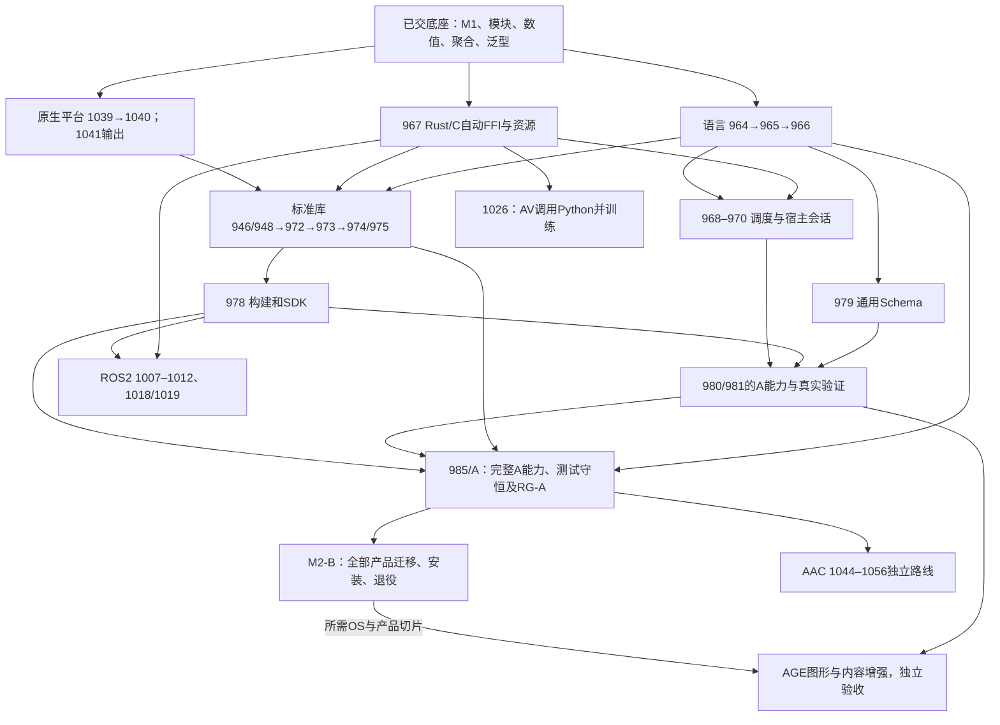

# ACE 各路线计划总览与执行顺序

2026-11-19，W1 按 1071 原子面和 AutoUI 104–108 剩余 AV 分母验齐，正式 W2 由 [1097](../../plans/1097-ace-ac-autoui-w2-and-age-host.md) 交付，1074 消费 W2。AGE 领域来源见[AGE 交付表](age-m2-three-route-strategy.md#后继交付与消费)。1068 接收正式证据并执行最终三端验收。 普通 AC 修复按 [AAC 与现 AC 实施归属](../59-aac-native-bootstrap-and-compiler-subject.md#现有-ac-差额的实施归属) 进入实际任务。

## 配置文档求值的B承接与第二批顺序（2026-11-17，当前）

本轮仅规划；[配置设计](../ace-config-document-evaluation.md)明确GAP-982-CONFIG-ACE由**982原B-CONFIG-I/V/R两仓端到端承接**：共享Schema/CST全程序投影/唯一verify→AV→owned SDK文档→Man真实配置/二阶段参数与产品消费。既有969/979只复用已交基础，不重开、不当未来owner；1068不再被假定为先交完整配置语言面的前置。原37任务与A route C、M2A-08 r29/95c7fbad8保历史；本轮不是已实现声明。

| 执行窗口 | 按实际接口/整包交付的顺序 | 后续与不等待项 |
|---|---|---|
| 首批三实施位 | 971/B工具、977/B REVERSE、1067 AC异步 | 三者按各自全合同独立final→合入归档；不等985/B最终 |
| 第二批三实施位 | **982/B、1066/B、1030** | CONFIG在982内首先补真实全链，I/V→独立R→原T-06 CONFIG phase fold正式交IF-982-CONFIG-ACE；随后本包EXEC/TEMPLATE/目标/EXPORT/DEVSDK与全包收口。1066/1030依已交来源可提前占空位，不必人为等首批全齐 |
| 研究并行 | 1038原六go/no-go/保留决定可按资源并行 | 可整包交研究结果，但不冒第三个产品实施位；不为配置再新立研究/能力Plan |
| UI/AGE | 981 EVENT-B→980完整AV/W1→1097图形AC/W2→980/981 A2R/W3 | CONFIG能力不等待这些整波；原业务图形三波规则保持。非图形982/983生成服务或1066编译门不一律拖到W3 |
| 产品汇合 | 983 CONSUMERS等982/EXEC＋980/WEB；984各产品等原CLI/构建接口，OS064在三UI波后→984/985 B候选→986安装默认→987退役 | 下游不反等985/B最终才开始，也不反卡982 CONFIG。985按已交来源滚动接收，全部required齐才最终签 |

982 CONFIG除M2A-08和已交基础外无新整包外部等待；982整包仍需971工具、977逆向等原批次接口。语言能力扩充写在982合同的实际改面/Case/AC/SD内，不以“新语言能力应另有人做”留下无owner，也不能因这次承接就把原CLI/目标验收缩成一个pac示例。所有计划的实施启动仍须后续用户指令，本次不创建/恢复工作目标。

> **AGE三路线同步（2026-11-17，仅规划）**：[当前统一strategy](age-m2-three-route-strategy.md)及[共同架构](../autographics/age-m2-three-route-architecture.md)明确生产UI替代、首批后引擎增强和新版AutoForge。980/981 已交基础，1097 交 W2，1074 交 W3，AGE 后端按[AGE 交付表](age-m2-three-route-strategy.md#后继交付与消费)接；UI099–102只新增中立实现＋AV合同，后续端由既有owner接，AG031收AGE完整增强；Forge001–004独立产品。**不新增985/A前置、不重冻A分母、不修改原已交证据/状态**。UI三波基线不等所有新cap或Forge，OS仍在三UI波后；各consumer按实际所需正式域子面推进，不等待彼此整包。

> M2-A之后的B阶段排程、各路线计划覆盖和待补规划见§26（2026-11-17）；§25及路线§42保留A接收前沿。B开工仍核985/T-A05正式M2A-08，本次规划不启动实施。

> 985/A最新前置见§25和路线§42：982/983/984 A已正式交；当前缺1037正式D、1066/A、OS064/A、1024交接，另核981原A范围和985自身接收。

> 最新状态以§24及路线§41为准：1029/1031/1036已归档，981 tier-1 A已交，982/A遇真实CONFIG能力缺口；旧12项状态不覆盖本次9项交付/接收前沿。

> 2026-11-17最新状态/12个A待办及执行顺序见§23与路线§40；§22 EVENT-SPLIT及985 r24合同不变。

> 当前事件/阶段交付与恢复条件以§22和路线§39为准；原§21状态快照已由1032归档等正式交付更新。

> 最新M2-A待办、已交复用与排程见§21及[执行路线§38](ace-m2-delivery-roadmap.md#38-m2-a出口前全部待办与执行顺序2026-11-16r36当前状态)；985 r23冻结合同不变。

> 本轮985/A分母与审计/1066的A/B分类、执行顺序以§20及985 r23为准；完整UI三波仍按§19，旧日期状态不覆盖原Plan/正式来源。

> 本轮A最小出口／AV→AC→A2R完整UI爬梯／OS后续顺序以§19及各Plan最新revision为准，§17/18等为早时历史；当前只规划。

> 本轮Node桌面合同与执行顺序以§18及980 r13／981 r15／1068 r2／985 r21为准：A交AV＋Rust FFI可复用Iced入口，B补AC桌面。下方§17等为较早状态快照，原Plan/正式收据为状态权威。

2026-11-16 最新全计划状态/A-B顺序以§17为准，六计划清空视角见§11/§16，Godot/TS目标范围以Design55 §5.1为准；本轮读取主线`40bec290abe315ae79fabed07f314afa122ae9e4`及相关原Plan任务/正式收据，核对后更新规划。旧状态快照保留日期；源码/未提交探针不计正式完成。范围为ACE/AGE M2及已有相关支线，原Plan/正式收据仍是状态与验收权威。

**主顺序只有一条：M2-A语言与标准库完善 → 985/A稳定出口 → M2-B产品替换、AC补齐与AAC实证。** 测试贯穿两阶段；Python和ROS2按实际接口切片消费上游，不必等整个M2。AAC在A出口之后与B并行，独立验收、完整AAC代际签章非M2硬门；三端能力闭合仍为M2最终门。AGE拥有独立里程碑，语言接入与图形/内容增强分属不同owner。

独立验收不等于可以省略：ROS2是v0.6已追加专项，整版发布仍按各专项合同核其必需结果；ACE M2通过不能替代ROS2或AGE通过。AAC沿独立后续版本路线，明确不加为M2硬门；Python1026的CPU AV训练不自动扩成GPU、全部Python库或所有后端都必须同步完成。

当前状态摘要：975/976/979/1034/1065已归档；971/A、977/PY、980/NATIVE MIN-A-UI已正式阶段交付。1033/1035/1064也已归档交付；A相关尚12个原计划的整包/子面/收尾，最新见§23与路线§40。事件边界沿§22，M2A-08尚未产生。

**2026-11-16阶段优先规则**：M2最终AV/AC/A2R公共能力一致，A2C完整对齐增强；M2-A要求AC真实基础可用，但允许剩余AC差额具名移B。新增1067原生异步和1068三端收口，B期间以AAC实际模块推动补齐，完整AAC代际签章仍独立。A2PY标准库/AV三provider/Linux延期保持。下方历史“四端/A全齐”按此解释，不将差额移交计PASS。

## 1 总依赖与当前推进前沿

图只表示能力供给方向，不表示下游必须等待上游整个包。979通用Schema不依完整967/978；980/981才汇合相应语言、宿主和构建能力。ROS2的1007-A原生研究也不等上述ACE链；测试/审计与质量修复贯穿全图。每Plan的任务级合同仍为最终依据。

**当前可关注的前沿**：先争取完整收掉979；1065与1064/MODULE继续并行，B1已正式可用。默认稳妥清树顺序为979→1065→1064→975→补外部976→980→985/A出口后完成981/B再清981。MODULE可先解除975的LOAD等待，但975原typed/文件/业务与全部AC仍须真正闭合；不承诺仅凭8/11直接归档。980完整模式必须有976，981整包跨A/B，六计划内部排序不能绕过这些外部必需门。

## 2 语言与共享运行底座

这一线生产所有消费者共用的语法、语义、FFI、调度、宿主、会话与SDK。967是Rust/C自动FFI的唯一通用owner；Python、ROS2、AGE都消费它，不各造一套FFI。

| 计划与职责 | 当前状态 | 主要进入条件或交接 |
|---|---|---|
| [959 M2 全语言与全产品兼容分母冻结](../../plans/archive/959-ace-m2-denominator.md) | 已归档 | 原分母基线已归档；后续增量并集由948/985维护，不重开959 |
| [960 完整模块包与公共类型绑定](../../plans/archive/960-ace-m2-modules.md) | 已归档 | 完整模块/包基础；供963/967/979及库装配 |
| [961 完整数值源码与四端一致语义](../../plans/archive/961-ace-m2-numbers.md) | 已归档 | 数值基础；供962及完整库 |
| [962 组合数据结构与递归拥有资源](../../plans/archive/962-ace-m2-aggregates.md) | 已归档 | 组合数据/拥有资源基础；供963/964/967 |
| [963 通用泛型spec与方法实例化](../../plans/archive/963-ace-m2-generics.md) | 已归档 | 泛型/spec基础；供964/966/967/979 |
| [964 动态值对象反射与通用闭包](../../plans/archive/964-ace-m2-dynamic.md) | 已归档 | 已交动态值/对象/反射与闭包能力，后继按965/966及消费方合同复用 |
| [965 完整控制流错误传播与生成器](../../plans/archive/965-ace-m2-control-effects.md) | 已归档 | 已交控制流、错误传播与生成器；frontmatter仍7/8，最终交付/清理收据与8项勾选已闭，不重开 |
| [966 完整编译期执行宏与领域生成](../../plans/archive/966-ace-m2-metaprogramming.md) | 已归档 | 已交完整CT/宏与领域生成，979与978消费正式成果 |
| [967 完整C/Rust FFI、自动binding与通用宿主资源](../../plans/archive/967-ace-m2-host.md) | 已归档 | 19/19已归档；正式merge收据绑定d9439e32a，自动binding/shim、资源与F0均按已交范围复用 |
| [968 任务async actor与事件调度](../../plans/archive/968-ace-m2-scheduler.md) | 已归档 | 调度/async/actor已正式交付，落主2fe30f52f；970/973/976等消费其实际合同 |
| [1067 AC原生Future异步与Task调度补齐](../../plans/archive/1067-ace-ac-native-async-and-task-parity.md) | 草案 0/10 | M2-B消费A基础收据，补968的native拒绝；不反置985/A前置，Linux代码/原例移交1063 |
| [1068 三端能力对齐与AAC实证收口](../../plans/1068-ace-m2b-three-backend-parity-and-aac-proof.md) | 草案 0/10 | 收生产任务的差额证据及 AAC 实证，复验 AV/AC/A2R，交 985/B |
| [969 ACE 产品执行配置与嵌入前门](../../plans/archive/969-ace-m2-facade.md) | 已归档 | 完整执行前门及E0已正式交付，最终落主6fd48b4f1；970续行，978/B0与980/HELLO消费公开入口 |
| [970 REPL持久会话daemon与在线更新](../../plans/archive/970-ace-m2-sessions.md) | 已归档 | 8/8已归档，交付900ba5ba9在主线、原树已清；供971/A及981/SESSION消费 |
| [971 调试LSP测试与Playground接管](../../plans/971-ace-m2-tools.md) | 实施中 4/11 r7 | A/PROOF正式来源lang 2f1eed27f、ui c1561d94；B与整包收口仍等M2A-08 |
| [976 共享HIR到生产TypeScript和JavaScript](../../plans/archive/976-ace-m2-typescript.md) | 草案 0/8 r6 | 直接前置均归档，可作为新增完整包；完整生产合法函数/模块闭包，独立全语言CLI不自动加门 |
| [977 Python与独立转换工具接管](../../plans/977-ace-m2-other-targets.md) | 实施中 4/10 r11 | PY正式交56aadead4；剩REVERSE I/V/R及T-05/06/07六项全B；M2A-08未交，不能完整收口/清树；不再等Godot |
| [978 工程增量多目标构建与预编译SDK](../../plans/archive/978-ace-m2-build.md) | 已归档 | 14/14已归档，交付b8f80afcf在主线，组内两仓树/材料已清；B0可供980/HELLO，Linux认证沿1063 |
| [979 Schema领域语言包与UI AGE投影接口](../../plans/archive/979-ace-m2-schema.md) | 实施中 9/12 r11 | 981 SOURCE正式落主e352e462b，落主后四行复核与AC-HANDOFF已关；T-04汇总已勾，剩T-05独立审→T-06/07落地清理，优先完整收掉 |

当前骨架：964–970、972、973、974和978已归档；971/A、977/PY和980/DIALECT正式切片可用。1064/1065承接973未交部分；新增975B1独立交付→1064MODULE独立交付→975完整消费，1065只阻1064所用AC最终验收；985 r19保完整A义务，不以阶段切片绿归档整包。

## 3 标准库与原生平台底座

默认库是Auto算法加受检OS适配，C/Rust是显式provider。AV只一个执行器；native/C/Rust是实现来源，不是三套VM。新增公共能力按AV三provider、AC、A2R、A2PY及原A2C义务验证。 当前普通math/io/net/JSON等由Auto实现；高级数据库/TLS等引擎可暂显式FFI。Windows系统DLL接入允许PE导入自动加载或复用受检动态加载器，不依赖CRT实现默认库。

**2026-11-15当前排程：Linux分支先写代码，当前不执行Linux测试。** 建设包完成门为Windows required验证＋Linux实现/完整用例移交审查；Linux行保deferred-required/NOT_RUN交1063，环境完善后经1061原生Linux入口实跑，不回退WSL。1063不反向阻塞当前建设/Windows认证；未验证不得宣称新版Linux全库已支持，1040/1041历史证据保留。

| 计划与职责 | 当前状态 | 主要进入条件或交接 |
|---|---|---|
| [943 标准库语义合同与兼容性实册](../../plans/archive/943-stdlib-semantic-contract-and-compatibility-inventory.md) | 已归档 | 已归档的公共语义/兼容实册 |
| [944 ACE 标准库绑定、装配与缓存接入](../../plans/archive/944-ace-stdlib-binding-assembly-and-cache.md) | 已归档 | 已归档的ACE绑定/装配接缝 |
| [947 ACE 控制台接入、标准库分层与装配合同](../../plans/archive/947-ace-stdlib-console-and-resource-host-contract.md) | 已归档 | 已归档的控制台与分层/装配合同；不等于完整系统库已交 |
| [945 ACE 基础数学与文本标准库最小切片](../../plans/archive/945-ace-stdlib-core-math-and-text.md) | 已归档 | 已归档的有限math/text切片；完整公共库仍972 |
| [1043 ACE标准库context装配与最小#in平台选择](../../plans/archive/1043-ace-stdlib-context-assembly.md) | 已归档 | 已归档的context/provider后缀与最小#in；完整CT仍966 |
| [1039 ACE受检平台I/O与内存原语及Windows系统边界](../../plans/archive/1039-ace-platform-io-primitives.md) | 已归档 | 已交受检I/O/内存原语及Windows系统边界，供库/平台消费者复用 |
| [1040 ACE Linux x64原生ELF启动与直接系统调用](../../plans/archive/1040-ace-linux-native-elf-and-syscalls.md) | 已归档 | 已交Linux x64底座；frontmatter仍6/9，最终交付/清理收据已闭，不把历史计数当在途 |
| [1041 ACE自有标准输出、Windows Unicode控制台与重定向](../../plans/archive/1041-ace-native-stdio-and-console-unicode.md) | 已归档 | 已交自有stdout/Unicode控制台与重定向；frontmatter仍5/8，最终交付/清理收据已闭 |
| [946 ACE 集合与拥有资源公共算法](../../plans/archive/946-ace-stdlib-collections-and-owned-algorithms.md) | 已归档 | 已归档8/8；有限集合/拥有算法边界按原合同，完整库归972 |
| [948 标准库领域迁移差额与发行接管准备](../../plans/archive/948-stdlib-domain-migration-and-release-readiness.md) | 已归档 | 已归档9/9；差额已具名交接，完整库/迁移仍归正式后继 |
| [972 新版标准库完整基础与集合](../../plans/archive/972-ace-m2-stdlib-core.md) | 已归档 | 基础/集合/Storage已按原交付范围归档，落主aa7b56864；存在具名边界/债务，消费方T-01仍核所需操作，Linux运行交1063 |
| [973 新版系统文件进程时间与资源库](../../plans/archive/973-ace-m2-stdlib-io.md) | 已归档10/10 r13 | 正式交付9d0f973cb，原树清理据原owner；D行→1064、AC真身→1065、Linux→1063，后继MODULE补记不重开本包 |
| [974 新版网络HTTP与流式服务库](../../plans/archive/974-ace-m2-stdlib-network.md) | 已归档 8/8 r9 | 正式交681efa26b在主线；按已交范围/已登记边界复用，不再安排继续开发或等待973的旧文件腿 |
| [975 新版JSON序列化数据库与扩展库](../../plans/archive/975-ace-m2-stdlib-data.md) | 实施中 8/11 r10 | B1正式交8e0c4d1d6；当前记录仍等1064 MODULE；原T-05 final前补实际LOAD/typed/文件/业务余量，不把已勾选当全部原AC已验 |
| [1064 byte→Str、共同模块装配与延后系统库面](../../plans/archive/1064-ace-stdlib-byte-str-deferred-surfaces.md) | 实施中 0/13 r2 | MODULE I已开工，I/V/R/D为975实际承接；B1正式切片已交；D09须真实Option/List、输出帧由本包沿967 owner补，最终AC取1065。原7任务+6新增，不代表实现 |
| [1065 AC系统操作真身](../../plans/archive/1065-ace-ac-sys-real-bodies.md) | 已有树/用户确认工作中（metadata 0/6 r2待同步） | 973正式技术输入已齐；按50签名/Win W36真身＋N14拒绝，Linux代码/完整用例交1063，不等1064或975全包 |
| [1063 标准库Linux分支延后验证与平台支持认证](../../plans/1063-ace-stdlib-linux-deferred-validation.md) | 草案 0/8 | 0/8；1061及973–975/978等尚未交，另需真实Linux环境；保完整延后Linux分母，不反阻当前Windows能力包 |

已交1042为A2PY最小端口，不重复计。973正式已交有限面不等于全库/AC全部完成；1064/1065、975B1/MODULE与原数据/RG职责仍须真实交付，985 r19原矩阵接收。Linux真实运行按1061→1063，新增子项源码/完整expected随各owner移交，不在Windows运行Linux/WSL。

AAC专需精确摘要/codec是1056，归AAC，不反加为本标准库M2-A新前置。

## 4 测试 审计与质量修复

1002负责作者格式试点，985负责M2义务守恒和验收，1024及后继负责质量风险；三者作用不同。测试用例随各能力Plan实现，不等“测试路线全做完”才测试。

| 计划与职责 | 当前状态 | 主要进入条件或交接 |
|---|---|---|
| [1002 autodown-document-cases](../../plans/archive/1002-autodown-document-cases.md) | 已归档 | 已交文档式用例试点；frontmatter仍3/4，最终交付/清理已闭；后续推广1057/1059也已归档 |
| [1057 AutoDown文档式用例首批推广](../../plans/archive/1057-autodown-document-cases-first-wave.md) | 已归档 | 复用已交作者格式与迁移结果，不重复立项 |
| [1059 AutoDown复合用例第二批推广](../../plans/archive/1059-autodown-composite-cases-migration.md) | 已归档 | 真实merge/归档/清理收据已齐；不是当前待执行项 |
| [1062 剩余代码式用例迁入AutoDown](../../plans/archive/1062-remaining-code-cases-to-autodown.md) | 已归档 | 正式交付42a1b19d1已在主线；不再列实施队列，后继复用已交用例迁移结果 |
| [1060 ACE常规测试时延审计](../../plans/archive/1060-ace-regular-test-latency-audit.md) | 已归档 | 复用最终交付范围，不据历史未闭记录重开；不替1061真实Linux VM验收 |
| [1061 ACE Linux测试隔离与原生运行](../../plans/1061-ace-linux-suite-isolation.md) | 草案 0/9 | 0/9 r3；原生Linux VM访问与材料路径仍未给出，不回退WSL，不列可无阻整包候选 |
| [1016 ACE comptime short reproduction and measured cost repair](../../plans/archive/1016-ace-comptime-short-repro-and-cost-repair.md) | 已归档 | 已归档的短复现/计量成本修复，保原有限收据边界 |
| [1017 M2 ace-perf串行套件成本与压力负载优化](../../plans/archive/1017-ace-perf-m2-cost-and-workload-optimization.md) | 已归档 | 已归档的ace-perf成本/压力负载专项，不变成每Plan日常门 |
| [1024 ACE M2 已实现代码质量、架构与复用审计](../../plans/archive/1024-ace-m2-code-quality-and-refactoring-audit.md) | 已交付归档 5/5 | 2026-11-17 T-05收据：落主f046f4ae4+归档c2f3b2aa9。交审计发现与任务归属，不代表发现已修复 |
| [1027 native UTF-8编辑保真](../../plans/archive/1027-ace-native-utf8-edit-fidelity.md) | 已交付归档 6/6 | 交付a425e9adf已在主线；复用范围内收据，不重做 |
| [1028 计量窗口嵌套/unwind](../../plans/archive/1028-ace-scoped-observation-restoration.md) | 已交付归档 6/6 | 交付7880f2a42已在主线；复用范围内收据，不重做 |
| [1029 恢复输入准入与租约](../../plans/archive/1029-ace-restored-input-and-lease-bounds.md) | 已交付归档 6/6 | 交付1ea540a19已在主线；复用范围内收据，不重做 |
| [1030 864历史会话失败重试](../../plans/1030-ace-av-864-failed-edit-transaction.md) | 草案 r3，0/6 | B后续；顺序第2，历史外层事务失败重试，不阻A |
| [1031 QueryHost负依赖提交](../../plans/archive/1031-ace-query-negative-dependency-commit.md) | 已交付归档 6/6 | 交付4e6d28522已在主线；复用范围内收据，不重做 |
| [1032 typed native批编辑原子性](../../plans/archive/1032-ace-native-typed-batch-atomicity.md) | 已交付归档 6/6 | 交付45fcd50f4已在主线；复用范围内收据，不重做 |
| [1033 A2X暖编辑/晚发布事务](../../plans/archive/1033-ace-a2x-late-publication-atomicity.md) | 已交付归档 6/6 | 交付305bbd0c1已在主线；复用范围内收据，不重做 |
| [1034 worker快照、限额与父子终态](../../plans/archive/1034-ace-worker-source-and-parent-bounds.md) | 已交付归档（末收据完成，头部3/6滞后） | 交付140c1a626已在主线；复用范围内收据，不重做 |
| [1035 聚合资源分类与故障回归](../../plans/archive/1035-ace-aggregate-resource-classification.md) | 已交付归档 6/6 | 交付d2847bf4c已在主线；复用范围内收据，不重做 |
| [1036 continue推进、终点与poll](../../plans/archive/1036-ace-loop-latch-and-cooperative-poll.md) | 已交付归档 6/6 | 交付3b734996b已在主线；复用范围内收据，不重做 |
| [1037 CT命名实参与发布失败事实](../../plans/1037-ace-cte-named-walk-and-attempt-facts.md) | 草案 r3，0/6 | 下一实施包/A必闭：CT-01/02与F26/F32，先T-01重核反例/来源 |
| [1038 复用候选、成本与模块边界研究](../../plans/1038-ace-reuse-candidates-and-cost-decisions.md) | 草案 r3，0/6 | B后续；顺序第3，六项go/no-go/保留研究；只读可提前，不授权重构 |

2026-11-17当前：本修复优化子线9/12已交付，默认新增实施顺序为**1037→1030→1038**；1037属A必闭正确性，1030/1038属B后续，1038的纯只读调查可提前并行。1024已交付归档（T-05收尾完成，落主f046f4ae4），不等后三包。此顺序不是新增整包依赖；同文件按实际在途owner排写窗。逐包revision/主线提交/例外和任务入口见[1024当前路线表](../../plans/archive/1024-ace-m2-code-quality-and-refactoring-audit.md#quality-route-20261117)。本表以最新末收据和祖先为依据，§20–23旧排程仅作历史。

1002已正式交付归档（70a680dba）；`G1002`仍只按实际触面约束迁入新作者格式或document/IR/adapter相关接线重构；原Rust测试、旧case反例和核心修复不必等1002。1002的试点不包括自动搬迁全部用例，985仍须按每条旧义务映射和新增反例汇总。正式压力显式走`cargo t ace-perf`，不附加为所有Plan收尾门。

## 5 Python 两个方向

| 计划与职责 | 当前状态 | 主要进入条件或交接 |
|---|---|---|
| [1042 ACE A2PY标准库后端与运行端口就绪](../../plans/archive/1042-ace-a2py-stdlib-readiness.md) | 已归档 | 已归档的新ACE A2PY最小producer/运行helper及标准库接缝；完整目标语言扩面归977/PY |
| [1026 ACE Python互操作与AV PyTorch训练闭环](../../plans/1026-python-interop-standard-auto-syntax.md) | 草案 0/7 | 0/7；直接语言计划前置已齐；CPython/PyTorch环境和所需接口准入本轮未实测，暂作支线候选，不计无阻整包主队列 |

Python方向一：`964/965 + 967 Python所需接口 + 必需库切片 → 1026`。方向二：`1042已交 → 977/PY逐步扩完整目标语言`，并支撑标准库A2PY腿。1042的生成Python后端与1026的AV调用CPython不是同一实现，也不互为整包前置。967/F0只有text和有限标量，不能代训练所需float/拥有引用/参数帧。

Design58初稿“新A2PY另行规划”的泛称已落后于1042/977当前状态：另行立项的是1026这类Python互操作能力在A2PY/其他后端的专用生态扩展，不是整个ACE Python后端从未编计划。全Python库/Notebook/GPU等未承诺后继不凭旧Python parity日历自动加进当前队列。

## 6 ROS2 SDK

| 计划与职责 | 当前状态 | 主要进入条件或交接 |
|---|---|---|
| [1007 ROS2 SDK平台、真实任务与provider合同](../../plans/1007-ros2-sdk-platform-and-provider-contract.md) | 实施中 2/17 | 仅A原生ROS/provider/部署研究已授权，2/17；B接967/968/969/978实际切片，B05/06/07交官方示例正式输入 |
| [1008 ROS2接口包与Auto类型生成](../../plans/1008-ros2-sdk-interface-generation.md) | 草案 0/6 | 1007示例所需正式输入+已交模块/聚合/泛型等；ROSIDL/接口类型生成 |
| [1009 ROS2节点、任务与运行时语义](../../plans/1009-ros2-sdk-runtime-and-task-semantics.md) | 草案 0/6 | 1007正式输入+所需FFI/任务/库；类型合同可与1008并行，联调消费1008 |
| [1010 ROS2 SDK的ACE双端与工程工具](../../plans/1010-ros2-sdk-ace-dual-backend-and-tooling.md) | 草案 0/6 | 1008+1009正式来源、A2R/Linux/SDK所需切片；同源AV开发/A2R发布及ROS工具 |
| [1018 ROS2官方基础示例的Auto SDK双端验收](../../plans/1018-ros2-sdk-official-examples-conformance.md) | 草案 0/9 | 1010；官方双向Topic/Service/Action、参数、干净工程 |
| [1019 turtlesim完整Auto教程与公共SDK互操作](../../plans/1019-ros2-sdk-turtlesim-tutorial-and-interoperability.md) | 草案 0/8 | 1018；turtlesim官方教程/互操作，普通Qt窗口不等AGE |
| [1011 ROS2真实工作流与AutoUI控制台](../../plans/1011-ros2-sdk-workflow-and-autoui-console.md) | 草案 0/6 | 1010+1019及980/auto-ui实际Linux UI事件切片、真实任务/设备；AutoUI控制台不等AGE增强 |
| [1012 ROS2 SDK的Autonix交付与联合终验](../../plans/1012-ros2-sdk-autonix-release-and-certification.md) | 草案 0/6 | 本线全部required与发行候选，最终绑定ACE无legacy SDK/实际Autonix安装，专项独立验收 |

执行链：`1007-A研究 → B05/06/07正式输入 → 1008/1009并行 → 1010 → 1018 → 1019 → 1011 → 1012`。完整设备/Autonix合同仍在1007解决，但不反向卡官方示例所需有限输入。1007-A分支研究不是已交Auto SDK，不能拿它冒下游正式来源。ROS2核心SDK不依AGE；只有追加空间可视化时才取AGE接口。1012最终SDK/安装身份核验不等于1008/1009必须等ACE M2最终标签才开工。

## 7 AutoUI AGE 与跨仓内容

语言仓负责把正常作者语言接入ACE；UI仓负责渲染/输入/资源；内容仓负责样例/游戏及联合验收。AGE当前是M1已签、M2增强与融合，旧M3/M4文件名与验收ID保留历史，不是新增两个未来阶段。

| 计划与职责 | 当前状态 | 主要进入条件或交接 |
|---|---|---|
| [980 现有AutoUI全模式ACE兼容接入](../../plans/archive/980-ace-m2-autoui.md) | 实施中 9/35 r11 | 字段子面46f4ac0ec/f864f33b及DIALECT批3de0bea0b正式交；STATE已正式交；HELLO I/V/R已批审、D待正式落主；完整模式还需976/979及所用库/接口；STATE/NATIVE及全模式/PARITY沿原依赖 |
| [981 AGE Node直接接入ACE与AV开发及A2R游戏发行](../../plans/archive/981-ace-m2-age.md) | 实施中 0/34 r13 | SOURCE四行已有979预验；25293cded完成与主线resync仍未落主，新基线独立phase复审、主线冲突文件owner落定和正式交接待闭；0不等于无代码 |

| 仓与计划 | 当前状态 | 主要依赖和交付 |
|---|---|---|
| [UI058 AGE M2俯视二维公共组合与ACE作者接线](../../../../auto-ui/docs/plans/058-age-topdown2d-queries-and-sprites.md) | 草案 0/10 | 中立公共2D/query/sprite准备可先；作者接线消费981所需A正式来源 |
| [AG023 AGE M2俯视二维组合与AV A2R同源示例](../../../../age-examples/docs/plans/023-age-m3-topdown2d-example.md) | 草案 0/10 | UI058+981作者接口；基础俯视二维教学样例，不是完整国风游戏 |
| [UI080 AGE正式Node方向光阴影与AV A2R公共端口](../../../../auto-ui/docs/plans/080-age-node3d-directional-light-and-shadow.md) | 实施中 3/10 | 中立实现已有3/10记录；Node作者整链等979/981所需A来源，不等全部M2-A出口才接线 |
| [AG029 AGE国风种田第一可玩切片与同源AV A2R交付](../../../../age-examples/docs/plans/029-age-farming-first-playable-slice.md) | 实施中 2/10；用户暂停 | UI058/AG023及973/978/980/981所需输入；正式产品实现还须M2A-08，用户暂停保持 |
| [AG030 AGE正式方向光阴影内容与独立首批能力验收](../../../../age-examples/docs/plans/030-age-directional-light-content-and-oracles.md) | 草案 0/10 | UI080、978/981及M2A-08对应产品门；独立光影内容/oracle/同源双端包 |
| [AG031 AGE M2四线真实OS与增强同源联合验收签章](../../../../age-examples/docs/plans/031-age-m2-joint-acceptance-and-signoff.md) | 草案 0/10 | 2D/国风/光影、980/981、OS064真实OS相关切片；增强混合与AGE M2独立签章，不当上游前置 |
| [AG020 AGE内容仓更名与目录迁移](../../../../age-examples/docs/plans/020-age-examples-repository-rename.md) | 草案 0/10 | 仓更名/目录迁移维护；按原冻结与窗口，不是图形能力前置，不据物理目录名认领完成 |

早期Hello：`967/F0→969/E0→978/B0`，并行`979/H0`，四个正式接口齐才`980/HELLO`。同源A2R腿按967/978/980原批次并行。**979通用Schema不需要先等完整FFI/SDK**，其完整机制直接依966等自己的语言合同。

完整作者链：`966→979通用Schema→981/SOURCE`；SESSION取967/968/969/970，RUST取967/969/978及所需库，LANGUAGE/PROOF汇合980的适用能力。UI058/UI080作者接线随后可消费正式A接口；AG029/030正式游戏产品实现保M2A-08。最后AG031核各自required与真实OS切片，不能反过来卡985/A。

直接复用的已归档AGE输入：

[UI055](../../../../auto-ui/docs/plans/archived/055-age-m3-topdown2d-feasibility-and-capacity.md)、[UI059](../../../../auto-ui/docs/plans/archived/059-age-node3d-lighting-and-shadow-feasibility.md)、[UI061](../../../../auto-ui/docs/plans/archived/061-rq-fidelity-contract-and-feasibility.md)、[UI062](../../../../auto-ui/docs/plans/archived/062-rq-lossless-rendering-and-resource-parity.md)、[UI063](../../../../auto-ui/docs/plans/archived/063-rq-vm-rust-runtime-and-input-parity.md)、[UI067](../../../../auto-ui/docs/plans/archived/067-age-ace-migration-inventory-and-chain-feasibility.md)、[UI072](../../../../auto-ui/docs/plans/archived/072-age-games-standalone-windows-player.md)；[AG021](../../../../age-examples/docs/plans/archived/021-age-mixed-ui-2d-3d-application.md)、[AG022](../../../../age-examples/docs/plans/archived/022-age-m3-farming-slice-and-threejs-inventory.md)、[AG024](../../../../age-examples/docs/plans/archived/024-age-m1-obligations-provenance-and-evidence-audit.md)、[AG025](../../../../age-examples/docs/plans/archived/025-age-m1-native-evidence-and-unified-acceptance.md)、[AG026](../../../../age-examples/docs/plans/archived/026-age-m1-dpi-native-debt-and-final-closure.md)、[AG028](../../../../age-examples/docs/plans/archived/028-age-games-windows-binary-and-resource-release.md)。研究go/no-go、旧VM可玩包与新ACE产品支持分别判定。

表中AG沿计划历史owner标识；本机实际内容仓定位为`D:/autostack/age-examples`。目录存在不等于AG020的全部更名/兼容/清理义务完成。

## 8 M2测试出口 产品替换与最终收口

这一组是主线交付收口；不是每条专项各做一遍全应用迁移。

| 计划与职责 | 当前状态 | 主要进入条件或交接 |
|---|---|---|
| [985 M2两阶段验收与完整义务联合认证](../../plans/985-ace-m2-certification.md) | 实施中 4/14 | 4/14 r16；T-01/T-A01/T-A02及T-09已交来源部分在推进，T-A03..A05仍等其余required能力/RG与973 File组合；M2A-08未签，不放行B |
| [982 AutoMan配置任务模板与生成器迁移](../../plans/982-ace-m2-man-gen.md) | 草案 0/37 | r7：Godot三任务用户后置，0完成保持；A/CONFIG取960/964/969/973，A/PROOF再取970/978；当前重点缺973，不要求971/977的B整包先完 |
| [983 Web服务嵌入与实际后端迁移](../../plans/983-ace-m2-web.md) | 草案 0/19 | 0/19；A真实Web证明仍需974/975、982与适用980/SDK来源，B全迁移保M2A-08；不因978已交直接判整包就绪 |
| [984 AutoOS全部应用与系统宿主迁移](../../plans/984-ace-m2-os-apps.md) | 草案 0/25 | 0/25；A/EMBED与OS064 HOST/PROOF按实际A接口交接，B全App/CLOSURE后置；不把OS全部App归档作为985/A前置 |
| [986 独立发行安装升级与默认切换](../../plans/986-ace-m2-release.md) | 草案 0/9 | 消费985候选及构建/Man接口，核仓外安装、升级/回滚、默认切换；不能把候选预认证当最终安装已验 |
| [987 旧AutoVM A2X退役及M2终验](../../plans/987-ace-m2-retirement.md) | 草案 0/9 | 986相应正式结果→旧实现不可达→冻结重建/实际产品安装再核→M2终验；退役使受影响旧收据失效 |

| 仓与计划 | 当前状态 | 主要依赖和交付 |
|---|---|---|
| [OS064 ACE桌面宿主与全应用分批迁移](../../../../auto-os/docs/plans/064-ace-desktop-and-app-migration-batches.md) | 草案 0/97 | A HOST+PROOF；B真实桌面/所有App/安装ASSEMBLY；直接消费969/970/978/980等，984最终汇总它，OS064不反等984整包 |

出口顺序：`A能力+新版库+RG-A+测试守恒 → 985/A正式稳定收据 → B全部迁移 → 985/B候选预认证 → 986安装/默认 → 987退役后重建与复验 → M2最终签章`。其中“985候选”不代表其所有最终发布义务已经通过，更不能用退役前包hash签退役后产物。

971/980/981/982/983/984都有阶段或批次交接，985/A核其A能力/具名PROOF，不等待这些Plan全部B任务归档。不得按frontmatter的整包最终并集把这个顺序误读成循环。

## 9 AAC 独立自举路线

**AAC在985/A基础正式出口后于M2-B期间逐模块推进。** A出口可以携AC具名差额，实际用到的能力按 Design59 交对应生产任务修复；不得要求全AC齐后才能开始。完整AAC Gen2/Gen3签章独立，但所暴露的M2三端差额必须在最终门关闭。 Rust后端/AV可保留明确执行服务，Auto主体覆盖语法、语义、CT编排、HIR/MIR及增量驱动。

| 计划与职责 | 当前状态 | 主要进入条件或交接 |
|---|---|---|
| [1044 AAC基线、源码需求与阶段契约冻结](../../plans/archive/1044-aac-baseline-and-stage-contracts.md) | 已交付归档 | 正式交付 `6022f10f2`，冻结 CS/CL、主体、ABI、资源与测试合同 |
| [1056 AAC精确摘要、编译器codec与标准库支撑](../../plans/archive/1056-aac-exact-digests-and-compiler-codecs.md) | 已交付归档 8/8 | 正式交付 `e36131b40`；`aac-support` 1.0.0 已在 Gen0 前端＋AV 执行验证，供 1045 接原生消费 |
| [1045 AAC hosted标准库需求落地与原生SDK消费](../../plans/1045-aac-hosted-stdlib-and-sdk.md) | 草案 0/9，下一项 | 1044 与 1056 已交。T-01 核当前前端、语法、SDK 与库身份；之后按顺序验 Gen0 AC 的库、系统资源及仓外 SDK |
| [1046 AAC Auto语法运行时、源码投影与模块装配](../../plans/1046-aac-syntax-source-and-modules.md) | 草案 0/9 | 1045及冻结合同；Auto解析/模块候选/来源，语义选择另验 |
| [1047 AAC名字绑定、类型推导与受检HIR核心](../../plans/1047-aac-binding-types-and-checked-hir.md) | 草案 0/9 | 1046；Auto绑定/推导/受检HIR |
| [1051 AAC native后端与CTE执行服务桥](../../plans/1051-aac-native-backend-and-cte-bridges.md) | 草案 0/9 | 1044+1045；与1046/1047可并行的backend/AV薄服务 |
| [1055 AAC基础Typed MIR与CT启动闭环](../../plans/1055-aac-early-typed-mir-and-ct-bootstrap.md) | 草案 0/8 | 1047+1051；基础Auto MIR与CT工厂，先交以解CT启动依赖 |
| [1048 AAC泛型、meta与编译期执行编排](../../plans/1048-aac-generics-meta-and-cte.md) | 草案 0/9 | 1047+1051+1055；泛型/meta/CT编排及基础闭环，完整CT组合交1050 |
| [1049 AAC控制流、dynamic、效果与资源语义扩面](../../plans/1049-aac-control-dynamic-and-resource-semantics.md) | 草案 0/9 | 1047+1048；控制/dynamic/资源与领域语义 |
| [1050 AAC共享Typed MIR lowering与资源保真](../../plans/1050-aac-shared-typed-mir-lowering.md) | 草案 0/9 | 1048/1049+1051/1055；扩同一MIR并关闭高阶CT/资源组合 |
| [1052 AAC增量查询、持久缓存与编译发布驱动](../../plans/1052-aac-incremental-driver-and-artifacts.md) | 草案 0/9 | 含完整1050/1051/1056在内的前序接口；增量/缓存/包与构建发布 |
| [1053 AAC Gen1完整语言闭环与主体迁移核验](../../plans/1053-aac-gen1-full-language-parity.md) | 草案 0/9 | 所有必要主体/支撑结果；Gen1完整CL及无Rust源语义回落核验 |
| [1054 AAC同源代际自编译与独立认证发行](../../plans/1054-aac-generations-and-independent-certification.md) | 草案 0/9 | 1053；同源Gen2/Gen3、独立oracle/包/确定性，review与落主身份齐后独立签AAC |

2026-11-19 状态核对。13 个计划中 1044、1056 已归档，余下 11 个计划仍为草案。剩余单执行者顺序为 **1045 → 1046 → 1047 → 1051 → 1055 → 1048 → 1049 → 1050 → 1052 → 1053 → 1054**。1045 交付后，1046→1047 与 1051 可各自推进，汇合于 1055。1052 可先准备通用身份与缓存事务，完整驱动接收 1050 的 MIR 后再验。各包依赖、验收基线和原始规划见 [AAC 路线](aac-delivery-roadmap.md)。

AV 的 [1078](../../plans/archive/1078-av-parity-baseline-and-autodown.md) 和 [1079](../../plans/archive/1079-av-parity-scalars-and-text.md) 已归档，可消费已交的普通源码入口与共享用例。1045 按所需正式供给开工，其后各能力使用现有 AutoDown 用例，缺项随 1096 最终交付对账。1068 仍接阶段 AAC 实证并做 M2 三端验收。

## 10 另一个消费支线 ASE M0

已有四个Plan也消费ACE/AutoUI接口，容易在队列里漏掉。它们是应用框架/浏览器原型，不是新的语言或标准库实现，不默认成为ACE M2硬门。

| 计划与职责 | 当前状态 | 主要进入条件或交接 |
|---|---|---|
| [1020 ASE M0基线与公共接口就绪调查](../../plans/archive/1020-ase-m0-baseline-and-interface-readiness.md) | 已归档 | 基线与公共接口就绪调查；不等整个M2标签 |
| [1021 ASE M0应用解析与无窗口AV加载实验](../../plans/archive/1021-ase-m0-resolver-and-headless-av.md) | 已归档 | 1020+已交模块能力；无窗口AV加载实验，受实际H接口就绪约束 |
| [1022 ASE M0两页文字浏览器与公共嵌入](../../plans/1022-ase-m0-text-browser-and-embedding.md) | 草案 0/9 | 1021+嵌入/SDK/Schema/UI所需切片；两页文字浏览器 |
| [1023 ASE M0交互会话原型与联合验收](../../plans/1023-ase-m0-interactive-sessions-and-acceptance.md) | 草案 0/10 | 1022+调度/会话/UI事件所需切片；交互原型与独立M0验收 |

## 11 建议的实际排程

### 六计划完整收口与清空顺序（2026-11-16当前）

本轮只规划，不执行合并/清理。目标是**一个包真正结束就按原流程收掉一个树**，不是先把六个都做到“等别人”。默认稳妥清树总序：

`979 → 1065 → 1064 → 975 →〔外部976〕→ 980 →〔981全部A及其他required A/RG → 985/A〕→ 981全部B → 981归档清树`

这不是新增硬依赖；前面独立包谁先达全部验收谁先收。975若在MODULE正式交接后独立复审确认其所有原AC/typed/文件/业务已齐，可提前于1064整包归档；默认按1064在前避免把持久/AC/类型余量漏掉。不得据“8/11”或某slice绿承诺975必然可提前归档。

| 波次 | 本波推进与可并行工作 | 本波希望真正收掉的树 |
|---|---|---|
| 1 最快释放 | 979已经收到981落主SOURCE/980字段，T-03/T-08与AC-HANDOFF已闭；T-04原V/职责并集已汇总，现做T-05→T-06/07。1065独立继续；1064优先MODULE-I/V/R/D。 | **979**；不再把“等981 SOURCE落主”写成当前阻塞 |
| 2 下游前置先收 | 1065按原6任务完成Windows适用真身/拒绝/资源/链接和Linux完整移交→独立final→正式交付/归档。1064 MODULE独立正式交IF供975；已交B1不重做，975可补canonical public声明/真实LOAD与typed/业务差额。 | **1065**；它不等1064/975，也不必等980/981 |
| 3 完整库面 | 1064依已交B1推进T-02/BSTR/Option/编码解码、T-FRAME、T-03 D面、T-04 ZIP、T-KV；取得1065实际AC来源后T-05完整并集→T-06→T-07。 | **1064**；仅MODULE phase fold不能删除其整包树 |
| 4 完整数据包 | 975消费正式MODULE与所需D/API/AC接口，核清包括结构感知decode[T]、真正public/private装配、持久/迁移/业务等原required余量；该补的回原work，再T-05独立final→T-06/07。不得等待归档973/966重做，也不以“具名gap”自动豁免。 | **975**；若前波已具备全部原AC可提前收，仍须真实独立review |
| 5 UI全包 | 六计划之外的**976必须完成**，它供WEB/ARK并经WEB供TAURI；在原树先完成980/HELLO-D正式交接及原NATIVE/RUST/JET等就绪批。取得976/库/979正式输入后完成WEB/TAURI/ARK/PARITY、原完整语言/组件/模式门，再全包review/merge。981 SESSION/RUST/LANGUAGE-I可并行用已有正式A接口，不反等980全包。 | **980**；Hello/STATE/DIALECT交了都不等于可归档 |
| 6 AGE的A完成 | 981复用正式SOURCE接面，补其原A余量；SESSION与RUST可并行，LANGUAGE最终V/R汇合二者和980适用能力，PROOF汇合完整真实混合/原980 PARITY。各required A按owner独立review/fold。 | **此时不能收981**；它仍跨A/B |
| 7 外部A出口与AGE最后收口 | 等其他required A库/语言、982 CONFIG/PROOF、983/984/OS064 A/RG及原组合都正式齐，985 T-A03→A04→A05真实M2A-08。然后981 CONTENT、RUST2D/RUST3D（实现可按原合同并行，最终各取对应AV证据）、FUSION→AUDIT→T-05/06/07。 | **981**；不能只靠这六Plan内部完成绕过985/A |

### 防止再次互等的切片约束

- `975/B1`已正式主线8e0c4d1d6，可供1064，不等待975全包。
- `1064/MODULE`先独立I/V/R/D正式交，供975，不等1064全部ZIP/KV/D面和1065；975的canonical API声明准备可在原T-03先做，完整LOAD消费在接口交付后验，不能把“准备声明”反置成等完整MODULE的死锁。
- `1065`只取973已交bytes/region与共同语义，独立收口；1064 AC最终验收取其正式来源，不反向等待1064。
- `981/SOURCE`已落主e352e462b，979已回验，979原完整门自行汇总，不反等981整包或980 PARITY。
- `980`全包都在A，必须尽量在985/A之前完整结束；`981`只交A来源供985，不反等自己的B，最终B才消费M2A-08。

### 每包何时才算清空

原required work/独立final通过→正式合入/已验规范与收据→下游引用切到主线/正式SDK及可重建来源→归档→按原收尾规则核所有输出路径、具名持有/唯一依赖、wt-guard后清树/分支/材料。不得删下游唯一仍在用的tree工件；只有phase fold的1064/981保留唯一树，不为省磁盘冒全包结束。本轮不执行这些动作，也不创建新树或通知其他会话。

## 12 已交共同底座和仍无独立计划的事项

ACE M1正式tag `v0.6-ACE-M1`在本地存在，最终收口见[1025](../../plans/archive/1025-ace-m1-mainline-identity-and-final-signoff.md)。现行可复用有限底座还包括[936](../../plans/archive/936-source-av-cte-query-and-frozen-recovery.md)、[938](../../plans/archive/938-checked-source-foreign-scalar-calls.md)、[939](../../plans/archive/939-foreign-resource-handle-and-callback-bridge.md)、[942](../../plans/archive/942-generated-workspace-incremental-sharing.md)、[949](../../plans/archive/949-vm-handler-async-parking-and-store-api-await.md)、[950](../../plans/archive/950-ace-finite-source-modules.md)、[958](../../plans/archive/958-a2x-worker-source-ct-frontdoor.md)、[1014](../../plans/archive/1014-fixed-regression-baseline-and-owned-execution-repair.md)，不逐项重排旧M1历史。已归档表示原Plan按其交付边界关闭，不自动证明新能力或新平台全绿。

仍有两项明确后移M2、但尚未独立编实施Plan的旧链债务：

| 债务 | 真实owner/安排 | 不能误当成 |
|---|---|---|
| D-1014-P707-CANCEL | 旧VM HTTP managed job取消/测试维护者；独立有界修复合同待编，968/974只关联新引擎迁移语义 | 已由968的新调度实现自动消除旧链问题 |
| D-1014-P988-BUDGET | 生成/测试预算owner；保持原字节/样本/拒绝后文件保全的成本治理合同待编 | 已由1017 ace-perf专项修复，或可以ignore消红 |

状态与关闭条件见[已知债务](../../plans/KNOWN-DEBT-AND-RISKS.md)；本次总览不取号/施工，不把“有owner”冒成“已有完整实施计划”。1026的跨后端生态后继、ROS后续更多设备/RMW及其他AAC宿主也不凭战略候选自动造当前计划。

## 13 阅读入口与维护规则

- 总排程先看本页；实现/验收/授权以对应Plan §5–8和revision绑定证据为准。
- [M2详细路线](ace-m2-delivery-roadmap.md)、[Design55](../55-ace-m2-complete-language-and-product-replacement.md)、[FFI与标准库设计](../56-ace-m2-ffi-and-native-stdlib.md)。
- [AAC路线](aac-delivery-roadmap.md)、[ROS2路线](ros2-sdk-delivery-roadmap.md)、[Python互操作设计](../58-python-standard-syntax-interop.md)、[ASE路线](ase-m0-delivery-roadmap.md)。
- AGE当前owner路线为[AGE两阶段与ACE接洽](../../../../auto-ui/docs/design/autographics/age-three-milestones-and-ace-m2.md)。旧三阶段/M3/M4文件名仅按该入口解释。
- 本页不是第二套状态机或验收registry，不改变Plan依赖/进度/已授权边界，不给任何消费者增加“等整条路线结束”的新门。接口交付/来源或暂停状态变化时更新对应行；旧路线的日期快照不能覆盖新Plan状态。

本页主归属表共92个语言仓Plan；另外列跨仓当前计划及直接已交输入。本轮只更新状态、正式来源与可执行顺序，不修改各Plan任务/进度/依赖或启动代码、测试、工作树与会话。

## 14 2026-11-15状态核对与979收口风险（历史，当前见§11/§16）

> 历史快照；2026-11-16状态及新前沿以§15为准，交接合同不因旧快照改变。

本轮只读Plan/正式交付摘要、主线祖先与worktree登记；没有重跑产品验证。968 8/8、969 12/12、972 10/10、1062 20/20均已归档，交付2fe30f52f/6fd48b4f1/aa7b56864/42a1b19d1均为读取主线祖先，对应语言树已不在登记中。970 executing 1/8，973在核对期间转executing 0/10，979 executing 6/12，981 executing 0/34（SOURCE已有代码，未完成整批勾选）；980 drafting 0/35。1024仍reviewed 4/5。UI058/AG023/AG030/AG031各0/10，UI080 3/10，AG029 2/10且暂停保持；旧归档计数滞后不重开计划。

979的F11重复程序项解析与F12身份缺项已闭；其模块/引用/完整字段构造/g01 CPU四类验收仍需正式输入与自身回验。**981/SOURCE原B-SOURCE-I/V/R**生产IF-981-MODULE/REF/FIELDS/ORIGINAL；**980/DIALECT原B-DIALECT-I/V/R**生产IF-980-FIELDS。它们消费979已落主基础，不等979归档；979可随输入到达逐项做T-03/T-08，再T-04全部原V、T-05及原收尾。960不重开，不新增计划，不改变979完整AC/V。

981实施树提交`1c2fcdbd5`尚非主线祖先：age-package已补g01所需view-2d/3d、场景属性、Node参数、模块let/符号表导入等语法；现有实现对模块级let仍具名报`source.module-let-inference`，故解析推进到绑定不等于IF-981-ORIGINAL已交。后续沿已选择的**A路线/选项1**继续：复用已有领域语义、原源与独立oracle，在共同Schema/CST和共享检查中实现合法原源所需推断/绑定/typed描述，不接旧Parser/旧AST，不要求作者改const或补注解。MODULE/REF/FIELDS的内部23例与grammar45例绿按原范围记录，不能冒全SOURCE或979回验PASS；本轮不恢复已暂停的目标。

973已转在途，当前尚未开工的“下一整包”候选为976/978，相关前置已归档；剩余产品顺序见§11。首Hello仍由980/HELLO消费967/F0、979/H0、969/E0（已交）和978/B0（待交），不反等979整包、981四IF或完整980。Linux所需1061/1063及实际VM按现行延期政策，未运行不冒已验证。完整G2/G3及AG031仍按自身正式输入/产品门，不因语法解析或首窗通过而自动完成。

本次最新核对补充：981 r13的最新work记录报告auto-ui旧dialect/AST与ACE CST入口之间的接面受阻，当前尚无IF-981-ORIGINAL等完整正式交付；本总览只记录该阻塞，不据此裁定改写979/981验收或重开960。979仍等待具名输入后完整收口。

本次状态检查逐源校准96条Plan表行，确认968/969/970/972/973/981六处状态变化，并补1062正式来源；968/969/972交付提交2fe30f52f、6fd48b4f1、aa7b56864均为读取HEAD的祖先。未重新执行产品测试，未改Plan状态/任务/计数器或归档历史。

## 15 2026-11-16早时核对与实施边界（状态历史，当前目标范围见§16）

读取主线5360b8833822b66e951c113e1de88d79ffb9afec及原Plan/worktree记录；970交付900ba5ba9、978交付b8f80afcf、971/A语言交付2f1eed27f和977/PY交付56aadead4均为主线祖先；971/A的auto-ui交付c1561d94亦为该仓主线祖先。970/978均已归档清树。971仍4/11，977仍4/16，其阶段交付不等于全包完成。

在途：973 0/10（已有核心实现但完整公开文本/进程/压缩/多端等未闭）、974 1/8、979 6/12、981 0/34、985 4/14；未开工：975 0/8、976 0/8、980 0/35、982 0/40、983 0/19、984 0/25、986/987各0/9。1024仍reviewed 4/5。元数据计数是原任务完成计数，不能将0误读为没代码，也不据内部绿提前推进。

981已提交b7f5a913d尚非主线祖先：资源端口/构造签名、受支持模块let推断、场景属性分类及原源类型检查已推进；最新未闭点为Node实例/隐藏值调用的record参数借用/所有权与call planning。该提交按最新用户裁定让普通use导入的node不再要求pub，并统一AgePackage解析/检查/发射身份；不将此推广为普通Auto所有声明都失去可见性规则。当前原树另有未提交探针/修改，不能据其宣称完成；完整四IF仍须按原独立复核和正式落主交979。原g01不得改源/加注解绕过，旧parser产物不能替新链证明。

979用已交基础先供980/981生产，收到正式输入即可对应回验，无需等两边整包；全部V-09/10/11/V-DETAIL-01与其他原AC/V齐后才收口。978/B0现已交，980/HELLO的四个最小正式前置齐备，但首窗口尚无本轮运行证据。完整980仍等973/976/979及适用模块输入，且是A期完整包；981本身跨A/B，979/Hello或A切片不能代B产品门。

985/A已开工并冻结义务矩阵/覆盖接面、审计部分已有来源；还缺required能力/RG（尤其系统File组合、其余领域/产品及OS064 A来源），T-A03..A05未闭。M2A-08尚未产生，所以971/B、977/REVERSE、981 B及其他全产品迁移不放行。977/PY已可消费，但GD/SCENE实际Godot环境缺失仍保pending，不把新引擎目标的全量运行改NA。

AGE现状仍为UI058/AG023/AG030/AG031各0/10、UI080 3/10、AG029 2/10且用户暂停；新增强作者接线仍取适用981正式A来源，产品门与独立AG031终验保持。此页只维护规划导航，未修改原Plan状态/计数、canonical Specs、原源、实现树或目标状态，未重新跑任何产品/测试。

## 16 2026-11-16六计划清空快照（最新全表见§17）

读取主线75afe716f、六计划任务/收据和工作树。975/B1已正式落主8e0c4d1d6，1064基面已含B1；981 SOURCE已落主e352e462b，979按落主来源回验后AC-HANDOFF关闭、T-03/T-08已勾，当前8/12；975当前8/11但原记录仍等MODULE与完整LOAD/typed等核验，不能读成可跳final直接归档；980当前9/35，HELLO I/V/R已批审，D仍待正式交。1064 executing0/13、MODULE已开工；1065已有树且用户确认工作中，原metadata drafting0/6尚未同步；981仍0/34元数据，不抹去已交SOURCE接口。

本轮六计划清空排程见§11：先979；1065与1064 MODULE并行，先收1065再完整1064和975；975如果MODULE后全部原AC已齐可提前经独立final收。980完整需要六包之外的976，先完成其全模式并在A尽量清树；981先交完整A能力/PROOF给985，必须等其他required A/RG齐并取得M2A-08后，完成其内容/游戏发行/FUSION/AUDIT与全包终验才可清981。只靠六包内部排序无法全部立即清空；不修改阶段门、不降原验收或重复立项。

原系统库后延合同继续由Design55 §5.2、1064 r2/1065 r2、975 r10/985 r19统领；Godot/生产TS范围沿§5.1，977仍剩B REVERSE/收尾不得提前归档。AGE UI058/UI080最终作者接线仍取所用SOURCE/SESSION/RUST/LANGUAGE A正式来源，AG029暂停及AG030/031原产品/联合门不变。这里只更新路线和静态核验，不实施/测试/合并/清理或代改原Plan进度。

## 17 2026-11-16 ACE/AGE M2全计划状态与A/B顺序（本轮当前）

读取主线`40bec290abe315ae79fabed07f314afa122ae9e4`、原Plan frontmatter/任务及正式切片收据；仅规划汇总，不运行测试/实施/建树/合入/清理，不代改原Plan勾选。本节是状态镜像和排程，不新增一套执行任务；每个Plan原§5–8/正式来源仍为合同权威。

**计数口径**：n/m是整包任务完成数，不是A完成百分比。已交A切片不等整包可归档；0可有尚未整项勾选的实现。1065用户确认已工作且有原树，元数据仍drafting0/6，本表如实并列，不替owner更新。新进展：979已9/12（T-04汇总完，原基线红按owner具名，不冒PASS）；1064 MODULE有208cc04a5实现/内部例，但未正式交IF。其packages侧误报private fn的已定位原因是条件expr贪婪吞record构造，并非简单“所有helper都不能private”；已有原public/private语义仍须验证，不能继续依据旧症状另造模块模型。

### 已归档输入：复用已验范围

945–948标准库准备、959分母、960–970模块/数值/聚合/泛型/动态/控制/CT/FFI/调度/前门/会话、972基础库、973系统有限面、974网络库、978构建SDK，以及1039–1043原生/输出/Python/装配底座均已归档。965/1040/1041等旧frontmatter有历史计数滞后，不能据此重开；实际交付/清理以原收据。973未交D/AC与M2完整库义务仍由1064/1065继承，不据归档抹掉。

### A阶段可完成整包的当前计划

| Plan / 职责 | 最新整包状态 | A阶段下一步与完整结束条件 |
|---|---|---|
| [979 Schema](../../plans/archive/979-ace-m2-schema.md) | executing9/12 | SOURCE正式输入/AC-HANDOFF已关、T-04汇总已勾；T-05独立复审→T-06/07正式交付/清理。仍须原完整AC，不保证仅按计数pass |
| [1065 AC系统真身](../../plans/archive/1065-ace-ac-sys-real-bodies.md) | 用户确认工作中；metadata drafting0/6 | 独立Windows W36真身/N14拒绝、资源/链接/原V09及Linux完整移交→全包review/merge，源直接前置973已交；不等1064/975 |
| [1064 MODULE/文本/延后库](../../plans/archive/1064-ace-stdlib-byte-str-deferred-surfaces.md) | executing0/13，MODULE实现中 | 已有B1正式来源；先MODULE I/V/R/D交975，再BSTR/Option/编码解码/D行/FRAME/ZIP/KV，最终适用AC取1065；全部AC齐后全包收口 |
| [975 数据库/JSON](../../plans/archive/975-ace-m2-stdlib-data.md) | executing8/11，B1已正式交 | 消费MODULE正式接面并核完整LOAD/typed decode/持久业务余量，再原T-05/06/07；已勾work不代缺口关闭 |
| [976 生产TS/JS](../../plans/archive/976-ace-m2-typescript.md) | drafting0/8 | 直接前置齐，可完整实施；保规范允许的生产函数/模块闭包，供980 WEB/ARK；不自动加独立全语言CLI门 |
| [980 完整传统UI](../../plans/archive/980-ace-m2-autoui.md) | executing9/35 | DIALECT/STATE已正式交，HELLO I/V/R已批审、D待正式交；原NATIVE/RUST/JET可按接口就绪推进，WEB/ARK取976、TAURI取WEB，全部PARITY/原模式齐后全包收口；Hello不代完整RG-A03 |

### 跨A/B计划：A先正式交，M2A-08后再B

| Plan | 最新整包状态 | A必须交 | B与整包结束 |
|---|---|---|---|
| [971 工具](../../plans/971-ace-m2-tools.md) | executing4/11 | PROOF已正式交，985核适用性 | 完整debug/LSP/test/Playground接管与原收口；M2A-08后 |
| [977 Python/转换工具](../../plans/977-ace-m2-other-targets.md) | executing4/10 | PY已正式交，985核原义务/来源适用性 | REVERSE I/V/R＋T-05/06/07六项仍B；Godot移出M2不提前解除阶段门 |
| [981 AGE](../../plans/archive/981-ace-m2-age.md) | executing0/34；SOURCE接口已正式落主e352e462b | SOURCE剩余原A义务、SESSION、RUST、LANGUAGE、PROOF；最终原PROOF取980 PARITY及适用正式接口 | CONTENT、RUST2D/RUST3D、FUSION、AUDIT＋最终review/merge；M2A-08后，完整两游戏/生产融合不提前 |
| [982 AutoMan](../../plans/982-ace-m2-man-gen.md) | drafting0/37 | CONFIG＋PROOF，不等全部CLI目标 | EXEC/TEMPLATE/RUST/C/生产WEBTARGET/PY/REVERSE/EXPORT/DEVSDK；按971/977相应来源等真实前置，最后全包收口 |
| [983 Web](../../plans/983-ace-m2-web.md) | drafting0/19 | PORT＋PROOF，真实AV/生成服务接缝，消费974/975/978 | AVSERVICE、GENERATED、CONSUMERS完整生产链；CONSUMERS取982 EXEC与980 WEB，不等别的B整包无关项 |
| [984 嵌入/生态](../../plans/984-ace-m2-os-apps.md) | drafting0/25 | EMBED，仓外真实候选SDK消费 | SHELL/AI/CODER/CODERS/EDIT＋CLOSURE；CLOSURE最终汇合OS064/981/982/983及其他原生态来源 |
| [OS064 桌面/App](../../../../auto-os/docs/plans/064-ace-desktop-and-app-migration-batches.md) | drafting0/97 | HOST＋PROOF，真实桌面宿主与Notes/Clock等规定见证 | A01–A28/ASSEMBLY及原桌面Node根/双Host/全业务；消费各App实际输入，不在A先开全28App |
| [985 联合验收](../../plans/985-ace-m2-certification.md) | executing4/14 | T-01/T-A01/T-A02/T-09已交既有来源部分；T-08[A]＋全部required A/RG→T-A03→A04→A05正式交M2A-08 | T-02/03/04、T-08[B]及全包T-05/06/07；原完整产品/组合候选齐，不能拿A/RG代B |

**985/A的前提是所有required A能力与真实RG，不是上述混合Plan整包归档。** 971-A、977-PY及已交底座可复用；975/976/979/980/1064/1065的完整A能力、981 A、982 CONFIG/PROOF、983 PORT/PROOF、984 EMBED、OS064 HOST/PROOF及原FFI/新库/测试守恒/增量资源共同汇合。A正式来源齐→T-A03验证→T-A04独立复审→T-A05落主，才M2A-08。B的产品默认切换/全生态/发行退役不反置成A前提。

### B之后的发行与退役

| Plan | 状态 | 顺序 |
|---|---|---|
| [986 候选安装/升级/默认](../../plans/986-ace-m2-release.md) | drafting0/9 | 985/B候选与982等所需正式输入齐后实施；真实安装/用户数据/回滚，不冒正式无legacy发行 |
| [987 退役后重建/终验](../../plans/987-ace-m2-retirement.md) | drafting0/9 | 986及相关候选来源→旧链不可达、重建发行/重装/终验；按实际生产支持目标宣称，Godot不required，生产TS不能旧fallback |

### AGE独立里程碑与平台延期

| 计划 | 状态 | 与ACE阶段的关系/顺序 |
|---|---|---|
| UI058 / AG023 | 各drafting0/10 | UI058所需981 SOURCE/SESSION/RUST/LANGUAGE A正式接口齐→完整公共2D接线→AG023同源示例；研究复用，不等981 B整包 |
| UI080 | executing3/10 | 中立光影已有进度；所需979/981 A正式作者接口齐后完整接线/验收，SOURCE单项不自动充分 |
| AG029 | executing2/10，用户暂停 | UI058/AG023与库/981所需接口、M2A-08后才正式国风产品；用户暂停不自动恢复 |
| AG030 | drafting0/10 | UI080等正式来源＋M2A-08后做光影内容/独立oracle/双端包 |
| AG031 | drafting0/10 | 四线成果、981/980与OS064真实OS等正式证据齐后的AGE独立联合签章；不反卡985/A |
| 1061 / 1063 | drafting0/9、0/8 | 原生Linux环境隔离→完整延后库/平台验证；在Windows不跑Linux/WSL，NOT_RUN按原批准移交，不冒Linux已认证，也不套到其他缺证项 |

### 当前推荐顺序（兼顾完整收口与磁盘）

1. **先清979**：目前9/12，原T-05→06/07；1065和1064 MODULE并行，B1已交不重做。
2. **先独立交MODULE再收库链**：1064 MODULE正式交供975；1065全包收口→1064完整库/AC收口→975全部原义务核清后收口。975若实际原AC已齐可先于1064整包归档，但不以计数/具名gap当通过。
3. **补976，完成980完整A**；981可并行做就绪SESSION/RUST/LANGUAGE-I，最终LANGUAGE/PROOF取980正式能力。982 CONFIG/PROOF、983 PORT/PROOF、984 EMBED、OS064 HOST/PROOF靠近A出口依真实输入集中交付，不提前展开其所有B。
4. **985/A**：所有required A/RG/组合正式来源齐→T-08[A]/T-A03→T-A04→T-A05→M2A-08。A切片已交但整包未完的唯一树按当前合同保留，不能为清树跳B门。
5. **M2A-08之后**：971/B、977 REVERSE与981/B可各按就绪前置推进并争取整包收；982各B批消费相关工具/转换来源→983完整消费者；OS064各App/ASSEMBLY与984各产品按实际输入就绪做，984/CLOSURE最终等OS064和相关产品齐。不把这条资源建议变成所有B必须串行的硬边。
6. **最终闭环**：985/B真实全产品/组合→986安装默认→987退役后重建/终验；AGE AG031按独立里程碑收证签章。每个整包真正完成就核下游已切主线/SDK、无唯一工件依赖后按原规则归档清树；phase-only不得冒整包删除。

本轮只更新三个路线视图、静态核验，没有实施/产品测试/取号/建树/合并/删除，也不修改全局A/B门。

## M2三端一致性的最终门（2026-11-16）

985/A接“完整AV/A2R＋AC真实基础＋B差额账”；B期间1067补AC异步，1068补语言/库/FFI/领域差额并收AAC实际模块。原scope内每项需同源AV/AC/A2R真实运行及独立oracle，不能把AC尚未实现改平台不适用。A2C完整对齐增强、不阻M2，已有结果如实保留。985/B、986、987必须收三端最终闭合，完整AAC1053/1054签章仍独立，不让阶段图形成环。当前仅规划，没有推进任何任务或测试。

## 18 2026-11-16 Node桌面入口早时顺序（历史，当前见§19）

本轮只规划，原任务ID/总任务数保持；980原NATIVE三项因新增UI-FFI范围重新打开（15/29→12/29），旧交付收据保留，其他Plan原状态/计数不变。旧状态快照和未同步勾选不能覆盖正式收据与新验收范围。已交HELLO（980 §9）=AV文本＋Rust FFI字节到达＋Rust宿主真窗；AXR0=有界A2R/rustc/输出上窗。两者复用、不重做，但都不能直接签“可复用AV UI-FFI应用入口”或“AC桌面已交”。

| 顺序/阶段 | 原计划任务/交付 | 执行/验收边界 |
|---|---|---|
| 1 / A，当前主线 | 980 B-NATIVE-I/V/R → IF-980-NODE-DESKTOP-A | 普通Node项目runner，AV业务经967自动受检Rust FFI实际UI效果/typed事件回AV，文本→Counter→双实例→关闭/恢复→原全部NATIVE门；真实UI提交负控，byte_len不能代替。精确前置DIALECT/STATE、967/969/978及所用库接口，不等AC/976/981整包。 |
| 2 / A，并行按接口 | 981 SESSION/LANGUAGE及原RUST/PROOF；980 WEB/TAURI/PARITY | 复用980宿主，A仍核原AV/A2R完整义务和RG。976只阻WEB相关；1064精确接口只阻实际消费者，不机械反卡纯文字入口。最终A-required齐后才985/A。 |
| 3 / A出口 | 985 T-A03→A04→A05 / M2A-08 | 真AV入口/完整RG与AC桌面逐行B-owner/oracle/关闭合同；AC语言/库基础仍实跑，AC桌面不作A前提。 |
| 4 / B | 1097 → IF-1068-AC-DESKTOP；与981 FUSION/AUDIT协作 | 同源AC机器码handler/状态＋同宿主UI效果/事件，1067提供实际异步所需切片；真实混合域/GPU/关闭/包。A2R、AV、CPU序列化或stdout窗不代AC；彼此不等整包归档，正式切片接续。 |
| 5 / B终验 | 985/B→986→987；AGE独立AG031按原门 | 正式三端真实产品/包/安装/退役，原AGE G2/G3及Linux延期不改变。 |

复用现有980/981/1068/985，不新立项。980全A可按原完整验收和正式B承接归档，AC后续改动归1068组/981原组，不为B常驻980树；同一公共文件短窗单写，一Plan一仓唯一树。旧B-RUST已勾仅保其真实AXR0范围，完整工程/RUST/PARITY未闭格不得自动通过；本轮不代改进度，也不执行窗口/测试/合入。

## 19 2026-11-16 A最小出口与完整UI三波、OS迁移（本轮当前）

本节取代§17/18等较早状态/排程中的A全UI/图形A2R门；原Plan及正式收据仍为执行状态权威。用户只授权规划，不启动实施/新Plan/新会话，所有下列新增验收/阶段收据尚未产生。

| 顺序 | 原计划/任务及交付 | 完成与前置边界 |
|---|---|---|
| A基础 | 既定语言/标准库/FFI/SDK与其他RG，980 NATIVE MIN-A-UI；981 SOURCE＋SESSION/LANGUAGE/PROOF的MIN-A-AGE；OS064 HOST/PROOF MIN-A-OS | 真AV UI-FFI Node Hello/函数中文/Counter/双实例/恢复，最小真实UI-2D-3D，真实OS启动/激活/窗口链见证；普通语言/库AC基础与非图形A2R门保持。不等完整UI/Widgets/五view/RUST/PARITY/Notes-Clock全业务。 |
| A出口 | 985 T-A03→T-A04→T-A05 / M2A-08 | 全部A-required与精确MIN-A真结果、全B逐项承接账；旧矩阵须重冻，不拿历史勾选冒新出口。 |
| B-W1 AV | 980 B-AV-I/V/R；981 SESSION/LANGUAGE/CONTENT/FUSION的AV部分→UI-W1-AV | 按U01..06多例成组、全部UI示例和Widgets相关组件；只实施/验AV，不每批编译图形A2R。原完整媒体/数据/交互/资源/错误oracle不减。 |
| B-W2 AC | 1097＋981域owner→UI-W2-AC | W1正式后同源AC机器业务/handler＋同宿主/独立oracle；AAC真实模块驱动所需补齐，1067供精确async，不等完整AAC或1068三端全包。 |
| B-W3 A2R | 980 B-RUST-I/V/R、981 RUST与对应域/游戏任务→UI-W3-A2R | W2正式后新增完整图形A2R生成/真实rustc/运行；旧AXR0仅按原范围复用，不代完整UI/包。最终三端并集在此后，不能成为W2前提。 |
| B-OS | OS064 HOST/PROOF完整余量、A01..A28与ASSEMBLY | 三波正式后迁真实shell/普通Node桌面根、全部登记App/增量、gallery容器/双Host/旧数据/daemon；A12 Clock/A15 Notes保原完整旅程。公共桌面三端与App声明模式分账，不强制每App同批三端。 |
| B最终 | 984 CLOSURE/985候选→986安装默认→987退役重建 | 三波/OS及其余产品/服务/游戏/库required齐，候选不反等安装退役才交付。AGE独立G2/G3/AG031与Linux延期原门保持。 |

现有计划修订：980 r14（新增B-AV三项，32总任务；原RUST完整W3重开，9历史完成）、981 r16（34任务，原SOURCE三项已交，旧元数据0校正3）、1068 r4、OS064 r6、985 r22、986/987 r11、984 r10。这些数字是本轮文档读取/核账快照，不代表新增实现；旧HELLO/AXR0/STATE/SOURCE等原代码、收据和未触任务保留。跨A/B唯一tree按现行合同保留到全包完成；不为换波次复制树、删原树或假归档。

**去环**：985/A不等任何UI完整波/OS全量；W2只等W1，W3只等W2的正式切片而非1068全包；1068最终T-06/08后收W3；OS只等三波与实际业务前置而非985/B最终；984 CLOSURE单向收OS；985候选→986→987。WEB/TAURI现役模式按自身976等前置在B并行，最终PARITY仍要齐，不反卡桌面W1/W2；JET/ARK归M3、Godot移出M2。

## 20 2026-11-16 985/A分母重冻与审计/1066排程（本轮当前）

本轮合同冻结ID **A-FREEZE-20261116-r23**，权威为[985 §5–8](../../plans/985-ace-m2-certification.md)。这次冻结的是规划验收口径：原162父义务的A/B原子化索引、1024 F01..35逐项与1066片段；旧矩阵只在985唯一worktree、主检出无同文件，SHA 2c394a7db676dc055fdd4e683d61ae2360e111e81aa4cb155ade9126c6fa0a93。实际矩阵/adapter更新、真实执行、独立复核/落主仍是985 T-A03/A04/A05工作，本轮没有签A。

| 归属 | 现有Plan/任务 | 当前关闭要求 |
|---|---|---|
| 已交可复用 | 1027/1028，既定语言/库/FFI正式来源 | 核真正来源/输入/实现漂移，受影响才重验，不重开归档也不以旧状态误报未修。 |
| A正确性（8包/20发现） | 1029、1031、1032、1033、1034、1035、1036、1037原T-01..06 | 原Case＋合法邻例/资源/失败后恢复→独立review→正式修复或充分反证D；不能以分支绿/组总绿/未知没跑过门。1035 F30/F33/F34全A，native基础/非图形A2R不因GUI波次延期。 |
| A约束/证据（6发现） | 985 T-A03/A04；已交969/970/978 | F03/05/08/12保原拒绝/会话/profile/ABI/执行器约束；F14/20保逐check/固定职责/实际来源。结构候选B，不用B研究抵消A真红。 |
| A正确性片段 | 1066原T-01/02/03/07/08/09/10/11子面→T-12[A]→T-13[A] | A-DEN/ORACLE/NOWRITE/EVIDENCE与NC-A1..4，两个缺result/九空H角色/实际证据/正常零作者写入必须先关，交IF-1066-A-CORRECTNESS；不等整包13/13。 |
| B后续，不阻A | 1030原T-01..06；1038原T-01..06；1066 B余量 | 864历史外层修复、六个复用研究决定、全S/N/P/C文档唯一路由/v2/proposal与250编译campaign。原oracle/条件/旧消费者/B关闭任务保留，不能改PASS或无理由NA。 |

推荐执行顺序（当前仅排程、不启动）：

1. **先按985本合同整理正式A清单/身份**；1024 T-05交其审计来源可独立收尾，不等所有后继修完。985的4/14旧勾选不代表r23分母已在adapter实现或验证。
2. **优先1035，並行1029/1034按写窗**：它们分别稳定资源语义、恢复前门与父侧证据。1064现有系统/ZIP收尾、976、980 MIN-A可按实际接口并行，不拿未审worktree修复作正式输入。源/query/core/lowering/native同文件短窗单写。
3. **收其余A正确性**：1031（query提交）、1036（循环）、1037（CT）与1032（native批编辑）、1033（A2X发布）按真实改面/数据依赖分组；没有人为“必须等前一个整包”的语义边，但应在1035等共享语义落主后冻结受影响测试身份，避免重复证据。
4. **1066只先交A片段**，原入口正确性修复不等它的全格式迁移；982 CONFIG/PROOF、983 PORT/PROOF、984 EMBED与980/981/OS064各MIN-A同步按接口推进。完整UI/Widgets/图形A2R/OS全量仍在B，不借本次审计重冻把它们加回A。
5. **最后汇合**：8个审计A包＋6约束/证据行＋1066 A正式切片＋所有原A能力/RG/MIN-A→T-08[A]/T-A03真实出口并集→T-A04独立复核→T-A05正式M2A-08。
6. **B仍按UI-W1-AV→UI-W2-AC→UI-W3-A2R→OS全量→候选/安装/退役**。1030/1038与1066 B迁移可在M2A-08后按资源并行，250编译单列A2R/最终验证窗口，不附每个AV UI计划；1068不等完整AAC，也不让其最终三端反卡W3。

原Plan的任务数、进度与状态均未因本次分类增加PASS；没有新Plan/新runner/代码测试变更，已决定的1035 DEC-RES、1029 DEC-ADM、1034 DEC-IPC-LIMIT保持，不重复立研究。本轮只规划/静态核验，未实施/构建/跑用例/窗口/合入/归档/取号或恢复目标。

## 21. M2-A出口前待办与当前执行前沿（2026-11-16）

> 本节状态/推荐为1032交付前快照；本轮1032归档及三事件任务/逐批解锁以§22为准。

完整16计划待办、整包状态/剩余任务、是否可清树及最小前置统一维护在[执行路线§38](ace-m2-delivery-roadmap.md#38-m2-a出口前全部待办与执行顺序2026-11-16r36当前状态)，不再沿旧§17/20把976/1034列未完成或等980全包。验收分母沿985 r23，不因本次状态刷新变更。

- 8个须整包关闭的修复：1029、1031、1032、1033、1035、1036、1037、1064；1024另收原审计T-05。
- 7个计划只交A：1066正确性子面；981 MIN-A-AGE；982 CONFIG＋PROOF；983 PORT＋PROOF；984 EMBED；OS064 MIN-A-OS；985 A汇总/复审/正式M2A-08。这些Plan不需在A前全归档，唯一树按原规约保留B。
- 980 MIN-A-UI已交（lang `7f431bd5f`／ui `403c936d`）；状态executing不是缺正式接口的证据。981先按源/ABI/oracle/typed资源接口逐缺项核接，不等WEB/TAURI或完整RUST/PARITY。971/A与977/PY已交复用。
- 保留980/981/1064既有owner推进；新增一个可清树名额优先1032，随后1033。核心线1035保持A优先，1029→1031另按共享写面；1036/1037协调公共文件窗口，推荐顺序不新增依赖。
- 982/CONFIG→PROOF、983/PORT→PROOF、984/EMBED、OS064/HOST[A]→PROOF[A]、1066[A]可按最小正式接口并行，不反等修复全部结束；最终证据必须绑定适用正式来源。1024审计收尾不等后继修复。
- 全部A-required及六条约束/证据正式齐→985 T-08[A]/T-A03真实矩阵→T-A04独立复审→T-A05正式出口。准备/旧勾选不签A；1030/1038/1066完整迁移/1067/1068/AAC及全UI/OS产品不新增为A前置。

本轮只核对并写路线文档，复用原计划与正式交付；未启动实施或其他会话/目标，未改变原Plan元数据/任务/验收/取号，未运行产品测试、合入归档或清理。最新交付可由原owner覆盖本日期状态快照。

## 22. 980/981/985逐阶段解锁与事件任务归属（2026-11-16当前）

当前合同为980 r15、981 r17、985 r24；完整设计/分账/用例见各Plan §5–8，当前执行表见[路线§39](ace-m2-delivery-roadmap.md#39-消除980981985循环等待与事件三缺口承接2026-11-16r37当前)。原r23 A分母与B完整义务保持；§21的1032待做已由归档6/6/45fcd50f4取代，现A尚15个原计划的整包/子面/收尾。

三缺口的真实producer统一归现有981 B-LANGUAGE-I/V/R；队列/真实AV调度归981 B-SESSION-I/V/R，980 B-AV/B-WEB负责消费者。#6i具名msg/带参语法已交复用，不重复立项；A先关unit真事件/声明参数保真/安全拒绝，B关完整typed payload/参数作用域/实际值与全部旧例。已有常量体spliced=1不证明读参成功，三件正式范围分别可审可消费。

正确依赖为：980 A正式源（已交）→981 A与其他A-required→985 A正式M2A-08→981事件B producer短phase＋980所需消费者→W1→W2→W3→OS全量/最终。WEB在M2A-08及所需事件接口后独立，不等W1/W2整波。980各批恢复不取“三外部条件全齐”，981 A不等980全包/完整RUST；985不可为解锁而先签A。

#6i新收据所报两条981 grammar冻结身份红明确归981 T-01/LANGUAGE[A]先核语义/Schema差额再维护期望与SDK/cache并回验，A必闭，不等完整WEB；当前新增完整计划优先1033，1064与981 A续原owner；1035/1029/1031/1036/1037协调共享写面，1024审计收尾独立；982/983/984/OS064/1066的A切片可并行，985同步准备/接收，最后全Arequired真结果→T-A03/A04/A05。只规划，不启动任何目标/实施，不以此更新真实矩阵或宣称缺口已关闭。

## 23. 2026-11-17 A阶段最新状态与接续

完整逐项状态/来源/待办统一见[执行路线§40](ace-m2-delivery-roadmap.md#40-2026-11-17状态核对与m2-a执行前沿r38当前)，不再沿§21/22旧日期把1033/1064排待开发。

- 1033 archived6/6（305bbd0c1）、1064 archived13/13（a9c35237e）；正式来源已在主线。1032/1034既有归档成果复用，不重复开发。
- 1035也已正式交付并归档（d2847bf4c为当前主线祖先），清理排空由原owner收尾、以最新收据为准；1024审计收尾独立，不等后继。
- 981事件A已批级review pass且修补正式交；新增真实Counter SESSION/公共A2R/overlay逐blob证据及V-L/AV源用例已落。V_PENDING_INPUTS已由3降2（移除980正式源，余typed UI/资源宿主面与合流oracle）；完整MIN-A-AGE UI/2D/3D/资源/PROOF和相应独立review仍须核，不能据整包3/34或事件A子面判全A完成，也不继续泛称等待980正式源。
- A尚12个原计划：1024、1029、1031、1036、1037、1066[A]、981/982/983/984[A]、OS064[A]、985[A]。4个尚需整包开发（1029/1031/1036/1037），1024审计收尾，其余7个只交A保树。
- 当前建议：981 A续验＋1024审计收尾；新增整包名额1029→1031，1035已交可立即接1036/1037并协调共享写窗。若做产品A可直接982 CONFIG→PROOF；983 PORT→PROOF、984 EMBED、OS064 HOST[A]→PROOF[A]及1066 A也可按已交最小接口并行。
- 985可同步接新证据/更新矩阵；所有A-required真结果及独立正式来源齐→T-08[A]/T-A03→T-A04→T-A05，才出M2A-08。971/A、977/PY、980/A已交复用，完整UI/语言/图形三端、OS全量与AAC等仍按原B/独立路线，不反卡A。

只刷新路线文档，不实施/改原Plan/签阶段/恢复目标或联系其他会话；各原owner后续正式进展覆盖本日期快照。

## 24. 最新状态、tier-1接收与CONFIG阻塞（2026-11-17当前）

逐项状态/正式来源/建议顺序统一见[路线§41](ace-m2-delivery-roadmap.md#41-最新交付981分层接收与982真实阻塞2026-11-17r39当前)。旧§23中的1029/1031/1036待开发已被归档交付取代；981不再是“review-67待回/事件A之外全未交”。

- 审计A八包已有7个正式交，仅1037仍drafting0/6；新交1029=1ea540a19、1031=4e6d28522、1036=3b734996b，均已核当前主线祖先。1035已清理6/6，1064已归档13/13。
- 981 tier-1 A已review-69及干净固定组终验pass/逐批落主，source/SDK pin可供985接收。原MIN-A-AGE实际UI＋2D＋3D/PROOF/资源/ROI及R69诊断/延期的A适用性仍由985 T-A03/A04逐原义务核，不据tier-1标签自动免除或重做已有成果。
- 982 executing1/37：T-01冻结已交，CONFIG所需ACE配置文档/文档值/canonical对象求值面缺失，GAP-982-CONFIG-ACE无已定owner；Q-982-1待裁定。原推荐C属收窄A，并未自动获批，本轮不选择/实施或让legacy结果冒ACE PASS。
- A尚9个交付/收尾/差额核对项：1037、1024、1066[A]、981[A接收/补差]、982/983/984[A]、OS064[A]、985[A]。不是9个待开发全包，原A/B/全部验收义务保持。
- 当前顺序：新增整包名额1037；1024审计收尾独立；985立即接已交来源并核981 A差额；1066正确性A、983 PORT→PROOF、984 EMBED、OS064 HOST[A]→PROOF[A]可按真实接口并行；982先解决CONFIG能力归属/合同，再CONFIG→PROOF。所有Arequired真结果齐才985 A03→A04→A05，不能提前签A解锁自身前置。

只刷新状态/导航，未修订Plan接受范围或选择982方案，未运行测试/实施/建树/合入/清理/恢复目标。M2A-08未签发；完整B产品仍依原三波/OS/候选顺序。

### 质量修复子线状态核对（2026-11-17）

本轮专核§4的1024→1027..1038：9个归档交付提交均为读取主线e85096628c468376c0c3632d832420a2e7f6d439祖先，相关实施树不在当前登记；1030/1037/1038仍drafting0/6，未启动实施。1034以终态merge/清理收据判已交付，旧frontmatter3/6不重写；1031外部retention问题及1033/1034具名既有红不被本状态表抹去。1002/1017已交来源复用，不成为后三包等待项；985 r24的A/B原义务和正式A出口不由本表签发。只更新导航/状态/推荐顺序，未修改归档/实现、运行产品测试、建树、合入或清理。

状态同步静态检查：九个主线祖先、9已交/3未开工及新增链接与1024 quality-route锚一致；只读核查/文档验证，不是重新执行产品回归。

## 25. 985/A还缺什么：新产品A交付后的接收（2026-11-17当前）

完整状态/正式来源/验收边界见[路线§42](ace-m2-delivery-roadmap.md#42-985a剩余前置产品a已交后的最新接收前沿2026-11-17r40当前)。旧§24中的982“待裁定”与983/984“未开工”已被新收据取代，不能继续引用为当前阻塞。

- 982/A：用户已选route C，正式lang e4b2c06b4/man11fe79c，m2-man-gen.md在库；配置求值由指定legacy owner留B迁移，A接同SDK＋真实ACE CLI/拒绝纪律。1/37元数据滞后，不代表只有T-01可交；B缺口/owner/任务与关闭oracle仍须登记，不能称配置引擎已ACE。
- 983/A：PORT＋PROOF正式web bdc48e8/lang d43e7970f，7/19；984/A：EMBED正式f77d87722，4/25。两者可供985接收，不等其全产品B/归档。
- 明确未齐的4个外部交付/收尾：1037 reviewed4/6待正式D/规范；1066/A drafting0/13；OS064/A drafting0/97；1024 reviewed4/5待审计交接收尾。核心修复不再需要新增开发整包，1037是原owner收尾。
- 另核981 tier-1正式来源对应原r17 MIN-A-AGE UI/2D/3D/PROOF/资源/ROI及诊断/延期适用性；985核982 route C与983两腿/DB/生成子集到原A判据的实际映射，缺证才沿原owner补最小面，不据阶段总PASS免除原A。
- 当前6个A交付/接收闭合行：1037、1066、OS064、1024、981、985；不是6个待重做计划。985可同步接新来源和更新矩阵，1037/1066/OS064/1024并行交齐；全部required真结果/差额闭→T-08[A]/T-A03→A04→A05，才有真正M2A-08。产品自身phase fold不等于M2A-08，不提前开B。

仅状态与路线文档更新；未改原计划/验收、未实施/运行/合入或恢复目标，不代用户/其他owner执行任何动作。

## 26. M2-A之后的B阶段执行、并行路线与规划缺口（2026-11-17）

### 执行原则与入口

用户本轮要求提前规划A完成后的执行顺序并核对ACE、AGE、标准库、UI库等路线是否已有计划。本节只组织现有合同与指出需补的规划，不批准或启动任何B实现，不改各Plan阶段、任务勾选、验收范围或独立里程碑。

**建议先消化跨A/B在途计划，但按实际依赖并行，不按编号逐包串行，也不等985/B才启动其他路线。** 正式入口为985/T-A03联合验证→T-A04独立复审→T-A05落主的M2A-08；985开工、产品自身A阶段合入或旧任务计数均不能代替。各包优先取得所需正式阶段接口，独立满足全部原验收后才整包归档/清树；跨A/B保唯一原树，不另造B树或重开已归档底座。

985/B负责联合候选，之后还有986发行/默认切换、987旧引擎退役及无legacy重建终验。**985/B结束不等于整个M2或正式v0.6结束**；AGE、ROS2、Linux发行版及App强化的整版义务仍各按原合同汇合。

### B阶段主链与可并行的工作

| 执行位置 | 原Plan/阶段 | 最小依赖与交付边界 |
|---|---|---|
| A出口后的首轮 | 971/B、977/REVERSE；981事件producer；1067；AAC1044 | 共同先核M2A-08，再核各自正式输入。971/977优先完成原剩余项并收树，是资源建议，不是981或1067的新语义前置。981的typed payload/msg/参数作用域与实际调度沿原LANGUAGE/SESSION短phase分别交所需接口。 |
| 桌面W1 | 980 B-AV及981所需AV域→UI-W1-AV | 完整UI示例/Widgets及原业务、交互、错误、资源oracle；依赖所用事件接口，不能拿A最小窗代全量。该波不逐批附图形A2R编译。 |
| 桌面W2 | 1097＋981 AC域→UI-W2-AC | 消费正式W1，同源业务/handler真AC机器执行并接同一宿主；1067交所需异步。1068其他语言/库缺口核对可按其输入提前，不把W1反加为整个1068开工门。W2不等1068最终三端汇总、W3或完整AAC代际。 |
| 桌面W3 | 980 RUST＋981对应A2R域/游戏→UI-W3-A2R | 消费正式W2后新增完整图形A2R生成、真实rustc、窗口/资源/包验证；已有正式A2R结果按原身份/范围复用。1068/T-06/08最后收W3，不能反卡本波。 |
| OS全量 | OS064余量、全部App与ASSEMBLY；984对应消费者 | 三波正式后迁实际桌面与App；所用工具/服务接口另核。984/CLOSURE最后收OS与其他生态结果，不能反过来成为OS开工前置。 |
| 非桌面产品并行 | 982各B批→983相应完整消费者；980 WEB/TAURI | M2A-08后各取对应工具/转换、事件、TS/JS、SDK与库正式切片。不统一等桌面W3、OS全量或前一个整包归档。982配置引擎缺口须先按下表落实能力producer。 |
| 质量与测试迁移并行 | 1030、1038、1066 B余量 | 按原风险和写窗推进。1038交研究决定，不等于重构已实施；1066完整迁移/旧消费者/250子输入编译义务保留，重编译集中安排，不附每个AV UI批。 |
| 联合候选与最终接管 | 1068完整三端、984/CLOSURE→985/B→986→987 | 各required产品/组合/库/差额真实闭合后交候选；986/987消费候选，安装/退役结果不反置成985候选的前提。 |

共享grammar/core/query/lowering、SDK与ABI文件按owner短窗单写；图形窗口/GPU/焦点与重编译按机器资源错峰。并行安排不是本轮开启额外会话或agent的指令。

### 各路线是否已经规划

| 路线 | 已有正式编号/原合同 | 本轮结论与仍需注意的边界 |
|---|---|---|
| ACE产品替换/发行退役 | 971、977、980–987 | 主线已有计划，不需要再建一套同义B计划。985最终前仍要所有真实产品结果，不能只收几个跨阶段包。 |
| AC完整语言/运行时与三端一致 | [1067](../../plans/archive/1067-ace-ac-native-async-and-task-parity.md)、[1068](../../plans/1068-ace-m2b-three-backend-parity-and-aac-proof.md) | 1067 已交异步基础。共享修复由 AAC 等具名生产任务交付，1068/T-01 核 A 后延账的范围、Case 和验收输入。 |
| AAC | [1044–1056路线](aac-delivery-roadmap.md) | 13包已规划。A出口后可与B并行；优先1044→1056→1045，随后1046/1051等按DAG。1068取真实阶段模块实证，不等1053/1054全代际；AAC未使用的语言特性仍独立补验。 |
| 标准库 | 已归档972–975、1039–1043、1064/1065；B差额1067/1068，AAC支撑1056 | 基础建设已有归属，不能把归档自动解释成所有后端全部组合已齐。B补真AC异步、网络/数据/FFI及真实工程组合；Linux验证另走1061/1063，不能以Windows绿或代码存在冒Linux支持。 |
| AGE执行/生产融合 | 980/981/1068；OS064；[AGE路线](../../../../auto-ui/docs/design/autographics/age-three-milestones-and-ace-m2.md) | 完整Node/传统UI、游戏、融合与真实OS各有现有owner；981/A或981整包完成都不自动替代AGE M2签章。 |
| AGE二维/三维增强与内容 | UI058→AG023→AG029；UI080→AG030；AG031联合终验 | 所述M2范围已有计划。UI080已archived10/10、completion_kind=delivered、cleanup_status=cleaned，不再沿旧3/10安排重做；AG030独立内容/oracle尚待交。AG029当前executing2/10且有用户暂停记录，本次排程不恢复它。 |
| 既有UI库的ACE迁移 | 980各模式/全组件＋981组合＋1068 AC | 已有B承接；NATIVE/WEB/RUST/TAURI按现役范围，JET/ARK归M3、Godot移出M2，生产TS/JS仍required。 |
| UI库新增通用组件 | [组件扩展路线](../../../../auto-ui/docs/design/autoui/component-library-extension-strategy.md)：UI084–097 | 084/085/086/087已有归档件，不能沿旧README泛称都未实施；088–097各有草案。组件开发不自动等985/B，原有VM/Vue入口可按本包依赖先行；这类代码交付不等于新ACE三端已验。 |
| ROS2 / ASE等消费者 | 1007–1012＋1018/1019；1020–1023 | 按实际已交能力/平台切片推进，不必等985/B。ROS2是整版必做专项；ASE现有计划只覆盖M0，后续服务/网络/混合产品面仍是滚动规划，不自动增加M2硬门。 |

### 确实需要补齐或具体化的规划

1. **配置引擎能力producer尚未落定。** [982当前Spec开放项](../../specs/ace-migration/m2-man-gen.md)明确`GAP-982-CONFIG-ACE`归M2-B且owner未指派：缺config/document SourceProfile、文档值与canonical对象求值。982/A route C仅证明同SDK身份、真实ACE命令执行与拒绝/失败纪律，配置仍由指定legacy owner求值。建议在982/B配置迁移施工前单列中等能力计划（或修订合适的既有能力owner切片），承接上述三项与真实pac/am配置、动态值、参数/环境、错误/隔离/资源及失败零写；982消费正式接口完成原CONFIG迁移。此缺口不阻其他已就绪B切片。不能只把旧实现藏入SDK后在987宣称退役完成。本轮不取号或发明现成API。
2. **1068 负责逐行接收证据和最终三端验收。** 按 Design59 将 985/A 后延账落到实际生产任务，~T/?T/!T、泛型、标注、CTE和组合皆保独立最终预期。
3. **新增UI组件与迁移分母须对接。** UI088–097目前主要约定原生VM/Vue开发；在W1冻结时，由980/981核实际产品/包依赖闭包，将本版已决定接管的新组件逐项挂原迁移任务/独立oracle。未纳入的新增候选明确阶段，不无限扩大“全部组件”，也不能遗漏已承诺的实际消费者。无需每个组件再建同义ACE计划。
4. **UI库远期路线并未全部立项。** CL-10 DataTable补齐、CL-11 Date/Time Picker、CL-12 FontPicker仍待调查；CL-18–26的Vector/Transform、Gradient、Layer/SceneTree、Ruler/Grid、Gizmo、Timeline、Curve、NodeGraph、Canvas/SceneViewport仅候选。除真实M2产品必需缺口外，不为候选齐备把它们全部塞入B；按实际消费者另立计划。
5. **跨平台欠验与里程碑不可漏账。** 标准库Linux已有1061/1063；UI084–087等归档件的Linux/统一回归与具名债务仍按其原收据核，不能用语言仓1063替UI/GPU/产品验收。AGE最终AG031、ROS2专项和发行版保持各自完成条件。Windows不执行Linux/WSL，不把NOT_RUN计PASS。

### 建议的首批执行窗口

M2A-08正式齐后，优先安排：**971/B＋977/REVERSE收短包；981事件producer→980 W1保持桌面关键路径；1067与AAC1044按共享写窗推进；同时补定982配置能力计划。** 982/983非桌面B、1030/1038/1066迁移、UI088/089/094/097等只按各自真实依赖及产品优先级排窗，不把上述建议变成新的一串整包硬依赖。UI088已可消费归档087，091仍须085/086/089，092取087/088，093按原084/085接口。

当前仅规划与只读核对：未签M2A-08、未启动B/AAC/外仓任务、未改源码或测试、未创建计划号/工作树/agent，未实施独立产品复审/构建/运行/合入/清理。状态以原Plan及其最终收据为准，旧总览数字不覆盖归档正式来源。
