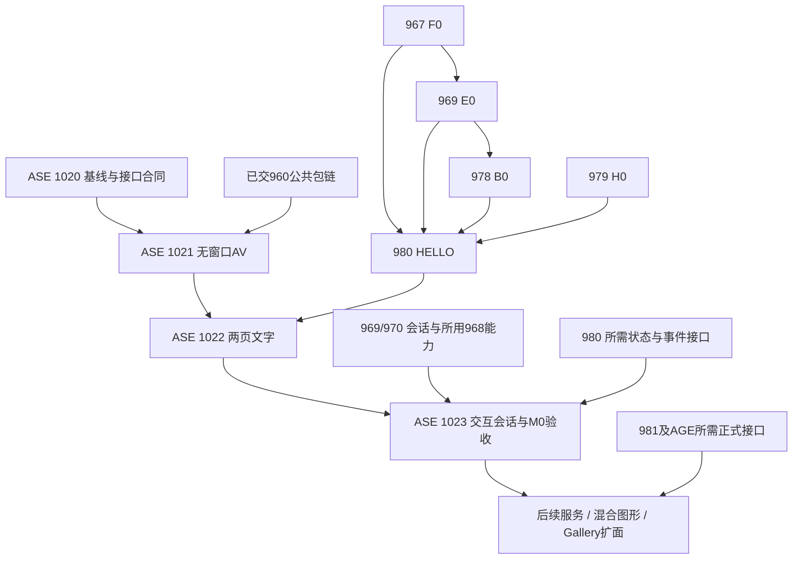

# ASE M0：AutoScape 最小原型实施路线

> 2026-11-12 · proposed r1 · 用户授权本轮制定命名、strategy 路线、首批计划及跨 ACE/AGE 排程；仅规划，未实施、未运行原型或性能测试。
> 上位：[Design31](../31-autoscape-autoweb.md)、[原生 Gallery 设计](autoscape-native-gallery.md)。各 Plan §5–8 为任务/验收权威，本路线只组织依赖与完成边界。

## 1. 命名与范围

用户确定框架总名为 **Auto Scape Engine（ASE）**，涵盖应用解析与装载、前台会话/导航/嵌入、后台服务绑定及其运行生命周期。**AutoScape** 保留为浏览器产品名。ACE、AGE、ASE 可作为三条引擎线并称，但不表示三者具有相同成熟度或必须同时签章。

| 名称 | 归属 |
|---|---|
| ACE | 受检语言编译、执行、制品与公共宿主基础 |
| AGE / AutoUI | UI/2D/3D 呈现、布局输入与设备资源；实际能力按各 owner 合同 |
| ASE | 复用 ACE/AGE/通信/安装能力，组织应用身份、Provider、Realm/Session、AutoFrame、前后台绑定与生命周期 |
| AutoScape | 消费 ASE 的浏览器产品；Gallery 是首个应用访问场景 |
| AutoWeb | Design31 的网络应用体系/协议语境；其分发、安全与部署合同保留 |
| auto-web | 现有服务框架仓，提供 ASE 可消费的服务/HTTP 能力；不更名，不被 ASE 重新实现 |

原文 AutoWeb Runtime 对应 ASE 内的共享应用运行时职责，本文新增总称而非全仓机械重命名。ASE 不成为另一套编译器、UI 引擎、RPC 框架或包管理器。本轮不创建独立 ASE 仓；M0 用语言仓独立实验 workspace 与 UI owner 的薄适配器验证，未来仓界单独决定。

## 2. M0 的三个递进成果

| 切片 | 回答的问题 | 可以宣称 | 不能宣称 |
|---|---|---|---|
| M0-H 无窗口加载实验 | 稳定 app 身份能否选择独立源码并走当前 ACE 公共执行链 | Resolver＋真实 AV 一次执行；错误/编辑/重新执行有记录 | 可视浏览器、持久 AppSession、UI/服务/GPU 接线完成 |
| M0-T 两页文字浏览器 | 两份独立 AutoUI 源能否经 ACE 显示到可切换的公共视口 | 原生验证宿主内，A/B文字、重新打开/关闭、失败与导航代次成立 | 按钮业务状态、保留会话、全 Gallery、AGE 混合图形完成 |
| M0-I 交互会话原型 | 业务状态、视口与执行实例能否独立管理 | 双 Counter 的真实输入、保留/关闭重开、同 app 双会话隔离与资源回收 | 后端本地绑定、持久化/休眠恢复、网络沙箱、全产品发行完成 |

**M0 最终完成以 M0-I 为终点，包含已验 M0-H/M0-T 与现状基线，不能仅凭 Resolver 或文字首窗签 M0。** 首平台为 Windows x64，可信本地应用、一个原生窗口、至多两个存活应用会话；生命周期控制预算是实验 profile，不是未来产品上限。暂不承诺零尺寸、DPI/IME/弹层全能力；实际使用的文字与按钮输入、有效 resize、焦点转移和销毁后旧事件必须验证。

M0 不切换现有 Gallery 默认入口，不启动专用 HTTP 服务，不修改旧演示业务以制造可比收益。单原生验证宿主可由 Rust/Iced 提供控制按钮，但子应用文字/计数业务必须来自普通 Auto 源与 ACE，不能由 Rust 或旧 VM 代算。这里是验证工具，尚非完整 AutoUI 编写的浏览器产品。

## 3. 第一批 Plan 与主责

| Plan | 独立交付 | 现在可进入的范围 | 进入实施的真实前置 |
|---|---|---|---|
| [1020：基线与接口就绪调查](../../plans/1020-ase-m0-baseline-and-interface-readiness.md) | 当前 Gallery 路径/实测、公共接缝决策、样例与就绪合同 | 后续获实施指令即可按原 T-01 开始；无新增 ACE M2 依赖 | 当前仓/Spec/source身份；原生基线单实例窗口 |
| [1021：Resolver 与无窗口 AV](../../plans/1021-ase-m0-resolver-and-headless-av.md) | 两个 app 的解析、独立源码、真实 AV、拒绝与编辑重试 | 1020 正式调查结论后，不等 UI/Hello/AGE | 1020及已交960包模块公开链；本包 T-01先证，不自动等待969整包 |
| [1022：文字浏览器与公共嵌入](../../plans/1022-ase-m0-text-browser-and-embedding.md) | 真实 AutoUI A/B 页面、切换/重开/关闭、源变更与错态 | 可复用1020合同准备；正式实施等待下述接口 | 1021＋967/F0-D、979/H0-D、969/E0-D、978/B0-D、980/HELLO-D；公共嵌入可行性在本包T-01闭合 |
| [1023：交互会话与M0验收](../../plans/1023-ase-m0-interactive-sessions-and-acceptance.md) | 两个 Counter、同应用双会话、关闭/陈旧事件/资源、整体M0裁决 | 先明确所需事件/状态/会话合同；不抢做旧引擎版 | 1022＋980所需STATE/NATIVE接口、969/970的保留/隔离/关闭会话接口及所用968调度能力正式交付 |

四份为 ASE 跨运行时研究计划，正文由语言仓持有；UI 实现只落 auto-ui 原 owner，新 ASE 消费层落语言仓实验 workspace。不改 AutoOS 桌面/安装/原 Gallery 产品接线；未来以 auto-os 为主改面的产品计划必须在那里另取号。不得以本批跨仓形式绕过产品仓登记规则。

全部 Plan 当前 drafting，零任务执行；本轮只授权规划。依赖表里的“现在可进入”是能力排序，不自动把上游或本批变为已授权施工。每个 Plan 唯一 sibling-group 工作树，跨仓同组，不创建链接；按既有独立 review→merge/Spec→清理流程交付。

## 4. 与 ACE / AGE M2 的实施顺序

读取时 ACE 979/980/969/970 等仍是草案，F0/H0/E0/B0/HELLO 是已规划早期切片，不是现成 API。AGE 已有 M1 图形基础，现 driver 仍依赖旧 AutoVM，不能拿旧可玩包证明新链就绪。依据：[ACE路线§17–18](ace-m2-delivery-roadmap.md)、[AGE路线](../../../../auto-ui/docs/design/autographics/age-three-milestones-and-ace-m2.md)。

收尾读回的上游状态已前进：962 为 archived r4、8/8，963 仍 drafting r4、0/8；完整语言线下一候选是核962正式来源后进入963，不再安排重复执行962。下表保留依赖拓扑而非第二份动态进度，开工始终重核原Plan与实际接口来源。

| 上游前沿 | ASE 排程 | 不新增的等待 |
|---|---|---|
| 完整语言962已归档→963，同时可安排967/F0和979/H0 | ASE 1020基线/合同可独立进行，1021在1020后消费现有960公开包链 | 1020/1021不等963、完整Schema、AGE或M1标签；也不豁免原上游自己的门 |
| F0→969/E0→978/B0，与H0汇合→980/HELLO | 正式来源齐后启动1022，先验独立源码的真实AV文字，再验公共frame切换 | 不等完整980、981、ACE M2标签、AGE M2签章或A2R发行腿 |
| 完整运行/Schema/UI线按原依赖推进：967/968/969/970、979、980所需状态/事件 | 对应最小正式能力齐→1023；缺某个关闭/状态接口就具名反馈原owner | 不因Hello过就假定有Counter/持久会话；也不把完整970 REPL/daemon功能全部设为M0前置 |
| 981/SOURCE/SESSION/LANGUAGE及AGE公共组合能力交付 | M0后另立本地服务/混合视图/Gallery扩面计划 | 不提前为M0要求981全部批次、UI080、AG029或AG031 |
| 原M2A-08及各产品阶段门满足 | 再按原合同推进正式产品、发行、默认切换、网络阶段 | M0不替M2A-08，不解除AG029暂停/UI080等待，不变更945–948的M1-TAG |

图示只标关键交接，不省略上游原有依赖：

没有“ASE 全部完成→ACE/AGE 才验收”的反向依赖。需要的最小公共能力在原967–981中交付，本批只实现消费适配和验证工具；发现需要扩展上游语义时修订原owner合同，不能在ASE复制实现。冻结已审分支仅在原合同允许时供准备，正式验收仍取已落地来源，不能借新集成分支跳过门。

## 5. 接口准入与研究截止点

每个接口进入实施前记录：主责仓/Plan/切片、版本/ABI/profile、落地SHA、实际验证入口和覆盖范围、关闭/取消语义、ASE消费点。以原Plan为权威，不在路线维护第二套完成勾选。frontmatter `depends_on` 表示涉及的Plan并集，局部消费前置由各Plan §5任务明确，不把切片描述误成整包已完成。

1021允许在孤立实验中直接消费已公开的 `PackageAvTarget` 等有限入口，只证明一次执行；不冒充未来969正式产品门面，也不承诺磁盘缓存命中零编译。迁入文字宿主后统一走E0及UI owner接口，不向产品输出永久低层依赖。

1022的首个任务必须在同一验证宿主中检查AutoUI公共视图消费与独立关闭接缝；最多比较两种机制。若只能合并源码、伪造旧VmBridge或重写渲染器才能实现，停止依赖实现，给出有界no-go/needs_replan和上游责任。上游Hello只证明text，不证明动态嵌入；二者分别验证。

1023只使用已交按钮/模型/会话能力。单text首窗不是Counter的准入证据，持久REPL计划存在也不是会话接口已交。无法保留状态时不把重建后显示旧数字当会话复用；不把Rust缓存计数当ACE模型状态。

## 6. M0 的完成与后续边界

| 门 | 最低实际结果 | 主责 |
|---|---|---|
| M0-BASE | 当前Gallery的真实路径、冷/热与服务/驻留基线，环境/版本/失败/排除清楚 | 1020 |
| M0-LOAD | 两身份分别执行11/22；非法URI/路径/版本拒绝；改A为12后B仍22，错误修复可重试 | 1021 |
| M0-TEXT | 两份普通AutoUI源的中文/ASCII真实AV文本；切换/关开/改源/失败恢复，旧完成不能写新frame | 1022 |
| M0-SESSION | A=3/B=7切回保留，同app双会话不串；关闭重开为0，迟到事件拒绝，两个存活会话上界清晰 | 1023 |
| M0-CLOSE | 原生真实输入与有效resize、重复开关资源收敛、来源与无legacy dispatch可追溯、各包独审/正式交付齐 | 各包原门，1023汇总 |

M0不含Clock计时恢复、Todo/Notes服务与持久化、AutoDown教程完整移植、全量Gallery、2D/3D混合、Native/RQ发行、网络代码或安全沙箱。它们保留在上位设计后续目标中，不因M0排除而从Gallery整体承诺删除；正式进入下一批时按实际接口另立Plan。

M0测量报告分阶段编译/初始化/首交互、进程/线程/listener、资源与关闭走势，不预设无依据的速度倍数。新样例与复杂旧demo不可直接作总体提速对照；只比较相同业务的有效格。自动注入和人工原生输入分别记录，未执行/缺环境/pending不算PASS。

## 7. 本轮交付与下一动作

本轮创建路线及1020–1023草案，更新Design31、Gallery设计与ACE/AGE导航；不创建源码/fixture/实施树、运行GUI/探针、安装SDK、提交、合并或打标签。四份Plan正式依赖和首次入口写在各自§5–8。下一实施候选为1020；其后1021不依赖UI，1022与1023按上游接口交付排队，不能按数字连跑越过门。
