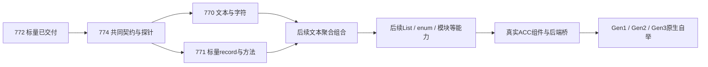

# AC/ACC 后端演进：Cranelift、自举、SSA 与自主代码生成

> 更新：2026-10-13（现行编号与推进队列）；2026-10-04版本路线与分期已由用户确认。具体接口、优化集与选型探针按专项 Plan 验证。
> 记录目标架构，不表示全部能力已实现。AC 指 Rust 实现的首版原生编译器；
> ACC 指 Auto 实现的编译器主体，现有 roadmap 的 AAC 与之指同一条自举路线，命名另行统一。
> 用户确认：v0.6 借助 Cranelift 完成约定 AC/ACC 原生自举；v0.7 推进自主低层 IR/SSA、
> 优化体系与自主后端实验，不以完全替换 Cranelift 为硬性门槛。

关联：[AC 子集与目标代码](auto-ac-subset-and-target.md)、[HIR](auto-hir-design.md)、
[Native ABI](auto-native-abi-rfc.md)、[v0.6 roadmap](../../roadmap-v0.6.md)、
[旧 Native 战略](native-backend-strategy.md)。

## 1. 两条演进轴

AC → ACC 改变编译器主体的实现语言，Cranelift → 自主后端改变机器码生成实现。
自举与后端重写分开验收；不要求实现 ACC 时同时替换机器码后端。
Auto 掌握源语言语义、HIR、编译流程、ABI、运行时与驱动；外部后端库和系统 linker 可继续复用。
ACC 的能力声明必须包含实际主体清单，不能只用 Auto 包装 Rust 前端或迁移 CLI 就称自举完成。
“完善”以约定语言覆盖/平台/编译器主体及其验收为边界，不等于整个 Auto 生态已原生支持。

## 2. 实现与参考路线

| 路线 | 核查结果与工程判断 | 定位 |
|---|---|---|
| Cranelift | Rust 库、AOT/JIT；ObjectModule 有 COFF 路径，Windows unwind 有专门约定；实际 target/调用/链接须探针 | v0.6 AC 与 ACC 的主后端 |
| Zig | 自主后端/快速编译/增量更新值得参考；代码生成入口依赖 Air/Zcu/InternPool，抽取为 Auto 库需要适配 | 架构与目标代码生成参考 |
| QBE | 简单 SSA IL、优化/寄存器分配、输出汇编交给系统工具；官网 AMD64 平台列 Linux/macOS | 自主低层 IR 与轻量后端参考；不能直接承诺 Windows 主线适用 |
| MIR（vnmakarov 项目） | 主线为轻量 JIT；README 保障平台不列 Windows，未核实可直接承担我们的 COFF AOT | 未来 JIT/热点编译研究参考；不是 Rust 的 MIR |
| LLVM | 完整代码生成体系；集成与工具链成本需评估 | Cranelift 必需能力不成立时的备选，以及后续优化/目标扩展候选 |

以上不是本项目实测性能排名；不套用 Zig 或 QBE 的他项目基准作 Auto 性能承诺。
Rust 原型先用 Cranelift，版本/API/SDK 由实测锁定；若必须能力失败，记录证据并修订方案。
不默默切为 C/Rust 转译、解释或 JIT 来代替 AOT 验收。
无需现在完整 clone Zig；深读时可使用独立参考目录、固定提交，不引入产品依赖。
Zig 已迁至 Codeberg，旧 GitHub 仓不再镜像；0.15.1 发布说明仅作历史演进案例。

## 3. v0.6：自举与优化基础

~~~text
Auto source → resolve/typecheck → Typed/Checked HIR
                                      ↓
                         Auto 语义降级与基础优化
                                      ↓
                      Cranelift adapter → CLIF/SSA
                                      ↓
                  Cranelift 支持的优化与机器码生成
                                      ↓
                        object → link → native
~~~

公共 HIR 保留结构化控制流、语言类型、所有权/资源与效果信息，低层 SSA 不反向成为所有后端
的公共数据模型。接入 Cranelift 本身就需处理基本块、分支、循环与 SSA 值；
FunctionBuilder 可维护可变源变量与 SSA 值的对应，不必先自己写完整 SSA 构造算法。

v0.6 要建立下列基础，按后续计划逐项实现：
- HIR 语义不变量和 effect 契约：数值/溢出、trap/错误、短路、调用顺序、内存、借用/移动与释放。
- pass 的输入/输出阶段、前置条件、支持 profile、顺序、来源映射和失败诊断。
- 语义变换后的 verifier 与优化前后对拍，记录配置及 pass 版本，分析缓存明确失效。
- 必要的语义规范化、常量求值和安全简化；具体优化项依据真实程序与收益确定。
- 从 HIR 向 CLIF/平台 ABI 的降级与隔离接口，公共 HIR 不泄漏后端私有结构。

不能仅按“read/write”猜所有 effect；trap、资源释放、外部调用和重载边界也影响合法变换。
常量求值须保持精确宽度/溢出/错误语义；未执行分支中的 trap 不能被提升成无条件编译错误。
禁止通过排序字段重排初始化或命名参数副作用。内联不得破坏公开/可重载入口边界。
复杂优化由已选后端承担其支持的部分，v0.6 不要求自写完整通用优化器。
pass 框架是版本路线要求，不据此扩充正在执行的 Plan 741 的任务/AC。

## 4. ACC 通过后端桥接继续使用 Cranelift

Rust AC 可直接调用库；Auto ACC 通过明确桥接继续调用它。
优先评估薄 Rust 库提供的受限 C ABI；初期独立后端进程也可作为实现阶段方案。
接口描述版本、target、输入 profile、能力、错误与产物；不暴露 Rust Vec/String/enum 或私有布局。
模块生产 ABI 与编译器工具内部桥接协议分别定义，后者不能冒充已冻结的生产 Auto ABI。

若跨进程，可以用 Atom/Batom 承载编译数据并校验；不要求每次标量运算/普通 native 调用序列化。
进程内接口使用明确宽度、缓冲区/句柄、所有权与释放契约；支持批量输入，评估边界开销。
具体编码/桥接模式不在本战略冻结，不能让后端把 Auto 名称解析/类型检查重新做一遍。

自举顺序：Rust AC 编译 ACC 第一代 → 第一代编译自身得到第二代 → 重复构建/语料验证。
控制非确定性，比较约定语义、诊断、HIR 与 native 行为；字节固定点若作为门禁，
另明确路径/版本/时间戳等可复现条件，不默认任意构建字节必须相同。
保留依赖库/运行时/桥接的来源与版本清单，自举不等同全部依赖都改写成 Auto。

## 5. v0.7：自主低层 IR/SSA 与优化体系

~~~text
Typed/Checked HIR → Auto 低层 IR / CFG / SSA
                              ↓
                    Auto 分析与优化 passes
                              ↓
                  ┌───────────┴───────────┐
                  ↓                       ↓
            Cranelift adapter        自主机器码后端
~~~

建议先把自己的 SSA/优化体系接到 Cranelift，再扩展自主代码生成，以同一 HIR/语料隔离验证。
Auto 低层 IR（工作名 AutoMIR，未冻结）确定块/值/类型、phi 或 block arguments、
effect/内存、目标降级与 verifier；不在 v0.6 提前冻结具体指令集。
v0.7 按性能证据选择内联、公共子表达式、循环等优化，而非先列全套算法作为发行保证。
低层 IR 也可用 Atom/Batom 描述，其 Schema/profile 与公共 HIR 分开版本化。

自主后端先限定 target/profile，与 Cranelift 对拍；可以先采用简单栈槽策略，
复用寄存器分配/对象库/linker，避免第一步重写所有基础设施。
regalloc2 和 object 可作组件候选，但其组合不自动提供指令选择、ABI、unwind 与完整链接。
不承诺 v0.7 完全替换 Cranelift，也不因此替换 v0.7 知识管理主线；
编译器研究按独立计划/容量安排，与应用产品工作分别验收。

## 6. 从实验到主后端的门槛

切换由证据触发，不与“AC 完善”“ACC 自举”或某个版本号机械绑定：
1. 覆盖实际语言 profile、目标、公开 ABI、静态/动态模块与必需运行时路径。
2. 数值/trap、调用/栈/展开、布局/重定位、模块生命周期与错误语料稳定通过。
3. 与 Cranelift 的差异有解释，在编译延迟、增量性、制品体积或独特能力上有实测收益。
4. 维护成本可承担，不拖累 AutoOS/生态主线；有能力矩阵、诊断、回退与发行策略。

可以按 target/profile/构建模式逐步采用；选择必须显式、制品记录后端/版本/配置。
不支持的能力明确报错或在生成前按明确配置选择另一后端，不静默改执行模式。
Cranelift 可长期保留为参考/备用，后端更换不自动改变源语言语义或公开 ABI；
保持兼容需要共同 conformance 验证，不能只写相同 ABI 版本号。

## 7. 与 Plan 741 和后续计划的关系

Plan 741 只验收有界 Atom HIR → 校验 → Windows 对象/可执行闭环。
本战略不增加其 pass 框架、ACC 桥接、自举、自主 SSA 或机器码重写验收。
上述分别形成后续计划；已有计划进度由各自执行/复审维护。
实现与架构决策状态分开；设计确认不等于实现通过。

### 7.1 对 Plan 741 的影响

本次路线确认不改变741的任务、AC或revision，不要求返工或追加完整pass框架、
ACC桥接、自举、自主SSA。741提供有界native基础，后续能力逐步增加。
2026-10-04检查时其frontmatter为executing/revision1/current_step7；
执行记录T-01至T-07已填，T-08独立复审待完成。这是进度记录，不代替复审/合入收据。

### 7.2 v0.6 工作量与计划数量的初步估算

以约定编译器主体的原生自举、Windows首平台及静态/动态模块/热重载为边界，
预计26–36个正式计划，包含741；主体排期可按约30个考虑。
若边界需拆分、返工或集成修复，预留35–45个计划的容量。
这是工程估算，不是已经批准的合同数量，也不是用计划数保证工期。

| 工作组 | 独立可验收成果 | 预计计划数 |
|---|---|---:|
| Atom/HIR与pass基础 | 741、所需数据契约、typed HIR、阶段验证、基础变换与诊断 | 3–4 |
| 源码前端与计算子集 | AST→HIR、精确类型映射、名称解析、函数/控制流/运算扩面 | 3–4 |
| 聚合类型、泛型与所有权 | record/enum/Option/Result、方法、泛型实例化、借用/移动/清理 | 4–6 |
| Native运行时与编译器所需库 | 字符串、集合、分配/释放、文件/进程服务、错误处理 | 3–4 |
| ABI、独立模块与热重载 | 布局/调用、静态库/DLL、常驻服务、迁移/在途调用/安全回收 | 5–7 |
| ACC主体迁移与自举 | 后端桥接、Auto前端/类型/HIR/lowering/驱动、代际自编译 | 6–8 |
| 集成与发布收口 | 完整语料、兼容性、构建复现、工具链集成与修复 | 2–3 |
| 合计 | 包含741 | 26–36 |

741收口后，对应剩余约25–35个主体计划；是否合并/拆分由实际独立验收边界决定。
不同组会复用契约和工具，不能把同一共享工作重复计数。

估算不含整个Auto生态全部原生化、全部A2X/AVM迁移、自主机器码后端，
也不重复计算完整Atom/package/UI等其他主线工程。所需共享Atom/HIR基础列在第一组；
完整Batom/通用Schema引擎若另线实施，应明确依赖与归属。
WSL/Linux若成为新增native发布门禁，或自举主体扩至更大语言范围，重新估算相应增量。

主要不确定性：泛型/所有权、热重载生命周期、ACC主体真实能力清单。
不能用741的小闭环速度推算全部计划；ABI或并发资源计划可能比算术扩面显著更长。
约30个计划分布在约三个月只是每周2–3个的吞吐参考，不是排期保证；
独立复审、真实平台与修复必须保留时间。

### 7.3 推进顺序与紧接着的候选工作包

~~~text
741独立复审/收口
  → ACC主体与能力清单、HIR阶段契约
  → Auto源码计算子集跑通
  → 类型/运行时扩面，同时推进ABI/模块
  → ACC按模块迁移并接后端桥
  → 原生自举、代际验证与发布收口
~~~

以下保留2026-10-04的候选拆分分析；已创建计划及现行编号以§7.5为准，其余保留工作包层级：

| 候选标签 | 范围与可评审成果 | 前置与安排 |
|---|---|---|
| NEXT-A | ACC主体/语言能力清单与HIR阶段边界；明确保留依赖、桥接职责和真实验收语料，形成后续实施合同 | 读741复审/Spec成果及现有Auto编译器；清单可离线调研，接入决策待完整v0.5核对 |
| NEXT-B | Auto源码→Checked HIR→native的最小adapter；明确int/i32兼容，编译函数/循环示例并验证结果 | 依赖741稳定API与清单；旧前端接线须基线恢复，必要时拆为adapter和计算扩面两个计划 |
| NEXT-C | 生产ABI的标量/聚合间接传参与返回、嵌套调用和C双向互调探针；输出明确布局/错误/工具链证据 | 可在741基础上与前端调研并行；遵守Native ABI RFC，不冒充完整模块/热重载完成 |

NEXT-A是否单列设计合同或并入最先的实现计划，按成果大小决定；
NEXT-B/C不要求都在下一编号连续出现，各线仍需统一独占取号。
源码计算示例及Auto lexer/parser代表程序开始真正native编译后，重校26–36的估算。
本轮不自动创建、批准或执行这些候选。

### 7.4 已创建后续计划的检查快照（2026-10-04）

检查范围：auto-lang主检出与四处已登记worktree的docs/plans（含archive），
主检出顶层Plan frontmatter，以及本地编号分支。
观察：仅找到PLAN-741；没有742及之后的计划文件或对应本地plan编号分支；
主检出.next-id=742。战略中的后续工作包不是已获编号、已评审或已开工的计划。
未fetch不可访问主机器，不据本快照推断其尚未push的新增工作。
后续正式计划创建/归档后更新队列，执行状态以其合同和复审证据为准。

### 7.5 现行AC/ACC队列与编号映射（2026-10-13）

默认分支合流保留发布线767–769的原义，开发线标量计划767改为772、AutoDown试点768改为773、共同契约769改为774。**文本770与record771没有改号**。旧附件/报告/已存在的验收脚本可保留原文件名；活跃计划入口、执行指令和依赖使用现行编号。

| 现行计划 | 成果与状态 | 下一步/依赖 |
|---|---|---|
| [741](../../plans/archive/741-ac-hir-native-core.md) | Atom HIR→Checked→Windows native首个闭环，archived | 已交付基础 |
| [743](../../plans/archive/743-acc-bootstrap-hir-contract.md) | ACC主体/能力清单与HIR阶段合同，archived | 已交付盘点，不等于自举实现 |
| [745](../../plans/archive/745-ac-source-checked-hir-native.md) | 独立Auto源码计算入口→native，archived | 已交付有限源码profile |
| [772（开发线原767）](../../plans/archive/772-ac-scalar-ops-short-circuit.md) | 精确标量运算、布尔短路、条件for及可信边界，archived 9/9 | 已交付，scalar Spec已沉淀 |
| [774（开发线原769）](../../plans/774-ac-data-resource-contract.md) | 数据/资源共同契约与真实native可行性探针，drafting 0/8 | 先执行；决定/预算/oracle冻结并实际验证，独立复审合入后解锁770/771 |
| [770](../../plans/770-ac-text-char-native.md) | str/Str/char首批原生编译，drafting 0/9 | 依赖774，可与771并行实施 |
| [771](../../plans/771-ac-record-method-native.md) | 标量record、字段与首批方法，drafting 0/9 | 依赖774，可与770并行实施；本轮无文本字段 |

770/771的独立profile各自通过不代表文本record组合或完整lexer已实现。两树共享AST/typecheck/HIR/verify/native等热点；774冻结接口和合入安排，第二合入者同步新基线、重跑两条路线相关门禁并重新独立复审。无需先重构旧编译器全仓。

[773（开发线原768）](../../plans/773-autodown-testcase-protocol-pilot.md)是独立AutoDown测试协议试点，当前execution_done；它不是本批AC扩面前置，不能据其状态放行774/770/771。计划状态是本次检查快照，后续以各自frontmatter/执行/复审收据为准；本次引用维护没有启动任何实施或关闭自举目标。

### 7.6 增量、插件与通用语法产品约束（2026-10-15）

用户要求增量编译、热重载和插件系统从AC/ACC设计起点融入，并将解析能力复用为以Atom/Batom配置语法的通用parser-generator产品，服务IDE/LSP与第三方语言symbol/signature扫描。对应 [Design 39](../39-ac-incremental-syntax-and-language-platform.md) 是新增目标态约束，不表示这些功能已经实现。

因此在真实ACC lexer/parser迁移前，先建立源码snapshot/edit/位置、容错CST、grammar/scanner代际、语义查询依赖和模块/接口身份合同；语法解析、Auto语义/Checked HIR、runtime重载分别验收。旧token/扫描/Pratt核心仍按743适配复用，输出与会话接口需按新边界设计。第三方源码结构扫描只产生候选元信息，需semantic/ABI验证后才可用于可执行互操作。

近期建议先规划“前端共享契约与全路径可行性探针”，enum/is与List语言扩面可共同规划；通用grammar引擎与ABI/热重载是独立实施线，不把整个产品塞入enum计划，也不等待完整生成器才继续自举。782按原合同复审修复，新约束不追加入其验收。§7.5保留历史快照，现状以各Plan/Spec与fresh收据为准。

同日进一步确认最终目标为亚秒级开发周转与低内存：AST/CST及语义/HIR/对象码统一进入跨工程全局cache，内存仅保存有界热点工作集，磁盘产物按块/查询读取；不得要求加载大型仓库全部依赖AST后才能服务。下一架构探针须同时验证分页语法树、已有AutoCache集成、共享session/多工程去重、配置隔离、崩溃/GC与端到端延迟；仅共享磁盘文件或仅报告parser耗时不足以验收。详见Design39 §5.1–5.5；具体实现与性能尚未交付。

[Design40](../40-compiler-artifacts-and-cache-lifecycle.md)进一步统一各阶段产物/Atom-Batom Schema/引用/存放和自动清理：required-data闭包、失效指纹、可重建边及来源分离；byte预算、lease、软保留、磁盘水位、物理回收/compaction与崩溃恢复形成一套生命周期。缓存健康不依赖用户逐工程clean，也不允许借GC删除源码/交付物/在途runtime代际。下一个架构合同计划以Design39+40共同取材，暂未分配编号。

### 7.7 C生态与未来Rust原生互操作（2026-10-15）

依据[A2C/ABI讨论](https://chatgpt.com/share/6ad0577b-5c00-83ea-9684-e64956b98cb1)，以 [Design41](../41-interface-metadata-and-foreign-abi.md)统一：AutoABI是独立原生模块契约，C/system ABI是具体目标外部接口，FFI含类型/所有权/错误/回调adapter，Module Runtime管理lease/状态/热重载。编译器内部Cranelift桥仍有独立协议，不能冒充公开模块ABI；普通native调用不强制Value/JSON/Atom序列化。

C headers/SDK/GIR等元信息与Rust构建的C兼容shim汇入共享Interface Metadata/Foreign IR；Native、VM、A2C/A2R各自lowering与验收。C互操作不要求Auto先转译为C，A2C仍服务MCU、特殊工具链/现有C工程及bootstrap；Rust原生私有ABI/fork-rustc不作为新主线前置，跨AutoABI域无显式已验证adapter则拒绝。

下一架构合同与Design39/40一起预留import provider、target layout/ABI及foreign元信息产物、缓存key/SDK依赖、加载代码/回调/foreign deleter的代际pin。可先用Auto双向C互调、SQLite外部宿主插件和小型Rust shim探针分阶段验证，未启动全部平台/库的工程；新能力不扩大782验收。use.c自动符号导入与package/header resolver是目标体验，语法与Schema另行冻结，既有auto-bindgen手工manifest面不冒称任意头文件摄入。

## 8. 官方参考与核查范围

2026-10-04 查阅官方公开文档/源码，尚未据此执行本项目性能或 ABI 对拍：
- [Cranelift 定位与平台](https://cranelift.dev/)
- [ObjectModule](https://docs.rs/cranelift-object/latest/cranelift_object/)、
  [COFF/unwind 源码](https://docs.rs/cranelift-object/latest/src/cranelift_object/backend.rs.html)
- [FunctionBuilder 的 SSA 构造接口](https://docs.rs/cranelift-frontend/latest/cranelift_frontend/struct.FunctionBuilder.html)
- [Zig 官方迁移说明](https://ziglang.org/news/migrating-from-github-to-codeberg/)、
  [代码生成入口](https://codeberg.org/ziglang/zig/src/branch/master/src/codegen.zig)、
  [0.15.1 历史发布说明](https://ziglang.org/download/0.15.1/release-notes.html)
- [QBE](https://c9x.me/compile/)、[QBE IL](https://c9x.me/compile/doc/il.html)
- [MIR](https://github.com/vnmakarov/mir)
- [LLVM 代码生成](https://llvm.org/docs/CodeGenerator.html)
- [regalloc2](https://docs.rs/regalloc2/latest/regalloc2/)、
  [object 写入接口](https://docs.rs/object/latest/object/write/)
