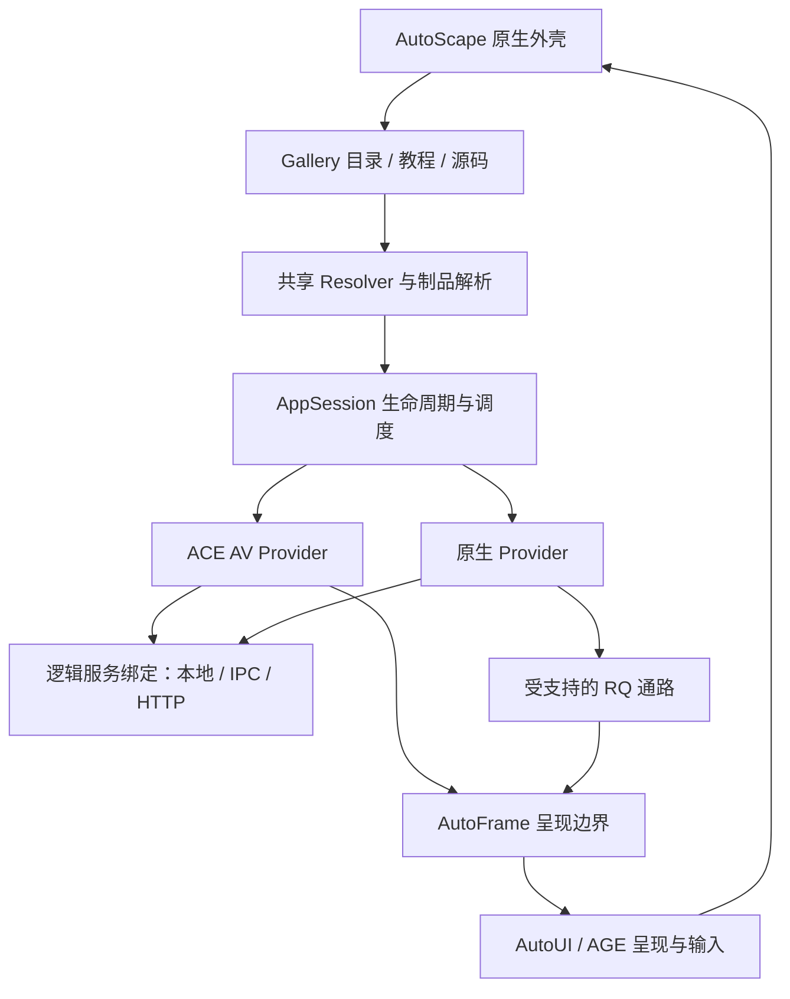

# ASE / AutoScape：基于 ACE / AGE 的原生 UI Gallery

> 2026-11-12 · proposed r3 · 设计补充，未实施、未做性能实测；r2 补实施时序与接口依赖策略（§8.1–8.4），r3 确认 ASE 框架命名并关联 M0 路线/首批计划。
> 用户授权制定路线与首批草案，见 [ASE M0 实施路线](ase-m0-delivery-roadmap.md)及 PLAN-1020–1023；不切默认入口，不宣称现有应用已迁移。
> 归属：Design31 的跨运行时专题；浏览器/Gallery 产品实现位置在立项时按仓界确定，桌面产品合同由 auto-os 持有。

## 1. 目标与设计关系

**命名决定（2026-11-12）**：Auto Scape Engine（ASE）为包括前后台技术的整体框架；AutoScape 为浏览器产品名。本文的共享应用运行时、服务绑定、会话与嵌入机制属于 ASE。AutoWeb 网络体系与 auto-web 服务仓名称/职责保留；ASE 复用 ACE、AGE、通信与安装能力，不重造这些机制。

将 UI Gallery 作为 AutoScape 的首个本地应用场景：Gallery 负责目录、搜索、教程、源码与演示编排；AutoScape 的共享应用运行时负责独立应用的解析、装载、服务绑定、嵌入和回收。ACE 负责受检编译与执行，AGE/AutoUI 负责呈现、输入与图形资源。浏览器外壳不重新实现编译器、业务解释器、组件系统、安装器或通信框架。

目标是让 Gallery 启动只付出外壳与轻量目录的成本；访问某个 demo 才准备其制品和会话；重复访问复用兼容制品或存活会话；后台执行与图形资源受预算管理。修改/增加一个 demo 不应重新编译整个 Gallery。

本文细化 [Design31](../31-autoscape-autoweb.md) 的本地 Gallery 路径，保留 URI/Intent/Provider、AppRealm/AppSession、AutoFrame、存储与网络安全模型。旧文档中的时间、数量和执行器对照是历史观察，当前排期以 [v0.6 路线](../../roadmap-v0.6.md)及各正式执行合同为准。v0.6 本专题交付目标是调研与有限真实原型，完整浏览器产品化另定。

相关权威与输入：

- [ACE M2 设计](../55-ace-m2-complete-language-and-product-replacement.md)及[交付路线](ace-m2-delivery-roadmap.md)：语言、会话、宿主、UI/AGE、构建与产品替换职责。
- [AGE 当前路线](../../../../auto-ui/docs/design/autographics/age-three-milestones-and-ace-m2.md)：M1 基线与 M2 作者链/生产融合边界。
- [系统通信设计](system-foundations-v06.md)、[AutoWeb 仓界](../50-autoweb-service-framework-and-repo-boundaries.md)、[安装策略](unified-package-install-strategy.md)：共享机制的上位合同。
- [AutoUI 应用架构](../47-autoui-state-design-and-feature-architecture.md)：组件实例、状态、生命周期与应用层边界。

本文接口名为职责示意，尚不是可调用 API、正式清单格式或新的作者语法。后续 Plan 应消费既有公共接口；缺失能力交原 owner，避免另造一套运行时。

## 2. 现状依据与待测问题

本轮只读核对得到以下事实；代码存在不等于当前用户启动路径一定启用了某个配置。

| 面 | 读取依据 | 已知机制与边界 |
|---|---|---|
| Vue 视口 | [AppViewport.vue](../../../../auto-os/ui-gallery/src/gallery/AppViewport.vue) | `demo.load()` 后 `createApp` 或 entry mount；切换先卸载旧实例。这里本身不证明每个 demo 启动独立 HTTP listener |
| 旧 VM 视口 | [AppViewport.vm.at](../../../../auto-os/ui-gallery/src/gallery/AppViewport.vm.at) | 生成文件静态引用多个 demo 子组件；不是每 demo 一个独立 AppSession |
| 后端 proxy | [back_proxy.rs](../../../../auto-ui/crates/auto-ui-runtime/src/back_proxy.rs) | 统一 listener，支持 `lazy_sessions`：首请求装载应用后端会话；已有移除机制。不能把本方案的收益全部归于首次引入懒加载 |
| 目录/资料 | [demos-registry.ts](../../../../auto-os/ui-gallery/src/demos-registry.ts)、[registry.at](../../../../auto-os/ui-gallery/src/front/registry.at) | 可见生成注册表与内嵌源码/文档形态；需测生成链及实际消费产物的体积和启动成本 |
| AGE 区域 | [活区域与生命周期](../../../../auto-ui/docs/specs/auto-graphics/node-mixed-regions-lifecycle.md) | 有混合区域挂卸、代次拒绝和资源计量基础；组件区域不等于独立应用容器 |
| RQ | [载荷与资源规范](../../../../auto-ui/docs/specs/runtime/rq-render-packets-and-resources.md) | 存在版本化呈现通路及保真边界；不能从已有 2D 载荷推断所有 3D/媒体均可承载 |
| ACE / AGE 融合 | ACE M2 设计与 AGE 当前路线 | AGE M1 已交基线不代表 ACE 正常作者前门及完整 UI/AGE 产品融合已交；按实际接口逐项准入 |

因此当前性能问题分成五项测量：制品生成/编译、应用装载与初始化、服务初始化、首个可交互画面、隐藏/已访问应用的驻留。旧 Design31 引用的冷启数字仅作历史背景，不充当当前基线或本方案收益。

后端是否按应用独立进程启动、proxy 是否 lazy、会话何时回收，都要记录真实启动命令、配置和进程/线程关系后判断。不能仅凭“打开了 tab”推断进程拓扑。

## 3. 总体结构与职责

| 层 | 职责 | 边界 |
|---|---|---|
| Gallery | 目录、分类、搜索、教程、源码、视口尺寸、演示重置 | 不编入所有 demo 实现，不读取子应用私有状态 |
| AutoScape Shell | Tab、地址、历史、导航、加载/失败反馈 | 消费公共 Resolver/Session；不持有业务执行器内部指针 |
| 应用运行时 | 身份、Provider、Realm、Session、服务绑定、生命周期、预算 | 与 Launcher/其它宿主共用；不是 Gallery 专用解释器 |
| ACE | 编译查询、语义检查、执行制品、AV/受支持原生执行路径 | 不持有布局/命中/图形设备所有权 |
| AutoUI / AGE | 布局、绘制、图形组合、输入、设备资源 | Surface 身份不替代应用权限与服务身份 |
| 服务/通信层 | 类型合同、调用、取消、错误、传输适配 | 复用原 owner；不复制 Web 路由和安装算法 |

AutoScape 是独立可运行的宿主，不以 AutoOS 桌面整包启动为前提；进入桌面后仍消费同一组应用接口。首个研究平台建议 Windows，与已有 Gallery 和 AGE 基线对照；Linux/Web/移动或跨进程 GPU 共享不由本原型自动承诺。

## 4. 应用身份、目录与制品

### 4.1 目录只描述应用

可用 `app://auto.demo.counter/` 表达 demo 身份，`app://auto.ui-gallery/` 表达 Gallery。这里是示例命名，正式 ID 在 Plan 中结合现有包身份冻结，避免重新登记同一应用或与独立 App 轨混同。

每个目录条目只需应用 ID、标题/分类/标签、来源包/修订、入口与 Provider 描述、缩略图引用、教程/源码引用、所需能力。元数据来自现有 package/manifest 与开发注册表，不再创建第二套包发现与安装权威。

目录不嵌入全部 demo 源码、完整文档或执行模块。教程和源码按条目读取，搜索索引可独立预生成。预览、教程与源码必须标明对应版本，避免运行新制品却展示旧源码。保留 demo 轨与独立产品轨的来源边界，不能为 Gallery 自动建立双向同步义务。

### 4.2 制品与会话分离

| 对象 | 共享/复用方式 | 不包含 |
|---|---|---|
| 编译/执行制品 | 同内容、兼容执行环境下可复用；消费 ACE/构建正式制品接口 | 用户输入、运行中的任务、连接 |
| 不可变依赖与资源 | 内容寻址、只读、引用计数或等价 owner | 应用对共享缓存的任意写权限 |
| AppRealm | 按 Design31 的应用/来源/用户 profile 分区，持权限与持久存储 | 自动赋予任意系统访问权 |
| AppSession | 一次运行的模型、组件实例、任务与服务租约 | 另一个 tab 的隐式共享内存 |
| BrowsingContext / AutoFrame | 导航与挂载、视口、焦点、输入路径 | 应用执行和存储的唯一所有权 |

缓存键至少覆盖源与依赖身份、编译器/制品格式、领域 Schema、标准库/宿主 ABI、目标/profile、编译选项。运行权限另行验证；缓存命中不复用旧授权或绕过制品验证。依赖不变时复用，变化时精确失效；二次访问不重复编译是兼容命中的目标，不是跨任意升级的承诺。

开发修改只失效受影响应用及真实共享依赖。Gallery 外壳通过公共制品/注册表变化通知更新目录或重新装载，不拼接子应用源码。运行时缓存采用托管只读资源访问；不在 worktree 内创建 symlink/junction。

### 4.3 Provider 选择

开发原型优先评估预编译宿主 + ACE AV；稳定发行可选择已交付且匹配的平台原生 Provider。应用 URI 不携带 AV/EXE/RQ 选择。Provider 不支持所需宿主能力时给出具名错误，不静默回到旧 Parser/VM 或删掉 demo 功能。

首次原型先证明真实 AV 会话；原生 Provider/RQ 是后续单独验证切片。Resolver fixture 可以独立研究，但不算真实应用激活，不用 fixture 代替最终显示、输入或业务证据。

## 5. 会话、导航与生命周期

### 5.1 打开流程

1. 解析 Intent 和稳定应用 URI；检查来源、版本、权限与 Provider 能力。
2. 复用匹配的制品，或准备该应用自己的制品；不编译整个 Gallery。
3. 根据显式策略激活已有 Session 或创建新 Session，并建立服务/存储绑定。
4. 在 AutoFrame 挂载实际输出，直到首个可交互画面；导航成功与服务失败分别可观测。
5. 关闭/取消时撤销输入路径、取消任务、解除挂载、释放服务租约和资源。

导航请求持代次/取消身份；快速 A→B→A 时，较晚完成的旧装载不得覆盖当前视口。失败显示明确原因并可重试；不因已经解析 URI 就把历史项标成激活成功。

### 5.2 状态与 tab 策略

| 状态 | 执行与呈现策略 | 返回时语义 |
|---|---|---|
| 仅目录 | 不创建应用会话或服务 | 首次装载 |
| 可见活动 | 正常输入与按需更新；公平分配执行预算 | 保持当前状态 |
| 隐藏驻留 | 解除无用呈现/限制更新；按声明允许后台任务 | 激活原会话，重新校准视口和时间 |
| 休眠回收 | 仅在应用支持保存/恢复协议时保存状态并释放执行资源 | 经版本检查恢复；不兼容时明确提示重新打开 |
| 关闭 | 取消任务、移除挂载、释放会话；持久数据按应用策略保留 | 创建新会话 |

以上是拟议运行状态，不修改仓库 Plan 状态机。缓存策略区分 tab 与会话数量：保留很多 tab 元数据不要求同样多的活 Session。采用有上限的近期会话集合与内存/图形预算；初始预算、超额行为及是否允许 pin 在 Plan 基线后冻结，不能承诺无限驻留。

同一 demo 的两个会话，计数器、路由和运行任务独立；同一 AppRealm 的持久数据可按原设计共享，并处理数据库并发/文件冲突。Gallery 的“重置演示”默认只重建选中会话，清空持久数据是另一个明确操作。

暂停呈现、暂停模拟、取消任务、停止服务四者分开。Clock 恢复时重新读取时钟，不补跑隐藏期间每帧；游戏按自己的暂停语义；音频、下载和流订阅声明后台需求。没有 checkpoint 协议时只能保持有界驻留或显式重启，不伪称透明恢复。

### 5.3 公平调度与故障边界

可信本地 demo 可先评估同进程多 Session，以减少重复宿主和启动成本。必须验证 AV 时间片/fuel、取消、事件队列上限和服务调用超时；UI 线程不能执行无界业务或阻塞 IO。宿主阻塞调用需可隔离/取消的任务 owner，AV fuel 无法替代它。

Session 隔离只保证受控状态与资源边界，不保证隔离进程 abort、原生内存故障或 GPU 设备故障。强隔离或不可信应用另选进程/沙箱方案；网络应用继续受 Design31 完整安全合同约束。

## 6. 后端：逻辑服务与传输分离

### 6.1 同一业务合同，多种绑定

| 场景 | 绑定候选 | 成本与语义 |
|---|---|---|
| 本地 AV 示例 | 有类型的本地消息/调用端口 | 不要求独立 HTTP listener；仍有执行 owner、鉴权、错误与取消 |
| 独立原生服务/需隔离应用 | IPC | 明确序列化、资源句柄和进程生命周期 |
| 传统 Web、远程业务、HTTP 教学示例 | HTTP | 保留真实网络协议及原有支持边界 |

服务名与操作合同由现有语言/通信/领域 owner 持有；ServiceBinding 只负责将该逻辑合同绑定到适配器。调用不写死 localhost 端口或 Gallery URL 前缀。概念如 `TodoService.list()`，不是本轮新增语法。

抽取的是可复用业务执行与参数/错误语义，不把 HTTP 路由处理器机械改成直接函数调用。上传、下载、媒体、文件授权、SSE/流、背压和取消逐类判断；不能保留一个 JSON CRUD 正控就宣称全部可替换。

当前 [AutoWeb 架构](../../../../auto-web/docs/specs/architecture.md)及[语言 HTTP 宿主端口](../../specs/language-sdk/http-host-port.md)可作为边界输入。本地非 HTTP 适配器归属在实施前与通信/语言 owner 冻结，不默认由 auto-web 接管所有 IPC。

### 6.2 服务生命周期

服务按需激活，同一次并发首次访问只初始化一次；初始化失败、超时、取消与重试可区分。服务实例身份至少关联 AppRealm/运行代次与部署版本，禁止同名方法跨应用串接。

UI 与本地后台可以是两个执行会话，但共享一个应用级生命周期 owner；共享服务按显式租约管理。关闭一个 tab 只释放自己的租约，不停止仍被其他会话使用的服务；最后 owner 释放后按策略回收。事务、持久任务或用户允许的后台工作不能因 UI 隐藏直接中断。

迁移顺序先统一已有 proxy/后端的按需启动与回收，再给适合的服务提供本地绑定。过渡期间保留 HTTP 路径并明确标记，验收逐 demo 登记当前绑定，不用“已原生化”掩盖仍依赖 listener 的项目。

## 7. AGE 呈现与 AutoFrame 边界

### 7.1 应用会话映射到呈现对象

AppSession 产生视图，AutoFrame 消费受支持的公共呈现接口并建立挂载；AGE Surface/View/Portal 管组合与输入映射。禁止为了嵌入直接读取 ACE VM 内部或修改子应用的私有 UI 节点。

宿主至少处理尺寸/缩放/DPI、裁剪、滚动、坐标转换、焦点与捕获、键盘/IME、弹层、无障碍与输入路由的所有权。是否允许弹层超出 frame 由明确合同决定；关闭、隐藏、resize 和导航换代时取消陈旧输入与晚回调，避免输入串到另一个 demo。

### 7.2 原型优先组合路径

首切片评估同进程、同设备/队列的公共嵌入适配器；应用逻辑仍按 Session 隔离。不能假定现有 Iced 与 AGE 已完成设备共享，也不为调研复制渲染器。缺公共设备/布局/输入接口时具名交 UI/AGE owner，不以每帧截图上传代替正式接线。

常态目标为 GPU 内组合、无逐帧 readback。Native Provider 通过已支持的 RQ 通路接入并单独验能力；跨进程 GPU 纹理共享、完整 3D 载荷或远程语义流不自动包含。当前 [Surface 组合规范](../../specs/auto-graphics/surface-composition.md)是有限实验输入，生产与平台支持依实际 owner 合同。

### 7.3 可见性与资源预算

当前 tab 按内容需要更新；隐藏 tab 停止无用呈现，可释放/降级离屏目标并保留有界状态。空闲内容是否真正零重绘要实测，不从“dirty 接口存在”推断现有每个 adapter 都跳帧。共享 Surface 多个 View 不得重复推进同一模拟 tick。

Gallery 默认用缩略图展示全集；滚动可见区域及用户显式选中的少量视口才实时运行。用户要求多 demo 同屏实时对比时，明确并发上限和成本。40 个实时应用仍是 40 份运行负载，不能用原生浏览器名义承诺资源恒定。

计量分别记录应用堆/会话、宿主 RSS、托管缓存、图形目标尺寸与字节、资源创建/释放。离屏颜色目标的理论下限是宽×高×像素字节数；深度/多缓冲/驱动额外开销另算。无法获取实际 GPU 驻留时写 unknown，不用 RSS 或理论纹理字节冒充显存实测。

## 8. v0.6 原型分期与依赖

### 8.1 时序决定：现在准备，按接口交付接入

用户确认采用：**现在推进独立基础工作，真实应用加载随 ACE/AGE 所需接口交付逐步接入；不等 ACE M2 / AGE M2 全部完成，也不先基于旧 AutoVM/AutoUI 做完整 AutoScape 再迁移。**

独立会话、动态装载、宿主调用、调度/取消、服务绑定、图形嵌入和回收正是引擎迁移的核心接缝。先建设完整旧引擎版会形成重复适配和新增兼容义务，因此正式运行路径面向 ACE/AGE 公共接口设计。AutoScape 作为早期真实消费者反馈缺口，不成为 ACE/AGE 两个里程碑的新增整体前置。

下表“现在可做”表示无须等待整个引擎里程碑的工作范围，不代表本轮启动代码、实测或新 Plan；这些仍按正式 Plan 和各 owner 现行进入门执行。

| 工作 | 现在可推进的部分 | 等接口交付后再做的部分 |
|---|---|---|
| 性能与现状 | 梳理 Vue/旧 VM/服务实际链路，设计并按授权执行基线测量，确认驻留与回收问题 | 用真实新运行路径做同业务对照；不预报提速倍数 |
| 身份、目录与 Resolver | 设计元数据、URI/Intent、版本/能力拒绝；基于 fixture 验解析与路由 | 解析结果激活真实应用并打开资源；fixture 结果不算应用启动 |
| Tab、导航与生命周期 | 定义状态、取消代次、会话复用/重置、后台声明和恢复合同；有限界面草图 | 连接真实会话、焦点/输入、任务取消、隐藏/重开与回收 |
| 制品与缓存 | 与 ACE/构建 owner 协商制品身份、兼容验证、失效与变化通知合同 | 接真实编译/装载/缓存入口，证明单应用修改和兼容缓存复用 |
| 服务绑定 | 与语言/通信/Web owner 明确业务合同、适配器归属、错误/取消与租约语义 | 接真实服务执行/资源/IO端口，验证本地全栈无需独立 HTTP listener |
| AutoFrame / AGE | 评估公共嵌入、设备共享、布局/输入和资源预算接缝，反馈具体缺口 | 实际视图挂载、GPU组合、混合 UI+2D/3D、可见性调度与资源回收 |
| 全量切换与发行 | 形成 demo/能力/来源清单和扩面条件 | 原型通过后分批迁移、验收原业务，再决定默认入口与正式发行 |

### 8.2 最小接口进入门与样例顺序

每个切片按所用接口的正式交付进入，不按“某个 M2 总标签是否完成”一刀切。接口可用须有 owner、版本/ABI、可消费的落地来源及覆盖本切片的验证记录；规划文档、分支 WIP 或接口名称存在不算交付。下列是能力清单，不另造替代上游合同的 API。

| 切片 | 最小依赖 | 完成后才能声称的结果 |
|---|---|---|
| Counter 独立装载 | ACE 受检 UI 执行、制品装载、独立 Session/关闭，以及 AutoUI 公共挂载与输入端口 | 应用地址→独立制品→真实 ACE AV 会话→AutoFrame→业务输入→关闭释放 |
| Clock 隐藏/恢复 | Counter 所用接口，以及时间源、可见性通知、可取消任务/更新调度 | 隐藏停止无用呈现、恢复重新校时，外壳保持可响应 |
| Todo/Notes 本地服务 | 真实服务调用、类型/错误/取消、资源 owner、所需持久化与 IO、租约回收 | 原有全栈业务与数据重开成立，本地绑定无独立 HTTP listener |
| 混合 UI+2D/3D | ACE/AGE 正常作者与执行接口、公共组合/设备/输入及图形资源生命周期 | 实际混合视图、输入和可见性调度成立，关闭/重挂不泄漏或串事件 |
| 原生 Provider / RQ | 对应平台的真实构建制品、会话控制、受支持呈现/资源/输入通路 | 仅对所验平台、Provider 和能力格声明支持 |

Counter→Clock→Todo/Notes→混合样例是建议的验证顺序，不把下游全部能力加给首个 Counter。服务合同与图形接缝准备可独立推进，某一条接口暂缺不阻塞其他已具备条件的工作。基础纯 UI 嵌入不反等完整 AGE 混合图形；纯解析研究也不反等真实 Session。

若上游缺能力，记录“缺哪个接口/行为、由谁交付、阻塞哪个切片、下一次如何验证”，交回原 owner。在上游正式接缝可用前，相关切片保持 pending；不在 AutoScape 内新建 Parser、执行器、服务调度器或图形组合替代实现绕过缺口。

### 8.3 旧 AutoVM / AutoUI 的使用边界

旧路径可用于当前 Gallery 基线、原业务行为参照和有限界面草图；必要的接缝实验在对应 Plan 中预先限定问题、规模、产出与退出条件，说明哪些代码丢弃、哪些经公共接口验证后可复用。其结果单列为 legacy/实验，不计入 ACE/AGE 新路径验收。

不建设待迁移的完整旧引擎版 AutoScape，不把旧 VM 业务执行/私有节点依赖变成新的正式兼容合同，也不通过隐式 fallback 维持新路径表面可用。旧 Gallery 的独立问题若另获修复授权，仍按其自己的范围与验证处理，不自动扩大成本浏览器实现。

### 8.4 分期与现有上游职责

具体首批执行合同已落 [ASE M0 路线](ase-m0-delivery-roadmap.md)：1020 基线/接口 → 1021 无窗口 AV → 1022 两页文字 → 1023 双 Counter/会话与 M0 联合验收。M0 为下表 G0/G1 的有界子集，不包含 G2 全栈/混合图形或完整 Gallery 教程区；这些后续目标保留。M0 现在可准备，1022 等 F0/H0/E0/B0/HELLO 正式来源，1023 再等所需状态/事件/保留会话接口，不等完整 ACE/AGE M2。

| 阶段 | 必需结果 | 进入条件与边界 |
|---|---|---|
| G0 基线/合同 | 当前 Vue/VM/后端真实路径、成本分解、原型接口与样例清单 | 可先只读研究；无性能结论直到实际测量 |
| G1 独立装载 | 轻量目录、Resolver、真实 AV Session、AutoFrame、关闭/重开/导航与失败恢复 | 消费实际可用的 ACE facade/session、UI 执行与公共嵌入接口；fixture 只算前探 |
| G2 服务/组合 | 一个本地全栈服务、独立持久数据、一个混合 UI+2D/3D 样例、可见性调度 | 服务/IO/取消、AGE Session 与呈现接口逐项具备；缺项保持 pending |
| G3 对照/评估 | 同业务基线对照、生命周期/隔离反例、可行性裁决与剩余差额 | 不用删功能/减少样本规模制造提升；不把局部成功称完整 Gallery 迁移 |
| 后续条件阶段 | 原生 Provider/RQ、扩展 demo、安装发行、网络加载 | 各自独立能力/发布/安全门，不成为前面纯解析研究的前置 |

首批建议 Counter、Clock、Todo 或 Notes、一个既有 UI+2D/3D 混合样例。样例以真实来源和原功能为准，正式 Plan 冻结数量与必需操作；不另写空壳替代原应用。Gallery 教程/源码区至少在原型中有一条真实文档显示、源码切换及版本对应闭环，其 AutoDown 原生组件能力另核，不把演示视口成功等同全 Gallery 可用。

与既有计划的关系：969/970 对应 facade/session，967/968 对应宿主/调度，973/974/975 对应实际使用的 IO/网络/数据服务，978 对应构建制品，979/980/981 对应领域前门与 UI/AGE，983 对应 Web 迁移；这些是职责定位，不表示必须整包完成才能做任一切片。各正式接口可以分段消费，实际依赖和源码身份在新 Plan 冻结。

不改动上述 owner 的进度或进入门；945–948 的 M1-TAG 要求仍保留。原型不等待 ACE/AGE 全部远期特性，但也不能用旧 VM 隐式 fallback 冒充 ACE 成功。无可用最小接口时先交 G0 或解析前探，G1/G2 保持未执行。

## 9. 验证矩阵与性能口径

### 9.1 功能与反例

| ID | 必须验证 | 正控/反例 |
|---|---|---|
| ASG-01 | 独立制品装载 | 增加 demo 不重编 Gallery；修改单 demo 只失效实际依赖 |
| ASG-02 | 缓存身份 | 同环境兼容命中不编译；依赖/Schema/ABI/目标变更重新验证或失效，损坏制品明确拒绝 |
| ASG-03 | 会话隔离 | 同 demo 两会话分别操作，状态/路由/任务不串；持久共享遵显式 Realm 合同 |
| ASG-04 | 导航与取消 | A→B→A 快切、装载失败、退出/重开；旧完成不覆盖新视口 |
| ASG-05 | 本地服务 | 真实全栈操作/持久化/重开；该路径无独立 HTTP listener；双首次调用不重复初始化 |
| ASG-06 | 服务生命周期 | 最后租约释放与取消；关闭单 tab 不杀共享服务；失败后可重试 |
| ASG-07 | 嵌入交互 | resize/DPI/裁剪/滚动、焦点/捕获、键盘/中文输入按样例能力验，隐藏或销毁后旧事件拒绝 |
| ASG-08 | AGE 组合 | 混合视图实际绘制与输入；多 View 不重复 Tick；正常路径无逐帧 readback |
| ASG-09 | 可见性/恢复 | 隐藏停止无用呈现；Clock 校时；支持 checkpoint 的样例恢复，不支持的明确重启 |
| ASG-10 | 公平性/资源 | 超预算 guest 与慢/失败服务不阻塞外壳；反复开关后无不受控资源增长 |
| ASG-11 | Gallery 内容 | 真实教程/源码、应用版本对齐、搜索与缩略图目录、重置不误清持久数据 |
| ASG-12 | 诚实边界 | 原源业务/资源不减；HTTP/旧运行路径/fixture/未支持项分别记账 |

G1/G2/G3 分别选择对应矩阵，未执行项记录 pending，不强填 PASS。上述执行预算反例仅证明受控故障，不能代替进程级强隔离。原生输入与 fixture、自动与人工证据分列。

### 9.2 对照场景

固定硬件/系统、电源、构建模式、源与资源版本，记录缓存状态。分别对照当前 Vue、当前 VM，以及新增原型的真实可比路径。行为和后台功能不同的结果只能分项说明，不能直接得出总体倍数。

场景至少包括：外壳冷启动、应用首次打开、制品缓存命中后的新会话、存活会话切回、进程重启后的兼容缓存、单 demo 修改、多个不同 demo 顺序访问、同应用双会话、隐藏空闲和重复开关回收。每组固定样本数、并发规模和操作脚本，由 Plan 在测前冻结；当前不预设无依据的毫秒/FPS门槛。

| 指标 | 口径 |
|---|---|
| 外壳可用时间 | 从宿主启动到目录可响应输入；不以进程存在代替 |
| 应用可交互时间 | 从打开动作到首画面且真实输入产生业务结果；冷制品/热制品/活会话分别列 |
| 成本分解 | 发现、制品生成/编译、装载初始化、服务就绪、布局绘制；并发阶段不简单相加 |
| 后台开销 | 进程、线程、listener、存活服务/会话数、CPU与 IO；区分开发服务器及发行运行 |
| 内存/资源 | 宿主与子进程驻留、应用堆、托管缓存、目标/资源字节、创建与释放；共享项避免重复计总 |
| 周转 | 单应用编辑至可交互更新、实际重编闭包；宿主/ABI变化的必要重建单列 |
| 稳定性 | 冷/热/隐藏/关闭循环、取消/超时、首次失败和重放结果、清理后资源走势 |

调研先报实际分布、样本数、条件与误差，再由正式 Plan 确定适用验收阈值。收益按“减少宿主耦合、避免兼容命中的重复编译、减少监听/初始化、限制隐藏执行、图形组合”分项归因，不把所有改进称作 AGE 渲染提速。

## 10. 实施拆分、待决与本轮产出

后续按§8的时序拆分：现在准备基线/目录/Resolver与公共接口合同；相应接口交付后依次验证独立 Session/制品装载、本地服务、AGE 可见性/预算及真实 Gallery 对照；原型通过再扩面和切默认。复用上游既有 Plan 的交付，不重新立项实现 ACE、AGE 或 AutoWeb 全部能力。新代码按仓库标准先确认 Plan，再在专属 worktree 实施；本轮只写设计。

立项前需明确：

1. 原型宿主及应用运行时的代码 owner、公共 AutoFrame 接口和单一 GPU 设备可行路径。
2. 首平台、样例来源、所需的 ACE/AGE 已交接口、业务操作与教程能力边界。
3. 服务端口类型/错误/取消合同、本地适配器 owner，以及哪些 demo 保留 HTTP。
4. 活会话/图形预算、后台声明、回收策略及 checkpoint 版本规则。
5. 性能对照的规模、重复次数、观测来源和随后冻结的阈值。

不可信网络代码、完整沙箱、签名/更新、远程 Provider、自研 HTML 引擎与完整跨平台发行均不由本地原型关闭。若后续纳入网络加载，必须与 Design31 的完整性/来源、权限与沙箱、缓存更新边界同船交付。原型本地信任假设需要在界面/运行配置中明确，不能作为正式安全保证。

实施材料遵仓库统一 `plan-artifacts/plan-<NNN>/` 约定，性能测量写入实际命令/版本/缓存状态、退出码与关键数字，最终摘要折入对应 Plan；不向项目目录散落日志/截图/制品副本。本设计不生成这些材料。

本轮完成的是架构与验收设计：新增本专题，在 Design31 与设计总索引登记；r2 补实施时序与旧引擎实验边界；r3 确认 ASE 命名，关联 M0 路线及首批1020–1023草案。没有性能结果、没有真实 Session/服务/图形运行证据，也未修改 canonical Specs 为已支持。
