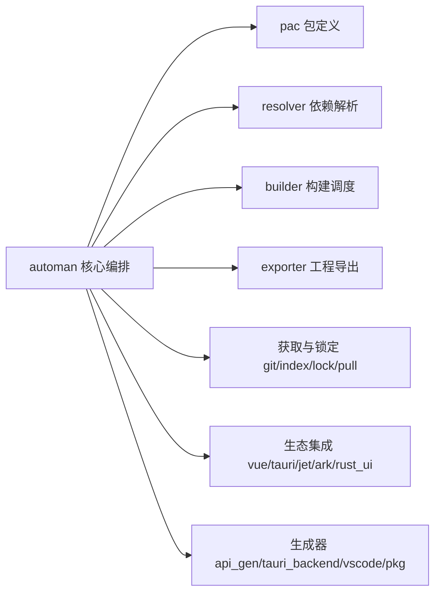

# PLAN-809 R10 received Spec delta before review calibration

### 规范增量

| delta_id | add/modify/retire | docs/specs/... target | before/after rule | rationale | acceptance IDs |
|---|---|---|---|---|---|
| SD-01 | add | docs/specs/auto-man-core/project.md | 规则散在Pac/Target/Dir/Builder→单份管理/图/扫描选择/构建规划、效果边及图错误合同 | 独立核心 | AC-01..04 |
| SD-02 | add | docs/specs/project-model/design/generation-request.md | 无通用生成输入→I-PROJECT字段/来源/覆盖顺序/未知与动态准入/无副作用 | UI工具脱Man前置 | AC-02 |
| SD-03 | modify | docs/specs/project-model/project.md | 静态pilot不变；新增独立请求数据消费，不扩大静态语法或786护栏 | 避免假等价 | AC-02,03 |
| SD-04 | modify | docs/specs/auto-man/project.md | 记录实际core委托/旧公开门面/adapter和仍未迁UI/CLI/发行职责 | 不虚报全Man独立 | AC-01..04 |


## Worktree candidate: docs/specs/auto-man-core/project.md

# auto-man-core — 管理/构建规划规则核心（PLAN-809 SD-01，as-built）

状态：work 树 canonical 草案（随 PLAN-809 merge 入主检出）。

## 职责与边界

单源承载 pac.at 声明归一、Target/Pac 纯选择与投影、链接闭包、源文件选择与构建规划的**纯规则**。语言执行（AutoConfig 求值/转译）、Git/索引/FS 观测与物化、Builder 实际执行、theme compose 留 auto-man 具名 adapter。

依赖闭包恒轻：auto-val / auto-atom / auto-toolchain-core / auto-project-model（+log/glob-match）。无 auto-lang/Parser/VM/UI/进程/网络；外部消费证据 = test/fixtures/modularity/man-core-consumer（cargo tree 断言）。

## 模块与规则（as-built）

- `scene`：Scene（workspace/ui/c/default）。
- `backend`：BackendName（BackendType 轻等价：from_str 含 ark/remote 别名、output_dir rust→"back"）+ RenderSelection（Single/Multi/Split/Absent；from_value 对齐 BackendConfig 三形态）+ frontend/backend/has_multi 选择。
- `target`：Target/TargetKind/TargetOrigin 声明归一（from_with_probe 观测注入；2 参 from 兼容入口保留原 is_dir 探针冻结签名）+ libname/to_node/to_atom/groups 投影 + merge/link 族。
- `dir`/`group`/`node_ext`/`file_types`：数据与纯工具。
- `port`：Port + port_from_node（含完整编译器配置解析）。
- `pac`：pac_from_decl→PacDecl（root wrapper 提升/render-backend 选择/标量族/默认 port builder ninja|cargo|noop）+ 投影自由函数族（all_incs/pac_to_node/exe_path/display_title_in/targets_map/filters）。
- `closure`：resolve_target_deps 五函数族（直接 link 含外部名保留 all_links、传递边只追 map 内、dep_names 只收 map 内、重复 link 不去重）+ **resolve_target_closure 有界准入**（内部环→GraphError::NoProgress：unresolved 全名单+DFS 灰标环候选链；外部 link 不触发；错误后不开始 scan）+ assemble_major_targets + **下载决策族**（dep_fetch_action/pinned_version/admit_new_dep_libs 观测注入/admit_transitive_deps）。
- `selection`：select_flat_entries（skips 精确+glob/FileFilter/头文件）+ STD_SOURCE_SUBDIRS+聚合 + .at 排除表 + auto_recurse 过滤 + check_incs/scan_specific_srcs 解析序。
- `planning`：select_port_binding（PortSelection）+ select_rust_package（RustPackageSpec）+ **BuildOrderItem+ordered_build_renames**（deps 先建/rename 去重执行序）。

## 门面契约（auto-man 侧）

无效果字段类型 re-export 保身份（805 模式）；效果方法以 TargetEffects/DirEffects 扩展 trait 承接（use auto_man::* 方法语法可用）；Pac（效果字段承载者）留在 auto-man，纯方法一行委托 core。

## 验证锚点

crate 单测（closure/selection/planning/target/backend 全规则 oracle）；auto-man plan809_management_core（api_compat_probe 全字段构造 pin/production_delegation_parity/环/V-05）；man-core-consumer 外部全链。


## Worktree candidate: docs/specs/project-model/design/generation-request.md

# generation-request — I-PROJECT 生成请求数据合同（PLAN-809 SD-02，as-built）

状态：work 树 canonical 草案（随 PLAN-809 merge 入主检出）。

## 合同

一次请求承载 UI 生成所需全部工程侧数据：origin（StaticAdmitted{source,unsupported}/DynamicEvaluated{source}）、project_root、identity/display/runtime/scene/members/render（RenderDecl）/toggles/theme_decl（ThemeDeclLite）/dep_roots/package_assets（npm_deps/styles/i18n 求值 Value）/exe_name/has_rust_sidecar/front_decl/input_sources/output_root/mode/raw+raw_nodes。

不变量：
- 无副作用（构造零网络/建目录/编译）；
- 无伪造求值（is_evaluated：静态 origin 需 unsupported 空；RenderSpec::Unknown 不假称前端）；
- 无字段丢失（未知键 raw 保留；B 组键 npm_deps/styles/i18n/exe_name/front/theme 块从 raw 目录回收）；
- 路径按 source 根纯代数（resolve_against_root，cwd 无关）；
- locale 链 display_title(prefers_zh) 镜像 Pac::display_title_in。

## 消费接线（as-built）

auto-man `generation_request_adapter`：request_from_pac（A 组全量投影）+ apply_evaluated_root/apply_evaluated_props（B 组，Pac.props 即求值 root 全量 props）+ request_of 单调用入口。生成器读缝：jet/ark（JetReads/ArkReads）、rust_ui（PacSource：name/exe/window/title/dep_roots/api/external/theme 激活）、vue（VueReads 九字段+Value 等价转换）；全部 `_with_request` 入口，legacy 自扫保留为冻结 oracle（R04 退役）。automan gen/run/build/open 分派全量经请求（零遗留 grep 审计）。

## 边界（as-built 校准，R4）

- **sidecar 声明在本合同内**（R4-02 后）：节点/对象/嵌套三形态经请求承载（raw_nodes+raw），core::sidecar_decl_from_root 单源解析，PacSource 全生成/交付入口消费，不回读主 pac.at。
- dep 自身 pac.at 的 npm_deps/styles 合并（vue 构建内跨文件资源读取，主声明已合同化）、api_gen 的 auto_lang resolve_back_dir——跨文件效果边，R04 迁生成器时收编。
- 全量/无损表述以本 Plan 实测矩阵为准（对拍+来源反转+干扰排除用例见 plan809/adapters 测试）。

验证：project-model generation_request_tests（8）+ project-request-consumer（3+闭包单证）+ vue plan809_v02 双源对拍 + generation_request_adapter 2 完备性。


## Worktree candidate: docs/specs/project-model/project.md

# project-model

> **Status**: active（pilot）
> 路径：`crates/auto-project-model`  | 技术栈：Rust（依赖仅 auto-atom / auto-val）
>
> PLAN-780 交付：轻静态工程声明模型 pilot——脱离 compiler/VM/UI 表达并读取
> 静态工程声明，与执行型配置（`AutoConfig::from_code` → `Pac::new`）对拍。
> 本 spec 为 R5 冻结增量（reviewed_commit `68fcc3bf7`）的 canonical 沉淀。

## 模块与依赖

`crates/auto-project-model` 为静态工程声明模型 pilot，仅直接依赖
auto-atom/auto-val；normal 闭包不包含 compiler、VM、auto-man、UI 或生成器
（外部 consumer 门：`test/fixtures/modularity/project-model/consumer/` 独立
manifest 构建即 AC-01 证据）。文档层自持扫描器，结构化值层复用 AtomParser；
不实现完整语言求值。公开入口为 `parse_document(text, SourceInfo)` 与只读
`parse_file(path)`。读取不执行网络、项目物化或构建；Builder/IndexStore/
AutoVM 不进入 DTO。

## 模型与边界

`ProjectDescriptor` 提供 identity、render/legacy backend、scene/members/
defines、依赖声明、展示/运行字段、toggle、external_backend 及
source/provenance；冻结字段的归一化对齐当前 `Pac` 语义（对拍探针：
`auto-man/src/project_model_adapter.rs`，corpus 门 170 受管文件计数）。
窗口、port、开关、render 形态等按已实现 DTO 规则解释；展示 locale/env
覆盖及构建效果仍由消费层负责。

普通未知属性/节点保留在 `raw_props`/`raw_nodes`；dep 体保留 props、重复
信息和 children，未知节点参数保留 raw_args。重复 path 按末声明覆盖，仍
记录重复及来源。该保留能力不等于完整源文本往返协议，规范不得额外承诺。

静态支持面为已冻结字面量属性、数组/对象、dep 裸名/引号/参数形态、顶层
对象文档（PLAN-729 minimal project format）及已验证注释/分隔形态。变量/
调用/插值/赋值/f-string、显式不支持的 wrapper（`root { … }` 历史形态）及
类型形态通过 `unsupported` 分类或 stage 错误暴露，非静态不计入等价；不
静默执行回退。轻模型的 static 标志不是对全部语言语法的兼容承诺，pilot 以
冻结域和 oracle 对拍为验收依据。

## 注释、错误与已知限制

块注释内部换行只更新源码位置，不形成语法分隔；注释外真实换行与逗号按
已验证容器规则处理。同一行无分隔的相邻值不能因块注释内部 LF 而获 static
标志。数组与对象的旧 VM 逗号规则不完全相同（数组：值后逗号/换行/注释
任意混排；对象：逗号仅同行紧随值，换行后逗号 Err），不能由一类控制推导
另一类。

顶层文档支持 `#` 行注释；当前容器值位 `#` 形态由旧 VM 拒绝，模型亦拒绝/
非静态，不能宣称容器中任意 `#` 注释均合法。旧 VM 允许而 AtomParser 拒绝
的逗号混排（例如 `["a", /*c*/, "b"]`）仍在冻结子集外：模型返回值层错误，
不宣称等价。这是保留限制，不要求扩张完整 VM 语法。

错误携带 source path、stage、位置；文件读取/编码失败是 Io，不以空配置
代替（required corpus 门必红）。扫描失败出口保持消费/返回/错误进度保证；
终止性控制有外部截止。EOF 块注释行为保持当前 legacy 已验证规则，不额外
宣称更严格语法。

## 后续接线归属

静态模型、compiler 执行 adapter 及构建/物化职责分层。auto-man 内部标量
文本读取可后续逐入口迁移；auto-lang registry/loader 接线及依赖边需另立
计划。npm_deps 和构建 targets 暂不扩为完整语义 DTO，现有生产读取保留。
模板渲染和动态配置留在显式上层 adapter；默认生产入口切换未发生（例外见
下）、不建立外仓、不宣称 auto-man 已脱离语言。字段 owner 对照与接线顺序见
`test/fixtures/modularity/project-model/T04-OWNER-MAP.md`（T-04 交付）。

### 首个有限生产消费者（PLAN-786）

auto-man 的 Vue 展示读取器（`crates/auto-man/src/project_display_reader.rs`）
是当前唯一生产消费面：name/title/title_zh 三字段、按值等价准入（含数值
astr 相等案例），**不扩大模型语法**。消费侧安全前置：调用 `parse_document`
前对原文**统计全部 `[` 与 `{` 字符**——无词法跳过、无递减；计数 >64 时
三字段整体路由到显式 DeepNesting legacy 兼容，不触模型（512 层嵌套实测
进程级栈溢出 abort，不可 catch_unwind）。该保守计数可包含字符串/注释内
字符与互不相干的平铺组——它不是实测嵌套深度，也不是语法限制；可能把浅
文档路由到兼容（旧字段值保持），≤64 照常进入解析/准入分类，不从计数推断
任何静态语法保证。已复核的 64/65 边界（数组/对象/节点/混合/平铺/字符串/
注释）与历史进程隔离反例即所选消费包络；模型级递归深度治理不在此次范围，
不宣称任意规模或任意线程栈安全。

registry/loader、其余 Pac/VM 消费者、剩余文本读取与 locale 求值不在本次
迁移范围。PLAN-780 已文档化的 unsupported/错误与语义归一规则全部保留。

## generation_request 独立消费（PLAN-809 SD-03，as-built）

`generation_request` 为具名独立模块（非静态扫描器一部分）：输入可以是静态准入描述（from_descriptor——静态子集与 786 护栏不变、不扩语法域）或动态求值后的显式投影（dynamic/直接构造），不强制工程先过静态扫描器。静态 origin 携带 unsupported 不伪造已求值（is_evaluated 诚实判定）。外部消费证据 = project-request-consumer（闭包 auto-atom/auto-val 单证）。


## Worktree candidate: docs/specs/auto-man/project.md

# auto-man

> **Status**: active
> 路径：`crates/auto-man`  | 技术栈：Rust（clap / serde / reqwest / rust-embed）

AutoMan 构建器/包管理器：AutoLang 工程的构建调度、依赖解析与多生态（Tauri/Vue/VSCode 等）项目集成。

## 目标与范围

- 解析 pac.at 包定义，执行构建（cargo/ninja）、导出 IDE 工程、管理依赖获取与锁定。
- 为 Vue / Tauri / Jetpack Compose / ArkTS(HarmonyOS) / Rust UI(ICED/GPUI) 等前端生态生成或集成工程代码。
- 提供 API 代码生成、Tauri 后端生成、VSCode 扩展生成等代码生成器。
- 不做：不实现语言编译（auto-lang）；不实现通用代码模板引擎（auto-gen）；缓存存储在 auto-cache。

## 依赖解析声明门控（PLAN-635，pnpm 式严格隔离）

`.at` 语言层 `use <dep>.<module>` 的跨包模块解析（`auto-lang` 侧
`resolve_module_path` walk-up 探测）实行**声明门控**：

- `deps/<name>` 目录仅在工程（或祖先目录）pac.at 中声明了同名 `dep` 时可达
  （`dep "<name>" { path: ... }` 引号形态与 `dep <name> { path: ... }` 裸名
  形态均认，词边界检查防 `settings` 误匹配 `settings_v2`）。
- `scene: "workspace"` 工程的 `members: [...]` 成员目录与 `deps/<name>` 同权
  解析（member 表项末路径段匹配依赖名）。
- 物化但未声明的 `deps/<name>`（幽灵依赖）阻断解析，stderr 输出修复指引
  （声明 dep 或加入 members）；junction 失效残留因此惰性化，无需清理。
- pac.at 本地 path 依赖（`dep "<name>" { path: ... }`）按声明天然过门控，
  解析候选序列与 deps/ 一致（src/front → src → 根）。
- pac.lock：本地 path 依赖入锁（记录 resolved path，git commit 可选——path
  即复现锚）；`verify()` 对无 commit 条目校验物化路径存在性。锁文件保持
  TOML 文本可 diff。

## pac.lock 核心抽取分工（PLAN-795）

锁模型/codec/校验规则的单一定义在 `crates/auto-package-lock`
（见 [package-lock spec](../package-lock/project.md)）；`auto-man/src/lock.rs`
是生产 adapter + 兼容门面：

- **adapter 职责**（留在 auto-man）：`Target`→锁条目投影（Dep/Device kind
  过滤、字段提取）、Git commit 观测（`get_git_commit`，`git rev-parse HEAD`）、
  `AUTOMAN_VERSION` 版本戳供给。
- **门面契约**：旧公开 `LockFile`/`LockEntry` 字段构造与
  `new/from_targets/load/save/verify/get/from_target` 方法保持；全部规则
  （排序/查找/校验/编解码）委托 core 单份实现（`LockedEntryView` 视图零
  DTO 往返），无第二套 verify 或序列化实现。
- **格式冻结**：TOML/JSON 字节、错误阶段/文本、统一化路径语义、重名首条
  命中均按 579f6dec0 旧臂冻结（golden 三面钉住：core/门面/consumer）。
- **未迁清单**：resolver/Target/build/exporter/可执行模板仍携语言栈留在
  auto-man；本抽取不解除 `auto-man→auto-lang` 依赖边。此 pac.lock 与
  PLAN-792 的 Cargo.lock 发行锁为不同合同。

## 模板资源层抽取分工（PLAN-803）

三组 Man 资源（`assets/templates` 五族、`assets/builders/ghs`、
`assets/builders/iar`）的嵌入与纯脚手架路径规划单一定义在
`crates/auto-man-assets`（见 [auto-man-assets spec](../auto-man-assets/project.md)）；
`auto-man/src/asset.rs` 是语言/IO adapter + 兼容门面：

- **adapter 职责**（留在 auto-man）：`Templates::copy` 的逐文件
  Auto 求值（`set_global`→`eval_template`→`repr`）与文件物化
  （create_dir_all/create/write），含旧臂失败阶段——unwrap panic 语义
  与「先创建/截断文件再求值」的遗留顺序（行为改善另立计划）；
  GHS/IAR 访问器的 AutoStr 转换；`Templates/GHSTemplate/IARTemplate`
  inherent+RustEmbed 双形态 get/iter/compressed 转发。
- **旧公开面不变**：类型名/方法签名/`pub use asset::*` 根 re-export
  保持；exporter（ghs.rs/iar.rs）与 `Automan::create_by_template`
  消费路径零改动。
- **冻结投影**：五族 copy 成功输出、Unicode 包名输出、未知族零副作用、
  `..` 路径 panic、GHS app mold 预存求值失败边界，均按基线
  `1dd123361a` 旧臂实测冻结（`tests/plan803_asset_facade_tests.rs`；
  探针收据 docs/plans/attachments/803/）。
- **遗留限制如实入账**（非新安全承诺）：模板注入可见性（`set_global`
  侧表对 eval_template 可见——基线实测五族全部渲染成功但插值形态
  含旧 VM 怪癖）、copy 先建后求值的破坏性失败窗口、GHS program.gpj
  模板解析级失败——仍在上层，未随资源迁移修复。
- `assets/` 其余资产（am.at/gallery/shadcn-ui/wm）不属本抽取，仍在
  auto-man（gallery/wm 由 vue/画廊栈消费，shadcn-ui 被 auto-lang
  ui_gen 契约锚定）。

## 工具链规则核心抽取分工（PLAN-805）

工具链配置模型/flag 映射/四命令模板的单一定义在
`crates/auto-toolchain-core`（见
[auto-toolchain-core spec](../auto-toolchain-core/project.md)）；
`builder/ninja/{config,mapper,templates}.rs` 是薄 re-export 门面
（同一类型身份，旧公开路径 `builder::ninja::*` 与根 re-export 不变）：

- **adapter 职责**（留在 auto-man）：`CompilerStore` 动态 am.at 加载
  （AutoConfig 解析/坏节点 warn 跳过/缺文件空 store）、
  `CompilerResolver` PATH/磁盘/进程观测与 MSVC 同目录优先、
  `NinjaBuilder` 生产编排（FlagMapper/CommandTemplates 真实消费 +
  `quote_if_spaced` + ninja 执行）。
- **行为冻结**：八类默认/alias 口径/`map_output` 尾缀语义/render
  次序与占位符保留，按基线 `282e50053` 旧臂 16 件 golden 逐字节冻结
  （`tests/plan805_toolchain_parity.rs`；类型同一性
  `tests/plan805_type_identity.rs`）。
- **遗留缺口如实入账**（非 805 引入，未随抽取修复）：
  `CompilerStore::load_from_am_config` 以 `get_kid(Str("compilers"))`
  找节点，而解析器对文档形 kids 产位置 Int 键——现行 am.at 文档形态
  下加载器恒空载（golden `compiler_store.txt` 冻结该三态行为；修复
  另立计划，见 KNOWN-DEBT P805-D1）。
- 不属本抽取：Target/Pac/构建 DAG、Cargo/Vue 生成器、模板资产
  （PLAN-803 资源与本文的内联命令模板是两个不相交概念）。

## 依赖解析核心抽取分工（PLAN-800）

已解析依赖视图与模块路径规则的单一定义在 `crates/auto-package-resolver`
（见 [package-resolver spec](../package-resolver/project.md)）；
`auto-man/src/resolver.rs` 是语言 adapter + 兼容门面：

- **adapter 职责**（留在 auto-man）：`ExecutionMode`（解析/默认/alias 语义）、
  `ModulePath`/`PathPrefix`/`ModuleResolver` trait 实现接线、pac.at legacy 行
  扫描（`prepare_env`/`load_pac_at`：mode:/use/dep:/("pkg", mode:) 形态与
  警告/缺文件/坏 mode 行为原样）、Pac/Super/None 前缀对语言
  `FilesystemResolver::with_package_root(project_root)` 的委托。
- **门面契约**：旧公开 `Dependency` = 核心泛型条目的语言侧实例
  （`DependencyEntry<ExecutionMode>` 类型别名——字段形状与
  `new`/`with_default_mode` 调用面保持）；`AutoManResolver` 全部公开方法/
  返回类型保持，`get_dependencies()` 直接借用核心内**单一权威 map**
  （无第二份 map/路径算法）；同名 `add_dependency` 替换后立即解析正确。
- **行为冻结**：resolve 三臂无盘构造、exists 差异（无 package.at 臂/键即真）、
  歧义不得成功、错误文本逐字、search 插入序与候选序均按 b0d6d4aab 旧臂冻结
  （T-01 冻结表：`docs/plans/attachments/800/t01-freeze.md`）。
- **未迁清单**：语言 trait/AST 前缀/ExecutionMode/pac.at 扫描/Target/build/
  Git/动态配置/CLI 留 adapter；不复制第二套 ExecutionMode 解析器或 pac parser
  （780 源配置模型与 795 锁 core 所有权不变）。

**标准多包消费样例（PLAN-637）**：`examples/ui/stylekit` 为声明门控的
canonical 消费示范——消费方 pac.at 声明 `dep stylekit { path: "../../ui/stylekit" }`
（相对路径形态）后即可 `use stylekit.styles: <name>` 导入 pub 配方；截至
plan-637 共 16 个 demo 以此形态消费（capability-tests/style-import 为最小
完整样例）。新建跨包消费工程照此结构起模板。

**边界**：auto-lang 不依赖 auto-man crate——pac.at 声明读取为文本扫描
（auto-lang 内实现）；auto-man 物化（junction/symlink/worktree，Plan 475）
与该门控正交互补。

## 脚手架类型面与阶段契约（PLAN-668 SD-01/SD-02）

- **SD-01（tsconfig 类型面）**：gen 模板 `tsconfig.json` 的 `compilerOptions.types`
  显式含 `"vite/client"`——`main.ts` 使用 `import.meta.env`（Vite 注入全局），
  无此类型则 `auto build` 的 vue-tsc 面全体示例 TS2339（P660-D1/P657-D2② 根修，
  vue.rs `generate_tsconfig`）。
- **SD-02（auto-sources 阶段序）**：`src/auto-sources.ts`（Select Anything 源码
  映射，PLAN-646）由 `write_auto_sources_ts` 在 **run 与 build 两阶段**产出（内容
  hash 防抖）——此前仅 `auto run` 写入，`auto build` 的 vue-tsc 面上 overlay.ts
  的 `import from '../auto-sources'` 落 TS2307（P657-D2① 根修，vue.rs
  `build_vue_project` 开头补写）。

## shadcn 脚手架传递依赖（PLAN-706 SD-03）

`vue_shadcn::materialize` 在拷贝前对请求集做**有界传递闭包（≤2 跳）**：扫描已选
组件源码内 `@/components/ui/<name>`，命中烘焙包的并入本次 materialize。典型：
`form` → `label`（FormLabel.vue 内部 import）。无闭包时 Form 页整页 TS2307/500。
Write-if-missing 与 CLI 回退语义不变。

## Rust UI 显式交付模式（PLAN-792 SD-02）

`rust_ui` 生成两显式模式：**开发**（框架仓内共享 `examples/rust-workspace/`
+ workspace 继承清单；仓外项目项目仓内 `rust-workspace/`——既有行为零变化）
与**交付**（`auto gen --delivery-root <dir>`，有效前端须为 rust，否则显式
报错不静默忽略）：

- 交付产物为镜像生产仓布局的受管 bundle；布局/消费根 patch/独立锁/drift
  pin/资源 allowlist/投影修剪合同见
  [repository-boundaries/generated-ui-distribution.md](../repository-boundaries/generated-ui-distribution.md)。
- **错误阶段（受管判红，不静默回退主检出）**：前端无 .at 组件、producer
  源根未解析、闭包 crate/根级编译输入缺失、投影修剪不完整（producer
  结构漂移）、外来非空目录、crate 名重复/应用撞名 → 显式 Err。锁冻结
  （fresh 解析一次）与消费构建（`--locked`）由交付管线/消费侧执行，生成器
  不自动跑 cargo。
- 交付与开发共享编译相位 `compile_rust_ui_app`（main.rs 逐字节同源）；
  `exe_name` [[bin]]（pac_bin_block）、rust_sidecar、`__InitLoaded` 载荷
  类型改写语义两模式同源。

## pac.at 四名称契约（PLAN-015）

每个 AutoUI app 在 pac.at 声明四个名称，展示名与工程标识解绑：

| 字段 | 语义 | 约束与消费 |
|---|---|---|
| `name` | 工程标识（kebab-case），永不承担展示职责 | rust 轨包名/exe 缺省名（snake_case）；os-config 配置查找键 `apps/<name>/config.at`（Plan 504 S7）；注册表条目 `name`。改名即破坏配置/查找键——不轻易动 |
| `exe_name` | rust 轨（a2r）exe 产物名 | 唯一消费点 `rust_ui::generate_cargo_toml`：写显式 `[[bin]]`；合法字符 `[A-Za-z0-9_-]`，非法告警忽略；缺省 = 包名；regen 按 pac 现值重写（Plan 014，auto-term 样板）。vue/VM 轨无 exe，字段无操作 |
| `title` | **英文展示名** | 桌面注册表/窗口标题/document.title 的 en 链事实源；兜底链 `title → name → 目录名` |
| `title_zh` | **中文展示名**（自由文本） | zh locale 优先取用；缺席/空白回落 `title`（两 locale 输出一致，零配置零回归） |

**展示名解析链（locale 臂）**：`AUTO_LOCALE` env（缺省 zh；zh 前缀命中 =
中文链，装载期定 locale、进程内不热切）。zh = `title_zh → title → name →
目录名`；en = `title → name → 目录名`。消费点：注册表
`AppRegistryEntry::display_title`（auto-lang `ui/app_registry`，launcher/
桌面格/LaunchSpec 填充）、VM 窗标题 `Automan::pac_display_title`（→
`AUTO_VM_TITLE`）、vue document.title（`vue::parse_pac_display_title`）。

**边界**：apps.manifest 不承载展示名（条目 = id/repo/kind/ports/status/
daemon；PLAN-015 起 `name` 键退役）——同一 app 的名称只在 pac.at 一处声明。
i18n/{lang}.json 是应用内内容文案机制，与 app 元数据名称无关；展示名不走
嵌套对象/外部文件（注册表保持平铺 `key: value` 行读解析）。

## pac.at opens 文件关联键（PLAN-016）

桌面互操作动词 `open_with`（协议 v1.7，docs/schema/projection-protocol-v1.md
§6）的关联声明面。app 在 pac.at 平铺声明可打开的扩展名集合：

```
opens: ".txt,.md,.at,.json"
```

- 值 = 逗号分隔扩展名列表；规范化为小写、带点前缀、剥空白
  （`normalize_opens`）；未声明 = 空集 = 不参与关联校验（`open_with`
  对其放行）。
- 注册表解析：`parse_pac_fields` → `AppRegistryEntry.opens: Vec<String>`
  （crates/auto-lang/src/ui/app_registry.rs），投影与 LaunchSpec 同源。
- 宿主消费：`execute_open_with` 执行臂校验——目标扩展名非空且不在
  声明集 → 拒绝并 toast；未声明 app id → 未知应用拒绝。
- 与 PLAN-015 四名称契约正交：同为平铺 `key: value` 行读键，互不依赖。

## 静态项目模型 pilot（PLAN-780；PLAN-786 首个有限生产消费面）

现有依赖声明门、pac 字段/展示和构建协议全部保持；本节新增 pilot 说明：

- `project_model_adapter` 为**显式旧新探针**：旧臂 `AutoConfig`→`Pac`，
  新臂轻模型（`crates/auto-project-model`，见
  [project-model spec](../project-model/project.md)），只在冻结域比较。
  生产默认读取保持原路径，**例外=Vue 展示三字段**（PLAN-786，见下）；
  pac.rs/rust_ui.rs 等其余读取零切换，adapter 本身仍是测试/探针消费者。
- static 成功逐冻结字段比较；dynamic/unsupported 只分类，不计相等；
  读取/编码失败使 required corpus 门失败（不以空配置代替）。
- 双拒/模板特例仅允许**完整仓根相对路径精确命中**的有限清单；双拒绑定
  预期新臂 stage；其他意外拒绝必须失败调查。同名/同后缀影子不得获得豁免。
- 当前有限特例为 clib 模板、dynamic-expressions fixture（模板/旧臂拒绝），
  以及 bad-missing-brace/bad-missing-value fixture（双拒，value stage），
  实际文件身份在 adapter 测试清单维护；不允许泛化为任意双臂 Err 均成功。
- 文本副本消除与动态管线后续按 T04 owner map 另立迁移计划。当前模型独立
  消费成立，不等于 auto-man 仓库拆分或生产切换完成。

### 展示字段统一只读入口（PLAN-786）

Vue 工程生成经内部 `project_display_reader` 一次读取 name/title/title_zh
——project-model DTO 的**首个有限生产消费**。字段准入条件：行门槛集合 ==
provenance 行集合、无重复键、唯一声明行的旧行归一与模型值相等；不满足者
走**唯一一份**显式兼容扫描器，保留旧行为（name 首匹配可空串、title 族跳空
续扫）。兼容原因具名：ParseError / HiddenOrPhantomLine / DuplicateKey /
UnsupportedValue / LineFormMismatch / DeepNesting。locale（AUTO_LOCALE
zh 前缀）与 title→name/目录兜底职责保留在原调用者；其余字段/读取器、
物化与 VM 路径不变——不解除 auto-man 的语言依赖、不新增反向边。
DeepNesting 安全前置：`parse_document` 前对原文统计全部 `[`/`{` 字符
（无词法跳过、无递减；>64 三字段整体走兼容、不触模型——512 层嵌套实测
栈溢出 abort 不可 catch_unwind）。计数含字符串/注释内字符与平铺组，
非实测嵌套深度、非语法限制；≤64 照常走解析/准入分类。反例字节与
64/65 边界（数组/对象/节点/混合/平铺/字符串/注释）为持久回归。

## 模块架构



## 模块清单

| 模块 | 职责 | 状态 |
|---|---|---|
| automan | 核心编排：命令分发、工程上下文 | active |
| pac | pac.at 包定义解析与模型 | active |
| resolver | 依赖解析（ModuleResolver trait 实现；PLAN-800 起为语言 adapter——ExecutionMode/pac.at 行扫描/trait 接线留此，路径规则单一定义在 auto-package-resolver，见上节） | active |
| builder | 构建调度：cargo / ninja / tool / vue 后端；ninja 后端 `finish()` 经 `builder/ninja/runner.rs` 探测链解析宿主（Plan 580：`AUTO_NINJA` env 覆盖 → PATH `ninja(.exe)` → PATH `n2(.exe)`（ninja 原作者 Rust 重实现，兜底 `cargo install --locked --git` 钉 rev `b1fead52`）→ 全无返回含两条手动安装路径的 Err），构建非零退出上抛 Err（不再吞状态/spawn panic）；resolver 对 MSVC Linker/Archiver 同目录优先（编译器定位目录下 link.exe/lib.exe 先于 PATH，避免 Git coreutils link.exe 抢先），`setup()` 四工具路径含空格加引号；**PLAN-805 起 config/mapper/templates 为薄 re-export 门面**——工具链规则单一定义在 crates/auto-toolchain-core（见上节），本模块保 am.at 加载/定位/执行 adapter | active |
| exporter | IDE 工程导出：cmake / ghs / iar | active |
| git / index / lock / pull | 依赖获取、注册索引、锁文件（PLAN-795 起 lock 为 Target/Git adapter+兼容门面，规则单一定义在 auto-package-lock，见上节） | active |
| scanner / target / dir / cache | 工程扫描、target 目录管理、本地缓存 | active |
| vue / tauri / jet / ark / rust_ui | 各前端生态的工程集成；vue 侧含 desktop 宿主 scaffold（Plan 465：`generate_desktop_host` + `assets/wm/` WM 运行时资产 rust_embed + `apps-registry.ts` 注册表生成；`auto run --desktop/--apps`；Plan 515：`assets/wm/Wallpaper.vue` 桌面壁纸层三档组件 + host App.vue 生成期配置注入 `shell.desktop.wallpaper`）；**PLAN-038 Phase B（P038-3）**：`generate_tailwind_config`（auto-man/cmd_vue/cmd_tauri）补 `success/warning/info/error → hsl(var(--*))`；`regenerate_source_files` 与 scaffold 同源重写 `tailwind.config.cjs`（磁盘残留旧模板会漏映射）；codegen 全路径（scaffold / write_project_files / regenerate / prepare_vue_sources）写 `src/vite-env.d.ts` + `src/auto-select/overlay.ts` + `src/auto-sources.ts`（缺失时空 map，消除 P657-D2 phase-ordering 对手工 stub 的依赖）；画廊 VM demo 级联发射 `emit_gallery_vm_demos`（Plan 625 T-10/632：loadable 单 widget 示例改名 `Demo*` 相邻拷贝自有模块 + `AppViewport.vm.at` 条件实例化——发射器保证模块组件源可达，组件状态桥接为运行时职责，见 auto-lang docs/specs/auto-lang/ui/architecture.md ADR-20；Plan 633：fullstack 内嵌档——back 语料不再一票否决，back 链传递闭包级联为 `<ns>_<mod>` 唯一 stem（use 行/链内互引/item 调用点限定仅 back 链三层改写，组件调用不动），发射前 core 场景解析探针，back 缺失/native-ns(use auto.*)/~Stream 签名严格降级静态面板，见 auto-lang docs/specs/auto-lang/vm/architecture.md ADR-21） | active |

| api_gen / tauri_backend / vscode / pkg | API/后端/扩展代码生成器，包管理器抽象（bun/npm）；api_gen server 生成器状态种子契约（**Plan 670 F-R1-A**）：`use api::Db`/`State<Db>` 种子仅当契约实际定义 Db（primary 类型存在，api.rs 才发 `pub type Db`）时发射，无 Db 标量契约走无状态退化路径（镜像 db_full_cover 分支形态）——生成物必须可编译（E0432 契约）；route A（无 db 覆盖的 scalar API 实现，以及含非薄业务体的 api.rs handler 内联转译）已落地，伴生模块导入/调用和 `List<T>.new` 构造由 Plan 742 补齐（r1–r5 复审收敛体路径不变量：代码区字面量保持/模块 token 身份与作用域遮蔽/借用实参切分（比较 `<`/`>` 非泛型定界）/返回出口矩阵——详见 design/api-generation-integrity.md §2）；转译失败由装配预检拒绝，`AUTO_A2R_BODY=0` 才允许显式标记的 scaffold | active |
| asset / fs / util / version / error 等 | 基础设施与公共类型；**PLAN-803 起 asset 为兼容门面**——三组资源（templates/builders-ghs/builders-iar）唯一来源与纯路径规划在 crates/auto-man-assets（见上节），本模块保 Auto 求值/IO adapter 与 inherent+RustEmbed 双形态转发 | active |
| up | 升级功能 | disabled（zip 依赖已移除，模块注释停用） |

## 画廊 host 内嵌四档与 routable 档（PLAN-675 SD-01）

`gallery_demo_row` 判四内嵌档，web 臂消费。`loadable`/`fullstack`
（PLAN-633/672）与 `route_stub`（PLAN-642 T-14a，VM 臂专属）语义不变
（routes 一票否决照旧）；**routable（PLAN-675）** = `vp.has_routes` 且除
routes 外无其余内嵌否决（vm-only/ext/locales/i18n；`vp` None → false）。

- **routable 发射**：fullstack 管线全复用（App/lib_api/api 三级瀑布解析
  `resolve_demo_api_client_ts`/组件与 store 共享池/shadcn/npm_merge）+
  per-demo 路由面 `emit_demo_route_face`——`pages/`（per-demo 命名空间，
  防 pages/home 异容撞）、`router.ts`（**createMemoryHistory 工厂**，每
  挂载 fresh 路由态，含参路由 props:true）、`main.ts`（mount/unmount
  入口契约）。无 api 消费不阻断内嵌；消费 api 而无源 → 诚实回退（翻
  routable=false 维持独立提示）。VM 臂不消费本档（仍 route_stub）；
  registry.at 不序列化。
- **注册表与视口契约**：demos-registry routable 行发
  `load: import('./apps/<id>/main')` + `routed: true` + `loadable: true`
  （视口门）；`DemoModule` 接口（mount/unmount 可选，default App 兼容旧
  createApp 路径）。AppViewport：mod.mount/unmount 在册走 entry 工厂
  （os scaffold 源副本与 auto-lang rust_embed 资产字节对齐纪律）。
- **嵌入态改写闭包**（rewrite_api_import，三档通用）：`@/lib/api` 导入改
  指 per-demo lib_api、EventSource 前缀化（672 条目4/5）+ 裸
  `fetch('/api/`、`fetch("/api/` 字面量前缀化（020 媒体面；幂等）。
- **会话准入**：`start_gallery_back_proxy` 对 `needs_session ||
  fullstack || routable` 且有 back/api.at 者建 back_proxy 会话（routable
  臂为 675 补——缺则路由 demo API 404 unknown app）。
- **依赖注入**：任一 routable 行 → npm_merge 通道注入 vue-router ^4.2.0。


## strict 生成门现状（PLAN-095 复验，2026-10-01）

- 历史"静默 abort"（e2deb4f87/gc8f86ef 时代，stderr 恒 5 条 S001 后无消息
  退出）在 3b3014e3→e0fb4e4e 区间已解除——旧→新收据：musk 消费工程
  `auto build --gen-only --strict` EXIT=0（65 组件，CLI 89c22af15c048019）。
- 非法输入口径：未知组件引用 → 非零退出 + 可定位诊断
  （"App.vue 引用的组件 SFC 未编译落盘（dep 源未解析？）：X"）。
- S001 schema drift 维持 Severity::Info；升级/删除逐条判断，不批量改级。

- api_gen 文件分支（PLAN-729）：声明 `FileResponse` 返回的端点生成真实文件 adapter
  （method/headers 提取器 + 委托/内联体 + 共享宿主 serve，`-> axum::response::Response`，
  不包 JsonResponse）；转译失败 = 位置诊断 500 handler，**不落 CRUD 模板**；GET 文件
  路由自动 `.head()`；非 GET/HEAD → 405。TS HTTP 文件方法返回原生 `Response`；Tauri
  IPC 明确 Unsupported。见 stdlib [http-server-files §6](../stdlib/design/http-server-files.md)。

## 上传端点生成（PLAN-730）

- 参数含 `UploadRequest` 的 `#[api]` 端点：Request 提取器置最后（不预读）、
  转译体 await 直发（`try_transpile_body` 对 `Future<T>` 端点置位 async 上下文）、
  收据映射真实 status + JSON（不落 CRUD 模板；非 POST/PUT 405）；main 安装宿主
  executor；TS 客户端 FormData 直传。契约见
  [auto-lang/trans/design/http-upload-lowering.md](../auto-lang/trans/design/http-upload-lowering.md)
  与 [stdlib/design/http-server-uploads.md](../stdlib/design/http-server-uploads.md)。

## checked generation 与错误传播（PLAN-734）

- route A（endpoint body → a2r 内联转译）已是生产实现源（旧的“未建/空桩”
  描述过时）。Plan 742 补齐 handler 体路径的集合构造、伴生模块导入/调用、
  借用和 Option 返回适配；`D-742-1`（db/repository 模块内 `use api: Note`
  类型导入解析）仍在债务簿单独跟踪，不能视为本计划已解决。PLAN-734 起：strict 解析门（失败=Err，lenient 显式
  opt-in）；真实实现优先（转译失败不落 CRUD 模板）；`AUTO_A2R_BODY=0` 重语义
  = SCAFFOLD 标注；`generation.json` ready 记录 + `AUTO_REUSE_BACKEND=1`
  复用新鲜度门；全部 8 个生成入口 Err 硬传播（vue/tauri/rust_ui 的 warn/
  静默丢弃清零）。契约见 [design/api-generation-integrity.md](design/api-generation-integrity.md)。

## 服务进程托管与 ready 身份（PLAN-736）

- `crates/auto-man/src/http_service.rs` 是 `auto service` 的进程托管面：VM 轨 =
  进程内大栈 VM 线程（32MB，同 start_vm_server）+ `bound_addr_snapshot()` 等待真实
  bind（port=0 解析内核分配地址）；rust 轨 = 734 strict 门重新生成 → `cargo run
  --release` 子进程 + service JSON 经 `AUTO_HTTP_SERVICE_JSON` env 注入 re-resolve。
- **ready 探针**：legacy 的纯 TCP-connect 判 ready 已废弃——`probe_service_ready`
  走 `GET /__auto/health/ready`：503=未 ready（不再误判），404=legacy 无控制面按
  可继续处理；`start_api_server`/`start_vm_server`（UI split 消费方）共用该探针。
- 占口/生成失败/初始化失败不得 ready：rust 轨子进程 bind/配置失败 exit(1)/exit(2)
  → parent 非零；VM 轨 serve fatal → Err 非零。父进程当前以退出码 + 状态码探针承载
  rust 轨判定，不消费 health 身份体做核对（P736-R1 增强候选）；734 新鲜度门
  （`AUTO_REUSE_BACKEND=1` 复用臂）维持不动。
- 关闭：shutdown 端点与 Ctrl+C/SIGTERM 同 watch（VM 网络线程 join / rust 子进程
  有界排空后 parent 退出），端口与子进程零残留。部署/配置/策略合同见
  [stdlib/design/http-service-deployment.md](../stdlib/design/http-service-deployment.md)。

## PLAN-809 管理核心委托（SD-04，as-built）

- 单一规则源=auto-man-core（声明归一/闭包含有界图准入/源选择/构建规划/下载决策）；本 crate 经 re-export 门面+扩展 trait（TargetEffects/DirEffects）保持旧公开面身份与方法语法；Pac/Builder/Automan 仍在本 crate（效果承载者）。
- I-PROJECT：生成器（vue/jet/ark/rust_ui/tauri）项目读取经 generation_request（`_with_request` 全入口）；gen/run/build/open 生产分派经 generation_request_adapter::request_of（automan+main 零遗留 legacy 分派调用，grep 审计）。legacy 自扫路径保留为行为冻结 oracle，R04 迁移退役。
- 未迁面（如实）：语言执行/AutoConfig 求值、Git/索引下载执行、三 Builder 进程执行、exporter、UI 生成算法本体（R04）、dep pac.at 跨文件/sidecar spec/resolve_back_dir 读取（R04 收编）。
- 777：auto-man-core 入 man-ecosystem 域；基线重采样收据 attachments/809/t07-777-strict-pass.json（verdict=pass violations=0 grandfathered=2 R5 退出项）。
