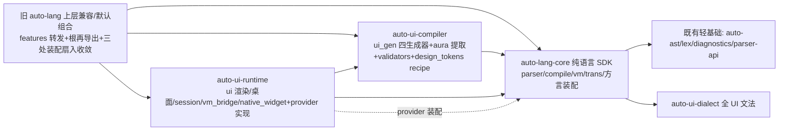

# PLAN-814 T-01 合同基线（contract-baseline）

2026-10-20。r1 会话只读盘点 + 811 合入后唯一树整链 probe。**r2 修订说明**：
本基线在 r2 合同（plan_revision 2，M814-A/B 阶段交付）下继续有效——盘点事实
与 probe 冻结结论直接服务 r2 T-01；r1 的"等 810/811 合入"启动门已被 r2 §4
取代（四前置均已交付）。probe 在唯一树 `D:/autostack/.wt/lang-814/auto-lang`
执行，切片提交 `be10024ab`（基面 master `203e2ce91`）。

## 1. 基线身份与源

| 项 | 值 |
|---|---|
| 只读盘点基面 | 主检出 master `08ba8ca2b`（2026-10-20 上午；当时 811 未合入） |
| probe 基面 | 唯一树 `D:/autostack/.wt/lang-814/auto-lang`，分支 `codex/plan-814-dev`，基面 master `203e2ce91`（811 收口 HEAD），切片提交 `be10024ab` |
| 前置状态 | 807/808/810/811 全部 archived；811 交付后 `crates/auto-media-core` 落地、`ui/image_pipeline.rs`（26 行）/`ui/media_service.rs`（14 行）已门面化（实测核实） |
| 权威输入 | specs：auto-lang/project+frontend+vm+ui、auto-ui-dialect/project、auto-parser-api/project、generated-ui-distribution；报告：v06-extraction-execution-roadmap v5、sdk-tools-parallel-order-814-816、staged-delivery-review-814-816（r2）；快照：sdk-tools-batch-20261019、sdk-tools-r2-20261020 |
| 调查方式 | 5 路并行只读盘点（API 面/全局态/测试族/资源/消费者）+ 关键断言直读复验；probe 四项机制实证（§15） |

## 2. 现状包图与规模事实（master 实测）

### 2.1 工作区既有轻基础 crate（拆包可复用的地基，不新建 common 巨包）

`auto-val`/`auto-atom`（data 域）→ `auto-lex`(789)/`auto-diagnostics`(793)/`auto-ast`(799，含 UI 兼容节点 R10 退出) → `auto-parser-api`(801，轻 CompilerSession/Scenario/ExternalDialect/ParseContext) → `auto-ui-dialect`(806+810，完整 UI 文法单源) ；另有 `auto-text-core`(807)/`auto-terminal-core`(808)/`auto-media-core`(811)、a2r-std（runtime 域，被 auto-lang 以**文本内嵌+依赖双形态**消费）、auto-macros/auto-cache/shim-metadata/auto-bindgen/auto-test-case（lang-infra）。Man 生态 core 群（gen-core/package-lock/package-resolver/man-assets/toolchain-core/man-core）与本 Plan 无关。

777 域映射（`.autoos/module-boundaries.toml` [domains.members]）：`auto-lang = "lang-monolith"`（core+UI 五目录混居的已知债）、`auto-ui-dialect = lang-core`、`a2r-std/auto-terminal-core/auto-media-core = runtime` 等；9 条 forbidden_declared 规则中约束本 Plan 的：`lang-no-man-no-tools`（monolith→man/工具）、`out-of-root-edges-must-be-optional`（monolith/lang-core/runtime→外部仓必须 optional）、`ui-no-man-big-lib`。**拆包后 auto-lang 不再是 monolith，777 域表与基线须随包图重构**（T-08 范围）。

### 2.2 auto-lang 巨型 crate 规模（行数 wc 实测，811 合入后口径）

| 域 | 文件数 | 行数 | 备注 |
|---|---|---|---|
| `src/ui/` | 188 | ~243,000 | iced 63,701 / desktop_protocol 36,337 / autodown_editor 10,838 / code_editor 9,284 / style 8,414 / terminal 4,737 / native_dock 3,361 / mpv 3,077 / debug 2,675 / scroll 1,915；image_pipeline/media_service 已降门面（811） |
| `src/vm/` | 88 | 106,713 | codegen 16,752 / engine 14,108 / ffi/stdlib 13,900 / native 13,354；**对 `crate::ui` 生产引用仅 2-3 文件**（§4.2） |
| `src/ui_gen/` | 42 | 87,614 | vue 34,468 / rust 17,736 / jet 11,254 / ark 5,988 / widget 3,878 / shared 2,890 |
| `src/trans/` | 20 | 52,291 | rust 31,722 / c 4,655 / python 3,251 / r2a 2,766 / gdscript 2,209 |
| `src/aura/` | 8 | 13,511 | schema 6,618 / extract 2,387 / types 1,439 / schema_loader 1,022 |
| `src/design_tokens/` | 4 | 3,043 | recipe 1,616 |
| `src/a2ui/` | 4 | 2,012 | export/import/schema |
| 顶层 `src/*.rs` | ~70 模块 | — | lib.rs 8,394 / parser.rs 18,020 / compile/session/config 等 |

最大单文件：ui/iced/renderer.rs 41,976 · ui_gen/vue.rs 34,468 · trans/rust.rs 31,722 · ui/aura_view_builder.rs 27,955。UI 约占 crate ~52%（Cargo.toml:13-19 注释口径）。default feature = `["with-file-history", "ui-iced"]`（crates/auto-lang/Cargo.toml:20）。

## 3. 旧 public API 构造面（冻结清单）

### 3.1 根再导出（lib.rs，全部 12 条 pub use）

**Core 无门控 9 条**：`InferenceContext`(:164)、`SharedTypeRegistry`(:165)、`Parser`(:177)、`DialectPriority`(:181，薄 re-export 自 auto-parser-api)、`ParserBridge`(:182)、`Atom/AtomReader`(:209)、`{atom,node,value}` 宏(:213)、`AutoInterpreter`(:216)、`SymbolLocation`(:219)。

**UI feature 门控 3 组**（lib.rs:8262-8276）：
- `#[cfg(feature="ui")]`：`view_to_vtree, App, AppResult, Component, Style, VNode, VNodeId, VNodeKind, VNodeProps, VTree, View, ViewBuilder`（12 名）
- `#[cfg(feature="ui-interpreter")]`：`{EventContext, EventRouter, EventType}`、`{HotReloadComponent, UIWatcher}`、`{DynamicMessage, InterpreterBridge}`（8 名）
- `#[cfg(feature="ui-iced")]`：`ComponentIced, IntoIcedElement`（2 名）

`CompilerSession/Scenario` 本体已在 auto-parser-api（session.rs:24 re-export）。结论：**根再导出面已天然二分，UI 名全部有 feature 门**——旧包同名 feature 转发 + 再导出即可保兼容；SDK 新包不复制这批门控名字。

### 3.2 Parser 公开面（parser.rs）

- **17 个 pub 字段**（:198-318）：`scope/db/cur/skip_check/compile_dest/errors/warnings/error_limit/infer_ctx/type_registry/type_store/module_tracker/lambda_id_gen/session/script_pragma/rust_pragma/saw_bare_null`——全部 Core 类型，**零 UI 类型**。
- 构造族：`from`(:324)/`new`(:343)/`new_with_note`(:423)/`new_with_note_and_first_token`(:485)/`new_with_type_store`(:1046)/`set_dest`(:403)/`set_type_registry`(:411)/`set_database`(:419)/`skip_check`(:548)。
- **`with_session`**(:561-565)：只重建内建方言段（`dialects_builtin = build_dialects(&session)`）；外部方言（pre/post 段）跨 with_session 保留。
- 方言注册：`register_dialect`(:573)/`with_dialect`(:587)/`register_external_dialect`(:602)/`with_external_dialect`(:618)。
- **UI 结构耦合唯一点**：`build_dialects`(:879-887) 在 `session.scenario == Scenario::UI` 时压入 `crate::dialect::ui::UiDialect`（:884，直读确认）。UiDialect（dialect/ui.rs:24）本体是薄 adapter，语句体全部委托 auto-ui-dialect（dialect/ui.rs:51-84）。
- parser.rs 零 `crate::ui::` 渲染域引用；AST 层引用 `crate::ast::ui::{ViewNode,MenuItemEntry,ViewProp}`（:13500/:14855-14867/:15993，R10 兼容节点）与 auto_ui_dialect 委托（:13307-13334）。

### 3.3 VM 公开面

- `AutoVM`（vm/engine.rs:459）：pub 字段 `flash/native_interface/strings/string_dedup/tasks/id_gen`。构造 `new`(:814)→`new_inner`→**`NativeInterface::production()`**（native.rs:755-770：register_std_shims → ffi::register_stdlib_ffi → interop → **build_from_inventory()** → nanbox 覆盖）；`new_with_capture`(:1165)；`merge_native_interface`(:1325)。
- `NativeInterface`（native.rs:112）：双表（static_shims/dynamic_shims）+ **九个宿主能力 provider 槽**（frame/clipboard_text/clipboard_media/scroll/code_editor/dialog/dnd/editor_snapshot/terminal）+ 注册 API 族（register_static:1199/register_dynamic:1214/register_dynamic_with_id:1228/register_typed_shim_by_name:1362/register_method_shim_by_name:1391/register_name:1410）。
- **provider trait 全部定义在 vm/host_capabilities.rs**（:28/:95/:175/:297/:411/:508/:593/:658 + terminal 用 auto_terminal_core::TerminalHostProvider），九个 `PROCESS_DEFAULT_*` 进程槽同文件；AutoVM 侧九族 set/getter（engine.rs:1334-1485）。装配三级契约（显式 set > 构造期快照 > if-absent 补缺）已是既定机制（779/785/790/794/802/804/807/808 八批次沉淀，811 媒体族同构）。
- native 目录单源：`for_each_native!`（vm/native_catalog.rs:13，#[macro_export]）；UI 相关 native 族 ID 表（code_editor 22 个 2910..9913、frame 9918/9919、clipboard 2925..2937、dialog 2927/2928、scroll 9900..9923）。
- 其余回调注入：`set_host(crate::host::SharedHost)`（engine.rs:1035）、timer 族（:1047/:1062/:1070）。

### 3.4 方言/桥

`Dialect` trait（dialect.rs:23）/`DialectPriority`+`ExternalDialect`（auto-parser-api 薄 re-export，dialect.rs:69/:75）。`ParserBridge`（parser_bridge.rs:42）pub 面 17 方法（:47-162）；**双重端口实现**：`impl ParseContext`（:196）+ `impl auto_ui_dialect::UiParseContext`（:276 起，810 交付）。

### 3.5 UI 域模块入口

- `ui/mod.rs`：~60 pub mod + 顶部 re-export（App/Component/Style/View/VTree 族/DebugLayer 族/HostBackend，:280-287）。
- `ui_gen/mod.rs`：`BackendGenerator` trait（:89）+ 四生成器 `VueGenerator`(vue.rs:416)/`JetGenerator`(jet/generator.rs:74)/`ArkGenerator`(ark/generator.rs:60)/`RustGenerator`(rust.rs:74)；api.rs 公开 `transpile_file/transpile_aura/transpile_vue_aura/generate_component_from_file` 等（:26-630）。
- **重名陷阱（两套 WidgetRegistry）**：`ui_gen::widget::WidgetRegistry`（registry.rs:31，WidgetSpec 表，`with_defaults()` :54 进程 OnceLock，依赖 aura schema）vs `ui::widget_registry::WidgetRegistry`（widget_registry.rs:11，AuraWidget 表+route_aliases，无 with_defaults）。另有第三登记面 = docs/schema/aura.at（777 assets 表 owner=auto-ui R6）。三者分属 compiler/runtime/数据文件，schema_drift 对拍围栏必须跨包保留。
- aura（types.rs：AuraWidget:63/AuraStore:402/AuraRoute:538 等 + schema_loader.rs:845 `default_schema_cached()` OnceLock+Box::leak 单源）、a2ui（export/import/schema）、design_tokens（`pub use recipe::*`，registry.rs 纯静态 ThemeSpec 表 + recipe.rs:141 thread_local 编译期 recipe 登记）。

## 4. owner DAG 与 Core→UI 焊点实况

### 4.1 顶层文件混合度（grep `crate::ui`）

| 文件 | 引用数 | 性质 |
|---|---|---|
| lib.rs | 57 | 生产代码：`install_ui_host_capabilities()`（:470-497，cfg any(ui,ui-dialog)，装 8 provider）；`run_file_dynamic_ui_inner`（:5630-5656，auto run UI 入口同套安装）；UI 编译辅助 :3716-3747；transpile 场景分发引 ui_gen 四生成器 :7394；运行 glue :7856-8055 |
| back_proxy.rs | 21 | media/photo service 耦合（:151/:243/:391/:824-885/:1007-1130）——811 后 media 半面已走 auto-media-core，photo_service 残留（本 Plan T-06 具名） |
| a2r_std.rs | 3 | 双门控桩（:1229-1252，feature ui 时 frame_bench 帧值、否则返 0）——**a2r 直接 frame 残边（AC-04/T-02 r2 立即清除目标）** |
| plan370_test_support.rs | 6 | 测试支持 |
| compile.rs/config.rs/parser.rs/session.rs/dialect.rs 等 | 0 | 纯 Core |

### 4.2 vm 子树反向边（生产代码仅 2-3 文件）

1. ~~`vm/ffi/stdlib.rs` → `crate::ui::image_pipeline`~~（811 已清偿：直调 auto-media-core）。
2. `vm/autodown_natives.rs:61` → `ui::autodown_editor::autodown_editor_text`（feature autodown 门控，跨仓 autodown-core 轨）。
3. `vm/ffi/term_engine.rs:433/:439` → `ui::terminal_provider`（窗口尺寸投影）。
其余 native.rs 17 处全在 cfg(test) 或注释；vm/native.rs:13013 起另有 FontSystem OnceLock（cosmic-text，非 UI 目录但同款进程级字体态）。

**方向结论**：真实边是 **UI→VM**（15 文件：vm_bridge/session/dynamic/各 provider/handler_codegen/app_registry 等）+ Core→UI 焊点集中在 lib.rs/back_proxy/a2r_std 三处（777 焊点表另列 vm/native.rs、database、build.rs、aura/validate，共九点）。拆包后 SDK 无 UI 实现的证明面 = 上述焊点全部归上层或经 provider/端口倒置。

## 5. 状态/单源点归属清单

### 5.1 留纯 SDK

- lib.rs 基础件：`GLOBAL_RT`(:15 全局 tokio)、`ERROR_LIMIT`(:231)、`VM_DEBUG`(:234)、`SCRIPT_ARGS`(:240)、env OnceLock 族(:285-352)、`BOOTSTRAP_LIB`(:2404)、`EXTERNAL_BACK_ROOT`(:3295)、`LAST_RUN_TRAP_CODE`(:555 thread_local，执行线程内 relay)。
- vm 侧：`BIGVM_NATIVES/NATIVE_ID_MAP`（native_registry.rs:503-510）、`bare_native_intrinsics`（codegen.rs:541，**注释明令禁第二份手抄**，vue natives.d.ts 同源）、vm/ffi 的 http/net/task 单例（stdlib.rs:4593/:4916/:9232 thread_local **VM 线程亲和**、:4979/:9729 进程级）、rc.rs、`host_capabilities.rs` 九槽（接口+槽归 Core，实现在 UI 侧注册——现架构已如此）。
- `SharedTypeRegistry`（type_registry.rs:70，Rc 实例持有非全局）、CompileSession（compile.rs:233，全实例态）、module_cache（实例态）。
- `list_data.rs:181 static mut DUMMY`：deprecated 兼容臂 unsafe 全局——拆包搬动时最易引入 UB 的点，迁移时保持单份不动。

### 5.2 归 UI compiler（编译轨）

- `ui_gen/` 全部 thread_local 编译上下文：rust.rs:196+（ROOT_STATE_FIELDS/STORE_NAMES 等）、validators.rs:131（SEEN 进程去重）、`ui/handler_codegen.rs:31-214`（store 改写上下文，采集与合成须同线程）。
- `STORE_EXTRA_FILES`（lib.rs:19-22）与 `USE_DIAGS`（lib.rs:34-43）：**thread_local 编译带外通道**（ui_gen/api.rs:713 clear/:762 push；drain lib.rs:25/:46）——拆包后 compiler 若独立线程，跨线程 drain 即静默空，须随编译入口同线程收敛或显式 API 化。
- `design_tokens/recipe.rs:141` REGISTRY（编译期 recipe）；`ui_module_parse_failures`（lib.rs:4246 OnceLock 台账，vm_bridge.rs:624 读）。
- `aura/schema_loader.rs:845` schema 缓存：**VM 渲染轨也消费 schema**（AuraViewBuilder），若 compiler/runtime 分包则需下沉共享只读（候选：留 SDK 或独立轻数据访问）——probe 决策点 D5。

### 5.3 归 UI runtime（VM 渲染轨/宿主）

- `ui/native_widget.rs:153` GLOBAL（进程级工厂注册表）、`ui/aura_view_builder.rs:258`（autodown 流缓存，含 DynamicMessage）、`ui/iced/**`（renderer.rs 重量级单例族：INPUT_TEXT:36/TEXTAREA Box::leak:68-74/SHELL_EVENT 通道:11008+/图片 SVG 文档缓存:8151+/blocking reqwest:8218；snapshot.rs:55-88）、`ui/style/theme/mod.rs:41/:122`（**活动主题真源在 thread_local**）、`ui/mpv/widget.rs:138-140`（RUNTIMES 非 Send 只活 UI 线程）、mem_guard、`libs/builtin.rs:35` UI console 进程单例、`host_adapters/dialog.rs:112` HWND、photo_service、i18n_lookup。
- 装配扇入（现三处重复，拆包归 runtime 单点）：lib.rs:473-497、lib.rs:5630-5656、ui/vm_bridge.rs:634-650——**曾发生 plan320 毒化缺席窗口**（host_capabilities.rs:770 附近注释），第 4 份复制是已知风险形态。

### 5.4 跨包双真源风险（T-02..T-06 必验）

1. native 词汇三套登记（WidgetRegistry spec / NativeWidgetRegistry 工厂 / aura.at 权威）跨包漂移围栏。
2. **inventory 链接期收集**（vm/ffi/mod.rs:82-92 StaticFFIRegistration → stdlib.rs:6351+ 提交 → native.rs:1545 build_from_inventory）：shim 与收集方分包则不吃链接即静默失联（host_capabilities.rs 头注释已立"不依赖 linker 偶然性"原则，FFI 面仍靠 inventory）。
3. thread_local 带外通道（§5.2）跨线程丢失。
4. FontSystem 多实例（code_editor/core/mod.rs:3619、vm/native.rs:13013/:13096/:13143、renderer.rs:3578 等 6+ 处 OnceLock<RwLock<FontSystem>>）——已是一种局部双源，拆包不改现状但不得新增。
5. 主题双端同源（style/theme thread_local ↔ code_editor/theme.rs:378 桥）。
6. "进程即应用"假设（EXTERNAL_BACK_ROOT/SCRIPT_ARGS 等）在 LSP/daemon 多 crate 共存形态下需重审。

## 6. 资源与 build 输入归属

| 输入 | 现位置 | 归属草案 | 风险 |
|---|---|---|---|
| build.rs 全仓指纹闭包 | crates/**.rs/toml/lock + 根 lock + AUTO_DOWN_ROOT + src/ui_gen/**（build.rs:63-108） | 拆包后各新 crate build.rs 重界闭包 | **最高风险**：漏输入或跨包重编风暴；OUT_DIR 契约唯一消费点 stdlib_assembly/manifest.rs:7 |
| `AUTO_UI_GEN_FINGERPRINT` | build.rs:9-13/:138-141 扫 ui_gen | UI compiler | 消费方 database/ui_cache.rs:34-37 若留 SDK 需跨 crate 协议 |
| stdlib/（182 .at + assembly-providers.json） | 仓根 | SDK | `../../../../stdlib` 相对路径内嵌（**挪 crate 位置即断**）；image*.at 连向 VM media native |
| docs/schema/aura.at（6,225 行）+ stdlib/aura/ | docs | 共享只读（probe 决策 D5） | ui_gen 与 ui/aura_view_builder 双消费；777 assets owner=auto-ui R6 |
| stdlib_assembly 内嵌源清单 | manifest.rs:232-283（根 lock/auto-macros/vm/native*/vm/ffi/*/trans/a2r-std 全套） | SDK | 硬编码文件列表，模块归属变化需同步 |
| assets/*.at（shell/switcher/notification_center/dashboard/desktop） | crates/auto-lang/assets | UI runtime | **desktop.at 双内嵌**：ui/shell.rs:164 + ui_gen/vue.rs:32743（需单一 owner + API 共享） |
| Inter 字体×3 + 壁纸×2 | src/ui/iced/assets | UI runtime | ui-iced 门 |
| vm/ffi/c_bindings/*.json | vm/ffi | SDK | — |
| aavm 语料 corpus_m1..m4/use/a2r（219 文件；**corpus_m5 目录不存在**，AGENTS 表中 m5 指 packages/aavm/lib/engine.at 终段） | crates/auto-lang/test/vm/aavm2/ | SDK（测试语料） | CARGO_MANIFEST_DIR 相对解析 |
| 792 交付闭包（811 后 14+1 crate，**含全库 auto-lang——如实披露非纯 core**） | generated-ui-distribution spec | T-08 更新为新包图 | 814 后闭包成员按真实包图重采 |

## 7. 测试族与选择面映射（迁包不丢面机制）

### 7.1 选择面机制事实

- **全部别名硬编码 `-p auto-lang --lib`**（.cargo/config.toml:68-115）——拆包即断点，需扩多 `-p`（**probe 已实证可行形态，见 §15-P6**）。
- default-filter 七排除（nextest.toml:32）：str_churn_bounded_large/aavm2_t3_tower_milestone/vm_file_tests::/cookbook_vm_tests::/conformance_tests::/widgets_gallery_all_front_pages_compile/**ui_gen::**——全部按**测试名前缀**匹配，前缀随包名变化需同步三份 toml（nextest/nextest-full/nextest-t3）+ mem 组 overrides（mem-xl/lg/md 名单 + ffi-dual）。
- **tu 单进程语义**：ui_gen 测试全部内联在生成器源文件 `mod tests`（vue.rs:20993 330 测/rust.rs:13554 85/jet+ark generator 等，共 ~870）；单进程使 `WidgetRegistry::with_defaults()` OnceLock（registry.rs:54-67，~1.1s 构建税）全档只付一次——**registry 与测试必须同包**，否则机制失效。
- `heavy_gate` 机器锁 + `pub(crate)` 可见性（lib.rs:8239 tests 模块挂载）是跨树共享前提，拆包后需上位化。
- t 档三件套集成测试：`--test schema_drift --test docs_gen --test component_registry_test`（27 个集成测试目标中的三个）——schema_drift 横跨 aura/ui_gen/ui/a2ui（归上层对拍）；docs_gen/component_registry 归 UI compiler。**probe 实证：--test 旗标在多 -p 下对缺该目标的包不报错**（§15-P6）。

### 7.2 族 → 包归属映射表

| 测试族 | 档 | 归属 |
|---|---|---|
| iced 族（ui:: 内联 ~1993 测 + iced-layout-tests 自门） | t/tf | **UI runtime**（/STACK:32MB 链接参数随迁） |
| ui_gen 族（~870 内联） | tu/tf | **UI compiler**（OnceLock+单进程机制原样保留） |
| trans 族（a2c/a2r/a2ts/probes/gates） | tt | **SDK**（a2r_std_signature_parity 横跨 SDK↔a2r-std，留 SDK 作 parity 门） |
| book 族 | tb | **SDK** |
| corpus 三族（vm_file/cookbook/conformance） | tv/tf | **SDK**（语料随 crate 走，MANIFEST_DIR 相对解析不变即零改） |
| 1M churn（str_churn_bounded_large） | tf | **SDK**（crate::vm） |
| aavm 族（含全部 XL/LG/MD/t3 塔） | taa/ta/t3 | **跨包**：SDK 全管线+a2r+rustc——留上层语言仓集成档，三份 nextest mem overrides 整体搬移 |
| 画廊围栏 | tf | **跨包**：parser+ui_gen+外部 auto-os 语料——上层兼容 |
| http 族（th + plan7XX） | th/日常 | **SDK**；例外 plan083（decode_payload 在 ui::dynamic）跨 runtime |
| host provider 探针族（plan779/785/790/794/802/804/807/808 + media-core） | 日常 | **上层兼容**（测的就是 core↔runtime 缝） |
| 仓根 test/（parity/runners/modularity fixtures） | — | 留语言仓顶层 |

## 8. 真实消费者清单与切换排序

| 消费者 | 依赖形态 | import 面 | 判定 |
|---|---|---|---|
| **crates/auto-vm** | path 无 feature（default 拖 ui-iced） | 仅 8 处：parser::Parser、vm::{codegen::Codegen, engine::AutoVM, native_registry::register_builtin_natives, virt_memory::VirtualFlash, loader::RelocType}（main.rs/dump_code.rs）；纯 bin 叶子、无下游 | **首选 SDK 切换者**（r2 T-02 V-01 当期证据） |
| crates/auto-gen | path 无 feature | interpreter/atom/ast | 纯 Core，第二候选 |
| crates/auto-lsp | path 无 feature | ast/database/scope/Parser/SymbolLocation 等，**零 ui::** | 纯 Core（面宽，规模化验证者） |
| a2r-actor-tests | path | 仅 trans::rust::transpile_rust | test-only 附带验证 |
| auto-playground | path | trans/vm/run_with_capture 系 | Core 但依赖 lib.rs 运行时 helper——SDK 须收编这些入口后再切 |
| crates/auto（CLI） | default=[ui-iced,python,autodown] | ui 34+ui_gen 13+design_tokens 4+vm 15+trans 12… | 混合最大面，留兼容层 |
| crates/auto-man | features=[ui-iced] | ui:: 144+ast 77+config 67+ui_gen 45… | UI 最重消费者，留兼容层（815/816 承接后续） |
| shell-pack | 显式 ui-iced | ui:: 124 | UI 消费者 |
| examples/rust-workspace（50+ 生成工程） | workspace path + ui-iced 转发 | 生成 Rust UI 后端 | 生成产物消费面，闭包重采（T-08） |
| auto-xml | workspace 条目缺失 | 休眠 | 不阻塞 |

**关键事实**：所有未写 feature 的消费者（auto-vm/auto-lsp/auto-gen/auto-playground/a2r-actor-tests）今天都经 default 拖着 ui-iced 编译闭包——SDK 切换 = 依赖改指新包 + `default-features=false` 语义，即"真正非 UI 消费者无 UI checkout/编译"的证明面。

## 9. 候选布局（probe 冻结，2026-10-20 切片 `be10024ab` 落地）

- **已冻结（probe 证据 §15）**：包名 `auto-lang-core`/`auto-ui-compiler`/`auto-ui-runtime`（无碰撞、workspace 编译通过）；DAG 方向 Compat→{SDK,UIC,UIR}、UIC→SDK、UIR→{SDK,UIC}；旧 auto-lang 无条件依赖三包=兼容/组合层（允许含 UI）。
- **SDK** = 现 auto-lang 减去 ui/ui_gen/aura(提取面)/a2ui/design_tokens 的全部 + lib.rs Core 面；VM host_capabilities 九槽与 provider trait 留 SDK（接口）；`build_dialects` UI 压入留 SDK（UiDialect→auto-ui-dialect 是 lang-core 合法边，**文法组合≠UI 实现回流**）。
- **UI compiler** = ui_gen/** + aura 提取面 + validators + design_tokens（recipe+registry）+ a2ui；生成 canonical runtime/SDK import 由一份路径策略产生。
- **UI runtime** = ui/**（iced/desktop_protocol/code_editor/style/theme/terminal view/native_dock/native_dnd/scroll 语义层/mpv/photo_service/i18n_lookup/vm_bridge/session/shell/mcp_server/headless/interpreter/dynamic）+ host_adapters + provider 实现 + `install_ui_host_capabilities` 收敛点。
- aura schema 缓存归属（D5）、compile/VM 是否进一步内部分层，随 T-02/T-03 迁移实际冻结。

## 10. 默认组合与旧 API 兼容方案（probe 验证结论）

1. **根再导出已 feature 门控二分**（§3.1）——旧包保留同名 feature + 同名 re-export 即编译兼容；无门控 UI 名为零。
2. **Parser/AutoVM 签名面纯 Core**（§3.2/§3.3 pub 字段/构造全 Core 类型）——SDK 直接拥有原实现即保类型身份；**probe 实证模块级 `pub use` 再导出保类型身份**（§15-P2，auto-lsp 直连消费编译通过），不需 Deref 双 Parser/VM 形态（完整面 pin 在 T-02/T-05 编译门）。
3. **默认 UI 组合承载**：`with_session(Scenario::UI)` → build_dialects 压 UiDialect（parser.rs:884）；SDK 的 UI 场景解析=文法组合（轻），与"UI 实现"不同层——AC-01 的"无 UI 文法实现"口径按计划 §0 解释为 UI 文法**实现**（生成器/renderer）不进 SDK；auto-ui-dialect 是轻闭包独立 crate（806/810 验收钉住）。
4. **隐式默认装配收敛**：三处扇入（lib.rs:473/:5630/vm_bridge:634）在旧包/runtime 内收敛为单点，SDK 不含 `install_ui_host_capabilities`；不依赖 inventory 偶然性拉 UI provider。
5. **旧场景零变化面**：`auto run` UI 入口、auto-man ui-iced、examples/rust-workspace 生成工程——全部经旧包组合，产物行为不因拆包变化（V-03 oracle）。

## 11. 811 合入后的基线漂移（已核实为事实）

- `crates/auto-media-core` 落地（image_pipeline/media_service/lib）；`ui/image_pipeline.rs`=26 行、`ui/media_service.rs`=14 行薄 pub use 门面（实测）。
- VM stdlib 17 media shim+票据表+HTTP 快路径、back_proxy 媒体路由、Iced renderer 19 钩子、Man api_gen/rust_ui 模板、生成 manifest（DELIVERY_CRATES 14→15）直调 core；`MediaRuntime` 聚合 + `global_media_runtime()` 进程唯一实例。
- 对本基线的影响：§2.2 ui/ 行数减 ~3k+40 行门面；§4.2 vm→ui 反向边剩 2 处（autodown_natives、term_engine）；§6 792 闭包 15 crate；811 移交 814 的具名 owner 不变（photo_service/mpv/i18n/a2r frame/renderer 纹理/merged 模式 sweep 接线/031 companion 发射破损【master 基线同款】/Man wire 档基线编译红）。

## 12. 代码 probe 清单（§15 已执行 P1/P2/P4 部分/P6；P3/P5/P7/P8 随 T-02/T-03 迁移就地验）

| # | probe 项 | 状态 |
|---|---|---|
| P1 | 新包骨架空 crate + `cargo check -p <SDK> -p <UIC> -p <UIR> -p auto-lang` 整链编译 | ✅ §15 |
| P2 | 模块迁移机制切片（use_scanner→SDK+旧路径再导出+全消费者编译） | ✅ §15（完整 Parser/VM 面 pin 归 T-02/T-05） |
| P3 | `build_dialects` UI 压入在 SDK 的显式组合双形态编译+解析行为对照 | T-02（parser 迁移时就地） |
| P4 | 独立 manifest SDK 消费者 + cargo tree 闭包断言 | 部分 ✅（闭包断言机制证毕；auto-vm 切换归 T-02 V-01） |
| P5 | build.rs 拆分：各新 crate 闭包边界 + OUT_DIR 契约 + FINGERPRINT 跨包协议 | T-02 |
| P6 | 别名/nextest 多 -p 形态 + 包前缀 feature + --test 跨包容忍 | ✅ §15 |
| P7 | inventory 收集面分包形态 | T-02（vm 迁移时就地） |
| P8 | desktop.at 双内嵌单 owner 化 + stdlib/schema 相对路径可解析性 | T-02/T-03 |

## 13. 残边与具名剩余 owner（本 Plan 内任务，不豁免）

i18n_lookup（ui 运行域——归属判定）、a2r 直接 frame（a2r_std.rs:1229-1252 双门控桩 → **r2 T-02 立即清除**）、photo_service（760 行，811 §4 定 R04=814）、mpv 播放器、term_engine 窗口尺寸边、autodown_natives 边、VM→UI FontSystem 局部双源（不改现状不新增）、`static mut DUMMY`（保持单份）。UI 兼容 AST/View/On TokenKind 明确 R10 退出，本 Plan 不动。

## 14. 阻塞点裁定

无需要用户裁定的阻塞。r2 阶段门已开（807/808/810/811 全交付）；T-01 probe 冻结布局与机制可行，**无需 needs_replan**。若 T-02/T-05 完整面 pin 发现薄 re-export 无法满足某旧公开面（需删 API/复制状态），按计划 §10 走 needs_replan，不自行砍 API。

## 15. probe 执行记录（2026-10-20，唯一树，提交 `be10024ab`）

| # | probe | 命令/动作 | 结果 |
|---|---|---|---|
| P1 | 骨架编译 | 三 crate + workspace members + auto-lang 依赖三包；`cargo check -p auto-lang-core -p auto-ui-compiler -p auto-ui-runtime` | 2.12s 零错零警 |
| P2 | 机制切片 | `git mv src/use_scanner.rs → auto-lang-core`（736 行，std-only，零 crate:: 引用）；lib.rs:102 `pub mod use_scanner` → `pub use auto_lang_core::use_scanner;`；两个 doctest 改 `auto_lang_core::` | auto-lang 0 error（404 警告全为基线预存）；**auto-lsp/auto-vm/auto-gen/a2r-actor-tests/auto/auto-man 全部 0 error**（auto-lsp 直连 `use auto_lang::use_scanner::scan_use_statements` 编译通过=类型身份保持证明） |
| P4a | 闭包纯度 | `cargo tree -p auto-lang-core` | 闭包=自身（零依赖，无 iced/UI）；后续随内容增长持续钉 |
| P6 | 选择面机制 | `cargo nextest list/run -p auto-lang -p auto-lang-core --lib --test schema_drift --test docs_gen --test component_registry_test --features auto-lang/ui-iced,auto-lang/test-cases` | 双包选择面 5262+14+27 测；**裸 `--features ui-iced,test-cases` 在多 -p 下红（auto-lang-core 无该 feature），包前缀式通过**；`--test` 旗标对缺目标的包不报错。`.cargo/config.toml` 的 t/tf 别名已改为多 -p + 前缀式 |
| 迁移测试 | 族保持 | `cargo nextest run -p auto-lang-core --lib`；`cargo test -p auto-lang-core --doc` | `use_scanner::tests::` 27/27 + doctest 2/2（族名不变、包归属变更后仍被 t 档选中） |
| 日常档 | 别名选择面 | `cargo t`（新多 -p 形态） | **5303/5303 passed**（1549 skipped=default-filter 排除族）；首轮 probe_adapter 两例超时经 scoped 复跑 18/18 全绿=首跑冷构建环境 flake，非切片回归 |
| no-ui | 兼容面 | `cargo check -p auto-lang --no-default-features --features with-file-history` | 0 error |
| 777 | 边界 | `python scripts/modularity-audit.py --mode strict --no-cargo-check` | **verdict=pass violations=0**（新边不在 forbidden 集；域表重构留 T-08） |

probe 冻结结论：§9 布局与 §10 兼容方案成立；T-01 可勾（r2 口径：盘点交付物 + 整链 probe 冻结方案，无 needs_replan 触发）。测试副产物 `docs/reports/plan796/turnaround-ipc.json` 被日常档重写——已还原不入提交。
