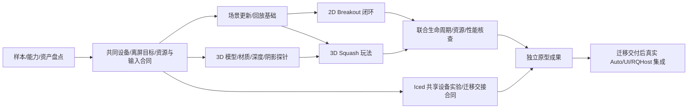

# Design 45：AutoGraphics 的 wgpu 引擎、游戏原型与 AutoUI 集成边界

> 状态：目标态设计草案，2026-10-21；用户已授权调研/原型计划制定，尚未授权本轮启动实现。
> 首个执行合同：[PLAN-829](../plans/829-autographics-independent-research-and-game-prototypes.md)。版本范围见 [v0.6](../roadmap-v0.6.md)，长期能力入口见[图形战略](strategy/autographics-forge-v06.md)。
> 本稿不改现行 Spec、AutoUI/RQHost 行为或迁移合同，不宣称任何游戏已经复刻完成。

## 1. 已确定方向

首版渲染底层采用 **wgpu**，与 AutoUI/Iced 的 wgpu 路径共享设备、资源和合成基础；AutoGraphics 拥有场景、组合、2D/3D 与游戏公共语义。未来替换底层时共同适配 UI/图形渲染路径，公共资源身份和玩法不直接暴露 wgpu/Iced 对象。
Godot/Bevy 是功能、结构与游戏样本参照，不把整个引擎作为首版隐藏运行时。物理、模型、文本、音频等可复用库；不用全面重写所有基础设施。

## 2. 首批样本与交付分层

| ID | 确定样本 | 能力用途 | 独立原型与正式复刻的区别 |
|---|---|---|---|
| AG-2D-01 | Bevy **Breakout** | 2D 几何/图元、输入、碰撞、计分文字、音效、生成销毁 | 先用 Rust driver 验证自有 core；真实 Auto 源码入口另验，不运行 Bevy 冒充 AutoGraphics |
| AG-3D-01 | Godot **Squash the Creeps** | 模型/场景、相机/材质/光照与阴影、角色移动/跳跃、敌人、碰撞/动画、计分/失败重开 | 同一自有 core 的 3D 原型；不以立方体、截图或 GDScript→Godot 路径替代玩法 |
| AG-MIX-01 | 真实 Iced 控件＋2D/3D 离屏视图的最小共享设备实验 | 同 Device/Queue、绘制顺序、alpha/裁剪、输入与退出 | 可用公开 Iced 构造独立宿主探针；不冒称生产 AutoUI 嵌套或 RQHost 已接通 |

源样本冻结到 PLAN-829 §4 的不可变提交。Breakout 源示例是封闭场地反弹/消砖计分，没有常见打砖块的掉球失败/生命系统；reset 属原型宿主附加能力，不伪称原规则。Bevy 专用 stepping 调试插件不是玩法兼容目标。Squash 的完整样本库存和资产清单由首个 work 任务盘点，不默默省略声音、动画、天空/阴影或输入形式；确需缩范围时显式回到 Plan 修订。

独立原型阶段交付研究决策、两款可玩的 Rust 驱动原型、复跑证据与后续集成合同。真实 Auto 游戏、完整生产 UI 嵌套、RQHost 及 Forge 产品编辑在迁移交接后实施；这些仍是 v0.6 目标，不能因原型 Plan 归档而标记已完成。

## 3. 开发顺序：共同基础先行，2D 先闭环，3D 提早并行



不等 2D 全部完成才碰 3D，也不各造一套设备/资源/场景/输入系统。先让 2D 提供较短的端到端反馈，3D 的高风险图形链同时验证；共同合同稳定后，维度专属模块和样例可以独立推进。
这描述工作依赖，不自动授权创建 agent/chat。PLAN-829 一树单写；将来需要多人实际并发写实现时，先按稳定交付边界分解后继 Plan，各自 worktree，公共核心一个 owner。

## 4. 最小分层

```text
当前：Rust 游戏 driver / 固定输入回放       后续：Auto SDK adapter / Forge
                         ↓                     ↓
        场景/对象身份、输入动作、时间/更新、资源与事件
                  ↓                       ↓
              2D 绘制/碰撞            3D 绘制/角色/碰撞
                  └──────────┬────────────┘
             wgpu renderer / 离屏目标 / 合成 / 生命周期
                             ↓
              独立 winit 宿主；公开 Iced 集成探针
后续：迁移后的 AutoUI 宿主/renderer adapter 与 RQHost
```

scene/model/API 不依赖语言 AST/VM Value、Man、Iced 控件类型；wgpu 对象留在 renderer/host 内。2D/3D 共用对象与资源身份、事件和时间合同，但可保留维度专属碰撞/渲染实现，不强行统一所有算法。
是否采用轻组件存储或局部 ECS、物理/音频/模型库、模型烘焙边界由有限 whole-path 实验决定，记录依赖/能力/成本后再接玩法，不预建“大而全框架”。

## 5. 与迁移及 AutoUI/Iced 的边界

独立实现放在 auto-lang 的新 `experimental/autographics-prototype/` 独立 workspace，独立锁与 target；不入根 workspace，不改根 Cargo/lock、现有 compiler/UI/runtime/provider。沿用仓库实验目录先例；最终生产归属为 auto-ui 图形域，实际迁入由后继 Plan 执行。

| 接缝 | 当前可交成果 | 迁移后放行条件/责任 |
|---|---|---|
| GPU 与 UI 合成 | 公开 Iced+wgpu 的同设备最小探针 | auto-ui renderer owner 提供真实设备/队列与目标借用，统一颜色/alpha、帧序、resize/退出；不能仅对齐依赖版本 |
| Auto 源码/更新/事件 | 稳定命令/资源/输入与错误合同、消费方用例；Rust driver 为研究工具 | 语言 SDK owner 提供实际支持入口，adapter 位于 UI/图形侧；真实 Auto 源码控制游戏并接收事件，不以外部预编译玩法替代 |
| RQHost | 场景更新/资源身份/帧与输入的候选协议及进程所有权决策 | 迁移后的 host/protocol owner 接线；现有 CPU 记录/重放和轻应用目标单列兼容；跨进程不传 Rust/GPU 引用 |
| 嵌套与 Forge | 视图/对象身份、坐标映射与修改/回退需求 | 在真实 AutoUI 上验 UI→3D→UI、3D→UI→2D，补文本/焦点/IME与基础创作闭环 |
| 发行与旧资产 | 实验 manifest/锁/资产来源与独立复跑 | 管理工具消费公开协议/资源闭包；既有 examples/godot 与历史资产不删、不改默认入口 |

正式生产接线的前置是迁移负责人提供当前迁移路线完成与接口交付的冻结收据；某一个 SDK 子集发布、独立 Iced 探针或“能编译”都不能代替整项迁移交接。
后继集成 Plan 在上述收据明确后取号、锁定写面与各 owner；原型完成可先独立审查，生产主分支的代码集成/切换仍等交接门。当前不建立长期集成分支或新的外仓。

## 6. 完成证据与后续扩面

样本玩法、画面/声音、输入与状态、资源释放分别取证；固定输入与物理步长用于可重复回放，真实窗口用于交互与绘制，不能仅靠 headless 状态或截图证明全部通过。原实现与工程版本/资产及测量设备锁定，差异逐项说明。
优先补齐选中样本需要的能力。Tilemap、骨骼/蒙皮、复杂刚体/关节、完整动画编辑器、HDR/复杂后处理、联网/XR 等由后续样本驱动，首批不要求具备全部 Godot/Bevy 功能。
所有性能数字先实测；支持规模与资源策略通过早期实验写成有界 profile，不把无限资源视为架构承诺，也不随手加限制来掩盖未实现功能。

## 7. 829 后继：组合与嵌套输入实验

2026-10-21 观察：829 为 execution_done r1，正在独立验收，尚不能将作者 work 结果写成 current Spec。[PLAN-830](../plans/830-autographics-surface-portal-composition-and-input.md)（drafting）承接其明确缺项：独立实验的 Surface/View/Portal、真实 Iced 离屏内容、GPU 多层合成与输入/焦点/IME。

下一步复用 Breakout/Squash，验证 UI→3D→UI、3D→UI→2D，以及独立内容实例/共享内容多挂载。Surface 内容状态、Portal 呈现/输入路径和渲染依赖分别建模；循环在提交前拒绝，多视图不重复推进模拟，GPU 纹理采样不经逐帧 CPU 图片往返。

830 不代修829验收、不修改生产UI/RQHost或语言核心；其代码消费前必须取得830 §2的G829交接。原型生产合入仍沿用迁移交接门；没有D829时，不得擅自把候选分支改称已发布依赖。830可完成独立复审，不因实验通过把I1–I3标记完成。

真正 Auto 源码接入、迁移后生产 AutoUI/RQHost、Forge与发行继续按§5实际owner/公开版本规划。此后续选择不新建第二渲染后端，也不要求先全面扩展游戏/物理/动画功能。

## 8. Draft 0.2 补编：AutoShader 与跨生态 CAP（2026-10-22）

此前独立的 AutoGraphics Draft 0.2 未在本次检索的项目镜像、auto-lang/auto-os 设计目录中找到；按《3D引擎方案比较》讨论重建的技术补编见[Design46：CAP System](46-context-profile-capability-cross-ecosystem.md)，战略补编见[跨生态编程战略](strategy/cross-ecosystem-programming-strategy.md)。这是讨论重建，不是原文恢复；本章已有游戏/组合、迁移与验收合同保持。

AutoShader 定位为 Auto 在 GPU graphics stage 下的场景接口，AutoGPU 为 shader/compute 等 GPU profile 族；不独立发明另一门语言。首个语言纵向切片建议 Auto→受检 device 表示→WGSL→wgpu，后续其他 backend 按实际支持另验。AutoRender/AutoGraphics 负责 host 侧绘制组织、资源和组合；host/device 之间用明确的参数布局、资源绑定、dispatch 与同步连接，不把 host 函数调用直接映射为跨设备栈调用。

可组合 Shader Components 是基础 shader 能力后的首个主打候选；CPU 共享数学函数、stage/地址空间/同步检查、宿主参数更新和设备资源生命周期构成首轮验证。Web/桌面/移动的产品目标按实施 Plan 分平台冻结，不由 wgpu 路线推导所有平台已经支持。

**新版 ACE 架构完成、基础 AutoGraphics 建立后，再启动完整 CAP 实现。** 图形独立原型可与 ACE 并行；A/B 两项进入门与实际交接证据见 Design46 §10。基础 AutoGraphics 需约定的真实 Auto 入口和宿主/图形链，829 Rust driver 或独立 Iced 探针不能单独认领。CAP 不扩张829/830或当前v0.6门槛，也不使原型成果自动变成 current Spec。
