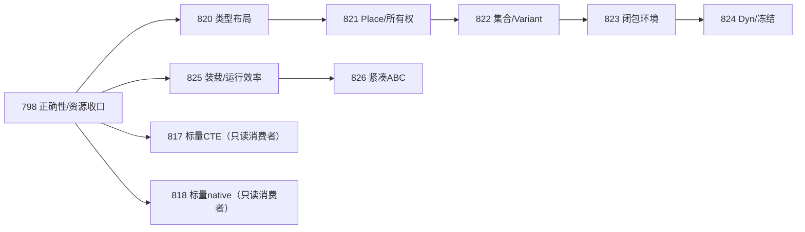

# Design43/44与798、820–826文档合同复审

日期：2026-10-20，Asia/Shanghai。范围仅架构与计划合同；用户要求直接修订问题、仍不写代码。

**结论：入审文档有8类合同缺口，已直接修订；修订后的责任、阶段oracle和硬依赖图通过文档检查，没有发现未处理的文档内依赖循环。798实现仍needs_fix，其他计划仍drafting，不能据此开工、宣称运行验收pass或合入。**

审查限制：本聊天曾起草这些文档，本轮从实际Spec、完整当前合同、任务/AC/SD和反例重建结论，未将原预检PASS当证据；未新建代理，不声称上下文隔离的另一审稿会话。review_scope=文档合同定向复核，非798或其他计划的独立实现final review。没有运行cargo/docs_gen、VM/WASM/V8探针，没有读取或修复实施树代码。另一798复审会话的R11结果按来源引用，不能算本轮运行证据。

## 1. Findings与直接修订

| Finding | 级别（文档风险） | 入审缺口 | 具体修订及未来验证 |
|---|---|---|---|
| F-AR-01 | P1 | 准入拒绝与运行期失败的零计数混用；证据位置：820–824 V-11通用末尾、824失败take；825 V-05 | 区分loader拒绝的dispatch=0与运行期fault目标访问/提交/子调用为0，保留先前合法执行 |
| F-AR-02 | P1 | CFG合流仅说明must初始化，未区分可能存活清理/借用；证据位置：Design44 §6、821 §5/V-11 | 初始化交集，活owner/loan保守并集，运行期init/drop guard；分支和零次循环补反例 |
| F-AR-03 | P1 | 捕获失败回滚与先move源的提交顺序未闭合；证据位置：Design44 §8、823 §5/V-05 | fallible prepare→完整校验→无失败提交；中途取消/clone失败保持未提交源，nested env转移有专用状态 |
| F-AR-04 | P2 | 优化先行与820指令表/旧wire承诺形成隐含依赖冲突；证据位置：Design43 §12、Design44 I-11/§12，820/825/826 | 显式硬依赖DAG，按已交付支持矩阵消费；820未交付不要求其指令表，窗口不持锁等上游 |
| F-AR-05 | P1 | 128MiB口径及验收完成声明冲突，大索引正例不满足总条目cap；证据位置：798 §3/5.5/T-05历史峰值；820–826资源策略；826 V-03 | 保留128/32边界，不扣前端，不以债务授PASS；798资源证据重开；分codec数值域与可准入表索引 |
| F-AR-06 | P2 | O(B+I)被误述成完整装载复杂度，标量优化要求未交付token；证据位置：825 §5.2/V-02/05 | 线性只约束PC索引构建，decode/verify/load分测；帧测试使用现有标量多请求/取消回收 |
| F-AR-07 | P2 | Scope/AC覆盖不唯一、kind伪造正反控不充分；证据位置：798 V-14/AC-01/05/07、825/826 §6 | 稳定case清单与父侧汇总反控；合法kind变化不一概拒绝；WASM/V8必需组与工具身份先冻结 |
| F-AR-08 | P1 | 可伪造描述符及内层不支持类型的Dyn/owned别名缺专项验收；证据位置：820/822/824 §5与矩阵 | derive Copy/drop布局、guard失效及remove后新下标正控、递归白名单/重复拥有引用拒绝 |

F-AR-05另有重要范围限制：历史约211MiB前端峰值不是本轮新测得的回归，798原§3称128MiB“目标”、后续计划却按上限继承，且旧work行有“已闭合”声明。本轮把两类指标、现存未达证据及收口owner写清，保持32/128数字与已批准负载，不据来源归因/记债授资源PASS。T-01/05必须给当前同口径证据；若只读上游导致政策不可行，带输入与owner阻断显式回new，不能靠本报告放宽预算。其实际实现/资源证据尚未闭合。

F-AR-03要求prepare与commit的行为是原合同“失败保留未提交源”的必然责任；不是承诺回滚已发生的普通guest副作用。内部env字段转移若使用专用capture操作，必须有活字段位图及invoke读集验证；普通Field/Index部分MoveOut仍拒绝。

## 2. 修订与责任矩阵

| 对象 | 入审→修订 | 责任/验收落点 | 当前状态 |
|---|---|---|---|
| [Design43](../../design/43-ac-av-typed-mir-and-abc.md) | §12补§12.5 | 三层表示、硬前置/单写窗口、版本支持矩阵、阶段计数与资源证据 | accepted-direction，非已实现 |
| [Design44](../../design/44-av-data-layout-place-and-ownership.md) | §16补充 | init/owner/loan合流、事务、guard/epoch、递归白名单/owned树 | accepted-direction，非已实现 |
| [798](../798-typed-mir-abc-av-probe.md) | r3→r4 | §5.8、K14-01..06、AC-01/05/06/07、T-01..05/07/08、SD-02/03 | executing 1/10，needs_fix |
| [820](../820-av-typed-data-layout.md) | r2→r3 | §5.5、V-12、AC-02..06/T/SD：派生Copy/drop/layout、源码边界和族预算 | drafting 0/8 |
| [821](../821-av-place-owned-access.md) | r2→r3 | §5.5、V-12：must-init与may-owner/loan、动态清理guard、合法来源返回 | drafting 0/8 |
| [822](../822-av-typed-collections-variants.md) | r2→r3 | §5.5、V-12：guard失效、remove旧Place/fresh索引、列表/Variant清理 | drafting 0/8 |
| [823](../823-av-owned-closure-captures.md) | r2→r3 | §5.5、V-12：fallible prepare→无失败commit、混合捕获/嵌套env | drafting 0/8 |
| [824](../824-av-dynamic-values-freeze.md) | r2→r3 | §5.5、V-12：递归类型白名单、错型take、树唯一入边/回滚 | drafting 0/8 |
| [825](../825-av-loaded-program-runtime-efficiency.md) | r1→r2 | §5.6、V-11、算法计数范围/实际标量帧/Scope与四组对标 | drafting 0/8 |
| [826](../826-av-compact-abc-format-and-size.md) | r1→r2 | §5.6、V-03/11、编码域与ref准入域、Scope/版本路由、SD-06 | drafting 0/8 |

798编辑期间并发收到[R11报告](../attachments/798/review-r11/review.md)：F798-R11-01为同一命名实参内131层组合路径漏过128层前门；F798-R11-02把单函数module类别往返线索实证化。完整保留其原收据及1/10任务状态，不把本轮起读时的3/10覆盖回去。R10具体误拒例已闭与完整不变量未闭分别记录。798的V-14还须覆盖手工DecodedAbc、bytes、driver、store、restart和正式runner全部子case，R11一个原例不是完整通过。

## 3. 依赖与窗口

硬图采用箭头“前置→消费者”，D表示独立最终review、冻结门禁、合入/Spec/收据齐全：

硬依赖不存在820→825→820或826→820→826。原“消费InstructionSpec”只指实际已交付版本：825/826先执行则消费D798指令合同，820后来接手合并唯一表。826实际交付后，820依启动时已批准wire支持矩阵兼容，不强迫恢复已迁移的旧格式解释。

验证两种排期：798→825→826→820→821→822→823→824；798→820→825→826→821→822→823→824。两者都满足硬图。实施仍共享核心单写交接；817/818只读核心及自己的独立workspace可按其原合同推进，其注册接线在实际owner窗口串行。814–816的已交付接口/注册迁移只产生局部窗口约束，不成为等待全批结束的硬D门。

为避免运行时排期死锁，必须先满足前置再取得写入窗口；不能持有窗口等待另一个Plan或上游合入。计划的只读T-01可提前，但最终合同冻结与首例不能把未交付API预测冒充真实D输入。

## 4. 验收可执行性检查

- 每个新增profile均有真实未信任输入→verify→ABC→公开装载→AV、首例持久化/新worker恢复及正式父侧oracle；新增接口/脚本尚未存在的部分由T-02建立，不伪称已运行。
- case必须冻结到子case级，包括Scope、实际入口、phase/code、expected、必需数及原始数据身份；T-03/04补安全反例，T-05补恢复/消费者，T-06（798为T-08）核总集合。缺例/skip/重复冒计或错actual不绿。
- 只在准入非法要求dispatch=0；运行期受控失败核危险读写/提交/目标callee=0，并检查合法前缀及cleanup。allocator故障与预算前拒分别有attempt/success计数，不能用整个执行0抹去先前合法事件。
- 821合流分别追踪确定初始化与可能存活/借用；822旧guard/Place失败有重新计算合法对照；823捕获前后提交失败/取消分开；824合法错型take与坏TypeRef分开。
- 825线性指标只适用于PC索引构建，完整验证/装载工作独立受预算；826的大数字codec往返与完整模块ref准入分开，大索引fixture先满足族总量预算。
- 825/826明确四组对标的真实入口、选层证据和相同语义结果；缺工具或无法证明tier留gap。未以benchmark准备/热身成本冒充AV热执行，未以code-only密度冒充包总长。
- 所有review/merge仍是未来任务，work-owned语义/资源/协议不能延给merge；本轮文档检查不运行根测试或独立workspace测试。

## 5. 证据与结论边界

[输入身份](../attachments/av-architecture-review-20261020-r1/inputs.json.txt)记录当前Spec/入审文档SHA及主检出/798提交；[修订后规范增量冻结](../attachments/av-architecture-review-20261020-r1/spec-delta-frozen.md)保留逐Plan SD；[文档检查](../attachments/av-architecture-review-20261020-r1/document-checks.json.txt)记录结构、AC/T/V/SD、链接、DAG拓扑/窗口反例和未变更范围。

出审结论是**文档合同修订检查通过**，不是隔离上下文的实现final pass。798仍needs_fix；其他Plan保持drafting，本轮用户仍只授权文档。当前未满足的D门、运行证据、性能/内存值不算已达标。历史旧798缺失附件链接若仍存在则单列，不伪造补齐，也不用其转述作为新独立证据。canonical Spec、ledger、实施源码、测试和依赖未修改。
