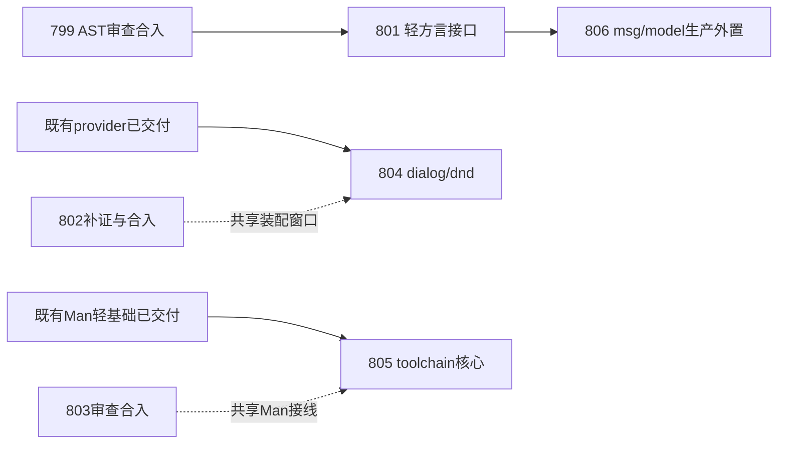

# 804–806：宿主/构建规则与声明文法迁移编排

2026-10-17，基于master `9932962bc157be13bcaa0520011c7c78082cb2fe`及本轮只读取材。此文只规划，不构成802/803验收通过、799/801已交付或旧仓切换授权。替代上一批编排中“下一批尚未取号”的近期建议，不更改旧计划合同。

## 先回答依赖关系

**802、803本身不依赖799/801合入；新804、805也不依赖。806是UI文法生产迁移，必须等799→801合入。** 不能把前端依赖传播成全局停工条件。

| 计划/当前证据 | 本轮观察 | 对本批的意义 |
|---|---|---|
| [799 AST](../799-frontend-ast-model-extraction.md) | 起草期间从execution_done回executing，复审/修复收口，主检出尚无auto-ast | 不代做review；806等实际审查合入，不凭status放行 |
| [801 方言接口](../801-dialect-api-dependency-inversion.md) | drafting、尚未实施/合入 | 依赖799；806再依赖其真实端口与快照合同 |
| [802 editor](../802-code-editor-host-provider.md) | 4029dd705在独立树；最新R1 readiness needs_fix，执行4/8，V06实机滚动/收敛待补 | 本批不重开/降低其验收；804不同native族，但共享装配短窗口串行，推荐802先合 |
| [803 assets](../803-man-template-assets-extraction.md) | 代码bbad82a9f在独立树；起草期间继续复审/修复，未合入 | 805的内联命令模板不消费其资产包，无API前置；仅Man接线/Spec共有小片段 |
| 779/785/790/791/794/795/800 | 已归档交付 | 804沿已交付provider模式，805沿已交付轻模型/生成生态边界 |

上表为取材时刻快照；在途进展会变。未修改以上计划文件/勾选/状态，未审查或合并它们。后续work以当前Specs、真实diff与冻结SHA重新核对。

## 三份正式新合同

| Plan | 主交付与删边/去重 | 实施条件 |
|---|---|---|
| [804 对话框/拖出](../804-dialog-dnd-host-provider.md) | 两独立provider承接2927/2928/2938，VM不再直引OS/UI；VM/a2r对话框单一构建实现，父窗策略兼容 | 前置已齐；无799/801/802/803新API依赖。与802的共享接线排短窗口，不消费review中的实现 |
| [805 工具链核心](../805-toolchain-rules-core-extraction.md) | auto-toolchain-core单份配置/默认flag映射/命令模板；Ninja真实消费，动态加载/定位/进程留adapter | 前置已齐；无799/801/802/803 API依赖，可与804及当前收口并行 |
| [806 msg/model文法](../806-ui-declarations-dialect-extraction.md) | auto-ui-dialect完整声明/注解单一实现，所有顶层/结构调用委托，原Parser算法删除 | **799、801已review并合入后**才work；不等802/803/804/805整体结束 |

804与805可分别确认合同后进入work；799/802/803继续自身review/修复/merge。799合入即可开展已有801；801合入即可开展806。编号先后不强制无依赖项串行。

虚线是共享写面协调，**不是接口依赖或全计划等待条件**。806依赖箭头是硬门，不能先复制worktree中的AST/API实施，也不能通过补宽allowlist或公开Parser本体绕过。

## 写面所有权与合流规则

| 区域 | 本批owner | 窄边界/先后责任 |
|---|---|---|
| vm/native.rs dialog两项/dnd一项、原dialog_parent | 804 | 不改802 editor22项或diff四项、term等族；在原树review/修复期间不要求其承担本批接线 |
| host_capabilities、NI/VM、lib组合安装、VmBridge/CLI入口 | 804两新槽；802自身editor槽 | 不改其他provider合同；短窗口协调，推荐802先合。谁后合就同步当前实现取并集并重验装配/clone/merge/显式默认优先关系，不覆盖整个文件 |
| ui/dialog及新上层host_adapters/dialog、dnd adapter | 804 | 共用已有OS算法；dialog-only无ui路径保留，旧a2r unparented/VM parented分支明确；不迁拖入/COM线程模型 |
| ninja/config.rs/mapper.rs/templates.rs、新auto-toolchain-core | 805 | 只迁纯规则；compiler_store/resolver/runner、Target/Pac继续上层；不改803的资源根或asset.rs |
| AST、parser API、parser/dialect注册 | 799→801→806 | 806以交付API做有界差额决策；804/805不改语法/类型；完整widget/view/on等仍后续 |
| 根/成员Cargo.toml、lock、lib导出、777规则/基线、Spec素材 | 按各自精确成员/依赖/出口/边 | 不升级无关依赖、不整文件格式化、不覆盖另一线规则。777刷新遵守既有工具与干净冻结树规则；Spec/ledger只在各自merge沉淀 |
| 792实际交付清单/source身份/资源 | 引起闭包变化的Plan | 若新包/编译期输入进入选定闭包，沿现有admission/staging接线并重放受影响fresh/locked/重定位/失败保护；不影响则给metadata证据，不把责任留空 |

803工作报告另有模板求值与旧臂观测结论，仍待其独立审查。本批不据该声明修改Spec，也不借早期模板注入猜测修解释器；805不触此路径。

推荐：802/803完成自己验收后就绪先合；804与802同时ready时802优先，805与803同时ready时803优先。前者因共享装配、后者因减少Man公共出口冲突；不构成对799/801的等待。806可在801合入后先于未完804/805合，不按计划号构造伪依赖链。

每项唯一组树实现→同树独立review→merge，review期间停写，后合入者承担语义复核/受影响证据重放。仅文本冲突解决不算验证；源码/依赖/输入/feature改变须更新冻结证据。work只做相关定向测试/check，裸t及tv/tu/tt等整档归final review之后merge；tf主检出到期单实例。并行实施不扩大为全量测试并发。

## 这批之后与搬仓的距离

- 806交付后，继续迁widget/view/on/actions/style等结构/事件文法与生产注册/导入传播，依真实端口/类型闭包分Plan；不会把msg/model等同完整UI文法。
- 804后仍有diff_files/snapshots/dirs/window、term/media等边。802未包含diff四项；它们涉及RopeSnapshot和目录IO，先辨认可下沉算法/模型与宿主adapter，不能再把纯diff算法盲包成OS provider。term当前native目录含多会话/配置/几何/背压接口，须单独盘清生命周期再取号。
- 805后仍需Target/管理编排、构建DAG和语言/进程adapter、UI工具/命令协议与薄CLI；复用project-model/package-lock/package-resolver/gen-core/assets/toolchain，不复制基础模型或新造第二套进程runner。
- UI SDK/运行桥/renderer与Man核心形成可独立真实消费闭包，源码/资产/示例/测试/脚本/CI/许可证归属及792发行覆盖实际支持面后，才建立G/H旧仓承接。继续784旧仓legacy保全/来源映射，不先清空默认分支或重写旧tag。

因此下一步可以并行推进，不必暂停所有计划；**旧仓正式搬迁仍需要完整退出门，不能仅凭本批三个计划建好就开始目录搬运**。UI专属AST终态退出和去重退役继续保留。

## 交接与验证

三份drafting/revision1/0-of-8。804/805 stage:new outcome:pass（合同可进入work）；806 outcome:blocked（799/801实际合入）。[指纹](../attachments/extraction-followup-20261017/inputs.json)、[合同预检](../attachments/extraction-followup-20261017/preflight.md)。本轮无Rust实施/测试、无新agent/树、无Spec发布或旧仓写操作。
