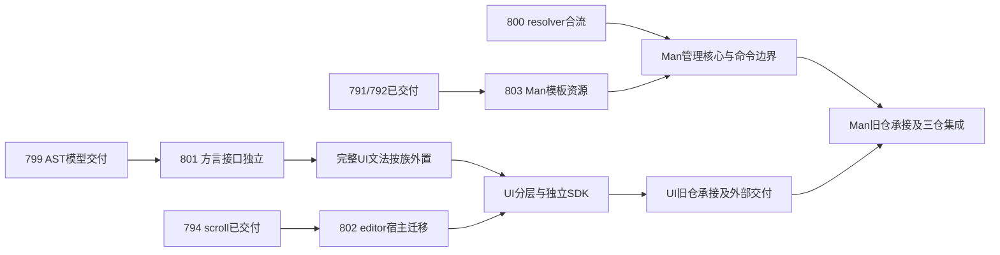

# 799/800之后的迁移批次与并行合流合同

2026-10-17。初次取材主检出`143aff0a258fdca8bda9a3b8068dc8a9cced623c`，规划期间同步核对至`2d246b4e86c1ebf5138f6a316c1896e56a5d35f8`（800合入及清理完成）。这是实施合同编排，不是已完成迁移或旧仓默认分支切换收据；本轮仅建立计划。

## 核实后的起点

| 计划 | 本轮核实状态 | 调度含义 |
|---|---|---|
| 789/790/791/793/795 | 已合入归档 | 词法、诊断、生成/锁等已有可复用轻切口 |
| 792 | 已合入归档 | 有选定Iced工程受管交付及失败保护，不等于UI已成独立仓 |
| 794 | 已合入归档 | scroll八native已迁provider，不再重复建scroll迁移计划 |
| [799 AST](../799-frontend-ast-model-extraction.md) | 用户确认时未实施，规划期间已executing、0/8 | 主检出auto-ast尚不存在，801必须等其交付；不把800合流当AST已交付 |
| [800 resolver](../archive/800-man-dependency-model-extraction.md) | 规划期间完成合入归档8/8，清理收据已回填 | 已核对实际源码/Spec及02b11c4b4交付；本批不改resolver合同 |

本批不等无关AC/AutoDown实验线全结束，也不重开已归档计划。状态是取材快照；work/merge重新查实际代码和合同。并发主检出已有其他会话WIP，本轮不纳入提交。

## 新增的三份可审阅合同

| Plan | 实际生产交付 | 硬前置与现在可做的工作 |
|---|---|---|
| [801 方言接口独立](../801-dialect-api-dependency-inversion.md) | auto-parser-api；生产Parser提供轻端口，778 model实现只依赖轻包，旧API适配 | **799合入后实施**；此前仅可只读准备，不复制AST、不在假接口上写实现 |
| [802 CodeEditor provider](../802-code-editor-host-provider.md) | 22个editor native完整族删core→UI边，真实UI adapter/装配与no-ui VM消费 | 785/790/794已满足；可与799、803并行，不依赖800 |
| [803 Man模板资源](../803-man-template-assets-extraction.md) | auto-man-assets承接三组唯一资源与纯路径规划；copy/GHS/IAR真委托 | 786/791/792已满足；可与799、802并行，不依赖800 resolver API |

当前可并行三条实现线：**799、802、803**；799已开工，可另行安排802/803。801准备好合同，但等799完成final review+合入，再依据真实auto-ast接口启动；不要求等802/803。800现已完成，无需为本批重开或追加其验收。

图只表达主要方向；后续完整计划还须检查其他宿主族、发行/CLI合同和真实依赖闭包，不能把箭头当成全部搬仓放行条件。

## 文件所有权与共享窗口

| 区域 | 主写方与允许变更 | 其他线规则 |
|---|---|---|
| ast.rs/ast、解析便利层、auto-ast | 799 | 801等最终模型，不预先复制/迁位；802/803不动 |
| parser_bridge/dialect/session、Parser注册/派发、外部dialect fixtures | 801（799合入后） | 802/803不动文法/类型推断；内建完整UI grammar保留到后续明确计划 |
| vm/native本22项、host_capabilities的editor槽、NI/VM接线、editor UI adapter | 802 | 不改794既有scroll合同/算法，不迁其他native族；801只改Parser不改VM装配 |
| asset.rs、templates和builders/ghs/iar、新auto-man-assets、对应exporter读取 | 803 | 不改800 resolver/依赖模型、不动rust_ui交付策略或其他Man资产 |
| resolver、auto-package-resolver及800证据 | 已交付800合同 | 其他线同步02b11c4b4交付与Spec，不改其规则或重开归档计划；803不消费此API |
| 根Cargo.toml、Cargo.lock、auto-lang/auto-man Cargo/lib、统一安装 | 各自仅新member/精确依赖/re-export/自己provider安装片段 | 短窗口串行；不整文件重排、不升级无关依赖。801/803新增包，各自负责必要lock更新与source身份一致 |
| 777规则/基线、Spec索引/ledger | 每Plan只新增/修改精确domain/边和自己的SD素材 | 刷新按777既有工具规则；合流取并集，不整份覆盖；canonical Spec/ledger只在各自merge沉淀 |
| 792交付包清单/producer指纹/资源 | 改变其生产闭包的后续Plan承担窄接线 | 使用已交付admission/staging/验证入口。包名、build输入、资源迁位影响实际闭包则更新，不能以“不是我原文件”漏包；闭包不变须metadata证明 |

各计划在自己的唯一组树实现/自检/独立复审，review期间停写。独立树只隔离文件，不证明语义不冲突；共享源码短窗口只允许一个owner改写。不能新增junction/symlink或改用临时目录逃避依赖解析。

## 合入顺序与证据责任

1. 800已归档；799/802/803分别实现及定向测试，不设置其他无关全局等待条件。
2. 同时ready时，推荐**799→802→803→801**；这是减少共享冲突的优先顺序，不是全局depends_on。802/803谁先ready谁可先合；801只硬等799，故799完成后即使802/803未完，801也可先合。
3. 后合入者同步当前master，重新核对API/feature/source/资源闭包及共享规则并重放受影响验收。文本合并成功不能替代语义复审。实施/依赖变化使原证据失效时，复审受影响项并在新冻结提交执行对应门；证据可复用仅限代码/依赖/输入/配置未变且有说明。
4. work只做相关反例/模块测试及必要check；最终review只报告代码/验收/SD pass及merge-owned门pending。merge冻结后才跑裸t及触面tv/tu等；tf仍到期主检出单实例。并行计划不意味着整档负载并发。
5. 每Plan交付迁位/净删除/仍留兼容层的同口径清单。移动行数不计净瘦身，资源crate独立不计整个Man去语言依赖，provider族独立不计UI渲染层已拆出。

## 本批后如何进入真正搬仓

下一批按照已交付代码再收敛，不现在占空壳编号：

- **前端线**：799→801后，按现有声明族与widget/view/on结构族外置UI文法，生产入口/import注册传播一起验收；不能只外置model就搬仓。随后UI模型/生成/运行桥/renderer分层及SDK门面形成可独立构建闭包。
- **宿主线**：802后按真实剩余edge盘点term/media/dialog/dnd等族，分别验ID/编码/线程/寿命/退出；与文法、Man线可继续并行。迁多少以目标UI/core正常闭包为准，不靠全局豁免保留反向实现依赖。
- **Man线**：800与803后，把Target/管理编排/命令协议、语言配置与可执行模板adapter、薄CLI分开；复用project-model/package-lock/package-resolver/gen-core，不新造第二套模型。动态pac与模板注入的行为修复另列，不夹在搬运中。
- **搬仓线**：D/E相关包可独立、F交付与工具消费覆盖实际支持面、源码/资产/脚本/测试/许可证/CI归属清单闭合后，分别建立UI旧仓承接与Man旧仓承接计划；继续沿784的legacy保全和来源映射，不先清空默认分支，不重写旧tag/历史。默认分支切换/远端写入在具体交付计划中明确授权。

因此，801–803是后续生产迁移的实施合同，**尚不是G/H旧仓切换计划**。UI专属AST兼容退出、语言内部去重/退役仍属于后续终态，不会因首次三仓能构建而取消。

## 本轮交接

三份均drafting、revision 1、0/8。801 stage:new outcome:blocked（799前置）；802/803 stage:new outcome:pass（合同可进入work，未实施）。[输入指纹](../attachments/extraction-next-20261017/inputs.json)、[合同预检](../attachments/extraction-next-20261017/preflight.md)。
