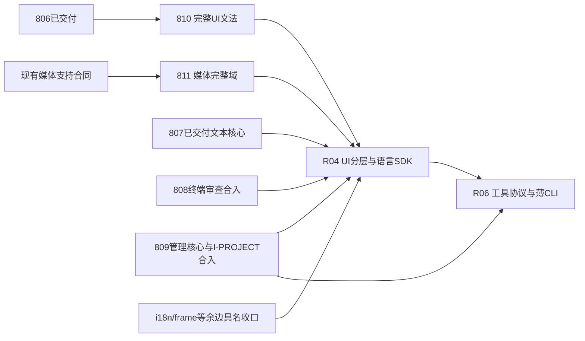

# 下一批完整模块：810 UI文法与811媒体宿主域

2026-10-19。用户已同意按上一轮建议建立两份较大模块合同；本轮只规划、更新Design 37/路线与证据，不实施、不复审808/809、不创建agent/worktree、不搬仓或操作远端。当前行为以canonical Specs为准，以下是实施目标与并行边界。

## 1. 状态与本批交付

806实际交付`c4158b89e`，已归档且清理收据成立（归档header仍7/8、尾部收据8/8，为既有簿记差额，本轮不代改）。807交付`63fe29fd9`，归档终收据`4880ba708`、10/10；其文本核心不重复规划。808与809仍executing，review修复在原owner树继续；work/R3修复声称不等于final pass/merge。精确来源/hash/观察header见[本批输入](../attachments/grammar-media-batch-20261019/inputs.json)。

| Plan | 路线归属 | 完整交付 | 现在可否实施 |
|---|---|---|---|
| [810](../810-ui-grammar-compiler-entry-extraction.md) | R01 | 完整UI结构/事件/样式文法和默认/import入口；最小解析能力、scope/诊断事务/raw CSS保持；旧Parser算法与UI escape退出，真VM/生成消费及轻发行闭包 | 前置799/801/806已交付；可从T-01开始，不等808/809 |
| [811](../811-media-host-runtime-extraction.md) | R03媒体完整域 | 单份资产/调度/cache/session/HTTP核心，加媒体文件索引/Range；17项VM接口、真HTTP/Vue后端/Rust merged/Iced消费与资源退出，旧路径兼容 | 原支持/provider基础已交付；可从T-01开始，不等808/809或810 |

两份各11项任务，内部完整闭环而非按函数/DTO开小Plan。暂不为R04/R06/R07再分配编号。i18n、a2r直接frame及其他运行桥残边由811清单逐项交R04合同接住；它们未迁前不得宣称所有R03/UI反向边清零，不把范围不相关的i18n强塞进媒体worker生命周期。

## 2. 实际并行写面

| 写面 | owner与协调要求 |
|---|---|
| Parser UI结构区、dialect/ui、ParserBridge/解析端口、auto-ui-dialect | 810唯一owner；保799/801/806轻类型/注册合同。其他AC/编译器计划改同一区域须明确语义交接，不整段覆盖 |
| image_pipeline/media_service、auto-media-core、VM image族/媒体HTTP | 811唯一owner；808只终端，不改媒体；不改809管理规则/生成请求 |
| UI renderer/notify | 811仅媒体数据/纹理查询与ImageSurface时序消费；808仅终端view/input，语义无关但同文件格式化/公共注册短窗口协调 |
| Man api_gen/rust_ui | 811仅媒体桥/HTTP/新core消费及必要发行声明；809仅项目读取/I-PROJECT与管理规划。不得整文件覆盖，不迁生成器算法，不依赖809 WIP API |
| 根/成员Cargo.toml、Cargo.lock、lib导出/tests注册 | 分别只改自己包/片段；后合入取并集。锁即使ignored也记录身份，不能以重生成丢掉他线依赖 |
| host/VM默认组合 | 808终端域、811媒体共享服务与native装配，既有frame/clipboard/editor/dialog等保持；不强迫媒体搬成新的OS provider框架，不让VM drop误关进程共享媒体池 |
| 777规则/基线 | 每Plan精确域边与合法清单，后入者基于当前master重采/验证并集；不宽化forbidden或复制旧baseline锚 |
| 792受管source/dependency/codec/资源闭包 | 808终端core、809管理core、810文法源、811媒体core各维护自己增量；在实际并集上重放受影响fresh/locked/重定位消费，不能用旧成员数覆盖最新清单 |
| Specs/ledger/INDEX | 各merge沉淀已验收SD，服务/索引写入窗口串行，不把draft未来目标提前写为现行规范 |

跨Plan无业务硬依赖并不等于共享文件没有冲突。所有work/review在各自唯一树进行，不改他线冻结树、不stash/reset丢WIP；主检出只簿记。树路径`D:/autostack/.wt/lang-810/auto-lang`与`lang-811/auto-lang`、分支`codex/plan-810-dev`与`codex/plan-811-dev`。worktree禁止junction/symlink，清理先wt-guard。

## 3. 接口、支持与风险关口

810第一关是完整路径端口可行性：现有ParseContext没有scope/body/raw等所有能力，且checkpoint诊断单调与computed局部投机回滚不同；新能力不许变成完整Parser逃逸。806前瞻成功/失败协议必须保留，不能重复引入曾修过的注释/诊断副作用。T-01有界probe失败先决策，不能只搬容易函数就收口。

811第一关是统一服务与真寿命：同一票据必须在VM/HTTP/renderer/生成后端命中同一资产；owned shutdown要覆盖scan/open/decode/resize，满channel和close迟到发布是必需反例。默认进程共享行为保留。17项中thumb按名注册、原request是stub，不能悄分新ID/补新功能。图片HTTP与媒体文件Range的不同规则、扫描策略分别冻结，不误去重。

设计文档image-viewer-pipeline包含未必全部兑现的历史目标，811以canonical Spec和现行实现逐项对账；既有规范冲突/正确性差额具名记录并决策，不能拿“Implemented”标签或重写golden替代证据。真实消费环境不足为pending，不删支持面；不重复全画廊、不给worker终止制造不可能的任意codec即时取消承诺。

## 4. 合入与后续批次

810、811可与808、809不重叠实现并行，**没有810→811或808/809→本批的强制顺序**。完整验收者先进入串行合入窗口；若808/809先交付，本批后入者同步取并集，复核影响面。无需等本批两项都结束再合先完成项，也不能消费未合入WIP。

R04现在仅准备包DAG、公开入口、旧auto_lang::ui兼容承载和owner/资源清单；不得把纯SDK与完整UI重导出放在同一基础闭包制造环。实际完整迁移等相关810/811/808及809接口合入，809的I-PROJECT仍须整体交付，不在本轮改为phase merge。R06可准备协议，但实际工具/CLI组合消费需R04/R05真接口；本轮不冻结809尚在修改的API。

本批完成后再按真实已交付出口建立R04/R06较大模块合同，发行责任持续维护，正式旧仓承接R08/R09仍以总路线G1–G8验收。R10 UI专属AST/关键词退出与R11/R12兼容/净瘦身不取消。

## 5. 验证与完成口径

work必须完成全部相关实现/修复与定向反例、真消费者和资源证据；独立final review同树核AC/SD/遗漏并绑定修订。merge最终冻结提交统一裸cargo t及实际触面tv/tu/tt等，合流改变代码/依赖/配置/输入要复审并重放；tf只主检出到期单实例。未完成review/merge任务保持未勾，work完成即可execution_done，不假填未来任务。

本轮Category A仅做合同/链接/编号/来源/共享面预检，无Cargo/docs_gen。取号[收据](../attachments/grammar-media-batch-20261019/allocation.json)与[预检](../attachments/grammar-media-batch-20261019/preflight.md)不构成实现完成或独立验收pass。
