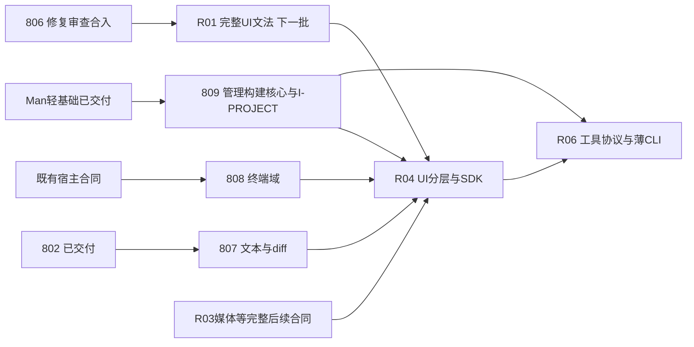

# 下一批完整模块迁移：807／808／809

2026-10-18。承接[总路线图](v06-extraction-execution-roadmap.md)R02/R03/R05；本批只新建三份drafting合同，不实施、不创建agent/工作树，不修改在途806或其他会话簿记。每Plan覆盖整个模块的生产接线、旧规则清理、支持面与失败控制、独立消费及规范交接，不把内部任务再拆成小Plan。

## 1. 批次与交付口径

| Plan | 路线归属 | 完整交付 | 交付后解锁 |
|---|---|---|---|
| [807](../807-text-snapshot-diff-core.md) | R02全文本模块 | rope/分页/快照/diff独立core；四native及真实editor/a2r/Rust消费，旧路径兼容、预取所有权闭环清偿、1GB资源与fresh/locked验收 | R04文本/编辑器层可以依已交付接口搬出 |
| [808](../808-terminal-host-domain-extraction.md) | R03终端完整子域 | 34项native、非UI DLL服务、UI输入/投影、句柄/背压/几何/滚动及真实资源退出；配置stub保留 | R04终端层可消费新接口；**R03媒体及其他残边仍需后续完整合同** |
| [809](../809-man-project-management-build-core.md) | R05完整管理/构建规划 | 轻核心、Pac/Target规则生产委托、三Builder效果adapter、动态准入与图错误、I-PROJECT真实生成读取合同 | R04拿已合入I-PROJECT移UI生成器，R06拿管理核心接工具与薄CLI |

本批不提前创建R01/R04/R06等全部未来计划。804已于本轮规划期间合入归档8/8（交付/清理终收据`601954cca`）；806当前executing修复，继续原合同。799/801/802/803/805及其他表列前置按现有Spec/归档收据取材，不重新做验收。准确取材SHA与状态见[输入清单](../attachments/module-batch-20261018/inputs.json)。

## 2. 可以现在并行，不能共同覆盖接线

三份Plan互不构成硬依赖，均不需要等806；各自work开始时核实自己的已交付前置和最新master。807/808虽都涉及宿主装配，属于不同能力槽；809主域在Man。它们可以三线同时实施，公共文件短窗口串行。真实DLL/Builder环境准备可提前；缺环境不等于通过验收，不需要全线停工但对应交付门pending。

| 写面 | 唯一领域owner／共享规则 |
|---|---|
| rope/file_backing/diff、editor快照能力及四native、a2r diff/Rust diff发射 | 807；不重写802 editor22项或terminal provider |
| term_engine业务、terminal合同/服务、term34项、terminal view/input/window/palette | 808；不处理media registry/session/HTTP或i18n，不改auto-term仓ABI |
| Pac/Target/Dir/Group/Port纯规则、管理图、build planning、project generation request、Man旧门面/Builder/项目读取adapter | 809；不搬UI生成算法/专属资源，不接全套CLI协议 |
| 根/成员Cargo.toml、Cargo.lock、lib导出、tests注册 | 各自只增自己的包/片段；后入者取并集，不整份覆盖/再生后吞掉他线修改；锁即使ignored仍记录hash与验证适用性 |
| host_capabilities/VM实例/默认安装 | 807快照槽、808终端槽；先接当前master已合入804，保留既有frame/clipboard/scroll/editor/dialog/dnd选择规则，不重建整份装配 |
| ui_gen/rust.rs | 807仅diff四入口，808仅终端组件必要兼容；809只在确有项目请求读取触面时协调，不趁机改发射算法；共同格式化不能吞他线 |
| 792：auto-man/src/rust_ui.rs受管source、dependency/资源闭包 | 807/808各维护自己新增包/资源，809维护Man核心；809项目读取接线与同文件其他模块分片，后入者重新验证fresh/locked，不用旧计数覆盖并集 |
| 777规则与基线、Specs/ledger | 每Plan真实边/类型owner精确登记；在最终master组合上重采适用基线，forbidden不放宽；canonical Specs由各Plan merge沉淀，索引/ledger合流串行 |

同一Plan一仓一工作树，采用`D:/autostack/.wt/lang-<NNN>/auto-lang`与`codex/plan-<NNN>-dev`。主检出只簿记；不改他线冻结树、不stash/reset别人的WIP。work/review在同树顺序使用，独立review指上下文独立。不能在worktree建junction/symlink，清理先wt-guard。

## 3. 推荐合入与后续批次

**没有强制807→808→809的业务顺序。** 谁先完整验收谁先进入合入窗口；同一时刻只一个owner改公共装配/777/792/ledger。若完成时间接近，推荐807→808→809，后入者同步master取并集并复核受影响证据；不要为了此推荐顺序让已完成809空等。真实终端DLL较慢时，807/809可先交付。

R04消费I-PROJECT须等809整体review+merge；本批不设中间phase merge，也不让R04引用809 WIP。806合入后可规划完整UI文法R01，与本批未完独立部分并行；808的余edge清单明确后可规划R03媒体等完整域，避免终端和media的句柄生命周期被一个模糊provider混在一起。R04准备公开包图/兼容承载、R06准备协议、R07持续清单可先做只读设计，生产接线按已交付合同推进。

## 4. 验收与计划状态

work先完成模块生产闭环与全部必要定向证据，真实资源/真工具不能都延期到merge。807必须提供新包1GB定向资源证据并清偿预取强引用闭环；808必须有真实DLL/PTY多会话及退出观测；809必须有真实三Builder和生成请求消费。独立manifest/fresh/locked、777及受影响792随各Plan完成，不等最终搬仓补漏。

独立final review验代码/AC/SD并绑定修订，保留merge-owned门pending。merge在冻结提交统一裸cargo t+实际触面的tv/tu/tt等，合流改变代码/依赖/配置/输入时复审并重放影响面；不重复使用不适用的worktree旧证据。tf只主检出到期单实例；本轮纯规划不跑Cargo/docs_gen。

807/808各10项、809共11项，review/merge任务保持未勾；work完成可以execution_done，不必伪填未来审查/合入步骤。整体三仓搬迁仍以总路线G1–G8为门，本批完成不等于可以立即切旧默认分支，也不宣称M1/M2全部结束。
