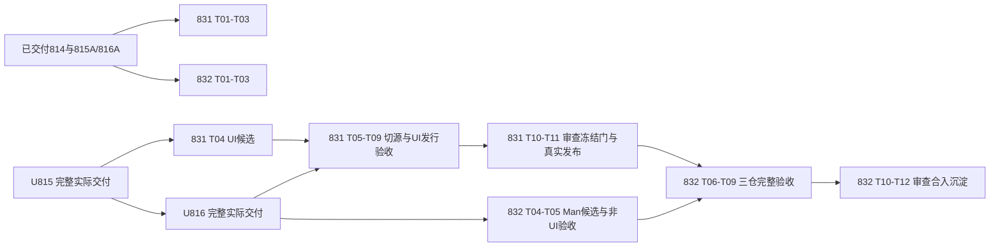

# 831/832：两仓正式承接、发行验收与三仓交付合同

2026-10-22。用户要求建立两个完整模块Plan：831负责auto-ui独立仓交付并含UI发行；832负责auto-man独立仓及三仓组合并含Man/CLI发行。R07按profile纳入这两份，不另取发行小计划；R10–R12的UiAst/兼容退役/去重目标继续保留。本轮仅规划，未实施/创建agent或工作树、未改旧仓/远端。来源见[输入](../attachments/repo-delivery-batch-20261022/inputs.json)。

## 1. 当前证据和真正的放行门

- 814 r3已archived 15/15，B实际交付93a25c924；并集丢测后继修复f97a9e2a9已合入，对账闭环见[恢复收据](../attachments/814/merge-recovery-20261021.md)。不重开814。
- 815 r3当前executing 10/17：A协议/tool已交付e609caf1a，T-04生成主体阶段pass且部分代码已在主检出；T-05..08仍在完整运行/兼容/发行反例修复，不以T-04或A代替B完成。
- 816 r2当前executing 7/14：A已交付7b8999d8f；T-03管理适配/T-04窄发现已有阶段pass，完整CLI/UI与profile仍等815-B并收口。以上是本轮输入快照，实施前重读实际主检出，不覆写其在途合同。

**U815**=815完整B实际审查通过、冻结合入门通过、实现/Spec/接口与来源收据已落master；**U816**同理为816完整B交付。review pass、分支HEAD、勾选和窄能力发布都不能替代。归档清理不是额外等待门，已实际交付且来源可读即可消费。未交付前只消费已发布子集。

| 工作范围 | 与815/816的关系 | 放行后的具体限制 |
|---|---|---|
| 两Plan T-01只读来源/owner/DAG/profile与切换设计 | 现在可并行 | 以814/A等已合入内容为证；标出B未知项，不能冻结其WIP API |
| 两Plan T-02旧仓新状态快照、保全/恢复、隔离准备树 | 执行获准后可与815/816并行 | 先重采784相关refs/WIP/ignored/CLAUDE指令；独立只保全不改旧默认代码树；复用现存784准备树须先确认无在途owner，不能另开同Plan第二树 |
| 两Plan T-03来源校验/独立consumer/发行与故障driver | 可与815/816并行 | 在自己唯一组的新增路径，以已发布输入开发；不改815/816生产热点/共享manifest或把缺能力当成功 |
| 831 T-04完整UI候选导入/仅目标仓的manifest与资源整理 | **等U815**，可与816剩余工作并行 | 冻结815来源，导入候选不是正式切源，不删语言仓原件、不改816实际消费入口；源有后继修复须重采差额 |
| 831 T-05起共享声明去边、兼容owner/语言生产消费切源与原件删除 | **等U815+U816** | 主语言树/清单/777/792/共享API一窗口一owner；不让在途816依赖目录消失 |
| 832 T-04起完整Man/CLI候选导入 | **等U815+U816** | 使用实际最终包名/路由/安装合同，不搬WIP；候选准备与831后半实施/审查可并行 |
| 832 T-05非UI候选包装/定向验证 | U815+U816后可与831并行 | 若依赖831尚未发布的共享声明切口，受影响子项pending；不借831 WIP。不受影响的管理规则、资源、打包、负控可继续 |
| 832 T-06完整三仓/UI/升级组合验收 | **再等831 T-11真实UI交付收据** | 不必等831归档清树；使用审过的实际UI版本/工具二进制与SDK身份，真CLI→工具→产物，不以fake判绿 |

## 2. 仓界与共享写面

| 唯一owner | 拟承接范围 | 不能倒灌的职责 |
|---|---|---|
| auto-lang | 纯SDK、AST/词法/诊断/值/Parser API、text/terminal/media等中立基础；project-model/I-TOOL中立数据、std-only auto-tool-execution共享owned进程设施；auto-gen/core与非UI语言/API生成adapter | 不因UI工具消费而加入renderer/UI文法实现或Man管理/CLI；通用轻协议不在UI/Man各复制一份 |
| auto-ui（831） | auto-ui-dialect/compiler/runtime/tools、其生产UI资产/blueprints/schema及真实测试/示例/脚本；旧auto-lang上层兼容包及shell-pack等UI组合项按T-01实际闭包迁入或具名映射 | compiler不反依runtime，SDK不反依UI；旧兼容包保原crate名/API但不再作为纯SDK的承载 |
| auto-man（832） | auto-man-core、锁/resolver/toolchain/man-assets等管理族、816管理服务/协议client/发现与auto CLI（std-only执行设施留语言基础共享）、对应脚本/CI/安装闭包 | 管理Core profile无UI静态实现；完整UI由已发布tool调用，不把UI源码复制进Man |

这是包owner图，不是仅按名字批量搬目录。T-01列出每个package和normal/build/dev/feature/source、tests/build/include、旧消费者/脚本/文档的实际归属，零未分配必要输入。通用API生成auto-api-gen以语言服务adapter承载；命名不决定其仓属。

**已观察的实际剩余切口，主责831 T-05**：auto-ui-tools→auto-man-core（sidecar、pac_from_decl读取theme/external_backend），auto-api-gen→auto-man-core::SidecarDecl/sidecar_decl_from_root。直接搬库会使UI/语言adapter反向依赖Man仓。T-01冻结逐符号使用，T-05将真正共享的声明数据/纯归一规则单源归既有project-model等合适轻数据owner，旧Man入口再导出/委托保持类型与行为；既有GenerationRequest字段能直接提供的优先消费请求，legacy读取仍保原动态求值语义。不能复制SidecarDecl/解析器、把整个Man核心塞回语言SDK、或靠长期[patch]双source掩盖依赖环。另观察到815实施树tools已消费auto-tool-execution：该std-only设施有UI/Man双消费者，物理owner留语言中立基础，Man仅承接管理执行编排/client/发现；不能按原man-ecosystem逻辑域把设施整体搬进Man造成UI→Man仓依赖。实施树清单仅作风险观察，不是可消费的发布接口，实际以U815/U816重采。832承接剩余管理规则；新的需求超出保持语义的去边则needs_replan，不缩小交付目标。

manifest/锁/public导出/777规则与扫描源根/792发布producer/模板根/账本、语言原件删除按精确scope串行合流。831先完成UI实际切源；832再切Man/CLI，双方后合入者同步master重验影响面。其他路线在途消费者（含829等）须有实际包/API/输入指纹影响清单和owner交接，未完成共享写面交接时仅暂停该切换，不强制所有生态计划归档、不重写其WIP。

## 3. 源身份、版本和独立发行

T-01冻结**可复现的本地Git固定commit引用+独立clone**为本期无需远端权限的验收渠道；来源收据可用bundle转移重建本地只读镜像。正式HTTP远端若已具授权可采用相同固定rev，但本期不以push或registry发布为完成前置，不虚称线上CI已执行。开发env→组内兄弟→主检出解析只限具名开发profile；发行/外部consumer清空AUTO_*根覆盖/parent workspace/兄弟path/target依赖，全部repo依赖为固定rev或已验证内容寻址源码包，不隐式回落D:/autostack。

三仓版本清单绑定实际commit/tree、package version、协议/能力、producer与工具二进制hash、锁、patch及资源schema/hash。不得同时解析同名AST/Value/SDK/协议的两种source身份；以cargo metadata/tree和类型跨包consumer共同验证。独立clone与发行包是不同oracle，都要做；vendored底层代码必须有来源/唯一生产owner，不计作第二实现或净删除。

受管应用发行沿792 admission→staging→校验→交换/恢复机制及其精确失败合同扩展，不另写弱发布器。移仓安装默认profile保原支持；Core profile显式无UI、完整profile包含匹配工具/资产及开发bootstrap，不能要求用户自行猜测安装步骤。Vue/VM-Iced/Rust生成、Jet/Ark/Tauri/VSCode及平台/编译器按现行支持矩阵登记真实正反控；缺环境pending，不能勾整个交付或静默删除。未被旧合同承诺支持的组合不凭“全平台”口号扩张。

## 4. 旧仓、切换与多仓合入

复用既有仓/URL/legacy refs；784快照只作历史输入，执行先重采tip/完整refs/WIP/ignored，再调用既有legacy-preservation工具新增状态寻址快照或同态复用，恢复演练读回refs/tree/保留字节。已有legacy锚异tip拒绝移动，新状态保全另具名，不覆盖旧证据。既有784树/分支不挪动、不强制清理，确认owner后将相应checkout作为本Plan该仓唯一树或另建独立分支，不能让一个活跃分支被两Plan写入。

迁移在旧仓新分支追加提交，形成来源commit/path→目标commit/path映射；生产权威切换前语言仓原件仍是权威，目标是冻结候选。切换后原实现删除，必要compat只转发固定源，测试/资源无双生产真源。**不清空master、不orphan/reset/force push、不强杀共享进程。** 本期review/冻结门通过后可以按具体Plan执行本地默认分支快进交付；有WIP/不能快进则先独立准备可审路径，不覆盖工作区或强移refs。保全载荷不能因推进分支而丢失。

多仓Git无原子事务：先落可用目标提交与固定依赖，验证再切语言消费者/删源；记录prepared→target landed→consumer switched→verified各状态与失败恢复命令/owner，恢复通过新提交或受管交换，不能reset用户仓历史。共享分支推进窗口串行；任何一仓失败不宣称全套交付、不归档/删树，旧可用版本或明确可执行恢复点仍可用。远端push、远端默认分支更名/registry发行不在本轮规划请求的动作授权内，不因此阻断已授权的本地独立交付。

## 5. 验证修复与测试资源

不同Plan的独立scope读审、定向反例与修复可并行；同Plan同一权威组/每仓一树，冻结SHA交接、单写者，修复批次先修齐已确定findings并回放共同反例再送审。缺上游的组合项明确pending，不每轮重复算新finding；整体pass仍要求全部AC/SD与实际依赖集成。代码/依赖/配置/输入变更只使受影响证据失效，接口owner负责新发布，不能借别人的送审分支修复。

work/review只必要check、包/模块定向consumer及实际安装/失败/资源验证。**真实外部构建/运行本身是验收，不能全推给merge**；与裸t/整档不同。最终独立review后merge在冻结三仓提交组合上统一裸cargo t及实际tv/tu/tt等和目标仓适用门，串行队列，重型/GUI/OS全局资源独占，tf主语言检出到期单实例。移动测试的ID映射防丢测，不以总数相同为证；跨仓后日常/触面/批量档须通过具名编排调用各owner的固定来源测试，不能让语言侧tf缩小成“只扫剩余成员”而丢UI/Man原覆盖。破坏性负控/安装故障注入只在本Plan拥有的临时clone/fixture/测试安装根执行，保全工具先校验目标路径；不能损坏真实旧默认树或共享安装。无用户指定agent/model，不自动创建会话。

## 6. 交付和后续

831实际发布收据放行832完整UI集成；832完成三仓组合后M1才满足总路线G1–G8，不以两个仓有代码或一个fresh编译代替。R10 UI AST/关键词退出、R11兼容退役、R12跨仓净瘦身仍保留。本轮合同预检见[收据](../attachments/repo-delivery-batch-20261022/preflight.md)，未来driver和验证尚未执行。
