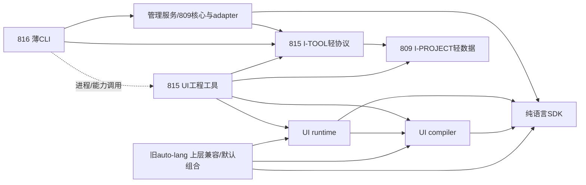

# 下一批：814 SDK/UI分层、815 UI工程工具、816工具执行与薄CLI

2026-10-19。用户要求继续规划，并说明是否等808–811合入。本轮只建立三份drafting完整模块合同与路线/Design 37登记，不实施、不创建agent/worktree、不复审/合并前批、不搬Git仓/切旧默认分支/写远端。所有未来包名/API在对应有界T-01中依实际证据冻结，canonical Specs仍描述已交付现状。

## 1. 观察状态与新交付单元

808已实际合入5833e155e，归档终收据cabe023e2、10/10；因此它不再是等待项。809–811仍审查/修复、未合入（810/811本轮起读execution_done，随后回executing），不能按“已实施”推定final pass或接口已合入。811的真浏览器等work证据还有pending记录，本轮不代审；809/810/811送审内容只作为预期接口/冲突面输入。精确SHA/header/hash见[来源](../attachments/sdk-tools-batch-20261019/inputs.json)。

| Plan | 路线/完整交付 | 前置与范围 |
|---|---|---|
| [814](../814-language-sdk-ui-package-separation.md) | R04包组半部：纯语言SDK、UI compiler/runtime、上层默认/旧路径兼容，剩余i18n/frame等边清偿；真实消费者/测试选择/发行源闭合 | 807/808已交付；主实施等810/811实际合入；不等809，不迁Man工具 |
| [815](../815-ui-project-tools-and-assets-extraction.md) | R04工具半部：Man内UI生成/脚手架/资源脱离管理大库；消费I-PROJECT，交付I-TOOL轻协议与真UI tool | 完整接线等809/814实际合入，不依赖816；独立资产可先做 |
| [816](../816-tool-execution-protocol-and-thin-cli.md) | R06：管理服务/语言adapter、实际tool执行、进程/stdio/取消/watch/service与薄CLI，Core/完整profile真实可消费 | 完整接线等809/814/815实际合入；独立执行设施可先做 |

本批不是把三份都宣称立即全量可执行。每Plan有可启动任务与不可越过的门，且不支持phase merge；815的I-TOOL交接等整体合入，816不能引用其WIP。R07发行责任随三份持续维护，完整旧仓承接R08/R09待出口实际交付再立合同；M2 UiAst/兼容退役/净瘦身不取消。

## 2. 可以立即开展的任务与必须等待的任务

| Plan | 现在可做 | 必须等待后才能做 | 等待的是合入，不是work完成 |
|---|---|---|---|
| 814 | T-01只读模块/API/状态/资源/测试归属和包DAG设计 | 涉及新接口的代码probe及T-02..09主搬包 | 810、811；808已满足 |
| 815 | T-01只读工具/配置/效果映射；T-02独立私有资产模块/清单测试（不提前搬走生产源） | 新I-PROJECT/SDK编译probe、T-03起协议/生成/工具生产接线 | 809、814 |
| 816 | T-01只读命令/进程设施/支持矩阵；T-02与新协议和他线共有写面无关的既有执行facility封装/反例 | 新接口probe、T-03起管理服务/I-TOOL/CLI切换；T-02无法分离时也等对应owner | 809、814、815 |

早期实现也必须在各自唯一工作树中，只改精确不重叠片段，不能动809 Builder或用临时镜像DTO/空协议替身绕门。T-01有界probe需前置时可先完成只读工件再等待；不是时间到了就自动放行。不得cherry-pick/堆叠送审分支。work记录actual merged commit及Spec后再进入依赖任务；早期任务完不等于execution_done。

## 3. 包图、兼容与接口交接

候选目标图（名字/最小类型在T-01整链probe后固定）：

核心问题是旧根API：若旧auto_lang::ui或auto_man::vue等暂保，其承载必须在上层兼容包，纯SDK/管理服务用独立真实公开出口。不能一边normal重导出完整UI，一边把同一包称为纯Core。保持旧Parser pub字段/构造、AutoVM/native回调/ExternalDialect、Pac/Target方法等须实际编译与行为probe；只有一份可变状态，不复制Parser/VM/Project来保表面签名。SDK/管理服务名字、是否需要薄wrapper或独立服务包由各T-01固定，不由路线图擅自破坏API。

UI compiler的runtime路径可为生成代码引用，不用dev依赖runtime制造环，集成测试归上层。compat旧包不得被新UI工具或SDK反向依赖。UI兼容AST暂留轻auto-ast是M1合同，最终职责R10再退出；不据此放任UI实现反向边。

**I-PROJECT属于809，I-TOOL属于815。** 815只消费已合入I-PROJECT，负责协议/工具实际端点；816只消费已合入I-TOOL并执行，不另建协议版本/请求镜像。815不等待816设施才能交付，须复用现有能力或自持适用执行adapter；816将命令生命周期归一并退役重复调用。这样没有“工具等CLI、CLI等工具”的环，也不另开一份纯协议小Plan。

## 4. 并行写面与合入窗口

| 写面 | owner/规则 |
|---|---|
| 语言源码/SDK、UI compiler/runtime、旧auto-lang兼容、i18n/frame余边 | 814；810/811合入后才搬，不让815同时搬生成器底层 |
| Man UI工具/工程生成、gallery/wm/shadcn/专属模板/资源、I-TOOL和tool入口 | 815；809合入后接I-PROJECT，资产早期段不动其接线；不盲搬所有api_gen/http_service |
| CLI/clap路由、管理服务/语言adapter、执行设施/watch/daemon/service | 816；815合入后接其公开tool，早期不改809 Builder；不再抽第二份UI生成/协议 |
| 旧auto-man兼容与纯服务边界 | 815明确旧UI门面/API；816完成服务/CLI与compat闭包分离；必须按已合入公开出口交接，不同时搬Pac/Target或重新定义类型 |
| Cargo/lib导出/测试注册/别名/nextest | 各自片段串行并集；814迁包保原测试选择面，815/816保持新包/命令被相关门覆盖，不凭总数碰巧相等 |
| 777/792、producer/lock/资源清单、Specs/INDEX/ledger | 每Plan维护真实增量，后入者基于最新master重采/复测；不宽化forbidden，不覆盖新source成员，canonical只merge沉淀 |

可并行阶段是814主搬包与815资产/816执行设施；815主接线可与816无协议部分并行。最终合入有真实依赖顺序：**810/811→814；809+814→815；809+814+815→816**。不需要等所有其他计划或813等无关路线结束；813等若触同VM/配置公开面按真实片段协调。

每Plan唯一树`D:/autostack/.wt/lang-814/auto-lang`、`lang-815/auto-lang`、`lang-816/auto-lang`，各分支`codex/plan-<NNN>-dev`；同树work/review/merge，不改他线冻结树、不stash/reset WIP、不建junction/symlink，移除前wt-guard clean。

## 5. 交付门与下一阶段

814必须交真正无UI normal/build/dev的SDK与真UI包组/旧默认兼容，不能只改features；815必须交真工具/轻请求/全部资源/可执行I-TOOL消费，不只资产或fake；816必须交真CLI→服务→tool→产物/运行与子进程/reader/watcher退出，不只exit码。默认完整profile维持现有UI能力，纯Core profile明确区分，不能把新缺件人工安装要求悄加到旧工作流。安装/开发bootstrap与实际CLI文件hash纳入证据。

所有必要定向反例、真实消费者、777/792/fresh/locked、资源失败证据是work义务。独立final review同树审AC/SD/遗漏并绑定修订；merge最终冻结提交统一裸cargo t和触面tv/tu/tt等，开发/复审不整档；tf只主检出到期批量。迁包后测试族归属/别名选择不能丢失。未完成review/merge任务不假勾，本轮仅文档Category A，不运行Cargo/docs_gen。

三份实际交付后，根据包源、安装profile和新出口建立R07必要发行收口（可并入搬仓）、R08 auto-ui旧仓承接、R09 auto-man旧仓与三仓组合。旧仓保全按784刷新复核，本轮不切默认分支。M1首次独立交付与M2 AST/兼容/净瘦身分别验收，不能只按Plan数量宣布全部迁移完成。

本轮[输入](../attachments/sdk-tools-batch-20261019/inputs.json)、[取号](../attachments/sdk-tools-batch-20261019/allocation.json)、[合同预检](../attachments/sdk-tools-batch-20261019/preflight.md)只证明规划，不是实施/独立验收pass。
