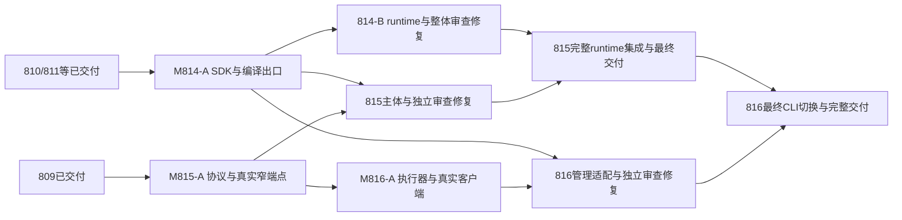

# 814–816 r2：阶段交付、接口放行与并行审查修复

2026-10-20。用户明确授权：修订814/815/816，允许阶段交付、接口实际合入后放行下游，不增加计划编号；并要求审查/验证/修复可并行。本文件是三份r2合同共用的执行约束，取代r1“等待整Plan合入、禁止phase merge”的调度限制，不改变整项最终交付目标和AC。当前三份仍drafting、进度0；已经登记814工作树，本轮不修改任何实现树。

## 1. 当前基线与阶段图

809/I-PROJECT已交付b819a602e，810文法已交付f0ec8a91f，811媒体已交付d06cdc6f6，均归档；此前等待它们的门已满足。实际状态/hash见[本轮输入](../attachments/sdk-tools-r2-20261020/inputs.json)，不重做其验收。

| 阶段 | 必须真实交付的范围 | 开始条件 | 能放行什么／仍不代表什么 |
|---|---|---|---|
| **M814-A** | 纯SDK真实parse/compile/VM、UI compiler真实生成公开出口、旧默认兼容、单源类型/状态、迁出部分测试/资源/独立消费及接口版本 | 807/808/810/811已交付；814 T-01方案可行 | 815生成/编排主体、816语言/管理adapter可消费已发布SDK/编译面；不声称新runtime/全部renderer已交付 |
| **M815-A** | I-TOOL轻协议/同源I-PROJECT codec、真实tool的describe/请求元数据校验等具名操作、版本/能力/错误/预算/日志合同与独立消费 | 809已交付；**不依赖M814-A或814整项** | 816实际协议客户端/执行器；未实现的UI backend必须报告不支持并拒绝副作用，不能伪造生成/运行成功 |
| **M816-A** | 独立执行设施与协议客户端，真实调用已交付M815-A、进程/stdio/退出/取消/reader控制与独立consumer | M815-A已发布；执行设施本身可先做 | 自身后续CLI/服务接线复用；不是默认CLI已切换或完整UI命令已交付 |
| **M814-B** | 814全部原AC：runtime/renderer/默认组合/旧API与全部测试族/资源/发行收口 | M814-A发布后同树继续 | 815实际runtime构建/运行集成、最终完整profile验证 |
| **M815-B** | 815全部原AC：UI工程工具/资产迁出、完整真实backend/capability、兼容及发行 | 主体可在M814-A与M815-A后做；完整runtime验收等M814-B | 816最终UI路由/默认profile切换；此处仍须完整独立review和冻结门 |
| **M816-B** | 816全部原AC：薄CLI/管理服务、真实命令/服务/watch/完整profile与资源退出 | 管理adapter可在M814-A+M815-A+M816-A后做；最终UI切换/集成等M814-B+M815-B | R07发行与后续R08/R09搬仓；不宣布M2 AST/兼容退役已完成 |

M*-A是**阶段标识**，不是新Plan/分支/后端status；M*-B是本Plan完整交付。frontmatter的depends_on保留整项关系摘要；具体任务按上表/各Plan依赖列执行，不能让粗粒度“依赖Plan未归档”把阶段又全部堵住。现有自动Runner若只能整单判依赖，阶段需按本合同人工组织，不能声称应用已经新增阶段调度能力。

815不是所有任务都等814；816不是所有任务都等815主体完成。依赖尚未发布的集成仍须等待，已知前置pending不在每轮被重复包装成新finding或用fake判绿。

## 2. 接口合入硬门（A阶段与B阶段都不降低门禁）

每次发布按以下顺序，缺任何项均不放行下游：

1. **scope先冻结**：本轮API/类型/序列化/行为/错误/能力、source/资源/feature、支持profile和调用样例明确。M814-A必须是真SDK/生成器，不能re-export旧大库；M815-A必须是真进程端点，metadata校验不冒称语言编译/运行校验；M816-A必须真调用已交付端点，不只mock。
2. **work证据完成**：阶段涉及的全部正反例/状态组合、真实消费者、normal/build/dev图、格式/新增告警和资源/退出证据完成，拟发布Spec增量精确反映本阶段。阶段A不承诺未实现B能力，但不能从已公布能力清单里默默删除困难项。
3. **独立阶段审查**：同树、独立上下文，以`PLAN-NNN:r2:MNNN-A`及冻结commit为对象；核对实际diff/所有出口/错误与资源/Spec。仅给阶段范围pass，不能把整Plan标reviewed或把最终review任务勾上。整体原AC继续保留。
4. **冻结合入门**：阶段审查pass后，在同一冻结代码/依赖/配置/输入上，merge owner统一裸`cargo t`及实际触面tv/tu/tt等、必要新包/外部消费门。work/修复/独立review不提前整档。M814-A迁Core/编译器通常触tv/tu/tt；M815-A只新增轻协议/窄端点通常是裸t+新包/协议进程控制，若实际改生成/VM则加对应档；M816-A同理。不要用“阶段”跳过必须门。
5. **串行实际合入**：master变更窗口单owner，包含本阶段全部代码/资源/测试/审过的实际Spec增量；不得夹带后续B未审代码。若rebase/冲突改变审查输入，按影响重新审查/重放，range-diff等价必须有证据，不能宣称所有rebase自动等价。
6. **知识与收据**：阶段Spec只陈述已发布子集；ledger按现有受管写通道增量记录phase/commit来源，不造全Plan交付条目。写发布收据并读回核对，`delivery_commit`必须是master祖先；consumer实际构建解析到该版本/包源。仅有接口文档、work通过、分支HEAD或阶段review pass都不算发布。

阶段收据建议`docs/plans/attachments/<NNN>/m<NNN>-a-release.md`及对应机器可读文件（新增，future merge owner写），最少记录：Plan/revision/phase、phase scope、reviewed与delivery commit、依赖交付commit、API/协议version及明确输入集合的digest、实际实现source指纹、支持/未支持capabilities、Spec patch hash、原始测试/门禁结果、producer/lock/resource来源、消费者解析路径与影响清单、尚未完成的B项。签名/schema相同不代表语义相同；digest不能只hash一个trait.rs漏掉codec/错误/依赖配置。

## 3. 状态机与同一工作树

这是用户2026-10-20授权的**本批阶段合入路径**，不是对所有Plan放宽规约。阶段A按“work完成→阶段独立review→冻结门→实际合入/沉淀”执行；整Plan保持`executing`，不归档、不清树、不标整体reviewed。最终B仍走完整`execution_done→reviewed→archived`，所有原AC/任务完成后才能宣称整个Plan交付。

现有`/auto-plan:merge`完整收尾要求整个Plan reviewed且包含归档/清理，**不能直接套用来结束阶段A**。阶段由明确scope的独立审查和人工Git/非归档Spec增量流程实施，沿用该技能的证据/门禁/账本守卫；不得调用`merge_plan`或会立即归档的组合API，不新增后端status/伪字段。本次只修订文档，不实现调度器或运行阶段合入。

每Plan始终一个实现树、原分支不变；阶段发布后保留该树并同步已合入master继续，接口实际交付位可被其他树正常同步。不得复制第二个review树、跨Plan cherry-pick WIP或用stub DTO绕门。独立审查期间同一树冻结只读，修复由单写者接回；要开始下一阶段前，先完成当前冻结审查/合入交接。主检出只簿记和合入窗口，无代码WIP。

原T/AC/SD ID保留；新增阶段work/review/merge任务追加ID，**ID顺序不代表执行顺序**，看依赖列。任务跨阶段的整体要求只有全部完成才勾，不把A局部进展假算完整B任务完成。现有工作证据保留，r1发布调度限制仅作历史，r2合同语义改变处不复用旧“通过”声称；本轮三份尚无完成任务。

## 4. 审查、验证、修复如何并行

**不同Plan可同时代码审查、跑有界定向验证和修复。** 例如814-B在修renderer/旧API，815在审生成请求/资源，816在修reader/取消，彼此使用已发布接口与各自树，不必等上一份final pass。纯读审查和轻量模块测试可以继续，不因另一份进入合入队列而全员停工。

| 工作 | 并行规则 |
|---|---|
| 不同Plan代码/AC/SD审查、counterexample设计 | 可以；绑定各自scope/commit/依赖交付位，不把下游已知pending当每轮新缺陷 |
| 不同Plan修复/定向测试 | 可以；各自单写者/fixture/scratch/输出目录/端口，资源按现有机器预算，保持编译参数/依赖指纹；必要重型实机项预约独占 |
| 同一Plan的审查与修复 | 按冻结轮次交接；审查读取的checkout不能同时被改，修复提交后新SHA使受影响旧审查失效。不同时两个owner改同一树 |
| SDK/协议/共享数据的修复 | 归发布owner；其他Plan记录反例并停止受影响调用，继续独立部分。不在下游复制/热改上游实现 |
| GUI/OS全局输入、共享daemon、重型cold生成构建/大内存例 | 同机器相应资源串行；其他代码审查/轻量反例仍能并行，不能同时抢同一前台/固定端口/重型负载 |
| 裸t及触面整档、master接线/基线/Spec ledger合入 | 串行合入队列；tf仍主检出到期单实例。不能三棵树同时开全档来“并行验证” |

同一Plan修复轮先把本轮已确定findings修全，跑必要反例/邻接组合和check，提交后再送独立复审；不修一条就跑整档/重启全项review。若审查出现真正新反例，明确其触发条件和覆盖缺口，不以轮次数代替验收，也不承诺固定两轮必过。

### 缩小5–6轮反复的交接要求

- 从第一轮保存**共享反例回放集**（输入/入口/期望/断言/当前SHA/环境），修复方和review使用同一份；新增真实反例追加，不每轮换一套隐含标准。
- 送审前检查代表性组合，而非只单点：生命周期的live/retired/unknown、close前后/替换前后、正常/错误/取消/超时、backpressure/满队列、不同实例/线程/交互等按该模块实际适用选择。814重点默认/显式/Core与类型/状态，815重点版本/能力/日志/输出，816重点child/reader/取消/ready；不要求无意义笛卡尔全集。
- 读审可以分scope提前做，范围证据保留；整体final pass仍要求所有原AC及真正依赖集成完成。只审某个子模块或缺环境pending不能作为整体通过。
- 复用**未改变且适用**的代码/依赖/配置/输入证据；上游implementation也可能改变接口行为，不能只看签名未变就免测，也不因上游改文档就机械重跑所有项目全档。

## 5. 已发布接口变更与失效规则

| 变更 | 必须做的动作 |
|---|---|
| 仅Plan进度/不影响合同的文档簿记 | 不自动使代码证据失效，记录实际scope/hash |
| 私有实现/依赖/配置/输入变化 | 上游给影响分析与真实指纹；重放被影响的消费者控制，证据不适用时重审该scope |
| additive能力 | 明确版本/能力表，旧请求继续受控；新能力只在真实实现/测试/发布后打开 |
| 破坏接口/序列化/错误/寿命/线程/能力支持 | 停止受影响下游，回到owner修订+独立审查+冻结门+新发布收据；同步受影响consumer，不全线重置无关工作 |
| 原收据hash不匹配、依赖仅在WIP分支、缺版本/Spec/真实门结果 | 发布门未成立，拒绝放行；不得复制上游源码或编造pass |

修复发布必须能从owner同一树组织出不含未审B代码的冻结范围；做不到就让受影响consumer等，只继续独立工作，不能为赶并行绕合入门。新release明确取代哪版，保留旧证据历史，依赖合同/语义不变时无需人为重开下游全部AC。共享接口及整合冲突修复在串行窗口进行；其余模块审查/修复继续。

## 6. 收尾与本轮证据

最终完整交付顺序只约束依赖集成：M814-B后815完成runtime验收，M815-B后816切完整UI命令。815/816此前其他实现、审查和修复可以已完成大部分，不等上游归档清理才做独立工作。R08/R09旧仓承接和R10–R12仍按总路线，不新增编号或缩小最终目标。

本轮纯Category A合同修订：不运行Cargo/docs_gen、不实施/合入产品代码、不创建agent/树。三份revision从1升2，编号计数器不由本轮改动；[来源](../attachments/sdk-tools-r2-20261020/inputs.json)、[预检](../attachments/sdk-tools-r2-20261020/preflight.md)绑定文档版本。已有814注册树仅记录inventory，本轮未检查或修改其内容，执行者先读取主检出r2合同再继续。
