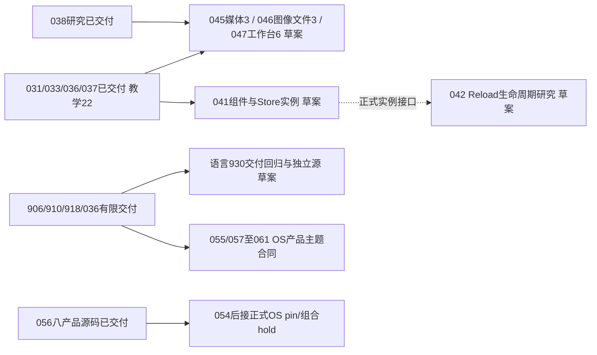
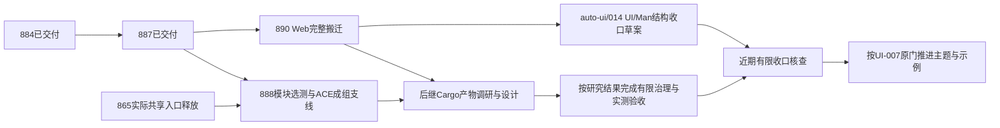
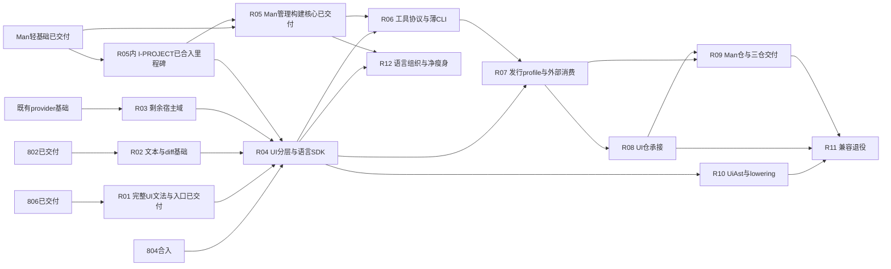

# v0.6 拆分与重构路线：当前状态与下一批

更新：2026-11-12；**当前路线v56，M1收口整理完成**。用户已确认按现有支持边界进入本路线收尾，已核1006/989/1015正式交付/验收与M2移交，见[本路线M1收口确认与联合交接](split-refactor-m1-closeout-2026-11-12.md)。013静态生成AddTodo保留未交付说明并列M2，不阻本路线M1。联合v0.6-M1仍需当前领域签章、到期批门与最终跨仓清单，不因本路线收口自动创建tag。本轮只整理文档与交接，不施工或接管其他会话。

## 生成工程的调试策略

| 要查的问题 | 阅读入口 |
|---|---|
| 为什么选 C，生产配置要达到什么目标？ | 生成工程的 dev 构建要保留成员代码的调用点行号，同时减少非成员依赖的调试信息。成员按 Cargo 的实际 workspace 成员表判定。[Design 53 §9](../../design/53-independent-build-and-generated-cargo-governance.md#9-调试策略c生产落地target-state2026-11-10) 定义目标和回退要求，[1001 的研究与采用决定](../../specs/repository-boundaries/generated-debug-policy-study.md#1-问题与裁定) 说明取舍。 |
| 主线生成器今天写入哪种默认值？ | [1003生产Spec](../../specs/repository-boundaries/generated-debug-policy-production.md)已生效：受管根manifest默认C，full恢复及有效覆盖/context/发布身份可核；dev成员行号、非成员依赖无debug，release不受dev块影响。源码落地不推定当前旧进程已重启。 |
| 1001 已经验证了什么？ | 归档记录给出同一组 UI 样例切换策略前后的冷编、编辑重编和磁盘占用，以及 Web release 对照结果。数字的适用范围见 [1001 的 T-07 对照记录](../archive/1001-incremental-cache-lifecycle-and-generated-debug-policy-validation.md#t-07-回填2026-11-10-对照执行原件-t07comparisonjson)。 |
| 谁负责把 C 变成生产默认？ | [1003归档](../archive/1003-generated-debug-policy-c-production.md)已正式交付，lang11e1f1fd5/UI393ea17c；生产实测及迁移/回退/P1关闭可供989复用。OS068已在C基线上交付，989 r8已归档，实际候选/渠道/有限验收以其最终收据和本轮收口复核为准。 |

## 1. 已交付与当前差额

原仓界/结构831/832、841–844、867/869/872/873、876/884、887/888/895/896/898、890、899、900/901、905/906/910/918均为已归档有限交付；不重开旧拆仓，不外推全部产品/平台绿。UI007/014/018、031/033/036/037/038、041/042、045/046/047已归档。教学主题B3十二例全部迁完，canonical累计34例；保各批既有红/平台/复审来源边界，研究042不等多文件Reload实现。

语言930已archived9/9：driver41/41、固定controls15/15、独立来源及生成器投影修复正式落地/清理。UI050/051已交付Vue冷启动/生成与实例派发接缝；UI052现在archived5/5，rust-ui应用生成器交付64aef780，清理在案。OS053/054/055/056/057/058/059/060已归档；OS054已完成八产品正式组合pin及实际双profile验收，源码落地仍不等主检出桌面制品已重建/部署。

头部未同步最终收据的UI037(7/11)、041(6/10)、047(6/9)、OS058(6/9)按最终delivered收据记已交付，保留簿记差额不由本轮改归档文件。OS055已archived11/11：Clock origin/main 3495671、OS交付38ae038，真实OS事件窗口执行并恢复原值1/1，真outproc载体及053两项具名债关闭、独立复审/正式pin/canonical/清理有收据；保复审证据精度与环境观察，不扩大平台支持。

## 2. 当前跟踪合同与正式交付

| 主责/计划 | 本轮状态 | 实际剩余与启动关系 |
|---|---|---|
| [OS054八应用正式组合](../../../../auto-os/docs/plans/archive/054-basic-apps-unified-assembly.md) | archived r3，10/10 | eba6fd34已落主线；独立终审、三项canonical、终局八产品pin与双profile汇总门各8/8、guard清理有收据。SDK195原生侧含六Rust native及Paint/Charts VM，不外推完整RQ六格；主检出桌面制品未为归档重建 |
| [OS061五外部工作区产品](../../../../auto-os/docs/plans/archive/061-external-workspaces-theme-adoption.md) | archived r1，9/9 | 五产品主题接入、正式产品来源/必要OS pin、canonical、复审/清理均有收据；OS交付ddfe5a5在当前主线。预存Term测试进程退出异常按基线同败保留，不冒全部原门无红 |
| [UI053宿主多API与栈修复](../../../../auto-ui/docs/plans/archived/053-desktop-host-multi-api-surface-and-stack-fix.md) | archived r2，6/6 | UI 9a94d568 / lang 61207576b已正式落地，最终复审/canonical/归档/清理收据齐；可供后继消费，其Vue门不抵RQ完整运行 |
| [语言940坏源恢复](../archive/940-parser-progress-and-malformed-source-recovery.md) | archived r1，7/7 | lang ec4fb9368 / UI eff9ece3已落主线，规范与清理有收据；修复实际归UI方言EOF循环，语言生产零差额。复审注明同实施上下文，不冒独立final review证明 |
| [UI056原子多文件Reload](../../../../auto-ui/docs/plans/archived/056-atomic-multifile-reload-and-schema-lifecycle.md) | archived r1；头登记5/8未同步最终收据 | 118eef7d在主线，独立review/merge/canonical/清理有最终done记录；按已交付跟踪，不冒头部已8/8。056自身未测Vue，后继057已交相关浏览器义务，保HMR剩余边界；desktop发行制品/Vue bundle未随本包重建 |
| [UI057 Vue真实隔离](../../../../auto-ui/docs/plans/archived/057-vue-app-store-isolation-and-owner-lifecycle.md) | archived r1；头4/7未同步最终收据 | 28fe202a已在主线，最终review/落地/清理记录齐；Vue真实owner退出与056相关移交已对账。存活SSE重连O-01、基线红及未重建发行制品限制保留，不冒全部能力无债 |
| [UI060原生索引、outproc输入与真实API链接](../../../../auto-ui/docs/plans/archived/060-a2r-index-vm-semantics-and-desktop-outproc-input.md) | archived r8，6/6 | 头部步数已补齐；84d5b7be在主线，独立最终review、冻结compiler4/runtime7/tools6、六项Spec、归档/guard清理有收据。SDK195有限任务交付不等完整RQ六格 |
| [语言942共享生成workspace研究](../archive/942-generated-workspace-incremental-sharing.md) | archived r2；头5/7未同步最终收据 | e97d5016439144dac6386fbec666b977640fb1bb已正式交付，最终审查/规范/归档/清理有收据。conditional：集中workspace额外收益未证，910共享target保留；P1现由1003关闭，P2现由1006正式关闭。C生产已正式交付，不改签集中workspace go |
| [UI061 RQ保真合同与可行性](../../../../auto-ui/docs/plans/archived/061-rq-fidelity-contract-and-feasibility.md) | archived r3，6/6 | 交付3efe4538、归档6d9ad9a3，canonical rq-fidelity-contract及独立复审/清理齐；研究原型/模型与生产缺口分列，真实present/完整产品等仍由后继关闭 |
| [UI062 RQ无损绘制与资源](../../../../auto-ui/docs/plans/archived/062-rq-lossless-rendering-and-resource-parity.md) | archived r5，7/7 | cae1632e/a1cdfaa7正式交付/规范/归档/清理；r5局部p50门与残差/静态媒体支持保持，不重开。上轮r4 waiting已是历史；四旧红/连续媒体/非exact/重排负控分别按后继关闭 |
| [UI063 RQ运行与输入](../../../../auto-ui/docs/plans/archived/063-rq-vm-rust-runtime-and-input-parity.md) | archived r4，7/7 | UI 96236725 + Man 347c29f已落各自主线；独立终审、canonical、归档/guard清理有收据。协议滤程290/0、四旧红闭环；P-04部分机制与代理测量不抵真实上屏/1、4、8规模。release制品未重建 |
| [UI073 M1媒体/保真/资源收口](../../../../auto-ui/docs/plans/archived/073-rq-m1-media-fidelity-and-resource-closure.md) | archived r1；头7/8，最终收据8/8 | 82b61084已落主线，三项canonical/归档/清理有收据；复审明确来自同实施上下文，独立性局限保留，不能外推独立final review。F-1 scale持有由OS063记录关闭；媒体/绘制机制不抵完整产品/物理上屏通过 |
| [UI074 桌面broker外部客户端接入](../../../../auto-ui/docs/plans/archived/074-rq-desktop-broker-attach-closure.md) | archived r1，5/5 | 5d8056f3正式落地，DG-1修复/独立review/规范/归档齐；真实3/3 attach Active+compose，输入点击仍归OS063。材料已删，os-063组UI树具名持有至OS063收尾，不误报整组已删 |
| [UI075 broker attach预算配置](../../../../auto-ui/docs/plans/archived/075-rq-broker-attach-budget-tiering.md) | archived r2，5/5 | 128cef27已交，默认/非法/零值仍5000ms，具名可配；Todo/Video最终失败归投影coverage，不由加大attach预算关闭。review同实施上下文局限保留 |
| [UI077 Windows投影与公开选路修复](../../../../auto-ui/docs/plans/archived/077-windows-rq-product-coverage-closure.md) | archived r1，7/7 | fa006603正式交付；Todo queue的list-none精确覆盖，Video走remote，旧queue的视频tag等仍拒绝；真实全产品任务、同源工具重建与最终六格归OS066 |
| [OS066 WindowsRQ有限实证](../../../../auto-os/docs/plans/archive/066-windows-rq-final-parity-and-performance.md) | archived r1，9/9 | b0bcd95正式交付，但AC-02 partial；7Demo/041/chat/N8三项/业务深测/release与真实物理/GPU/高刷原门未闭，OS068承接全部余项；不以归档抵完整目标 |
| [OS062 Linux原生RQHost准入](../../../../auto-os/docs/plans/062-linux-native-rqhost-admission.md) | drafting r2，0/13；Linux发行支线 | 明确VMware NixOS+COSMIC正式环境、WSL可选开发、E-01～04与实际Linux执行/发行源门；下一步先另行尝试环境。不是Windows M1/989硬前置，不因环境未知拖Windows收尾；仍须保实际共享改动的Windows回归 |
| [OS063 RQ双Host完整装配](../../../../auto-os/docs/plans/archive/063-rq-dual-host-assembly-and-parity.md) | archived r4；头3/7，末收据记work/review/merge完成 | 0e6f065交付/canonical/归档/清理有记录，复审为同实施上下文；实测6/8嵌入，Todo/Video覆盖仍缺，M-02亚秒/物理上屏/GPU/高刷新未测。按有限边界记交付，不追认完整分母或原预算全过，M1差额另核 |
| [语言1001缓存治理与调试策略研究](../archive/1001-incremental-cache-lifecycle-and-generated-debug-policy-validation.md) | archived r1；头8/9、最终merge/清理已交 | delivery762941d5b/簿记130977239；A增量治理+B研究已交，用户采用C，默认已由1003正式推广，D-1001-R7关闭，其他R1..R6不自动关闭 |
| [语言1003 C生产落地](../archive/1003-generated-debug-policy-c-production.md) | archived r1；头7/10，末正式落地/清理已交 | lang11e1f1fd5/UI393ea17c；C/full/身份/四入口/delivery/净收益已交，P1与D-1001-R7关闭；历史同上下文审查限制保留，989核其实际复用面 |
| [OS068 WindowsRQ修约交付](../../../../auto-os/docs/plans/archive/068-windows-rq-remaining-fixes-and-full-acceptance.md) | archived r1，13/13 | OS3ea7ead/UI69104765/lang落地f29f6facc；原缺陷/8App已adopt，按用户裁定交60Hz DWM/机制-协议-配对及Video机制面；未测严格指标与Video后端移交不冒已实现，989 B-01～08精确接收 |
| [Web主责1006成员独立交付](../archive/1006-web-generated-member-independent-delivery-and-recovery.md) | archived r1，11/11 | 三仓正式交付/独立终审/规范与清理齐；公开service-export、成员闭包/移根locked、HTTP与持久数据、首版A/B失败恢复已交，library6/6、driver30/30；P2已关闭 |
| [语言989联合交付核查与tag准备](../archive/989-split-refactor-joint-delivery-and-tag-readiness.md) | archived r8，9/9 | 正式落地28803252…、独立终审pass、规范/清理齐；收据签split_refactor_ready与joint_m1_ready=true，未建tag。本轮发现RC-UI业务/013缺证与RQ旧包来源差额，按§3待有限闭合，不以归档掩盖 |
| [语言1015收口补验与合同对齐](../archive/1015-split-refactor-closeout-supplement-and-contract-alignment.md) | archived r1，9/9 | 独立终审pass、正式落地/Spec/清理齐；Counter A/B/恢复A真交互、013勾选/过滤等，UI20/20+controls；AddTodo按用户裁定移交owner。RQ服务/数据18/18，窗口面身份复用，不冒新跑两Host窗口 |

本表24份：**23归档、1 drafting（关联Linux OS062）**。本路线当前无未归档正式实施合同；1015不是再等待T-01的草案。013 AddTodo仍缺正式生产关闭交付，不因两债已闭而写成功能实现。

## 3. 本路线M1收口与后继

1. **本路线交付/定向验收已闭**：1003/OS068生产、1006独立Web交付、989核查、1015有限补验均正式交付；按用户裁定收口。不重开归档合同，不追加新能力或整套重验。Counter与013已测面、RQ服务18/18和窗口身份复用按原断言声明。
2. **M2移交已明确**：D-1015-UI-ADD为AutoUI有限修复待办，尚未立实施Plan。M1明确013静态生成AddTodo不可用；M2正式修复和A/B/恢复A添加/勾选等关闭条件保持，不把方向探针算交付。
3. **当前联合出口仍分开**：1013未正式交付，1016为execution_done6/7，原ACE会话当前有测试在运行；以其最新正式来源/采集/终审交付为准，不再沿旧暂停记录推断无进展，本会话不接管或代签。
4. **交接包已整理**：范围/来源/有效复用与限制、M2 owner/关闭条件、周期门、联合标签缺项和材料清理集中于[收口确认](split-refactor-m1-closeout-2026-11-12.md)。该记录为本轮工作区整理，最终标签须纳正式提交，不以未提交WIP或可变HEAD作为发布锚。

## 4. 已完成面的边界

- 构建：910共享target保留；942集中workspace研究仍conditional，1001治理/研究与1003 C生产已交。净收益仅采1003同源工作集11.64～11.70GiB→约5.08GiB，不外推全生态、不回算清理量。
- RQ：按OS068明示修约和989当前有限支持声明交付；≤60Hz/DWM、机制/协议证据不扩大为高刷/光子/字节级/replay-p95/原生输入延迟。Video后端仍是B-06具名产品owner移交，不冒已实现。
- 独立交付：P1关闭、P2由1006正式关闭；SDK安装暂存缺口在989过程中由owner-lane修复并正式消费。源落地不等用户当前安装已更新；不擅改部署/PATH/持有缓存。
- OS062仍drafting r2/0-13，属于Linux发行应用准入，不是本Windows M1收尾硬前置。ACE/AGE后继和Linux/其他正式版义务按版本路线，不从原“未来M4”拖延现行M2责任。

## 5. 周期批回归与来源有效性

最新收据covered_plan=1014，时间2026-11-12 07:29:40+08:00、commit82fc90f86；36次组调用/4524执行，known-reds-only/new_reds=[]，剩plan988超时预算边界具名；此前六红组已由1014修复。本次核该commit不含1015落地8abc862f4，不能写已覆盖1015。

1015为5倍数且已正式落地，周期门到期。当前检测到ACE侧cargo/nextest等测试运行，依单实例/独占重门规则不另起全量，不停止他人任务；待独占条件满足时用现行批回归入口跑一轮、分诊并更新收据。此项与本路线已交付的定向证据分开，不把待跑填PASS，也不在此修组或重开1015。

收口运行基准沿989冻结N+1015增量，当前UI主线相较N仅081计划文档变化已核；其他未来源/工具/锁/资源/配置变化仍按触面判失效。足够摘要可复用，原材料删除不要求复活scope，当前未重新验证整个主检出组合。

## 6. 联合标签交接与正式版出口

| 门 | 本轮状态 | 后续职责 |
|---|---|---|
| 本路线M1 | 范围/正式来源/验收与M2移交已核，收口文档整理完成 | 联合冻结时把收口说明/限制纳正式提交 |
| ACE当前签章 | 1013未正式交付；当前测试活动可见，1016结果/配置依原会话确认 | 原ACE会话完成有效来源/证据/终审与主线交付，不用旧1000/989 ready代签 |
| AGE签章/组合 | AG026已archived11/11，领域标签不代联合 | 核实际AGE源/SDK与跨仓同一可消费组合 |
| 周期批门 | 1015触发到期；当前并发测试不满足单实例条件 | 独占窗口跑现行批门，保真实红/排除/归因并更新收据 |
| 联合v0.6-M1 | 只有989历史模板，本轮未创建/查询远端 | 前述当前证据齐→冻结全仓源/工件/锁/资源清单→必要差额核→用户明确打标/推送指令 |

正式v0.6继续按[版本总路线](../../roadmap-v0.6.md)的ACE M2、AGE M2、Linux发行/App强化及当前新增专项与联合门；M1收口不代表正式版或全平台完成。OS062仍是相关Linux支线，不阻本Windows M1。

## 7. 本轮工作

完成[本路线M1收口确认](split-refactor-m1-closeout-2026-11-12.md)的工作区整理，读回关键Git祖先/规范身份/材料清理与周期门，固定M2移交并同步战略/版本/RQ路线。不建新Plan/实施树，不改生产/canonical/归档，不跑新GUI/安装/恢复或并发全量，不终止/恢复其他会话，不提交或打tag。新的独立终审/正式文档提交及联合tag收据不由这次静态文档核对替代。

v51状态快照（1006/989交付前，已由v52取代）

# v0.6 拆分与重构路线：当前状态与下一批

更新：2026-11-11；**当前路线v51**。1003及OS068均已正式归档；989修订r8/0-9，接收C生产和OS068修约交付，逐渠道/范围分层核验。P1/R7已闭，P2由1006 r1认领但尚未实施，四类恢复对象合同r1已立；实际生产交付/候选绑定未齐，T-02仍不能放行。本轮只立1006、恢复清单并同步989/路线，不实施。

## 生成工程的调试策略

| 要查的问题 | 阅读入口 |
|---|---|
| 为什么选 C，生产配置要达到什么目标？ | 生成工程的 dev 构建要保留成员代码的调用点行号，同时减少非成员依赖的调试信息。成员按 Cargo 的实际 workspace 成员表判定。[Design 53 §9](../../design/53-independent-build-and-generated-cargo-governance.md#9-调试策略c生产落地target-state2026-11-10) 定义目标和回退要求，[1001 的研究与采用决定](../../specs/repository-boundaries/generated-debug-policy-study.md#1-问题与裁定) 说明取舍。 |
| 主线生成器今天写入哪种默认值？ | [1003生产Spec](../../specs/repository-boundaries/generated-debug-policy-production.md)已生效：受管根manifest默认C，full恢复及有效覆盖/context/发布身份可核；dev成员行号、非成员依赖无debug，release不受dev块影响。源码落地不推定当前旧进程已重启。 |
| 1001 已经验证了什么？ | 归档记录给出同一组 UI 样例切换策略前后的冷编、编辑重编和磁盘占用，以及 Web release 对照结果。数字的适用范围见 [1001 的 T-07 对照记录](../archive/1001-incremental-cache-lifecycle-and-generated-debug-policy-validation.md#t-07-回填2026-11-10-对照执行原件-t07comparisonjson)。 |
| 谁负责把 C 变成生产默认？ | [1003归档](../archive/1003-generated-debug-policy-c-production.md)已正式交付，lang11e1f1fd5/UI393ea17c；生产实测及迁移/回退/P1关闭可供989复用。OS068已在C基线上交付，989 r8核当前组合、渠道与修约声明，不重复实施。 |

## 1. 已交付与当前差额

原仓界/结构831/832、841–844、867/869/872/873、876/884、887/888/895/896/898、890、899、900/901、905/906/910/918均为已归档有限交付；不重开旧拆仓，不外推全部产品/平台绿。UI007/014/018、031/033/036/037/038、041/042、045/046/047已归档。教学主题B3十二例全部迁完，canonical累计34例；保各批既有红/平台/复审来源边界，研究042不等多文件Reload实现。

语言930已archived9/9：driver41/41、固定controls15/15、独立来源及生成器投影修复正式落地/清理。UI050/051已交付Vue冷启动/生成与实例派发接缝；UI052现在archived5/5，rust-ui应用生成器交付64aef780，清理在案。OS053/054/055/056/057/058/059/060已归档；OS054已完成八产品正式组合pin及实际双profile验收，源码落地仍不等主检出桌面制品已重建/部署。

头部未同步最终收据的UI037(7/11)、041(6/10)、047(6/9)、OS058(6/9)按最终delivered收据记已交付，保留簿记差额不由本轮改归档文件。OS055已archived11/11：Clock origin/main 3495671、OS交付38ae038，真实OS事件窗口执行并恢复原值1/1，真outproc载体及053两项具名债关闭、独立复审/正式pin/canonical/清理有收据；保复审证据精度与环境观察，不扩大平台支持。

## 2. 当前跟踪合同与最近交付

| 主责/计划 | 本轮状态 | 实际剩余与启动关系 |
|---|---|---|
| [OS054八应用正式组合](../../../../auto-os/docs/plans/archive/054-basic-apps-unified-assembly.md) | archived r3，10/10 | eba6fd34已落主线；独立终审、三项canonical、终局八产品pin与双profile汇总门各8/8、guard清理有收据。SDK195原生侧含六Rust native及Paint/Charts VM，不外推完整RQ六格；主检出桌面制品未为归档重建 |
| [OS061五外部工作区产品](../../../../auto-os/docs/plans/archive/061-external-workspaces-theme-adoption.md) | archived r1，9/9 | 五产品主题接入、正式产品来源/必要OS pin、canonical、复审/清理均有收据；OS交付ddfe5a5在当前主线。预存Term测试进程退出异常按基线同败保留，不冒全部原门无红 |
| [UI053宿主多API与栈修复](../../../../auto-ui/docs/plans/archived/053-desktop-host-multi-api-surface-and-stack-fix.md) | archived r2，6/6 | UI 9a94d568 / lang 61207576b已正式落地，最终复审/canonical/归档/清理收据齐；可供后继消费，其Vue门不抵RQ完整运行 |
| [语言940坏源恢复](../archive/940-parser-progress-and-malformed-source-recovery.md) | archived r1，7/7 | lang ec4fb9368 / UI eff9ece3已落主线，规范与清理有收据；修复实际归UI方言EOF循环，语言生产零差额。复审注明同实施上下文，不冒独立final review证明 |
| [UI056原子多文件Reload](../../../../auto-ui/docs/plans/archived/056-atomic-multifile-reload-and-schema-lifecycle.md) | archived r1；头登记5/8未同步最终收据 | 118eef7d在主线，独立review/merge/canonical/清理有最终done记录；按已交付跟踪，不冒头部已8/8。056自身未测Vue，后继057已交相关浏览器义务，保HMR剩余边界；desktop发行制品/Vue bundle未随本包重建 |
| [UI057 Vue真实隔离](../../../../auto-ui/docs/plans/archived/057-vue-app-store-isolation-and-owner-lifecycle.md) | archived r1；头4/7未同步最终收据 | 28fe202a已在主线，最终review/落地/清理记录齐；Vue真实owner退出与056相关移交已对账。存活SSE重连O-01、基线红及未重建发行制品限制保留，不冒全部能力无债 |
| [UI060原生索引、outproc输入与真实API链接](../../../../auto-ui/docs/plans/archived/060-a2r-index-vm-semantics-and-desktop-outproc-input.md) | archived r8，6/6 | 头部步数已补齐；84d5b7be在主线，独立最终review、冻结compiler4/runtime7/tools6、六项Spec、归档/guard清理有收据。SDK195有限任务交付不等完整RQ六格 |
| [语言942共享生成workspace研究](../archive/942-generated-workspace-incremental-sharing.md) | archived r2；头5/7未同步最终收据 | e97d5016439144dac6386fbec666b977640fb1bb已正式交付，最终审查/规范/归档/清理有收据。conditional：集中workspace额外收益未证，910共享target保留；P1现由1003关闭，P2由1006认领仍OPEN。C生产已正式交付，不改签集中workspace go |
| [UI061 RQ保真合同与可行性](../../../../auto-ui/docs/plans/archived/061-rq-fidelity-contract-and-feasibility.md) | archived r3，6/6 | 交付3efe4538、归档6d9ad9a3，canonical rq-fidelity-contract及独立复审/清理齐；研究原型/模型与生产缺口分列，真实present/完整产品等仍由后继关闭 |
| [UI062 RQ无损绘制与资源](../../../../auto-ui/docs/plans/archived/062-rq-lossless-rendering-and-resource-parity.md) | archived r5，7/7 | cae1632e/a1cdfaa7正式交付/规范/归档/清理；r5局部p50门与残差/静态媒体支持保持，不重开。上轮r4 waiting已是历史；四旧红/连续媒体/非exact/重排负控分别按后继关闭 |
| [UI063 RQ运行与输入](../../../../auto-ui/docs/plans/archived/063-rq-vm-rust-runtime-and-input-parity.md) | archived r4，7/7 | UI 96236725 + Man 347c29f已落各自主线；独立终审、canonical、归档/guard清理有收据。协议滤程290/0、四旧红闭环；P-04部分机制与代理测量不抵真实上屏/1、4、8规模。release制品未重建 |
| [UI073 M1媒体/保真/资源收口](../../../../auto-ui/docs/plans/archived/073-rq-m1-media-fidelity-and-resource-closure.md) | archived r1；头7/8，最终收据8/8 | 82b61084已落主线，三项canonical/归档/清理有收据；复审明确来自同实施上下文，独立性局限保留，不能外推独立final review。F-1 scale持有由OS063记录关闭；媒体/绘制机制不抵完整产品/物理上屏通过 |
| [UI074 桌面broker外部客户端接入](../../../../auto-ui/docs/plans/archived/074-rq-desktop-broker-attach-closure.md) | archived r1，5/5 | 5d8056f3正式落地，DG-1修复/独立review/规范/归档齐；真实3/3 attach Active+compose，输入点击仍归OS063。材料已删，os-063组UI树具名持有至OS063收尾，不误报整组已删 |
| [UI075 broker attach预算配置](../../../../auto-ui/docs/plans/archived/075-rq-broker-attach-budget-tiering.md) | archived r2，5/5 | 128cef27已交，默认/非法/零值仍5000ms，具名可配；Todo/Video最终失败归投影coverage，不由加大attach预算关闭。review同实施上下文局限保留 |
| [UI077 Windows投影与公开选路修复](../../../../auto-ui/docs/plans/archived/077-windows-rq-product-coverage-closure.md) | archived r1，7/7 | fa006603正式交付；Todo queue的list-none精确覆盖，Video走remote，旧queue的视频tag等仍拒绝；真实全产品任务、同源工具重建与最终六格归OS066 |
| [OS066 WindowsRQ有限实证](../../../../auto-os/docs/plans/archive/066-windows-rq-final-parity-and-performance.md) | archived r1，9/9 | b0bcd95正式交付，但AC-02 partial；7Demo/041/chat/N8三项/业务深测/release与真实物理/GPU/高刷原门未闭，OS068承接全部余项；不以归档抵完整目标 |
| [OS062 Linux原生RQHost准入](../../../../auto-os/docs/plans/062-linux-native-rqhost-admission.md) | drafting r2，0/13；Linux发行支线 | 明确VMware NixOS+COSMIC正式环境、WSL可选开发、E-01～04与实际Linux执行/发行源门；下一步先另行尝试环境。不是Windows M1/989硬前置，不因环境未知拖Windows收尾；仍须保实际共享改动的Windows回归 |
| [OS063 RQ双Host完整装配](../../../../auto-os/docs/plans/archive/063-rq-dual-host-assembly-and-parity.md) | archived r4；头3/7，末收据记work/review/merge完成 | 0e6f065交付/canonical/归档/清理有记录，复审为同实施上下文；实测6/8嵌入，Todo/Video覆盖仍缺，M-02亚秒/物理上屏/GPU/高刷新未测。按有限边界记交付，不追认完整分母或原预算全过，M1差额另核 |
| [语言1001缓存治理与调试策略研究](../archive/1001-incremental-cache-lifecycle-and-generated-debug-policy-validation.md) | archived r1；头8/9、最终merge/清理已交 | delivery762941d5b/簿记130977239；A增量治理+B研究已交，用户采用C，默认已由1003正式推广，D-1001-R7关闭，其他R1..R6不自动关闭 |
| [语言1003 C生产落地](../archive/1003-generated-debug-policy-c-production.md) | archived r1；头7/10，末正式落地/清理已交 | lang11e1f1fd5/UI393ea17c；C/full/身份/四入口/delivery/净收益已交，P1与D-1001-R7关闭；历史同上下文审查限制保留，989核其实际复用面 |
| [OS068 WindowsRQ修约交付](../../../../auto-os/docs/plans/archive/068-windows-rq-remaining-fixes-and-full-acceptance.md) | archived r1，13/13 | OS3ea7ead/UI69104765/lang落地f29f6facc；原缺陷/8App已adopt，按用户裁定交60Hz DWM/机制-协议-配对及Video机制面；未测严格指标与Video后端移交不冒已实现，989 B-01～08精确接收 |
| [Web主责1006成员独立交付](../1006-web-generated-member-independent-delivery-and-recovery.md) | drafting r1，0/11 | 中央登记、Web生产owner；公开成员导出/SDK资源闭包/仓外locked HTTP与状态、首版A/B失败恢复；不等989/ACE M2。只有正式交付才关P2/E-03，当前暂不实施 |
| [语言989联合交付核查与tag准备](../989-split-refactor-joint-delivery-and-tag-readiness.md) | drafting r8，0/9；待独立设计复核 | 两上游生产等待解除，C-01/03/04已有结果待候选核验；P2/C-02由1006立约未交；恢复对象r1已核定，实际生产命令/最终源/schema待交接及T-01绑定。未来授权可T-01准备，T-02须E-01～06全齐，不把后续T-03～05结果当启动前置 |

本表23份：20归档、3 drafting（1006、989、关联Linux OS062）。本路线Windows活动合同为1006→989；1006目前只有草案，P2仍开放，不能由编号推定渠道/候选或tag已就绪。

本次读1003/OS068归档和canonical、Web生成/SDK交付及Man入口源码、P1/P2债表，接明示修约并核责任；未重跑上游/运行验收，不改canonical或归档，不将新revision当独立审查通过。

收口支援记录：[语言949](../archive/949-vm-handler-async-parking-and-store-api-await.md) archived r2/4-4（VM handler异步与JSON值闭合）；[语言990/Web实现](../archive/990-web-db-import-source-context.md) archived r2（头3/4，Web本地交付2d698413、规范落地，父054记录已统一guard清理所持树）。两者已被054正式收口消费；990是db导入上下文修复，不等D-942-P2独立导出入口已交付。本轮不重开这些合同。

## 3. 执行顺序与并行边界

1. 产品组合：**UI060→OS054均已正式交付**，不再列为待启动或在途。它们对UI063和OS063的相应正式来源门已解除；下一RQ合同仍须按自身进入门消费这些实际交付及新Spec，不把SDK195有限产品组合当全公共能力RQ六格PASS。
2. 宿主主题：**OS055、OS061均已正式交付**；OS061五个实际产品、组合来源与清理已闭，不再列在途或等待。
3. 新框架：**940、UI056、UI057均已落地**。UI057的28fe202a为当前UI主线祖先，Vue真实双App/Store与owner退出证据及056移交对账有最终收据；头4/7簿记差额、既有红/O-01与未重建制品分别保留，不称所有能力/发行无缺口。
4. 当前不再启动UI057。989 T-01/06将056/057原移交与存活SSE重连O-01逐项对应候选承诺，若命中必需能力则交owner有限修复；不因历史归档自动清债，也不重开归档Plan。
5. **C生产已正式交付**：1003读回默认/full/身份/四入口/移根/收益，P1/R7已闭；942仍是集中workspace研究conditional，不改签go、不再等C实施。当前组合适用性/新耦合由989核。

6. **OS068已按用户修约交付**：既有生产修复/8/8与有限任务证据可复用，支持≤60Hz DWM呈现与已批机制/协议口径；高刷/光学/原生100ms/字节计数/replay p95、完整Video业务不得冒已证。989按B矩阵而非旧严格词句验收。

**下一步**：先按[1006 r1](../1006-web-generated-member-independent-delivery-and-recovery.md)准备后续实施；本轮暂不实施。以后获启动，1006实际生产交付后989才可能过E-03；989 T-01可与1006并行准备，按[恢复对象合同r1](split-refactor-recovery-objects.md)绑定实际源/命令/schema及其余E门。T-02全齐才冻结，再跑T-03～05；不要求预跑、不等两个M2/Linux。1006/989草案自检不代独立设计复核。

本轮授权仅先立P2计划与恢复清单、修订989和同步路线；未尝试Linux环境或接管任何执行。Windows RQ有限交付不等本路线M1全部就绪；本M1不同于Linux发行版M1、AGE M1、ACE M2或v0.6正式版。

RQ性能职责：UI061先冻结测量/原direct基线及候选前预算；UI062实现批量异步/驻留资源/有界队列；UI063闭合输入与present调度、公平性；OS063验实际两Host多App总成本。四Plan均新增AC-07、V-05～08，不新增号/任务数。M-01～08含响应分位与帧节奏、CPU/GPU、带宽/重复上传、内存/队列、启动恢复及公平性；无预算/缺测不签PASS，不预填收益或承诺比X11/direct更快。详[设计§7](../../../../auto-ui/docs/design/autoui/renderqueue-complete-fidelity.md)。UI061正式Spec及062 r5局部门可消费；062 p95只记录不免除最终真实尾延迟/截止预算。标签不隔离机器，实际负载/环境污染、提交与present终点、完整样本必须可核。本轮未运行功能或性能验收。

## 4. 未立项、债务与程序门

- 完整Feature/命令/Service、Tauri R-6、Vue新发行渠道、Web预期执行ID schema/源暂存/vendor/锁、Man D-910-2派发，仍各归实际owner；本轮没有足够实测归因，不虚构统一实施包或称已关闭。
- UI042截断坏源的具名问题已由940交付关闭（实际修复在UI方言）；UI041浏览器隔离验证差额已有057交付，保O-01等具名边界。058媒体生成、025后端生成、019 TS1005等具名holds仍需按实际owner/当前源码复核，不因930/052标题相似自动关闭。
- 上轮读取的批量回归收据covered=953，2026-11-06 04:24（北京时间），verdict=known_reds_and_fixture_observations、gate_passed=false，执行2828/条件排除1014；本轮未刷新该批门，不能称当前全绿或替代UI/Man owner门。940自身收尾回归是历史绑定证据，不覆盖其后全部变化。
- UI073已正式交付连续媒体/绘制/资源机制，媒体类预算按用户裁定独立计量、UI内容8MiB/s保持；最终全产品/性能与完整画面仍按OS063具名holds及原承诺核差额。阶段像素/结构或代理结果不得自动外推完整M1。
- ACE/SQ/CA与AGE M2/M3（包括UI054/055）另线，不纳本表或全局前置；同仓号务必带仓名，OS055和UI055不是同一计划。

## 5. 收口范围与补充事项（2026-11-07）

用户本轮裁定：现有计划收口后，以共享workspace减少编译产物、RQ完整模式两大事项作为本路线最后的主要工作。既有已交付仓界不重开，不为结束路线追加完整Feature框架、进一步拆crate、全部历史债清零或新平台/新引擎重构。路线完成是以下有限合同与实际结果成立，不按剩余Plan数量判断。

| 收口面 | 已有责任/覆盖 | 仍须补充及完成判据 |
|---|---|---|
| 现有框架与产品收口 | UI060→OS054、UI056/057均已归档交付 | 原框架/八产品组合收口完成；后继消费真实提交/工具及既有支持限制。056/057原移交和历史债按989候选承诺判适用性，不因本次交付泛化全部生态无债 |
| 构建产物治理 | 942/1001研究治理已交，1003 C生产正式交付 | 复用实际净益/成本、C/full/身份/迁移证据，当前组合变更定向判失效；不外推全产品56%或回算旧清理量 |
| RQ本里程碑支持面 | OS068正式交付，明示修约已由989 r8 B-01～08接收 | 修复/8App/已证任务与机制等按实证层级采信；≤60Hz/DWM和MCP等口径不扩大为高刷/光子/原生输入/replay/全Video业务。未修约required缺证仍具名处理 |
| 两项结果联合消费 | 989 r8，既定上游已交 | C-01～05独立判，P1已闭/P2仍开放，C-05对象合同r1已定、实际绑定待齐；只读准备可先，T-02暂阻；正式候选验证未执行，联合ready不随归档自动变化 |
| 发布支持面与旧债 | 路线§4、各仓债表、各owner正式收据 | 区分必需阻断、有效关闭、支持面外具名移交。942的P1 UI vendor闭包/P2 Web独立导出为冻结来源观察；核实际候选适用性/关闭证据，命中则owner有限修复，不能默认交D-WS/OS063/986。App后端运行不替Web成员独立导出；其他既有债沿原支持面判定 |
| 版本/证据一致 | 各Plan review/merge、canonical与清理记录 | 解决UI056等计数与最终收据差额，保留940审查上下文局限；最后由独立审查核本里程碑相关行为与证据，不伪造历史独立review或重开归档Plan。文档草案/未跟踪文件不能作为最终tag唯一内容 |

**治理当前事实**：1003已正式交付生产C，G2仍核当前组合真实净收益/成本；无需重做采用决定或集中workspace研究。历史审查/未部署限制保留，复用只核足够身份和断言，缺证定向补。

**已交上游与989 r8的剩余准入**：

1. [1003归档](../archive/1003-generated-debug-policy-c-production.md)及[OS068归档](../../../../auto-os/docs/plans/archive/068-windows-rq-remaining-fixes-and-full-acceptance.md)均已交，正式源/修约/证据可消费，不重开。
2. 989 r8核C-01～05：P1闭合；P2由auto-web主责的1006 r1认领，auto-generation-core中立支撑，尚无实际交付；C-05采用恢复合同r1，989与包owner在T-01/02绑定实际候选/命令/schema。两个上游不自动全包承接。

**验收证据复用**：989§5.1将证据分为“身份/输入与oracle仍适用的摘要复用、已失效项定向重验、新联合路径新增验证”。归档Plan内可追溯摘要足够时，不因原始日志按政策已删强制重跑；只有标题/状态/计数、缺实际来源/执行ID/oracle或性能口径预算的记录不能充PASS。

### 5.1 Linux与ACE/AGE交接

- 当前必需RQ出口沿既有合同为**Windows RQ-W**。2026-11-10已明确OS062 r2归Linux发行版M1→M2的两Rust应用/Nix准入，在此仅关联观察/协调共享接口，**不是本拆分重构Windows M1、989或tag-ready的硬前置**；若tag声明包含该Linux支持，则其四格/Nix安装与新协议兼容必须另有正式证据。Linux全能力、自己的Wayland compositor不纳本次结束条件，OS062未完成不得冒Linux已支持。
- ACE替换与AGE演进是其他路线的实施责任，不追加为本路线里程碑前置，但**ACE已是v0.6正式版前置**。RQ子战略中“未来M4”的ACE排期文字早于现行M2替换裁定，不能据它延期正式版责任。与[978](../978-ace-m2-build.md)、[980 AutoUI接管](../980-ace-m2-autoui.md)、[981 AGE/RQ消费者](../981-ace-m2-age.md)交接实际producer/Host协议、模式/能力ID、资源/输入/性能oracle与版本；当前VM/Rust是现有执行形态验收，不强迫未来发行继续携带旧AutoVM。
- 若ACE接管先于本路线最终候选，按实际交付实现更新受影响消费矩阵并重新核验；若后于本里程碑，保存原冻结基面，由ACE owner证明后继等价与新预算。不能把旧VM候选的PASS直接挪给ACE。当前iced/wgpu保真交付也不等AGE已替换AutoUI，更不等自有compositor完成。

## 6. 什么时候可以打tag

区分三个节点：开发工作完成（代码/Plan已交付）、本路线里程碑就绪（下面TAG-01～07全闭）、v0.6正式版就绪（再叠加全版本发布门）。分支上有实现或计划归档数量足够，都不能代替后两者。

| 门 | 本路线里程碑tag所需证据 | 当前判断 |
|---|---|---|
| TAG-01 范围与来源冻结 | 固定本路线能力/模式/平台/Demo/产品ID与全部必需Plan；语言/UI/Man/Web/OS及实际产品/依赖每仓完整SHA、锁、工具链、SDK、协议/资源版本和恢复入口成一份可提交清单；34例/28产品只是现观察，增减逐项解释 | 未冻结 |
| TAG-02 实际交付 | 基础交付及1003/OS068正式来源按明示范围成立，必需渠道生产能力正式交付；研究/机制/移交不冒更强结果 | 两包已交；P2/C-02仍缺生产关闭交付，其他当前渠道定义/验证待989 |
| TAG-03 同组合功能与性能 | 当前候选独立边界、C净益/成本及OS068修约适用口径成立，未修约义务不减；有效复用/失效定向重验/新耦合取证 | 989未执行；严格未测指标不假标全绿 |
| TAG-04 可重建/渠道/恢复 | C-01～05的公开生产入口及有限旧→新/数据/失败恢复独立oracle齐；真移根构建/HTTP/运行闭包，不借开发根，不新增通用安装器 | P1已关闭可复用，P2仍OPEN阻T-02；C-05四类对象/配方已有合同r1，实际候选绑定与运行验收均待完成 |
| TAG-05 必需红与债务结清 | 新增回归和承诺面阻断=0；已知红逐项绑定本组合与支持面，范围外限制写owner/理由/后继/关闭条件。非零门不能改标全绿，缺测/环境缺失不能冲抵必需项 | 既有路线记录批门gate_passed=false，不能据此签就绪；本轮未重跑/刷新批门 |
| TAG-06 独立终验与文档 | 独立上下文核上述证据、遗漏/延后/绕行；正确Specs、启动/生成/部署/恢复说明、限制和本里程碑说明与冻结组合一致；Plan头与收据差额明确，实际输出/材料清理依现行规则完成 | 尚无路线级最终收据 |
| TAG-07 tag可追溯 | 最终候选源码/锁/清单/收尾摘要均已提交，tag精确绑定最终提交。跨仓用同一清单指向各SHA/可选对应tag，不要求版本号相同；被引用来源可取回，若公开发布则接收方实际可获取。候选后源码/锁/资源/工具变化须核失效范围，不能移动旧tag掩盖变化 | 尚未准备/创建 |

**2026-11-10联合M1标签决定（989 r8已绑定准备职责）**：本路线M1、ACE M1、AGE M1分别正式交付并独立终审后，汇合为`v0.6-M1`。1000负责ACE签章、AG026负责AGE签章，989负责本路线验收及有限收据汇总/跨仓清单准备，不能代领域全量测试。分别记录本路线ready与联合ready；缺外部收据可先完成本路线，但联合必须pending。若989已归档后收据才齐，由路线协调者补齐清单/独立组合核验，不重开归档989。不同SDK/引擎来源须说明可消费组合及必要交叉证据，不拼异版PASS；不创建/推送tag。

**正式v0.6的完成条件（2026-11-10用户裁定）**：在本路线M1交付基础上，须等ACE M2、AGE M2和Linux发行版路线按各自批准合同全部完成，再通过最终版本联合验收。现行[ACE发布门](ace-v06-m2-release-gate-2026-11-02.md)的全场景/目标接管、实际安装发行及旧实现disable继续有效，[986候选发行](../986-ace-m2-release.md)仍接[987退役](../987-ace-m2-retirement.md)；AGE按[当前M2合同](../../../../auto-ui/docs/design/autographics/age-three-milestones-and-ace-m2.md)验收。Linux OS062仅是发行版应用准入支线，不能代整条路线收口，也不因此成为本Windows M1/989的新增前置。三路按具体接口并行，不互等总标签；本次不擅定Linux阶段终点、不削减其他有效发布门。总入口见[版本路线](../../roadmap-v0.6.md)。

**时间判据**：1003/OS068已按各自范围正式交付；当前1006 P2生产交付、有限恢复对象实际绑定和989最终组合验收尚未完成，不据此承诺发布日期。前置齐后按冻结→联合核验→独立审查→tag准备收口，不能仅按剩余计划数量推断可打标。

## 7. 本轮更新纪律

本次仅中央立1006 r1（号源1007）、核定恢复对象合同r1、修989 r8，并同步路线/战略v51、RQ子路线v8和债务责任指针。无实施树/材料、项目构建测试/GUI/安装/恢复演练/清理/提交/tag或新聊天/代理；静态合同自检不等执行、独立final review或任何ready PASS。

v25历史快照（不作为当前调度）

# v0.6 拆分与重构总路线图：按完整模块交付

更新：2026-11-04；**当前路线v25**。本节为当前调度；下方v20/v9全文保留为折叠历史，旧waiting/入口/证据政策不再是执行指令。状态以各唯一合同及最终收据为准；本轮只核查/规划/刷新文档，暂不实施、不建树或运行项目门。

## 1. 已交付基面

| 范围 | 当前接受 | 有限边界 |
|---|---|---|
| 831/832、841–844；867/869/872/873；876/884/887 | 已归档的仓界、等价/清单/语义/结构与入口交付；873暂不进一步细拆crate | 不重开旧搬仓，不外推所有应用/平台/测试全绿 |
| [888](../archive/888-module-test-selection-and-ace-batch-pilot.md)、[896](../archive/896-merged-invocations-and-consumer-closure-audit.md)、[898](../archive/898-tm-tier-retirement.md) | 已归档；现正式入口`cargo t <固定组>`，tm/旧tier入口已退役 | 888旧选测设计不作为未来方向，保原义务/平台/资源条件 |
| [890 Web](../archive/890-auto-web-independent-repository-delivery.md) | 独立仓完整搬迁有限交付已归档 | 现具名发行债不因归档消失，也不重开整个890 |
| [900](../archive/900-de-ui-dependency-inversion.md)、[901](../archive/901-test-feature-flattening.md)、[906](../archive/906-standalone-language-web-boundary.md) | 语言零UI实现依赖、测试feature拍平、语言L1/L2无Web兄弟检出；900-N7由906关闭 | 单源轻合同在语言仓，Web实现由显式consumer装配，不恢复旧边 |
| [UI018](../../../../auto-ui/docs/plans/archived/018-ui-build-configuration-closure.md)、[UI014](../../../../auto-ui/docs/plans/archived/014-ui-man-structure-closure.md) | UI编译/测试选择及CLI/Vue/Aura/renderer结构均已交付 | 真实可选能力/资源owner保持；不是全部新架构已实现 |
| [905](../archive/905-generated-cargo-artifact-governance-research.md)、[910](../archive/910-generated-cargo-build-governance.md) | 研究及有限Cargo治理实施已归档；生成context/member/receipt/回收与实际同义UI/Web收益交付 | 不冒全机缓存治理；910具名缓存持有、D-910-1已由918有限关闭，D-910-2仍归Man，缓存持有另核 |
| [UI007](../../../../auto-ui/docs/plans/archived/007-autoui-tree-theme-and-examples.md) | 示例来源归UI、Theme Lab/002/005首批与受限主题能力已交付 | 非全量主题化，多App/子树scope等由031；真实OS事件腿尚须后继闭合 |

## 2. 当前合同与启动门

| 主责/合同 | 本轮快照 | 范围与交接 |
|---|---|---|
| [UI031](../../../../auto-ui/docs/plans/archived/031-theme-scope-publication-and-package-closure.md) | archived r1，11/11 | b6c26186已在主线；scope/原子发布/正式包/基础控件＋003/010已交付；F-05渠道及VM/Rust receipt边界接036 |
| [UI033](../../../../auto-ui/docs/plans/archived/033-basic-examples-theme-migration.md) | archived r1，9/9 | d734f1fe已在主线；六例迁移，B1累计10例，余B2/B3共24应用及验证/共享资产义务 |
| [OS053](../../../../auto-os/docs/plans/archive/053-host-theme-chain-and-calculator-adoption.md) | archived r1，10/10 | 宿主/calc落地并清理；G-1真实系统事件hold、G-2真实outproc载体闭环交055，不冒这两腿已PASS |
| [语言918](../archive/918-cross-repository-admission-and-boundary-closure.md) | archived r1，9/9 | ca9bcafb9交付、独立复审/规范/归档清理齐；D-910-1/D-906-3有限关闭，Web schema级ID集合对账仍归Web |
| [UI036](../../../../auto-ui/docs/plans/archived/036-official-theme-distribution-and-input-closure.md) | archived r1，10/10 | 三仓落地/清理齐；V04×2/V05a原红交语言930；Tauri R-6/vue-render新渠道仍具名，不冒全部发行已绿 |
| [UI037](../../../../auto-ui/docs/plans/archived/037-business-examples-theme-migration.md) | archived；头7/11，最终收据11/11 | delivery0f90ec1b与清理在案，头部计数待owner对账；B1+B2按canonical累计22；首红/复审来源/外部新渠道限制保留 |
| [UI038](../../../../auto-ui/docs/plans/archived/038-specialized-examples-theme-readiness.md) | archived r1，8/8 | 十二例支持面/阻点研究已交付；B3仍未迁，正式实施后继045/046/047 |
| [UI041](../../../../auto-ui/docs/plans/041-component-and-store-instance-ownership.md) | drafting r1，0/10 | 新立组件/props/handler receiver、App/store共享隔离与owner退出；不是全部Feature架构 |
| [UI042](../../../../auto-ui/docs/plans/042-reload-schema-and-effect-readiness.md) | drafting r1，0/8 | 新立多文件Reload/schema/effect有界核验；相关新实例腿接041，研究不抵HMR实现 |
| [UI045](../../../../auto-ui/docs/plans/045-media-demo-theme-migration.md) | drafting r1，0/9 | 新立019/020/030媒体三教学例；links/back contract/真实播放支持具名门 |
| [UI046](../../../../auto-ui/docs/plans/046-image-and-file-demo-theme-migration.md) | drafting r1，0/9 | 新立029/031iv/027三教学例；031iv七编译错/VM挂起等先核，保像素/文件/性能 |
| [UI047](../../../../auto-ui/docs/plans/047-specialized-workbench-demo-theme-migration.md) | drafting r1，0/9 | 新立018/041/026/025/024/031-paint六教学例；挂载/旧测试定位/主题声明与内容owner |
| [语言930](../930-generated-delivery-regression-and-source-boundary-closure.md) | drafting r1，0/9 | 新立三项生成交付原红/正确成员身份/随包tool与语言L1/L2；不接语法ACE全线 |
| [OS055](../../../../auto-os/docs/plans/055-clock-theme-and-host-evidence-closure.md) | drafting r1，0/11 | 真实auto-clock＋G-1系统事件/G-2载体闭环；正式包接U036，先核真实载体可行性；本轮不实施 |
| [OS056](../../../../auto-os/docs/plans/archive/056-productivity-products-theme-adoption.md) | archived r1，9/9 | 八产品源码主题已交付；OS gitlink/组合部署仍等054具名hold，blog基线失败另owner，不能按归档冒全部桌面已升级 |
| [OS057](../../../../auto-os/docs/plans/057-desktop-utilities-theme-adoption.md) | drafting r1，0/9 | Weather/Launcher/Monitor/Explorer/os-config/syslog六入口；设置接053唯一policy |
| [OS058](../../../../auto-os/docs/plans/058-media-products-theme-adoption.md) | drafting r1，0/9 | Music/Video/Photos三产品；保真实媒体链，不等Reader/教学038 |
| [OS059](../../../../auto-os/docs/plans/059-reader-product-theme-adoption.md) | drafting r1，0/9 | 正式Reader主题，接U036与READER-007正式阅读/Locator源，不借在途WIP |
| [OS060](../../../../auto-os/docs/plans/060-desktop-games-theme-adoption.md) | drafting r1，0/9 | Solitaire/Tetris/Minesweeper三产品，保规则/盘面/输入与内容身份 |
| [OS061](../../../../auto-os/docs/plans/061-external-workspaces-theme-adoption.md) | drafting r1，0/9 | Kanban/Musk/Jade Garden/Term/jade-edit五产品；外部/嵌套真实source，所需载体能力才接055 |

**教学与产品独立演进**：教学B1+B2按canonical累计22，B3十二由038研究后正式分045/046/047（3+3+6），均本轮只立约。037最终收据已合入/清理但头计数未同步，不能据头7/11抹掉交付，也不隐去复审来源/首红与vue-render新渠道待办。

UI041/042是框架状态/Reload接续，语言930收036三红与真实独立来源门，设计见[两仓接续](../../../../auto-ui/docs/design/autoui/instance-state-and-reload-stage-one.md)。它们不是所有Demo/OS主题迁移统一前置；只有实际命中共同根因/新增实例接口的腿接受对应正式结果。完整Feature/命令/Service、Tauri R-6、Vue发行新渠道仍须按owner后继，不冒自动完成。

实际产品按OS Design03的28入口独立验。056源码八产品已主题接入，但OS组合pin/部署仍hold等054；055/057–061按各合同，不能以产品源码归档=用户桌面已升级。共享renderer/manifest/锁/来源输入短窗单写、不借WIP；语法927及后继SG/ACE合同独立，不把全线当本包前置。

## 3. 已交付治理与保留差额

- 918已修D-910-1执行ID解析/真实nextest缩进等正负控制，现schema内校验交付；未由consumer绿推定Web发行全绿。
- 918已交D-906-3精确std-only设施准入/干净可解析基线与反控，真实后继manifest变更仍按owner审计，不给永久豁免。
- Web现收据schema未携预期执行ID集合，等计数替换ID的schema级对账归Web producer后继；Web D-906-1源暂存/vendor/锁、Man D-910-2派发仍各归owner，不纳本主题批。
- OS053真实系统事件G-1与真实outproc载体G-2由055认领；UI013原生成、015编辑依赖及B3媒体/专用表面须在037/038真实重核，不凭旧红文字预填当前结果。

## 4. 近期出口和证据纪律

历史M1/M2有限交付保留；本轮结构/独立边界与910有限Cargo治理已有实际交付，今后转向框架/应用接入及具名守门收口，不再等890/014/007“开工”。研究文本/归档数量不替代真实原子义务，007实际OS事件pending、910持有/观察、各owner既有红仍显式跟踪。

work/review定向反控与完整受影响职责，独立final review后merge冻结并集，保原oracle/平台/ignore/资源条件。语言固定cargo t组、UI/Man/Web各owner入口；批量回归到期user-pending沿既有用户裁定，未执行不写PASS，不由本轮启动全目录构建。

计划材料仅plan-artifacts/plan-NNN按repo身份登记；merge摘要折Plan后删整scope/自有树产物，仅具名未闭持有可留。禁止worktree链接，移除前wt-guard clean；canonical docs/specs，legacy specs.json只读。此规则取代下方历史attachments/tm/ledger写入等旧文，不改历史原貌。

## 5. 下一步

本轮按用户明确的auto-ui+auto-lang范围，新增UI041（实例状态）、UI042（Reload有界研究）、语言930（生成交付回归/独立源）及接受038实测后的UI045/046/047三教学B3合同，**全部暂不实施**。可独立授权930或041；042现路径核验可先做，消费新实例的腿接041正式结果。B3各批T-01先核具名阻点，不以研究有界go冒必需面已通过。

未给全部产品/媒体/编辑新能力自动实施授权；真正共享生成/类型/API缺口具名交实际owner，不无限塞入930。旧拆仓/测试feature计划不重开，Cargo全机问题不因这些有限交付自动关闭。

来源：[重审设计](../../../../auto-ui/docs/design/autoui/post-extraction-architecture-and-theme-closure.md)、上述归档/活动合同和实际脚本/清单/边界配置；本次仅只读核查，未重跑历史验收或修改实现/配置/基线。

v20及更早正文原貌（历史快照；不作为当前调度、命令或证据政策）

# v0.6 拆分与重构总路线图：按完整模块交付

更新：2026-10-30；**当前路线v20**。本节及以下§1–8为当前调度；本轮新增当前批次之后的Cargo产物调研/设计与近期M1治理出口，详[后继交接](cargo-artifact-sharing-research-handoff-2026-10-30.md)。文末v9及旧v16–v19仅历史，不复活已归档计划。

本轮用户要求提前规划UI/Man结构收口，已在主责任仓建立[auto-ui/014](../../../../auto-ui/docs/plans/014-ui-man-structure-closure.md) drafting r1、0/11，明确890→UI014→UI007的职责与验收；语言仓不另取同一工作包编号。**本会话仍只规划**，不建仓/实施树/agent，不跑项目测试，不改他方执行合同/产品/canonical或ledger、不联系其他会话。890已有其他会话的实施授权，状态按其真实合同/收据读回，不能以本轮规划限制覆盖该授权。

## 1. 当前交付锚与限制

| 范围 | 当前可核交付/状态 | 后续约束 |
|---|---|---|
| 831/832、841–844 | 已归档的UI/Man独立仓与领域/兼容/结构/减法有限交付 | 不重开搬仓，不改写成测试全集或全应用绿；UI/Man沿用原仓身份/历史 |
| [867](../archive/867-split-equivalence-test-closure.md)、[869](../archive/869-crate-inventory-and-subtraction-batch-2.md)、[872](../archive/872-builtin-semantics-dual-track-ruling.md)、[873](../archive/873-build-cost-and-member-split-decision.md) | 均已归档；873结论暂不进一步细拆member | 完整义务/逐ID账、减法双口径、六族DISTINGUISH及测量适用范围保留；A1调整默认UI特性另签核，不承诺拆crate收益 |
| [876](../archive/876-autos-desktop-entry-and-launch-health.md) | 已归档，桌面入口归auto-os及启动健康面已交付 | OS计划/债独立管理，语言只留指针；保留051新脚本能力和UI栈策略，旧example命令仅历史证据 |
| [884](../archive/884-language-structure-closure-without-crate-split.md) | archived10/10；delivery `fa0282c85`，guard清理有收据 | 语言结构包有限关闭；不等于已广泛审查优化旧VM/A2R全部算法 |
| [885](../archive/885-blog-generated-rust-backend-parity.md) | archived7/7；delivery `dacd00184`，Spec/ledger已落；原始移除前guard日志未恢复 | 890最新合同记录用户明确确认885收尾、关闭该历史证据启动缺口；不伪造guard、不复活已处置阻塞，仍保原证据限制 |
| [887](../archive/887-test-governance-and-ace-first-corpus.md) | archived r2、10/10；delivery `dd916c184`，有清理收据 | 治理清单/守恒/首批ACE消费已交付；提速项以用户批准机制级负结果关闭，不能称已显著加速；语义/生命周期/手工限制具名保留 |
| [888模块选测与ACE成组试点](../888-module-test-selection-and-ace-batch-pilot.md) | 本轮读取executing r2、5/10，实时进度以其合同为准 | 语言仓细模块/影响并集与ACE批处理质量线；不是Web/UI014的全局U门。新Cargo研究等其完整交付，不能抢当前测量窗 |
| [890 Web完整搬迁](../890-auto-web-independent-repository-delivery.md) | 本轮读取executing r2、1/12；已有全链授权，885历史启动缺口已处置 | 按其真实合同/版本继续，尚非U890；后继Cargo研究与UI014均接受其完整交付，不追加入本Plan验收 |
| [auto-ui/014 UI/Man结构收口](../../../../auto-ui/docs/plans/014-ui-man-structure-closure.md) | 新立drafting r1、0/11；11任务/12AC/14V/6SD，唯一正文在UI仓 | 现在只立约，全部实施含建树/探针等U890及后续明确UI014实施授权；CLI→Vue→Aura→renderer四面，保行为/类型/测试/资源 |
| [auto-ui/007主题与示例](../../../../auto-ui/docs/plans/007-autoui-tree-theme-and-examples.md) | drafting r3、0/10；独立主题/示例合同 | 结构出口明确为U014，再按007原合同确认及基线重核推进；整棵examples归位、新主题树/.Design/官方包/两demo不并入014 |
| [Cargo产物共享与治理研究](cargo-artifact-sharing-research-handoff-2026-10-30.md) | 新登记后继需求，未编号、未调研/设计/实施 | U888且U890后开始有界研究/设计，之后按结果立有限实施包；治理结果纳入本轮近期M1，不能仅以研究文档放行 |

这些是只读来源核对，不是本轮重新执行验收。特别是状态archived不自动替代完整收尾、测试执行和应用消费证据。

## 2. 当前顺序与可并行边界

**主治理线：已交付867→869→872→873测量结论→已交付884→已交付887→890 Web完整搬迁→auto-ui/014 UI/Man结构收口→核近期有限收口→按原门推进UI-007。** 873是测量支线，不将“暂不细拆”解读为禁止必要领域边界。

2026-10-30用户新增：当前888/890这批完整交付后，补Cargo生成/构建产物共享的调研与设计；经研究确定有限治理方案/实施/实测出口，与U014一起满足本轮近期M1。研究与UI014无交集部分可协调并行，正式构建/磁盘实验另排窗口；不把研究塞入888/890或改变它们当前验收。UI007的后续启动沿结构/里程碑后的排程核门，本轮不改其任务或AC。

888是U887后的有限测试质量支线，已按修订合同推进；**U888不是890或UI014的无关全局前置**。890无交集范围按其G/X推进；UI014严格等U890，本轮立项不开放实施。共享runner、清单/schema、注册、SDK接口、锁与最终合入窗口逐文件/符号短串行，不借ACE/888 WIP，不凭不同工作树宣称无语义冲突。

865/889等ACE工作、BLOG-004与业务应用按原合同继续，只按实际共享面交接；Web不成为它们的新硬前置。当前不启动UI架构重设计、ACE替换全线、数据/runtime另建仓或无编号的其他实施工作。

## 3. 890范围和执行门

890包含服务契约/路由/绑定/错误、既有部署安全/预算/健康/观测/关闭、VM/Rust服务适配、HTTP生成与客户端、测试owner/四仓执行、独立发行和真实消费、旧原件退出及恢复。不是整包搬auto-api-gen；Tauri/sidecar/shared workspace/语言语义按真实consumer保唯一owner。首期不实现新增浏览器/沙箱/认证平台/OpenAPI产品或扩大公网支持等级。

890已有明确全链授权，其885历史证据缺口也已有合同记录的用户处置；沿原G/X和任务依赖继续，其他未核写面不自动放行。U(N)始终含完整验收、独立终审、冻结门、真实合入、规范/账本、归档和guard收尾，不以阶段pass替代。UI014的G=后续明确该Plan实施授权∧U890；相关X另核，全部T-01/02/建树/探针均等G，不借“无关准备”提前实施。

既有Web仓如存在，沿用身份/refs/历史并保全；本地未见目录不能当远端不存在。未来组为`.wt/lang-890/{auto-lang,auto-web,auto-ui,auto-man}`，一仓一权威树，不建junction/symlink，不reset/stash覆盖WIP。远端建仓/push/改默认分支/公共registry不在本轮授权内。

## 4. 测试和发行退出

复用887逐ID与原子义务清单、867等价性规则，Web自己扩独立测试与明确四仓required执行模式；旧三仓历史pass/仅list/减少floor均不能认证新四仓。真实VM/Rust HTTP对拍与Blog双UI消费分开证明。fresh/locked、独立检出/外部生成工程、A→B重定位与失败恢复后真实再消费均属890合同。

work/review只做定向验证和必要check；final pass后merge在冻结提交按实际修改仓统一门，完整四仓批次单实例，不多树重复整档。tf到期仍沿主检出批量规则。原始证据本地，摘要记命令/退出码/选择与执行ID/版本/路径+hash。全绿结论不得超出实际执行支持面。

## 5. 里程碑口径

原三仓M1/M2历史有限交付继续成立；Web是新增独立交付，不把历史改写为尚未搬仓。当前近期收口须到U890与U(auto-ui/014)有限出口闭合再核；014完整验收M1/U1/U2/U3、真实消费/资源、测试与独立合入收尾，不能只凭文件变短。888质量包独立跟踪，不无限追加全部测试改写或性能目标。UI007主题/示例是其后独立交付，不成为014反向前置。

用户本轮所称的近期“M1”新增**Cargo产物有限治理出口**：U888/U890后先研究/设计，确认可验证的有限目标，再实际交付或实证现有机制已满足。不能把全局workspace当预定答案、把“约20GB”当已测分母，或只靠设计稿/候选否定宣布问题解决。历史三仓M1/M2不回退；不由本次登记给UI014/007追加Cargo实现任务，具体门与验收在后续设计/计划明确。

80万目标、全部旧债清零、ACE/AutoGraphics全线、未来Web新产品、所有应用全绿不属于这里的自动出口。UI新架构设计/实施在近期有限收口后另行评估，不能混进结构搬迁。

## 6. 应用与OS

业务应用可以固定已交付公开版本继续，不必等待全部质量治理。BLOG-004不等待Web，Web验收不改其业务WIP/合同；新组合只重放受影响消费。OS/桌面计划和视频解析、Music/Photos扫描404等债在auto-os独立管理，不能称全应用通过。876后现行桌面入口为OS的`ui-desktop`，051旧example命令仅历史收据。

## 7. 下一步

890由其原执行会话按当前授权/合同推进，888由其owner继续，不在本会话认领。现在审阅UI014及[结构边界设计](../../../../auto-ui/docs/design/autoui/ui-man-structure-closure.md)，等U890和后续UI014实施指令后，才在唯一ui-014组按CLI→Vue→Aura→renderer执行。U014后给007精确版本/后继模块/状态owner/测试回交，再按007原门推进；不提前迁整棵examples或实现新主题。

888/890完整交付后另接[Cargo研究交接](cargo-artifact-sharing-research-handoff-2026-10-30.md)：先核真实生成/缓存/磁盘与复用，再设计/立实施包；本轮仅登记，不提前测量/建树/清target或共享cache，不创建新Plan/agent或自动唤醒执行。

## 8. 本轮来源与文档操作

v20已读取Cargo来源对话全部2轮，新增研究交接、里程碑出口与后继顺序；不取号，不启动调研/设计或实验，不改任何在途Plan的AC/任务/授权，不清产物/cache。下条v19取号与规划记录保留为历史；当前真实进度仍读各Plan。

本轮v19只在UI主责任仓取014→015，语言号源不动；不修改890/007/888/ACE/AG合同或状态。来源为当前Spec/四面源码、890最新授权/885历史缺口处置记录、007 r3与[UI014](../../../../auto-ui/docs/plans/014-ui-man-structure-closure.md)/本仓设计索引和[战略](../../design/strategy/modularization-and-refactoring-strategy.md)。v18取890及早期状态仍在Git/历史快照，不覆盖现在真实进度。

本轮只改规划文档/号源，无实施测试、建仓/树/agent、其他聊天写入、canonical/ledger沉淀或提交/push。文档预检只证明合同内部一致，不是搬迁交付证据。

v9历史正文（含旧§11 Web后置评估；不作为当前调度）

# v0.6 剩余迁移总路线图：按完整模块交付（v9历史）

更新：2026-10-24；路线版本：9。815 r3已归档17/17、816 r2已归档14/14；831 r2 executing 3/12，832 r2 drafting 0/12。新增841–844四份M2大模块合同，全部实际实施等831/832完整交付，再按841→842→843→844整Plan串行。来源与假设见[本轮输入](../attachments/m2-governance-batch-20261024/inputs.json)，历史快照不覆盖当前状态。

本文件是剩余迁移工作的统一调度入口，承接[Design 37](../../design/37-v06-modularization-and-repo-boundaries.md)。用户已明确：后续提高模块粒度，先整理交付目标、依赖、并行边界及搬仓验收，**暂不为全部工作包分配Plan号**；已按滚动请求建立807–811，831/832负责完整搬仓及发行，本轮将R10/R11/R12落实为[841–844四份大模块合同](m2-governance-order-841-844.md)。812/813是其他路线，不算迁移计划。R00–R12是路线工作包标识，不是实施计划号，也不改变在途Plan合同或授权执行/切仓。

当前规则以[Specs总览](../../specs/overview.md)及各模块Spec为准；本图描述未来目标，不发布为已实现规范。过去按批次追加的时间线从本文件当前正文退出，保留在Git历史与文末批次报告中，避免多个“当前状态”并存。

## 1. 当前切换点

| 范围 | 本轮可核实的交付/状态 | 对后续的意义 |
|---|---|---|
| 789/793/799/801 | 词法、诊断、共享兼容AST、轻方言接口已合入；[auto-ast](../../specs/auto-ast/project.md)、[auto-parser-api](../../specs/auto-parser-api/project.md)已有Spec | 无须再次规划AST/端口抽取；UI文法/默认组合随后由810/814分层，AST兼容节点终态仍归R10 |
| 779/785/790/794/802 | frame、文本/媒体剪贴板、scroll及editor22项已交付；[VM宿主合同](../../specs/auto-lang/vm/overview.md) | 不重复迁这些族；文本/diff、term、media已分别由807/808/811交付，UI运行组合由814承接 |
| 780/786/791/795/800/803/805 | 已有project-model有限消费、gen-core、包锁、resolver、Man资源与工具链规则；见[Man Spec](../../specs/auto-man/project.md) | 纯规则及809管理核心已独立；完整管理服务/CLI已由816交付，正式Man仓承接归832 |
| 803 | archived 8/8，delivery `89bb13944`，Man模板资源已独立 | 832承接既有资源单源，不重开抽取合同 |
| 792 | [选定Rust/Iced交付合同](../../specs/repository-boundaries/generated-ui-distribution.md)已交付 | 是可复用发行地基；受管包仍含语言大库，不等于全部UI/Man独立发行已成立 |
| 784 | [旧仓保全合同](../../specs/repository-boundaries/project.md)已交付，准备树/恢复载荷有交接 | 搬仓时重新核对源仓状态及恢复能力，不另建auto-ui/auto-man仓，不先清空旧默认分支 |
| [804](../archive/804-dialog-dnd-host-provider.md) | archived 8/8，合入及清理终收据`601954cca` | 对话框/拖出已交付；后续装配保留其真实接口及语义 |
| [806](../archive/806-ui-declarations-dialect-extraction.md) | 实际交付`c4158b89e`，归档/清理收据成立；header仍7/8、尾部收据8/8为原簿记差额，本轮不代改 | R01前置已满足；msg/model不是完整UI文法 |
| [807](../archive/807-text-snapshot-diff-core.md) | 已交付文本/分页/快照/diff，delivery `63fe29fd9`，归档清理终收据`4880ba708`，10/10 | R02已完成，不再次规划其数据算法；R04消费已合入文本core |
| [808](../archive/808-terminal-host-domain-extraction.md) | 已交付5833e155e，终态归档cabe023e2、10/10 | 终端已满足R04前置，不再重复等待 |
| [809](../archive/809-man-project-management-build-core.md) | archived 11/11，实际交付b819a602e | R05/I-PROJECT已可消费，815协议阶段不等814 |
| [810](../archive/810-ui-grammar-compiler-entry-extraction.md)／[811](../archive/811-media-host-runtime-extraction.md) | 均archived 11/11，实际交付f0ec8a91f／d06cdc6f6 | 814文法/媒体前置已满足；本轮不代重新验收 |
| [814](../archive/814-language-sdk-ui-package-separation.md)／[815](../archive/815-ui-project-tools-and-assets-extraction.md)／[816](../archive/816-tool-execution-protocol-and-thin-cli.md) | 814 archived 15/15；815 archived 17/17；816 archived 14/14 | SDK/UI包组、完整UI工具及薄CLI均已交付，831可按既有G启动；当前搬仓和后续M2仍未完成 |

已建立[831 auto-ui独立交付](../831-auto-ui-independent-repository-delivery.md)与[832 auto-man/三仓组合](../832-auto-man-three-repository-delivery.md)，831为r2/executing 3/12，832为r2/drafting 0/12；832仍严格等831完整交付收尾。完整任务门/owner/切换事务见[本批合同](repo-delivery-parallel-order-831-832.md)。

以上是来源明确的快照，不是本会话重做验收；具体完成范围以Spec/merge收据为准。当前其他AC/AutoDown等在途工作按真实共享写面协调，不作为全局停工条件。当前来源见本轮M2输入快照；[v2原输入](../attachments/extraction-roadmap-20261018/inputs.json)保留历史。

## 2. 两个明确里程碑

**M1：首次三仓独立交付。** auto-lang基础SDK、auto-ui、auto-man各有可消费边界，三仓能独立解析依赖/构建/测试/打包，生成工程与CLI组合实际可用；语言基础正常闭包不反依赖UI/Man实现。UI兼容AST及有期限的上层兼容入口可暂留，必须列明归属和退出路径。

**M2：干净解耦与减法收口。** UI专属AST/关键词职责归UI领域，旧兼容层按消费者迁移后退役，残留反向边与重复实现清理；语言内部模型/前端/VM/codegen/trans职责进一步清楚，同口径全生态源码/依赖指标可复核。M1完成后不能把M2默默取消。

数据与通用runtime模块先保持独立可消费的crate边界，其仓名/单独建仓与发布渠道可后续决定，不设为三仓首次交付的额外前置。全语言IR重写、后端退役、业务新功能不自动纳入本轮迁移。

### 计划粒度与数量口径

- R00的804/806已有实际交付，不为收口再开新计划，也不重新拼装在途工作。
- M1整段归为R01–R09 **9个完整工作包**，默认每包一份较大的Plan；一个Plan包含生产接线、旧实现清理、资源/测试与独立消费，内部3–5个内聚任务阶段不再各自取号。
- 历史M1计划预算为**约8–12份**（含已经立约/交付项，不是本轮还要新增的数量）：R01/R03/R04若存在真实的独立语法/生命周期/发布边界，可各拆两份；R07发行验收若完全纳入R08/R09合同，可以不单独建Plan。依据可交付/可复审/可回退边界调整，不按文件数、函数数或实现耗时拆。
- M2仍为R10–R12三工作包，本轮明确落实为**841领域终态、842兼容退役、843内部结构、844去重净瘦身共4份**，不再把“3–5份”当待取号范围。四份均大模块完整交付，内部probe不单独取号。
- 上一轮“7项待合入”及804/806待最终交付均属旧时点；当前808–811已交付，814–816已按r2阶段立约。上述九包与8–12份是整段M1编排基准，含已建立/已交付项，不是今天尚需新增数量；已有工作量、待建合同、仓库切换分别计数。

## 3. 目标模块及允许依赖

| 模块/所有者 | 完整交付职责 | 正常/构建闭包红线 |
|---|---|---|
| 语言基础与SDK／auto-lang仓 | 来源/诊断/兼容模型、Core解析与语义、编译执行/转译入口、LSP等基础消费 | 基础闭包不依赖UI grammar/renderer/Man管理实现；类型/推断存储有实际归属，不靠公开私有Parser或复制模型 |
| UI编译与运行／auto-ui仓 | 领域文法、UI分析/IR/生成、运行桥、renderer、UI工具及其资源 | 依赖语言SDK与轻工具协议；不拉Man管理大库或语言私有实现，不要求语言基础反向链接UI |
| 工程管理与工具／auto-man仓 | 项目/依赖/锁/构建规划、工具协议、语言/系统构建adapter、薄CLI | 管理核心无完整VM/renderer依赖；语言执行与UI工具由明确adapter/进程协议接入 |
| 共享数据与运行能力／各自明确所有者 | 已有值模型、通用规则、runtime/capability合同与非UI实现 | 无Parser/UI/Man反向边，不建立装所有跨界类型的common巨包；一份类型/算法来源 |
| 过渡兼容层／上层组合所有者 | 旧公开入口、默认宿主选择、弃用提示与迁移桥 | 必须在基础闭包之外，有消费者/期限/退出条件；不能一面依赖完整UI一面宣称同一基础包“纯Core” |

R04必须解决crate DAG与旧根API的组合位置。若旧`auto_lang::ui`等入口必须暂保，需以实际包图选择上层兼容承载与纯SDK入口，连同workspace解析/发行闭包一起验证；不能把UI re-export重新塞回基础SDK制造环。涉及公开路径退役或支持范围变化时，由具体Plan明示兼容方案及所需决定。本路线不预授权破坏已有接口。

## 4. 完整工作包及交付目标

其他工作包的“硬前置”按各自合同约束；**831/832及841–844采用整Plan严格启动门，连无关调查、测试资产、保全和独立子任务也不得提前做**。不得用本路线的通用并行建议绕过G831/G832及G841..G844，“并行范围”不授权多方同时改同一生产接线。

| 工作包 | 完整交付目标与退出证据 | 硬前置 | 可并行范围／推荐Plan数 |
|---|---|---|---|
| **R00 现有合同收口** | 804真实模态/拖出和806完整msg/model均有实际交付/归档/清理收据 | 已交付；806 header簿记差额由原owner处理，不重开合同 | **不新增Plan** |
| **R01 完整UI文法与编译入口** | widget/component/view/fragment、props/setup/refs、store/computed/on/actions/style等既有支持面全部归UI文法模块；Core expr/type/body由通用端口委托，默认UI入口/递归/导入保持装配，原Parser算法删除。完整正反语料、源位置/恢复与Core view参数/task on/同名变量对照通过 | 806实际合入；799/801作为已交付基础；端口差额有界设计 | 可与R02/R03/R05并行；widget结构与事件/样式相互调用先形成闭合图，不强拆成多个同改Parser的计划；**1–2** |
| **R02 文本／快照／diff基础模块** | rope/snapshot共享数据与diff算法有最小独立边界；行/文件/快照/目录/窗口四native及真实UI消费者使用单份规则；UI registry/FS观测有明确adapter。保持剪枝、serial/parallel等价、窗口为全量投影、换行/Unicode及错误envelope，纯算法无UI依赖 | 802已交付；盘清RopeSnapshot实际依赖。无需等待R01或804 | 可现在独立推进，不能把纯diff算法盲包成OS provider；与editor运行桥只协调公开面；**1** |
| **R03 终端／媒体等剩余宿主域** | 对实际目录/调用图穷举剩余能力，迁移term多会话/配置/几何/背压，以及其他实际仍跨界的媒体/窗口等能力；定义/编解码/实现/装配分层，真实VM/a2r消费、线程亲和、队列、水位/句柄、取消/退出/资源清理完整 | 已交付provider模式；具体子域共享类型/生命期先冻结。804仅在共同装配/整体闭包验收中合流，不是所有新族实施前置 | 可与R01/R02/R05并行；同一有状态族只一个owner，独立终端/媒体生命周期才允许分开；**1–2** |
| **R04 UI分层、语言SDK与默认组合出口** | UI模型/分析生成/运行桥/renderer成为职责清楚的包组；Man内的UI生成器及其gallery/wm/shadcn等专属资源归UI工具，项目配置通过轻合同输入。语言基础SDK与UI默认组合分离，Core消费不拉UI实现；既有支持消费者从公开入口工作，私有API/全局注册/缓存归属清楚，旧入口兼容有承载 | 最终交付需R01/R02/R03及804、806相关交付；从Man抽UI生成器还需R05的**I-PROJECT轻数据合同**实际合入。可先设计包图/公开出口和无关子模块 | 与Man线并行；不得与R01/R03同时搬其核心文件，也不与R05改同一Pac/生成请求接线；**1–2** |
| **R05 Man项目／管理／构建核心** | Target/Pac的声明数据、包管理/依赖/锁/构建规划及纯规则形成可消费核心；先冻结I-PROJECT（轻项目/生成请求数据：来源/后端/资源与输出根等），供UI生成器脱离Man大库。复用既有轻包，动态pac/am.at/模板、转译、Git/FS/外部工具留具名adapter；真实生产命令切核心，旧重复扫描/规则收口 | 现有780/786/791/795/800/803/805基础；无799/801/R01接口依赖 | 可现在与UI/宿主线并行；轻合同先交接，静态/动态支持面与旧失败语义冻结，不把静态子集当全部pac替代；**1** |
| **R06 工具协议、构建adapter与薄CLI** | 统一请求/能力/版本/producer/资源输出根；UI工具与语言/服务构建adapter明确，auto命令flags/stdio/exit/取消/watch/daemon及前后端路由保持；管理核心不导入UI大库，真实CLI→工具→产物可运行 | 完整交付需R05核心及R04公开UI工具/SDK出口；协议/非UI路由可先实现，不靠fake替代最终UI生产链 | 协议定义、进程控制与未重叠命令可先行；与R04/R05各有一次接口交接；**1** |
| **R07 发行闭包、资源与消费矩阵** | 固定source/锁/producer/资源、fresh/locked/重定位/升级恢复与外部验收 | 各属831/832全部验收，不缩面 | 并入两份，不另取号；严格遵守G831/G832，不提前准备driver |
| **R08 auto-ui旧仓承接与独立交付（831）** | UI包组/资源/测试/兼容进旧UI仓，独立发行与语言原件删除 | **全Plan启动等G831=815/816完整交付合入及收尾** | 含T-01..03准备均等待，不与815/816重叠；1份r2合同 |
| **R09 auto-man旧仓承接与三仓组合交付（832）** | 管理/CLI/安装进旧Man仓，固定三仓发行/恢复与语言原件删除 | **全Plan启动等G832，831全部交付及归档收尾完成** | 含T-01..03准备均等待，不与831重叠；1份r2合同 |

R01包含完整结构/事件文法闭包，不能把“搬几个parse函数”当退出证据。当前映射：**R01=810已交付、R02=807已交付、R03终端=808/媒体=811已交付、R04=814/815已交付、R05=809已交付、R06=816已交付**。811负责图像及本地媒体服务，i18n/a2r frame等运行桥已由814按SDK钩子/上层adapter收口；保留的兼容与UiAst终态仍按R10/R11退出，不将分层等同于全部兼容退役。R04/R05只完成三仓解耦所需拆缝，不顺手重写整个编译器/格式。

**I-PROJECT属于已交付809，I-TOOL属于815，均不另占Plan号。** 815-A只依809，交轻协议/同源codec与真实窄端点，不引AST/VM/renderer/Man；816-A实际消费已发布端点。814-A发布真实SDK/编译出口后815主体和816管理adapter可展开；完整UI生成/运行与CLI集成仍分别等814-B/815-B。阶段发布须独立审查、冻结门、实际master/Spec来源收据，不引用WIP、不复制请求或假backend。详见[阶段合同](staged-delivery-review-814-816.md)。

### M2工作包（已落实841–844；2026-10-24）

| 工作包 | 交付目标／退出证据 | 前置与并行 |
|---|---|---|
| **R10 UI领域AST／lowering终态：841** | UI专属模型/分类归UI，Core不再拥有UI专属节点，Core共享view/on/task/msg/Scene等合法语义保留；owned产物校验/lowering→类型/VM/生成器、codec/导入/clone/缓存/寿命完整 | G841=831且832整Plan完整交付收尾；所有任务含T-01/probe/fixture等待，不再按旧路线提前实施；1份 |
| **R11 兼容入口／旧发行退役：842** | 逐入口迁真实consumer后实际删过渡壳/旧路径/不再必要feature与隐式装配，保正式稳定API，版本迁移/拒绝/历史恢复可验 | 等G841且841整Plan交付收尾；不在841中途拆支撑，1份 |
| **R12 语言内部结构：843** | 七个已观察SDK巨型热点/其后继按职责实拆，保API/状态/算法/字节码，单TypeStore/会话/执行owner；源码/测试/指标归属清楚 | 等842整Plan交付收尾（并核前链）；不先重构旧布局，1份 |
| **R12 跨仓去重与净瘦身：844** | 基于最终owner证明真重复/无消费者，切生产调用并真实删除；三仓生产净删>0且有重复清偿，扣除helper/格式/生成/移仓，核M2有限退出 | 等843整Plan交付收尾（并核前链）；不凭DEPRECATED或文本相似删活跃功能，1份 |

本批[841](../841-ui-domain-ast-token-lowering-finalization.md)、[842](../842-legacy-compat-and-distribution-retirement.md)、[843](../843-language-core-structure-and-module-ownership.md)、[844](../844-cross-repository-dedup-and-net-slimming.md)均drafting r1/0/12，**当前启动门均blocked**。本轮只规划，未提前执行任何实施盘点/扫描/probe/度量/建树；仅用户授权的规划和上游状态/交付核验允许。共用门/顺序/范围见[本批合同](m2-governance-order-841-844.md)。

## 5. 依赖关系与关键路径

下图实线表示最终交付硬依赖；“既有基础”均需以实际merge/Spec为证。包内无依赖部分可以先做，最终不能越过对应出口门。

当前严格串行主线是：**814/815/816已交付→831完整交付收尾→832完整交付收尾→841领域终态→842兼容退役→843内部结构→844去重净瘦身**，每个箭头均要求前置整Plan完整交付收尾。831所有任务含T-01..03均等G831；832所有任务均等G832，不能以831 T-11局部发布或“只读准备”提前启动。原r1部分并行门已撤销；具体证据与禁止动作见[831/832 r2合同](repo-delivery-parallel-order-831-832.md)。R07仍并入两份，原交付目标不变。

旧R10/R12可与搬仓准备交错的建议已被本批保守顺序替代；841–844全部实际实施都等831/832完整交付，之后依次整Plan交付。M1允许的UI兼容模型在841终态退出，842按实际消费者与稳定支持承诺逐入口退役，不盲删Core共享语义。

## 6. 可并行范围与合入纪律

| 阶段 | 可并行的完整工作线 | 串行交接／不可越过的关口 |
|---|---|---|
| 现在 | 815/816已交付，831按G831执行；其他已获准路线按实际写面协调 | 832等831完整交付，841–844都等各自严格G，禁止实施准备/测试/建树 |
| G831满足后 | 831按内部任务依赖准备、实施、验收、合入与收尾 | 832继续等待，不以831候选或UI发布提前开始 |
| G832满足后 | 832按内部任务依赖执行全部准备与三仓交付 | 必须确认831全部AC/冻结门/合入/Spec/交接/归档收尾真实完成 |

共有文件（根/成员Cargo.toml、锁、lib导出、宿主安装、777规则/基线、Spec索引）按精确片段接线，后合入者同步master取并集并重放受影响验证。不能整份覆盖，不宽化forbidden规则，不因不同worktree而宣称没有语义冲突。

**无全工程停工要求。** AC/ABI/AutoDown及业务新功能按实际写面协调；新UI语法/native/pac协议需先交给相应owner。迁移窗口内受影响WIP先形成可恢复交接，不能stash/reset丢代码。跨仓一Plan一仓一树、组内解析、不建junction/symlink，清理必须wt-guard clean。

## 搬仓前的共同硬门

每条门由对应工作包提供受版本约束的实际证据；“文件存在”“代码能编译一次”“计划已勾选”均不足以单独放行。R08/R09的实施Plan须将下表变为稳定AC和可复跑入口。

| Gate | 验收条件／必须观察的结果 | 主责与放行范围 |
|---|---|---|
| **G1 功能与支持面** | 冻结命令/语法/backend/平台矩阵；正常输入、Core对照、错误/缺能力/取消和真实消费与旧臂或独立oracle一致。既有失败具名复现，不新增静默降级，不靠重写golden掩盖漂移 | R01/R03/R04/R05/R06；每个交付profile明确支持面，缺环境标pending，不将未测写成pass或默默取消原支持 |
| **G2 依赖方向与类型身份** | 真实normal/build及必要dev/feature闭包无环；纯语言消费者无UI/Man checkout仍可解析构建/运行，Man核心不拉完整VM/renderer；UI只经公开SDK/轻工具协议；AST/Value/协议/FFI只来自单一source身份 | R04/R05/R06；组合/legacy facade与基础SDK分别测，不能在大workspace可建就宣称基础包独立 |
| **G3 资源及构建闭包** | 源码、build.rs/include_str、模板/schema/stdlib、patch、字体/图像/脚本、工具二进制和producer/cache身份全有归属/版本；manifest/lock可重放。fresh解析、真实build/test、locked重放和A→B重定位成功，不借原target/rlib/临时树兜底 | R07持续＋R08/R09重放；缺资源/坏hash/漏patch/同名双source/不兼容版本确实非零失败，恢复后复绿 |
| **G4 宿主生命周期与退出** | 实例选择/默认优先/clone/merge、字符串/句柄/队列/线程亲和/模态/重入保持；term/media/拖出与watch/daemon在成功、失败、取消、超时后实际子进程/窗口/reader/临时资源退出或给准确恢复结果 | R03/R04/R06；真实OS/renderer/进程证据不能用fake计数或提前返回代替 |
| **G5 旧仓与来源可恢复** | 按当下HEAD/完整refs/WIP/ignored载荷刷新状态寻址保全，独立恢复验证；源commit/path→目标commit/path及资产/许可证映射闭合；新提交进入旧仓迁移分支，原tag/legacy不移动 | R08/R09，复用784工具/准备树/恢复载荷。没有先清空默认分支、orphan或强推覆盖历史；状态已变则新快照，不覆盖旧证据 |
| **G6 真正独立仓及CI** | 从目标仓/固定依赖的新检出和独立外部工程完成支持profile的构建/测试/生成/运行；每仓所需锁/CI/工具安装说明完整，source不存在D:/autostack或工作树隐式依赖。准备独立CI不等于实际已运行，执行结果须注明环境/提交 | R08 UI交付、R09 Man与三仓组合；本地受管bundle、真实仓检出、第三方consumer是三个不同证明对象 |
| **G7 切换事务与失败保护** | 明确受管产物/目录和写入owner；依赖/资源校验、生成、发布等失败/中断时旧可用产物与用户文件保持，或有预先规定且实际演练的恢复步骤；版本/缓存不兼容在执行前拒绝，不能误报成功 | R07/R08/R09。792已有admission/staging机制优先复用；不为搬仓另写一套弱事务。业务copy的旧先截断失败债另行治理，不豁免发行/搬仓保护 |
| **G8 审查／合入／交接** | 相关实现独立final review通过，代码/依赖/配置/输入绑定冻结SHA；merge-owned门通过，Spec/ledger/来源与剩余债沉淀；迁出实现真实删除，消费者已切源，树/分支清理有guard收据 | 各Plan和R08/R09。reviewed不等于已交付；旧默认分支只在本门与前七门齐备后以新提交推进，远端push/默认分支更名仍需具体授权 |

每个profile至少包括其实际适用的Core SDK消费、Vue生成/构建、VM/Iced交互、Rust/Iced生成外部构建以及Man/CLI主要路径；Jet/Ark、其他平台和工具链等按**现行支持合同**登记验收或明确环境缺口。792选定Iced正控不能外推为所有renderer/平台已通过。若支持范围需要变化，在具体Plan中取得明确决定，不由路线图擅自缩减。

所有跨界增量都随所属模块验收闭合，不把必需验证延期给未知“最后一次总测”。新crate/路径/资源影响792闭包时，产生变更的Plan立即沿其现有接口更新/定向验证；R07/R08/R09再验新的完整支持面。

其他已获准路线的跨Plan代码审查、定向验证与修复按其合同可并行；**831/832及841–844始终遵守各自整Plan串行启动门**，不借通用规则提前开工。同Plan同树单写者、冻结提交交接。共享SDK/协议修复由owner发布，影响方重放受影响scope。master/公共manifest/777/792/Spec ledger及裸t/触面整档走串行队列，GUI/OS全局资源与重型测试预约独占。反例回放与证据失效沿[既有规则](staged-delivery-review-814-816.md)，831/832调度以[其r2合同](repo-delivery-parallel-order-831-832.md)为准，841–844以[M2共用合同](m2-governance-order-841-844.md)为准。

## 8. 测试、证据与完成口径

work先完成全部实现/修复及相关定向反例、模块测试、必要check；同树独立final review验AC/SD，不运行整档来代替缺失证据。最终review pass后，merge在新冻结提交上统一跑裸cargo t及实际触面的tv/tu/tt等；变更影响证据须复审/重放，复用须证明源码/依赖/配置/输入未变。tf由主检出到期批量单实例执行，不因多模块并行而各树重复开重档。

每个工作包收据包含：来源/目标commit与路径、真实依赖/feature、支持profile、正反oracle、原始结果、旧实现删减、剩余边/兼容及失败回退。新文法不能复制Parser算法，新模型不能复制类型，新runner优先复用已有设施。已登记的模板/工具链加载预存缺陷按合同保留或另立明确行为修复，不借搬迁随手改语义。

规模指标跨三仓统一比较：生产/测试/生成/第三方来源分开披露；迁出行数、净删除量、重复实现清偿量分列；同一份实现搬到别仓不算全生态净删。依赖禁向边/包闭包、最大实现模块、cold/warm/增量构建在相同环境/输入下测量；没有实测不承诺速度/内存提升百分比。

**M1完成判据**：R00和R01–R09所需交付已过G1–G8，三仓支持profile独立与组合消费成立，允许的兼容项逐条列明。**M2完成判据**：R10–R12退出条件及受影响消费方已验收，兼容/净瘦身清单无未授权遗留；不能只以仓库个数或计划归档数宣布完成。

## 9. 下一步与滚动规划

1. 831按其r2合同实施/审查/交付，832严格等待其完整交付与归档收尾后才开始；本轮不改831/832合同或进度。
2. 841–844只建立规划：**831→832→841→842→843→844**全部整Plan完整交付收尾再放行后继，禁止T-01或probe提前开工，不自动建agent/树。
3. 831/832包含发行/CI/资源/安装/独立consumer和失败恢复；未通过项由其owner补齐，不转给M2做“最后收尾”。
4. 四份M2按领域终态→过渡退役→结构稳定→实测减法收口。844最终引用前三份真实交付，全部原目标内项闭环才宣布有限M2完成，不承诺解决未来所有新债/新IR/后端退役。

## 10. 来源、历史与本轮验证

当前合同来源：[前端Spec](../../specs/auto-lang/frontend/overview.md)、[AST](../../specs/auto-ast/project.md)、[解析端口](../../specs/auto-parser-api/project.md)、[VM宿主](../../specs/auto-lang/vm/overview.md)、[UI](../../specs/auto-lang/ui/overview.md)、[Man](../../specs/auto-man/project.md)、[工具链核心](../../specs/auto-toolchain-core/project.md)、[旧仓治理](../../specs/repository-boundaries/project.md)、[发行地基](../../specs/repository-boundaries/generated-ui-distribution.md)。这些Spec陈述已交付范围，本路线只提出未来目标。

历史批次：[789–792](../attachments/extraction-batch-20261016/inputs.json)、[799–800与792/794合流](model-decoupling-parallel-order-20261016.md)、[801–803](extraction-next-parallel-order-20261017.md)、[804–806](extraction-followup-parallel-order-20261017.md)、[807–809](module-migration-batch-807-809.md)、[810–811](grammar-media-parallel-order-810-811.md)；814–816阶段依据见[其合同](sdk-tools-parallel-order-814-816.md)，最新为[831/832](repo-delivery-parallel-order-831-832.md)。历史状态不覆盖当前快照，不反向修订已归档合同；旧A–J映射为A/B→R01/R04/R10，C→R02/R03，D→R04，E→R05/R06，F→持续发行＋R07，G/H→R08/R09，I/J→R10–R12。

总路线v2仅整理路线，见[原预检](../attachments/extraction-roadmap-20261018/preflight.md)；v3新增807–809，见[其预检](../attachments/module-batch-20261018/preflight.md)；v4新增810/811，见[其预检](../attachments/grammar-media-batch-20261019/preflight.md)。v5建立814–816的r1，见[旧预检](../attachments/sdk-tools-batch-20261019/preflight.md)；v6在2026-10-20按用户授权修订r2，开放真实A/B阶段发布与并行审查修复，当轮不增加Plan号、不写编号计数器。该轮只改规划文档，不改Rust/测试/canonical规范/ledger，不创建agent/树、不实施搬仓。Category A无Cargo/docs_gen；[r2预检](../attachments/sdk-tools-r2-20261020/preflight.md)仅验证当时合同，未执行未来验收。

本轮v7新增831/832，将R07并入对应搬仓交付；实际中央取号831→832→833，保留此前其他会话取号，不覆盖其文件。只写计划/设计/路线与证据，不改canonical Specs/ledger/产品实现，不创建agent/树，不写旧仓/远端。合同预检见[本轮收据](../attachments/repo-delivery-batch-20261022/preflight.md)，未来验收未执行。

本轮v8仅按用户最新要求将831/832修订r2严格串行，原r1/v7并行规则只作历史；不增加编号、不改实现/815/816合同/规范账本、不建树或agent。预检见[本轮收据](../attachments/repo-delivery-r2-serial-20261022/preflight.md)。

2026-10-24 v9将M2固定为841–844四份合同，全任务严格等前置整Plan交付收尾。来源与[预检](../attachments/m2-governance-batch-20261024/preflight.md)只验证文档，不是实现通过证据；本轮不改Rust/canonical/ledger、不建树或agent。

## 11. auto-web建仓与迁移的评估门（2026-10-29用户决定）

用户明确决定：**auto-web等待语言结构包884及后续UI/Man结构包完整交付后，再评估是否建仓与迁移；不作为Blog运行与验收补齐的前置条件。**

- 评估启动条件为 `U884 && U(后续UI/Man结构包)`。后续结构包目前未编号，以届时正式合同及交付收据为准；它不是Blog的auto-ui/003原生VM前置计划。
- “完整交付”沿本路线U(N)口径：约定验收、独立终审、冻结门、实际修改仓合入、规范/账本、归档和guard收尾全部闭环；代码已写、内部pass或阶段合入不提前触发评估。
- 门满足后，固定语言/UI/Man的实际交付组合，重新核对服务生成与运行的owner/公开接口及现有AutoWeb上位设计，再单独作建仓和迁移的go/no-go。达门不等于自动授权建立仓库、移动代码或实施完整Web生态。
- 门前保留auto-web候选方向与讨论记录，暂不建仓、迁移或复制HTTP生成器；不将这项新仓拆分塞入884或后续UI/Man既定结构范围。
- [BLOG-004](../../../../auto-blog/docs/plans/004-dual-runtime-acceptance.md)、[语言885](../885-blog-generated-rust-backend-parity.md)及[auto-ui/003](../../../../auto-ui/docs/plans/003-blog-native-vm-run-and-acceptance.md)按其已有运行/验收与最小缺陷修复合同继续，不新增auto-web或整个结构里程碑的全局等待；涉及884等共享路径时按实际交集协调写入/交付顺序。

本轮只记录排程决定，并与[AutoOS应用总表](../../../../auto-os/docs/plans/b-apps-basic-capabilities.md)同步；不修改任何在途Plan的合同/任务/验收，不创建仓库、Plan、worktree或agent，不改变产品代码、canonical Spec或ledger，不运行构建/GUI/功能测试。

