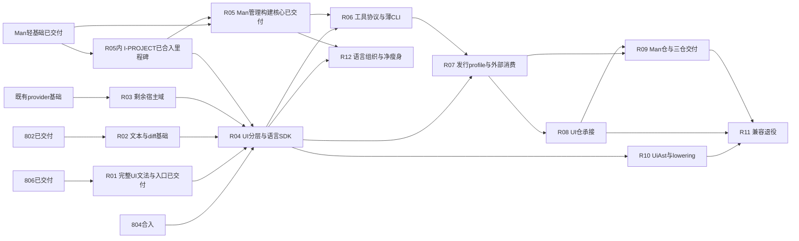

# v0.6 剩余迁移总路线图：按完整模块交付

更新：2026-10-24；路线版本：9。815 r3已归档17/17、816 r2已归档14/14；831 r2 executing 3/12，832 r2 drafting 0/12。新增841–844四份M2大模块合同，全部实际实施等831/832完整交付，再按841→842→843→844整Plan串行。来源与假设见[本轮输入](../attachments/m2-governance-batch-20261024/inputs.json)，历史快照不覆盖当前状态。

本文件是剩余迁移工作的统一调度入口，承接[Design 37](../../design/37-v06-modularization-and-repo-boundaries.md)。用户已明确：后续提高模块粒度，先整理交付目标、依赖、并行边界及搬仓验收，**暂不为全部工作包分配Plan号**；已按滚动请求建立807–811，831/832负责完整搬仓及发行，本轮将R10/R11/R12落实为[841–844四份大模块合同](m2-governance-order-841-844.md)。812/813是其他路线，不算迁移计划。R00–R12是路线工作包标识，不是实施计划号，也不改变在途Plan合同或授权执行/切仓。

当前规则以[Specs总览](../../specs/overview.md)及各模块Spec为准；本图描述未来目标，不发布为已实现规范。过去按批次追加的时间线从本文件当前正文退出，保留在Git历史与文末批次报告中，避免多个“当前状态”并存。

## 1. 当前切换点

| 范围 | 本轮可核实的交付/状态 | 对后续的意义 |
|---|---|---|
| 789/793/799/801 | 词法、诊断、共享兼容AST、轻方言接口已合入；[auto-ast](../../specs/auto-ast/project.md)、[auto-parser-api](../../specs/auto-parser-api/project.md)已有Spec | 无须再次规划AST/端口抽取；UI文法/默认组合随后由810/814分层，AST兼容节点终态仍归R10 |
| 779/785/790/794/802 | frame、文本/媒体剪贴板、scroll及editor22项已交付；[VM宿主合同](../../specs/auto-lang/vm/overview.md) | 不重复迁这些族；文本/diff、term、media已分别由807/808/811交付，UI运行组合由814承接 |
| 780/786/791/795/800/803/805 | 已有project-model有限消费、gen-core、包锁、resolver、Man资源与工具链规则；见[Man Spec](../../specs/auto-man/project.md) | 纯规则及809管理核心已独立；完整管理服务/CLI已由816交付，正式Man仓承接归832 |
| 803 | archived 8/8，delivery `89bb13944`，Man模板资源已独立 | 832承接既有资源单源，不重开抽取合同 |
| 792 | [选定Rust/Iced交付合同](../../specs/repository-boundaries/generated-ui-distribution.md)已交付 | 是可复用发行地基；受管包仍含语言大库，不等于全部UI/Man独立发行已成立 |
| 784 | [旧仓保全合同](../../specs/repository-boundaries/project.md)已交付，准备树/恢复载荷有交接 | 搬仓时重新核对源仓状态及恢复能力，不另建auto-ui/auto-man仓，不先清空旧默认分支 |
| [804](../archive/804-dialog-dnd-host-provider.md) | archived 8/8，合入及清理终收据`601954cca` | 对话框/拖出已交付；后续装配保留其真实接口及语义 |
| [806](../archive/806-ui-declarations-dialect-extraction.md) | 实际交付`c4158b89e`，归档/清理收据成立；header仍7/8、尾部收据8/8为原簿记差额，本轮不代改 | R01前置已满足；msg/model不是完整UI文法 |
| [807](../archive/807-text-snapshot-diff-core.md) | 已交付文本/分页/快照/diff，delivery `63fe29fd9`，归档清理终收据`4880ba708`，10/10 | R02已完成，不再次规划其数据算法；R04消费已合入文本core |
| [808](../archive/808-terminal-host-domain-extraction.md) | 已交付5833e155e，终态归档cabe023e2、10/10 | 终端已满足R04前置，不再重复等待 |
| [809](../archive/809-man-project-management-build-core.md) | archived 11/11，实际交付b819a602e | R05/I-PROJECT已可消费，815协议阶段不等814 |
| [810](../archive/810-ui-grammar-compiler-entry-extraction.md)／[811](../archive/811-media-host-runtime-extraction.md) | 均archived 11/11，实际交付f0ec8a91f／d06cdc6f6 | 814文法/媒体前置已满足；本轮不代重新验收 |
| [814](../archive/814-language-sdk-ui-package-separation.md)／[815](../archive/815-ui-project-tools-and-assets-extraction.md)／[816](../archive/816-tool-execution-protocol-and-thin-cli.md) | 814 archived 15/15；815 archived 17/17；816 archived 14/14 | SDK/UI包组、完整UI工具及薄CLI均已交付，831可按既有G启动；当前搬仓和后续M2仍未完成 |

已建立[831 auto-ui独立交付](../831-auto-ui-independent-repository-delivery.md)与[832 auto-man/三仓组合](../832-auto-man-three-repository-delivery.md)，831为r2/executing 3/12，832为r2/drafting 0/12；832仍严格等831完整交付收尾。完整任务门/owner/切换事务见[本批合同](repo-delivery-parallel-order-831-832.md)。

以上是来源明确的快照，不是本会话重做验收；具体完成范围以Spec/merge收据为准。当前其他AC/AutoDown等在途工作按真实共享写面协调，不作为全局停工条件。当前来源见本轮M2输入快照；[v2原输入](../attachments/extraction-roadmap-20261018/inputs.json)保留历史。

## 2. 两个明确里程碑

**M1：首次三仓独立交付。** auto-lang基础SDK、auto-ui、auto-man各有可消费边界，三仓能独立解析依赖/构建/测试/打包，生成工程与CLI组合实际可用；语言基础正常闭包不反依赖UI/Man实现。UI兼容AST及有期限的上层兼容入口可暂留，必须列明归属和退出路径。

**M2：干净解耦与减法收口。** UI专属AST/关键词职责归UI领域，旧兼容层按消费者迁移后退役，残留反向边与重复实现清理；语言内部模型/前端/VM/codegen/trans职责进一步清楚，同口径全生态源码/依赖指标可复核。M1完成后不能把M2默默取消。

数据与通用runtime模块先保持独立可消费的crate边界，其仓名/单独建仓与发布渠道可后续决定，不设为三仓首次交付的额外前置。全语言IR重写、后端退役、业务新功能不自动纳入本轮迁移。

### 计划粒度与数量口径

- R00的804/806已有实际交付，不为收口再开新计划，也不重新拼装在途工作。
- M1整段归为R01–R09 **9个完整工作包**，默认每包一份较大的Plan；一个Plan包含生产接线、旧实现清理、资源/测试与独立消费，内部3–5个内聚任务阶段不再各自取号。
- 历史M1计划预算为**约8–12份**（含已经立约/交付项，不是本轮还要新增的数量）：R01/R03/R04若存在真实的独立语法/生命周期/发布边界，可各拆两份；R07发行验收若完全纳入R08/R09合同，可以不单独建Plan。依据可交付/可复审/可回退边界调整，不按文件数、函数数或实现耗时拆。
- M2仍为R10–R12三工作包，本轮明确落实为**841领域终态、842兼容退役、843内部结构、844去重净瘦身共4份**，不再把“3–5份”当待取号范围。四份均大模块完整交付，内部probe不单独取号。
- 上一轮“7项待合入”及804/806待最终交付均属旧时点；当前808–811已交付，814–816已按r2阶段立约。上述九包与8–12份是整段M1编排基准，含已建立/已交付项，不是今天尚需新增数量；已有工作量、待建合同、仓库切换分别计数。

## 3. 目标模块及允许依赖

| 模块/所有者 | 完整交付职责 | 正常/构建闭包红线 |
|---|---|---|
| 语言基础与SDK／auto-lang仓 | 来源/诊断/兼容模型、Core解析与语义、编译执行/转译入口、LSP等基础消费 | 基础闭包不依赖UI grammar/renderer/Man管理实现；类型/推断存储有实际归属，不靠公开私有Parser或复制模型 |
| UI编译与运行／auto-ui仓 | 领域文法、UI分析/IR/生成、运行桥、renderer、UI工具及其资源 | 依赖语言SDK与轻工具协议；不拉Man管理大库或语言私有实现，不要求语言基础反向链接UI |
| 工程管理与工具／auto-man仓 | 项目/依赖/锁/构建规划、工具协议、语言/系统构建adapter、薄CLI | 管理核心无完整VM/renderer依赖；语言执行与UI工具由明确adapter/进程协议接入 |
| 共享数据与运行能力／各自明确所有者 | 已有值模型、通用规则、runtime/capability合同与非UI实现 | 无Parser/UI/Man反向边，不建立装所有跨界类型的common巨包；一份类型/算法来源 |
| 过渡兼容层／上层组合所有者 | 旧公开入口、默认宿主选择、弃用提示与迁移桥 | 必须在基础闭包之外，有消费者/期限/退出条件；不能一面依赖完整UI一面宣称同一基础包“纯Core” |

R04必须解决crate DAG与旧根API的组合位置。若旧`auto_lang::ui`等入口必须暂保，需以实际包图选择上层兼容承载与纯SDK入口，连同workspace解析/发行闭包一起验证；不能把UI re-export重新塞回基础SDK制造环。涉及公开路径退役或支持范围变化时，由具体Plan明示兼容方案及所需决定。本路线不预授权破坏已有接口。

## 4. 完整工作包及交付目标

其他工作包的“硬前置”按各自合同约束；**831/832及841–844采用整Plan严格启动门，连无关调查、测试资产、保全和独立子任务也不得提前做**。不得用本路线的通用并行建议绕过G831/G832及G841..G844，“并行范围”不授权多方同时改同一生产接线。

| 工作包 | 完整交付目标与退出证据 | 硬前置 | 可并行范围／推荐Plan数 |
|---|---|---|---|
| **R00 现有合同收口** | 804真实模态/拖出和806完整msg/model均有实际交付/归档/清理收据 | 已交付；806 header簿记差额由原owner处理，不重开合同 | **不新增Plan** |
| **R01 完整UI文法与编译入口** | widget/component/view/fragment、props/setup/refs、store/computed/on/actions/style等既有支持面全部归UI文法模块；Core expr/type/body由通用端口委托，默认UI入口/递归/导入保持装配，原Parser算法删除。完整正反语料、源位置/恢复与Core view参数/task on/同名变量对照通过 | 806实际合入；799/801作为已交付基础；端口差额有界设计 | 可与R02/R03/R05并行；widget结构与事件/样式相互调用先形成闭合图，不强拆成多个同改Parser的计划；**1–2** |
| **R02 文本／快照／diff基础模块** | rope/snapshot共享数据与diff算法有最小独立边界；行/文件/快照/目录/窗口四native及真实UI消费者使用单份规则；UI registry/FS观测有明确adapter。保持剪枝、serial/parallel等价、窗口为全量投影、换行/Unicode及错误envelope，纯算法无UI依赖 | 802已交付；盘清RopeSnapshot实际依赖。无需等待R01或804 | 可现在独立推进，不能把纯diff算法盲包成OS provider；与editor运行桥只协调公开面；**1** |
| **R03 终端／媒体等剩余宿主域** | 对实际目录/调用图穷举剩余能力，迁移term多会话/配置/几何/背压，以及其他实际仍跨界的媒体/窗口等能力；定义/编解码/实现/装配分层，真实VM/a2r消费、线程亲和、队列、水位/句柄、取消/退出/资源清理完整 | 已交付provider模式；具体子域共享类型/生命期先冻结。804仅在共同装配/整体闭包验收中合流，不是所有新族实施前置 | 可与R01/R02/R05并行；同一有状态族只一个owner，独立终端/媒体生命周期才允许分开；**1–2** |
| **R04 UI分层、语言SDK与默认组合出口** | UI模型/分析生成/运行桥/renderer成为职责清楚的包组；Man内的UI生成器及其gallery/wm/shadcn等专属资源归UI工具，项目配置通过轻合同输入。语言基础SDK与UI默认组合分离，Core消费不拉UI实现；既有支持消费者从公开入口工作，私有API/全局注册/缓存归属清楚，旧入口兼容有承载 | 最终交付需R01/R02/R03及804、806相关交付；从Man抽UI生成器还需R05的**I-PROJECT轻数据合同**实际合入。可先设计包图/公开出口和无关子模块 | 与Man线并行；不得与R01/R03同时搬其核心文件，也不与R05改同一Pac/生成请求接线；**1–2** |
| **R05 Man项目／管理／构建核心** | Target/Pac的声明数据、包管理/依赖/锁/构建规划及纯规则形成可消费核心；先冻结I-PROJECT（轻项目/生成请求数据：来源/后端/资源与输出根等），供UI生成器脱离Man大库。复用既有轻包，动态pac/am.at/模板、转译、Git/FS/外部工具留具名adapter；真实生产命令切核心，旧重复扫描/规则收口 | 现有780/786/791/795/800/803/805基础；无799/801/R01接口依赖 | 可现在与UI/宿主线并行；轻合同先交接，静态/动态支持面与旧失败语义冻结，不把静态子集当全部pac替代；**1** |
| **R06 工具协议、构建adapter与薄CLI** | 统一请求/能力/版本/producer/资源输出根；UI工具与语言/服务构建adapter明确，auto命令flags/stdio/exit/取消/watch/daemon及前后端路由保持；管理核心不导入UI大库，真实CLI→工具→产物可运行 | 完整交付需R05核心及R04公开UI工具/SDK出口；协议/非UI路由可先实现，不靠fake替代最终UI生产链 | 协议定义、进程控制与未重叠命令可先行；与R04/R05各有一次接口交接；**1** |
| **R07 发行闭包、资源与消费矩阵** | 固定source/锁/producer/资源、fresh/locked/重定位/升级恢复与外部验收 | 各属831/832全部验收，不缩面 | 并入两份，不另取号；严格遵守G831/G832，不提前准备driver |
| **R08 auto-ui旧仓承接与独立交付（831）** | UI包组/资源/测试/兼容进旧UI仓，独立发行与语言原件删除 | **全Plan启动等G831=815/816完整交付合入及收尾** | 含T-01..03准备均等待，不与815/816重叠；1份r2合同 |
| **R09 auto-man旧仓承接与三仓组合交付（832）** | 管理/CLI/安装进旧Man仓，固定三仓发行/恢复与语言原件删除 | **全Plan启动等G832，831全部交付及归档收尾完成** | 含T-01..03准备均等待，不与831重叠；1份r2合同 |

R01包含完整结构/事件文法闭包，不能把“搬几个parse函数”当退出证据。当前映射：**R01=810已交付、R02=807已交付、R03终端=808/媒体=811已交付、R04=814/815已交付、R05=809已交付、R06=816已交付**。811负责图像及本地媒体服务，i18n/a2r frame等运行桥已由814按SDK钩子/上层adapter收口；保留的兼容与UiAst终态仍按R10/R11退出，不将分层等同于全部兼容退役。R04/R05只完成三仓解耦所需拆缝，不顺手重写整个编译器/格式。

**I-PROJECT属于已交付809，I-TOOL属于815，均不另占Plan号。** 815-A只依809，交轻协议/同源codec与真实窄端点，不引AST/VM/renderer/Man；816-A实际消费已发布端点。814-A发布真实SDK/编译出口后815主体和816管理adapter可展开；完整UI生成/运行与CLI集成仍分别等814-B/815-B。阶段发布须独立审查、冻结门、实际master/Spec来源收据，不引用WIP、不复制请求或假backend。详见[阶段合同](staged-delivery-review-814-816.md)。

### M2工作包（已落实841–844；2026-10-24）

| 工作包 | 交付目标／退出证据 | 前置与并行 |
|---|---|---|
| **R10 UI领域AST／lowering终态：841** | UI专属模型/分类归UI，Core不再拥有UI专属节点，Core共享view/on/task/msg/Scene等合法语义保留；owned产物校验/lowering→类型/VM/生成器、codec/导入/clone/缓存/寿命完整 | G841=831且832整Plan完整交付收尾；所有任务含T-01/probe/fixture等待，不再按旧路线提前实施；1份 |
| **R11 兼容入口／旧发行退役：842** | 逐入口迁真实consumer后实际删过渡壳/旧路径/不再必要feature与隐式装配，保正式稳定API，版本迁移/拒绝/历史恢复可验 | 等G841且841整Plan交付收尾；不在841中途拆支撑，1份 |
| **R12 语言内部结构：843** | 七个已观察SDK巨型热点/其后继按职责实拆，保API/状态/算法/字节码，单TypeStore/会话/执行owner；源码/测试/指标归属清楚 | 等842整Plan交付收尾（并核前链）；不先重构旧布局，1份 |
| **R12 跨仓去重与净瘦身：844** | 基于最终owner证明真重复/无消费者，切生产调用并真实删除；三仓生产净删>0且有重复清偿，扣除helper/格式/生成/移仓，核M2有限退出 | 等843整Plan交付收尾（并核前链）；不凭DEPRECATED或文本相似删活跃功能，1份 |

本批[841](../841-ui-domain-ast-token-lowering-finalization.md)、[842](../842-legacy-compat-and-distribution-retirement.md)、[843](../843-language-core-structure-and-module-ownership.md)、[844](../844-cross-repository-dedup-and-net-slimming.md)均drafting r1/0/12，**当前启动门均blocked**。本轮只规划，未提前执行任何实施盘点/扫描/probe/度量/建树；仅用户授权的规划和上游状态/交付核验允许。共用门/顺序/范围见[本批合同](m2-governance-order-841-844.md)。

## 5. 依赖关系与关键路径

下图实线表示最终交付硬依赖；“既有基础”均需以实际merge/Spec为证。包内无依赖部分可以先做，最终不能越过对应出口门。

当前严格串行主线是：**814/815/816已交付→831完整交付收尾→832完整交付收尾→841领域终态→842兼容退役→843内部结构→844去重净瘦身**，每个箭头均要求前置整Plan完整交付收尾。831所有任务含T-01..03均等G831；832所有任务均等G832，不能以831 T-11局部发布或“只读准备”提前启动。原r1部分并行门已撤销；具体证据与禁止动作见[831/832 r2合同](repo-delivery-parallel-order-831-832.md)。R07仍并入两份，原交付目标不变。

旧R10/R12可与搬仓准备交错的建议已被本批保守顺序替代；841–844全部实际实施都等831/832完整交付，之后依次整Plan交付。M1允许的UI兼容模型在841终态退出，842按实际消费者与稳定支持承诺逐入口退役，不盲删Core共享语义。

## 6. 可并行范围与合入纪律

| 阶段 | 可并行的完整工作线 | 串行交接／不可越过的关口 |
|---|---|---|
| 现在 | 815/816已交付，831按G831执行；其他已获准路线按实际写面协调 | 832等831完整交付，841–844都等各自严格G，禁止实施准备/测试/建树 |
| G831满足后 | 831按内部任务依赖准备、实施、验收、合入与收尾 | 832继续等待，不以831候选或UI发布提前开始 |
| G832满足后 | 832按内部任务依赖执行全部准备与三仓交付 | 必须确认831全部AC/冻结门/合入/Spec/交接/归档收尾真实完成 |

共有文件（根/成员Cargo.toml、锁、lib导出、宿主安装、777规则/基线、Spec索引）按精确片段接线，后合入者同步master取并集并重放受影响验证。不能整份覆盖，不宽化forbidden规则，不因不同worktree而宣称没有语义冲突。

**无全工程停工要求。** AC/ABI/AutoDown及业务新功能按实际写面协调；新UI语法/native/pac协议需先交给相应owner。迁移窗口内受影响WIP先形成可恢复交接，不能stash/reset丢代码。跨仓一Plan一仓一树、组内解析、不建junction/symlink，清理必须wt-guard clean。

## 搬仓前的共同硬门

每条门由对应工作包提供受版本约束的实际证据；“文件存在”“代码能编译一次”“计划已勾选”均不足以单独放行。R08/R09的实施Plan须将下表变为稳定AC和可复跑入口。

| Gate | 验收条件／必须观察的结果 | 主责与放行范围 |
|---|---|---|
| **G1 功能与支持面** | 冻结命令/语法/backend/平台矩阵；正常输入、Core对照、错误/缺能力/取消和真实消费与旧臂或独立oracle一致。既有失败具名复现，不新增静默降级，不靠重写golden掩盖漂移 | R01/R03/R04/R05/R06；每个交付profile明确支持面，缺环境标pending，不将未测写成pass或默默取消原支持 |
| **G2 依赖方向与类型身份** | 真实normal/build及必要dev/feature闭包无环；纯语言消费者无UI/Man checkout仍可解析构建/运行，Man核心不拉完整VM/renderer；UI只经公开SDK/轻工具协议；AST/Value/协议/FFI只来自单一source身份 | R04/R05/R06；组合/legacy facade与基础SDK分别测，不能在大workspace可建就宣称基础包独立 |
| **G3 资源及构建闭包** | 源码、build.rs/include_str、模板/schema/stdlib、patch、字体/图像/脚本、工具二进制和producer/cache身份全有归属/版本；manifest/lock可重放。fresh解析、真实build/test、locked重放和A→B重定位成功，不借原target/rlib/临时树兜底 | R07持续＋R08/R09重放；缺资源/坏hash/漏patch/同名双source/不兼容版本确实非零失败，恢复后复绿 |
| **G4 宿主生命周期与退出** | 实例选择/默认优先/clone/merge、字符串/句柄/队列/线程亲和/模态/重入保持；term/media/拖出与watch/daemon在成功、失败、取消、超时后实际子进程/窗口/reader/临时资源退出或给准确恢复结果 | R03/R04/R06；真实OS/renderer/进程证据不能用fake计数或提前返回代替 |
| **G5 旧仓与来源可恢复** | 按当下HEAD/完整refs/WIP/ignored载荷刷新状态寻址保全，独立恢复验证；源commit/path→目标commit/path及资产/许可证映射闭合；新提交进入旧仓迁移分支，原tag/legacy不移动 | R08/R09，复用784工具/准备树/恢复载荷。没有先清空默认分支、orphan或强推覆盖历史；状态已变则新快照，不覆盖旧证据 |
| **G6 真正独立仓及CI** | 从目标仓/固定依赖的新检出和独立外部工程完成支持profile的构建/测试/生成/运行；每仓所需锁/CI/工具安装说明完整，source不存在D:/autostack或工作树隐式依赖。准备独立CI不等于实际已运行，执行结果须注明环境/提交 | R08 UI交付、R09 Man与三仓组合；本地受管bundle、真实仓检出、第三方consumer是三个不同证明对象 |
| **G7 切换事务与失败保护** | 明确受管产物/目录和写入owner；依赖/资源校验、生成、发布等失败/中断时旧可用产物与用户文件保持，或有预先规定且实际演练的恢复步骤；版本/缓存不兼容在执行前拒绝，不能误报成功 | R07/R08/R09。792已有admission/staging机制优先复用；不为搬仓另写一套弱事务。业务copy的旧先截断失败债另行治理，不豁免发行/搬仓保护 |
| **G8 审查／合入／交接** | 相关实现独立final review通过，代码/依赖/配置/输入绑定冻结SHA；merge-owned门通过，Spec/ledger/来源与剩余债沉淀；迁出实现真实删除，消费者已切源，树/分支清理有guard收据 | 各Plan和R08/R09。reviewed不等于已交付；旧默认分支只在本门与前七门齐备后以新提交推进，远端push/默认分支更名仍需具体授权 |

每个profile至少包括其实际适用的Core SDK消费、Vue生成/构建、VM/Iced交互、Rust/Iced生成外部构建以及Man/CLI主要路径；Jet/Ark、其他平台和工具链等按**现行支持合同**登记验收或明确环境缺口。792选定Iced正控不能外推为所有renderer/平台已通过。若支持范围需要变化，在具体Plan中取得明确决定，不由路线图擅自缩减。

所有跨界增量都随所属模块验收闭合，不把必需验证延期给未知“最后一次总测”。新crate/路径/资源影响792闭包时，产生变更的Plan立即沿其现有接口更新/定向验证；R07/R08/R09再验新的完整支持面。

其他已获准路线的跨Plan代码审查、定向验证与修复按其合同可并行；**831/832及841–844始终遵守各自整Plan串行启动门**，不借通用规则提前开工。同Plan同树单写者、冻结提交交接。共享SDK/协议修复由owner发布，影响方重放受影响scope。master/公共manifest/777/792/Spec ledger及裸t/触面整档走串行队列，GUI/OS全局资源与重型测试预约独占。反例回放与证据失效沿[既有规则](staged-delivery-review-814-816.md)，831/832调度以[其r2合同](repo-delivery-parallel-order-831-832.md)为准，841–844以[M2共用合同](m2-governance-order-841-844.md)为准。

## 8. 测试、证据与完成口径

work先完成全部实现/修复及相关定向反例、模块测试、必要check；同树独立final review验AC/SD，不运行整档来代替缺失证据。最终review pass后，merge在新冻结提交上统一跑裸cargo t及实际触面的tv/tu/tt等；变更影响证据须复审/重放，复用须证明源码/依赖/配置/输入未变。tf由主检出到期批量单实例执行，不因多模块并行而各树重复开重档。

每个工作包收据包含：来源/目标commit与路径、真实依赖/feature、支持profile、正反oracle、原始结果、旧实现删减、剩余边/兼容及失败回退。新文法不能复制Parser算法，新模型不能复制类型，新runner优先复用已有设施。已登记的模板/工具链加载预存缺陷按合同保留或另立明确行为修复，不借搬迁随手改语义。

规模指标跨三仓统一比较：生产/测试/生成/第三方来源分开披露；迁出行数、净删除量、重复实现清偿量分列；同一份实现搬到别仓不算全生态净删。依赖禁向边/包闭包、最大实现模块、cold/warm/增量构建在相同环境/输入下测量；没有实测不承诺速度/内存提升百分比。

**M1完成判据**：R00和R01–R09所需交付已过G1–G8，三仓支持profile独立与组合消费成立，允许的兼容项逐条列明。**M2完成判据**：R10–R12退出条件及受影响消费方已验收，兼容/净瘦身清单无未授权遗留；不能只以仓库个数或计划归档数宣布完成。

## 9. 下一步与滚动规划

1. 831按其r2合同实施/审查/交付，832严格等待其完整交付与归档收尾后才开始；本轮不改831/832合同或进度。
2. 841–844只建立规划：**831→832→841→842→843→844**全部整Plan完整交付收尾再放行后继，禁止T-01或probe提前开工，不自动建agent/树。
3. 831/832包含发行/CI/资源/安装/独立consumer和失败恢复；未通过项由其owner补齐，不转给M2做“最后收尾”。
4. 四份M2按领域终态→过渡退役→结构稳定→实测减法收口。844最终引用前三份真实交付，全部原目标内项闭环才宣布有限M2完成，不承诺解决未来所有新债/新IR/后端退役。

## 10. 来源、历史与本轮验证

当前合同来源：[前端Spec](../../specs/auto-lang/frontend/overview.md)、[AST](../../specs/auto-ast/project.md)、[解析端口](../../specs/auto-parser-api/project.md)、[VM宿主](../../specs/auto-lang/vm/overview.md)、[UI](../../specs/auto-lang/ui/overview.md)、[Man](../../specs/auto-man/project.md)、[工具链核心](../../specs/auto-toolchain-core/project.md)、[旧仓治理](../../specs/repository-boundaries/project.md)、[发行地基](../../specs/repository-boundaries/generated-ui-distribution.md)。这些Spec陈述已交付范围，本路线只提出未来目标。

历史批次：[789–792](../attachments/extraction-batch-20261016/inputs.json)、[799–800与792/794合流](model-decoupling-parallel-order-20261016.md)、[801–803](extraction-next-parallel-order-20261017.md)、[804–806](extraction-followup-parallel-order-20261017.md)、[807–809](module-migration-batch-807-809.md)、[810–811](grammar-media-parallel-order-810-811.md)；814–816阶段依据见[其合同](sdk-tools-parallel-order-814-816.md)，最新为[831/832](repo-delivery-parallel-order-831-832.md)。历史状态不覆盖当前快照，不反向修订已归档合同；旧A–J映射为A/B→R01/R04/R10，C→R02/R03，D→R04，E→R05/R06，F→持续发行＋R07，G/H→R08/R09，I/J→R10–R12。

总路线v2仅整理路线，见[原预检](../attachments/extraction-roadmap-20261018/preflight.md)；v3新增807–809，见[其预检](../attachments/module-batch-20261018/preflight.md)；v4新增810/811，见[其预检](../attachments/grammar-media-batch-20261019/preflight.md)。v5建立814–816的r1，见[旧预检](../attachments/sdk-tools-batch-20261019/preflight.md)；v6在2026-10-20按用户授权修订r2，开放真实A/B阶段发布与并行审查修复，当轮不增加Plan号、不写编号计数器。该轮只改规划文档，不改Rust/测试/canonical规范/ledger，不创建agent/树、不实施搬仓。Category A无Cargo/docs_gen；[r2预检](../attachments/sdk-tools-r2-20261020/preflight.md)仅验证当时合同，未执行未来验收。

本轮v7新增831/832，将R07并入对应搬仓交付；实际中央取号831→832→833，保留此前其他会话取号，不覆盖其文件。只写计划/设计/路线与证据，不改canonical Specs/ledger/产品实现，不创建agent/树，不写旧仓/远端。合同预检见[本轮收据](../attachments/repo-delivery-batch-20261022/preflight.md)，未来验收未执行。

本轮v8仅按用户最新要求将831/832修订r2严格串行，原r1/v7并行规则只作历史；不增加编号、不改实现/815/816合同/规范账本、不建树或agent。预检见[本轮收据](../attachments/repo-delivery-r2-serial-20261022/preflight.md)。

2026-10-24 v9将M2固定为841–844四份合同，全任务严格等前置整Plan交付收尾。来源与[预检](../attachments/m2-governance-batch-20261024/preflight.md)只验证文档，不是实现通过证据；本轮不改Rust/canonical/ledger、不建树或agent。

## 11. auto-web建仓与迁移的评估门（2026-10-29用户决定）

用户明确决定：**auto-web等待语言结构包884及后续UI/Man结构包完整交付后，再评估是否建仓与迁移；不作为Blog运行与验收补齐的前置条件。**

- 评估启动条件为 `U884 && U(后续UI/Man结构包)`。后续结构包目前未编号，以届时正式合同及交付收据为准；它不是Blog的auto-ui/003原生VM前置计划。
- “完整交付”沿本路线U(N)口径：约定验收、独立终审、冻结门、实际修改仓合入、规范/账本、归档和guard收尾全部闭环；代码已写、内部pass或阶段合入不提前触发评估。
- 门满足后，固定语言/UI/Man的实际交付组合，重新核对服务生成与运行的owner/公开接口及现有AutoWeb上位设计，再单独作建仓和迁移的go/no-go。达门不等于自动授权建立仓库、移动代码或实施完整Web生态。
- 门前保留auto-web候选方向与讨论记录，暂不建仓、迁移或复制HTTP生成器；不将这项新仓拆分塞入884或后续UI/Man既定结构范围。
- [BLOG-004](../../../../auto-blog/docs/plans/004-dual-runtime-acceptance.md)、[语言885](../885-blog-generated-rust-backend-parity.md)及[auto-ui/003](../../../../auto-ui/docs/plans/003-blog-native-vm-run-and-acceptance.md)按其已有运行/验收与最小缺陷修复合同继续，不新增auto-web或整个结构里程碑的全局等待；涉及884等共享路径时按实际交集协调写入/交付顺序。

本轮只记录排程决定，并与[AutoOS应用总表](../../../../auto-os/docs/plans/b-apps-basic-capabilities.md)同步；不修改任何在途Plan的合同/任务/验收，不创建仓库、Plan、worktree或agent，不改变产品代码、canonical Spec或ledger，不运行构建/GUI/功能测试。
