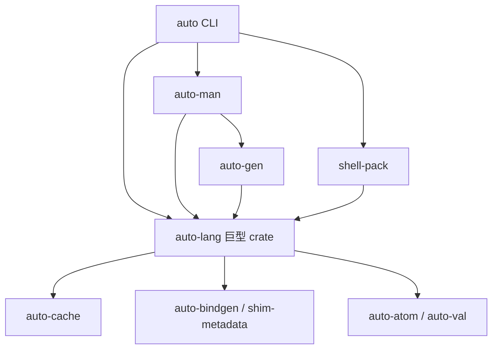

# v0.6 解耦、拆仓与瘦身调研报告

> 日期：2026-10-13（Asia/Shanghai）
> 基线：`master@5e21561d2c303a02319ff7a29e4607933e09a38f`
> 性质：代码调查与规划建议，未实施重构，未证明拆仓后的构建/运行已经通过。
> 数据附件：[静态基线 JSONL](v06-modularization-baseline.jsonl)（单条记录）。它记录逐文件行数、SHA-256、Cargo 本地依赖、引用样本、查重候选与历史快照。
> 架构方案：[Design 37](../../design/37-v06-modularization-and-repo-boundaries.md)；历史方案：[Design 32](../../design/32-autoui-repo-extraction.md)。

## 1. 结论与建议

**auto-ui 和 auto-man 都可以分出去。Cargo 并没有要求它们必须与编译器同仓；真正需要解决的是类型归属、编译时依赖方向、宿主装配和工具链契约。** 当前 crate 依赖图已无正常依赖环，但一个巨大的 auto-lang crate 隐藏了大量模块级往返依赖。移文件或关闭默认 feature 都不足以完成解耦。

建议采用三个主要交付仓；其中 auto-ui/auto-man 已有旧仓，推荐沿用原仓身份，迁移办法见 §10：

1. **auto-lang：语言 SDK、前端、VM、语言转译后端、LSP/语言测试。** 内部分成有边界的 crate，SDK 装配入口保持可用，避免立即把每个后端拆成一个仓。
2. **auto-ui：UI DSL、AURA、UI 生成器、Vue/iced 宿主、组件 schema、UI 资产与测试。** VM 模式仍可进程内消费语言 SDK；不要求解释器与 renderer 通过 IPC 才算独立。
3. **auto-man：包/工程管理、依赖锁定、构建调度、统一 auto CLI、工具插件发现。** UI 工程编排归 auto-ui 插件；语言编译与通用服务生成归工具适配器。包管理核心最终不依赖整个语言执行栈。

再建立两个可独立交付的底层模块域：**数据模型（Atom/Value）**和**标准运行时/宿主能力**。先在仓内建立独立 crate、独立契约与发布验证，再决定是否各建仓。目标是少数职责完整的大模块，不是按目录建立几十个小仓。

顺序必须是：**测清基线 → 补接口与装配缝 → 仓内 crate 化 → 独立构建验收 → 物理拆仓 → 清理兼容层。** 大文件结构拆分、去重与废弃面删除贯穿其中，但不与语义改造混在一次提交里。

## 2. 调研方法、口径与限制

- 读取主检出的 AGENTS、Cargo manifest、当前 module Specs、Design 32、相关源文件和在途 Plan。
- `git ls-files -- '*.rs'` 列举受版本管理的文件，以 `splitlines()` 计算物理行数；包含空行、注释、内联测试、金样与生成文件。**这些数不是生产代码 SLOC，也不是可删除代码量。** 不计 target/node_modules/未跟踪 scratch，不跟进 submodule 内部内容。
- `cargo metadata --no-deps --format-version 1` 核实 22 个 workspace 成员和声明依赖。其 `resolve=null`；不把 optional 声明边当成已经启用的构建边。
- 补查 `cargo tree --offline -p auto-man -e features -i iced` 成功，证实直接 auto-man→auto-lang/ui-iced 和 auto-man→auto-gen→auto-lang/default 两条启用路径；输出保存在数据附件。该查询未编译，但 Cargo 为本地忽略的根 Cargo.lock 补入 autodown-test-parser；后续只读审计宜用 `--locked` 阻止隐式锁更新。
- 对 `crate::ui/aura/ui_gen/design_tokens/a2ui` 和 `auto_lang::` 做文本引用扫描，再核读关键类型、函数和注册入口。文本计数包含部分测试/字符串，不能当解析后的架构边数；别名、相对路径和宏可能漏检。
- 完整文件以 SHA-256 查同；局部用 24 条非空、非整行 `//` 注释的规范化行窗口、步长 8 查重。该方法是低成本候选筛查，**没有得出全仓重复率**，也不能发现多数改名/改序后的语义复制。
- 历史用 `git rev-list --before` 选择 master 可达提交，再从 Git blob 读同一 `crates/auto-lang/src/**/*.rs` 口径；受合并历史影响，是当时可达提交快照，不是逐日增长曲线。
- 只读抽查本机 auto-os/auto-down/auto-term/auto-shell/auto-ai 的 manifest 与脚本。没有跑这些仓的完整回归或审计所有消费方。
- 本轮只产出文档。按 Category A **没有运行 cargo t、docs_gen，也没有在主检出构建**；metadata 成功不等于功能测试通过。初始 776 文档 WIP 与其决策报告保留。
- 收尾时另一个会话提交了 774 计划簿记，HEAD 变为 `76c3019394e9`；与调研 HEAD 的已提交差异仅为该 Plan 文档。逐文件 Rust SHA-256 复核零变化；报告仍绑定原始调查快照，不接管其他会话的 774/776 变更。

## 3. 规模和增长：问题在哪里

### 3.1 当前规模

| 口径 | Rust 文件数 | 物理行数 |
|---|---:|---:|
| 全仓受版本管理 `.rs` | 1,786 | 910,779 |
| `crates/**`，含补丁与 crate 内金样 | 1,687 | 875,599 |
| `crates/auto-lang/**` | 1,385 | 733,092 |
| **`crates/auto-lang/src/**`** | **730** | **704,000** |
| `crates/auto-man/**` | 57 | 47,895 |
| `crates/patches/**`（iced 补丁源码） | 64 | 31,816 |
| `experimental/**` | 31 | 19,501 |

用户所说的“70 万行”与 auto-lang crate 的 **src 口径**准确对应。73.3 万与 91.1 万采用了更宽的口径，不能拿它们与 70 万直接比较增长。

| auto-lang/src 模块 | 文件数 | 物理行数 | 判断 |
|---|---:|---:|---|
| ui | 181 | 247,615 | 最大实现域，编辑器/媒体/平台/桌面/渲染混合 |
| ui_gen | 42 | 87,180 | UI 生成器与大量内联测试 |
| aura | 8 | 13,511 | UI 表示、提取、schema、验证 |
| design_tokens + a2ui | 8 | 5,055 | UI 样式与协议桥 |
| **上述 UI 五目录合计** | **239** | **353,361（src 的 50.19%）** | 直接可归属 UI 域；未含 parser/AST/VM/根入口里的 UI 代码 |
| vm | 85 | 104,309 | 字节码生成、执行、标准库与 UI natives 同居 |
| trans | 20 | 52,215 | 语言转译，不应全部归 auto-ui |
| tests | 211 | 78,754 | 专用 src/tests，未包含内联/其他目录测试 |
| src 根文件 | 61 | 72,902 | parser/lib/compile/配置/服务等多职责入口 |

即使仅把 UI 五目录搬走，原 src 仍有 **350,639 行**。而生态总代码量不会因此下降。**拆仓降低单仓/单 crate 复杂度，去重和退役才减少生态实现量。** 两个指标必须分开记录。

### 3.2 半年增长实证

| 快照（截止当日本地 23:59:59） | 提交 | auto-lang/src | UI 五目录 |
|---|---|---:|---:|
| 2026-04-13 | `427cbd8e5429` | 166,131 | 44,155 |
| 2026-09-20 | `28c94a5d4421` | 549,247 | 274,300 |
| 2026-10-13 调研 HEAD | `5e21561d2c30` | 704,000 | 353,361 |

半年 src 净增 **537,869 行，约为原来的 4.24 倍**；UI 五目录贡献其中约 **57.5%**。09-20 快照到现在又净增 154,753 行（28.2%）。支持“增长过快”的判断，但不说明每一行是冗余，也不能证明期间从未做过删减；已有 PLAN-691 等清理记录。

### 3.3 必须结构拆分的大文件

| 文件 | 行数 | 推荐切线 |
|---|---:|---|
| ui/iced/renderer.rs | 41,775 | 布局/基础控件/复合控件/媒体/交互/主题/测试；保留薄调度入口 |
| ui_gen/vue.rs | 34,045 | 分析、UI lowering、模板、script、style、包集成；测试另归模块 |
| trans/rust.rs | 31,646 | 类型映射、表达式、语句、模块/FFI、发布装配；输出顺序保持 |
| ui/aura_view_builder.rs | 27,724 | 表达式求值桥、组件展开、属性、事件、列表/条件、测试 |
| parser.rs | 22,272 | Core grammar 与 UI grammar；先分文件，后分 crate |
| ui_gen/rust.rs | 17,736 | UI 通用分析、iced 发射、桌面/窗口装配 |
| vm/codegen.rs | 16,718 | 元信息、表达式、控制流、调用/FFI、闭包/泛型 |
| vm/ffi/stdlib.rs | 13,613 | 纯服务逻辑、VM 栈编码适配、宿主注册 |
| vm/engine.rs | 13,468 | opcode family、调度、资源/堆、外部 capability |
| auto-man/src/vue.rs | 13,026 | 工程分析、脚手架、资产、运行/构建、画廊、测试 |
| vm/native.rs | 12,803 | 注册框架与 provider 实现分离 |
| lib.rs | 8,232 | SDK 门面、语言执行、UI 编译/运行门面分离 |

这些文件包含测试，不能把全部行数当实现。例：vue.rs 内联测试在 20,820 行附近开始，parser.rs 在 17,784 行附近；renderer.rs 多个测试模块穿插，不能用“首个 cfg(test) 后全是测试”的算法估算生产代码。分文件是导航改善；只有 crate 和依赖边改变后才可能缩小编译失效面。

## 4. auto-ui：可拆，但有六类实际焊点

### 4.1 关键字/AST：不是单一问题

代码证据：

- `token.rs:367` 的硬关键字表里，widget/model/store/style 已不是硬 TokenKind；`dialect/ui.rs:35` 用 Ident 上下文派发 widget/msg/model/component/actions/style。
- `view` 是 Core 参数所有权模式（parser.rs:9674），不能作为“UI 关键字污染”整体删除；`on` 也在任务消息语法中使用，需按上下文区分。
- `TokenKind::Grid` 尚存在，但词法硬映射已经注释停用（token.rs:408）；Grid/Node 还服务 AutoData、Godot 和转译，不能按 UI 命名一刀删除。
- `ast.rs:207,220–236` 把 UseWeb、WidgetDecl、StoreDecl、ActionsDecl、ViewFragmentDecl、StyleRecipeDecl、MsgDecl、ModelBlock、ViewBlock 放进闭合 Stmt enum。
- `Stmt::Store` 是普通变量存储语句，**不是** UI `Stmt::StoreDecl`；混淆会影响整个语言。

**核心问题是闭合枚举的归属与下游 match 消费，不是 lexer 多了几个字符串。** Rust 下游 crate 无法给上游 enum 新增变体；若 core Stmt 依赖 UI 节点，而 UI 节点又包含 core Expr/Fn，机械分 crate 就产生环。

分两步解决：

1. **兼容期拆出实现**：基础 AST 暂保留 UI 兼容数据，不含 renderer/生成器依赖；UI 文法通过外部 Dialect 消费 parser 接口。此时可拆仓，但仍有 UI 语义债。
2. **干净终态**：UI 自有 typed UiAst，核心 AST 不拥有 WidgetDecl 等领域变体；有顺序/来源信息的扩展 item 经 UI driver 解析与 lowering，生成 core AST/程序和 UI IR。未处理的扩展项必须在 core 编译入口显式拒绝，不能静默忽略。具体承载选择需完整链路原型，不能贸然上 Box<dyn Any> 或把 AST 都转 JSON。

### 4.2 Dialect 已有缝，但不具备外部实现能力

`dialect.rs:25` 是 `Dialect: Send + Sync`；其方法接收具体 `&mut Parser`，返回 core Stmt。`UiDialect` 仍调用 Parser 内的 UI 方法；`in_on_body/in_fn_body` 是 pub(crate) 状态；`Parser::with_session` 会重建方言表，`build_dialects` 在 613–614 行硬编码 UiDialect。`store` 在 5326 行绕开方言表，`atom()` 中也有 UI struct/node 判别。

所以“trait 存在”不等于第三方 crate 可以接管。需要有限的 **ParserBridge**（游标/检查点/基础表达式与类型解析/上下文/诊断），显式注册与嵌套解析传播、错误恢复和冲突规则。先做外部探针，再迁全部文法。

还应验证错误时方言表恢复：当前 `try_dialect_stmt` / `try_token_dialect_stmt` 先 mem::take，再在循环内 `?`；Err 路径可能提前离开恢复语句。这里是静态发现的风险，未在本轮运行复现，归探针验收，不能作为已修复结论。

### 4.3 Core→UI 不只是测试，更有类型依赖

| 焊点 | 当前证据 | 切断方式 |
|---|---|---|
| SDK 主入口 | lib.rs:4411/4426 参数为 UI WidgetRegistry，4513/5494 返回 DynamicComponent；7231 起多种 ui_build API | UI 门面迁 auto-ui；core 只导出语言编译/执行 SDK；兼容层置于上层装配 crate |
| VM natives | vm/native.rs:1612–2391 的编辑器/clipboard/scroll 直接调 ui；native_catalog 绑定符号；NativeInterface::production/register_std_shims 集中装配 | native provider 由宿主注入；签名、ID、编码约定与 capability 声明统一登记 |
| 媒体资源 | vm/ffi/stdlib.rs:34/4933/4960 的 MediaAssetKey/MediaAssetTicket 等 UI 类型 | 纯媒体 capability 实现独立；VM 适配器留上层；句柄生命周期不变 |
| 终端引擎 | vm/ffi/term_engine.rs 多处调用 ui::term_engine_loader | terminal capability 与渲染/VM shim 分层，不靠反向依赖加载 UI |
| 应用 backend proxy | back_proxy.rs:151 持有 MediaIndex，1069 返回 PhotoEntry | proxy 属应用宿主层；公共媒体/文件服务作为可复用能力，不置 compiler core |
| 生成 Rust runtime | a2r_std.rs:1231–1306 调 ui::frame_bench 和 code_editor::diff | UI runtime adapter 随 UI，纯 diff 核心可共享；生成物依赖小型 runtime 包 |
| 编译数据库 | database/mod.rs:27–33 导出 UIArtifact/UICache | 通用源/符号数据库与 UI 产物缓存分开 |
| 构建指纹 | build.rs:39 扫 ui_gen；91–107 扫整个 crates 与兄弟 auto-down | 按真实 provider/build closure 生成指纹；拆仓后从包/产物获取身份，不能靠扫描旧目录 |

**Design 32 §3.2“反向引用全部非类型级、lib.rs 仅测试引用”已不符合当前代码。** 本轮没有去改它的历史内容；Design 37 给出当前补充和替代的提议。尤其 MediaAssetTicket、DynamicComponent、WidgetRegistry 的类型签名说明不能直接 git mv 五个目录。

### 4.4 宿主注入必须保护运行时不变量

现有 NativeInterface 已支持静态/动态注册、name→ID、merge、contract 与 reference proof，可以扩展，不必另建一套 native 系统。需要把“定义”与“实现/装配”分离：VM 不直接调用编辑器/剪贴板/renderer；UI host 注入 provider。缺 capability 的行为按当前各接口的真实降级或报错契约保持，不能统一改成空串/false，也不能把现有受支持行为悄悄变成 unsupported。

UI 调度、Rc/!Send 的 VM、线程亲和性、NanoValue/堆句柄 retain-release、异步终值和消息队列归属都要保持。`Send+Sync` 的注册闭包不意味着可以把 UI 状态或 AutoVM 直接跨线程传递。先以小族探针验证，媒体和 handler 全迁另立 Plan。

### 4.5 UI 自身也必须分层

建议 UI 域按 **UI AST/IR/schema → UI 分析/lowering → 多目标生成 → VM adapter/renderer → CLI/项目插件** 分层。AURA validate 当前反引 ui_gen::widget::AUTO_IMPORTED_WIDGETS（aura/validate.rs:20），应把领域目录/规则交给 UI core，不能保留“基础 IR 依赖生成器”的方向。

组件差异和 renderer-specific 行为不要强行抽成万能 visitor；先统一共享语义规则和分析输入，再保留明确 backend emission。

### 4.6 资产与外部消费面

当前 `docs/schema/aura.at`、`stdlib/aura`（62 文件）、auto-man/assets（376 文件）、packages（300 受管文件）、examples/ui（381 受管文件）、UI tests/skills/config/iced patch 都要逐项指定归属。

Design 32 的旧 `schema/`、`blueprints/` 路径不能原样当当前迁移清单：本机仓根已有 docs/schema，根 blueprints 不存在；UI 画廊/应用有已迁 auto-os 的资产。**按实际路径盘点，不复制旧数字与迁移清单。** packages 中 Playground/网站体验也不必全部迁 auto-ui。

外部抽查：auto-os/desktop.ps1 验证 auto-lang+examples/desktop-host，并直接 build auto-lang example；auto-down jade-garden/back/server 用 auto-lang 绝对 path；auto-term/at-gen 指向 language runtime 并可开 UI；auto-shell 主库也直接依赖 auto-lang（关闭默认 feature），auto-ai 消费 auto-atom/auto-val/a2r-std。Design 32“auto-shell 仅依赖小库不受影响”不能照搬。更改 SDK/runtime 导出需要相应消费方迁移或明确兼容窗口。

## 5. auto-man：可独立，但先拆成管理核心与生态适配器

### 5.1 Cargo 声明边与隐藏成本

当前正常依赖：

auto-man 显式启用 auto-lang/ui-iced；auto-lang 默认也启用 UI；auto-gen/LSP/VM CLI/Playground/shell-pack 的默认依赖因此扩展出 UI。auto-macros→auto-lang 是 **dev-dependency**，不是当前正常依赖环，发布/测试安排时应另审，不能误判 Cargo 无法构建。

### 5.2 auto-man 里哪些应搬

| 责任 | 当前路径 | 去向 |
|---|---|---|
| 包管理 | git/index/lock/pull、pac 的包/dep/member 字段、resolver | auto-man core；resolver 语言适配置上层 |
| 构建执行 | builder/{cargo,ninja}、target、工具发现/进程执行 | auto-man core + build provider |
| UI 工程编排 | vue/vue_shadcn/rust_ui/jet/ark/tauri、gallery/wm/image_viewer | auto-ui tool plugin，含对应模板资产 |
| 通用 HTTP/API 生成 | api_gen、http_service、tauri_backend 中通用部分 | language/service build adapter；不能因过去服务 UI 就全部搬 UI |
| 通用模板 | auto-gen，asset::Templates 使用 AutoInterpreter | 模板/复制核心与可执行 Auto 模板 adapter 分开 |
| CLI | crates/auto 的 Run/Build/Ui/Bp/Tauri/Serve 等 | auto-man 仓的薄入口；provider 路由；保留用户命令 |

其中 `vue.rs`、`rust_ui.rs` 共 19,243 行，`api_gen.rs` 8,043 行。这三个文件占 auto-man 宽口径近 57%，反映包管理器的职责被项目生成和运行时编排占据。不是把整个 47,895 行 crate 搬出去就完成治理。

### 5.3 先统一工程模型，避免为了无环继续复制 parser

`pac.rs:12–14` 依赖 auto_lang 的 AutoConfig/BackendConfig/BackendType/Atom；resolver 依赖 ModuleResolver、ExecutionMode、ModulePath/PathPrefix；asset.rs 通过 AutoInterpreter.eval_template 执行模板。UI app_registry 用平铺文本读 pac，语言 import loader 另扫 dep/member，vue 还有展示名读取。

建议新增 **auto-project-model**：纯数据 ProjectDescriptor/DependencyDecl/RenderSpec/工具请求与错误；包管理、语言模块装载、UI 注册表消费同一解释规则。项目效果（拉仓/构建/渲染）不进入模型 crate。适配器在两端把它翻译成语言/宿主接口。

已有 auto-atom 的独立 AtomParser 可作为静态配置读取候选，但 auto-lang::AtomReader 当前会执行 AutoVM。**不能未经探针就切换所有 pac.at**：表达式、模板、变量/插值、配置 mode、未知字段、路径和覆盖顺序需要盘点。静态子集由轻解析器处理；必须执行的旧配置由显式 compiler adapter 处理，或拒绝并提供迁移说明，后一种需要单独批准兼容性改变。首轮 pilot 不改变当前默认语义。

### 5.4 CLI 插件缝与仓独立

保留 `auto run` / `auto run -r vm` / `auto build` 等表面命令，AutoMan 根据工程与显式 flags 选择工具 provider；UI provider 用子进程 `auto-ui`。pac.scene 不是唯一条件，直接 `.at` 输入、CLI override、混合后端、无 pac 的示例都需要路由契约。

定义版本化请求/响应或握手（协议版本、工具版本、capability、项目/输出/资源根、原始参数）；stdout/stderr/退出码、Ctrl+C、watch 子进程和 daemon 收尾是必测项。**不兼容版本拒绝执行**，不能仅告警后继续；兼容工具版本差异可提示。UI 一般不在编译期依赖 auto-man 大包，两端只依赖轻项目/工具契约。

Design 32 当时保留 auto-man 在 auto-lang workspace 的裁定是历史方案。用户本轮提出各大模块都能独立建仓，Design 37 将 **auto-man 独立交付**作为新提案；未把旧裁定抹去，也未声称已经获得实施批准。

## 6. Cargo 到底限制了什么

Cargo 支持跨目录 path 和跨仓 git/registry 依赖，也允许一个 git 仓里提供多个 crate；需要避免正常 crate 依赖环。限制的是具体类型/依赖构图，不是项目必须同 Git 仓。[Cargo 依赖声明](https://doc.rust-lang.org/cargo/reference/specifying-dependencies.html)

features 是 additive：一个消费者启用 UI，其他依赖方的 default-features=false 不能从同次构建里撤销它；resolver=2 只在特定场景减少统一，不是模块解耦器。单独 core consumer 构建与 UI 装配构建要分别验证。[Cargo features](https://doc.rust-lang.org/cargo/reference/features.html)、[resolver](https://doc.rust-lang.org/cargo/reference/resolver.html)

workspace 共享 lock/profile/配置有便利，也有编译配置扩散。跨仓后每个仓必须有可独立使用的 manifest/lock/CI；集成 workspace 是开发/对拍工具，不作为运行或构建前提。[Cargo workspaces](https://doc.rust-lang.org/cargo/reference/workspaces.html)

本仓根 Cargo.lock 当前被 `.gitignore:8` 忽略，并未受版本管理；因此当前“有本地 lock”不等于 clone 后拥有同一锁定结果。跨仓方案必须明确应用/工具交付仓的 lock 入库与刷新规则，以及库包的版本约束/消费方锁定责任，不能继续把个人机器的 lock 当可复现发行基线。

本仓的 `{workspace=true}`、根 iced patch、build.rs 对 ../../crates 的扫描、生成物里的源检出相对路径和绝对路径都是迁移事项。普通 Cargo.toml path **不会自动套用 AUTO_LANG_ROOT 环境解析序**；环境解析是应用/生成器职责。开发可用组内显式 path/顶层 patch，发行依赖固定版本或 git revision，不能承诺“一个 env 自动修好所有 manifest”。

## 7. 其他模块的重构和查重去重

### 7.1 优先级

| 优先级 | 项目 | 原因/行动 |
|---|---|---|
| P0 | lib.rs 门面、VM native/FFI/provider、项目模型 | 直接决定能否剪断依赖；先接口/实例化/资源边界 |
| P0 | build.rs 指纹/资源根 | 扫整个 crates 和兄弟仓使失效与仓布局耦合；改成真实闭包，不削弱 PLAN-738 身份校验 |
| P1 | parser/UI DSL、UI core 与 generators | 补外部注册和 ParserBridge；兼容 AST 到 UiAst 分期 |
| P1 | renderer/vue/trans rust/codegen 大文件 | 按责任搬运，金样与行为保持；避免顺便换算法 |
| P1 | VM engine→codegen | engine.rs:2 的 ObjectType、:758 的 CFFI_GLOBAL 属执行端反依赖生成端；共有类型/元数据下沉、runtime 从显式装配获取 FFI |
| P1 | stdlib 分层 | 纯能力实现与 VM/a2r/TS adapter 分离；目录/ID/签名单源，保持真实不同 backend 行为 |
| P2 | frontend 的类型/数据库/模块加载 | parser 已依赖 inference/type store/database，非纯语法库；先 API 分层，再考虑 syntax/front-end crate |
| P2 | cache/dep/shim 生成 | frontend 当前直接触发外部 cargo/缓存构建；逐步迁 build driver，通过 artifact/metadata 接口消费 |
| P2 | 实验与非支持后端 | AC/HIR 原型边界已有 Specs，维持独立实验；不把它假定为成熟全语言 IR；aavm 拟退役仍需用户裁定 |

VM crate 的当前名字尤其容易误导：`crates/auto-vm` 只有约 207 行，实际引擎在 auto-lang/src/vm。未来引擎 crate 要先命名决策，避免覆盖辅助 CLI 或留下两个“AutoVM”。

### 7.2 已核实的重复与差异

| 候选 | 证据 | 处理建议 |
|---|---|---|
| Levenshtein 两实现 | aura/schema.rs:408、aura/validate.rs:380，24 行窗口一致，人工核读算法一致 | UI domain 内的小 helper，两消费者共用；验证 Unicode/空串语义 |
| dialog 标签角色 | parser.rs:13438 与 ui_gen/rust.rs:7204 | **不是完全相同**：生成器另有 title/description/header/footer/label/separator；抽共享 role 表，各阶段显式投影子集，不能择一覆盖另一份 |
| pac/locale/展示名 | pac.rs、lib 装载器、ui/app_registry.rs、vue.rs、automan.rs:25 | 项目/应用元信息单源解析；locale 纯策略；保留语言/执行效果边界 |
| iced 自定义 Widget 委派 | pointer_area/seek_area/video_uplink，frame_probe/pen_area/right_press_area 等 | 查重命中多为 size/layout/draw/operate boilerplate；仅在同语义/同生命周期下抽 helper，不以减少几行引入万能 wrapper |
| VM ↔ a2r 标准函数 | read_text_range 等已有 parity 契约 | 同一纯能力可共享；栈/所有权适配必须分开，不删除独立 backend 对拍 oracle |
| 窗口/协议 Win32 FFI | KNOWN-DEBT P726-R2 已登记重复声明差异 | 单一声明模块与 typed wrapper，保留平台 cfg |
| 废弃 macros | Specs 已登记 auto-lang-macros 非 workspace，无依赖；两个测试文件逐字相同 | 先查脚本/发布引用，确认后删除旧副本；不把整个两 crate 声称为逐字相同 |

窗口扫描得到 **20 组候选窗口**，大部分重叠或框架 boilerplate；它不是“20 个重复函数”，更不是全仓重复比例。全文哈希还命中空白占位文件、fixture/golden 和历史报告探针，这些不能自动删除。

### 7.3 真正的减法

建立 keep / merge / generated / deprecate / retire 清单，记录用途、消费方、替代路径、兼容窗口与验证门。优先处置孤儿 auto-lang-macros、auto-xml、重复 lock、永不启用的旧 converter cfg、旧桩/墓碑注释。已有 Scope.get_val 恒 None 等 legacy 要查实际可达路径再退役，不能依据注释删除。

生成表（如 lucide_generated.rs 5,668 行）以 schema/manifest 为单源，并验证重生成稳定；移动到生成 crate/OUT_DIR 不等于消灭生成复杂度。后端发射可以分享分析，但 C/Rust/TS 的语义差异必须显式保留。

测试减法以**断言能力**为准：历史 Plan 命名测试可按当前 feature 归组，复用夹具构造；不删除能抓住不同 bug 的 oracle，不重新把所有测试绑回一个大 crate。外部书仓/画廊用固定输入或 explicit integration gate，避免普通包 test 依赖机器上恰好有全生态。

## 8. 路线、停止点与完成定义

| 波次 | 独立产出 | 当前规划 | 通过后可进入 |
|---|---|---|---|
| R0 | 同口径规模/依赖/资产清单、边界增量检查 | [PLAN-777](../777-v06-modular-boundary-baseline.md) | 防止新耦合继续增长 |
| R1 | 外部 Dialect 可用性与错误恢复原型 | [PLAN-778](../778-ui-dialect-externalization-pilot.md) | UI 文法按族迁移；不是整个 UI 已拆 |
| R2 | UI native provider 小族完整装配原型 | [PLAN-779](../779-ui-native-provider-pilot.md) | native/媒体/终端分族迁移 |
| R3 | 项目模型与静态/执行配置兼容性探针 | [PLAN-780](../780-project-model-decoupling-pilot.md) | 项目解析单源、auto-man core 分层 |
| R4 | 剩余反向依赖清偿；UI runtime/API 门面迁移；大文件结构拆分 | 后续按 R1–R3 证据立多个中等 Plan | 仓内 UI crate 独立构建 |
| R5 | UI 工具插件、通用 service/compiler adapter、薄 auto CLI | 后续新 Plan，契约先评审 | auto-man 可独立构建/发行 |
| R6 | 复用既有 auto-ui 仓、legacy 留旧版、资产/文档/CI/history 与消费方迁移 | 后续跨仓 Plan；先 UI，再 man | auto-ui 独立交付 |
| R7 | 复用既有 auto-man 仓、legacy 留旧版、版本锁定与集成组合验收 | 后续跨仓 Plan | 三大仓 independently usable |
| R8 | UI 专属 AST 从 core 退出；VM/codegen、stdlib/数据域进一步分层；兼容层退役 | 后续按需求/风险拆 Plan | 干净终态，而非兼容拆仓即收工 |

前四份只是 drafting，未批准实施；后续 Plan 的编号、任务范围由探针决定，避免把未验证接口写成确定工程量。先启动 777，再顺序实施 778/779/780；后续每族单独 review/fold。没有并行改核心类型与 native 装配的建议，也未创建新仓。

阶段停止规则：外部 grammar 需要暴露 Parser 全部私有字段、native provider 需要让 !Send VM 跨线程、static pac parser 无法保持已支持语义，均停在决策工件上重新设计，不以临时副本/unsafe/静默降级“过门”。776 的返回资源/异步终值合同、770/771/774 的 AC 扩面各有归属，本路线不能趁结构调整改写它们。

最终验收应同时满足：

- normal/build dependency DAG 无环，语言 core manifest/代码/构建指纹不依赖 auto-ui 或 auto-man；工具/renderer 是上层装配。
- 外部普通 Rust consumer **无本机 D:/autostack 假设、无 UI checkout/renderer**可解析 Core、运行 VM；生成的 CLI/HTTP Rust 工程不依赖整套编译器/UI。
- auto-ui 能独立构建 Vue 与 VM/iced，代表 UI 行为/视觉 parity 和桌面/媒体能力真实通过；核心不以“兼容 AST 暂留”冒充纯净终态。
- auto-man 包管理核心不用 UI/VM；需 compiler 的命令经 adapter；原有 run/build/serve 与缺插件/版本失配/取消/退出码可验证。
- 底层模块仅依赖比自己低的契约；foundation/project-model 不能成为新的 common 巨无霸。
- 每个发行仓有独立 lock、CI、安装及版本兼容说明；集成 CI 对 pinned 组合复现，禁止复制锁/源快照冒充真实依赖。
- 分别报告搬迁量、删除量、生产/测试/生成量、模块最大尺寸、依赖扇出与构建失效范围。性能在相同 profile、缓存状态和消费者命令下前后比较；本轮没有实测速度或内存承诺。

## 9. 对旧方案的具体修订建议

1. 保留 Design 32 的进程内 grammar + 工具子进程双缝方向；把“注册倒置改动小、反向依赖只有常量”改为本轮逐项类型/装配清偿。
2. 将 auto-man 由永远留 language workspace 调整为有独立仓目标；先解 package core 与生态编排。
3. 旧方案 tf per-plan 门禁改用现行 scoped t/tv/tu/tt；tf 仍按到期规则由 batch regression 在主检出单实例执行。
4. 旧迁移清单按当前 docs/schema、auto-os 等所有者重盘；新增 build.rs/UI cache、std runtime、HTTP/service 非 UI 归属和真正的普通 consumer 证明。
5. 明確区分实现分离与 UI AST 最终退出；保留的兼容债有后续任务与退出门，不无限延期。
6. 复用既有 auto-ui/auto-man 仓并保留旧历史/tag；auto-lang 迁出路径的历史提取只在 disposable clone 操作，先 crate 化再搬史，不能对任何主仓直接 filter-repo 或覆盖旧默认分支历史。

本报告提供了可拆的工程路径和风险证据；真正完成拆仓还需要上述分期实施与独立复审，不能由静态调查宣布达成。

## 10. 补充：沿用旧 auto-ui / auto-man 仓，还是另建新仓？

**推荐沿用旧仓，并在交付时用新代码树承接默认分支。** 仓名、产品身份与职责延续，没有必要为一次架构重构更换仓库 URL；旧标签、分支、提交以及托管平台现有项目关联也继续保留。

2026-10-13 本地只读证据：

| 仓 | origin | 当前默认检出/提交 | 旧版本引用 | 未提交状态 |
|---|---|---|---|---|
| ../auto-ui | git@gitee.com:auto-stack/auto-ui.git | master / f7d92eef273c（2026-02-28） | v0.1、v0.2；远端跟踪 gpui2/gpui3/iced | Cargo.lock 修改 |
| ../auto-man | git@gitee.com:auto-stack/auto-man.git | master / 51fafe82e8e0（2026-01-21） | v0.0.*；远端跟踪 v0.0.x | clean |

两仓本地 master 与本地 origin/master 对比均无 ahead/behind；未 fetch，也未读取托管平台 issue/release/CI 配置，不能把这一结果当成最新远端状态或完整平台资产审计。

用户提出的“旧代码放旧分支，main 留给新代码”方向合理，具体建议为：

1. 拆仓交付前冻结旧基线，保存工作区改动；保留一个明确的 legacy 分支和归档标签，不挪已有发布 tag。auto-ui 的 Cargo.lock 当前脏，不能直接覆盖。
2. 在从旧 master 分出的 migration 分支/专用 worktree 导入 **当前 auto-lang 中经解耦与验收的实现**，替换旧代码树；旧代码不整套挪进新树的 legacy 目录，以免继续形成双实现。
3. 独立构建与跨仓消费验收通过后，以正常新提交/合并推进默认分支。旧 commit 继续作为历史祖先；不要 force-push、reset 或先建空的 orphan main。
4. 如果采用 main 名称，交付时处理默认分支/CI/引用切换；两仓现在实际都是 master，先不改名也能完成全部解耦。
5. auto-lang 中新增半年的路径历史从临时 clone 提取，可在目标仓单独保存来源历史分支与迁移映射。是否合入默认历史另作迁移设计；不要仅复制文件却丢失来源记录，也不要为了拼接历史自动合入旧实现。

因此保留的是旧仓身份和历史，新默认代码的基线则来自现行 auto-lang。本次只修订报告/设计，未修改两个旧仓、创建分支、清理其工作区或操作远端。

## 11. 补充：是否暂停其他计划后独立拆分？

**建议受控并行：准备与独立模块继续，公共接口先收口，搬迁时只冻结相关模块。** 全部暂停会让尚未验证的缺陷长期停在旧边界，也把拆分变成必须一次成功的大项目；等所有计划完成则可能永远等不到稳定空窗。采用短小、可合入的边界阶段。

具体调度和核查快照见 [Design 37 §8.2](../../design/37-v06-modularization-and-repo-boundaries.md#82-与在途功能工作的并行策略)：

- 777 可立即作为独立准备工作；报告绑定采样revision，动态主线在真正切换前重新取样。
- 774 已 execution_done、主体在独立experimental探针；其复审/收口可继续。770/771满足自身前置后可与UI/Man拆分并行，但二者内部共享热点仍按既有合同协调。
- 776 在执行：真实diff涉及http_server/stdlib/heap/资源编组，后续T06还要API合同与auto-man生成器；优先完成scope与review/merge，再迁相关FFI/API/生成器或native装配。不是先要求它完成所有未来HTTP能力。
- 742/744/773先核查剩余工作与必需验证；已合入代码不等于Plan完成。可先收口的推进收口，涉及API/natives/test adapters的残余由迁移owner明确交接，不能为拆分取消验收。
- 778/779/780可先并行调查/隔离探针；生产接线按源码与语义接口冲突逐项串行。工作树隔离只能减少文件互踩，不能隔离native ID/合同、AST/路径、生成runtime等语义变化。
- 真正crate化/搬仓/CLI接线时，仅暂停所迁模块的大改，旧语法兼容下的应用业务/文档/实验可继续。切换完成后受影响在途树同步新边界并重跑其验收。

建议的眼前顺序是“777准备 + 774收口 + 776当前scope完成”，然后分批补接口、UI切换、Man切换。尚未开始的新功能若正落在拟迁UI/Man热点上，优先排到新边界之后；已开始的工作保全并按实际交叉面协调。本建议没有停止/改状态/派遣任何现有任务，也没有将777–780视为已经获得执行授权。
