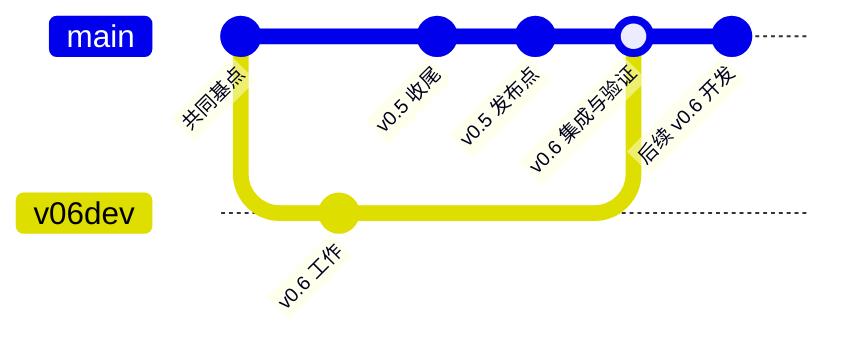

# v0.6 回归主开发线：盘点与执行方案

日期：2026-10-12（Asia/Shanghai）。本文件是合并前只读调查基线：当时尚未合并、提交、推送或切换分支；2026-10-13 的实际合流结果见 [merge-receipt-20261013.md](merge-receipt-20261013.md)。

## 结论

以 GitHub 已发布后的默认分支为基底，完成在途工作后，通过普通 merge 吸收 v0.6 成果。保留 auto-lang/auto-down 的 `master`，其他仓现有的 `main`。最终主线承担 v0.6 开发；v0.5 tag 固定，原 v0.6-dev 保留为历史入口，待在途工作树迁移完后停止作为集成目标。

已 push 不妨碍任一方向的普通 merge；它约束的是 rebase/reset/force-push 等历史改写。为了让发布主线保持第一父链，本次选择从发布主线创建集成候选，再 merge 开发线。原开发提交仍保留在原支线上，新增汇合提交位于发布点之后；不把原提交重写成一条伪线性历史。



实际须在独立工作树准备、验证和独立复审候选，通过后才快进主线并普通 push。跨仓发布无法一次原子提交：先应用子仓，后 AutoOS 父仓 gitlink，逐仓登记 SHA 与完成/失败/待重试状态。

## 已核实的范围与提交

GitHub connector 返回 auto-stack 38 个仓库。排除语料库 `daizhigev20` 后，本次覆盖 37 个相关 GitHub 仓库：七个核心/服务仓、auto-edit/jade-edit、24 个 AutoOS 子仓，以及 auto-ui/auto-man/tree-sitter-auto/books。另盘点 D:/autostack 顶层 27 个 Git 检出；Gitee/Codeup 的历史工具仓记录状态，不能把它们的 WIP 自动解释为 v0.6 待合并实现。

七个 GitHub 核心仓的远端 heads 已成功 fetch；24 个子仓的远端 branches 已由 GitHub API 核对。初次直连/HTTP2 同步缓慢，最终采用本机已有 SOCKS 代理和单次 HTTP/1.1 配置完成同步，未修改全局 Git/网络配置。

| 仓库 | GitHub 主线 | 本地开发/独有工作 | 判断与后续动作 |
|---|---|---|---|
| auto-lang | master `38e4c7c5f`；v0.5.0 解引用 `e05e2d3d7` | v0.6-dev `a45ff543e`；远端 v0.6-dev `94173fe2c`，本地领先 58 条；主线/本地开发各独有 594/283 条 | 完成 742/744/768 收口，保全未提交设计/计划，解决编号/代码/Spec 冲突后合入主线 |
| auto-os | main `e7fadc4`（v0.5.0 解引用同 SHA） | v0.6-dev `71d3b5f`；两线各独有 68/40 条；Weather/Notes/Blog gitlink 与当前检出不同，Launcher 有未跟踪内容；两个未跟踪 probe 文件 | 先完成子仓与源更新吸收，最后合父仓并固定可远端获取的子仓 SHA |
| auto-musk | main `0400cbd` | 本地 main `bfcf373`；主线/本地各独有 367/2 条；本地 v0.6-dev 仍在旧基点 `edde608` | 两条未推送提交是 auto-plan 技能规约修订，实际位于本地 main；以新远端 main 为第一父线合入两条提交 |
| auto-down | master `895f8d0` | 本地 master/v0.6-dev `fba6563`；远端比开发基点多 2 条，开发独有 0 | 快进到新主线；Plan 768 的只读 pinned parser 依赖另外核对，不移动裁判快照 |
| auto-ai | main `2a4d606` | 本地 main/v0.6-dev `58bee8d`；远端独有 11 条、开发独有 0 | 快进；保留最新 v0.5.1 主线，不能回退至 v0.5.0 |
| auto-shell | main `46bf489` | 本地 main/v0.6-dev `00c8775`；远端独有 15 条、开发独有 0 | 快进，更新与新工具链的运行验证 |
| auto-forge | main `c239d61` | 本地 main `a1f5982`，落后 40 条；无 v0.6-dev | 主线同步与消费核对，不制造空合并 |

auto-edit/jade-edit 仅有远端 main，分别 `acf71a0`/`4d49bbc`；当前机器未找到独立检出，因此远端分支盘点不等于证明其他机器没有本地 WIP。auto-ui/man/tree-sitter/books 无远端 v0.6-dev；本地对应仓多指向 Gitee，后续先核对 GitHub/Gitee 的提交关系再同步，不能自动重配 origin 或覆盖本地资产。

### 应用子仓

- Notes：`61e83f8`，相对远端 v0.6-dev `80770cc` 领先 **11 条**；001 r7 execution_done 34/34，仍待独立 final review 和规范沉淀；10 个未跟踪路径为旧 probe 证据，须甄别并保全。
- Blog：`08da633`，相对远端 v0.6-dev `6d819c4` 领先 **14 条**；001 r6 executing 3/31，Phase 5 needs_fix；`drafts.at`/`works.at`/`draft_store.at` 有未提交修复（122 增/86 删），不能直接当完成品发布主线。
- Reader：`29b5dec`，开发线已推送；001 r7 executing 16/32。用户 2026-10-12 已决定保留混排滚动恢复、10MiB 成功导入、原生 VM 验收目标，由 auto-lang 能力/验收工具前置承接，禁止把 required 改为延期债务来取得 pass。先核查最新 v0.5 是否已提供能力；仍缺的部分单独立设计/Plan，再回来终审。
- Launcher：当前 detached `df20728` 已在远端 v0.6-dev；本地同名分支仍 `87ef98e`，落后 1 条；001 r7 状态仍 executing 15/15，摘要仍说 r3 未实施，r7 工作记录仍说待提交/IME blocked，而后面已有用户双端 IME pass 和推送回执。需核对最终代码与证据、修复现行记录，再独立复审；不能仅以全部勾选判定 delivered。11 个未跟踪工具/缓存路径须保全甄别。
- Weather：主线/开发线 `1626a4a`；Plan 008 在工作树 `D:/autostack/.wt/weather-008/auto-weather`、分支 `plan-008-dev`、提交 `8c810c8`，execution_done 6/6，未合入应用主线，先 review/merge。
- Explorer：开发线 `59a99b9`，领先 main `19d13ed` 32 条，已推送；需核对验收和同步主线。
- 另外 15 个新产品仓 main 与 v0.6-dev 相同，保持当前内容，仅核对是否有 v0.5 源更新应吸收。
- 既有 Kanban/OS-config 检出分别 `5e0da49`/`8fe4cdc`，远端 main 已到 `1c967c5`/`905e993`；AutoOS 集成时必须重新核对固定点。auto-term main 为 `7a0d0e8`。
- 21 个新产品仓另有 `source-sync` 分支。逐仓 GitHub compare 的 ahead=0，均是 v0.6-dev 的祖先；**这些不是遗漏的独有提交**。完整 SHA/对拍结果见 remote-evidence.json。

### 语言仓在途与遗留工作树

- Plan 741/743/745/767 已在本地 v0.6-dev 归档；远端开发线落后造成的旧 active 745 不应复活。
- Plan 742 仍 executing 0/3，三任务未勾、复审记录“未执行”；相关 API 发射器已有改动，必须按三个真实反例/Notes 后端编译重新核对，不补写虚假的历史执行结论。
- Plan 744 标 execution_done 3/3，但唯一 work 记录仍申报 19 个 VM 场景只有 T0 跑通、冲突验证受 MCP 存活阻塞。需用最新框架重验剩余 required 路径，消除状态与证据矛盾后 review/merge。
- Plan 768 代码在 `plan-768-dev@8a9f305cb`（7 条独有提交）且工作树 clean；工作项 8/10 完成，独立 review/merge 未完成。根 crates/CLI/Cargo 测试档有修改，含 VM 动态段注册修复，应按它的完整合同核对，尤其旧金样修正、既有红测试归因和真正 required coverage。
- 主检出有 Design 35/36、Plan 769/770/771、Plan 768 进度/证据和盘点报告等未提交文档。769/770/771 为未实施草案，先保全、完成文档提交；本次“收尾”不意味着启动三个新特性。
- ABI 工作树 `codex/auto-abi-rfc@f1d665271` 已是 v0.6-dev 祖先，独有提交 0；OS foundations/app-import 工作树也无相对 v0.6-dev 的独有提交。只审计保留/清理，不重复合入。
- 本地 master `168b56923` 有一条目录分析文档提交未在远端 master **也未在 v0.6-dev**，必须单独保留并吸收。
- `codex/archive-5fa2-20261006@711357f9a` 有独有 roadmap 保全提交；保留原分支并核对语义差异，再决定吸收哪些有效内容，不把恢复快照全量覆盖新 roadmap。
- v0.5 主线已归档 719/722/723/725/726；旧开发线上的 active 文档视图不代表这些计划仍未完成。迁移以两线实际代码和归档证据消歧。

## 合并预演发现

预演命令为 `git merge-tree --write-tree <最新远端主线> <本地开发头>`。仅写入模拟 Git 对象和本报告，不创建 merge commit、不变更 refs/检出。预演树含冲突标记，不能发布。输入 heads 固定见证据文件；收口后必须在最终源 SHA 上重新预演和验证。

### auto-lang：10 个冲突路径

`.autoos/specs.json`、`crates/auto-lang/src/trans/rust.rs`、`crates/auto-lang/src/ui_gen/vue.rs`、`crates/auto-man/src/api_gen.rs`、`docs/plans/.last-batch-regression.json`、`docs/plans/.next-id`、`docs/plans/KNOWN-DEBT-AND-RISKS.md`、`docs/roadmap.md`、`docs/specs/INDEX.md`、`docs/specs/overview.md`。

三处 Rust 冲突按语义合并：保留 v0.5 的标准库 manifest/strict 门、生成收据、UI 修复，同时保留 v0.6 的 API handler、集合、SQLite、store 生命周期等行为。无文本冲突的自动合并路径也要验收。v0.5 还有 Plan 761/763 根目录/包路径整理，应核对新实验、脚本、fixture 和 Spec 引用，防止恢复已迁走的旧目录或使用过时路径。

派生 INDEX 从合并后的 canonical Markdown 重新生成；ledger 以条目身份和来源合并，债务记录按身份消歧；回归收据保留原始证据并新增最终组合验证，不把两条线的绿状态简单合成一个绿结论。

### 必须消歧的计划身份

| 旧编号 | v0.5 主线计划 | v0.6 计划 |
|---|---|---|
| 767 | os-overview-inline-cards | ac-scalar-ops-short-circuit（已归档） |
| 768 | navbar-repository-icons | autodown-testcase-protocol-pilot（在途） |
| 769 | screenshot-webp-delivery | ac-data-resource-contract（草案） |

Git 会保留不同文件名，但 parser、ledger、附件目录和口头 PLAN-NNN 引用会发生语义碰撞。建议保留已发布主线编号，将三个开发计划的**现行登记**迁到三个新编号，并保留 `旧分支+旧编号+旧路径+SHA→新身份` 别名表。迁移现行引用和索引，不改历史 commit message；冻结复审/制品证据保存原字节、附别名，不全仓替换旧数字。正运行的 Plan 768 先按旧工作树交付，再在新集成树迁移登记，保持一个权威实现树。

联合编号核对结果：远端 master 当前计数器为 770，v0.6-dev 已占用 770/771；发布线 767–769 原义保留，v0.6 的 767/768/769 现行登记迁至 772/773/774，汇合计划取 775。正式 Plan 775 必须由 master 上的 `scripts/new-plan.sh` 生成；只有确认完整联合清单后才手动把 master 计数器提升到 775，再运行脚本。历史文件名、分支、commit message 与冻结证据不改写。

### auto-os 与 Musk

AutoOS 有内容冲突：ledger、README、apps.manifest、desktop.sh；还有 Tetris/Solitaire 的 modify/delete 与目录/gitlink 冲突。v0.5 自共同基点改变的 app 源码精确为：

```
apps/036-tetris/src/front/app.at
apps/037-klondike/src/front/app.at
apps/039-syslog/src/front/app.at
```

前两项须在产品子仓吸收 v0.5 相对基点的增量并验证，再让 OS 使用新 gitlink；不能直接选择删除或旧子模块 SHA。Syslog 仍属 OS 本仓普通目录，应保留其主线更新。manifest 的每个 id、端口/daemon/注册路径与启动脚本逐项核对。.gitmodules 的新工作分支策略应跟随每个仓的现有默认主线；日常 detached 固定到父仓记录的 SHA，不能把 `submodule update --remote` 当组合发布。

Musk 的一个冲突为 `.agents/skills/auto-plan-review/SKILL.md`，另一个 merge 技能文件自动合并。需保留两边审核约束、shared-worktree 规则和实际新增能力，按技能文档范围审核，不能为 docs-only 改动运行 Rust 全档。

## 推荐执行顺序

1. **保全与正式立项**：冻结当前 refs，保存必要 tracked/staged/untracked/ignored 证据的内容和 hash、所有工作树清单；保存本地 master 独有提交和恢复分支。按限定文件提交已有草案/交接文档，保留状态含义；在可安全使用的默认 master 检出上运行中央取号脚本，将本方案登记为正式 Plan，按 union 预留三个身份迁移号。不要 stash/reset 覆盖其他仓 WIP。
2. **构建最终组合候选**：在 `D:/autostack/.wt/lang-<正式编号>/` 建各仓兄弟工作树，候选分支使用 `codex/` 前缀，从最新远端主线开始；原实现继续在其唯一权威树收口。候选用普通 merge 汇总，既有 Plan 768/Weather 的代码不复制到第二树修改。
3. **先核清语言能力并收口在途任务**：742/744 的状态、真实反例和 missing 验收；768 的 final review 和实际合入；v0.5 提供的 Reader 前置核查。缺失的 Reader 框架能力按现有验收目标另立专项设计/Plan，完成后才允许 Reader required 门通过。新未开工 769–771 保留为草案。
4. **应用收口**：Notes final review；Blog 完成 Phase 5 未提交修复并全量重验/独立 review；Launcher 统一当前文档状态并 final review；Weather 008 review/merge；Reader 前置完成后 final review；Explorer、Kanban、OS-config、Term 核对实际交付和最新源。恢复所有必要证据，逐仓普通 push 可核验的源成果。
5. **补齐 v0.5 应用增量**：Tetris/Solitaire 的主线源 delta 落到独立应用仓；其他新产品仓逐项证明无需额外源吸收，保留来源表与文件 hash；Syslog 主线更新保留在 OS。验证后先推送子仓。
6. **最终集成与联合验证**：语言代码冲突、路径整理、Plan/Spec/债务身份、Musk 技能冲突和 OS manifest/desktop/gitlinks；最终组合重新 build/test。先主线候选核对工具链，再固定应用与 OS 的组合 SHA；最终 review 绑定所有输入 SHA 与 Plan revision，任何源移动必须更新证据。
7. **逐仓主线发布**：主线候选通过独立 review 后普通 fast-forward/push 到当前默认分支，远端发生竞争更新则停止并重集成，禁止 force。先子仓后 OS；明确每仓已发布/失败/待重试，保留 v0.5 tags。推送后从远端验证祖先关系和所有 gitlink 可获取，再切回主线日常开发。
8. **沉淀与清理**：更新 roadmap/offline-strategy/AGENTS/app workflow 中“v0.5 尚未发布/固定写 v0.6-dev”的现行规则与链接；保留历史回执。Spec/ledger/index、Plan archive、独立复审与合入收据闭环后，guard clean 才删本次临时树。初始化子模块的树先按规约 deinit；旧恢复树/分支不自动删除。

## 验证与验收边界

当前已运行的是只读 Git/远端盘点和三仓 merge-tree 预演。下列是**执行合同要求，尚未运行**：

| 验证 | 入口与可观测预期 |
|---|---|
| 历史与发布点 | 冻结旧 refs；对最终 candidate 分别 `merge-base --is-ancestor` 检查旧远端主线、开发源、本地 master 文档及 Musk 两条独有提交；v0.5 tag 解引用 SHA 完全不变 |
| 身份与状态 | 对联合 active/archive 扫描 Plan ID 唯一性；别名表定位两个旧 767/768/769 的正确对象；current_step、任务、required AC、最终 review 和 spec delta 同步，未开工草案不得伪装完成 |
| 语言 Rust | 工作树 `cargo check -p auto-lang`、完整日常 `cargo t`、`cargo tv`、`cargo tt`、`cargo tu`；AutoMan generator 的自身 scoped/full 适用门；语法/文档生成器触面才跑 docs_gen，book 触面才跑 tb；不无故跑 aavm 档 |
| AC 原型 | ac-core locked test/fmt/check + scripts/verify-ac-741.ps1 / verify-ac-source-745.ps1 / verify-ac-scalar-767.ps1（迁移登记后保留 historical gate alias）；真实 PE、可信 HIR、source-span、短路/循环、发布失败保旧制品等原合同不缩水 |
| TestCase 768 | 它的协议/字节/路径 admission、required coverage、pilot CLI、no-default、AVM/a2r 和旧 suite 全部原门，独立审查旧 expected 变更；不能从 work 自报或“零新增红”直接推定 pass |
| 应用 | 按各 Plan 真实前后端、持久化/冲突/恢复/fault/升级和双端入口重验，AutoUI 使用既有 autoui-verifier；Blog 未提交修复与 Reader required 前置缺项必须闭合 |
| 源迁移 | v0.5→新产品仓逐文件 delta/来源 hash 表；Tetris/Solitaire 新 delta 与独立产品的其他既有功能同时保留，OS 只使用已推送子仓 SHA |
| OS 组合 | manifest 唯一 id、gitmodules 路径/默认分支、daemon/端口和实际桌面 launch；`verify-app-links.py` 及原双端 smoke；在独立 fresh checkout 执行 fixed-SHA `submodule update --init --recursive` 验证无本地未推送依赖 |
| 回归收据 | 沿仓规约判断批量档到期与允许执行阶段，机器单实例；master 最近收据有两项 flakes，开发旧红已可能被主线修复，必须在最终输入重判。证据区分硬失败、确认的已知 flake 与真正未验收项 |
| 发布竞态/部分完成 | 每次 push 前更新远端 heads；正常非强制 push 拒绝不兼容更新；子仓先成功再发布父仓，失败保持旧父 gitlink、保存 per-repo 收据和下一次操作，不能报整个组合完成 |

未请求架构重构、完整 v0.6 roadmap 全实施、重做 v0.5 发布或统一分支重命名。Reader 原验收目标有框架前置，属于本次收口依赖；具体实现合同先核最新框架、再单独 Plan，不临时发明 workaround。

## 证据与恢复

- [远端仓库/应用分支/源同步祖先/编号尾部证据](remote-evidence.json)
- [初始本地顶层仓库快照](local-repositories.json)、[初始应用检出与计划快照](local-apps.json)：生成于 fetch 前，里面的 upstream ahead/behind 不能覆盖正文中的最新远端结果。
- [auto-lang 模拟冲突](merge-tree-auto-lang.txt)、[auto-os 模拟冲突](merge-tree-auto-os.txt)、[Musk 模拟冲突](merge-tree-auto-musk.txt)

本次没有切走 WIP、改写已发布历史或推送任何内容。新报告自身只落在 auto-lang 文档目录；已有文档、应用 WIP、原工作树均保持原状。审计不能证明当前机器之外不存在未推送工作；执行时必须保留已知恢复引用，并以实际可获取的 SHA 作最终完成依据。

## 下一步

用户已于 2026-10-12 明确批准执行。依据 auto-lang AGENTS.md §1 L1 的确认门已满足；正式 Plan 仍须在安全 master 检出由脚本生成。本次取号前的合同草案见 [执行合同预稿](../../plans/proposals/v06-main-convergence-20261012.md)，实施以正式 Plan 775 为准。
