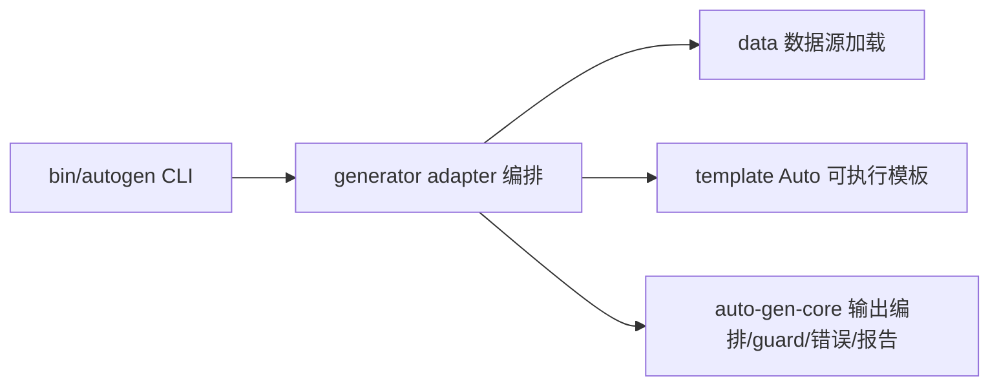

# auto-gen

> **Status**: active
> 路径：`crates/auto-gen`  | 技术栈：Rust（clap / miette / auto-lang / auto-gen-core）

AutoGen 代码生成器（bin 名 `autogen`）：从 Auto 格式数据源 + **Auto 可执行模板**生成 JSON/C/Rust 等代码。PLAN-791 起本 crate 是 Auto 数据/模板 **adapter + 兼容门面**：输出编排、保护区段、通用错误与生成报告委托给无解释器核心 [auto-gen-core](../auto-gen-core/project.md)（guard/error/报告/TemplateSpec 单一定义在此 re-export，旧公开路径不变）。

## 目标与范围

- 加载 Auto 格式数据源（DataLoader），经 AutoInterpreter 执行模板（TemplateEngine）渲染输出目标代码。
- guard（保护区段保留/覆盖/dry_run/失败反控/批次语义）与输出文件编排：**由 auto-gen-core 拥有**，本 crate 经 `TemplateRenderer` 边界交付 owned 渲染文本（`AutoTemplateRenderer` = TemplateEngine + 共享 LoadedData 解释器）。
- 提供配置文件驱动的批量生成（GenerationSpec / GeneratorConfig；fstr_note 等 Auto 侧配置留 adapter，duration 保持整调用语义）。
- 保留 deprecated legacy API（AutoGen/OneGen/Mold）：模板执行与 guard feed 走同一核心（`auto_gen_core::feed_guarded_legacy`），不再有第二份算法。
- 不做：生成编排/守护算法的本地副本；模板语法演进；auto-man 模板资产迁移（见"未迁项"）。

## 模块架构

## 模块清单

| 模块 | 职责 | 状态 |
|---|---|---|
| bin/autogen | CLI 入口：generate 等子命令、配置文件加载 | active |
| data | Auto 格式数据源加载（DataSource/LoadedData，持 Shared\<AutoInterpreter\>） | active |
| template | Auto 可执行模板加载与渲染（Template/TemplateEngine） | active |
| generator | adapter 编排：数据/库加载（顶层 Err 阶段）+ AutoTemplateRenderer 委托 core（CodeGenerator/GenerationSpec/GeneratorConfig/Builder） | active |
| legacy（lib.rs） | deprecated AutoGen/OneGen/Mold 兼容门面 | deprecated |
| test_framework | 测试辅助 | test-only |

guard/error/GenReport/TemplateSpec 已迁 [auto-gen-core](../auto-gen-core/project.md)（本 crate re-export 保持旧公开路径）。

## 冻结行为与已知缺陷（PLAN-791 T-01 旧臂）

- **模板不是文本替换**：经 AutoInterpreter `eval_template` 执行（f-string 行/`$ ` 代码行/循环/条件）。金样钉在 `crates/auto-gen/tests/fixtures/goldens/`。
- AutoFile/AutoCode 数据源与 lib_files 定义对模板**不可见**（解释器作用域错配；仅 `DataSource::Atom` 经 merge_atom 可渲染）——预存缺陷，修复=行为变更需显式决策。
- fstr_note 在共享解释器渲染路径无效（DataLoader 解释器恒默认 note）。
- 无 guard 输出丢尾换行（filter_use_statements join）；guard 合并输出保留尾换行；legacy feed 无尾换行。

## 未迁项（诚实登记，不伪报删边）

- auto-man：exporter（iar/ghs）、builder/ninja 经 legacy AutoGen/Mold 消费本 crate；assets/templates 为自有 AutoInterpreter 可执行模板（不经 auto-gen）。Man→语言栈依赖未消，auto-gen→auto-lang 边在 module-boundaries 基线 grandfather（exit R5）。
- `TemplateSpec.rename` 为兼容携带字段，编排不消费（历史行为）。
