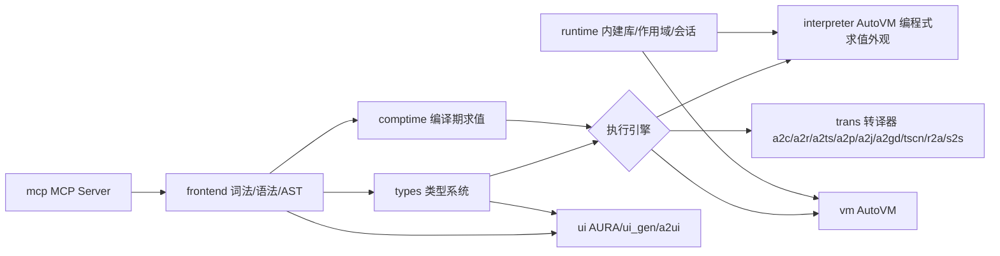

# auto-lang（语言核心）

> **Status**: active
> 路径：`crates/auto-lang`  | 技术栈：Rust 库（巨型，全 workspace 的依赖中心）

Auto 语言的核心实现：lexer/parser/AST、类型系统、解释器、AutoVM、多目标转译器、UI 引擎全部在此 crate。
所有应用层 crate（auto-cli、auto-lsp、auto-vm、auto-gen、auto-man、auto-playground）都依赖它。

## 目标与范围

- 负责：Auto 语言从源码到执行/转译的全部语义；AURA/UI 代码生成；内建标准库绑定。
- 不负责：构建/包管理（auto-man）、LSP 协议层（auto-lsp）、CLI 命令分发（auto-cli）、独立运行时标准库（a2r-std）。
- 重后端由 features 控制：`python`（PyO3 FFI）、`ui-iced`、`ui-interpreter` 等，default 为 `with-file-history` + `ui-iced`（2026-09-22 全档统一裁定）；`ui-gpui`（Zed GPUI 宿主后端）已随 PLAN-691 移除（全仓零启用者）。
- 路线图：见 [docs/roadmap.md](../../roadmap.md)。

## 模块架构

## 模块清单

| 模块 | 职责 | 状态 |
|---|---|---|
| [frontend](frontend/) | lexer/token/parser/AST/dialect/resolver/宏 | implemented（核心管线完整；符号属性/位操作/Auto Flow 未实现） |
| [types](types/) | 类型推断 infer/、typeck、ownership（borrow/lifetime/cfa）、trait_checker | implemented（核心可用；借检查、参数检查集成仍 partial） |
| [comptime](comptime/) | 编译期求值 | partial（语句级 `#if/#for/#is/#{}` 已实现；表达式级编译期替换/沙箱/限额未落地） |
| [interpreter](interpreter/) | AutoVM 编程式求值外观（旧 TreeWalker 已删，plan-091） | partial（`call()` 未实现、结果提取不完整） |
| [vm](vm/) | AutoVM：abt/codegen/engine/debugger/ffi/generic | implemented |
| [trans](trans/) | 转译后端：C/Rust/TypeScript/Python/JavaScript/GDScript/tscn/r2a/s2s | implemented |
| [runtime](runtime/) | runtime/scope/session、libs/ 内建标准库绑定、ffi、database、sse、route | partial（Plan 064 分层迁移未收尾，`Scope` 遗留） |
| [ui](ui/) | aura/、ui/（iced/headless 渲染 + code_editor/autodown 内建 + style 主题）、桌面运行时（session/wm/VirtualWindow）、ui_gen/（vue 主力/rust/ts/widget 契约/block）、a2ui/ | active（桌面线主战场；Plan 515：desktop_protocol DrawOp v1.5——Scissor 裁剪栈+TextStyled 字重/斜体差分（追加式 tag 3/4/5，TS 渲染器同步）、queue 臂投影保真（scroll 裁剪/typography 差分/layout_block 垂直高度修正）、native HICON 真图标链（win32 提取+native_icon 缓存）、e2e_exe 陈旧防护+queue-coverage 覆盖率 bin；Plan 656：scroll-pane 通用滚动架构——ui/scroll 语义层（State/Intent/Viewport 三通道）+axis/scrollbar/controller/on-scroll 双端 + managed bridge）；Plan 664：menubar 快照可见性与开合持久性契约（design/menubar-snapshot.md——TimeSource 泵事件不参与关菜单判据，041 矩阵六失败根修）+ use 导入 P-15/P-16 静默死面编译期告警化（[AUTO-USE-DIAG]） |
| [mcp](mcp/) | MCP server 集成 | implemented（7 工具；sandbox/会话 GC/诊断为半完成） |

> 模块层文档已完成 Phase 1 蒸馏与 PLAN-546 代码证据 rebaseline（2026-09-07，
> 报告 [docs/reports/module-spec-rebaseline-2026-09-04.md](../../reports/module-spec-rebaseline-2026-09-04.md)）；
> 状态列以各模块 overview 的 Status 行为准。

## PLAN-814：上层兼容包定位（M814-A @ master f6e07acee）

原巨型包拆分后，本 crate 降为**上层兼容/默认组合包**：纯语言栈单源在
`auto-lang-core`（[language-sdk](../language-sdk/project.md)）、UI 编译/
生成在 `auto-ui-compiler`（[auto-ui-compiler](../auto-ui-compiler/project.md)）、
UI 运行/renderer/宿主域在 `auto-ui-runtime`
（[auto-ui-runtime](../auto-ui-runtime/project.md)，M814-B T-04 迁移）。
旧 `auto_lang::*` 公开路径经再导出保类型身份；UI 特性族（ui-iced/ui/
autodown/ui-headless/code-editor 等）在此转发。

**r3 具名登记例外**（合同见 PLAN-814 §5.3）：本包经源码可见
`inventory::submit!` 登记轻量 UI 文法函数表/宿主安装器函数指针（启动
构造器机制，只登记不执行 UI 业务/I/O），覆盖不经装配入口的旧直达
调用；`install_ui_host_capabilities()`（run 族漏斗/旧公开入口包装/SDK
钩子回调汇点）首句显式 `set_ui_grammar` 装配优先。纯 SDK 的无 UI
闭包/缺席语义不受影响。

## PLAN-814 B 增量（T-08；M814-B 发布落库）

- →auto-ui-runtime 依赖边 **default-features=false**（T-08 捕获）：
  no-UI 消费者（default-features=false 形态）闭包禁拖 ui-iced；六
  provider fixture=缺席臂哨兵（43 测）。
- 测试期 UI 依赖清零（T-04 临时 dev-deps 兜住形态收口；残留 UI
  测试仅经再导出消费=V-02 兼容面）。
- `extract_autovm_result` 再导出恢复（T-02 丢失公开路径勘误）。

## PLAN-840 Phase 2：计时验收的调度前提

`diff_window_census` 与 `probe_adapter_turnaround_ipc_hard_gate_p95` 保持原有
输入、真实调用路径和所有断言：窗口体量/语义、窗口墙钟不劣于全量、30 样本
完整 edit-session P95 <1000ms，以及 prep/worker/admit 窗口边界与间隙限制。
这两项在 nextest 日常、full 与 t3 配置中通过 `threads-required =
"num-test-threads"` 独占当前运行池，随 `-j` 自动调整；其他测试仍照原选择面
执行。单个 max-threads=1 测试组不足以排除无关测试争用，不能作为替代。

此调度只约束同一 nextest 实例，不隔离其他会话的构建/测试。计时证据须记录
外部负载与精确代码/依赖/输入；受干扰失败保留，不通过放宽阈值、删除样本、
缩小输入或 ignore 测试变绿。feature-on/off 的编译与完整 ID 选择面分别核验，
配置解析或单项通过不能代替 merge 阶段的完整档验收。

阶段计量使用开始、worker 开始、admit 开始、准入完成四个共享时间标记；
相邻分段共享同一边界，调度停顿也归入某一阶段。完整 wall 与三段之和仅允许
微秒取整误差（至多 2us），不能由分别调用 elapsed()/now() 留下未测量间隙。
原真实路径、P95 与窗口 tiling 断言保持；资源隔离不替代计量正确性。

共享 methods-pack fixture 的 ffi_dual 测试沿用既定 max-threads=1 串行资源
约定；daily/full/t3 均须实际把整族绑定至 ffi-dual 组。显式 config-file
整体替换配置，仅声明空组不产生隔离；不改变包布局、features 反例、输入、
测试选择或值断言。该约定约束测试共享资源，不宣称修复生产ABI并发语义。

## PLAN-831 上层兼容与切源（SD-06，as-built）

五 UI 包生产 owner=独立 auto-ui 仓（组内兄弟相对 path + 受管锁）；本包作为上层兼容组合保留：公开路径经真实 UI owner 再导出，不进入纯 SDK 闭包。旧 auto-lang 巨包不再被 UI 仓反向依赖。
