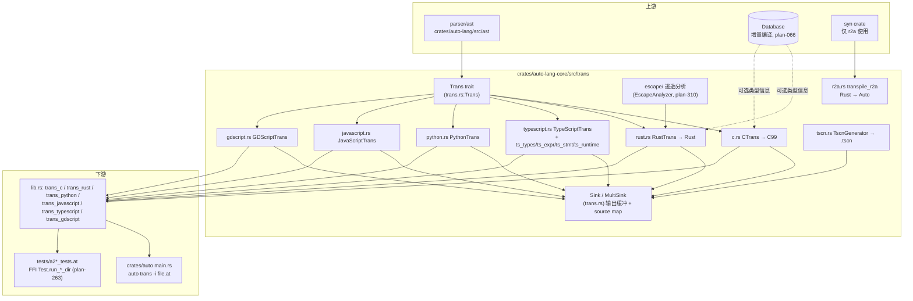

# trans 架构

## 结构图

要点：

- 所有正向后端实现同一 `Trans::trans(ast: Code, sink: &mut Sink)`，差异全部封装在各后端内部。
- `Sink` 同时承担字节缓冲与 source map 记录（`set_source_line` / `record` / `prepend_body`），
  `MultiSink` 支撑多文件项目级转译（plan-167/168 代码注释、plan-219）。
- 逃逸分析只服务 a2r：`transpile_rust` 在 CTEE 之后、`trans` 之前运行 `EscapeAnalyzer`，
  结果按"函数名 → EscapeMap"缓存进 `RustTrans.escape_results`，代码生成期查询。
- r2a 方向相反：不走 AST，直接用 `syn` 解析 Rust 源码字符串生成 Auto 源码（plan-173）。
- a2j 与 a2ts 并存是历史产物（plan-100 决定默认生成 TS，JS 后端保留未删）。

## ADR 日志

### ADR-01: 统一 Trans trait + Sink 输出抽象
- 日期 / 来源：docs/design/06-code-generation.md；代码 `crates/auto-lang-core/src/trans.rs:Trans`
- 决策：所有后端实现同一 `Trans` trait，输出统一写入 `Sink`（body/header/source 三段 + source map）。
- 备选：每后端自定义输出 API（pros：更自由；cons：source map、多文件、CLI 接线无法复用）。
- 后果：正面——新增后端只需实现一个 trait，测试与 CLI 一次接线；负面——`Sink` 的 C 风格
  header/body 分段对部分后端（TS/Python）是多余概念。
- 状态：active

### ADR-02: a2js → a2ts，默认生成 TypeScript
- 日期 / 来源：plan-100（Phase 2 完成于 2026-03-01）
- 决策：JS 方向默认生成 TypeScript（可再编译为 JS），ArkTS 视为 TS 变体；`javascript.rs` 保留。
- 备选：继续维护纯 JS 生成器（pros：实现简单；cons：无类型注解，无法支撑 ArkTS/生态需求）。
- 后果：正面——a2ts 成为 JS 方向主力；负面——a2j/a2ts 双后端并存，a2j 文档与实现逐渐脱节。
- 状态：active

### ADR-03: a2ts 按职责拆分为四个子模块
- 日期 / 来源：plan-152（2026-04）；代码 `typescript.rs` 头注释
- 决策：`typescript.rs` 保留 `TypeScriptTrans` 与块结构控制，类型映射、表达式、语句、stdlib runtime
  分别拆到 `ts_types.rs` / `ts_expr.rs` / `ts_stmt.rs` / `ts_runtime.rs`，用 `#[path]` 挂为子模块。
- 备选：单文件膨胀（pros：跳转直接；cons：与其他后端一样难维护，rust.rs 13842 行即是反例）。
- 后果：正面——a2ts 是转译器中唯一按职责拆分的后端；负面——`#[path]` 子模块是非常规写法。
- 状态：active

### ADR-04: 转译器接入 Database，Universe 并存过渡
- 日期 / 来源：plan-066（2025-02-01 完成）；代码 `rust.rs:RustTrans::with_database`、`c.rs:CTrans::with_database`
- 决策：a2c/a2r 增加 `db: Option<Arc<RwLock<Database>>>`，类型信息改从增量编译 Database 读取；
  旧 Universe 路径保留（`new()` 构造函数仍可用）。
- 备选：一次性删 Universe（pros：无双轨；cons：破坏所有存量调用点与测试）。
- 后果：正面——支撑增量转译 `trans_incremental`；负面——双轨并存至今，`new()` 与 `with_database()` 语义分叉。
- 状态：active（迁移未完成）

### ADR-05: 约定式转译测试发现
- 日期 / 来源：plan-263（old/263-transpiler-tests.md，DONE）
- 决策：废弃每用例一个 `#[test]` 的样板，改为 `tests/a2{r,c,ts}_tests.at` 声明 `#[test]` 函数，
  经 FFI `Test.run_*_dir(path)` 目录扫描 `.at` ↔ `.expected.*` 对。
- 备选：保留 Rust 侧逐用例注册（pros：cargo test 粒度细；cons：~420 个样板函数，加用例要改代码）。
- 后果：正面——加测试只需放文件；负面——失败定位依赖 runner 输出而非测试名。
- 状态：active

### ADR-06: 逃逸分析 own-by-default + 保守回退分层
- 日期 / 来源：plan-310（2026-06-16，Phase 0–4 全部交付）
- 决策：struct 字段/返回值默认 owned；借用仅作函数体内局部优化；分析不确定时按
  `&` → clone（Copy/小类型）→ `Rc<RefCell<T>>`（Send 边界升 `Arc<Mutex<T>>`）回退，每次回退发 warning（W0007）
  且绝不写入输出字节（避免破坏 .expected.rs 逐字节比对）。
- 备选：精确复刻 rustc NLL（pros：少回退；cons：无底洞）；不分析直接全 Rc（pros：简单；cons：性能与生成代码可读性差）。
- 后果：正面——生成的 Rust 必过借用检查（false negative 为 bug，false positive 仅损性能）；
  负面——`RustTrans` 增加 escape_results/current_fn_name/current_scope_depth 等状态，复杂度上升。
- 状态：active

### ADR-07: a2r 字符串三函数映射 + 生成后启发式清理
- 日期 / 来源：docs/design/06-code-generation.md §Rust Transpiler；plan-232、plan-241
- 决策：按语境分 `rust_type_name()`（存储：全 String）/ `rust_param_type_name()`（参数：全 &str）/
  `rust_return_type_name()`（返回：全 String）；`.to_string()` 在 13+ 注入点按需插入，
  再由 `RustTrans::post_process()` 的 20+ 正则 pass 清理冗余转换。
- 备选：在类型系统层彻底解决（pros：根除启发式；cons：改动面大，逐字节测试全部要重生成）。
- 后果：正面——存量测试基线不动即可持续修 bug；负面——已知误注入/误映射坑（见 overview 已知坑）。
- 状态：active

### ADR-08: r2a 逆翻译基于 syn 而非自建 Rust 解析器
- 日期 / 来源：plan-173（Phase 1 合并于 2025-04-15）
- 决策：r2a 用 `syn` crate 解析 Rust 源码，直接映射 syn AST → Auto 源码文本，不经过 Auto AST。
- 备选：自建 Rust parser（pros：无外部依赖；cons：工作量不可接受）。
- 后果：正面——四个 phase 快速交付（116 测试）；负面——r2a 与正向转译器无任何代码复用。
- 状态：active

### ADR-09: 旧 A2R 在 CTE 前执行共享静态准入
- 日期 / 来源：PLAN-916；`crates/auto-lang-core/src/trans/rust/semantics.rs`
- 决策：single/full-options 与 project/merged 在 CTE 和 Rust 发射前执行七族高置信检查，typed 错误直接返回；不只在 TestCase adapter 增加过滤。
- 备选：开启旧 `infer` 全部诊断（会误拒闭包/Option/generator）；交给 rustc 拒绝（不是 Auto 前端准入）。
- 后果：B16/B17/B18/B19/T06/R09/R10 与 E03 a2r 格关闭；既有合法 import/动态边界及所有合法 golden 保持。细则见 [rust-semantic-admission](rust-semantic-admission.md)。
- 状态：active

### ADR-10: 写捕获闭包发射契约——恰一次 move、无重叠 cell 赋值、确定性克隆序
- 日期 / 来源：PLAN-993（H-05，K06）；`crates/auto-lang-core/src/trans/rust/expr_emit.rs`
- 决策：①写捕获 Rc::clone 块已强制 move 语义，源级显式 `move` 不再叠加第二个关键字（四种 capture 组合恰一次/零次发射）；②写捕获绑定上 RHS 引用同 cell 的 `Op::Asn` 按 ADR-Plan-347 全局变量先例提升 `{ let __a2r_wc = rhs; *x.borrow_mut() = __a2r_wc; }`（直接形单语句 BorrowMutError）；③≥2 写捕获时克隆行按名字典序发射（HashSet 迭代序非确定性）。
- 备选：生成后字符串替换 `move move`（violates 字节级金样纪律）；每次调用独立 clone 值（破坏共享可变捕获语义，被独立性 oracle 抓红）。
- 后果：K06 认证关闭（cert-gap 21→20）；`test/a2r/25_lifecycle/005/006/007` 永久反例（42/42/67）；已正确形状（K01/K03 等）字节不变。已知边界：嵌套闭包写捕获不获 Rc 降级（KNOWN-DEBT D-993-1）；复合赋值（`+=` 等）自引用不提升（无已知语料）。
- 状态：active

### ADR-11: 有限 0 参泛型 `List<T>.new()` 构造定型——typed `Vec::new()` + 元素型单源解析流入绑定注解
- 日期 / 来源：PLAN-996（H-04，L01..L07 值域）；`trans/rust/ty.rs`（`generic_list_ctor_elem_ty` + `infer_type_from_expr` 0 参臂）、`trans/rust/call_emit/call_value_ctors.rs`（0 参 `Vec::new()` 发射）、`trans/rust/stmt_emit.rs`（声明注解孪生）
- 决策：①`List<T>.new()`（0 参、泛型参数在有限域）推断 `Type::List(elem)` 并发射自包含 `Vec::new()`（std-only，cert 轴不变）；元素型由单源 helper 从泛型参数名解析（int/str 族/标量+已知 struct；`GenName("List<int>")` 与 `Bina(List Lt T)` 两解析投影都识别；嵌套泛型/未知名→None 保持既有落穿），真实流入绑定注解（`Vec<i64>`/`Vec<Item>`/`Vec<String>`），未解析时保持跳注解——绝不注 serde_json 动态桶；②List 接收者方法面沿用既有 Auto 语义臂：get=索引+`.clone()` 拥有值读（433 A1）、set=`__list_set_idx__` 索引赋值**替换**（PLAN-019，非 insert 右移）、insert/remove/clear/push/len 原生 Vec 形；拥有权纯 Rust native（push=move、remove=移出 owner）。③1 参 `List<T>.new(expr)` 剥离（musk-022）与裸 `List.new()`（PLAN-010）识别面**不动**：GenName 泛型 1 参形的逐字发射是冻结金样载荷（`25_lifecycle/002`）。
- 备选：文本级 `lower_list_constructs` 推广到全程序管线（body-only 管线方案无法携带类型、绕过类型分析）；A8 式生成后正则补丁（无类型，L01 算术/L07 set 形已证不覆盖）；元素型注 JSON 桶（破坏名义 record 字段，违背源语义）。
- 后果：ace-m1 六集合值格认证关闭（cert 32→38、cert-gap 16→10，快照日常 35→41）；`a2r_tests.rs` plan996 10 例永久面（含裸/1 参域守恒与 994 字符 len 共存反控）；既有 415 a2r 例字节稳定。已知边界：嵌套泛型/枚举元素名/非有限域类型不在本轮（保持落穿）；L06 越界 trap 属 997 trap 域；`oracle/certs/*.json` 受根 `.gitignore` 吞没须显式入库（F-996-R1-01）。
- 状态：active

### ADR-12: 显式版本化源整数 profile `legacy-a2r.checked-i32/1`——运算时 i32 域检查与受控 typed trap 通道
- 日期 / 来源：PLAN-997（H-06，B13/B14/B15/B20 trap 域）；`trans/rust.rs`（`IntProfile` 精确 id 准入、`transpile_rust_full_with_profile`/`transpile_rust_with_source_dir_profile`、懒 helper 块追加）、`trans/rust/expr_emit.rs`（`expr_is_source_int` 结构化分类 + Add/catch-all/一元 neg/复合赋值四钩子）、`test_cases/a2r.rs`（case 选项 `int_profile`）
- 决策：①profile 显式选择才生效（`IntProfile::from_id` 精确匹配 `legacy-a2r.checked-i32/1`；contract 层与 adapter 双重准入；suite defaults 层不承认；project 模式选择即 contract error）；默认 `LegacyI64` 输出与全部已认证值金样逐字节相同（每钩子 `checked_i32_active()` 门控+全语料快照证明）。②源整数运算走私有 typed helper `__a2r_i32_{add,sub,mul,div,mod,neg}`：i64 载体不变、**运算时**检查结果 i32 域（div/rem 另分零除与 MIN/-1 两类、neg 检查 MIN），绝不以末尾 `as i32` 补救；helper 块仅在用到时追加（BTreeSet 固定序）。③分类为结构化有限域：`Expr::Int` 字面量、int 型局部/参数、一元 neg（含 `neg(I64(2^31))`=i32::MIN 字面量特例；负字面量 `-Int(k≠MIN)`/`-I64(2^31)` 保持默认 `-k` 字节）、int-only 算术复合；显式 i64/f64/char/str/调用/字段/cast/全局/cell 不入域（默认发射）。④trap 通道：stderr 单行 `auto.trap:<kind>:<op>` + 受控 `exit(70)`、stdout 干净——自定义 fn 调用不被 rustc 常量折叠（E0080 逃逸），`&&`/`||` 原生短路保留（`false && 10/0` 不陷阱），helper 调用实参保证每操作数恰一次源序求值。⑤int 局部复合赋值脱糖 `x = __a2r_i32_<op>(x, y)`（运算时检查）。
- 备选：内联 checked 表达式（字节膨胀/括号风险/`unwrap_or_else` 捕获非受控结束且常量除零仍被 lint 拒）；i64 原生 `checked_add`（检的是 i64 域——i32 操作数在 i64 永不溢出，语义错）；末尾 cast 补救（违反运算时检查义务）。
- 后果：ace-m1 H-06 四 trap 格独立认证关闭（cert-gap 10→6，快照日常 41→45，trap 证书 4 张 `ace.m1.a2r-trap/1` 独立域）；`a2r_tests.rs` plan997 9 例永久面；默认金样字节零变化。已知边界：调用/字段/cast/全局承载的整数运算不入域（保持默认）；trap 观察通道属认证域（用户源可打印相似 stdout 文本不能伪造——事件在 stderr+exit 码）。
- 状态：active
