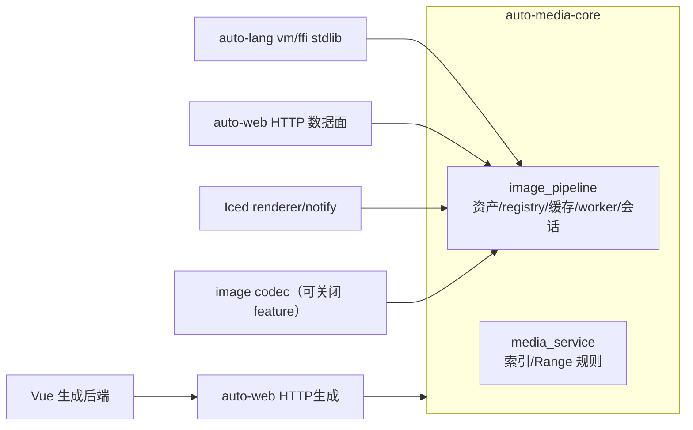

# auto-media-core

> **Status**: active
> 路径：`crates/auto-media-core`  | 技术栈：Rust（image codec 可关闭 + blake3 + std 并发原语）
>
> PLAN-811 交付：renderer-neutral 媒体机制单源——`image_pipeline`（图像资产
> 类型/registry/缓存/调度 worker/图像会话）与 `media_service`（本地媒体索引/
> Range 值规则）自 `auto-lang/src/ui/` 整体迁出；VM 17 项 image native、HTTP
> 数据面、Vue 生成后端、Rust merged 与真实 Iced 渲染共享同一数据与机制。
> 本 spec 为该冻结增量的 canonical 沉淀。

## 模块与依赖

| 模块 | 职责 |
|---|---|
| `src/image_pipeline.rs` | AssetId/Key/Ticket/State/Lookup/Error、metadata/orientation/rendition、registry、TTL/引用/过期/代次唤醒、encoded/decoded 缓存与预算、priority/latest-wins、2 decode + 1 resize worker 池、图像会话（默认共享服务 + owned `MediaRuntime`） |
| `src/media_service.rs` | 本地媒体索引（深度/扩展名/自然排序/根路径优先级/不跟随 symlink/junction）、token/路径隐藏、HTTP Range 值规则与 StreamPlan |

依赖闭包仅基础包（codec/hash 等），**不依赖 auto-lang/VM/UI/Man/iced**
（module-boundaries 域独立）。`image` codec 为默认可关闭特性：关闭后纯媒体
文件服务（索引/Range）仍可独立使用。HTTP socket/server、语言编解码与
纹理/事件执行留各消费方 adapter。原 `auto_lang::ui::{image_pipeline,
media_service}` 为薄重导出（同一类型身份、同一默认服务），不保留第二份
`LazyLock` registry/worker/session。

外部消费门：`test/fixtures/modularity/media-core-consumer/` 独立 manifest
fresh/locked 构建运行 + 缺包/非法反向边负控（777 strict 域）。

## 生命周期与所有权合同

- **进程默认服务共享**；owned `MediaRuntime`（可控寿命/测试）关闭即准入关闭：
  收回 scan/open 生产者、join decode/resize 线程、registry/session 归终态；
  **重复关闭等待同一完成结果**（返回即完整终态）。不承诺抢断不可取消的
  codec 指令——只保证不再接新任务、旧工作受控收敛、关闭后不再发布可见结果。
- 关闭完成性以**线程 join + registry 终态 + 引用释放 + 占用归零**联合验证
  （`resize_backlog` 等占用仪表在 shutdown 完成后恒读真终态 0，不因 Stop
  标记/阻塞发送者虚计）。
- 调度：入口 `MediaPriorityQueue`（容量 8，同优先级满队拒绝）→ 2 decode
  worker → `sync_channel(8)` → 1 resize/publish lane。关闭顺序 = 先 join
  decode 发送方再 Stop resize lane，堵死 Stop 后接受窗口。
- 缓存/预算：encoded 64MiB / decoded 256MiB，hard-pin 当前图允许临时越
  budget、软 pin 先淘汰；1GiB 编码文件 / 400MP 像素上限为现行拒绝边界
  （不冒称 RSS 强上限或任意大图支持）。会话/引用/TTL/淘汰（256 handle/
  512 registry/32 session×256 entry）与旧行为一致；双 close、过期 revision
  不释放他人 live 资源。
- 会话返回 URI/元数据，不输出像素或绝对路径；未经支持的任意 URI/路径不因
  抽包获得访问能力。

## 剩余 owner（非本 crate）

i18n、a2r 直接 frame、播放器/mpv、纹理 renderer 及其他 runtime 残边归
UI/宿主侧（见 [auto-lang/ui overview](../auto-lang/ui/overview.md)）与
R04 运行桥计划；本 crate 不承接。

## 验证锚

`cargo test -p auto-media-core`（44 测试：生命周期/满通道 oracle/预算/
Range/索引/不跟随 reparse）+ `cargo test -p auto-lang --lib plan811`
（VM 17 native 接线）+ `cargo test -p auto-man --test
plan811_media_consumers`（Man 真实消费）+ 777 strict / 792 driver
（发行闭包）。

## PLAN-890 photo 单源

`src/photo_service.rs`接管原UI的中立照片扫描/索引机制及十项原测试，旧UI路径仅重导出。
Web运行时和HTTP生成消费该单源；renderer/纹理留UI。原资源、ID/断言/条件不重置。
来源：[四仓合同](../repository-boundaries/web-four-repository-delivery.md)（plan-890）。
