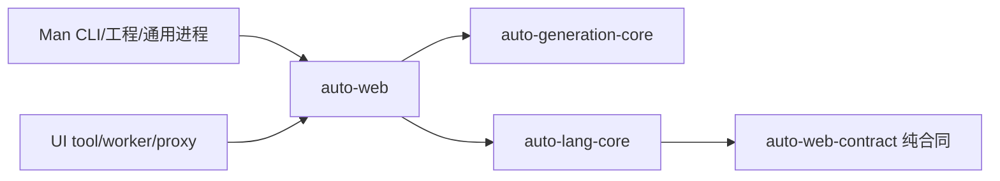

# auto-web — 独立 Web 服务框架指针

> **Status**: active（PLAN-890；语言仓仅保存指针）
> 物理仓：兄弟 `auto-web`，版本0.1.0；本地 Git 独立交付，无远端发布声明。

Web 运行时、HTTP 服务/客户端生成器、资源、测试和发行的唯一领域规范在
[Web项目](../../../../auto-web/docs/specs/project.md)、[架构](../../../../auto-web/docs/specs/architecture.md)、
[HTTP合同](../../../../auto-web/docs/specs/http-contracts.md)、[测试](../../../../auto-web/docs/specs/testing.md)、
[发行](../../../../auto-web/docs/specs/delivery.md)。本文不维护第二份 Web 合同。

Core 只拥有语言语义、编译元数据、VM/值转换和[中立宿主端口](../language-sdk/http-host-port.md)，
不反依赖 Web 实现。Web 独立 normal/build/必需 dev 闭包无 UI/Man/Tauri 实现。
直接 SDK 服务消费者显式链接并安装 Web adapter；普通语言执行无需 Web。
四仓来源、原测试ID/条件和实际执行守恒见[组合交付](../repository-boundaries/web-four-repository-delivery.md)。

来源：[PLAN-890](../../plans/archive/890-auto-web-independent-repository-delivery.md)；
独立复审与最终执行结果分别保留，复审pass不能替代最终交付门。
